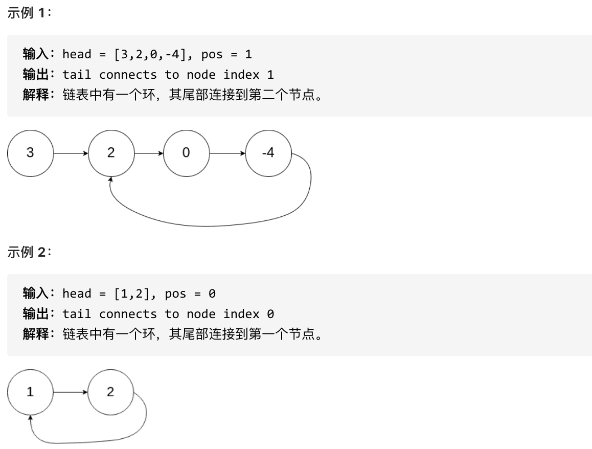
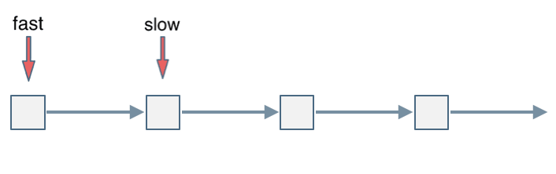
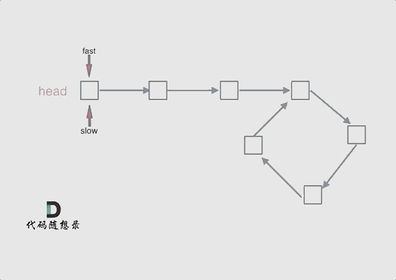
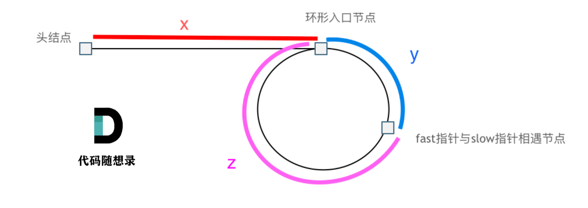
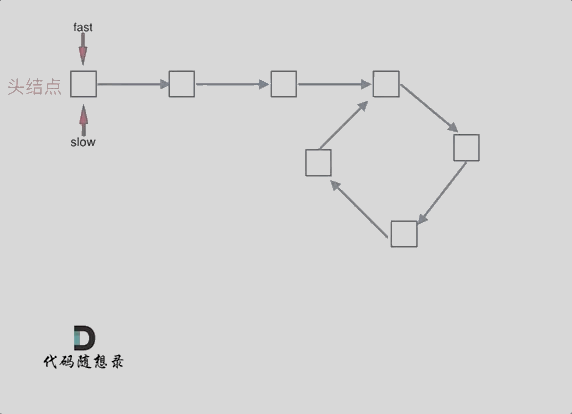
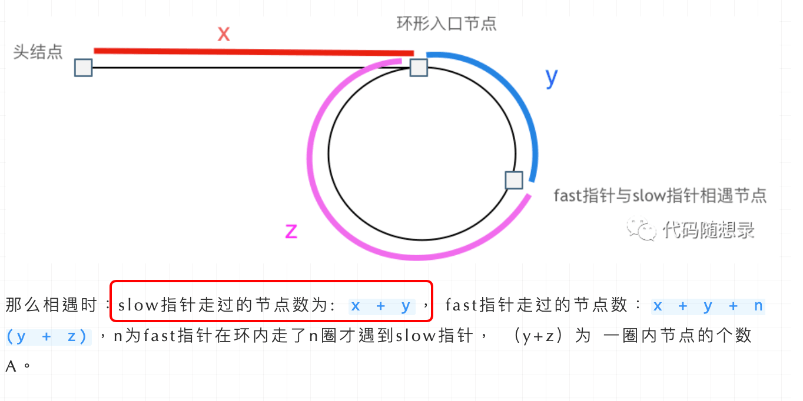
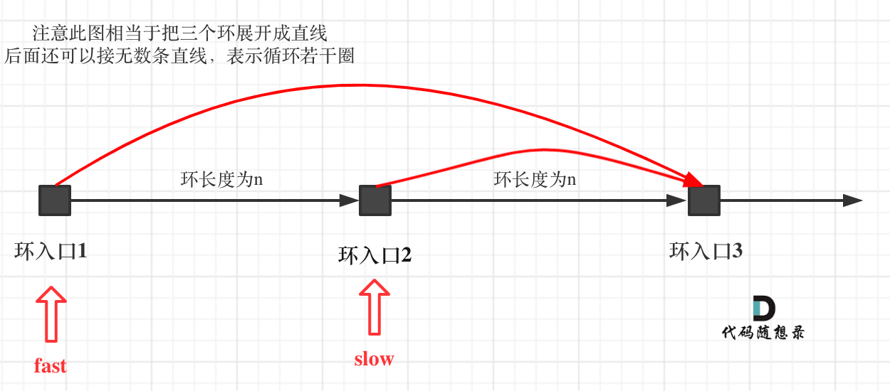
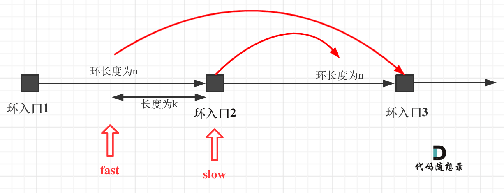

* [做專案（多個 C++、Java、Go、測試開發、前端（front end）專案）](https://www.programmercarl.com/other/kstar.html)
* [刷演算法（兩個月高強度學演算法）](https://www.programmercarl.com/xunlian/xunlianying.html)
* [背八股文（40 天挑戰高頻面試題）](https://www.programmercarl.com/xunlian/bagu.html)


> 找到有沒有環已經很不容易了，還要讓我找到環的入口？


# 142. 循環鏈接串列（circular linked list） II

[LeetCode 題目連結](https://leetcode.cn/problems/linked-list-cycle-ii/)

題意：
給定一個鏈接串列（linked list），回傳鏈接串列開始入環的第一個節點（node）。如果鏈接串列無環，則回傳 null。

為了表示給定鏈接串列中的環，使用整數（integer） pos 來表示鏈接串列尾連接到鏈接串列中的位置（索引（index）從 0 開始）。如果 pos 是 -1，則在該鏈接串列中沒有環。

**說明**：不允許修改給定的鏈接串列。



## 演算法公開課

**[《程式碼隨想錄》演算法影片公開課](https://programmercarl.com/other/gongkaike.html)：[把循環鏈接串列講清楚！| LeetCode:142.循環鏈接串列 II](https://www.bilibili.com/video/BV1if4y1d7ob)，相信結合影片再看本篇題解，更有助於大家對鏈接串列的理解。**

## 解題思路


這道題目不僅考察對鏈接串列的操作，而且還需要一些數學運算。

主要考察兩個知識點：

* 判斷鏈接串列是否有環
* 如果有環，如何找到這個環的入口

### 判斷鏈接串列是否有環

可以使用快慢指標（fast and slow pointers）法，分別定義 fast 和 slow 指標（pointer），從頭節點（head node）出發，fast 指標每次移動兩個節點，slow 指標每次移動一個節點，如果 fast 和 slow 指標在途中相遇，說明這個鏈接串列有環。

為什麼 fast 走兩個節點，slow 走一個節點，有環的話，一定會在環內相遇呢，而不是永遠錯開呢

首先第一點：**fast 指標一定先進入環中，如果 fast 指標和 slow 指標相遇的話，一定是在環中相遇，這是毋庸置疑的。**

那麼來看一下，**為什麼 fast 指標和 slow 指標一定會相遇呢？**

可以畫一個環，然後讓 fast 指標在任意一個節點開始追趕 slow 指標。

會發現最終都是這種情況，如下圖：




fast 和 slow 各自再走一步，fast 和 slow 就相遇了

這是因為 fast 是走兩步，slow 是走一步，**其實相對於 slow 來說，fast 是一個節點一個節點地靠近 slow 的**，所以 fast 一定可以和 slow 重合。

動畫如下：




### 如果有環，如何找到這個環的入口

**此時已經可以判斷鏈接串列是否有環了，那麼接下來要找這個環的入口了。**

假設從頭節點到循環入口節點的節點數為 x。
循環入口節點到 fast 指標與 slow 指標相遇節點節點數為 y。
從相遇節點再到循環入口節點節點數為 z。如圖所示：



那麼相遇時：
slow 指標走過的節點數為：`x + y`，
fast 指標走過的節點數：`x + y + n (y + z)`，n 為 fast 指標在環內走了 n 圈才遇到 slow 指標，（y+z）為一圈內節點的個數 A。

因為 fast 指標是一步走兩個節點，slow 指標一步走一個節點，所以 fast 指標走過的節點數 = slow 指標走過的節點數 * 2：

`(x + y) * 2 = x + y + n (y + z)`

兩邊消掉一個（x+y）：`x + y = n (y + z)`

因為要找循環的入口，那麼要求的是 x，因為 x 表示頭節點到循環入口節點的距離。

所以要求 x，將 x 單獨放在左邊：`x = n (y + z) - y`，

再從 n(y+z) 中提出一個（y+z）來，整理公式之後為如下公式：`x = (n - 1) (y + z) + z` 注意這裡 n 一定是大於等於 1 的，因為 fast 指標至少要多走一圈才能相遇 slow 指標。

這個公式說明什麼呢？

先拿 n 為 1 的情況來舉例，意味著 fast 指標在環裡轉了一圈之後，就遇到了 slow 指標了。

當 n 為 1 的時候，公式就化簡為 `x = z`，

這就意味著，**從頭節點出發一個指標，從相遇節點也出發一個指標，這兩個指標每次只走一個節點，那麼當這兩個指標相遇的時候就是循環入口的節點**。


也就是在相遇節點處，定義一個指標 index1，在頭節點處定義一個指標 index2。

讓 index1 和 index2 同時移動，每次移動一個節點，那麼他們相遇的地方就是循環入口的節點。

動畫如下：




那麼 n 如果大於 1 是什麼情況呢，就是 fast 指標在環裡轉 n 圈之後才遇到 slow 指標。

其實這種情況和 n 為 1 的時候效果是一樣的，一樣可以透過這個方法找到循環的入口節點，只不過 index1 指標在環裡多轉了 (n-1) 圈，然後再遇到 index2，相遇點依然是循環的入口節點。

程式碼如下：

```CPP
/**
 * Definition for singly-linked list.
 * struct ListNode {
 *     int val;
 *     ListNode *next;
 *     ListNode(int x) : val(x), next(NULL) {}
 * };
 */
class Solution {
public:
    ListNode *detectCycle(ListNode *head) {
        ListNode* fast = head;
        ListNode* slow = head;
        while(fast != NULL && fast->next != NULL) {
            slow = slow->next;
            fast = fast->next->next;
            // fast and slow pointers 相遇，此時從 head 和相遇點，同時尋找直至相遇
            if (slow == fast) {
                ListNode* index1 = fast;
                ListNode* index2 = head;
                while (index1 != index2) {
                    index1 = index1->next;
                    index2 = index2->next;
                }
                return index2; // 回傳環的入口
            }
        }
        return NULL;
    }
};
```

* 時間複雜度（time complexity）: O(n)，快慢指標相遇前，指標走的次數小於鏈接串列長度，快慢指標相遇後，兩個 index 指標走的次數也小於鏈接串列長度，總體為走的次數小於 2n
* 空間複雜度（space complexity）: O(1)

### 補充

在推理過程中，大家可能有一個疑問就是：**為什麼第一次在環中相遇，slow 的步數是 x+y 而不是 x + 若干環的長度 + y 呢？**

即文章 [鏈接串列：環找到了，那入口呢？](https://programmercarl.com/0142.环形链表II.html) 中如下的地方：




首先 slow 進環的時候，fast 一定是先進環來了。

如果 slow 進環入口，fast 也在環入口，那麼把這個環展開成直線，就是如下圖的樣子：



可以看出如果 slow 和 fast 同時在環入口開始走，一定會在環入口 3 相遇，slow 走了一圈，fast 走了兩圈。

重點來了，slow 進環的時候，fast 一定是在環的任意一個位置，如圖：



那麼 fast 指標走到環入口 3 的時候，已經走了 k + n 個節點，slow 相應地應該走了 (k + n) / 2 個節點。

因為 k 是小於 n 的（圖中可以看出），所以 (k + n) / 2 一定小於 n。

**也就是說 slow 一定沒有走到環入口 3，而 fast 已經到環入口 3 了**。

這說明什麼呢？

**在 slow 開始走的那一環已經和 fast 相遇了**。

那有同學又說了，為什麼 fast 不能跳過去呢？在剛剛已經說過一次了，**fast 相對於 slow 是一次移動一個節點，所以不可能跳過去**。

好了，這次把為什麼第一次在環中相遇，slow 的步數是 x+y 而不是 x + 若干環的長度 + y，用數學推理了一下，算是對 [鏈接串列：環找到了，那入口呢？](https://programmercarl.com/0142.环形链表II.html) 的補充。

## 總結

這次可以說把循環鏈接串列這道題目的各個細節，完完整整地證明了一遍，說這是全網最詳細講解不為過吧。


## 其他語言版本

### Java：

```java
public class Solution {
    public ListNode detectCycle(ListNode head) {
        ListNode slow = head;
        ListNode fast = head;
        while (fast != null && fast.next != null) {
            slow = slow.next;
            fast = fast.next.next;
            if (slow == fast) {// 有環
                ListNode index1 = fast;
                ListNode index2 = head;
                // 兩個指標，從頭節點和相遇節點，各走一步，直到相遇，相遇點即為環入口
                while (index1 != index2) {
                    index1 = index1.next;
                    index2 = index2.next;
                }
                return index1;
            }
        }
        return null;
    }
}
```

### Python：

```python
（版本一）fast and slow pointers 法
# Definition for singly-linked list.
# class ListNode:
#     def __init__(self, x):
#         self.val = x
#         self.next = None


class Solution:
    def detectCycle(self, head: ListNode) -> ListNode:
        slow = head
        fast = head
        
        while fast and fast.next:
            slow = slow.next
            fast = fast.next.next
            
            # If there is a cycle, the slow and fast pointers will eventually meet
            if slow == fast:
                # Move one of the pointers back to the start of the list
                slow = head
                while slow != fast:
                    slow = slow.next
                    fast = fast.next
                return slow
        # If there is no cycle, return None
        return None
```
```python
（版本二）集合法
# Definition for singly-linked list.
# class ListNode:
#     def __init__(self, x):
#         self.val = x
#         self.next = None


class Solution:
    def detectCycle(self, head: ListNode) -> ListNode:
        visited = set()
        
        while head:
            if head in visited:
                return head
            visited.add(head)
            head = head.next
        
        return None
```
### Go：

```go
func detectCycle(head *ListNode) *ListNode {
    slow, fast := head, head
    for fast != nil && fast.Next != nil {
        slow = slow.Next
        fast = fast.Next.Next
        if slow == fast {
            for slow != head {
                slow = slow.Next
                head = head.Next
            }
            return head
        }
    }
    return nil
}
```

### JavaScript

```js
// 兩種迴圈實作方式
/**
 * @param {ListNode} head
 * @return {ListNode}
 */
// 先判斷是否是循環鏈接串列
var detectCycle = function(head) {
    if(!head || !head.next) return null;
    let slow =head.next, fast = head.next.next;
    while(fast && fast.next && fast!== slow) {
        slow = slow.next;
        fast = fast.next.next;
    }
    if(!fast || !fast.next ) return null;
    slow = head;
    while (fast !== slow) {
        slow = slow.next;
        fast = fast.next;
    }
    return slow;
};

var detectCycle = function(head) {
    if(!head || !head.next) return null;
    let slow =head.next, fast = head.next.next;
    while(fast && fast.next) {
        slow = slow.next;
        fast = fast.next.next;
        if(fast == slow) {
            slow = head;
            while (fast !== slow) {
                slow = slow.next;
                fast = fast.next;
            }
            return slow;
        }
    }
    return null;
};
```

### TypeScript：

```typescript
function detectCycle(head: ListNode | null): ListNode | null {
    let slowNode: ListNode | null = head,
        fastNode: ListNode | null = head;
    while (fastNode !== null && fastNode.next !== null) {
        slowNode = slowNode!.next;
        fastNode = fastNode.next.next;
        if (slowNode === fastNode) {
            slowNode = head;
            while (slowNode !== fastNode) {
                slowNode = slowNode!.next;
                fastNode = fastNode!.next;
            }
            return slowNode;
        }
    }
    return null;
};
```

### Swift:

```swift
class Solution {
    func detectCycle(_ head: ListNode?) -> ListNode? {
        var slow: ListNode? = head
        var fast: ListNode? = head
        while fast != nil && fast?.next != nil {
            slow = slow?.next
            fast = fast?.next?.next
            if slow == fast {
                // 環內相遇
                var list1: ListNode? = slow
                var list2: ListNode? = head
                while list1 != list2 {
                    list1 = list1?.next
                    list2 = list2?.next
                }
                return list2
            }
        }
        return nil
    }
}
extension ListNode: Equatable {
    public func hash(into hasher: inout Hasher) {
        hasher.combine(val)
        hasher.combine(ObjectIdentifier(self))
    }
    public static func == (lhs: ListNode, rhs: ListNode) -> Bool {
        return lhs === rhs
    }
}
```

### C：

```c
ListNode *detectCycle(ListNode *head) {
    ListNode *fast = head, *slow = head;
    while (fast && fast->next) {
        // 這裡判斷兩個指標是否相等，所以移位操作放在前面
        slow = slow->next;
        fast = fast->next->next;
        if (slow == fast) { // 相交，開始找循環入口：分別從頭部和從交點出發，找到相遇的點就是循環入口
            ListNode *f = fast, *h = head;
            while (f != h) f = f->next, h = h->next;
            return h;
        }
    }
    return NULL;
}
```

### Scala:

```scala
object Solution {
  def detectCycle(head: ListNode): ListNode = {
    var fast = head // 快指標
    var slow = head // 慢指標
    while (fast != null && fast.next != null) {
      fast = fast.next.next // 快指標一次走兩步
      slow = slow.next // 慢指標一次走一步
      // 如果相遇，fast 快指標回到頭
      if (fast == slow) {
        fast = head
        // 兩個指標一步一步地走，第一次相遇的節點必是入環節點
        while (fast != slow) {
          fast = fast.next
          slow = slow.next
        }
        return fast
      }
    }
    // 如果 fast 指向空值，必然無環回傳 null
    null
  }
}
```

### C#:
```CSharp
public class Solution
{
    public ListNode DetectCycle(ListNode head)
    {
        ListNode fast = head;
        ListNode slow = head;
        while (fast != null && fast.next != null)
        {
            slow = slow.next;
            fast = fast.next.next;
            if (fast == slow)
            {
                fast = head;
                while (fast != slow)
                {
                    fast = fast.next;
                    slow = slow.next;
                }
                return fast;
            }
        }
        return null;
    }
}
```

