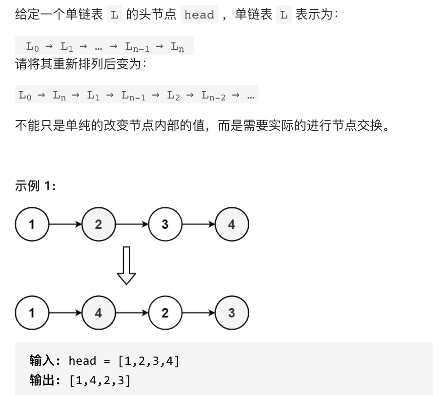
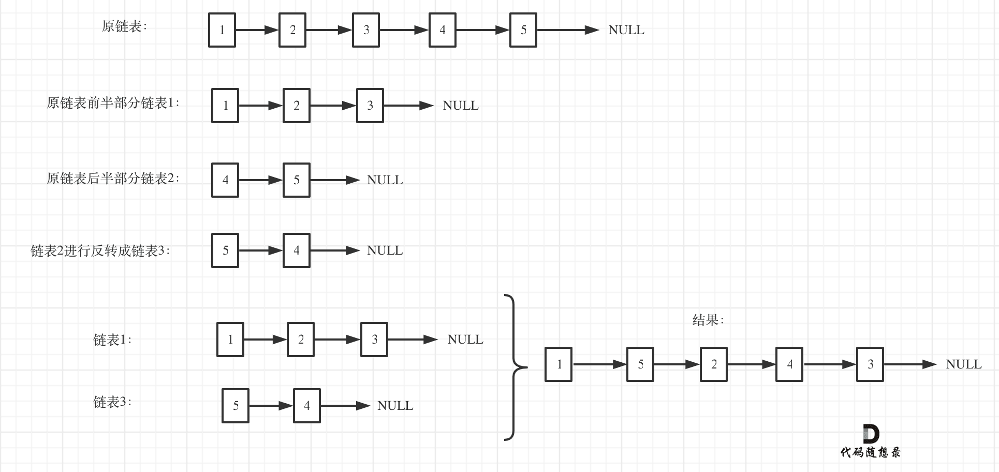

* [做專案（多個 C++、Java、Go、測試開發、前端（front end）專案）](https://www.programmercarl.com/other/kstar.html)
* [刷演算法（兩個月高強度學演算法）](https://www.programmercarl.com/xunlian/xunlianying.html)
* [背八股文（40 天挑戰高頻面試題）](https://www.programmercarl.com/xunlian/bagu.html)

# 143. 重排鏈接串列（linked list）

[LeetCode 題目連結](https://leetcode.cn/problems/reorder-list/submissions/)



## 解題思路

本篇將給出三種 C++ 實作的方法

* 陣列（array）模擬（simulation）
* 雙端佇列（double-ended queue, deque）模擬
* 直接分割鏈接串列

### 方法一

把鏈接串列放進陣列中，然後透過 雙指標（two pointers） 法，一前一後，來遍歷（traversal）陣列，構造鏈接串列。

程式碼如下：

```CPP
class Solution {
public:
    void reorderList(ListNode* head) {
        vector<ListNode*> vec;
        ListNode* cur = head;
        if (cur == nullptr) return;
        while(cur != nullptr) {
            vec.push_back(cur);
            cur = cur->next;
        }
        cur = head;
        int i = 1;
        int j = vec.size() - 1;  // i j 為前後的 two pointers
        int count = 0; // 計數，偶數取後面，奇數取前面
        while (i <= j) {
            if (count % 2 == 0) {
                cur->next = vec[j];
                j--;
            } else {
                cur->next = vec[i];
                i++;
            }
            cur = cur->next;
            count++;
        }
        cur->next = nullptr; // 注意結尾
    }
};
```

### 方法二

把鏈接串列放進雙端佇列，然後透過雙端佇列一前一後彈出資料，來構造新的鏈接串列。這種方法比操作陣列容易一些，不用 雙指標 模擬一前一後了

```CPP
class Solution {
public:
    void reorderList(ListNode* head) {
        deque<ListNode*> que;
        ListNode* cur = head;
        if (cur == nullptr) return;

        while(cur->next != nullptr) {
            que.push_back(cur->next);
            cur = cur->next;
        }

        cur = head;
        int count = 0; // 計數，偶數取後面，奇數取前面
        ListNode* node;
        while(que.size()) {
            if (count % 2 == 0) {
                node = que.back();
                que.pop_back();
            } else {
                node = que.front();
                que.pop_front();
            }
            count++;
            cur->next = node;
            cur = cur->next;
        }
        cur->next = nullptr; // 注意結尾
    }
};
```

### 方法三

將鏈接串列分割成兩個鏈接串列，然後把第二個鏈接串列反轉（reverse），之後再透過兩個鏈接串列拼接成新的鏈接串列。

如圖：

 </img></div>

這種方法比較難，平均切割鏈接串列，看上去很簡單，真正寫程式碼的時候有很多細節，同時兩個鏈接串列最後拼裝成一個新的鏈接串列也有一些細節需要注意！

程式碼如下：

```CPP
class Solution {
private:
    // 反轉鏈接串列
    ListNode* reverseList(ListNode* head) {
        ListNode* temp; // 保存 cur 的下一個節點
        ListNode* cur = head;
        ListNode* pre = NULL;
        while(cur) {
            temp = cur->next;  // 保存一下 cur 的下一個節點，因為接下來要改變 cur->next
            cur->next = pre; // 翻轉操作
            // 更新 pre 和 cur 指標
            pre = cur;
            cur = temp;
        }
        return pre;
    }

public:
    void reorderList(ListNode* head) {
        if (head == nullptr) return;
        // 使用 fast and slow pointers 法，將鏈接串列分成長度均等的兩個鏈接串列 head1 和 head2
        // 如果總鏈接串列長度為奇數，則 head1 相對 head2 多一個節點
        ListNode* fast = head;
        ListNode* slow = head;
        while (fast && fast->next && fast->next->next) {
            fast = fast->next->next;
            slow = slow->next;
        }
        ListNode* head1 = head;
        ListNode* head2;
        head2 = slow->next;
        slow->next = nullptr;

        // 對 head2 進行翻轉
        head2 = reverseList(head2);

        // 將 head1 和 head2 交替生成新的鏈接串列 head
        ListNode* cur1 = head1;
        ListNode* cur2 = head2;
        ListNode* cur = head;
        cur1 = cur1->next;
        int count = 0; // 偶數取 head2 的元素，奇數取 head1 的元素
        while (cur1 && cur2) {
            if (count % 2 == 0) {
                cur->next = cur2;
                cur2 = cur2->next;
            } else {
                cur->next = cur1;
                cur1 = cur1->next;
            }
            count++;
            cur = cur->next;
        }
        if (cur2 != nullptr) { // 處理結尾
            cur->next = cur2;
        }
        if (cur1 != nullptr) {
            cur->next = cur1;
        }
    }
};
```

## 其他語言版本

### Java 

```java

// 方法一 Java 實作，使用陣列儲存節點
 class Solution {
    public void reorderList(ListNode head) {
        // two pointers 的做法
        ListNode cur = head;
        // ArrayList 底層是陣列，可以使用索引隨機存取
        List<ListNode> list = new ArrayList<>();  
        while (cur != null){
            list.add(cur);
            cur = cur.next;
        }
        cur = head;  // 重新回到頭部
        int l = 1, r = list.size() - 1;  // 注意左邊是從 1 開始
        int count = 0;
        while (l <= r){
            if (count % 2 == 0){
                // 偶數
                cur.next = list.get(r);
                r--;
            }else {
                // 奇數
                cur.next = list.get(l);
                l++;
            }
            // 每一次指標都需要移動
            cur = cur.next;
            count++;
        }
        // 注意結尾要結束一下
        cur.next = null;
    }
}
// 方法二：使用雙端佇列，簡化了陣列的操作，程式碼相對於前者更簡潔（避免一些邊界條件）
class Solution {
    public void reorderList(ListNode head) {
        // 使用雙端佇列的方法來解決
        Deque<ListNode> de = new LinkedList<>();
        // 這裡是取 head 的下一個節點，head 不需要再入佇列了，避免造成重複
        ListNode cur = head.next;  
        while (cur != null){
            de.offer(cur);
            cur = cur.next;
        }
        cur = head;  // 回到頭部

        int count = 0;
        while (!de.isEmpty()){
            if (count % 2 == 0){
                // 偶數，取出佇列右邊尾部的值
                cur.next = de.pollLast();
            }else {
                // 奇數，取出佇列左邊頭部的值
                cur.next = de.poll();
            }
            cur  = cur.next;
            count++;
        }
        cur.next = null;
    }
}

// 方法三
public class ReorderList {
    public void reorderList(ListNode head) {
        ListNode fast = head, slow = head;
        // 求出中點
        while (fast.next != null && fast.next.next != null) {
            slow = slow.next;
            fast = fast.next.next;
        }
        // right 就是右半部分 12345 就是 45  1234 就是 34
        ListNode right = slow.next;
        // 斷開左部分和右部分
        slow.next = null;
        // 反轉右部分 right 就是反轉後右部分的起點
        right = reverseList(right);
        // 左部分的起點
        ListNode left = head;
        // 進行左右部分來回連接 
        // 這裡左部分的節點個數一定大於等於右部分的節點個數 因此只判斷 right 即可
        while (right != null) {
            ListNode curLeft = left.next;
            left.next = right;
            left = curLeft;

            ListNode curRight = right.next;
            right.next = left;
            right = curRight;
        }
    }

    public ListNode reverseList(ListNode head) {
        ListNode headNode = new ListNode(0);
        ListNode cur = head;
        ListNode next = null;
        while (cur != null) {
            next = cur.next;
            cur.next = headNode.next;
            headNode.next = cur;
            cur = next;
        }
        return headNode.next;
    }
}

```

### Python 
```python 
# 方法二 雙端佇列
class Solution:
    def reorderList(self, head: ListNode) -> None:
        """
        Do not return anything, modify head in-place instead.
        """
        d = collections.deque()
        tmp = head
        while tmp.next: # 鏈接串列除了首元素全部加入雙端佇列
            d.append(tmp.next)
            tmp = tmp.next
        tmp = head
        while len(d): # 一後一前加入鏈接串列
            tmp.next = d.pop()
            tmp = tmp.next
            if len(d):
                tmp.next = d.popleft()
                tmp = tmp.next
        tmp.next = None # 尾部置空
 
# 方法三 反轉鏈接串列
class Solution:
    def reorderList(self, head: ListNode) -> None:
        if head == None or head.next == None:
            return True
        slow, fast = head, head
        while fast and fast.next:
            slow = slow.next
            fast = fast.next.next
        right = slow.next # 分割右半邊
        slow.next = None # 切斷
        right = self.reverseList(right) # 反轉右半邊
        left = head
        # 左半邊一定比右半邊長, 因此判斷右半邊即可
        while right:
            curLeft = left.next
            left.next = right
            left = curLeft

            curRight = right.next
            right.next = left
            right = curRight


    def reverseList(self, head: ListNode) -> ListNode:
        cur = head   
        pre = None
        while(cur!=None):
            temp = cur.next # 保存一下 cur 的下一個節點
            cur.next = pre # 反轉
            pre = cur
            cur = temp
        return pre
```
### Go 

```go
// 方法一 陣列模擬
/**
 * Definition for singly-linked list.
 * type ListNode struct {
 *     Val int
 *     Next *ListNode
 * }
 */
func reorderList(head *ListNode)  {
    vec := make([]*ListNode, 0)
    cur := head
    if cur == nil {
        return
    }
    for cur != nil {
        vec = append(vec, cur)
        cur = cur.Next
    }
    cur = head
    i := 1
    j := len(vec) - 1  // i j 為前後的 two pointers 
    count := 0   // 計數，偶數取後面，奇數取前面
    for i <= j {
        if count % 2 == 0 {
            cur.Next = vec[j]
            j--
        } else {
            cur.Next = vec[i]
            i++
        }
        cur = cur.Next
        count++
    }
    cur.Next = nil // 注意結尾
}
```

```go
// 方法二 雙端佇列模擬
/**
 * Definition for singly-linked list.
 * type ListNode struct {
 *     Val int
 *     Next *ListNode
 * }
 */
func reorderList(head *ListNode)  {
    que := make([]*ListNode, 0)
    cur := head
    if cur == nil {
        return
    }
    
    for cur.Next != nil {
        que = append(que, cur.Next)
        cur = cur.Next
    }
    
    cur = head
    count := 0 // 計數，偶數取後面，奇數取前面
    for len(que) > 0 {
        if count % 2 == 0 {
            cur.Next = que[len(que)-1]
            que = que[:len(que)-1]
        } else {
            cur.Next = que[0]
            que = que[1:]
        }
        count++
        cur = cur.Next
    }
    cur.Next = nil // 注意結尾   
}
```

```go
// 方法三 分割鏈接串列
func reorderList(head *ListNode)  {
    var slow=head
    var fast=head
    for fast!=nil&&fast.Next!=nil{
        slow=slow.Next
        fast=fast.Next.Next
    }  // two pointers 將鏈接串列分為左右兩部分
    var right =new(ListNode)
    for slow!=nil{
        temp:=slow.Next
        slow.Next=right.Next
        right.Next=slow
        slow=temp
    }  // 翻轉鏈接串列右半部分
    right=right.Next  // right 為反轉後的右半部分
    h:=head
    for right.Next!=nil{
        temp:=right.Next
        right.Next=h.Next
        h.Next=right
        h=h.Next.Next
        right=temp
    } // 將左右兩部分重新組合
}
```
### JavaScript 

```javascript
// 方法一 使用陣列儲存節點
var reorderList = function(head, s = [], tmp) {
    let cur = head;
    // list 是陣列，可以使用索引隨機存取
    const list = [];
    while(cur != null){
        list.push(cur);
        cur = cur.next;
    }
    cur = head; // 重新回到頭部
    let l = 1, r = list.length - 1; // 注意左邊是從 1 開始
    let count = 0;
    while(l <= r){
        if(count % 2 == 0){
            // even
            cur.next = list[r];
            r--;
        } else {
            // odd
            cur.next = list[l];
            l++;
        }
        // 每一次指標都需要移動
        cur = cur.next;
        count++;
    }
    // 注意結尾要結束一下
    cur.next = null;
}

// 方法二 使用雙端佇列的方法來解決 js 中執行很慢
var reorderList = function(head, s = [], tmp) {
    // js 陣列作為雙端佇列
    const deque = [];
    // 這裡是取 head 的下一個節點，head 不需要再入佇列了，避免造成重複
    let cur = head.next;
    while(cur != null){
        deque.push(cur);
        cur = cur.next;
    }
    cur = head;  // 回到頭部
    let count = 0;
    while(deque.length !== 0){
        if(count % 2 == 0){
            // even，取出佇列右邊尾部的值
            cur.next = deque.pop();
        } else {
            // odd, 取出佇列左邊頭部的值
            cur.next = deque.shift();
        }
        cur = cur.next;
        count++;
    }
    cur.next = null;
}

// 方法三 將鏈接串列分割成兩個鏈接串列，然後把第二個鏈接串列反轉，之後再透過兩個鏈接串列拼接成新的鏈接串列
var reorderList = function(head, s = [], tmp) {
    const reverseList = head => {
        let headNode = new ListNode(0);
        let cur = head;
        let next = null;
        while(cur != null){
            next = cur.next;
            cur.next = headNode.next;
            headNode.next = cur;
            cur = next;
        }
        return headNode.next;
    }

    let fast = head, slow = head;
    // 求出中點
    while(fast.next != null && fast.next.next != null){
        slow = slow.next;
        fast = fast.next.next;
    }
    // right 就是右半部分 12345 就是 45  1234 就是 34
    let right = slow.next;
    // 斷開左部分和右部分
    slow.next = null;
    // 反轉右部分 right 就是反轉後右部分的起點
    right = reverseList(right);
    // 左部分的起點
    let left = head;
    // 進行左右部分來回連接 
    // 這裡左部分的節點個數一定大於等於右部分的節點個數 因此只判斷 right 即可
    while (right != null) {
        let curLeft = left.next;
        left.next = right;
        left = curLeft;

        let curRight = right.next;
        right.next = left;
        right = curRight;
    }
}
```

### TypeScript

> 輔助陣列（auxiliary array） 法：

```typescript
function reorderList(head: ListNode | null): void {
    if (head === null) return;
    const helperArr: ListNode[] = [];
    let curNode: ListNode | null = head;
    while (curNode !== null) {
        helperArr.push(curNode);
        curNode = curNode.next;
    }
    let node: ListNode = head;
    let left: number = 1,
        right: number = helperArr.length - 1;
    let count: number = 0;
    while (left <= right) {
        if (count % 2 === 0) {
            node.next = helperArr[right--];
        } else {
            node.next = helperArr[left++];
        }
        count++;
        node = node.next;
    }
    node.next = null;
};
```

> 分割鏈接串列法：

```typescript
function reorderList(head: ListNode | null): void {
    if (head === null || head.next === null) return;
    let fastNode: ListNode = head,
        slowNode: ListNode = head;
    while (fastNode.next !== null && fastNode.next.next !== null) {
        slowNode = slowNode.next!;
        fastNode = fastNode.next.next;
    }
    let head1: ListNode | null = head;
    // 反轉後半部分鏈接串列
    let head2: ListNode | null = reverseList(slowNode.next);
    // 分割鏈接串列
    slowNode.next = null;
    /**
    	直接在 head1 鏈接串列上進行插入
        head1 鏈接串列長度一定大於或等於 head2,
        因此在下面的迴圈中，只要 head2 不為 null, head1 一定不為 null
     */
    while (head2 !== null) {
        const tempNode1: ListNode | null = head1!.next,
            tempNode2: ListNode | null = head2.next;
        head1!.next = head2;
        head2.next = tempNode1;
        head1 = tempNode1;
        head2 = tempNode2;
    }
};
function reverseList(head: ListNode | null): ListNode | null {
    let curNode: ListNode | null = head,
        preNode: ListNode | null = null;
    while (curNode !== null) {
        const tempNode: ListNode | null = curNode.next;
        curNode.next = preNode;
        preNode = curNode;
        curNode = tempNode;
    }
    return preNode;
}
```

### C

方法三：反轉鏈接串列
```c
// 翻轉鏈接串列
struct ListNode *reverseList(struct ListNode *head) {
    if(!head)
        return NULL;
    struct ListNode *preNode = NULL, *curNode = head;
    while(curNode) {
        // 建立 tempNode 記錄 curNode->next（即將被更新）
        struct ListNode* tempNode = curNode->next;
        // 將 curNode->next 指向 preNode
        curNode->next = preNode;
        // 更新 preNode 為 curNode
        preNode = curNode;
        // curNode 更新為原鏈接串列中下一個元素
        curNode = tempNode;
    }
    return preNode;
}

void reorderList(struct ListNode* head){
    // slow 用來截取到鏈接串列的中間節點(第一個鏈接串列的最後節點)，每次迴圈跳一個節點。fast 用來輔助，每次迴圈跳兩個節點
    struct ListNode *fast = head, *slow = head;
    while(fast && fast->next && fast->next->next) {
        // fast 每次跳兩個節點
        fast = fast->next->next;
        // slow 每次跳一個節點
        slow = slow->next;
    }
    // 將 slow->next 後的節點翻轉
    struct ListNode *sndLst = reverseList(slow->next);
    // 將第一個鏈接串列與第二個鏈接串列斷開
    slow->next = NULL;
    // 因為插入從 curNode->next 開始，curNode 剛開始已經是 head。所以 fstList 要從 head->next 開始
    struct ListNode *fstLst = head->next;
    struct ListNode *curNode = head;

    int count = 0;
    // 當第一個鏈接串列和第二個鏈接串列中都有節點時迴圈
    while(sndLst && fstLst) {
        // count 為奇數，插入 fstLst 中的節點
        if(count % 2) {
            curNode->next = fstLst;
            fstLst = fstLst->next;
        } 
        // count 為偶數，插入 sndList 的節點
        else {
            curNode->next = sndLst;
            sndLst = sndLst->next;
        }
        // 設定下一個節點
        curNode = curNode->next;
        // 更新 count
        ++count;
    }

    // 若兩個鏈接串列 fstList 和 sndLst 中還有節點，將其放入鏈接串列
    if(fstLst) {
        curNode->next = fstLst;
    }
    if(sndLst) {
        curNode->next = sndLst;
    }

    // 回傳鏈接串列
    return head;
}
```


