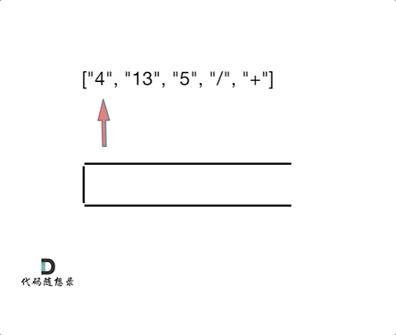

* [做專案（多個 C++、Java、Go、測試開發、前端（front end）專案）](https://www.programmercarl.com/other/kstar.html)
* [刷演算法（兩個月高強度學演算法）](https://www.programmercarl.com/xunlian/xunlianying.html)
* [背八股文（40 天挑戰高頻面試題）](https://www.programmercarl.com/xunlian/bagu.html)


> 這不僅僅是一道好題，也展現出電腦（computer）的思考方式

# 150. 反波蘭記法（reverse Polish notation）求值

[LeetCode 題目連結](https://leetcode.cn/problems/evaluate-reverse-polish-notation/)

根據反波蘭記法，求表式（expression）的值。

有效的運算子（operator）包括 + ,  - ,  *  ,  / 。每個運算元（operand）可以是整數（integer），也可以是另一個反波蘭記法表式。

說明：

整數除法（integer division）只保留整數部分。
給定反波蘭記法表式總是有效的。換句話說，表式總會得出有效數值且不存在除數為 0 的情況。


範例 1：
* 輸入: ["2", "1", "+", "3", " * "]
* 輸出: 9
* 解釋: 該算式轉化為常見的中綴（infix）算術表式（arithmetic expression）為：((2 + 1) * 3) = 9

範例 2：
* 輸入: ["4", "13", "5", "/", "+"]
* 輸出: 6
* 解釋: 該算式轉化為常見的中綴算術表式為：(4 + (13 / 5)) = 6

範例 3：
* 輸入: ["10", "6", "9", "3", "+", "-11", " * ", "/", " * ", "17", "+", "5", "+"]

* 輸出: 22

* 解釋:該算式轉化為常見的中綴算術表式為：

  ```
  ((10 * (6 / ((9 + 3) * -11))) + 17) + 5       
  = ((10 * (6 / (12 * -11))) + 17) + 5       
  = ((10 * (6 / -132)) + 17) + 5     
  = ((10 * 0) + 17) + 5     
  = (0 + 17) + 5    
  = 17 + 5    
  = 22    
  ```


反波蘭記法表式：是一種後置陳式（postfix expression），所謂尾綴（suffix）就是指運算子寫在後面。

平常使用的算式則是一種中置語法（infix syntax），如 ( 1 + 2 ) * ( 3 + 4 ) 。

該算式的反波蘭記法寫法為 ( ( 1 2 + ) ( 3 4 + ) * ) 。

反波蘭記法表式主要有以下兩個優點：

* 去掉括號（bracket）後表式無歧義，上式即便寫成 1 2 + 3 4 + * 也可以依據次序計算出正確結果。

* 適合用堆疊（stack）操作運算：遇到數字則入堆疊；遇到運算子則取出堆疊頂（top of stack）兩個數字進行計算，並將結果壓入堆疊中。

## 演算法公開課

**[《程式碼隨想錄》演算法影片公開課](https://programmercarl.com/other/gongkaike.html)：[堆疊的最後表演！ | LeetCode：150. 反波蘭記法求值](https://www.bilibili.com/video/BV1kd4y1o7on)，相信結合影片再看本篇題解，更有助於大家對本題的理解**。

## 解題思路

### 正題

在上一篇文章中 [1047.刪除字串中的所有相鄰重複項](https://programmercarl.com/1047.删除字符串中的所有相邻重复项.html) 提到了遞迴（recursion）就是用堆疊來實作的。

所以**堆疊與遞迴之間在某種程度上是可以轉換的！** 這一點我們在後續講解二元樹（binary tree）的時候，會更詳細地講解到。

那麼來看一下本題，**其實反波蘭記法表式相當於是二元樹中的後序遍歷（post-order traversal）**。大家可以將運算子作為中間節點（node），按照後序遍歷的規則畫出一個二元樹。

但我們沒有必要從二元樹的角度去解決這個問題，只要知道反波蘭記法表式是用後序遍歷的方式把二元樹串列化（serialization）了，就可以了。

更進一步看，本題中每一個子表式要得出一個結果，然後拿這個結果再進行運算，那麼**這豈不就是一個相鄰字串（string）消除的過程，和 [1047.刪除字串中的所有相鄰重複項](https://programmercarl.com/1047.删除字符串中的所有相邻重复项.html) 中的對對碰遊戲是不是就非常像了。**

如動畫所示：


相信看完動畫大家應該知道，這和 [1047. 刪除字串中的所有相鄰重複項](https://programmercarl.com/1047.删除字符串中的所有相邻重复项.html) 是差不多的，只不過本題不要相鄰元素（element）做消除了，而是做運算！

C++ 程式碼如下：


```CPP
class Solution {
public:
    int evalRPN(vector<string>& tokens) {
        // LeetCode 修改了後台測試資料，需要用 long long
        stack<long long> st; 
        for (int i = 0; i < tokens.size(); i++) {
            if (tokens[i] == "+" || tokens[i] == "-" || tokens[i] == "*" || tokens[i] == "/") {
                long long num1 = st.top();
                st.pop();
                long long num2 = st.top();
                st.pop();
                if (tokens[i] == "+") st.push(num2 + num1);
                if (tokens[i] == "-") st.push(num2 - num1);
                if (tokens[i] == "*") st.push(num2 * num1);
                if (tokens[i] == "/") st.push(num2 / num1);
            } else {
                st.push(stoll(tokens[i]));
            }
        }

        long long result = st.top();
        st.pop(); // 把堆疊裡最後一個元素彈出（其實不彈出也沒事）
        return result;
    }
};

```
* 時間複雜度（time complexity）: O(n)
* 空間複雜度（space complexity）: O(n)


### 題外話

我們習慣看到的表式都是中置語法，因為符合我們的習慣，但是中置語法對於電腦來說就不是很友善了。

例如：4 + 13 / 5，這就是中置語法，電腦從左到右去掃描的話，掃到 13，還要判斷 13 後面是什麼運算子，還要比較一下運算子在先（operator precedence），然後 13 還和後面的 5 做運算，做完運算之後，還要向前回退到 4 的位置，繼續做加法，你說麻不麻煩！

那麼將中置語法轉化為後置陳式之後：["4", "13", "5", "/", "+"]，就不一樣了，電腦可以利用堆疊來順序處理，不需要考慮優先順序了。也不用回退了，**所以後置陳式對電腦來說是非常友善的。**

可以說本題不僅僅是一道好題，也展現出電腦的思考方式。

在 1970 年代和 1980 年代，惠普（HP）在其所有桌上型和手持式計算機中都使用了 RPN（後置陳式），直到 2020 年代仍在某些機型中使用了 RPN。

參考維基百科（Wikipedia）如下：

> During the 1970s and 1980s, Hewlett-Packard used RPN in all of their desktop and hand-held calculators, and continued to use it in some models into the 2020s.


## 其他語言版本

### Java:

```Java
class Solution {
    public int evalRPN(String[] tokens) {
        Deque<Integer> stack = new LinkedList();
        for (String s : tokens) {
            if ("+".equals(s)) {        // leetcode 內建 jdk 的問題，不能使用 == 判斷字串是否相等
                stack.push(stack.pop() + stack.pop());      // 注意 - 和 / 需要特殊處理
            } else if ("-".equals(s)) {
                stack.push(-stack.pop() + stack.pop());
            } else if ("*".equals(s)) {
                stack.push(stack.pop() * stack.pop());
            } else if ("/".equals(s)) {
                int temp1 = stack.pop();
                int temp2 = stack.pop();
                stack.push(temp2 / temp1);
            } else {
                stack.push(Integer.valueOf(s));
            }
        }
        return stack.pop();
    }
}
```

### Python3：

```python
from operator import add, sub, mul

def div(x, y):
    # 使用整數除法的向零取整方式
    return int(x / y) if x * y > 0 else -(abs(x) // abs(y))

class Solution(object):
    op_map = {'+': add, '-': sub, '*': mul, '/': div}
    
    def evalRPN(self, tokens: List[str]) -> int:
        stack = []
        for token in tokens:
            if token not in {'+', '-', '*', '/'}:
                stack.append(int(token))
            else:
                op2 = stack.pop()
                op1 = stack.pop()
                stack.append(self.op_map[token](op1, op2))  # 第一個出來的在運算子後面
        return stack.pop()
```

另一種可行，但因為使用 eval() 相對較慢的方法:
```python
class Solution(object):
    def evalRPN(self, tokens: List[str]) -> int:
        stack = []
        for token in tokens:
            # 判斷是否為數字，因為 isdigit() 不識別負數，故需要排除第一位的符號
            if token.isdigit() or (len(token)>1 and token[1].isdigit()):
                stack.append(token)
            else:
                op2 = stack.pop()
                op1 = stack.pop()
		# 由題意 "The division always truncates toward zero"，所以使用 int() 可以天然取整
                stack.append(str(int(eval(op1 + token + op2))))
        return int(stack.pop())
```

### Go:

```Go
func evalRPN(tokens []string) int {
	stack := []int{}
	for _, token := range tokens {
		val, err := strconv.Atoi(token)
		if err == nil {
			stack = append(stack, val)
		} else {   // 如果 err 不為 nil 說明不是數字
			num1, num2 := stack[len(stack)-2], stack[(len(stack))-1]
			stack = stack[:len(stack)-2]
			switch token {
			case "+":
				stack = append(stack, num1+num2)
			case "-":
				stack = append(stack, num1-num2)
			case "*":
				stack = append(stack, num1*num2)
			case "/":
				stack = append(stack, num1/num2)
			}
		}
	}
	return stack[0]
}
```

### JavaScript:

```js
var evalRPN = function (tokens) {
    const stack = [];
    for (const token of tokens) {
        if (isNaN(Number(token))) { // 非數字
            const n2 = stack.pop(); // 出堆疊兩個數字
            const n1 = stack.pop();
            switch (token) { // 判斷運算子類型，算出新數入堆疊
                case "+":
                    stack.push(n1 + n2);
                    break;
                case "-":
                    stack.push(n1 - n2);
                    break;
                case "*":
                    stack.push(n1 * n2);
                    break;
                case "/":
                    stack.push(n1 / n2 | 0);
                    break;
            }
        } else { // 數字
            stack.push(Number(token));
        }
    }
    return stack[0]; // 因沒有遇到運算子而待在堆疊中的結果
};
```

### TypeScript：

普通版：

```typescript
function evalRPN(tokens: string[]): number {
    let helperStack: number[] = [];
    let temp: number;
    let i: number = 0;
    while (i < tokens.length) {
        let t: string = tokens[i];
        switch (t) {
            case '+':
                temp = helperStack.pop()! + helperStack.pop()!;
                helperStack.push(temp);
                break;
            case '-':
                temp = helperStack.pop()!;
                temp = helperStack.pop()! - temp;
                helperStack.push(temp);
                break;
            case '*':
                temp = helperStack.pop()! * helperStack.pop()!;
                helperStack.push(temp);
                break;
            case '/':
                temp = helperStack.pop()!;
                temp = Math.trunc(helperStack.pop()! / temp);
                helperStack.push(temp);
                break;
            default:
                helperStack.push(Number(t));
                break;
        }
        i++;
    }
    return helperStack.pop()!;
};
```

最佳化版：

```typescript
function evalRPN(tokens: string[]): number {
    const helperStack: number[] = [];
    const operatorMap: Map<string, (a: number, b: number) => number> = new Map([
        ['+', (a, b) => a + b],
        ['-', (a, b) => a - b],
        ['/', (a, b) => Math.trunc(a / b)],
        ['*', (a, b) => a * b],
    ]);
    let a: number, b: number;
    for (let t of tokens) {
        if (operatorMap.has(t)) {
            b = helperStack.pop()!;
            a = helperStack.pop()!;
            helperStack.push(operatorMap.get(t)!(a, b));
        } else {
            helperStack.push(Number(t));
        }
    }
    return helperStack.pop()!;
};
```

### Swift：

```Swift
func evalRPN(_ tokens: [String]) -> Int {
    var stack = [Int]()
    for c in tokens {
        let v = Int(c)
        if let num = v {
            // 遇到數字直接入堆疊
            stack.append(num)
        } else {
            // 遇到運算子, 取出堆疊頂兩元素計算, 結果壓堆疊
            var res: Int = 0
            let num2 = stack.popLast()!
            let num1 = stack.popLast()!
            switch c {
            case "+":
                res = num1 + num2
            case "-":
                res = num1 - num2
            case "*":
                res = num1 * num2
            case "/":
                res = num1 / num2
            default:
                break
            }
            stack.append(res)
        }
    }
    return stack.last!
}
```

### C#:

```csharp
public int EvalRPN(string[] tokens) {
        int num;
        Stack<int> stack = new Stack<int>();
        foreach(string s in tokens){
           if(int.TryParse(s, out num)){
                stack.Push(num);
            }else{
                int num1 = stack.Pop();
                int num2 = stack.Pop();
                switch (s)
                {
                    case "+":
                        stack.Push(num1 + num2);
                        break;
                    case "-":
                        stack.Push(num2 - num1);
                        break;
                    case "*":
                        stack.Push(num1 * num2);
                        break;
                    case "/":
                        stack.Push(num2 / num1);
                        break;
                    default:
                        break;
                }
            }
        }
        return stack.Pop(); 
    }
```

### PHP：

```php
class Solution {
    function evalRPN($tokens) {
        $st = new SplStack();
        for($i = 0;$i<count($tokens);$i++){
            // 是數字直接入堆疊
            if(is_numeric($tokens[$i])){ 
                $st->push($tokens[$i]);
            }else{ 
                // 是符號進行運算
                $num1 = $st->pop();
                $num2 = $st->pop();
                if ($tokens[$i] == "+") $st->push($num2 + $num1);
                if ($tokens[$i] == "-") $st->push($num2 - $num1);
                if ($tokens[$i] == "*") $st->push($num2 * $num1);
                // 注意處理小數部分
                if ($tokens[$i] == "/") $st->push(intval($num2 / $num1));
            }
        }
        return $st->pop();
    }
}
```

### Scala:

```scala
object Solution {
  import scala.collection.mutable
  def evalRPN(tokens: Array[String]): Int = {
    val stack = mutable.Stack[Int]()    // 定義堆疊
    // 抽取運算操作，需要傳遞 x, y，和一個函數
    def operator(x: Int, y: Int, f: (Int, Int) => Int): Int = f(x, y)
    for (token <- tokens) {
      // 模式匹配，匹配不同的運算子做什麼樣的運算
      token match {
        // 最後一個參數 _+_，代表 x+y，遵循 Scala 的函數至簡原則，以下運算同理
        case "+" => stack.push(operator(stack.pop(), stack.pop(), _ + _))  
        case "-" => stack.push(operator(stack.pop(), stack.pop(), -_ + _))
        case "*" => stack.push(operator(stack.pop(), stack.pop(), _ * _))
        case "/" => {
          var pop1 = stack.pop()
          var pop2 = stack.pop()
          stack.push(operator(pop2, pop1, _ / _))
        }
        case _ => stack.push(token.toInt)   // 不是運算子就入堆疊
      }
    }
    // 最後回傳堆疊頂，不需要加 return 關鍵字
    stack.pop() 
  }

}
```

### Rust:

```rust
impl Solution {
    pub fn eval_rpn(tokens: Vec<String>) -> i32 {
        let mut stack = vec![];
        for token in tokens.into_iter() {
            match token.as_str() {
                "+" => {
                    let a = stack.pop().unwrap();
                    *stack.last_mut().unwrap() += a;
                }
                "-" => {
                    let a = stack.pop().unwrap();
                    *stack.last_mut().unwrap() -= a;
                }
                "*" => {
                    let a = stack.pop().unwrap();
                    *stack.last_mut().unwrap() *= a;
                }
                "/" => {
                    let a = stack.pop().unwrap();
                    *stack.last_mut().unwrap() /= a;
                }
                _ => {
                    stack.push(token.parse::<i32>().unwrap());
                }
            }
        }
        stack.pop().unwrap()
    }
}
```

### C:

```c
int str_to_int(char *str) {
    // string 轉 integer
    int num = 0, tens = 1;
    for (int i = strlen(str) - 1; i >= 0; i--) {
        if (str[i] == '-') {
            num *= -1;
            break;
        }
        num += (str[i] - '0') * tens;
        tens *= 10;
    }
    return num;
}

int evalRPN(char** tokens, int tokensSize) {

    int *stack = (int *)malloc(tokensSize * sizeof(int));
    assert(stack);
    int stackTop = 0;

    for (int i = 0; i < tokensSize; i++) {
        char symbol = (tokens[i])[0];
        if (symbol < '0' && (tokens[i])[1] == '\0') {

            // pop 兩個數字
            int num1 = stack[--stackTop];
            int num2 = stack[--stackTop];

            // 計算結果
            int result;
            if (symbol == '+') {
                result = num1 + num2;
            } else if (symbol == '-') {
                result = num2 - num1;
            } else if (symbol == '/') {
                result = num2 / num1;
            } else {
                result = num1 * num2;
            }

            // push 回 stack
            stack[stackTop++] = result;

        } else {

            // push 數字進 stack
            int num = str_to_int(tokens[i]);
            stack[stackTop++] = num;
            
        }
    }

    int result = stack[0];
    free(stack);
    return result;
}
```

