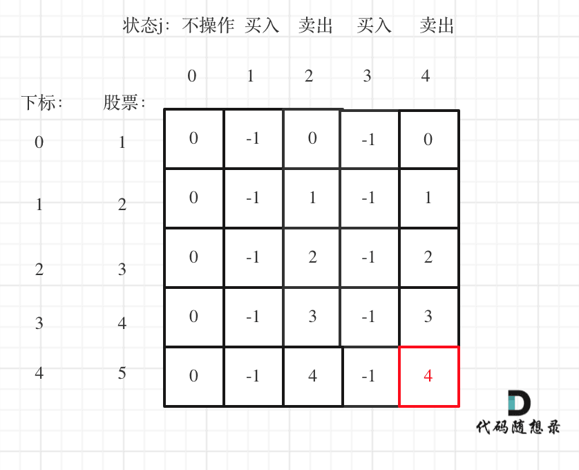

* [做專案（多個 C++、Java、Go、測試開發、前端專案）](https://www.programmercarl.com/other/kstar.html)
* [刷演算法（algorithm）（兩個月高強度學演算法）](https://www.programmercarl.com/xunlian/xunlianying.html)
* [背八股文（面試必考題，40 天挑戰高頻面試題）](https://www.programmercarl.com/xunlian/bagu.html)

# 188.買賣股票的最佳時機 IV

[LeetCode 題目連結](https://leetcode.cn/problems/best-time-to-buy-and-sell-stock-iv/)

給定一個整數（integer）陣列（array） prices ，它的第 i 個元素（element） prices[i] 是一支給定的股票在第 i 天的價格。

設計一個演算法來計算你所能獲取的最大利潤。你最多可以完成 k 筆交易。

注意：你不能同時參與多筆交易（你必須在再次購買前出售掉之前的股票）。

* 範例 1：
* 輸入：k = 2, prices = [2,4,1]
* 輸出：2
解釋：在第 1 天 (股票價格 = 2) 的時候買入，在第 2 天 (股票價格 = 4) 的時候賣出，這筆交易所能獲得利潤 = 4-2 = 2。

* 範例 2：
* 輸入：k = 2, prices = [3,2,6,5,0,3]
* 輸出：7
解釋：在第 2 天 (股票價格 = 2) 的時候買入，在第 3 天 (股票價格 = 6) 的時候賣出, 這筆交易所能獲得利潤 = 6-2 = 4。隨後，在第 5 天 (股票價格 = 0) 的時候買入，在第 6 天 (股票價格 = 3) 的時候賣出, 這筆交易所能獲得利潤 = 3-0 = 3 。


提示：

* 0 <= k <= 100
* 0 <= prices.length <= 1000
* 0 <= prices[i] <= 1000

## 演算法公開課

**[《程式碼隨想錄》演算法影片公開課](https://programmercarl.com/other/gongkaike.html)：[動態規劃（dynamic programming, DP）來決定最佳時機，至多可以買賣 K 次！| LeetCode：188.買賣股票最佳時機 4](https://www.bilibili.com/video/BV16M411U7XJ)，相信結合影片再看本篇題解，更有助於大家對本題的理解**。


## 解題思路

這道題目可以說是[動態規劃：123.買賣股票的最佳時機 III](https://programmercarl.com/0123.买卖股票的最佳时机III.html)的進階版，這裡要求至多有 k 次交易。

動規五部曲，分析如下：

1. 確定 dp 陣列以及下標（subscript）的含義

在[動態規劃：123.買賣股票的最佳時機 III](https://programmercarl.com/0123.买卖股票的最佳时机III.html)中，我是定義了一個二維（2D）dp 陣列，本題其實依然可以用一個二維 dp 陣列。

使用二維陣列 dp[i][j] ：第 i 天的狀態（state）為 j，所剩下的最大現金是 dp[i][j]

j 的狀態表示為：

* 0 表示不操作
* 1 第一次買入
* 2 第一次賣出
* 3 第二次買入
* 4 第二次賣出
* .....

**大家應該發現規律了吧 ，除了 0 以外，偶數就是賣出，奇數就是買入**。

題目要求是至多有 K 筆交易，那麼 j 的範圍就定義為 2 * k + 1 就可以了。

所以二維 dp 陣列的 C++ 定義為：

```CPP
vector<vector<int>> dp(prices.size(), vector<int>(2 * k + 1, 0));
```

2. 確定遞推公式

還要強調一下：dp[i][1]，**表示的是第 i 天，買入股票的狀態，並不是說一定要第 i 天買入股票，這是很多同學容易陷入的誤區**。

達到 dp[i][1] 狀態，有兩個具體操作：

* 操作一：第 i 天買入股票了，那麼 dp[i][1] = dp[i - 1][0] - prices[i]
* 操作二：第 i 天沒有操作，而是沿用前一天買入的狀態，即：dp[i][1] = dp[i - 1][1]

選最大的，所以 dp[i][1] = max(dp[i - 1][0] - prices[i], dp[i - 1][1]);

同理 dp[i][2] 也有兩個操作：

* 操作一：第 i 天賣出股票了，那麼 dp[i][2] = dp[i - 1][1] + prices[i]
* 操作二：第 i 天沒有操作，沿用前一天賣出股票的狀態，即：dp[i][2] = dp[i - 1][2]

所以 dp[i][2] = max(dp[i - 1][1] + prices[i], dp[i - 1][2])

同理可以類比剩下的狀態，程式碼如下：

```CPP
for (int j = 0; j < 2 * k - 1; j += 2) {
    dp[i][j + 1] = max(dp[i - 1][j + 1], dp[i - 1][j] - prices[i]);
    dp[i][j + 2] = max(dp[i - 1][j + 2], dp[i - 1][j + 1] + prices[i]);
}
```

**本題和[動態規劃：123.買賣股票的最佳時機 III](https://programmercarl.com/0123.买卖股票的最佳时机III.html)最大的區別就是這裡要類比 j 為奇數是買，偶數是賣的狀態**。

3. dp 陣列如何初始化（initialization）

第 0 天沒有操作，這個最容易想到，就是 0，即：dp[0][0] = 0;

第 0 天做第一次買入的操作，dp[0][1] = -prices[0];

第 0 天做第一次賣出的操作，這個初始值（value）應該是多少呢？

此時還沒有買入，怎麼就賣出呢？ 其實大家可以理解當天買入，當天賣出，所以 dp[0][2] = 0;

第 0 天第二次買入操作，初始值應該是多少呢？應該不少同學疑惑，第一次還沒買入呢，怎麼初始化第二次買入呢？

第二次買入依賴於第一次賣出的狀態，其實相當於第 0 天第一次買入了，第一次賣出了，然後再買入一次（第二次買入），那麼現在手頭上沒有現金，只要買入，現金就做相應的減少。

所以第二次買入操作，初始化為：dp[0][3] = -prices[0];

第二次賣出初始化 dp[0][4] = 0;

**所以同理可以推出 dp[0][j] 當 j 為奇數的時候都初始化為 -prices[0]**

程式碼如下：

```CPP
for (int j = 1; j < 2 * k; j += 2) {
    dp[0][j] = -prices[0];
}
```

**在初始化的地方同樣要類比 j 為偶數是賣、奇數是買的狀態**。

4. 確定遍歷（traversal）順序

從遞迴公式（recurrence formula）其實已經可以看出，一定是從前向後遍歷，因為 dp[i]，依靠 dp[i - 1] 的數值。

5.  舉例推導 dp 陣列

以輸入 [1,2,3,4,5]，k=2 為例。



最後一次賣出，一定是利潤最大的，dp[prices.size() - 1][2 * k] 即紅色部分就是最後求解。

以上分析完畢，C++ 程式碼如下：

```CPP
class Solution {
public:
    int maxProfit(int k, vector<int>& prices) {

        if (prices.size() == 0) return 0;
        vector<vector<int>> dp(prices.size(), vector<int>(2 * k + 1, 0));
        for (int j = 1; j < 2 * k; j += 2) {
            dp[0][j] = -prices[0];
        }
        for (int i = 1;i < prices.size(); i++) {
            for (int j = 0; j < 2 * k - 1; j += 2) {
                dp[i][j + 1] = max(dp[i - 1][j + 1], dp[i - 1][j] - prices[i]);
                dp[i][j + 2] = max(dp[i - 1][j + 2], dp[i - 1][j + 1] + prices[i]);
            }
        }
        return dp[prices.size() - 1][2 * k];
    }
};
```

* 時間複雜性（time complexity）: O(n * k)，其中 n 為 prices 的長度
* 空間複雜度（space complexity）: O(n * k)


當然有的解法是定義一個三維（three-dimensional）陣列 dp[i][j][k]，第 i 天，第 j 次買賣，k 表示買還是賣的狀態，從定義上來講是比較直觀。

但感覺三維陣列操作起來有些麻煩，我是直接用二維陣列來模擬（simulation）三維陣列的情況，程式碼看起來也清爽一些。


## 其他語言版本

### Java:

```java
// 版本一: 三維 dp 陣列
class Solution {
    public int maxProfit(int k, int[] prices) {
        if (prices.length == 0) return 0;

        // [天數][交易次數][是否持有股票]
        int len = prices.length;
        int[][][] dp = new int[len][k + 1][2];
        
        // dp 陣列初始化
        // 初始化所有的交易次數是為確保 最後結果是最多 k 次買賣的最大利潤
        for (int i = 0; i <= k; i++) {
            dp[0][i][1] = -prices[0];
        }

        for (int i = 1; i < len; i++) {
            for (int j = 1; j <= k; j++) {
                // dp 方程, 0 表示不持有/賣出, 1 表示持有/買入
                dp[i][j][0] = Math.max(dp[i - 1][j][0], dp[i - 1][j][1] + prices[i]);
                dp[i][j][1] = Math.max(dp[i - 1][j][1], dp[i - 1][j - 1][0] - prices[i]);
            }
        }
        return dp[len - 1][k][0];
    }
}

// 版本二: 二維 dp 陣列
class Solution {
    public int maxProfit(int k, int[] prices) {
        if (prices.length == 0) return 0;

        // [天數][股票狀態]
        // 股票狀態: 奇數表示第 k 次交易持有/買入, 偶數表示第 k 次交易不持有/賣出, 0 表示沒有操作
        int len = prices.length;
        int[][] dp = new int[len][k*2 + 1];
        
        // dp 陣列的初始化, 與版本一同理
        for (int i = 1; i < k*2; i += 2) {
            dp[0][i] = -prices[0];
        }

        for (int i = 1; i < len; i++) {
            for (int j = 0; j < k*2 - 1; j += 2) {
                dp[i][j + 1] = Math.max(dp[i - 1][j + 1], dp[i - 1][j] - prices[i]);
                dp[i][j + 2] = Math.max(dp[i - 1][j + 2], dp[i - 1][j + 1] + prices[i]);
            }
        }
        return dp[len - 1][k*2];
    }
}

//版本三：一維 dp 陣列 (下面有和卡哥邏輯一致的一維陣列 JAVA 解法)
class Solution {
    public int maxProfit(int k, int[] prices) {
        if(prices.length == 0){
            return 0;
        }
        if(k == 0){
            return 0;
        }
        // 其實就是 123 題的擴展，123 題只用記錄 2 次交易的狀態
        // 這裡記錄 k 次交易的狀態就行了
        // 每次交易都有買入，賣出兩個狀態，所以要乘 2
        int[] dp = new int[2 * k];
        // 按 123 題解題格式那樣，做一個初始化
        for(int i = 0; i < dp.length / 2; i++){
            dp[i * 2] = -prices[0];
        }
        for(int i = 1; i <= prices.length; i++){
            dp[0] = Math.max(dp[0], -prices[i - 1]);
            dp[1] = Math.max(dp[1], dp[0] + prices[i - 1]);
            // 還是與 123 題一樣，與 123 題對照來看
            // 就很容易啦
            for(int j = 2; j < dp.length; j += 2){
                dp[j] = Math.max(dp[j], dp[j - 1] - prices[i-1]);
                dp[j + 1] = Math.max(dp[j + 1], dp[j] + prices[i - 1]);
            }
        }
        // 回傳最後一次交易賣出狀態的結果就行了
        return dp[dp.length - 1];
    }
}
```
```JAVA
class Solution {
    public int maxProfit(int k, int[] prices) {

        //edge cases
        if(prices.length == 0 || k == 0)
            return 0;

        
        int dp[] = new int [k * 2 + 1];

        //和卡哥邏輯一致，奇數天購入股票，故初始化只初始化奇數天。
        for(int i = 1; i < 2 * k + 1; i += 2){
            dp[i] = -prices[0];
        }

        for(int i = 1; i < prices.length; i++){ //i 從 1 開始，因為第 i = 0 天已經透過初始化完成了。
            for(int j = 1; j < 2 * k + 1; j++){ //j 從 1 開始，因為第 j = 0 天已經透過初始化完成了。
                //奇數天購買
                if(j % 2 == 1)
                    dp[j] = Math.max(dp[j], dp[j - 1] - prices[i]);
                //偶數天賣出
                else
                    dp[j] = Math.max(dp[j], dp[j - 1] + prices[i]);
            }
	    //印出 DP 陣列
            //for(int x : dp)
            //    System.out.print(x +", ");
            //System.out.println();
        }
        //return 第 2 * k 次賣出的獲利。
        return dp[2 * k];
    }
}
```

### Python:

> 版本一
```python
class Solution:
    def maxProfit(self, k: int, prices: List[int]) -> int:
        if len(prices) == 0:
            return 0
        dp = [[0] * (2*k+1) for _ in range(len(prices))]
        for j in range(1, 2*k, 2):
            dp[0][j] = -prices[0]
        for i in range(1, len(prices)):
            for j in range(0, 2*k-1, 2):
                dp[i][j+1] = max(dp[i-1][j+1], dp[i-1][j] - prices[i])
                dp[i][j+2] = max(dp[i-1][j+2], dp[i-1][j+1] + prices[i])
        return dp[-1][2*k]
```

> 版本二
```python
class Solution:
    def maxProfit(self, k: int, prices: List[int]) -> int:
        if len(prices) == 0: return 0
        dp = [0] * (2*k + 1)
        for i in range(1,2*k,2):
            dp[i] = -prices[0]
        for i in range(1,len(prices)):
            for j in range(1,2*k + 1):
                if j % 2:
                    dp[j] = max(dp[j],dp[j-1]-prices[i])
                else:
                    dp[j] = max(dp[j],dp[j-1]+prices[i])
        return dp[2*k]
```

> 版本三: 一維（one-dimensional） dp 陣列(易理解版本)
```python
class Solution:
    def maxProfit(self, k: int, prices: List[int]) -> int:
        dp = [0] * k * 2
        for i in range(k):
            dp[i * 2] = -prices[0]

        for price in prices[1:]:
            dc = dp.copy() # 這句話是關鍵，把前一天的 dp 狀態保存下來，防止被覆蓋掉，後面只用它，不用 dp，邏輯簡單易懂

            for i in range(2 * k):
                if i % 2 == 1:
                    dp[i] = max(dc[i], dc[i - 1] + price)
                else:
                    pre = 0 if i == 0 else dc[i - 1]
                    dp[i] = max(dc[i], pre - price)
            
        return dp[-1]
```

### Go:

> 版本一：

```go
// 買賣股票的最佳時機 IV 動態規劃
// 時間複雜性 O(kn) 空間複雜度 O(kn)
func maxProfit(k int, prices []int) int {
    if k == 0 || len(prices) == 0 {
        return 0
    }
    
    dp := make([][]int, len(prices))
    status := make([]int, (2 * k + 1) * len(prices))
    for i := range dp {
        dp[i] = status[:2 * k + 1]
        status = status[2 * k + 1:]
    }
    for j := 1; j < 2 * k; j += 2 {
        dp[0][j] = -prices[0]
    }
    
    for i := 1; i < len(prices); i++ {
        for j := 0; j < 2 * k; j += 2 {
            dp[i][j + 1] = max(dp[i - 1][j + 1], dp[i - 1][j] - prices[i])
            dp[i][j + 2] = max(dp[i - 1][j + 2], dp[i - 1][j + 1] + prices[i])
        }
    }
    return dp[len(prices) - 1][2 * k]
}

func max(a, b int) int {
    if a > b {
        return a
    }
    return b
}
```

> 版本二: 三維 dp 陣列
```go
func maxProfit(k int, prices []int) int {
	length := len(prices)
	if length == 0 {
		return 0
	}
	// [天數][交易次數][是否持有股票]
	// 1 表示不持有/賣出, 0 表示持有/買入
	dp := make([][][]int, length)
	for i := 0; i < length; i++ {
		dp[i] = make([][]int, k+1)
		for j := 0; j <= k; j++ {
			dp[i][j] = make([]int, 2)
		}
	}
	for j := 0; j <= k; j++ {
		dp[0][j][0] = -prices[0]
	}
	for i := 1; i < length; i++ {
		for j := 1; j <= k; j++ {
			dp[i][j][0] = max188(dp[i-1][j][0], dp[i-1][j-1][1]-prices[i])
			dp[i][j][1] = max188(dp[i-1][j][1], dp[i-1][j][0]+prices[i])
		}
	}
	return dp[length-1][k][1]
}

func max188(a, b int) int {
	if a > b {
		return a
	}
	return b
}
```

版本三：空間最佳化版本

```go
func maxProfit(k int, prices []int) int {
    n := len(prices)
    // k 次交易，2 * k 種狀態
    // 狀態從 1 開始計算，避免判斷
    // 奇數時持有(保持或買入)
    // 偶數時不持有(保持或賣出)
    dp := make([][]int, 2)
    dp[0] = make([]int, k * 2 + 1)
    dp[1] = make([]int, k * 2 + 1)

    // 奇數狀態時持有，i += 2
    for i := 1; i <= k * 2; i += 2 {
        dp[0][i] = -prices[0]
    }

    for i := 1; i < len(prices); i++ {
        for j := 1; j <= k * 2; j++ {
            if j % 2 == 1 {
                dp[i % 2][j] = max(dp[(i - 1) % 2][j], dp[(i - 1) % 2][j - 1] - prices[i])
            } else {
                dp[i % 2][j] = max(dp[(i - 1) % 2][j], dp[(i - 1) % 2][j - 1] + prices[i])
            }
        }
    }

    return dp[(n - 1) % 2][k * 2]
}

func max(a, b int) int {
    if a > b {
        return a
    }
    return b
}
```

> 版本四：一維 dp 陣列（易理解版本）

```go
func maxProfit(k int, prices []int) int {
    dp := make([]int, 2 * k)
    for i := range k {
        dp[i * 2] = -prices[0]
    }

    for j := 1; j < len(prices); j++ {
        dc := slices.Clone(dp) // 這句話是關鍵，把前一天的 dp 狀態保存下來，防止被覆蓋掉，後面只用它，不用 dp，邏輯簡單易懂

        for i := range k * 2 {
            if i % 2 == 1 {
                dp[i] = max(dc[i], dc[i - 1] + prices[j])
            } else {
                pre := 0; if i >= 1 { pre = dc[i - 1] }
                dp[i] = max(dc[i], pre - prices[j])
            }
        }
    }

    return dp[2 * k - 1]
}
```

### JavaScript:

```javascript
// 方法一：動態規劃
const maxProfit = (k,prices) => {
    if (prices == null || prices.length < 2 || k == 0) {
        return 0;
    }
    
    let dp = Array.from(Array(prices.length), () => Array(2*k+1).fill(0));

    for (let j = 1; j < 2 * k; j += 2) {
        dp[0][j] = 0 - prices[0];
    }
    
    for(let i = 1; i < prices.length; i++) {
        for (let j = 0; j < 2 * k; j += 2) {
            dp[i][j+1] = Math.max(dp[i-1][j+1], dp[i-1][j] - prices[i]);
            dp[i][j+2] = Math.max(dp[i-1][j+2], dp[i-1][j+1] + prices[i]);
        }
    }

    return dp[prices.length - 1][2 * k];
};

// 方法二：動態規劃+空間最佳化
var maxProfit = function(k, prices) {
    let n = prices.length;
    let dp = new Array(2*k+1).fill(0);
    // dp 買入狀態初始化
    for (let i = 1; i <= 2*k; i += 2) {
        dp[i] = - prices[0];
    }

    for (let i = 1; i < n; i++) {
        for (let j = 1; j < 2*k+1; j++) {
            // j 為奇數：買入狀態
            if (j % 2) {
                dp[j] = Math.max(dp[j], dp[j-1] - prices[i]);
            } else {
                // j 為偶數：賣出狀態
                dp[j] = Math.max(dp[j], dp[j-1] + prices[i]);
            }
        }
    }

    return dp[2*k];
};
```

### TypeScript：

```typescript
function maxProfit(k: number, prices: number[]): number {
    const length: number = prices.length;
    if (length === 0) return 0;
    const dp: number[][] = new Array(length).fill(0)
        .map(_ => new Array(k * 2 + 1).fill(0));
    for (let i = 1; i <= k; i++) {
        dp[0][i * 2 - 1] = -prices[0];
    }
    for (let i = 1; i < length; i++) {
        for (let j = 1; j < 2 * k + 1; j++) {
            dp[i][j] = Math.max(dp[i - 1][j], dp[i - 1][j - 1] + Math.pow(-1, j) * prices[i]);
        }
    }
    return dp[length - 1][2 * k];
};
```

### C:

```c
#define max(a, b) ((a) > (b) ? (a) : (b))

int maxProfit(int k, int* prices, int pricesSize) {
    if(pricesSize == 0){
        return 0;
    }
    
    int dp[pricesSize][2 * k + 1];
    memset(dp, 0, sizeof(int) * pricesSize * (2 * k + 1));
    for (int j = 1; j < 2 * k; j += 2) {
        dp[0][j] = -prices[0];
    }

    for (int i = 1;i < pricesSize; i++) {//列舉股票
        for (int j = 0; j < 2 * k - 1; j += 2) { //更新每一次買入賣出
            dp[i][j + 1] = max(dp[i - 1][j + 1], dp[i - 1][j] - prices[i]);
            dp[i][j + 2] = max(dp[i - 1][j + 2], dp[i - 1][j + 1] + prices[i]);
        }
    }
    return dp[pricesSize - 1][2 * k];
}
```


### Rust：

```rust
impl Solution {
    pub fn max_profit(k: i32, prices: Vec<i32>) -> i32 {
        let mut dp = vec![vec![0; 2 * k as usize + 1]; prices.len()];

        for v in dp[0].iter_mut().skip(1).step_by(2) {
            *v = -prices[0];
        }

        for (i, &p) in prices.iter().enumerate().skip(1) {
            for j in (0..2 * k as usize - 1).step_by(2) {
                dp[i][j + 1] = dp[i - 1][j + 1].max(dp[i - 1][j] - p);
                dp[i][j + 2] = dp[i - 1][j + 2].max(dp[i - 1][j + 1] + p);
            }
        }

        dp[prices.len() - 1][2 * k as usize]
    }
}
```

空間最佳化：

```rust
impl Solution {
    pub fn max_profit(k: i32, prices: Vec<i32>) -> i32 {
        let mut dp = vec![0; 2 * k as usize + 1];
        for v in dp.iter_mut().skip(1).step_by(2) {
            *v = -prices[0];
        }

        for p in prices {
            for i in 1..=2 * k as usize {
                if i % 2 == 1 {
                    // 買入
                    dp[i] = dp[i].max(dp[i - 1] - p);
                    continue;
                }
                // 賣出
                dp[i] = dp[i].max(dp[i - 1] + p);
            }
        }

        dp[2 * k as usize]
    }
}
```


