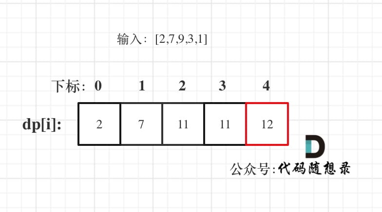

* [做專案（多個 C++、Java、Go、測試開發、前端專案）](https://www.programmercarl.com/other/kstar.html)
* [刷演算法（兩個月高強度學演算法）](https://www.programmercarl.com/xunlian/xunlianying.html)
* [背八股文（面試必考題，40 天挑戰高頻面試題）](https://www.programmercarl.com/xunlian/bagu.html)

# 198.打家劫舍

[LeetCode 題目連結](https://leetcode.cn/problems/house-robber/)

你是一個專業的小偷，計畫偷竊沿街的房屋。每間房內都藏有一定的現金，影響你偷竊的唯一制約因素就是相鄰的房屋裝有相互連通的防盜系統，如果兩間相鄰的房屋在同一晚上被小偷闖入，系統會自動報警。

給定一個代表每個房屋存放金額的非負整數（nonnegative integer）陣列（array），計算你 不觸動警報裝置的情況下 ，一夜之內能夠偷竊到的最高金額。

* 範例 1：
* 輸入：[1,2,3,1]
* 輸出：4

解釋：偷竊 1 號房屋 (金額 = 1) ，然後偷竊 3 號房屋 (金額 = 3)。
     偷竊到的最高金額 = 1 + 3 = 4 。

* 範例 2：
* 輸入：[2,7,9,3,1]
* 輸出：12
解釋：偷竊 1 號房屋 (金額 = 2), 偷竊 3 號房屋 (金額 = 9)，接著偷竊 5 號房屋 (金額 = 1)。
     偷竊到的最高金額 = 2 + 9 + 1 = 12 。


提示：

* 0 <= nums.length <= 100
* 0 <= nums[i] <= 400

## 演算法公開課

**[《程式碼隨想錄》演算法影片公開課](https://programmercarl.com/other/gongkaike.html)：[動態規劃（dynamic programming, DP），偷不偷這個房間呢？| LeetCode：198.打家劫舍](https://www.bilibili.com/video/BV1Te411N7SX)，相信結合影片再看本篇題解，更有助於大家對本題的理解**。


## 解題思路

大家如果剛接觸這樣的題目，會有點困惑，當前的狀態（state）我是偷還是不偷呢？ 

仔細一想，當前房屋偷與不偷取決於 前一個房屋和前兩個房屋是否被偷了。 

所以這裡就更感覺到，當前狀態和前面狀態會有一種依賴關係，那麼這種依賴關係都是動規的遞迴公式（recurrence formula）。

當然以上是大概思路，打家劫舍是 dp 解決的經典問題，接下來我們來動規五部曲分析如下：

1. 確定 dp 陣列（dp table）以及下標（subscript）的含義

**dp[i]：考慮下標 i（包括 i）以內的房屋，最多可以偷竊的金額為 dp[i]**。

2. 確定遞迴公式

決定 dp[i] 的因素就是第 i 房間偷還是不偷。

如果偷第 i 房間，那麼 dp[i] = dp[i - 2] + nums[i] ，即：第 i-1 房一定是不考慮的，找出 下標 i-2（包括 i-2）以內的房屋，最多可以偷竊的金額為 dp[i-2] 加上第 i 房間偷到的錢。

如果不偷第 i 房間，那麼 dp[i] = dp[i - 1]，即考慮 i-1 房，（**注意這裡是考慮，並不是一定要偷 i-1 房，這是很多同學容易混淆的點**）

然後 dp[i] 取最大值，即 dp[i] = max(dp[i - 2] + nums[i], dp[i - 1]);

3. dp 陣列如何初始化（initialization）

從遞迴公式 dp[i] = max(dp[i - 2] + nums[i], dp[i - 1]); 可以看出，遞迴公式的基礎就是 dp[0] 和 dp[1]

從 dp[i] 的定義上來講，dp[0] 一定是 nums[0]，dp[1] 就是 nums[0] 和 nums[1] 的最大值即：dp[1] = max(nums[0], nums[1]);

程式碼如下：

```CPP
vector<int> dp(nums.size());
dp[0] = nums[0];
dp[1] = max(nums[0], nums[1]);
```

4. 確定遍歷（traversal）順序

dp[i] 是根據 dp[i - 2] 和 dp[i - 1] 推導出來的，那麼一定是從前到後遍歷！

程式碼如下：
```CPP
for (int i = 2; i < nums.size(); i++) {
    dp[i] = max(dp[i - 2] + nums[i], dp[i - 1]);
}
```

5. 舉例推導 dp 陣列

以範例二，輸入 [2,7,9,3,1] 為例。



紅框 dp[nums.size() - 1] 為結果。

以上分析完畢，C++ 程式碼如下：

```CPP
class Solution {
public:
    int rob(vector<int>& nums) {
        if (nums.size() == 0) return 0;
        if (nums.size() == 1) return nums[0];
        vector<int> dp(nums.size());
        dp[0] = nums[0];
        dp[1] = max(nums[0], nums[1]);
        for (int i = 2; i < nums.size(); i++) {
            dp[i] = max(dp[i - 2] + nums[i], dp[i - 1]);
        }
        return dp[nums.size() - 1];
    }
};
```

* 時間複雜度（time complexity）: O(n)
* 空間複雜度（space complexity）: O(n)

## 總結

打家劫舍是 動態規劃（dynamic programming, DP） 解決的經典題目，這道題也是打家劫舍入門級題目，後面我們還會變種方式來打劫的。

## 其他語言版本

### Java：

```Java
// 動態規劃
class Solution {
	public int rob(int[] nums) {
		if (nums == null || nums.length == 0) return 0;
		if (nums.length == 1) return nums[0];

		int[] dp = new int[nums.length];
		dp[0] = nums[0];
		dp[1] = Math.max(dp[0], nums[1]);
		for (int i = 2; i < nums.length; i++) {
			dp[i] = Math.max(dp[i - 1], dp[i - 2] + nums[i]);
		}

		return dp[nums.length - 1];
	}
}

// 使用 rolling array 思想，最佳化空間
// 分析本題可以發現，所求結果僅依賴於前兩種狀態，此時可以使用 rolling array 思想將空間複雜度降低為 3 個空間
class Solution {
    public int rob(int[] nums) {
        
        int len = nums.length;

        if (len == 0) return 0;
        else if (len == 1) return nums[0];
        else if (len == 2) return Math.max(nums[0],nums[1]);


        int[] result = new int[3]; //存放選擇的結果
        result[0] = nums[0];
        result[1] = Math.max(nums[0],nums[1]);
        

        for(int i=2;i<len;i++){

            result[2] = Math.max(result[0]+nums[i],result[1]);

            result[0] = result[1];
            result[1] = result[2];
        }
        
        return result[2];
    }
}

// 進一步對 rolling array 的空間最佳化 dp 陣列只存與計算相關的兩次資料
class Solution {
    public int rob(int[] nums) {
        if (nums.length == 1)  {
            return nums[0];
        }
        // 初始化 dp 陣列
        // 最佳化空間 dp 陣列只用 2 格空間 只記錄與當前計算相關的前兩個結果
        int[] dp = new int[2];
        dp[0] = nums[0];
        dp[1] = Math.max(nums[0],nums[1]);
        int res = 0;
        // 遍歷
        for (int i = 2; i < nums.length; i++) {
            res = Math.max((dp[0] + nums[i]) , dp[1] );
            dp[0] = dp[1];
            dp[1] = res;
        }
        // 輸出結果
        return dp[1];
    }
}
```

### Python：

1 維（one-dimensional）DP
```python
class Solution:
    def rob(self, nums: List[int]) -> int:
        if len(nums) == 0:  # 如果沒有房屋，回傳 0
            return 0
        if len(nums) == 1:  # 如果只有一個房屋，回傳其金額
            return nums[0]

        # 建立一個動態規劃（dynamic programming, DP）陣列，用於儲存最大金額
        dp = [0] * len(nums)
        dp[0] = nums[0]  # 將 dp 的第一個元素設定為第一個房屋的金額
        dp[1] = max(nums[0], nums[1])  # 將 dp 的第二個元素設定為第一二個房屋中的金額較大者

        # 遍歷剩餘的房屋
        for i in range(2, len(nums)):
            # 對於每個房屋，選擇搶劫當前房屋和搶劫前一個房屋的最大金額
            dp[i] = max(dp[i - 2] + nums[i], dp[i - 1])

        return dp[-1]  # 回傳最後一個房屋中可搶劫的最大金額
```
2 維（two-dimensional）DP
```python
class Solution:
    def rob(self, nums: List[int]) -> int:
        if not nums:  # 如果沒有房屋，回傳 0
            return 0

        n = len(nums)
        dp = [[0, 0] for _ in range(n)]  # 建立二維DP陣列，dp[i][0] 表示不搶劫第 i 個房屋的最大金額，dp[i][1] 表示搶劫第 i 個房屋的最大金額

        dp[0][1] = nums[0]  # 搶劫第一個房屋的最大金額為第一個房屋的金額

        for i in range(1, n):
            dp[i][0] = max(dp[i-1][0], dp[i-1][1])  # 不搶劫第 i 個房屋，最大金額為前一個房屋搶劫和不搶劫的最大值
            dp[i][1] = dp[i-1][0] + nums[i]  # 搶劫第 i 個房屋，最大金額為前一個房屋不搶劫的最大金額加上當前房屋的金額

        return max(dp[n-1][0], dp[n-1][1])  # 回傳最後一個房屋中可搶劫的最大金額

```
最佳化版
```python
class Solution:
    def rob(self, nums: List[int]) -> int:
        if not nums:  # 如果沒有房屋，回傳 0
            return 0

        prev_max = 0  # 上一個房屋的最大金額
        curr_max = 0  # 當前房屋的最大金額

        for num in nums:
            temp = curr_max  # 臨時變數保存當前房屋的最大金額
            curr_max = max(prev_max + num, curr_max)  # 更新當前房屋的最大金額
            prev_max = temp  # 更新上一個房屋的最大金額

        return curr_max  # 回傳最後一個房屋中可搶劫的最大金額


```
### Go：

```Go
func rob(nums []int) int {
    n := len(nums)
    dp := make([]int, n+1) // dp[i] 表示偷到第 i 家能夠偷得的最大金額
    dp[1] = nums[0]
    for i := 2; i <= n; i++ {
        dp[i] = max(dp[i-1], dp[i-2] + nums[i-1])
    }
    return dp[n]
}

func max(a, b int) int {
    if a > b {
        return a
    }
    return b
}
```

### JavaScript：

```javascript
const rob = nums => {
    // 陣列長度
    const len = nums.length;
    // dp 陣列初始化
    const dp = [nums[0], Math.max(nums[0], nums[1])];
    // 從下標 2 開始遍歷
    for (let i = 2; i < len; i++) {
        dp[i] = Math.max(dp[i - 2] + nums[i], dp[i - 1]);
    }
    return dp[len - 1];
};
```

### TypeScript：

```typescript
function rob(nums: number[]): number {
    /**
        dp[i]: 前 i 個房屋能偷到的最大金額
        dp[0]: nums[0];
        dp[1]: max(nums[0], nums[1]);
        ...
        dp[i]: max(dp[i-1], dp[i-2]+nums[i]);
     */
    const length: number = nums.length;
    if (length === 1) return nums[0];
    const dp: number[] = [];
    dp[0] = nums[0];
    dp[1] = Math.max(nums[0], nums[1]);
    for (let i = 2; i < length; i++) {
        dp[i] = Math.max(dp[i - 1], dp[i - 2] + nums[i]);
    }
    return dp[length - 1];
};
```

### C

```c
#define max(a, b) ((a) > (b) ? (a) : (b))

int rob(int* nums, int numsSize) {
    if(numsSize == 0){
        return 0;
    }
    if(numsSize == 1){
        return nums[0];
    }
    // dp 初始化
    int dp[numsSize];
    dp[0] = nums[0];
    dp[1] = max(nums[0], nums[1]);
    for(int i = 2; i < numsSize; i++){
        dp[i] = max(dp[i - 1], dp[i - 2] + nums[i]);
    }
    return dp[numsSize - 1];
}
```


### Rust:

```rust
impl Solution {
    pub fn rob(nums: Vec<i32>) -> i32 {
        if nums.len() == 1 {
            return nums[0];
        }
        let mut dp = vec![0; nums.len()];
        dp[0] = nums[0];
        dp[1] = nums[0].max(nums[1]);
        for i in 2..nums.len() {
            dp[i] = (dp[i - 2] + nums[i]).max(dp[i - 1]);
        }
        dp[nums.len() - 1]
    }
}
```


