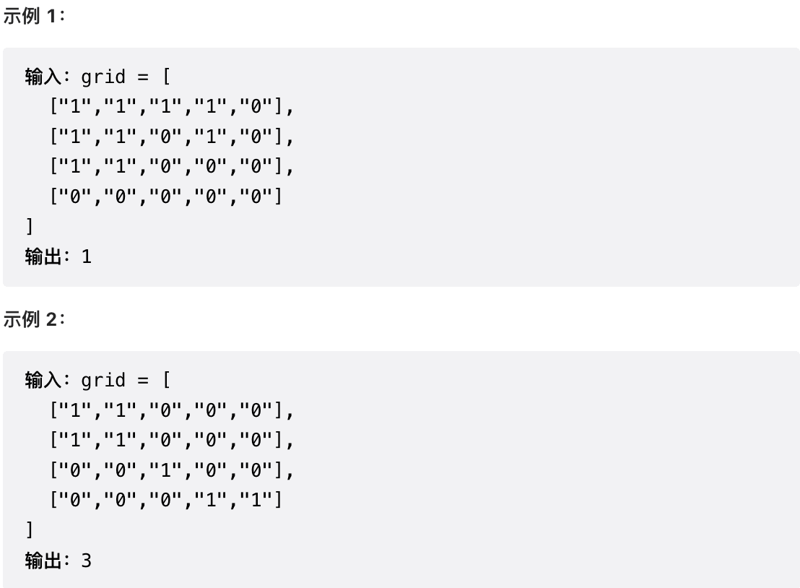
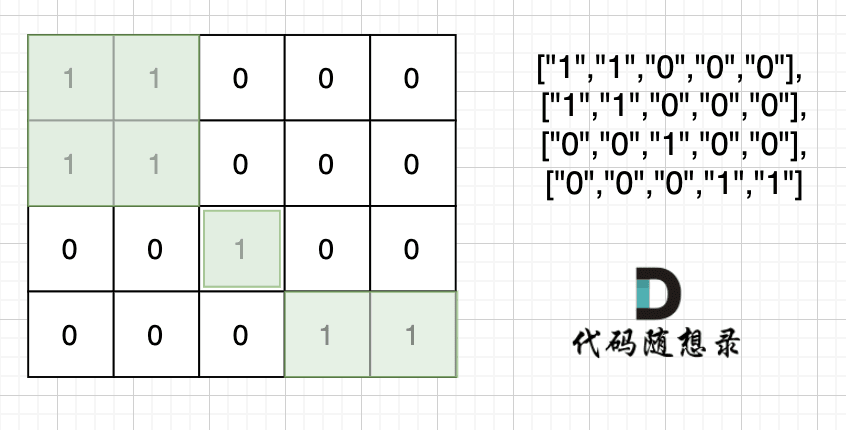
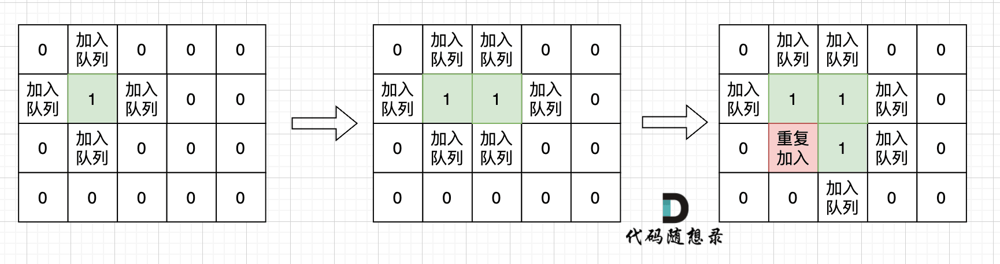

* [做專案（多個 C++、Java、Go、測試開發、前端專案）](https://www.programmercarl.com/other/kstar.html)
* [刷演算法（兩個月高強度學演算法）](https://www.programmercarl.com/xunlian/xunlianying.html)
* [背八股文（面試必考題，40 天挑戰高頻面試題）](https://www.programmercarl.com/xunlian/bagu.html)


# 200. 島嶼數量 

[題目連結](https://leetcode.com/problems/number-of-islands/)

給你一個由 '1'（陸地）和 '0'（水）組成的二維（two-dimensional）格子（grid），請你計算格子中島嶼的數量。

島嶼總是被水包圍，並且每座島嶼只能由水平方向和/或豎直方向上相鄰的陸地連接形成。

此外，你可以假設該格子的四條邊均被水包圍。



提示：

* m == grid.length
* n == grid[i].length
* 1 <= m, n <= 300
* grid[i][j] 的值為 '0' 或 '1'

## 解題思路 

注意題目中每座島嶼只能由**水平方向和/或豎直方向上**相鄰的陸地連接形成。

也就是說斜角度連接是不算的， 例如範例二，是三個島嶼，如圖：

 

這道題目是深度優先搜尋（depth-first search, DFS），廣度優先搜尋（breadth-first search, BFS），互斥集（disjoint set），基礎題目。

本題思路，是遇到一個沒有遍歷（traversal）過的節點（node）陸地，計數器（counter）就加一，然後把該節點陸地所能遍歷到的陸地都標記上。 

在遇到標記過的陸地節點和海洋節點的時候直接跳過。 這樣計數器就是最終島嶼的數量。

那麼如何把節點陸地所能遍歷到的陸地都標記上呢，就可以使用 DFS，BFS 或者互斥集。 

### 廣度優先搜尋（breadth-first search, BFS） 

不少同學用廣搜做這道題目的時候，逾時了。 這裡有一個廣搜中很重要的細節：

根本原因是**只要加入佇列（queue）就代表走過，就需要標記，而不是從佇列拿出來的時候再去標記走過**。

很多同學可能感覺這有區別嗎？

如果從佇列拿出節點，再去標記這個節點走過，就會發生下圖所示的結果，會導致很多節點重複（duplicate）加入佇列。



逾時寫法 （從佇列中取出節點再標記）

```CPP
int dir[4][2] = {0, 1, 1, 0, -1, 0, 0, -1}; // 四個方向
void bfs(vector<vector<char>>& grid, vector<vector<bool>>& visited, int x, int y) {
    queue<pair<int, int>> que;
    que.push({x, y});
    while(!que.empty()) {
        pair<int ,int> cur = que.front(); que.pop();
        int curx = cur.first;
        int cury = cur.second;
        visited[curx][cury] = true; // 從佇列中取出再標記走過
        for (int i = 0; i < 4; i++) {
            int nextx = curx + dir[i][0];
            int nexty = cury + dir[i][1];
            if (nextx < 0 || nextx >= grid.size() || nexty < 0 || nexty >= grid[0].size()) continue;  // 越界了，直接跳過
            if (!visited[nextx][nexty] && grid[nextx][nexty] == '1') {
                que.push({nextx, nexty});
            }
        }
    }

}
```

加入佇列就代表走過，立刻標記，正確寫法：

```CPP
int dir[4][2] = {0, 1, 1, 0, -1, 0, 0, -1}; // 四個方向
void bfs(vector<vector<char>>& grid, vector<vector<bool>>& visited, int x, int y) {
    queue<pair<int, int>> que;
    que.push({x, y});
    visited[x][y] = true; // 只要加入佇列，立刻標記
    while(!que.empty()) {
        pair<int ,int> cur = que.front(); que.pop();
        int curx = cur.first;
        int cury = cur.second;
        for (int i = 0; i < 4; i++) {
            int nextx = curx + dir[i][0];
            int nexty = cury + dir[i][1];
            if (nextx < 0 || nextx >= grid.size() || nexty < 0 || nexty >= grid[0].size()) continue;  // 越界了，直接跳過
            if (!visited[nextx][nexty] && grid[nextx][nexty] == '1') {
                que.push({nextx, nexty});
                visited[nextx][nexty] = true; // 只要加入佇列立刻標記
            }
        }
    }

}
```

以上兩個版本其實只有細微區別，就是 `visited[x][y] = true;` 放置的地方，這取決於我們對程式碼中佇列的定義，佇列中的節點就表示已經走過的節點。 **所以只要加入佇列，立即標記該節點走過**。

本題完整廣搜程式碼： 

```CPP
class Solution {
private:
int dir[4][2] = {0, 1, 1, 0, -1, 0, 0, -1}; // 四個方向
void bfs(vector<vector<char>>& grid, vector<vector<bool>>& visited, int x, int y) {
    queue<pair<int, int>> que;
    que.push({x, y});
    visited[x][y] = true; // 只要加入佇列，立刻標記
    while(!que.empty()) {
        pair<int ,int> cur = que.front(); que.pop();
        int curx = cur.first;
        int cury = cur.second;
        for (int i = 0; i < 4; i++) {
            int nextx = curx + dir[i][0];
            int nexty = cury + dir[i][1];
            if (nextx < 0 || nextx >= grid.size() || nexty < 0 || nexty >= grid[0].size()) continue;  // 越界了，直接跳過
            if (!visited[nextx][nexty] && grid[nextx][nexty] == '1') {
                que.push({nextx, nexty});
                visited[nextx][nexty] = true; // 只要加入佇列立刻標記
            }
        }
    }
}
public:
    int numIslands(vector<vector<char>>& grid) {
        int n = grid.size(), m = grid[0].size();
        vector<vector<bool>> visited = vector<vector<bool>>(n, vector<bool>(m, false));

        int result = 0;
        for (int i = 0; i < n; i++) {
            for (int j = 0; j < m; j++) {
                if (!visited[i][j] && grid[i][j] == '1') {
                    result++; // 遇到沒訪問過的陸地，+1
                    bfs(grid, visited, i, j); // 將與其連接的陸地都標記上 true
                }
            }
        }
        return result;
    }
};

```

## 其他語言版本

### Java

```java
class Solution {

    boolean[][] visited;
    int[][] move = {{0, 1}, {0, -1}, {1, 0}, {-1, 0}};

    public int numIslands(char[][] grid) {
        int res = 0;
        visited = new boolean[grid.length][grid[0].length];
        for(int i = 0; i < grid.length; i++) {
            for(int j = 0; j < grid[0].length; j++) {
                if(!visited[i][j] && grid[i][j] == '1') {
                    bfs(grid, i, j);
                    res++;
                }
            }
        }
        return res;
    }

    //將這片島嶼上的所有陸地都訪問到
    public void bfs(char[][] grid, int y, int x) {
        Deque<int[]> queue = new ArrayDeque<>();
        queue.offer(new int[]{y, x});
        visited[y][x] = true;
        while(!queue.isEmpty()) {
            int[] cur = queue.poll();
            int m = cur[0];
            int n = cur[1];
            for(int i = 0; i < 4; i++) {
                int nexty = m + move[i][0];
                int nextx = n + move[i][1];
                if(nextx < 0 || nexty == grid.length || nexty < 0 || nextx == grid[0].length) continue;
                if(!visited[nexty][nextx] && grid[nexty][nextx] == '1') {
                    queue.offer(new int[]{nexty, nextx}); 
                    visited[nexty][nextx] = true; //只要加入佇列就標記為訪問
                }
            }
        }
    }
}
```


### Python

BFS solution 

```python
class Solution:
    def __init__(self):
        self.dirs = [[0, 1], [1, 0], [-1, 0], [0, -1]] 
        
    def numIslands(self, grid: List[List[str]]) -> int:
        m = len(grid)
        n = len(grid[0])
        visited = [[False]*n for _ in range(m)]
        res = 0
        for i in range(m):
            for j in range(n):
                if visited[i][j] == False and grid[i][j] == '1':
                    res += 1
                    self.bfs(grid, i, j, visited)  # Call bfs within this condition
        return res

    def bfs(self, grid, i, j, visited):
        q = deque()
        q.append((i,j))
        visited[i][j] = True
        while q:
            x, y = q.popleft()
            for k in range(4):
                next_i = x + self.dirs[k][0]
                next_j = y + self.dirs[k][1]

                if next_i < 0 or next_i >= len(grid):
                    continue 
                if next_j < 0 or next_j >= len(grid[0]):
                    continue
                if visited[next_i][next_j]:
                    continue
                if grid[next_i][next_j] == '0':
                    continue
                q.append((next_i, next_j))
                visited[next_i][next_j] = True

```
### JavaScript

```javascript
var numIslands = function (grid) {
    let dir = [[0, 1], [1, 0], [-1, 0], [0, -1]]; // 四個方向
    let bfs = (grid, visited, x, y) => {
        let queue = [];
        queue.push([x, y]);
        visited[x][y] = true;
        while (queue.length) {
            let top = queue.shift();//取出佇列頭部元素
            console.log(top)
            for (let i = 0; i < 4; i++) {
                let nextX = top[0] + dir[i][0]
                let nextY = top[1] + dir[i][1]
                if (nextX < 0 || nextX >= grid.length || nextY < 0 || nextY >= grid[0].length)
                    continue;
                if (!visited[nextX][nextY] && grid[nextX][nextY] === "1") {
                    queue.push([nextX, nextY])
                    visited[nextX][nextY] = true
                }
            }
        }
    }
    let visited = new Array(grid.length).fill().map(() => Array(grid[0].length).fill(false))
    let res = 0
    for (let i = 0; i < grid.length; i++) {
        for (let j = 0; j < grid[i].length; j++) {
            if (!visited[i][j] && grid[i][j] === "1") {
                ++res;
                bfs(grid, visited, i, j);
            }
        }
    }
    return res
};
```

### TypeScript

```TypeScript
function numIslands2(grid: string[][]): number {
	// 四個方向
	const dir: number[][] = [[0, 1], [1, 0], [-1, 0], [0, -1]];
	const [m, n]: [number, number] = [grid.length, grid[0].length];

	function dfs(grid: string[][], visited: boolean[][], x: number, y: number) {
		const queue: number[][] = [[x, y]];
		while (queue.length !== 0) {
			//取出佇列頭部元素
			const top: number[] = queue.shift()!;
			for (let i = 0; i < 4; i++) {
				const nextX: number = top[0] + dir[i][0];
				const nextY: number = top[1] + dir[i][1];
				// 越界了，直接跳過
				if (nextX < 0 || nextX >= m || nextY < 0 || nextY >= n) {
					continue;
				}
				if (!visited[nextX][nextY] && grid[nextX][nextY] === '1') {
					queue.push([nextX, nextY]);
					// 只要加入佇列立刻標記
					visited[nextX][nextY] = true;
				}
			}
		}
	}

	const visited: boolean[][] = Array.from({ length: m }, _ => new Array(n).fill(false));

	let result = 0;
	for (let i = 0; i < m; i++) {
		for (let k = 0; k < n; k++) {
			if (!visited[i][k] && grid[i][k] === '1') {
				++result; // 遇到沒訪問過的陸地，+1
				visited[i][k] = true;
				dfs(grid, visited, i, k); // 將與其連接的陸地都標記上 true
			}
		}
	}
	return result;
}
```

### Go

```go
var DIRECTIONS = [4][2]int{{-1, 0}, {0, -1}, {1, 0}, {0, 1}}

func numIslands(grid [][]byte) int {
	res := 0

	visited := make([][]bool, len(grid))
	for i := 0; i < len(grid); i++ {
		visited[i] = make([]bool, len(grid[0]))
	}

	for i, rows := range grid {
		for j, v := range rows {
			if v == '1' && !visited[i][j] {
				res++
				bfs(grid, visited, i, j)
			}
		}
	}
	return res
}

func bfs(grid [][]byte, visited [][]bool, i, j int) {
	queue := [][2]int{{i, j}}
	visited[i][j] = true // 標記已訪問，迴圈中標記會導致重複
	for len(queue) > 0 {
		cur := queue[0]
		queue = queue[1:]
		for _, d := range DIRECTIONS {
			x, y := cur[0]+d[0], cur[1]+d[1]
			if x < 0 || x >= len(grid) || y < 0 || y >= len(grid[0]) {
				continue
			}
			if grid[x][y] == '1' && !visited[x][y] {
				visited[x][y] = true
				queue = append(queue, [2]int{x, y})
			}
		}
	}
}
```

### Rust

```rust
use std::collections::VecDeque;
impl Solution {
    const DIRECTIONS: [(i32, i32); 4] = [(0, 1), (1, 0), (-1, 0), (0, -1)];
    pub fn num_islands(grid: Vec<Vec<char>>) -> i32 {
        let mut visited = vec![vec![false; grid[0].len()]; grid.len()];
        let mut res = 0;
        for (i, chars) in grid.iter().enumerate() {
            for (j, &c) in chars.iter().enumerate() {
                if !visited[i][j] && c == '1' {
                    res += 1;
                    Self::bfs(&grid, &mut visited, (i as i32, j as i32));
                }
            }
        }
        res
    }

    pub fn bfs(grid: &Vec<Vec<char>>, visited: &mut Vec<Vec<bool>>, (x, y): (i32, i32)) {
        let mut queue = VecDeque::new();
        queue.push_back((x, y));
        visited[x as usize][y as usize] = true;
        while let Some((cur_x, cur_y)) = queue.pop_front() {
            for (dx, dy) in Self::DIRECTIONS {
                let (nx, ny) = (cur_x + dx, cur_y + dy);
                if nx < 0 || nx >= grid.len() as i32 || ny < 0 || ny >= grid[0].len() as i32 {
                    continue;
                }
                let (nx, ny) = (nx as usize, ny as usize);
                if grid[nx][ny] == '1' && !visited[nx][ny] {
                    visited[nx][ny] = true;
                    queue.push_back((nx as i32, ny as i32));
                }
            }
        }
    }
}
```
