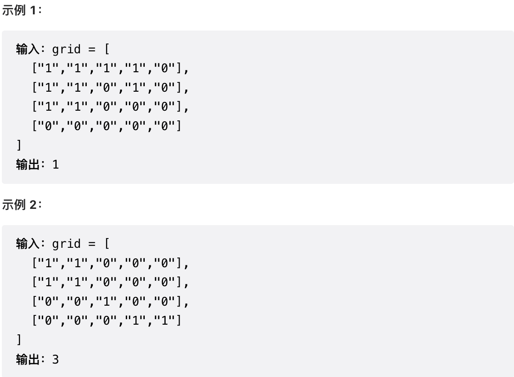
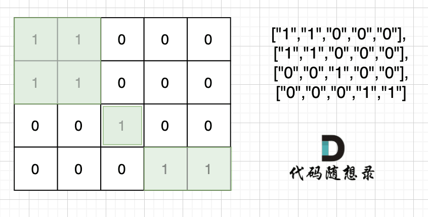

* [做專案（多個 C++、Java、Go、測試開發、前端專案）](https://www.programmercarl.com/other/kstar.html)
* [刷演算法（兩個月高強度學演算法）](https://www.programmercarl.com/xunlian/xunlianying.html)
* [背八股文（面試必考題，40 天挑戰高頻面試題）](https://www.programmercarl.com/xunlian/bagu.html)

# 200. 島嶼數量 

[題目連結](https://leetcode.cn/problems/number-of-islands/)

給你一個由 '1'（陸地）和 '0'（水）組成的二維（two-dimensional）格子（grid），請你計算格子中島嶼的數量。

島嶼總是被水包圍，並且每座島嶼只能由水平方向和/或豎直方向上相鄰的陸地連接形成。

此外，你可以假設該格子的四條邊均被水包圍。



提示：

* m == grid.length
* n == grid[i].length
* 1 <= m, n <= 300
* grid[i][j] 的值為 '0' 或 '1'

## 解題思路 

注意題目中每座島嶼只能由**水平方向和/或豎直方向上**相鄰的陸地連接形成。

也就是說斜角度連接是不算的， 例如範例二，是三個島嶼，如圖：

 

這道題目是 深度優先搜尋（depth-first search, DFS），廣度優先搜尋（breadth-first search, BFS），互斥集（disjoint set），基礎題目。

本題思路，是遇到一個沒有遍歷（traversal）過的節點（node）陸地，計數器（counter）就加一，然後把該節點陸地所能遍歷到的陸地都標記上。 

在遇到標記過的陸地節點和海洋節點的時候直接跳過。 這樣計數器就是最終島嶼的數量。

那麼如何把節點陸地所能遍歷到的陸地都標記上呢，就可以使用 DFS，BFS 或者互斥集。 

### 深度優先搜尋（depth-first search, DFS） 

以下程式碼使用 dfs 實作，如果對 dfs 不太了解的話，建議先看這篇題解：[797.所有可能的路徑](https://programmercarl.com/0797.%E6%89%80%E6%9C%89%E5%8F%AF%E8%83%BD%E7%9A%84%E8%B7%AF%E5%BE%84.html)，

C++ 程式碼如下：

```CPP 
// 版本一 
class Solution {
private:
    int dir[4][2] = {0, 1, 1, 0, -1, 0, 0, -1}; // 四個方向
    void dfs(vector<vector<char>>& grid, vector<vector<bool>>& visited, int x, int y) {
        for (int i = 0; i < 4; i++) {
            int nextx = x + dir[i][0];
            int nexty = y + dir[i][1];
            if (nextx < 0 || nextx >= grid.size() || nexty < 0 || nexty >= grid[0].size()) continue;  // 越界了，直接跳過
            if (!visited[nextx][nexty] && grid[nextx][nexty] == '1') { // 沒有訪問過的 同時 是陸地的

                visited[nextx][nexty] = true; 
                dfs(grid, visited, nextx, nexty);
            } 
        }
    }
public:
    int numIslands(vector<vector<char>>& grid) {
        int n = grid.size(), m = grid[0].size();
        vector<vector<bool>> visited = vector<vector<bool>>(n, vector<bool>(m, false)); 

        int result = 0;
        for (int i = 0; i < n; i++) {
            for (int j = 0; j < m; j++) {
                if (!visited[i][j] && grid[i][j] == '1') { 
                    visited[i][j] = true;
                    result++; // 遇到沒訪問過的陸地，+1
                    dfs(grid, visited, i, j); // 將與其連接的陸地都標記上 true
                }
            }
        }
        return result;
    }
};
```

很多讀者可能有疑惑，為什麼以上程式碼中的 dfs 函數（function），沒有終止條件（termination condition）呢？ 感覺遞迴（recursion）沒有終止很危險。

其實終止條件就寫在了呼叫 dfs 的地方，如果遇到不合法的方向，直接不會去呼叫 dfs。 

當然也可以這麼寫： 

```CPP 
// 版本二
class Solution {
private:
    int dir[4][2] = {0, 1, 1, 0, -1, 0, 0, -1}; // 四個方向
    void dfs(vector<vector<char>>& grid, vector<vector<bool>>& visited, int x, int y) {
        if (visited[x][y] || grid[x][y] == '0') return; // 終止條件：訪問過的節點 或者 遇到海水
        visited[x][y] = true; // 標記訪問過
        for (int i = 0; i < 4; i++) {
            int nextx = x + dir[i][0];
            int nexty = y + dir[i][1];
            if (nextx < 0 || nextx >= grid.size() || nexty < 0 || nexty >= grid[0].size()) continue;  // 越界了，直接跳過
            dfs(grid, visited, nextx, nexty);
        }
    }
public:
    int numIslands(vector<vector<char>>& grid) {
        int n = grid.size(), m = grid[0].size();
        vector<vector<bool>> visited = vector<vector<bool>>(n, vector<bool>(m, false));

        int result = 0;
        for (int i = 0; i < n; i++) {
            for (int j = 0; j < m; j++) {
                if (!visited[i][j] && grid[i][j] == '1') {
                    result++; // 遇到沒訪問過的陸地，+1
                    dfs(grid, visited, i, j); // 將與其連接的陸地都標記上 true
                }
            }
        }
        return result;
    }
};
```

這裡大家應該能看出區別了，無非就是版本一中呼叫 dfs 的條件（condition）判斷放在了版本二的終止條件位置上。 

**版本一的寫法**是：下一個節點是否合法已經判斷完了，只要呼叫 dfs 就是可以合法的節點。 

**版本二的寫法**是：不管節點是否合法，上來就 dfs，然後在終止條件的地方進行判斷，不合法再 return。 

**理論上來講，版本一的效率更高一些**，因為避免了沒有意義的遞迴呼叫（recursive call），在呼叫 dfs 之前，就做合法性判斷。 但從寫法來說，可能版本二更利於理解一些。（不過其實都差不太多）

很多同學看了同一道題目，都是 dfs，寫法卻不一樣，有時候有終止條件，有時候連終止條件都沒有，其實這就是根本原因，兩種寫法而已。 


## 總結 

其實本題是 dfs，bfs 模板（template）題，但正是因為是模板題，所以大家或者一些題解把重要的細節都忽略了，我這裡把大家沒注意的但以後會踩的陷阱都給列出來了。 

本篇我只給出 dfs 的寫法，大家發現我寫的還是比較細的，那麼後面我再單獨更新本題的 bfs 寫法，雖然是模板題，但依然有很多注意的點，敬請期待！


## 其他語言版本

### Java

下面的程式碼使用的是DFS DFS 的做法。為了統計島嶼數量同時不重複（duplicate）記錄，每當我們搜尋到一個島後，就將這個島 「淹沒」 —— 將這個島所占的地方從 「1」 改為 「0」，這樣就不用擔心後續會重複記錄這個島嶼了。而 DFS 的過程就體現在 「淹沒」 這一步中。詳見程式碼：

```java
public int numIslands(char[][] grid) {
    int res = 0; //記錄找到的島嶼數量
    for(int i = 0;i < grid.length;i++){
        for(int j = 0;j < grid[0].length;j++){
        	//找到「1」，res 加一，同時淹沒這個島
            if(grid[i][j] == '1'){
                res++;
                dfs(grid,i,j);
            }
        }
    }
    return res;
}
//使用 DFS「淹沒」島嶼
public void dfs(char[][] grid, int i, int j){
	//搜尋邊界：索引越界或遍歷到了"0"
    if(i < 0 || i >= grid.length || j < 0 || j >= grid[0].length || grid[i][j] == '0') return;
    //將這塊土地標記為"0"
    grid[i][j] = '0';
    //根據"每座島嶼只能由水平方向或豎直方向上相鄰的陸地連接形成"，對上下左右的相鄰頂點進行 dfs
    dfs(grid,i - 1,j);
    dfs(grid,i + 1,j);
    dfs(grid,i,j + 1);
    dfs(grid,i,j - 1);
}
```
```java
//graph - dfs (和卡哥的程式碼邏輯一致)
class Solution {
    boolean[][] visited;
    int dir[][] = {
        {0, 1}, //right
        {1, 0}, //down
        {-1, 0}, //up
        {0, -1} //left
    };
    public int numIslands(char[][] grid) {
        int count = 0;
        visited = new boolean[grid.length][grid[0].length];

        for(int i = 0; i < grid.length; i++){
            for(int j = 0; j < grid[0].length; j++){
                if(visited[i][j] == false && grid[i][j] == '1'){
                    count++;
                    dfs(grid, i, j);
                }
            }
        }
        return count;
    }

    private void dfs(char[][]grid, int x, int y){
        if(visited[x][y] == true || grid[x][y] == '0')
            return;
	    
        visited[x][y] = true;
	
        for(int i = 0; i < 4; i++){
            int nextX = x + dir[i][0];
            int nextY = y + dir[i][1];
            if(nextX < 0 || nextY < 0 || nextX >= grid.length || nextY >= grid[0].length)
                continue;
            dfs(grid, nextX, nextY);
        }
    }
}
```

### Python:

```python
# 版本一
class Solution:
    def numIslands(self, grid: List[List[str]]) -> int:
        m, n = len(grid), len(grid[0])
        visited = [[False] * n for _ in range(m)]
        dirs = [(-1, 0), (0, 1), (1, 0), (0, -1)]  # 四個方向
        result = 0

        def dfs(x, y):
            for d in dirs:
                nextx = x + d[0]
                nexty = y + d[1]
                if nextx < 0 or nextx >= m or nexty < 0 or nexty >= n:  # 越界了，直接跳過
                    continue
                if not visited[nextx][nexty] and grid[nextx][nexty] == '1':  # 沒有訪問過的同時是陸地的
                    visited[nextx][nexty] = True
                    dfs(nextx, nexty)
        
        for i in range(m):
            for j in range(n):
                if not visited[i][j] and grid[i][j] == '1':
                    visited[i][j] = True
                    result += 1  # 遇到沒訪問過的陸地，+1
                    dfs(i, j)  # 將與其連接的陸地都標記上 true

        return result
```

```python
# 版本二
class Solution:
    def numIslands(self, grid: List[List[str]]) -> int:
        m, n = len(grid), len(grid[0])
        visited = [[False] * n for _ in range(m)]
        dirs = [(-1, 0), (0, 1), (1, 0), (0, -1)]  # 四個方向
        result = 0

        def dfs(x, y):
            if visited[x][y] or grid[x][y] == '0':
                return  # 終止條件：訪問過的節點 或者 遇到海水
            visited[x][y] = True
            for d in dirs:
                nextx = x + d[0]
                nexty = y + d[1]
                if nextx < 0 or nextx >= m or nexty < 0 or nexty >= n:  # 越界了，直接跳過
                    continue
                dfs(nextx, nexty)
        
        for i in range(m):
            for j in range(n):
                if not visited[i][j] and grid[i][j] == '1':
                    result += 1  # 遇到沒訪問過的陸地，+1
                    dfs(i, j)  # 將與其連接的陸地都標記上 true

        return result
```
```python 
# 我們用三個狀態去標記每一個格子
# 0 代表海水
# 1 代表陸地
# 2 代表已經訪問的陸地
class Solution:
    def traversal(self, grid, i, j):
        m = len(grid)
        n = len(grid[0])

        if i < 0 or j < 0 or i >= m or j >= n:
            return   # 越界了
        elif grid[i][j] == "2" or grid[i][j] == "0":
            return 

        grid[i][j] = "2"
        self.traversal(grid, i - 1, j) # 往上走
        self.traversal(grid, i + 1, j) # 往下走
        self.traversal(grid, i, j - 1) # 往左走
        self.traversal(grid, i, j + 1) # 往右走

    def numIslands(self, grid: List[List[str]]) -> int:
        res = 0


        for i in range(len(grid)):
            for j in range(len(grid[0])):
                if grid[i][j] == "1":
                    res += 1
                    self.traversal(grid, i, j)

        return res
```

### JavaScript

```javascript
var numIslands = function (grid) {
    let dir = [[0, 1], [1, 0], [-1, 0], [0, -1]]; // 四個方向

    let dfs = (grid, visited, x, y) => {
        for (let i = 0; i < 4; i++) {
            let nextX = x + dir[i][0]
            let nextY = y + dir[i][1]
            if (nextX < 0 || nextX >= grid.length || nextY < 0 || nextY >= grid[0].length)
                continue;
            if (!visited[nextX][nextY] && grid[nextX][nextY] === "1") {
                visited[nextX][nextY] = true
                dfs(grid,visited,nextX,nextY)
            }
        }
    }
    let visited = new Array(grid.length).fill().map(() => Array(grid[0].length).fill(false))

    let res = 0
    for (let i = 0; i < grid.length; i++) {
        for (let j = 0; j < grid[i].length; j++) {
            if (!visited[i][j] && grid[i][j] === "1") {
                ++res;
                visited[i][j] = true;
                dfs(grid, visited, i, j);
            }
        }
    }
    return res
};
```

### TypeScript

```TypeScript
function numIslands(grid: string[][]): number {
	// 四個方向
	const dir: number[][] = [[0, 1], [1, 0], [-1, 0], [0, -1]];
	const [m, n]: [number, number] = [grid.length, grid[0].length];

	function dfs(grid: string[][], visited: boolean[][], x: number, y: number) {
		for (let i = 0; i < 4; i++) {
			let nextX: number = x + dir[i][0];
			let nextY: number = y + dir[i][1];
			// 越界了，直接跳過
			if (nextX < 0 || nextX >= m || nextY < 0 || nextY >= n) {
				continue;
			}
			// 沒有訪問過同時是陸地
			if (!visited[nextX][nextY] && grid[nextX][nextY] === '1') {
				visited[nextX][nextY] = true;
				dfs(grid, visited, nextX, nextY);
			}
		}
	}

	const visited: boolean[][] = Array.from({ length: m }, _ => new Array(n).fill(false));

	let result: number = 0;
	for (let i = 0; i < m; i++) {
		for (let k = 0; k < n; k++) {
			if (!visited[i][k] && grid[i][k] === '1') {
				++result; // 遇到沒訪問過的陸地，+1
				visited[i][k] = true;
				dfs(grid, visited, i, k); // 將與其連接的陸地都標記上 true
			}
		}
	}
	return result;
}
```

### Go

```go

var DIRECTIONS = [4][2]int{{-1, 0}, {0, -1}, {1, 0}, {0, 1}}

func numIslands(grid [][]byte) int {
	res := 0

	visited := make([][]bool, len(grid))
	for i := 0; i < len(grid); i++ {
		visited[i] = make([]bool, len(grid[0]))
	}

	for i, rows := range grid {
		for j, v := range rows {
			if v == '1' && !visited[i][j] {
				res++
				dfs(grid, visited, i, j)
			}
		}
	}

	return res
}

func dfs(grid [][]byte, visited [][]bool, i, j int) {
        visited[x][y] = true
	for _, d := range DIRECTIONS {
		x, y := i+d[0], j+d[1]
		if x < 0 || x >= len(grid) || y < 0 || y >= len(grid[0]) {
			continue
		}
		if grid[x][y] == '1' && !visited[x][y] {
			dfs(grid, visited, x, y)
		}
	}

}
```

### Rust:


```rust
impl Solution {
    const DIRECTIONS: [(i32, i32); 4] = [(0, 1), (1, 0), (-1, 0), (0, -1)];
    pub fn num_islands(grid: Vec<Vec<char>>) -> i32 {
        let mut visited = vec![vec![false; grid[0].len()]; grid.len()];
        let mut res = 0;
        for (i, chars) in grid.iter().enumerate() {
            for (j, &c) in chars.iter().enumerate() {
                if !visited[i][j] && c == '1' {
                    res += 1;
                    Self::dfs(&grid, &mut visited, (i as i32, j as i32));
                }
            }
        }
        res
    }

    pub fn dfs(grid: &Vec<Vec<char>>, visited: &mut Vec<Vec<bool>>, (x, y): (i32, i32)) {
        for (dx, dy) in Self::DIRECTIONS {
            let (nx, ny) = (x + dx, y + dy);
            if nx < 0 || nx >= grid.len() as i32 || ny < 0 || ny >= grid[0].len() as i32 {
                continue;
            }
            let (nx, ny) = (nx as usize, ny as usize);
            if grid[nx][ny] == '1' && !visited[nx][ny] {
                visited[nx][ny] = true;
                Self::dfs(grid, visited, (nx as i32, ny as i32));
            }
        }
    }
}
```

