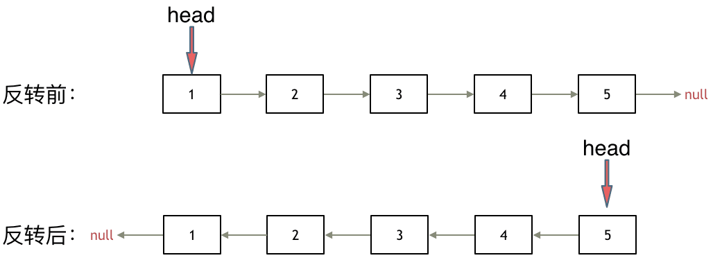
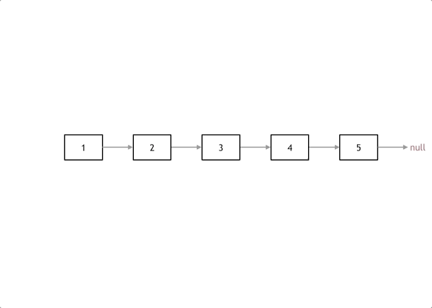
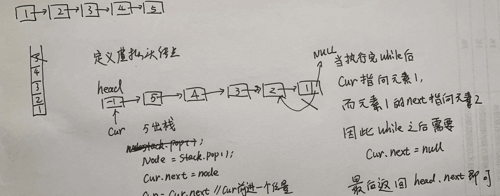

* [做專案（多個 C++、Java、Go、測試開發、前端專案）](https://www.programmercarl.com/other/kstar.html)
* [刷演算法（兩個月高強度學演算法）](https://www.programmercarl.com/xunlian/xunlianying.html)
* [背八股（40 天挑戰高頻面試題）](https://www.programmercarl.com/xunlian/bagu.html)


> 反轉（reverse）鏈接串列（linked list）的寫法很簡單，有些同學甚至可以背下來但過一陣子就忘了該怎麼寫，主要是因為沒有理解真正的反轉過程。

# 206.反轉鏈接串列

[LeetCode 題目連結](https://leetcode.cn/problems/reverse-linked-list/)

題意：反轉一個單向鏈接串列（singly-linked list）。

範例:
輸入: 1->2->3->4->5->NULL
輸出: 5->4->3->2->1->NULL

## 演算法（algorithm）公開課

**[《代碼隨想錄》演算法影片公開課](https://programmercarl.com/other/gongkaike.html)：[幫你拿下反轉鏈接串列 | LeetCode：206.反轉鏈接串列](https://www.bilibili.com/video/BV1nB4y1i7eL)，相信結合影片再看本篇題解，更有助於大家對本題的理解**。


## 解題思路

如果再定義一個新的鏈接串列，實作鏈接串列元素（element）的反轉，其實這是對記憶體（memory）空間的浪費。

其實只需要改變鏈接串列的 next 指標（pointer）的指向，直接將鏈接串列反轉，而不用重新定義一個新的鏈接串列，如圖所示:




之前鏈接串列的頭節點（head node）是元素 1，反轉之後頭節點就是元素 5，這裡並沒有新增或者刪除（delete）節點（node），僅僅是改變 next 指標的方向。

那麼接下來看一看是如何反轉的呢？

我們拿範例中的鏈接串列來舉例，如動畫所示：（糾正：動畫應該是先移動 pre，再移動 cur）



首先定義一個 cur 指標，指向頭節點，再定義一個 pre 指標，初始化（initialization）為 null。

然後就要開始反轉了，首先要把 cur->next 節點用 tmp 指標保存一下，也就是保存一下這個節點。

為什麼要保存一下這個節點呢，因為接下來要改變 cur->next 的指向了，將 cur->next 指向 pre，此時已經反轉了第一個節點了。

接下來，就是迴圈（loop）走如下程式碼邏輯了，繼續移動 pre 和 cur 指標。

最後，cur 指標已經指向了 null，迴圈結束，鏈接串列也反轉完畢了。此時我們回傳 pre 指標就可以了，pre 指標就指向了新的頭節點。

### two pointers 法
```CPP
class Solution {
public:
    ListNode* reverseList(ListNode* head) {
        ListNode* temp; // 保存 cur 的下一個節點
        ListNode* cur = head;
        ListNode* pre = NULL;
        while(cur) {
            temp = cur->next;  // 保存一下 cur 的下一個節點，因為接下來要改變 cur->next
            cur->next = pre; // 反轉操作
            // 更新 pre 和 cur 指標
            pre = cur;
            cur = temp;
        }
        return pre;
    }
};
```

* 時間複雜性（time complexity）: O(n)
* 空間複雜度（space complexity）: O(1)

### 遞迴（recursion）法

遞迴法相對抽象一些，但是其實和 two pointers 法是一樣的邏輯，同樣是當 cur 為空的時候迴圈結束，不斷將 cur 指向 pre 的過程。

關鍵是初始化的地方，可能有的同學會不理解，可以看到 two pointers 法中初始化 cur = head，pre = NULL，在遞迴法中可以從如下程式碼看出初始化的邏輯也是一樣的，只不過寫法變了。

具體可以看程式碼（已經詳細註解），**two pointers 法寫出來之後，理解如下遞迴寫法就不難了，程式碼邏輯都是一樣的。**
```CPP
class Solution {
public:
    ListNode* reverse(ListNode* pre,ListNode* cur){
        if(cur == NULL) return pre;
        ListNode* temp = cur->next;
        cur->next = pre;
        // 可以和 two pointers 法的程式碼進行對比，如下遞迴的寫法，其實就是做了這兩步
        // pre = cur;
        // cur = temp;
        return reverse(cur,temp);
    }
    ListNode* reverseList(ListNode* head) {
        // 和 two pointers 法初始化是一樣的邏輯
        // ListNode* cur = head;
        // ListNode* pre = NULL;
        return reverse(NULL, head);
    }

};
```

* 時間複雜性: O(n), 要遞迴處理鏈接串列的每個節點
* 空間複雜度: O(n), 遞迴呼叫了 n 層堆疊空間（stack space）

我們可以發現，上面的遞迴寫法和 two pointers 法實質上都是從前往後反轉指標指向，其實還有另外一種與 two pointers 法不同思路的遞迴寫法：從後往前反轉指標指向。

具體程式碼如下（帶詳細註解）：

```CPP
class Solution {
public:
    ListNode* reverseList(ListNode* head) {
        // 邊界條件判斷
        if(head == NULL) return NULL;
        if (head->next == NULL) return head;
        
        // 遞迴呼叫，反轉第二個節點開始往後的鏈接串列
        ListNode *last = reverseList(head->next);
        // 反轉頭節點與第二個節點的指向
        head->next->next = head;
        // 此時的 head 節點為尾節點，next 需要指向 NULL
        head->next = NULL;
        return last;
    }
}; 
```

* 時間複雜性: O(n)
* 空間複雜度: O(n)


## 其他語言版本

### Java：

```java
// two pointers
class Solution {
    public ListNode reverseList(ListNode head) {
        ListNode prev = null;
        ListNode cur = head;
        ListNode temp = null;
        while (cur != null) {
            temp = cur.next;// 保存下一個節點
            cur.next = prev;
            prev = cur;
            cur = temp;
        }
        return prev;
    }
}
```

```java
// 遞迴 
class Solution {
    public ListNode reverseList(ListNode head) {
        return reverse(null, head);
    }

    private ListNode reverse(ListNode prev, ListNode cur) {
        if (cur == null) {
            return prev;
        }
        ListNode temp = null;
        temp = cur.next;// 先保存下一個節點
        cur.next = prev;// 反轉
        // 更新 prev、cur 位置
        // prev = cur;
        // cur = temp;
        return reverse(cur, temp);
    }
}
```

```java
// 從後向前遞迴
class Solution {
    ListNode reverseList(ListNode head) {
        // 邊界條件判斷
        if(head == null) return null;
        if (head.next == null) return head;
        
        // 遞迴呼叫，反轉第二個節點開始往後的鏈接串列
        ListNode last = reverseList(head.next);
        // 反轉頭節點與第二個節點的指向
        head.next.next = head;
        // 此時的 head 節點為尾節點，next 需要指向 NULL
        head.next = null;
        return last;
    } 
}
```

### Python：

```python
（版本一）two pointers 法
# Definition for singly-linked list.
# class ListNode:
#     def __init__(self, val=0, next=None):
#         self.val = val
#         self.next = next
class Solution:
    def reverseList(self, head: ListNode) -> ListNode:
        cur = head   
        pre = None
        while cur:
            temp = cur.next # 保存一下 cur 的下一個節點，因為接下來要改變 cur->next
            cur.next = pre #反轉
            #更新 pre、cur 指標
            pre = cur
            cur = temp
        return pre
```

```python
（版本二）遞迴法
# Definition for singly-linked list.
# class ListNode:
#     def __init__(self, val=0, next=None):
#         self.val = val
#         self.next = next
class Solution:
    def reverseList(self, head: ListNode) -> ListNode:
        return self.reverse(head, None)
    def reverse(self, cur: ListNode, pre: ListNode) -> ListNode:
        if cur == None:
            return pre
        temp = cur.next
        cur.next = pre
        return self.reverse(temp, cur)

```


### Go：

```go
//two pointers
func reverseList(head *ListNode) *ListNode {
    var pre *ListNode
    cur := head
    for cur != nil {
        next := cur.Next
        cur.Next = pre
        pre = cur
        cur = next
    }
    return pre
}

//遞迴
func reverseList(head *ListNode) *ListNode {
    return help(nil, head)
}

func help(pre, head *ListNode)*ListNode{
    if head == nil {
        return pre
    }
    next := head.Next
    head.Next = pre
    return help(head, next)
}

```
### JavaScript: 

```js
/**
 * @param {ListNode} head
 * @return {ListNode}
 */

// two pointers：
var reverseList = function(head) {
    if(!head || !head.next) return head;
    let temp = null, pre = null, cur = head;
    while(cur) {
        temp = cur.next;
        cur.next = pre;
        pre = cur;
        cur = temp;
    }
    // temp = cur = null;
    return pre;
};

// 遞迴：
var reverse = function(pre, head) {
    if(!head) return pre;
    const temp = head.next;
    head.next = pre;
    pre = head
    return reverse(pre, temp);
}

var reverseList = function(head) {
    return reverse(null, head);
};

// 遞迴 2
var reverse = function(head) {
    if(!head || !head.next) return head;
    // 從後往前翻
    const pre = reverse(head.next);
    head.next = pre.next;
    pre.next = head;
    return head;
}

var reverseList = function(head) {
    let cur = head;
    while(cur && cur.next) {
        cur = cur.next;
    }
    reverse(head);
    return cur;
};
```

### TypeScript:

```typescript
// two pointers 法
function reverseList(head: ListNode | null): ListNode | null {
    let preNode: ListNode | null = null,
        curNode: ListNode | null = head,
        tempNode: ListNode | null;
    while (curNode) {
        tempNode = curNode.next;
        curNode.next = preNode;
        preNode = curNode;
        curNode = tempNode;
    }
    return preNode;
};

// 遞迴（從前往後反轉）
function reverseList(head: ListNode | null): ListNode | null {
    function recur(preNode: ListNode | null, curNode: ListNode | null): ListNode | null {
        if (curNode === null) return preNode;
        let tempNode: ListNode | null = curNode.next;
        curNode.next = preNode;
        preNode = curNode;
        curNode = tempNode;
        return recur(preNode, curNode);
    }
    return recur(null, head);
};

// 遞迴（從後往前反轉）
function reverseList(head: ListNode | null): ListNode | null {
    if (head === null) return null;
    let newHead: ListNode | null;
    function recur(node: ListNode | null, preNode: ListNode | null): void {
        if (node.next === null) {
            newHead = node;
            newHead.next = preNode;
        } else {
            recur(node.next, node);
            node.next = preNode;
        }
    }
    recur(head, null);
    return newHead;
};
```

### Ruby:

```ruby
# two pointers
# Definition for singly-linked list.
# class ListNode
#     attr_accessor :val, :next
#     def initialize(val = 0, _next = nil)
#         @val = val
#         @next = _next
#     end
# end
def reverse_list(head)
  # return nil if head.nil?	# 迴圈判斷條件亦能起到相同作用因此不必單獨判斷
  cur, per = head, nil
  until cur.nil?
    tem = cur.next
    cur.next = per
    per = cur
    cur = tem
  end
  per
end

# 遞迴
# Definition for singly-linked list.
# class ListNode
#     attr_accessor :val, :next
#     def initialize(val = 0, _next = nil)
#         @val = val
#         @next = _next
#     end
# end
def reverse_list(head)
  reverse(nil, head)
end

def reverse(pre, cur)
  return pre if cur.nil?
  tem = cur.next
  cur.next = pre
  reverse(cur, tem)	# 透過遞迴實作 two pointers 法中的更新操作
end
```

### Kotlin:

```Kotlin
fun reverseList(head: ListNode?): ListNode? {
    var pre: ListNode? = null
    var cur = head
    while (cur != null) {
        val temp = cur.next
        cur.next = pre
        pre = cur
        cur = temp
    }
    return pre
}
```
```kotlin
/**
 * Example:
 * var li = ListNode(5)
 * var v = li.`val`
 * Definition for singly-linked list.
 * class ListNode(var `val`: Int) {
 *     var next: ListNode? = null
 * }
 */
class Solution {
    fun reverseList(head: ListNode?): ListNode? {
        // temp 用來儲存臨時的節點
        var temp: ListNode?
        // cur 用來遍歷鏈接串列
        var cur: ListNode? = head
        // pre 用來作為鏈接串列反轉的工具
        // pre 是比 cur 前一位的節點
        var pre: ListNode? = null
        while (cur != null) {
            // 臨時儲存原本 cur 的下一個節點
            temp = cur.next
            // 使 cur 下一節點位址為它之前的
            cur.next = pre
            // 之後隨著 cur 的遍歷移動 pre
            pre = cur;
            // 移動 cur 遍歷鏈接串列各個節點
            cur = temp;
        }
        // 由於開頭使用 pre 為 null，所以 cur 等於鏈接串列本身長度 + 1，
        // 此時 pre 在 cur 前一位，所以此時 pre 為頭節點
        return pre;
    }
}
```

### Swift：

```swift
/// two pointers 法 (疊代)
/// - Parameter head: 頭節點
/// - Returns: 反轉後的鏈接串列頭節點
func reverseList(_ head: ListNode?) -> ListNode? {
    if head == nil || head?.next == nil {
        return head
    }
    var pre: ListNode? = nil
    var cur: ListNode? = head
    var temp: ListNode? = nil
    while cur != nil {
        temp = cur?.next
        cur?.next = pre
        pre = cur
        cur = temp
    }
    return pre
}

/// 遞迴
/// - Parameter head: 頭節點
/// - Returns: 反轉後的鏈接串列頭節點
func reverseList2(_ head: ListNode?) -> ListNode? {
    return reverse(pre: nil, cur: head)
}
func reverse(pre: ListNode?, cur: ListNode?) -> ListNode? {
    if cur == nil {
        return pre
    }
    let temp: ListNode? = cur?.next
    cur?.next = pre
    return reverse(pre: cur, cur: temp)
}
```

### C:
two pointers 法：

```c
struct ListNode* reverseList(struct ListNode* head){
    //保存 cur 的下一個節點
    struct ListNode* temp;
    //pre 指標指向前一個當前節點的前一個節點
    struct ListNode* pre = NULL;
    //用 head 代替 cur，也可以再定義一個 cur 節點指向 head。
    while(head) {
        //保存下一個節點的位置
        temp = head->next;
        //反轉操作
        head->next = pre;
        //更新節點
        pre = head;
        head = temp;
    }
    return pre;
}
```

遞迴法：
```c
struct ListNode* reverse(struct ListNode* pre, struct ListNode* cur) {
    if(!cur)
        return pre;
    struct ListNode* temp = cur->next;
    cur->next = pre;
    //將 cur 作為 pre 傳入下一層
    //將 temp 作為 cur 傳入下一層，改變其指標指向當前 cur
    return reverse(cur, temp);
}

struct ListNode* reverseList(struct ListNode* head){
    return reverse(NULL, head);
}
```


### PHP:

```php
// two pointers 法：
function reverseList($head) {
    $cur = $head;
    $pre = NULL;
    while($cur){
        $temp = $cur->next; 
        $cur->next = $pre;
        $pre = $cur;
        $cur = $temp;
    }
    return $pre;
    }
```

### Scala:
two pointers 法：

```scala
object Solution {
  def reverseList(head: ListNode): ListNode = {
    var pre: ListNode = null
    var cur = head
    while (cur != null) {
      var tmp = cur.next
      cur.next = pre
      pre = cur
      cur = tmp
    }
    pre
  }
}
```
遞迴法：
```scala
object Solution {
  def reverseList(head: ListNode): ListNode = {
    reverse(null, head)
  }

  def reverse(pre: ListNode, cur: ListNode): ListNode = {
    if (cur == null) {
      return pre    // 如果當前 cur 為空，則回傳 pre
    }
    val tmp: ListNode = cur.next
    cur.next = pre
    reverse(cur, tmp)   // 此時 cur 成為前一個節點，tmp 是當前節點
  }

}
```

### Rust:
two pointers 法：

```rust
impl Solution {
    pub fn reverse_list(head: Option<Box<ListNode>>) -> Option<Box<ListNode>> {
        let mut cur = head;
        let mut pre = None;
        while let Some(mut node) = cur.take() {
            cur = node.next;
            node.next = pre;
            pre = Some(node);
        }
        pre
    }
}
```

遞迴法：

```rust
impl Solution {
    pub fn reverse_list(head: Option<Box<ListNode>>) -> Option<Box<ListNode>> {
        fn rev(
            mut head: Option<Box<ListNode>>,
            mut pre: Option<Box<ListNode>>,
        ) -> Option<Box<ListNode>> {
            if let Some(mut node) = head.take() {
                let cur = node.next;
                node.next = pre;
                pre = Some(node);
                return rev(cur, pre);
            }
            pre
        }
        rev(head, None)
    }
}
```
### C#:
three pointers 法，感覺會更直觀：

```cs
public LinkNumbers Reverse()
{
    ///用 three pointers，寫的過程中能夠彌補 two pointers 在反轉過程中的想像
    LinkNumbers pre = null;
    var move = root;
    var next = root;

    while (next != null)
    {
        next = next.linknext;
        move.linknext = pre;
        pre = move;
        move = next;
    }
    root = pre;
    return root;
}

///LinkNumbers 的定義
public class LinkNumbers
{
    /// <summary>
    /// 鏈接串列值
    /// </summary>
    public int value { get; set; }

    /// <summary>
    /// 鏈接串列指標
    /// </summary>
    public LinkNumbers linknext { get; set; }
}
```

## 其他解法

### 使用 dummy head 解決鏈接串列反轉

> 使用 dummy head，透過頭插法實作鏈接串列的反轉（不需要堆疊（stack））

```java
// 疊代方法：增加 dummy head，使用頭插法實作鏈接串列反轉
public static ListNode reverseList1(ListNode head) {
    // 建立 dummy head
    ListNode dumpyHead = new ListNode(-1);
    dumpyHead.next = null;
    // 遍歷所有節點
    ListNode cur = head;
    while(cur != null){
        ListNode temp = cur.next;
        // 頭插法
        cur.next = dumpyHead.next;
        dumpyHead.next = cur;
        cur = temp;
    }
    return dumpyHead.next;
}
```


### 使用堆疊解決反轉鏈接串列的問題

* 首先將所有的節點入堆疊
* 然後建立一個 dummy head，讓 cur 指向 dummy head。然後開始迴圈出堆疊，每出來一個元素，就把它加入到以 dummy head 為頭節點的鏈接串列當中，最後回傳即可。

```java
public ListNode reverseList(ListNode head) {
    // 如果鏈接串列為空，則回傳空
    if (head == null) return null;
    // 如果鏈接串列中只有一個元素，則直接回傳
    if (head.next == null) return head;
    // 建立堆疊 每一個節點都入堆疊
    Stack<ListNode> stack = new Stack<>();
    ListNode cur = head;
    while (cur != null) {
        stack.push(cur);
        cur = cur.next;
    }
    // 建立一個 dummy head
    ListNode pHead = new ListNode(0);
    cur = pHead;
    while (!stack.isEmpty()) {
        ListNode node = stack.pop();
        cur.next = node;
        cur = cur.next;
    }
    // 最後一個元素的 next 要賦值為空
    cur.next = null;
    return pHead.next;
}
```

> 採用這種方法需要注意一點。就是當整個出堆疊迴圈結束以後，cur 正好指向原來鏈接串列的第一個節點，而此時節點 1 中的 next 指向的是節點 2，因此最後還需要`cur.next = null`


