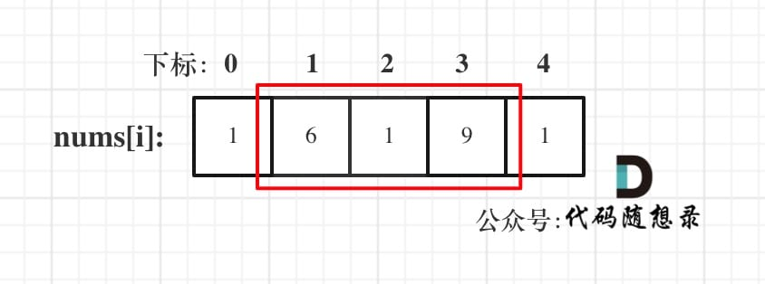
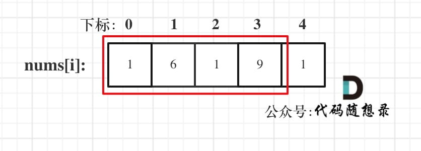
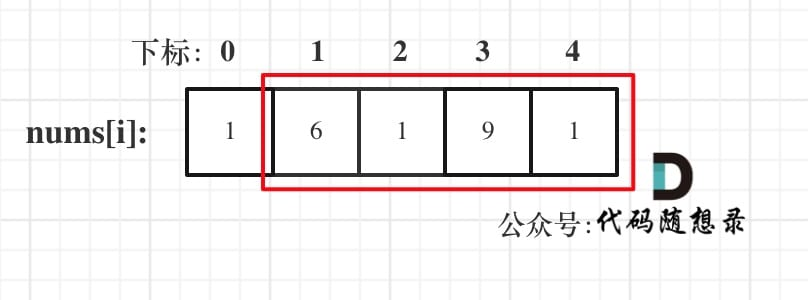

* [做專案（多個 C++、Java、Go、測試開發、前端專案）](https://www.programmercarl.com/other/kstar.html)
* [刷演算法（兩個月高強度學演算法）](https://www.programmercarl.com/xunlian/xunlianying.html)
* [背八股（40 天挑戰高頻面試題）](https://www.programmercarl.com/xunlian/bagu.html)

# 213.打家劫舍II

[LeetCode 題目連結](https://leetcode.cn/problems/house-robber-ii/)

你是一個專業的小偷，計畫偷竊沿街的房屋，每間房內都藏有一定的現金。這個地方所有的房屋都圍成一圈，這意味著第一個房屋和最後一個房屋是緊挨著的。同時，相鄰的房屋裝有相互連通的防盜系統，如果兩間相鄰的房屋在同一晚上被小偷闖入，系統會自動報警。

給定一個代表每個房屋存放金額的非負整數（nonnegative integer）陣列（array），計算你在不觸動警報裝置的情況下，能夠偷竊到的最高金額。

範例 1：

* 輸入：nums = [2,3,2]
* 輸出：3
* 解釋：你不能先偷竊 1 號房屋（金額 = 2），然後偷竊 3 號房屋（金額 = 2）, 因為他們是相鄰的。

* 範例 2：
* 輸入：nums = [1,2,3,1]
* 輸出：4
* 解釋：你可以先偷竊 1 號房屋（金額 = 1），然後偷竊 3 號房屋（金額 = 3）。偷竊到的最高金額 = 1 + 3 = 4 。

* 範例 3：
* 輸入：nums = [0]
* 輸出：0

提示：
* 1 <= nums.length <= 100
* 0 <= nums[i] <= 1000

## 演算法公開課

**[《代碼隨想錄》演算法影片公開課](https://programmercarl.com/other/gongkaike.html)：[動態規劃，房間連成環了那還偷不偷呢？| LeetCode：213.打家劫舍II](https://www.bilibili.com/video/BV1oM411B7xq)，相信結合影片再看本篇題解，更有助於大家對本題的理解**。


## 解題思路

這道題目和[198.打家劫舍](https://programmercarl.com/0198.打家劫舍.html)是差不多的，唯一區別就是成環了。

對於一個陣列，成環的話主要有如下三種情況：

* 情況一：考慮不包含首尾元素（element）



* 情況二：考慮包含首元素，不包含尾元素



* 情況三：考慮包含尾元素，不包含首元素



**注意我這裡用的是「考慮」**，例如情況三，雖然是考慮包含尾元素，但不一定要選尾部元素！對於情況三，取 nums[1] 和 nums[3] 就是最大的。

**而情況二和情況三都包含了情況一了，所以只考慮情況二和情況三就可以了**。

分析到這裡，本題其實比較簡單了。剩下的和[198.打家劫舍](https://programmercarl.com/0198.打家劫舍.html)就是一樣的了。

程式碼如下：

```CPP
// 注意註解中的情況二情況三，以及把 198.打家劫舍的程式碼抽離出來了
class Solution {
public:
    int rob(vector<int>& nums) {
        if (nums.size() == 0) return 0;
        if (nums.size() == 1) return nums[0];
        int result1 = robRange(nums, 0, nums.size() - 2); // 情況二
        int result2 = robRange(nums, 1, nums.size() - 1); // 情況三
        return max(result1, result2);
    }
    // 198.打家劫舍的邏輯
    int robRange(vector<int>& nums, int start, int end) {
        if (end == start) return nums[start];
        vector<int> dp(nums.size());
        dp[start] = nums[start];
        dp[start + 1] = max(nums[start], nums[start + 1]);
        for (int i = start + 2; i <= end; i++) {
            dp[i] = max(dp[i - 2] + nums[i], dp[i - 1]);
        }
        return dp[end];
    }
};
```

* 時間複雜性（time complexity）: O(n)
* 空間複雜度（space complexity）: O(n)


## 總結

成環之後還是難了一些的，不少題解沒有把「考慮房間」和「偷房間」說清楚。

這就導致大家會有這樣的困惑：情況三怎麼就包含了情況一了呢？本文圖中最後一間房不能偷啊，偷了一定不是最佳結果。

所以我在本文重點強調了情況一二三是「考慮」的範圍，而具體房間偷與不偷交給遞迴公式（recurrence formula）去抉擇。

這樣大家就不難理解情況二和情況三包含了情況一了。

## 其他語言版本

### Java：

```Java
class Solution {
    public int rob(int[] nums) {
        if (nums == null || nums.length == 0)
            return 0;
        int len = nums.length;
        if (len == 1)
            return nums[0];
        return Math.max(robAction(nums, 0, len - 1), robAction(nums, 1, len));
    }

    int robAction(int[] nums, int start, int end) {
        int x = 0, y = 0, z = 0;
        for (int i = start; i < end; i++) {
            y = z;
            z = Math.max(y, x + nums[i]);
            x = y;
        }
        return z;
    }
}
```

### Python：

```Python
class Solution:
    def rob(self, nums: List[int]) -> int:
        if len(nums) == 0:
            return 0
        if len(nums) == 1:
            return nums[0]
        
        result1 = self.robRange(nums, 0, len(nums) - 2)  # 情況二
        result2 = self.robRange(nums, 1, len(nums) - 1)  # 情況三
        return max(result1, result2)
    # 198.打家劫舍的邏輯
    def robRange(self, nums: List[int], start: int, end: int) -> int:
        if end == start:
            return nums[start]
        
        prev_max = nums[start]
        curr_max = max(nums[start], nums[start + 1])
        
        for i in range(start + 2, end + 1):
            temp = curr_max
            curr_max = max(prev_max + nums[i], curr_max)
            prev_max = temp
        
        return curr_max

```
二維（2D）DP
```python
class Solution:
    def rob(self, nums: List[int]) -> int:
        if len(nums) < 3:
            return max(nums)

        # 情況二：不搶劫第一個房屋
        result1 = self.robRange(nums[:-1])

        # 情況三：不搶劫最後一個房屋
        result2 = self.robRange(nums[1:])

        return max(result1, result2)

    def robRange(self, nums):
        dp = [[0, 0] for _ in range(len(nums))]
        dp[0][1] = nums[0]

        for i in range(1, len(nums)):
            dp[i][0] = max(dp[i - 1])
            dp[i][1] = dp[i - 1][0] + nums[i]

        return max(dp[-1])


        
```

最佳化版
```python
class Solution:
    def rob(self, nums: List[int]) -> int:
        if not nums:  # 如果沒有房屋，回傳 0
            return 0

        if len(nums) == 1:  # 如果只有一個房屋，回傳該房屋的金額
            return nums[0]

        # 情況二：不搶劫第一個房屋
        prev_max = 0  # 上一個房屋的最大金額
        curr_max = 0  # 當前房屋的最大金額
        for num in nums[1:]:
            temp = curr_max  # 臨時變數保存當前房屋的最大金額
            curr_max = max(prev_max + num, curr_max)  # 更新當前房屋的最大金額
            prev_max = temp  # 更新上一個房屋的最大金額
        result1 = curr_max

        # 情況三：不搶劫最後一個房屋
        prev_max = 0  # 上一個房屋的最大金額
        curr_max = 0  # 當前房屋的最大金額
        for num in nums[:-1]:
            temp = curr_max  # 臨時變數保存當前房屋的最大金額
            curr_max = max(prev_max + num, curr_max)  # 更新當前房屋的最大金額
            prev_max = temp  # 更新上一個房屋的最大金額
        result2 = curr_max

        return max(result1, result2)

        
```
### Go：

```go
// 打家劫舍Ⅱ 動態規劃
// 時間複雜性 O(n) 空間複雜度 O(n)
func rob(nums []int) int {
    // 如果長度為 0 或 1，那麼有沒有環的限制都一樣
    if len(nums) <= 1 {
        return robWithoutCircle(nums)
    }

    // 否則，去頭或去尾，取最大
    res1 := robWithoutCircle(nums[:len(nums)-1])
    res2 := robWithoutCircle(nums[1:])

    return max(res1, res2)
}

// 原始的打家劫舍版
func robWithoutCircle(nums []int) int {
    switch len(nums) {
        case 0: return 0
        case 1: return nums[0]
    }
    dp := make([]int, len(nums))
    dp[0]=nums[0]
    dp[1] = max(nums[0], nums[1])

    for i:=2; i<len(nums); i++ {
        dp[i] = max(dp[i-1], dp[i-2]+nums[i])
    }

    return dp[len(nums)-1]

}

func max(a, b int ) int {
    if a>b {
        return a
    }
    return b
}
```

### JavaScript:

```javascript
var rob = function(nums) {
  const n = nums.length
  if (n === 0) return 0
  if (n === 1) return nums[0]
  const result1 = robRange(nums, 0, n - 2)
  const result2 = robRange(nums, 1, n - 1)
  return Math.max(result1, result2)
};

const robRange = (nums, start, end) => {
  if (end === start) return nums[start]
  const dp = Array(nums.length).fill(0)
  dp[start] = nums[start]
  dp[start + 1] = Math.max(nums[start], nums[start + 1])
  for (let i = start + 2; i <= end; i++) {
    dp[i] = Math.max(dp[i - 2] + nums[i], dp[i - 1])
  }
  return dp[end]
}
```
### TypeScript：

```typescript
function rob(nums: number[]): number {
    const length: number = nums.length;
    if (length === 0) return 0;
    if (length === 1) return nums[0];
    return Math.max(robRange(nums, 0, length - 2),
        robRange(nums, 1, length - 1));
};
function robRange(nums: number[], start: number, end: number): number {
    if (start === end) return nums[start];
    const dp: number[] = [];
    dp[start] = nums[start];
    dp[start + 1] = Math.max(nums[start], nums[start + 1]);
    for (let i = start + 2; i <= end; i++) {
        dp[i] = Math.max(dp[i - 1], dp[i - 2] + nums[i]);
    }
    return dp[end];
}
```

### C

```c
#define max(a, b) ((a) > (b) ? (a) : (b))

// 198.打家劫舍的邏輯
int robRange(int* nums, int start, int end, int numsSize) {
    if (end == start) return nums[start];
    int dp[numsSize];
    dp[start] = nums[start];
    dp[start + 1] = max(nums[start], nums[start + 1]);
    for (int i = start + 2; i <= end; i++) {
        dp[i] = max(dp[i - 2] + nums[i], dp[i - 1]);
    }
    return dp[end];
}

int rob(int* nums, int numsSize) {
    if (numsSize == 0) return 0;
    if (numsSize == 1) return nums[0];
    int result1 = robRange(nums, 0, numsSize - 2, numsSize); // 情況二
    int result2 = robRange(nums, 1, numsSize - 1, numsSize); // 情況三
    return max(result1, result2);
}
```


### Rust:

```rust
impl Solution {
    pub fn rob(nums: Vec<i32>) -> i32 {
        match nums.len() {
            1 => nums[0],
            _ => Self::rob_range(&nums, 0, nums.len() - 2).max(Self::rob_range(
                &nums,
                1,
                nums.len() - 1,
            )),
        }
    }

    pub fn rob_range(nums: &Vec<i32>, start: usize, end: usize) -> i32 {
        if start == end {
            return nums[start];
        }
        let mut dp = vec![0; nums.len()];
        dp[start] = nums[start];
        dp[start + 1] = nums[start].max(nums[start + 1]);
        for i in start + 2..=end {
            dp[i] = dp[i - 1].max(dp[i - 2] + nums[i]);
        }
        dp[end]
    }
}
```


