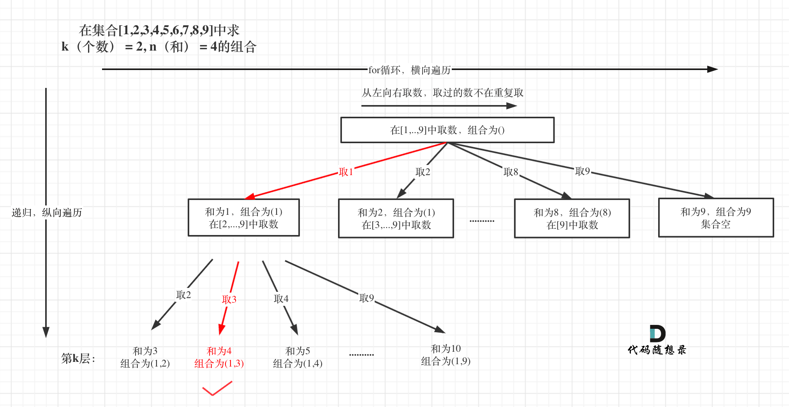
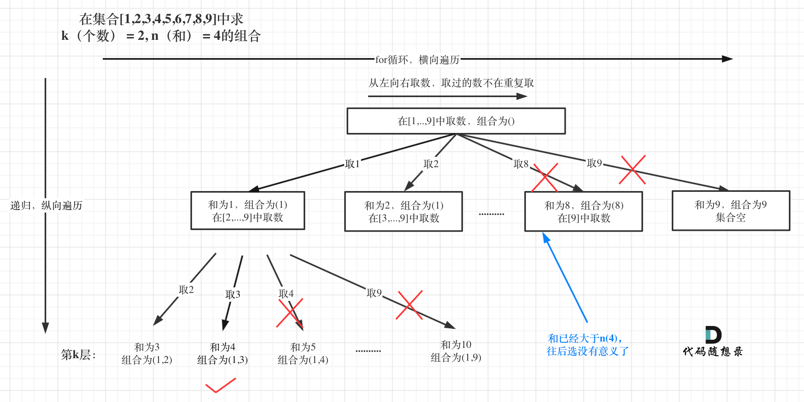

* [做專案（多個 C++、Java、Go、測試開發、前端專案）](https://www.programmercarl.com/other/kstar.html)
* [刷演算法（兩個月高強度學演算法）](https://www.programmercarl.com/xunlian/xunlianying.html)
* [背八股（40 天挑戰高頻面試題）](https://www.programmercarl.com/xunlian/bagu.html)


> 別看本篇選的是組合總和 III，而不是組合總和，本題和上一篇 77.組合相比難度剛剛好！

# 216.組合（combination）總和 III

[LeetCode 題目連結](https://leetcode.cn/problems/combination-sum-iii/)

找出所有相加之和為 n 的 k 個數的組合。組合中只允許含有 1 - 9 的正整數（positive integer），並且每種組合中不存在重複的數字。

說明：

* 所有數字都是正整數。
* 解集（solution set）不能包含重複的組合。

範例 1:
輸入: k = 3, n = 7
輸出: [[1,2,4]]

範例 2:
輸入: k = 3, n = 9
輸出: [[1,2,6], [1,3,5], [2,3,4]]

## 演算法公開課

**[《代碼隨想錄》演算法影片公開課](https://programmercarl.com/other/gongkaike.html)：[和組合問題有啥區別？回溯演算法（backtracking algorithm）如何修剪法（pruning）？| LeetCode：216.組合總和 III](https://www.bilibili.com/video/BV1wg411873x)，相信結合影片再看本篇題解，更有助於大家對本題的理解**。


## 解題思路

本題就是在 [1,2,3,4,5,6,7,8,9] 這個集合（set）中找到和為 n 的 k 個數的組合。

相對於[77. 組合](https://programmercarl.com/0077.组合.html)，無非就是多了一個限制，本題是要找到和為 n 的 k 個數的組合，而整個集合已經是固定的了 [1,...,9]。

想到這一點了，做過[77. 組合](https://programmercarl.com/0077.组合.html)之後，本題是簡單一些了。

本題 k 相當於樹（tree）的深度（depth），9（因為整個集合就是 9 個數）就是樹的寬度。

例如 k = 2，n = 4 的話，就是在集合 [1,2,3,4,5,6,7,8,9] 中求 k（個數） = 2, n（和） = 4 的組合。

選取過程如圖：


圖中，可以看出，只有最後取到集合（1，3）和為 4 符合條件。


### 回溯（backtracking）三部曲

* **確定遞迴函數（recursive function）參數（parameter）**

和[77. 組合](https://programmercarl.com/0077.组合.html)一樣，依然需要一維陣列（one dimensional array）path 來存放符合條件的結果，二維（2D）陣列（array）result 來存放結果集（result set）。

這裡我依然定義 path 和 result 為全域變數（global variable）。

至於為什麼取名為 path？從上面樹狀結構（tree structure）中，可以看出，結果其實就是一條根節點（root node）到葉節點（leaf node）的路徑（path）。

```cpp
vector<vector<int>> result; // 存放結果集
vector<int> path; // 符合條件的結果
```

接下來還需要如下參數：

* targetSum（int）目標和，也就是題目中的 n。
* k（int）就是題目中要求 k 個數的集合。
* sum（int）為已經收集的元素（element）的總和，也就是 path 裡元素的總和。
* startIndex（int）為下一層 for 迴圈（for-loop）搜尋的起始位置。

所以程式碼如下：

```cpp
vector<vector<int>> result;
vector<int> path;
void backtracking(int targetSum, int k, int sum, int startIndex)
```

其實這裡 sum 這個參數也可以省略，每次 targetSum 減去選取的元素數值，然後判斷如果 targetSum 為 0 了，說明收集到符合條件的結果了，我這裡為了直觀便於理解，還是加一個 sum 參數。

還要強調一下，回溯中遞迴函數參數很難一次性確定下來，一般先寫邏輯，需要啥參數了，填什麼參數。

* 確定終止條件（termination condition）

什麼時候終止呢？

在上面已經說了，k 其實就已經限制樹的深度，因為就取 k 個元素，樹再往下深了沒有意義。

所以如果 path.size() 和 k 相等了，就終止。

如果此時 path 裡收集到的元素和（sum）和 targetSum（就是題目描述的 n）相同了，就用 result 收集當前的結果。

所以終止程式碼如下：

```CPP
if (path.size() == k) {
    if (sum == targetSum) result.push_back(path);
    return; // 如果 path.size() == k 但 sum != targetSum 直接回傳
}
```

* **單層搜尋過程**

本題和[77. 組合](https://programmercarl.com/0077.组合.html)區別之一就是集合固定的就是 9 個數 [1,...,9]，所以 for 迴圈固定 i<=9

如圖：


處理過程就是 path 收集每次選取的元素，相當於樹狀結構裡的邊（edge），sum 來統計 path 裡元素的總和。

程式碼如下：

```CPP
for (int i = startIndex; i <= 9; i++) {
    sum += i;
    path.push_back(i);
    backtracking(targetSum, k, sum, i + 1); // 注意 i+1 調整 startIndex
    sum -= i; // 回溯
    path.pop_back(); // 回溯
}
```

**別忘了處理過程和回溯過程是一一對應的，處理有加，回溯就要有減！**

參照[關於回溯演算法，你該了解這些！](https://programmercarl.com/回溯算法理论基础.html)中的模板（template），不難寫出如下 C++ 程式碼：

```CPP
class Solution {
private:
    vector<vector<int>> result; // 存放結果集
    vector<int> path; // 符合條件的結果
    // targetSum：目標和，也就是題目中的 n。
    // k：題目中要求 k 個數的集合。
    // sum：已經收集的元素的總和，也就是 path 裡元素的總和。
    // startIndex：下一層 for 迴圈搜尋的起始位置。
    void backtracking(int targetSum, int k, int sum, int startIndex) {
        if (path.size() == k) {
            if (sum == targetSum) result.push_back(path);
            return; // 如果 path.size() == k 但 sum != targetSum 直接回傳
        }
        for (int i = startIndex; i <= 9; i++) {
            sum += i; // 處理
            path.push_back(i); // 處理
            backtracking(targetSum, k, sum, i + 1); // 注意 i+1 調整 startIndex
            sum -= i; // 回溯
            path.pop_back(); // 回溯
        }
    }

public:
    vector<vector<int>> combinationSum3(int k, int n) {
        result.clear(); // 可以不加
        path.clear();   // 可以不加
        backtracking(n, k, 0, 1);
        return result;
    }
};
```

### 修剪法

這道題目，修剪法操作其實是很容易想到了，想必大家看上面的樹狀圖的時候已經想到了。

如圖：


已選元素總和如果已經大於 n（圖中數值為 4）了，那麼往後遍歷（traversal）就沒有意義了，直接剪掉。

那麼修剪法的地方可以放在遞迴函數開始的地方，修剪法程式碼如下：

```cpp
if (sum > targetSum) { // 修剪操作
    return;
}
```

當然這個修剪法也可以放在呼叫遞迴（recursion）之前，即放在這裡，只不過要記得把回溯操作給做了。

```CPP
for (int i = startIndex; i <= 9 - (k - path.size()) + 1; i++) { // 修剪
    sum += i; // 處理
    path.push_back(i); // 處理
    if (sum > targetSum) { // 修剪操作
        sum -= i; // 修剪之前先把回溯做了
        path.pop_back(); // 修剪之前先把回溯做了
        return;
    }
    backtracking(targetSum, k, sum, i + 1); // 注意 i+1 調整 startIndex
    sum -= i; // 回溯
    path.pop_back(); // 回溯
}
```


和[回溯演算法：組合問題再剪剪枝](https://programmercarl.com/0077.组合优化.html)一樣，for 迴圈的範圍也可以修剪，i <= 9 - (k - path.size()) + 1 就可以了。

最後 C++ 程式碼如下：

```CPP
class Solution {
private:
    vector<vector<int>> result; // 存放結果集
    vector<int> path; // 符合條件的結果
    void backtracking(int targetSum, int k, int sum, int startIndex) {
        if (sum > targetSum) { // 修剪操作
            return; 
        }
        if (path.size() == k) {
            if (sum == targetSum) result.push_back(path);
            return; // 如果 path.size() == k 但 sum != targetSum 直接回傳
        }
        for (int i = startIndex; i <= 9 - (k - path.size()) + 1; i++) { // 修剪
            sum += i; // 處理
            path.push_back(i); // 處理
            backtracking(targetSum, k, sum, i + 1); // 注意 i+1 調整 startIndex
            sum -= i; // 回溯
            path.pop_back(); // 回溯
        }
    }

public:
    vector<vector<int>> combinationSum3(int k, int n) {
        result.clear(); // 可以不加
        path.clear();   // 可以不加
        backtracking(n, k, 0, 1);
        return result;
    }
};
```
* 時間複雜度（time complexity）: O(n * 2^n)
* 空間複雜度（space complexity）: O(n)

## 總結

開篇就介紹了本題與[77.組合](https://programmercarl.com/0077.组合.html)的區別，相對來說加了元素總和的限制，如果做完[77.組合](https://programmercarl.com/0077.组合.html)再做本題再合適不過。

分析完區別，依然把問題抽象為樹狀結構，按照回溯三部曲進行講解，最後給出修剪法的最佳化。

相信做完本題，大家對組合問題應該有初步了解了。


## 其他語言版本


### Java

模板方法

```java
class Solution {
	List<List<Integer>> result = new ArrayList<>();
	LinkedList<Integer> path = new LinkedList<>();

	public List<List<Integer>> combinationSum3(int k, int n) {
		backTracking(n, k, 1, 0);
		return result;
	}

	private void backTracking(int targetSum, int k, int startIndex, int sum) {
		// 修剪
		if (sum > targetSum) {
			return;
		}

		if (path.size() == k) {
			if (sum == targetSum) result.add(new ArrayList<>(path));
			return;
		}

		// 修剪 9 - (k - path.size()) + 1
		for (int i = startIndex; i <= 9 - (k - path.size()) + 1; i++) {
			path.add(i);
			sum += i;
			backTracking(targetSum, k, i + 1, sum);
			//回溯
			path.removeLast();
			//回溯
			sum -= i;
		}
	}
}

// 上面修剪 i <= 9 - (k - path.size()) + 1; 如果還是不清楚
// 也可以改為 if (path.size() > k) return; 執行效率上是一樣的
class Solution {
    LinkedList<Integer> path = new LinkedList<>();
    List<List<Integer>> ans = new ArrayList<>();
    public List<List<Integer>> combinationSum3(int k, int n) {
        build(k, n, 1, 0);
        return ans;
    }

    private void build(int k, int n, int startIndex, int sum) {

        if (sum > n) return;

        if (path.size() > k) return;

        if (sum == n && path.size() == k) {
            ans.add(new ArrayList<>(path));
            return;
        }

        for(int i = startIndex; i <= 9; i++) {
            path.add(i);
            sum += i;
            build(k, n, i + 1, sum);
            sum -= i;
            path.removeLast();
        }
    }
}
```

其他方法

```java
class Solution {
    List<List<Integer>> res = new ArrayList<>();
    List<Integer> list = new ArrayList<>();

    public List<List<Integer>> combinationSum3(int k, int n) {
        res.clear();
        list.clear();
        backtracking(k, n, 9);
        return res;
    }

    private void backtracking(int k, int n, int maxNum) {
        if (k == 0 && n == 0) {
            res.add(new ArrayList<>(list));
            return;
        }

        // 因為不能重複，並且單個數字最大值是 maxNum，所以 sum 最大值為
        // （maxNum + (maxNum - 1) + ... + (maxNum - k + 1)） == k * maxNum - k*(k - 1) / 2
        if (maxNum == 0
                || n > k * maxNum - k * (k - 1) / 2
                || n < (1 + k) * k / 2) {
            return;
        }
        list.add(maxNum);
        backtracking(k - 1, n - maxNum, maxNum - 1);
        list.remove(list.size() - 1);
        backtracking(k, n, maxNum - 1);
    }

}
```

### Python

```py
class Solution:
    def combinationSum3(self, k: int, n: int) -> List[List[int]]:
        result = []  # 存放結果集
        self.backtracking(n, k, 0, 1, [], result)
        return result

    def backtracking(self, targetSum, k, currentSum, startIndex, path, result):
        if currentSum > targetSum:  # 修剪操作
            return  # 如果 currentSum 已經超過 targetSum，則直接回傳
        if len(path) == k:
            if currentSum == targetSum:
                result.append(path[:])
            return
        for i in range(startIndex, 9 - (k - len(path)) + 2):  # 修剪
            currentSum += i  # 處理
            path.append(i)  # 處理
            self.backtracking(targetSum, k, currentSum, i + 1, path, result)  # 注意 i+1 調整 startIndex
            currentSum -= i  # 回溯
            path.pop()  # 回溯

```

### Go

回溯+修剪法

```go
var (
    res [][]int
    path  []int
)
func combinationSum3(k int, n int) [][]int {
    res, path = make([][]int, 0), make([]int, 0, k)
    dfs(k, n, 1, 0)
    return res
}

func dfs(k, n int, start int, sum int) {
    if len(path) == k {
        if sum == n {
            tmp := make([]int, k)
            copy(tmp, path)
            res = append(res, tmp)
        }
        return
    }
    for i := start; i <= 9; i++ {
        if sum + i > n || 9-i+1 < k-len(path) {
            break
        }
        path = append(path, i)
        dfs(k, n, i+1, sum+i)
        path = path[:len(path)-1]
    }
}
```

### JavaScript
- 未修剪：

```js
/**
 * @param {number} k
 * @param {number} n
 * @return {number[][]}
 */
var combinationSum3 = function (k, n) {
  // 回溯法
  let result = [],
    path = [];
  const backtracking = (_k, targetSum, sum, startIndex) => {
    // 終止條件
    if (path.length === _k) {
      if (sum === targetSum) {
        result.push(path.slice());
      }
      // 如果總和不相等，就直接回傳
      return;
    }

    // 迴圈當前節點，因為只使用數字 1 到 9，所以最大是 9
    for (let i = startIndex; i <= 9; i++) {
      path.push(i);
      sum += i;
      // 回呼函數
      backtracking(_k, targetSum, sum, i + 1);
      // 回溯
      sum -= i;
      path.pop();
    }
  };
  backtracking(k, n, 0, 1);
  return result;
};
```

- 修剪：

```js
/**
 * @param {number} k
 * @param {number} n
 * @return {number[][]}
 */
var combinationSum3 = function (k, n) {
  // 回溯法
  let result = [],
    path = [];
  const backtracking = (_k, targetSum, sum, startIndex) => {
    if (sum > targetSum) {
      return;
    }
    // 終止條件
    if (path.length === _k) {
      if (sum === targetSum) {
        result.push(path.slice());
      }
      // 如果總和不相等，就直接回傳
      return;
    }

    // 迴圈當前節點，因為只使用數字 1 到 9，所以最大是 9
    for (let i = startIndex; i <= 9 - (_k - path.length) + 1; i++) {
      path.push(i);
      sum += i;
      // 回呼函數
      backtracking(_k, targetSum, sum, i + 1);
      // 回溯
      sum -= i;
      path.pop();
    }
  };
  backtracking(k, n, 0, 1);
  return result;
};
```

### TypeScript

```typescript
function combinationSum3(k: number, n: number): number[][] {
    const resArr: number[][] = [];
    function backTracking(k: number, n: number, sum: number, startIndex: number, tempArr: number[]): void {
        if (sum > n) return;
        if (tempArr.length === k) {
            if (sum === n) {
                resArr.push(tempArr.slice());
            }
            return;
        }
        for (let i = startIndex; i <= 9 - (k - tempArr.length) + 1; i++) {
            tempArr.push(i);
            backTracking(k, n, sum + i, i + 1, tempArr);
            tempArr.pop();
        }
    }
    backTracking(k, n, 0, 1, []);
    return resArr;
};
```

### Rust

```Rust
impl Solution {
    pub fn combination_sum3(k: i32, n: i32) -> Vec<Vec<i32>> {
        let mut result = vec![];
        let mut path = vec![];
        Self::backtrace(&mut result, &mut path, n, k, 0, 1);
        result
    }
    pub fn backtrace(
        result: &mut Vec<Vec<i32>>,
        path: &mut Vec<i32>,
        target_sum: i32,
        k: i32,
        sum: i32,
        start_index: i32,
    ) {
        if sum > target_sum {
            return;
        }
        let len = path.len() as i32;
        if len == k {
            if sum == target_sum {
                result.push(path.to_vec());
            }
            return;
        }
        for i in start_index..=9 - (k - len) + 1 {
            path.push(i);
            Self::backtrace(result, path, target_sum, k, sum + i, i + 1);
            path.pop();
        }
    }
}
```

### C

```c
int* path;
int pathTop;
int** ans;
int ansTop;
int getPathSum() {
    int i;
    int sum = 0;
    for(i = 0; i < pathTop; i++) {
        sum += path[i];
    }
    return sum;
}

void backtracking(int targetSum, int k, int sum, int startIndex) {
    if(pathTop == k) {
        if(sum == targetSum) {
            int* tempPath = (int*)malloc(sizeof(int) * k);
            int j;
            for(j = 0; j < k; j++)
                tempPath[j] = path[j];
            ans[ansTop++] = tempPath;
        }
        // 如果 path.size() == k 但 sum != targetSum 直接回傳
        return;
    }
    int i;
    //從 startIndex 開始遍歷，一直遍歷到 9
    for (i = startIndex; i <= 9; i++) {
        sum += i; // 處理
        path[pathTop++] = i; // 處理
        backtracking(targetSum, k, sum, i + 1); // 注意 i+1 調整 startIndex
        sum -= i; // 回溯
        pathTop--;; // 回溯
    }
}

int** combinationSum3(int k, int n, int* returnSize, int** returnColumnSizes){
    //初始化輔助變數
    path = (int*)malloc(sizeof(int) * k);
    ans = (int**)malloc(sizeof(int*) * 20);
    pathTop = ansTop = 0;

    backtracking(n, k, 0, 1);

    //設定回傳的二維陣列中元素個數為 ansTop
    *returnSize = ansTop;
    //設定二維陣列中每個元素個數的大小為 k
    *returnColumnSizes = (int*)malloc(sizeof(int) * ansTop);
    int i;
    for(i = 0; i < ansTop; i++) {
        (*returnColumnSizes)[i] = k;
    }
    return ans;
}
```

### Swift

```swift
func combinationSum3(_ count: Int, _ targetSum: Int) -> [[Int]] {
    var result = [[Int]]()
    var path = [Int]()
    func backtracking(sum: Int, start: Int) {
        // 修剪
        if sum > targetSum { return }
        // 終止條件
        if path.count == count {
            if sum == targetSum {
                result.append(path)
            }
            return
        }

        // 單層邏輯
        let end = 9
        guard start <= end else { return }
        for i in start ... end {
            path.append(i) // 處理
            backtracking(sum: sum + i, start: i + 1)
            path.removeLast() // 回溯
        }
    }

    backtracking(sum: 0, start: 1)
    return result
}
```

### Scala

```scala
object Solution {
  import scala.collection.mutable
  def combinationSum3(k: Int, n: Int): List[List[Int]] = {
    var result = mutable.ListBuffer[List[Int]]()
    var path = mutable.ListBuffer[Int]()

    def backtracking(k: Int, n: Int, sum: Int, startIndex: Int): Unit = {
      if (sum > n) return // 修剪，如果 sum > 目標和，就回傳
      if (sum == n && path.size == k) {
        result.append(path.toList)
        return
      }
      // 修剪
      for (i <- startIndex to (9 - (k - path.size) + 1)) {
        path.append(i)
        backtracking(k, n, sum + i, i + 1)
        path = path.take(path.size - 1)
      }
    }

    backtracking(k, n, 0, 1) // 呼叫遞迴方法
    result.toList // 最終回傳結果集的 List 形式
  }
}
```
### C#
```csharp
public class Solution
{
    public IList<IList<int>> res = new List<IList<int>>();
    public IList<int> path = new List<int>();
    public IList<IList<int>> CombinationSum3(int k, int n)
    {
        BackTracking(k, n, 0, 1);
        return res;
    }
    public void BackTracking(int k, int n, int sum, int start)
    {
        if (path.Count == k)
        {
            if (sum == n)
                res.Add(new List<int>(path));
            return;
        }
        for (int i = start; i <= 9; i++)
        {
            sum += i;
            path.Add(i);
            BackTracking(k, n, sum, i + 1);
            sum -= i;
            path.RemoveAt(path.Count - 1);
        }
    }
}
// 修剪
public class Solution
{
    public IList<IList<int>> res = new List<IList<int>>();
    public IList<int> path = new List<int>();
    public IList<IList<int>> CombinationSum3(int k, int n)
    {
        BackTracking(k, n, 0, 1);
        return res;
    }
    public void BackTracking(int k, int n, int sum, int start)
    {
        if (sum > n)
            return;
        if (path.Count == k)
        {
            if (sum == n)
                res.Add(new List<int>(path));
            return;
        }
        for (int i = start; i <= 9 - (k - path.Count) + 1; i++)
        {
            sum += i;
            path.Add(i);
            BackTracking(k, n, sum, i + 1);
            sum -= i;
            path.RemoveAt(path.Count - 1);
        }
    }
}
```


