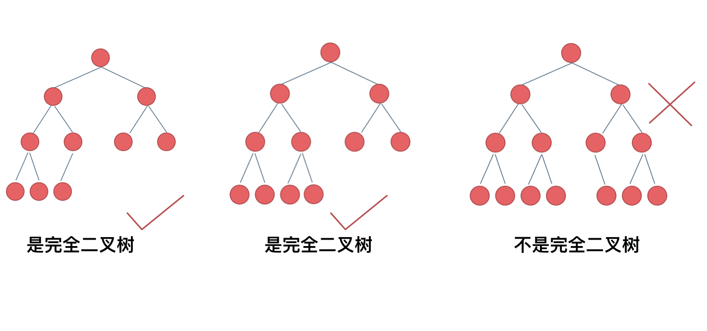
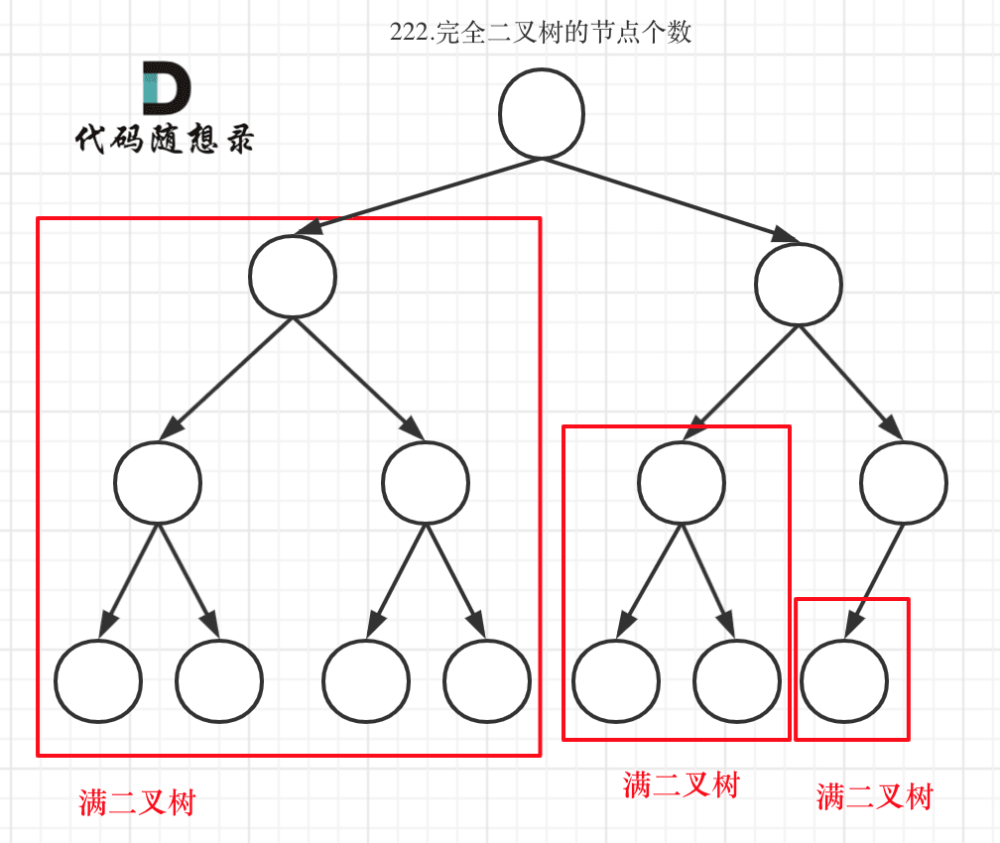
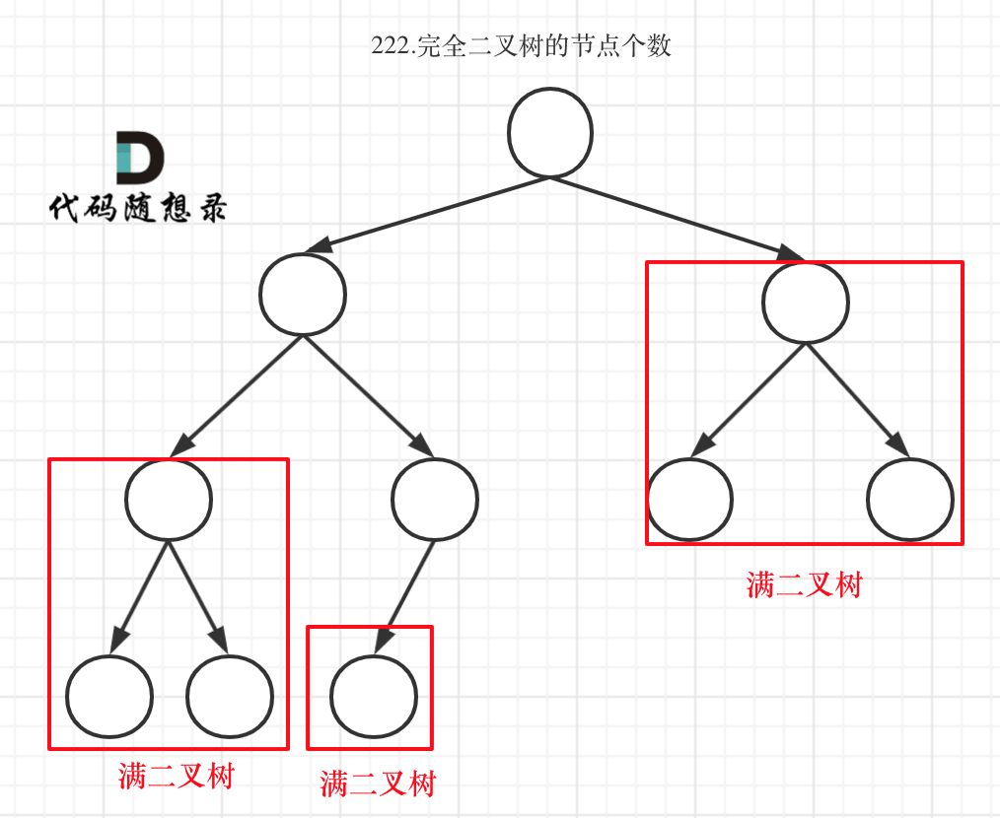
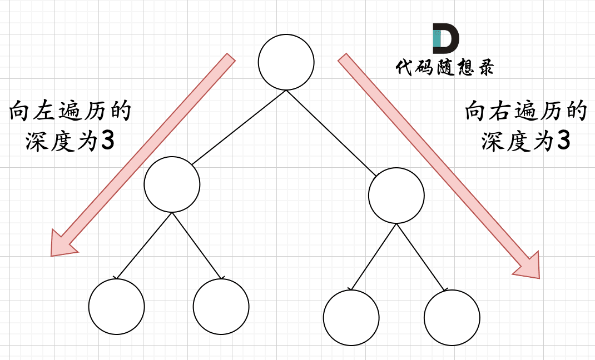
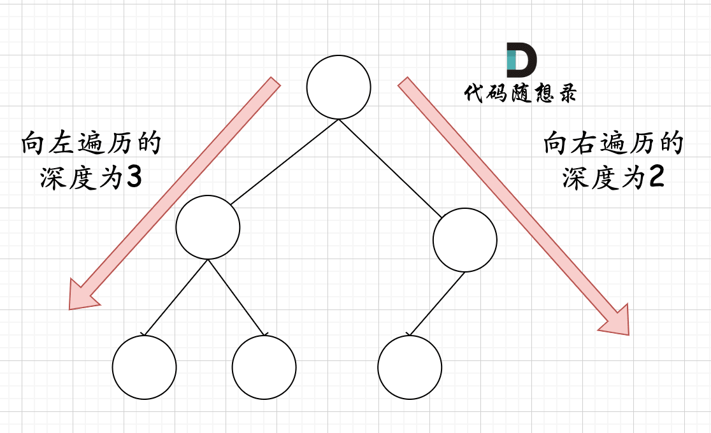
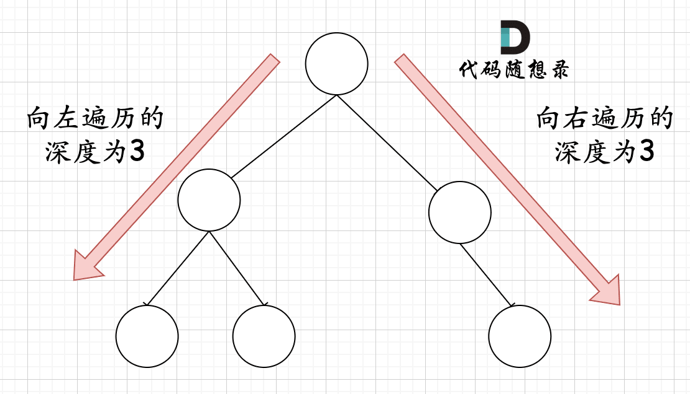

* [做專案（多個 C++、Java、Go、測試開發、前端專案）](https://www.programmercarl.com/other/kstar.html)
* [刷演算法（兩個月高強度學演算法）](https://www.programmercarl.com/xunlian/xunlianying.html)
* [背八股（40 天挑戰高頻面試題）](https://www.programmercarl.com/xunlian/bagu.html)


# 222.完全二元樹的節點個數

[LeetCode 題目連結](https://leetcode.cn/problems/count-complete-tree-nodes/)

給出一個完全二元樹（complete binary tree），求出該樹的節點（node）個數。

範例 1：
* 輸入：root = [1,2,3,4,5,6]
* 輸出：6

範例 2：
* 輸入：root = []
* 輸出：0

範例 3：
* 輸入：root = [1]
* 輸出：1

提示：

* 樹中節點的數目範圍是[0, 5 * 10^4]
* 0 <= Node.val <= 5 * 10^4
* 題目資料保證輸入的樹是 完全二元樹

## 演算法公開課

**[《代碼隨想錄》演算法影片公開課](https://programmercarl.com/other/gongkaike.html)：[要理解普通二元樹和完全二元樹的區別！ | LeetCode：222.完全二元樹節點的數量](https://www.bilibili.com/video/BV1eW4y1B7pD)，相信結合影片再看本篇題解，更有助於大家對本題的理解**。


## 解題思路


本篇給出按照普通二元樹（binary tree）的求法以及利用完全二元樹性質的求法。

### 普通二元樹

首先按照普通二元樹的邏輯來求。

這道題目的遞迴（recursion）法和求二元樹的深度（depth）寫法類似，而疊代（iteration）法，[二元樹：層次序走訪登場！](https://programmercarl.com/0102.二叉树的层序遍历.html)遍歷（traversal）模板（template）稍稍修改一下，記錄遍歷的節點數量就可以了。

遞迴遍歷的順序依然是後序遍歷（post-order traversal）（左右中）。

#### 遞迴

如果對求二元樹深度還不熟悉的話，看這篇：[二元樹：看看這些樹的最大深度](https://programmercarl.com/0104.二叉树的最大深度.html)。

1. 確定遞迴函數（recursive function）的參數（parameter）和轉回值（return value）：參數就是傳入樹的根節點（root node），回傳就回傳以該節點為根節點二元樹的節點數量，所以轉回值為 int 類型。

程式碼如下：
```CPP
int getNodesNum(TreeNode* cur) {
```

2. 確定終止條件（termination condition）：如果為 null node 的話，就回傳 0，表示節點數為 0。

程式碼如下：

```CPP
if (cur == NULL) return 0;
```

3. 確定單層遞迴的邏輯：先求它的左子樹（left subtree）的節點數量，再求右子樹（right subtree）的節點數量，最後取總和再加一（加 1 是因為算上當前中間節點）就是目前節點為根節點的節點數量。

程式碼如下：

```CPP
int leftNum = getNodesNum(cur->left);      // 左
int rightNum = getNodesNum(cur->right);    // 右
int treeNum = leftNum + rightNum + 1;      // 中
return treeNum;
```

所以整體 C++ 程式碼如下：

```CPP
// 版本一
class Solution {
private:
    int getNodesNum(TreeNode* cur) {
        if (cur == NULL) return 0;
        int leftNum = getNodesNum(cur->left);      // 左
        int rightNum = getNodesNum(cur->right);    // 右
        int treeNum = leftNum + rightNum + 1;      // 中
        return treeNum;
    }
public:
    int countNodes(TreeNode* root) {
        return getNodesNum(root);
    }
};
```

程式碼精簡之後 C++ 程式碼如下：
```CPP
// 版本二
class Solution {
public:
    int countNodes(TreeNode* root) {
        if (root == NULL) return 0;
        return 1 + countNodes(root->left) + countNodes(root->right);
    }
};
```

* 時間複雜性（time complexity）：O(n)
* 空間複雜度（space complexity）：O(log n)，算上了遞迴系統堆疊（stack）占用的空間

**網上基本都是這個精簡的程式碼版本，其實不建議大家照著這個來寫，程式碼確實精簡，但隱藏了一些內容，連遍歷的順序都看不出來，所以初學者建議學習版本一的程式碼，穩穩地打基礎**。


#### 疊代

如果對求二元樹層次序走訪（level order traversal）還不熟悉的話，看這篇：[二元樹：層次序走訪登場！](https://programmercarl.com/0102.二叉树的层序遍历.html)。

那麼只要模板少做改動，加一個變數（variable）result，統計節點數量就可以了

```CPP
class Solution {
public:
    int countNodes(TreeNode* root) {
        queue<TreeNode*> que;
        if (root != NULL) que.push(root);
        int result = 0;
        while (!que.empty()) {
            int size = que.size();
            for (int i = 0; i < size; i++) {
                TreeNode* node = que.front();
                que.pop();
                result++;   // 記錄節點數量
                if (node->left) que.push(node->left);
                if (node->right) que.push(node->right);
            }
        }
        return result;
    }
};
```
* 時間複雜性：O(n)
* 空間複雜度：O(n)

### 完全二元樹

以上方法都是按照普通二元樹來做的，對於完全二元樹特性不了解的同學可以看這篇 [關於二元樹，你該了解這些！](https://programmercarl.com/二叉树理论基础.html)，這篇詳細介紹了各種二元樹的特性。

在完全二元樹中，除了最底層節點可能沒填滿外，其餘每層節點數都達到最大值，並且最下面一層的節點都集中在該層最左邊的若干位置。若最底層為第 h 層，則該層包含 1~ 2^(h-1) 個節點。

**大家要自己看完全二元樹的定義，很多同學對完全二元樹其實不是真正的懂了。**

我來舉一個典型的例子如題：

 </img>

完全二元樹只有兩種情況，情況一：就是滿二元樹（full binary tree），情況二：最後一層葉節點（leaf node）沒有滿。

對於情況一，可以直接用 2^樹深度 - 1 來計算，注意這裡根節點深度為 1。

對於情況二，分別遞迴左孩子，和右孩子，遞迴到某一深度一定會有左孩子或者右孩子為滿二元樹，然後依然可以按照情況 1 來計算。

完全二元樹（一）如圖：


完全二元樹（二）如圖：


可以看出如果整個樹不是滿二元樹，就遞迴其左右孩子，直到遇到滿二元樹為止，用公式計算這個子樹（subtree）（滿二元樹）的節點數量。

這裡關鍵在於如何去判斷一個左子樹或者右子樹是不是滿二元樹呢？

在完全二元樹中，如果遞迴向左遍歷的深度等於遞迴向右遍歷的深度，那說明就是滿二元樹。如圖：



在完全二元樹中，如果遞迴向左遍歷的深度不等於遞迴向右遍歷的深度，則說明不是滿二元樹，如圖：



那有讀者說了，這種情況，遞迴向左遍歷的深度等於遞迴向右遍歷的深度，但也不是滿二元樹，如題：



如果這麼想，大家就是對完全二元樹理解有誤區了，**以上這棵二元樹，它根本就不是一個完全二元樹**！

判斷其子樹是不是滿二元樹，如果是則利用公式計算這個子樹（滿二元樹）的節點數量，如果不是則繼續遞迴，那麼在遞迴三部曲中，第二部：終止條件的寫法應該是這樣的：

```CPP
if (root == nullptr) return 0; 
// 開始根據左深度和右深度是否相同來判斷該子樹是不是滿二元樹
TreeNode* left = root->left;
TreeNode* right = root->right;
int leftDepth = 0, rightDepth = 0; // 這裡初始為 0 是有目的的，為了下面求指數方便
while (left) {  // 求左子樹深度
    left = left->left;
    leftDepth++;
}
while (right) { // 求右子樹深度
    right = right->right;
    rightDepth++;
}
if (leftDepth == rightDepth) {
    return (2 << leftDepth) - 1; // 注意 (2<<1) 相當於 2^2，回傳滿足滿二元樹的子樹節點數量
}
```

遞迴三部曲，第三部，單層遞迴的邏輯：（可以看出使用後序遍歷）

```CPP 
int leftTreeNum = countNodes(root->left);       // 左
int rightTreeNum = countNodes(root->right);     // 右
int result = leftTreeNum + rightTreeNum + 1;    // 中
return result;
```

該部分精簡之後程式碼為：

```CPP 
return countNodes(root->left) + countNodes(root->right) + 1; 
```

最後整體 C++ 程式碼如下：

```CPP
class Solution {
public:
    int countNodes(TreeNode* root) {
        if (root == nullptr) return 0;
        TreeNode* left = root->left;
        TreeNode* right = root->right;
        int leftDepth = 0, rightDepth = 0; // 這裡初始為 0 是有目的的，為了下面求指數方便
        while (left) {  // 求左子樹深度
            left = left->left;
            leftDepth++;
        }
        while (right) { // 求右子樹深度
            right = right->right;
            rightDepth++;
        }
        if (leftDepth == rightDepth) {
            return (2 << leftDepth) - 1; // 注意 (2<<1) 相當於 2^2，所以 leftDepth 初始為 0
        }
        return countNodes(root->left) + countNodes(root->right) + 1;
    }
};
```

* 時間複雜性：O(log n × log n)
* 空間複雜度：O(log n)

## 其他語言版本

### Java:
```java
class Solution {
    // 通用遞迴解法
    public int countNodes(TreeNode root) {
        if(root == null) {
            return 0;
        }
        return countNodes(root.left) + countNodes(root.right) + 1;
    }
}
```
```java
class Solution {
    // 疊代法
    public int countNodes(TreeNode root) {
        if (root == null) return 0;
        Queue<TreeNode> queue = new LinkedList<>();
        queue.offer(root);
        int result = 0;
        while (!queue.isEmpty()) {
            int size = queue.size();
            while (size -- > 0) {
                TreeNode cur = queue.poll();
                result++;
                if (cur.left != null) queue.offer(cur.left);
                if (cur.right != null) queue.offer(cur.right);
            }
        }
        return result;
    }
}
```
```java
class Solution {
    /**
     * 針對完全二元樹的解法
     *
     * 滿二元樹的節點數為：2^depth - 1
     */
    public int countNodes(TreeNode root) {
        if (root == null) return 0;
        TreeNode left = root.left;
        TreeNode right = root.right;
        int leftDepth = 0, rightDepth = 0; // 這裡初始為 0 是有目的的，為了下面求指數方便
        while (left != null) {  // 求左子樹深度
            left = left.left;
            leftDepth++;
        }
        while (right != null) { // 求右子樹深度
            right = right.right;
            rightDepth++;
        }
        if (leftDepth == rightDepth) {
            return (2 << leftDepth) - 1; // 注意 (2<<1) 相當於 2^2，所以 leftDepth 初始為 0
        }
        return countNodes(root.left) + countNodes(root.right) + 1;
    }
}
```

### Python:

遞迴法：
```python
class Solution:
    def countNodes(self, root: TreeNode) -> int:
        return self.getNodesNum(root)
        
    def getNodesNum(self, cur):
        if not cur:
            return 0
        leftNum = self.getNodesNum(cur.left) #左
        rightNum = self.getNodesNum(cur.right) #右
        treeNum = leftNum + rightNum + 1 #中
        return treeNum
```

遞迴法：精簡版
```python
class Solution:
    def countNodes(self, root: TreeNode) -> int:
        if not root:
            return 0
        return 1 + self.countNodes(root.left) + self.countNodes(root.right)
```

疊代法：
```python
import collections
class Solution:
    def countNodes(self, root: TreeNode) -> int:
        queue = collections.deque()
        if root:
            queue.append(root)
        result = 0
        while queue:
            size = len(queue)
            for i in range(size):
                node = queue.popleft()
                result += 1 #記錄節點數量
                if node.left:
                    queue.append(node.left)
                if node.right:
                    queue.append(node.right)
        return result
```

完全二元樹
```python
class Solution:
    def countNodes(self, root: TreeNode) -> int:
        if not root:
            return 0
        left = root.left
        right = root.right
        leftDepth = 0 #這裡初始為 0 是有目的的，為了下面求指數方便
        rightDepth = 0
        while left: #求左子樹深度
            left = left.left
            leftDepth += 1
        while right: #求右子樹深度
            right = right.right
            rightDepth += 1
        if leftDepth == rightDepth:
            return (2 << leftDepth) - 1 #注意 (2<<1) 相當於 2^2，所以 leftDepth 初始為 0
        return self.countNodes(root.left) + self.countNodes(root.right) + 1
```
完全二元樹寫法 2
```python
class Solution: # 利用完全二元樹特性
    def countNodes(self, root: TreeNode) -> int:
        if not root: return 0
        count = 1
        left = root.left; right = root.right
        while left and right:
            count+=1
            left = left.left; right = right.right
        if not left and not right: # 如果同時到底說明是滿二元樹，反之則不是
            return 2**count-1
        return 1+self.countNodes(root.left)+self.countNodes(root.right)  
```
完全二元樹寫法 3
```python
class Solution: # 利用完全二元樹特性
    def countNodes(self, root: TreeNode) -> int:
        if not root: return 0
        count = 0
        left = root.left; right = root.right
        while left and right:
            count+=1
            left = left.left; right = right.right
        if not left and not right: # 如果同時到底說明是滿二元樹，反之則不是
            return (2<<count)-1
        return 1+self.countNodes(root.left)+self.countNodes(root.right)  
```

### Go:

遞迴版本

```go
/**
 * Definition for a binary tree node.
 * type TreeNode struct {
 *     Val int
 *     Left *TreeNode
 *     Right *TreeNode
 * }
 */
//本題直接就是求有多少個節點，無腦存進結果變數就行了。
func countNodes(root *TreeNode) int {
    if root == nil {
        return 0
    }
    res := 1
    if root.Right != nil {
        res += countNodes(root.Right)
    }
    if root.Left != nil {
        res += countNodes(root.Left)
    }
    return res
}
```

利用完全二元樹特性的遞迴解法
```go
func countNodes(root *TreeNode) int {
    if root == nil {
        return 0
    }
    leftH, rightH := 0, 0
    leftNode := root.Left
    rightNode := root.Right
    for leftNode != nil {
        leftNode = leftNode.Left
        leftH++
    }
    for rightNode != nil {
        rightNode = rightNode.Right
        rightH++
    }
    if leftH == rightH {
        return (2 << leftH) - 1
    }
    return countNodes(root.Left) + countNodes(root.Right) + 1
}
```

疊代法

```go
func countNodes(root *TreeNode) int {
    if root == nil {
        return 0
    }
    q := list.New()
    q.PushBack(root)
    res := 0
    for q.Len() > 0 {
        n := q.Len()
        for i := 0; i < n; i++ {
            node := q.Remove(q.Front()).(*TreeNode)
            if node.Left != nil {
                q.PushBack(node.Left)
            }
            if node.Right != nil {
                q.PushBack(node.Right)
            }
            res++
        }
    }
    return res 
}
```

### JavaScript:

遞迴版本
```javascript
var countNodes = function(root) {
    //遞迴法計算二元樹節點數
    // 1. 確定遞迴函數參數
    const getNodeSum = function(node) {
    //2. 確定終止條件
        if(node === null) {
            return 0;
        }
    //3. 確定單層遞迴邏輯
        let leftNum = getNodeSum(node.left);
        let rightNum = getNodeSum(node.right);
        return leftNum + rightNum + 1;
    }
    return getNodeSum(root);
};
```

疊代(層次序走訪)版本
```javascript
var countNodes = function(root) {
    //層次序走訪
    let queue = [];
    if(root === null) {
        return 0;
    }
    queue.push(root);
    let nodeNums = 0;
    while(queue.length) {
        let length = queue.length;
        while(length--) {
            let node = queue.shift();
            nodeNums++;
            node.left && queue.push(node.left);
            node.right && queue.push(node.right);
        }
    }
    return nodeNums;
};
```

利用完全二元樹性質
```javascript
var countNodes = function(root) {
    //利用完全二元樹的特點
    if(root === null) {
        return 0;
    }
    let left = root.left;
    let right = root.right;
    let leftDepth = 0, rightDepth = 0;
    while(left) {
        left = left.left;
        leftDepth++;
    }
    while(right) {
        right = right.right;
        rightDepth++;
    }
    if(leftDepth == rightDepth) {
        return Math.pow(2, leftDepth+1) - 1;
    }
    return countNodes(root.left) + countNodes(root.right) + 1;
};
```

### TypeScript:

> 遞迴法

```typescript
function countNodes(root: TreeNode | null): number {
    if (root === null) return 0;
    return 1 + countNodes(root.left) + countNodes(root.right);
};
```

> 疊代法

```typescript
function countNodes(root: TreeNode | null): number {
    let helperQueue: TreeNode[] = [];
    let resCount: number = 0;
    let tempNode: TreeNode;
    if (root !== null) helperQueue.push(root);
    while (helperQueue.length > 0) {
        for (let i = 0, length = helperQueue.length; i < length; i++) {
            tempNode = helperQueue.shift()!;
            resCount++;
            if (tempNode.left) helperQueue.push(tempNode.left);
            if (tempNode.right) helperQueue.push(tempNode.right);
        }
    }
    return resCount;
};
```

> 利用完全二元樹性質

```typescript
function countNodes(root: TreeNode | null): number {
    if (root === null) return 0;
    let left: number = 0,
        right: number = 0;
    let curNode: TreeNode | null= root;
    while (curNode !== null) {
        left++;
        curNode = curNode.left;
    }
    curNode = root;
    while (curNode !== null) {
        right++;
        curNode = curNode.right;
    }
    if (left === right) {
        return 2 ** left - 1;
    }
    return 1 + countNodes(root.left) + countNodes(root.right);
};
```

### C:

遞迴法
```c
int countNodes(struct TreeNode* root) {
    //若傳入節點不存在，回傳 0
    if(!root)
        return 0;
    //算出左右子樹的節點總數
    int leftCount = countNodes(root->left);
    int rightCount = countNodes(root->right);
    //回傳左右子樹節點總數+1
    return leftCount + rightCount + 1;
}

int countNodes(struct TreeNode* root){
    return getNodes(root);
}
```

疊代法
```c
int countNodes(struct TreeNode* root){
    //記錄節點總數
    int totalNum = 0;
    //開闢堆疊空間
    struct TreeNode** stack = (struct TreeNode**)malloc(sizeof(struct TreeNode*) * 100);
    int stackTop = 0;
    //如果 root 節點不為 NULL，則將其入堆疊。若為 NULL，則不會進入遍歷，回傳 0
    if(root)
        stack[stackTop++] = root;
    //若堆疊中有節點存在，則進行遍歷
    while(stackTop) {
        //取出堆疊頂元素
        struct TreeNode* tempNode = stack[--stackTop];
        //節點總數+1
        totalNum++;
        //若堆疊頂節點有左右孩子，將它們入堆疊
        if(tempNode->left)
            stack[stackTop++] = tempNode->left;
        if(tempNode->right)
            stack[stackTop++] = tempNode->right;
    }
    return totalNum;
}
```

滿二元樹
```c
int countNodes(struct TreeNode* root){
    if(!root)
        return 0;
    int leftDepth = 0;
    int rightDepth = 0;
    struct TreeNode* rightNode = root->right;
    struct TreeNode* leftNode = root->left;
    //求出左子樹深度
    while(leftNode) {
        leftNode = leftNode->left;
        leftDepth++;
    }

    //求出右子樹深度
    while(rightNode) {
        rightNode = rightNode->right;
        rightDepth++;
    }
    //若左右子樹深度相同，為滿二元樹。節點個數為 2^height-1
    if(rightDepth == leftDepth) {
        return (2 << leftDepth) - 1;
    }
    //否則回傳左右子樹的節點個數+1
    return countNodes(root->right) + countNodes(root->left) + 1;
}
```

### Swift:

> 遞迴
```swift
func countNodes(_ root: TreeNode?) -> Int {
    return _countNodes(root)
}
func _countNodes(_ root: TreeNode?) -> Int {
    guard let root = root else {
        return 0
    }
    let leftCount = _countNodes(root.left)
    let rightCount = _countNodes(root.right)
    return 1 + leftCount + rightCount
}
```

> 層次序走訪
```Swift
func countNodes(_ root: TreeNode?) -> Int {
    guard let root = root else {
        return 0
    }
    var res = 0
    var queue = [TreeNode]()
    queue.append(root)
    while !queue.isEmpty {
        let size = queue.count
        for _ in 0 ..< size {
            let node = queue.removeFirst()
            res += 1
            if let left = node.left {
                queue.append(left)
            }
            if let right = node.right {
                queue.append(right)
            }
        }
    }
    return res
}
```

> 利用完全二元樹性質
```Swift
func countNodes(_ root: TreeNode?) -> Int {
    guard let root = root else {
        return 0
    }
    var leftNode = root.left
    var rightNode = root.right
    var leftDepth = 0
    var rightDepth = 0
    while leftNode != nil {
        leftNode = leftNode!.left
        leftDepth += 1
    }
    while rightNode != nil {
        rightNode = rightNode!.right
        rightDepth += 1
    }
    if leftDepth == rightDepth {
        return (2 << leftDepth) - 1
    }
    return countNodes(root.left) + countNodes(root.right) + 1
}
```

### Scala:

遞迴:
```scala
object Solution {
  def countNodes(root: TreeNode): Int = {
    if(root == null) return 0
    1 + countNodes(root.left) + countNodes(root.right)
  }
}
```

層次序走訪:
```scala
object Solution {
  import scala.collection.mutable
  def countNodes(root: TreeNode): Int = {
    if (root == null) return 0
    val queue = mutable.Queue[TreeNode]()
    var node = 0
    queue.enqueue(root)
    while (!queue.isEmpty) {
      val len = queue.size
      for (i <- 0 until len) {
        node += 1
        val curNode = queue.dequeue()
        if (curNode.left != null) queue.enqueue(curNode.left)
        if (curNode.right != null) queue.enqueue(curNode.right)
      }
    }
    node
  }
}
```

利用完全二元樹性質:
```scala
object Solution {
  def countNodes(root: TreeNode): Int = {
    if (root == null) return 0
    var leftNode = root.left
    var rightNode = root.right
    // 向左向右往下探
    var leftDepth = 0
    while (leftNode != null) {
      leftDepth += 1
      leftNode = leftNode.left
    }
    var rightDepth = 0
    while (rightNode != null) {
      rightDepth += 1
      rightNode = rightNode.right
    }
    // 如果相等就是一個滿二元樹
    if (leftDepth == rightDepth) {
      return (2 << leftDepth) - 1
    }
    // 如果不相等就不是一個完全二元樹，繼續向下遞迴
    countNodes(root.left) + countNodes(root.right) + 1
  }
}
```

### Rust:

遞迴
```rust
use std::cell::RefCell;
use std::rc::Rc;
impl Solution {
    pub fn count_nodes(root: Option<Rc<RefCell<TreeNode>>>) -> i32 {
        if root.is_none() {
            return 0;
        }
        1 + Self::count_nodes(Rc::clone(root.as_ref().unwrap()).borrow().left.clone())
            + Self::count_nodes(root.unwrap().borrow().right.clone())
    }
}
```

疊代
```rust
use std::rc::Rc;
use std::cell::RefCell;
use std::collections::VecDeque;
impl Solution {
    pub fn count_nodes(root: Option<Rc<RefCell<TreeNode>>>) -> i32 {
        let mut res = 0;
        let mut queue = VecDeque::new();
        if root.is_some() {
            queue.push_back(root);
        }
        while !queue.is_empty() {
            for _ in 0..queue.len() {
                let node = queue.pop_front().unwrap().unwrap();
                if node.borrow().left.is_some() {
                    queue.push_back(node.borrow().left.clone());
                }
                if node.borrow().right.is_some() {
                    queue.push_back(node.borrow().right.clone());
                }
                res += 1;
            }
        }
        res
    }
}
```
### C#
```csharp
// 遞迴
public int CountNodes(TreeNode root)
{
    if (root == null) return 0;
    var left = root.left;
    var right = root.right;
    int leftDepth = 0, rightDepth = 0;
    while (left != null)
    {
        left = left.left;
        leftDepth++;
    }
    while (right != null)
    {
        right = right.right;
        rightDepth++;
    }
    if (leftDepth == rightDepth)
        return (int)Math.Pow(2, leftDepth+1) - 1;
    return CountNodes(root.left) + CountNodes(root.right) + 1;

}
```


