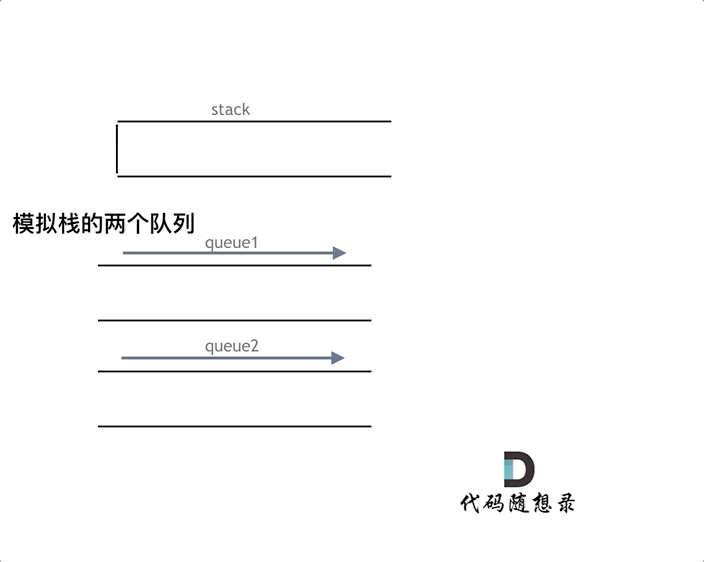

* [做專案（多個 C++、Java、Go、測試開發、前端專案）](https://www.programmercarl.com/other/kstar.html)
* [刷演算法（algorithm）（兩個月高強度學演算法）](https://www.programmercarl.com/xunlian/xunlianying.html)
* [背面試必考題（八股文）（40 天挑戰高頻面試題）](https://www.programmercarl.com/xunlian/bagu.html)


> 用佇列（queue）實作堆疊（stack）還是有點彆扭。

# 225. 用佇列實作堆疊

[LeetCode 題目連結](https://leetcode.cn/problems/implement-stack-using-queues/)

使用佇列實作堆疊的下列操作：

* push(x) -- 元素（element） x 入堆疊
* pop() -- 移除堆疊頂（top of stack）元素
* top() -- 取得堆疊頂元素
* empty() -- 回傳堆疊是否為空

注意:

* 你只能使用佇列的基本操作-- 也就是 push to back, peek/pop from front, size, 和 is empty 這些操作是合法的。
* 你所使用的語言也許不支援佇列。你可以使用 list 或者 deque（雙端佇列（double-ended queue, deque））來模擬（simulation）一個佇列, 只要是標準的佇列操作即可。
* 你可以假設所有操作都是有效的（例如, 對一個空的堆疊不會呼叫 pop 或者 top 操作）。

## 演算法公開課

**[《程式碼隨想錄》演算法影片公開課](https://programmercarl.com/other/gongkaike.html)：[佇列的基本操作！ | LeetCode：225. 用佇列實作堆疊](https://www.bilibili.com/video/BV1Fd4y1K7sm)，相信結合影片再看本篇題解，更有助於大家對本題的理解**。

## 解題思路


（這裡要強調是單向佇列）

有的同學可能疑惑這種題目有什麼實際工程意義，**其實很多演算法題目主要是對知識點的考察和教學意義遠大於其工程實踐的意義，所以面試題也是這樣！**

剛剛做過[堆疊與佇列：我用堆疊來實作佇列怎麼樣？](https://programmercarl.com/0232.用栈实现队列.html)的同學可能依然想著用一個輸入佇列，一個輸出佇列，就可以模擬堆疊的功能，仔細想一下還真不行！

**佇列模擬堆疊，其實一個佇列就夠了**，那麼我們先說一說兩個佇列來實作堆疊的解題思路。

**佇列是先進先出（first in first out, FIFO）的規則，把一個佇列中的資料導入另一個佇列中，資料的順序並沒有變，並沒有變成先進後出（first in last out, FILO）的順序。**

所以用堆疊實作佇列，和用佇列實作堆疊的想法還是不一樣的，這取決於這兩個資料結構（data structure）的性質。

但是依然還是要用兩個佇列來模擬堆疊，只不過沒有輸入和輸出的關係，而是另一個佇列完全用來備份的！

如下面動畫所示，**用兩個佇列 que1 和 que2 實作佇列的功能，que2 其實完全就是一個備份的作用**，把 que1 最後面的元素以外的元素都備份到 que2，然後彈出最後面的元素，再把其他元素從 que2 導回 que1。

模擬的佇列執行語句如下：      

```cpp
queue.push(1);        
queue.push(2);        
queue.pop();   // 注意彈出的操作       
queue.push(3);        
queue.push(4);       
queue.pop();  // 注意彈出的操作    
queue.pop();    
queue.pop();    
queue.empty();    
```



詳細如程式碼註解所示：


```CPP
class MyStack {
public:
    queue<int> que1;
    queue<int> que2; // 輔助佇列，用來備份

    /** Initialize your data structure here. */
    MyStack() {

    }

    /** Push element x onto stack. */
    void push(int x) {
        que1.push(x);
    }

    /** Removes the element on top of the stack and returns that element. */
    int pop() {
        int size = que1.size();
        size--;
        while (size--) { // 將 que1 導入 que2，但要留下最後一個元素
            que2.push(que1.front());
            que1.pop();
        }

        int result = que1.front(); // 留下的最後一個元素就是要回傳的值
        que1.pop();
        que1 = que2;            // 再將 que2 賦值給 que1
        while (!que2.empty()) { // 清空 que2
            que2.pop();
        }
        return result;
    }

    /** Get the top element.
     ** Can not use back() direactly.
     */
    int top(){
        int size = que1.size();
        size--;
        while (size--){
            // 將 que1 導入 que2，但要留下最後一個元素
            que2.push(que1.front());
            que1.pop();
        }

        int result = que1.front(); // 留下的最後一個元素就是要回傳的值
        que2.push(que1.front());   // 取得值後將最後一個元素也加入 que2 中，保持原本的結構不變
        que1.pop();

        que1 = que2; // 再將 que2 賦值給 que1
        while (!que2.empty()){
            // 清空 que2
            que2.pop();
        }
        return result;
    }

    /** Returns whether the stack is empty. */
    bool empty() {
        return que1.empty();
    }
};
```
* 時間複雜性（time complexity）: pop 為 O(n)，top 為 O(n)，其他為 O(1)
* 空間複雜度（space complexity）: O(n)

## 最佳化

其實這道題目就是用一個佇列就夠了。

**一個佇列在模擬堆疊彈出元素的時候只要將佇列頭部的元素（除了最後一個元素外）重新添加到佇列尾部，此時再去彈出元素就是堆疊的順序了。**

C++ 最佳化程式碼

```CPP
class MyStack {
public:
    queue<int> que;

    MyStack() {

    }

    void push(int x) {
        que.push(x);
    }

    int pop() {
        int size = que.size();
        size--;
        while (size--) { // 將佇列頭部的元素（除了最後一個元素外）重新添加到佇列尾部
            que.push(que.front());
            que.pop();
        }
        int result = que.front(); // 此時彈出的元素順序就是堆疊的順序了
        que.pop();
        return result;
    }

    int top(){
        int size = que.size();
        size--;
        while (size--){
            // 將佇列頭部的元素（除了最後一個元素外）重新添加到佇列尾部
            que.push(que.front());
            que.pop();
        }
        int result = que.front(); // 此時取得的元素就是堆疊頂的元素了
        que.push(que.front());    // 將取得完的元素也重新添加到佇列尾部，保證資料結構沒有變化
        que.pop();
        return result;
    }

    bool empty() {
        return que.empty();
    }
};
```
* 時間複雜性: pop 為 O(n)，top 為 O(n)，其他為 O(1)
* 空間複雜度: O(n)


## 其他語言版本

### Java：

使用兩個 Queue 實作方法 1
```java
class MyStack {

    Queue<Integer> queue1; // 和堆疊中保持一樣元素的佇列
    Queue<Integer> queue2; // 輔助佇列

    /** Initialize your data structure here. */
    public MyStack() {
        queue1 = new LinkedList<>();
        queue2 = new LinkedList<>();
    }
    
    /** Push element x onto stack. */
    public void push(int x) {
        queue2.offer(x); // 先放在輔助佇列中
        while (!queue1.isEmpty()){
            queue2.offer(queue1.poll());
        }
        Queue<Integer> queueTemp;
        queueTemp = queue1;
        queue1 = queue2;
        queue2 = queueTemp; // 最終交換 queue1 和 queue2，將元素都放到 queue1 中
    }
    
    /** Removes the element on top of the stack and returns that element. */
    public int pop() {
        return queue1.poll(); // 因為 queue1 中的元素和堆疊中的保持一致，所以這個和下面兩個的操作只看 queue1 即可
    }
    
    /** Get the top element. */
    public int top() {
        return queue1.peek();
    }
    
    /** Returns whether the stack is empty. */
    public boolean empty() {
        return queue1.isEmpty();
    }
}

```
使用兩個 Queue 實作方法 2
```java
class MyStack {
    //q1作為主要的佇列，其元素排列順序和出堆疊順序相同
    Queue<Integer> q1 = new ArrayDeque<>();
    //q2僅作為臨時放置
    Queue<Integer> q2 = new ArrayDeque<>();

    public MyStack() {

    }
    //在加入元素時先將q1中的元素依序出堆疊壓入q2，然後將新加入的元素壓入q1，再將q2中的元素依序出堆疊壓入q1
    public void push(int x) {
        while (q1.size() > 0) {
            q2.add(q1.poll());
        }
        q1.add(x);
        while (q2.size() > 0) {
            q1.add(q2.poll());
        }
    }

    public int pop() {
        return q1.poll();
    }

    public int top() {
        return q1.peek();
    }

    public boolean empty() {
        return q1.isEmpty();
    }
}
```

使用兩個 Deque 實作
```java
class MyStack {
    // Deque 介面繼承了 Queue 介面
    // 所以 Queue 中的 add、poll、peek 等效於 Deque 中的 addLast、pollFirst、peekFirst
    Deque<Integer> que1; // 和堆疊中保持一樣元素的佇列
    Deque<Integer> que2; // 輔助佇列
    /** Initialize your data structure here. */
    public MyStack() {
        que1 = new ArrayDeque<>();
        que2 = new ArrayDeque<>();
    }
    
    /** Push element x onto stack. */
    public void push(int x) {
        que1.addLast(x);
    }
    
    /** Removes the element on top of the stack and returns that element. */
    public int pop() {
        int size = que1.size();
        size--;
        // 將 que1 導入 que2 ，但留下最後一個值
        while (size-- > 0) {
            que2.addLast(que1.peekFirst());
            que1.pollFirst();
        }

        int res = que1.pollFirst();
        // 將 que2 物件的參考賦給了 que1 ，此時 que1，que2 指向同一個佇列
        que1 = que2;
        // 如果直接操作 que2，que1 也會受到影響，所以為 que2 分配一個新的空間
        que2 = new ArrayDeque<>();
        return res;
    }
    
    /** Get the top element. */
    public int top() {
        return que1.peekLast();
    }
    
    /** Returns whether the stack is empty. */
    public boolean empty() {
        return que1.isEmpty();
    }
}
```
最佳化，使用一個 Deque 實作
```java
class MyStack {
    // Deque 介面繼承了 Queue 介面
    // 所以 Queue 中的 add、poll、peek 等效於 Deque 中的 addLast、pollFirst、peekFirst
    Deque<Integer> que1;
    /** Initialize your data structure here. */
    public MyStack() {
        que1 = new ArrayDeque<>();
    }
    
    /** Push element x onto stack. */
    public void push(int x) {
        que1.addLast(x);
    }
    
    /** Removes the element on top of the stack and returns that element. */
    public int pop() {
        int size = que1.size();
        size--;
        // 將 que1 導入 que2 ，但留下最後一個值
        while (size-- > 0) {
            que1.addLast(que1.peekFirst());
            que1.pollFirst();
        }

        int res = que1.pollFirst();
        return res;
    }
    
    /** Get the top element. */
    public int top() {
        return que1.peekLast();
    }
    
    /** Returns whether the stack is empty. */
    public boolean empty() {
        return que1.isEmpty();
    }
}
```

最佳化，使用一個 Queue 實作
```java
class MyStack {

    Queue<Integer> queue;

    public MyStack() {
        queue = new LinkedList<>();
    }

    //每 offer 一個數（A）進來，都重新排列，把這個數（A）放到佇列的隊首
    public void push(int x) {
        queue.offer(x);
        int size = queue.size();
        //移動除了 A 的其他數
        while (size-- > 1)
            queue.offer(queue.poll());
    }

    public int pop() {
        return queue.poll();
    }

    public int top() {
        return queue.peek();
    }

    public boolean empty() {
        return queue.isEmpty();
    }
}

```
最佳化，使用一個 Queue 實作，但用卡哥的邏輯實作
```Java
class MyStack {
    Queue<Integer> queue;
    
    public MyStack() {
        queue = new LinkedList<>();
    }
    
    public void push(int x) {
        queue.add(x);
    }
    
    public int pop() {
        rePosition();
        return queue.poll();
    }
    
    public int top() {
        rePosition();
        int result = queue.poll();
        queue.add(result);
        return result;
    }
    
    public boolean empty() {
        return queue.isEmpty();
    }

    public void rePosition(){
        int size = queue.size();
        size--;
        while(size-->0)
            queue.add(queue.poll());
    }
}
```

### Python：

```python
from collections import deque

class MyStack:

    def __init__(self):
        """
        Python 普通的 Queue 或 SimpleQueue 沒有類似於 peek 的功能
        也無法用索引存取，在實作 top 的時候較為困難。

        用 list 可以，但是在使用 pop(0) 的時候時間複雜性為 O(n)
        因此這裡使用雙向佇列，我們保證只執行 popleft() 和 append()，因為 deque 可以用索引存取，可以實作和 peek 相似的功能

        in - 存所有資料
        out - 僅在 pop 的時候會用到
        """
        self.queue_in = deque()
        self.queue_out = deque()

    def push(self, x: int) -> None:
        """
        直接 append 即可
        """
        self.queue_in.append(x)


    def pop(self) -> int:
        """
        1. 首先確認不空
        2. 因為佇列的特殊性，FIFO，所以我們只有在 pop() 的時候才會使用 queue_out
        3. 先把 queue_in 中的所有元素（除了最後一個），依序出列放進 queue_out
        4. 交換 in 和 out，此時 out 裡只有一個元素
        5. 把 out 中的 pop 出來，即是原佇列的最後一個
        
        tip：這不能像堆疊實作佇列一樣，因為另一個 queue 也是 FIFO，如果執行 pop() 它不能像
        stack 一樣從另一個 pop()，所以乾脆 in 只用來存資料，pop() 的時候兩個進行交換
        """
        if self.empty():
            return None

        for i in range(len(self.queue_in) - 1):
            self.queue_out.append(self.queue_in.popleft())
        
        self.queue_in, self.queue_out = self.queue_out, self.queue_in    # 交換 in 和 out，這也是為啥 in 只用來存
        return self.queue_out.popleft()

    def top(self) -> int:
        """
        寫法一：
        1. 首先確認不空
        2. 我們僅有 in 會存放資料，所以回傳第一個即可（這裡實際上用到了堆疊）
        寫法二：
        1. 首先確認不空
        2. 因為佇列的特殊性，FIFO，所以我們只有在 pop() 的時候才會使用 queue_out
        3. 先把 queue_in 中的所有元素（除了最後一個），依序出列放進 queue_out
        4. 交換 in 和 out，此時 out 裡只有一個元素
        5. 把 out 中的 pop 出來，即是原佇列的最後一個，並使用 temp 變數暫存
        6. 把 temp 追加到 queue_in 的末尾
        """
        # 寫法一：
        # if self.empty():
        #     return None
        
        # return self.queue_in[-1]    # 這裡實際上用到了堆疊，因為直接取得了 queue_in 的末尾元素

        # 寫法二：
        if self.empty():
            return None

        for i in range(len(self.queue_in) - 1):
            self.queue_out.append(self.queue_in.popleft())
        
        self.queue_in, self.queue_out = self.queue_out, self.queue_in 
        temp = self.queue_out.popleft()   
        self.queue_in.append(temp)
        return temp


    def empty(self) -> bool:
        """
        因為只有 in 存了資料，只要判斷 in 是不是有數即可
        """
        return len(self.queue_in) == 0

```
最佳化，使用一個佇列實作
```python
class MyStack:

    def __init__(self):
        self.que = deque()

    def push(self, x: int) -> None:
        self.que.append(x)

    def pop(self) -> int:
        if self.empty():
            return None
        for i in range(len(self.que)-1):
            self.que.append(self.que.popleft())
        return self.que.popleft()

    def top(self) -> int:
        # 寫法一：
        # if self.empty():
        #     return None
        # return self.que[-1]

        # 寫法二：
        if self.empty():
            return None
        for i in range(len(self.que)-1):
            self.que.append(self.que.popleft())
        temp = self.que.popleft()
        self.que.append(temp)
        return temp

    def empty(self) -> bool:
        return not self.que
```

### Go：

使用兩個佇列實作
```go
type MyStack struct {
    //建立兩個佇列
    queue1 []int
    queue2 []int
}


func Constructor() MyStack {
    return MyStack{	//初始化
        queue1:make([]int,0),
        queue2:make([]int,0),
    }
}


func (this *MyStack) Push(x int)  {
     //先將資料存在 queue2 中
    this.queue2 = append(this.queue2,x)	
   //將 queue1 中所有元素移到 queue2 中，再將兩個佇列進行交換
    this.Move() 
}


func (this *MyStack) Move(){    
    if len(this.queue1) == 0{
        //交換，queue1 置為 queue2, queue2 置為空
        this.queue1,this.queue2 = this.queue2,this.queue1
    }else{
        //queue1 元素從頭開始一個一個追加到 queue2 中
            this.queue2 = append(this.queue2,this.queue1[0])  
            this.queue1 = this.queue1[1:]	//去除第一個元素
            this.Move()     //重複
    }
}

func (this *MyStack) Pop() int {
    val := this.queue1[0]
    this.queue1 = this.queue1[1:]	//去除第一個元素
    return val

}


func (this *MyStack) Top() int {
    return this.queue1[0]	//直接回傳
}


func (this *MyStack) Empty() bool {
return len(this.queue1) == 0
}


/**
 * Your MyStack object will be instantiated and called as such:
 * obj := Constructor();
 * obj.Push(x);
 * param_2 := obj.Pop();
 * param_3 := obj.Top();
 * param_4 := obj.Empty();
 */
```

使用一個佇列實作
```go
type MyStack struct {
    queue []int//建立一個佇列
}


/** Initialize your data structure here. */
func Constructor() MyStack {
    return MyStack{   //初始化
        queue:make([]int,0),
    }
}


/** Push element x onto stack. */
func (this *MyStack) Push(x int)  {
    //新增元素
    this.queue=append(this.queue,x)
}


/** Removes the element on top of the stack and returns that element. */
func (this *MyStack) Pop() int {
    n:=len(this.queue)-1//判斷長度
    for n!=0{ //除了最後一個，其餘的都重新新增到佇列裡
        val:=this.queue[0]
        this.queue=this.queue[1:]
        this.queue=append(this.queue,val)
        n--
    }
    //彈出元素
    val:=this.queue[0]
    this.queue=this.queue[1:]
    return val
    
}


/** Get the top element. */
func (this *MyStack) Top() int {
    //利用 Pop 函式，彈出來的元素重新新增
    val:=this.Pop()
    this.queue=append(this.queue,val)
    return val
}


/** Returns whether the stack is empty. */
func (this *MyStack) Empty() bool {
    return len(this.queue)==0
}


/**
 * Your MyStack object will be instantiated and called as such:
 * obj := Constructor();
 * obj.Push(x);
 * param_2 := obj.Pop();
 * param_3 := obj.Top();
 * param_4 := obj.Empty();
 */
```

### JavaScript: 

使用陣列（array）（push, shift）模擬佇列

```js

// 使用兩個佇列實作
/**
 * Initialize your data structure here.
 */
var MyStack = function() {
    this.queue1 = [];
    this.queue2 = [];
};

/**
 * Push element x onto stack. 
 * @param {number} x
 * @return {void}
 */
MyStack.prototype.push = function(x) {
    this.queue1.push(x);
};

/**
 * Removes the element on top of the stack and returns that element.
 * @return {number}
 */
MyStack.prototype.pop = function() {
    // 減少兩個佇列交換的次數， 只有當 queue1 為空時，交換兩個佇列
    if(!this.queue1.length) {
        [this.queue1, this.queue2] = [this.queue2, this.queue1];
    }
    while(this.queue1.length > 1) {
        this.queue2.push(this.queue1.shift());
    }
    return this.queue1.shift();
};

/**
 * Get the top element.
 * @return {number}
 */
MyStack.prototype.top = function() {
    const x = this.pop();
    this.queue1.push(x);
    return x;
};

/**
 * Returns whether the stack is empty.
 * @return {boolean}
 */
MyStack.prototype.empty = function() {
    return !this.queue1.length && !this.queue2.length;
};

```

```js

// 使用一個佇列實作
/**
 * Initialize your data structure here.
 */
var MyStack = function() {
    this.queue = [];
};

/**
 * Push element x onto stack. 
 * @param {number} x
 * @return {void}
 */
MyStack.prototype.push = function(x) {
    this.queue.push(x);
};

/**
 * Removes the element on top of the stack and returns that element.
 * @return {number}
 */
MyStack.prototype.pop = function() {
    let size = this.queue.length;
    while(size-- > 1) {
        this.queue.push(this.queue.shift());
    }
    return this.queue.shift();
};

/**
 * Get the top element.
 * @return {number}
 */
MyStack.prototype.top = function() {
    const x = this.pop();
    this.queue.push(x);
    return x;
};

/**
 * Returns whether the stack is empty.
 * @return {boolean}
 */
MyStack.prototype.empty = function() {
    return !this.queue.length;
};

```

### TypeScript:

版本一：使用兩個佇列模擬堆疊

```typescript
class MyStack {
    private queue: number[];
    private tempQueue: number[];
    constructor() {
        this.queue = [];
        this.tempQueue = [];
    }

    push(x: number): void {
        this.queue.push(x);
    }

    pop(): number {
        for (let i = 0, length = this.queue.length - 1; i < length; i++) {
            this.tempQueue.push(this.queue.shift()!);
        }
        let res: number = this.queue.pop()!;
        let temp: number[] = this.queue;
        this.queue = this.tempQueue;
        this.tempQueue = temp;
        return res;
    }

    top(): number {
        let res: number = this.pop();
        this.push(res);
        return res;
    }

    empty(): boolean {
        return this.queue.length === 0;
    }
}
```

版本二：使用一個佇列模擬堆疊

```typescript
class MyStack {
    private queue: number[];
    constructor() {
        this.queue = [];
    }

    push(x: number): void {
        this.queue.push(x);
    }

    pop(): number {
        for (let i = 0, length = this.queue.length - 1; i < length; i++) {
            this.queue.push(this.queue.shift()!);
        }
        return this.queue.shift()!;
    }

    top(): number {
        let res: number = this.pop();
        this.push(res);
        return res;
    }

    empty(): boolean {
        return this.queue.length === 0;
    }
}
```

### Swift:

```Swift
// 定義一個佇列資料結構
class Queue {
    var array: [Int]
    init() {
        array = [Int]()
    }
    
    /** Push element x to the back of queue. */
    func push(_ x: Int) {
        array.append(x)
    }
    
    /** Removes the element from in front of queue and returns that element. */
    func pop() -> Int {
        if array.isEmpty {
            return -1
        }
        return array.removeFirst()
    }
    
    /** Get the front element. */
    func peek() -> Int {
        if array.isEmpty {
            return -1
        }
        return array.first!
    }
    
    /** Returns whether the queue is empty. */
    func empty() -> Bool {
        return array.isEmpty
    }
    
    func count() -> Int {
        return array.count
    }
}

// 使用雙佇列
class MyStack {
    var queue1: Queue
    var queue2: Queue
    
    init() {
        queue1 = Queue()
        queue2 = Queue()
    }
    
    func push(_ x: Int) {
        queue1.push(x)
    }
    
    func pop() -> Int {
        if queue1.empty() {
            return -1
        }
        while queue1.count() > 1 {
            queue2.push(queue1.pop())
        }
        let res = queue1.pop()
        while !queue2.empty() {
            queue1.push(queue2.pop())
        }
        return res
    }
    
    func top() -> Int {
        if queue1.empty() {
            return -1
        }
        let res = pop()
        push(res)
        return res
    }
    
    func empty() -> Bool {
        return queue1.empty() && queue2.empty()
    }
}

// 使用單佇列
class MyStack {
    var queue: Queue
    
    init() {
        queue = Queue()
    }
    
    func push(_ x: Int) {
        queue.push(x)
    }
    
    func pop() -> Int {
        if queue.empty() {
            return -1
        }
        for _ in 1 ..< queue.count() {
            queue.push(queue.pop())
        }
        return queue.pop()
    }
    
    func top() -> Int {
        if queue.empty() {
            return -1
        }
        let res = pop()
        push(res)
        return res
    }
    
    func empty() -> Bool {
        return queue.empty()
    }
}
```
### Scala:
使用兩個佇列模擬堆疊:

```scala
import scala.collection.mutable

class MyStack() {

  val queue1 = new mutable.Queue[Int]()
  val queue2 = new mutable.Queue[Int]()

  def push(x: Int) {
    queue1.enqueue(x)
  }

  def pop(): Int = {
    var size = queue1.size
    // 將 queue1 中的每個元素都移動到 queue2
    for (i <- 0 until size - 1) {
      queue2.enqueue(queue1.dequeue())
    }
    var res = queue1.dequeue()
    // 再將 queue2 中的每個元素都移動到 queue1
    while (!queue2.isEmpty) {
      queue1.enqueue(queue2.dequeue())
    }
    res
  }

  def top(): Int = {
    var size = queue1.size
    for (i <- 0 until size - 1) {
      queue2.enqueue(queue1.dequeue())
    }
    var res = queue1.dequeue()
    while (!queue2.isEmpty) {
      queue1.enqueue(queue2.dequeue())
    }
    // 最終還需要把 res 送進 queue1
    queue1.enqueue(res)
    res
  }

  def empty(): Boolean = {
    queue1.isEmpty
  }
}
```
使用一個佇列模擬:
```scala
import scala.collection.mutable

class MyStack() {

  val queue = new mutable.Queue[Int]()

  def push(x: Int) {
    queue.enqueue(x)
  }

  def pop(): Int = {
    var size = queue.size
    for (i <- 0 until size - 1) {
      queue.enqueue(queue.head) // 把頭添到佇列最後
      queue.dequeue() // 再出隊
    }
    queue.dequeue()
  }

  def top(): Int = {
    var size = queue.size
    var res = 0
    for (i <- 0 until size) {
      queue.enqueue(queue.head) // 把頭添到佇列最後
      res = queue.dequeue() // 再出隊
    }
    res
  }

  def empty(): Boolean = {
    queue.isEmpty
  }
  }
```

### C#:

> 雙佇列

```csharp
public class MyStack {
    Queue<int> queue1;
    Queue<int> queue2;
    public MyStack() {
        queue1 = new Queue<int>();
        queue2 = new Queue<int>();
    }
    
    public void Push(int x) {
        queue2.Enqueue(x);
        while(queue1.Count != 0){
            queue2.Enqueue(queue1.Dequeue());
        }
        Queue<int> queueTemp;
        queueTemp = queue1;
        queue1 = queue2;
        queue2 = queueTemp;
    }
    
    public int Pop() {
        return queue1.Count > 0 ? queue1.Dequeue() : -1;
    }
    
    public int Top() {
        return queue1.Count > 0 ? queue1.Peek() : -1;
    }
    
    public bool Empty() {
        return queue1.Count == 0;
    }
}
```

> 單佇列

```c#
/*
 * @lc app=leetcode id=225 lang=csharp
 * 版本二：單佇列
 * [225] Implement Stack using Queues
 */

// @lc code=start
public class MyStack {
    Queue<int> myQueue;
    public MyStack() {
        myQueue = new Queue<int>();
    }
    
    public void Push(int x) {
        myQueue.Enqueue(x);
    }
    
    //使用一個佇列實作
    public int Pop() {
        //一個佇列在模擬堆疊彈出元素的時候只要將佇列頭部的元素（除了最後一個元素外）重新新增到佇列尾部，此時再去彈出元素就是堆疊的順序了。
        for (var i = 0; i < myQueue.Count-1; i++)
        {
            myQueue.Enqueue(myQueue.Dequeue());
        }
        return myQueue.Dequeue();
    }

    //複用 Pop() 的程式碼
    public int Top() {
        int res = Pop();
        myQueue.Enqueue(res);
        return res;
    }
    
    public bool Empty() {
        return (myQueue.Count == 0);
    }
}

// @lc code=end

```


### PHP:

> 雙佇列
```php
// SplQueue 類別透過使用一個雙向鏈接串列來提供佇列的主要功能。(PHP 5 >= 5.3.0, PHP 7, PHP 8)
// https://www.php.net/manual/zh/class.splqueue.php
class MyStack {
    public $queueMain; // 儲存資料
    public $queueTmp;  // 輔助作用

    function __construct() {
        $this->queueMain=new SplQueue();
        $this->queueTmp=new SplQueue();
    }
    
    // queueMain: 1,2,3 <= add
    function push($x) {
        $this->queueMain->enqueue($x);
    }
                                    
    function pop() {
       $qmSize = $this->queueMain->Count();
       $qmSize --;
       // queueMain: 3,2,1 => pop =>2,1 => add => 2,1 :queueTmp
       while($qmSize --){
           $this->queueTmp->enqueue($this->queueMain->dequeue());
       }
       // queueMain: 3
       $val = $this->queueMain->dequeue();
       // queueMain <= queueTmp 
       $this->queueMain = $this->queueTmp;
       // 清空 queueTmp, 下次使用 
       $this->queueTmp = new SplQueue();
       return $val;
    }

    function top() {
        // 底層是雙鏈接串列實作：從雙鏈接串列的末尾查看節點
        return $this->queueMain->top(); 
    }

    function empty() {
        return $this->queueMain->isEmpty();
    }
}
```
> 單佇列
```php
class MyStack {
    public $queue;

    function __construct() {
        $this->queue=new SplQueue();
    }
    
    function push($x) {
        $this->queue->enqueue($x);
    }
                                 
    function pop() {
       $qmSize = $this->queue->Count();
       $qmSize --;
       //queue: 3,2,1 => pop =>2,1 => add => 2,1,3 :queue
       while($qmSize --){
           $this->queue->enqueue($this->queue->dequeue());
       }
       $val = $this->queue->dequeue();
       return $val;
    }

    function top() {
        return $this->queue->top(); 
    }

    function empty() {
        return $this->queue->isEmpty();
    }
}
```

### Rust:

> rust：單佇列

```rust
struct MyStack {
    queue: Vec<i32>,
}

impl MyStack {
    fn new() -> Self {
        MyStack { queue: vec![] }
    }

    fn push(&mut self, x: i32) {
        self.queue.push(x);
    }

    fn pop(&mut self) -> i32 {
        let len = self.queue.len() - 1;
        for _ in 0..len {
            let tmp = self.queue.remove(0);
            self.queue.push(tmp);
        }
        self.queue.remove(0)
    }

    fn top(&mut self) -> i32 {
        let res = self.pop();
        self.queue.push(res);
        res
    }

    fn empty(&self) -> bool {
        self.queue.is_empty()
    }
}
```

### C:

> C：單佇列

```c
typedef struct Node {
    int val;
    struct Node *next;
} Node_t;

// 用單向鏈接串列實作 queue
typedef struct {
    Node_t *head;
    Node_t *foot;
    int size;
} MyStack;

MyStack* myStackCreate() {
    MyStack *obj = (MyStack *)malloc(sizeof(MyStack));
    assert(obj);
    obj->head = NULL;
    obj->foot = NULL;
    obj->size = 0;
    return obj;
}

void myStackPush(MyStack* obj, int x) {

    Node_t *temp = (Node_t *)malloc(sizeof(Node_t));
    assert(temp);
    temp->val = x;
    temp->next = NULL;

    // 新增至 queue 末尾
    if (obj->foot) {
        obj->foot->next = temp;
    } else {
        obj->head = temp;
    }
    obj->foot = temp;
    obj->size++;
}

int myStackPop(MyStack* obj) {

    // 取得末尾元素
    int target = obj->foot->val;

    if (obj->head == obj->foot) {
        free(obj->foot);
        obj->head = NULL;
        obj->foot = NULL;
    } else {
        
        Node_t *prev = obj->head;
        // 移動至 queue 尾部節點前一個節點
        while (prev->next != obj->foot) {
            prev = prev->next;
        }

        free(obj->foot);
        obj->foot = prev;
        obj->foot->next = NULL;
    }

    obj->size--;
    return target;
}

int myStackTop(MyStack* obj) {
    return obj->foot->val;
}

bool myStackEmpty(MyStack* obj) {
    return obj->size == 0;
}

void myStackFree(MyStack* obj) {
    Node_t *curr = obj->head;
    while (curr != NULL) {
        Node_t *temp = curr->next;
        free(curr);
        curr = temp;
    }
    free(obj);
}

```


