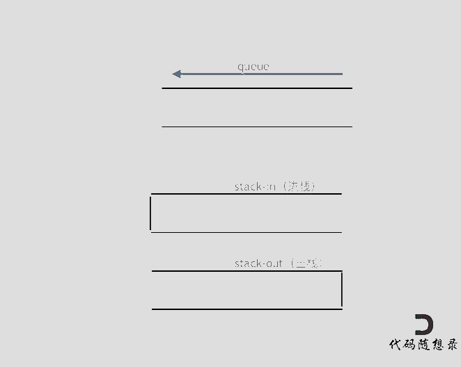

* [做專案（多個 C++、Java、Go、測試開發、前端專案）](https://www.programmercarl.com/other/kstar.html)
* [刷演算法（兩個月高強度學演算法）](https://www.programmercarl.com/xunlian/xunlianying.html)
* [背面試必考題（八股文）（40 天挑戰高頻面試題）](https://www.programmercarl.com/xunlian/bagu.html)


> 工作上一定沒人這麼搞，但是考察對堆疊（stack）、佇列（queue）理解程度的好題

# 232. 用堆疊實作佇列

[LeetCode 題目連結](https://leetcode.cn/problems/implement-queue-using-stacks/)

使用堆疊實作佇列的下列操作：

push(x) -- 將一個元素（element）放入佇列的尾部。     
pop() -- 從佇列首部移除元素。    
peek() -- 回傳佇列首部的元素。    
empty() -- 回傳佇列是否為空。   


範例:

```cpp
MyQueue queue = new MyQueue();
queue.push(1);
queue.push(2);
queue.peek();  // 回傳 1
queue.pop();   // 回傳 1
queue.empty(); // 回傳 false
```

說明:

* 你只能使用標準的堆疊操作 -- 也就是只有 push to top, peek/pop from top, size, 和 is empty 操作是合法的。
* 你所使用的語言也許不支援堆疊。你可以使用 list 或者 deque（雙端佇列（double-ended queue, deque））來模擬（simulation）一個堆疊，只要是標準的堆疊操作即可。
* 假設所有操作都是有效的 （例如，一個空的佇列不會呼叫 pop 或者 peek 操作）。

## 演算法公開課

**[《程式碼隨想錄》演算法影片公開課](https://programmercarl.com/other/gongkaike.html)：[堆疊的基本操作！ | LeetCode：232. 用堆疊實作佇列](https://www.bilibili.com/video/BV1nY4y1w7VC)，相信結合影片再看本篇題解，更有助於大家對本題的理解**。

## 解題思路

這是一道模擬題，不涉及到具體演算法，考察的就是對堆疊和佇列的掌握程度。

使用堆疊來模擬佇列的行為，如果僅僅用一個堆疊，是一定不行的，所以需要兩個堆疊**一個輸入堆疊，一個輸出堆疊**，這裡要注意輸入堆疊和輸出堆疊的關係。

下面動畫模擬以下佇列的執行過程：

執行語句：     
queue.push(1);     
queue.push(2);       
queue.pop(); **注意此時的輸出堆疊的操作**   
queue.push(3);    
queue.push(4);     
queue.pop();    
queue.pop();**注意此時的輸出堆疊的操作**   
queue.pop();      
queue.empty();      



在 push 資料的時候，只要資料放進輸入堆疊就好，**但在 pop 的時候，操作就複雜一些，輸出堆疊如果為空，就把進堆疊資料全部導入進來（注意是全部導入）**，再從出堆疊彈出資料，如果輸出堆疊不為空，則直接從出堆疊彈出資料就可以了。

最後如何判斷佇列為空呢？**如果進堆疊和出堆疊都為空的話，說明模擬的佇列為空了。**

在程式碼實作的時候，會發現 pop() 和 peek() 兩個函數（function）功能類似，程式碼實作上也是類似的，可以思考一下如何把程式碼抽象化一下。

C++ 程式碼如下：

```CPP
class MyQueue {
public:
    stack<int> stIn;
    stack<int> stOut;
    /** Initialize your data structure here. */
    MyQueue() {

    }
    /** Push element x to the back of queue. */
    void push(int x) {
        stIn.push(x);
    }

    /** Removes the element from in front of queue and returns that element. */
    int pop() {
        // 只有當 stOut 為空的時候，再從 stIn 裡導入資料（導入 stIn 全部資料）
        if (stOut.empty()) {
            // 從 stIn 導入資料直到 stIn 為空
            while(!stIn.empty()) {
                stOut.push(stIn.top());
                stIn.pop();
            }
        }
        int result = stOut.top();
        stOut.pop();
        return result;
    }

    /** Get the front element. */
    int peek() {
        int res = this->pop(); // 直接使用已有的 pop 函數
        stOut.push(res); // 因為 pop 函數彈出了元素 res，所以再新增回去
        return res;
    }

    /** Returns whether the queue is empty. */
    bool empty() {
        return stIn.empty() && stOut.empty();
    }
};

```

* 時間複雜度（time complexity）: 都為 O(1)。pop 和 peek 看起來像 O(n)，實際上一個迴圈（loop）n 會被使用 n 次，最後還是 O(1)。
* 空間複雜度（space complexity）: O(n)


## 拓展

可以看出 peek() 的實作，直接重複使用了 pop()， 要不然，對 stOut 判空的邏輯又要重寫一遍。

再多說一些程式碼開發上的習慣問題，在工業級別程式碼開發中，最忌諱的就是實作一個類似的函數，直接把程式碼貼過來改一改就完事了。

這樣的專案程式碼會越來越亂，**一定要懂得重複使用，功能相近的函數要抽象出來，不要大量的複製貼上，很容易出問題！（踩過坑的人自然懂）**

工作中如果發現某一個功能自己要經常用，同事們可能也會用到，自己就花點時間把這個功能抽象成一個好用的函數或者工具類別（class），不僅自己方便，也方便了同事們。

同事們就會逐漸認可你的工作態度和工作能力，自己的口碑都是這麼一點一點累積起來的！在同事圈裡口碑起來了之後，你就發現自己走上了一個正循環，以後的升職加薪才少不了你！


## 其他語言版本

### Java：

```java
class MyQueue {

    Stack<Integer> stackIn;
    Stack<Integer> stackOut;

    /** Initialize your data structure here. */
    public MyQueue() {
        stackIn = new Stack<>(); // 負責進堆疊
        stackOut = new Stack<>(); // 負責出堆疊
    }
    
    /** Push element x to the back of queue. */
    public void push(int x) {
        stackIn.push(x);
    }
    
    /** Removes the element from in front of queue and returns that element. */
    public int pop() {    
        dumpstackIn();
        return stackOut.pop();
    }
    
    /** Get the front element. */
    public int peek() {
        dumpstackIn();
        return stackOut.peek();
    }
    
    /** Returns whether the queue is empty. */
    public boolean empty() {
        return stackIn.isEmpty() && stackOut.isEmpty();
    }

    // 如果 stackOut 為空，那麼將 stackIn 中的元素全部放到 stackOut 中
    private void dumpstackIn(){
        if (!stackOut.isEmpty()) return; 
        while (!stackIn.isEmpty()){
                stackOut.push(stackIn.pop());
        }
    }
}

```

### Python：

```python
class MyQueue:

    def __init__(self):
        """
        in 主要負責 push，out 主要負責 pop
        """
        self.stack_in = []
        self.stack_out = []


    def push(self, x: int) -> None:
        """
        有新元素進來，就往 in 裡面 push
        """
        self.stack_in.append(x)


    def pop(self) -> int:
        """
        Removes the element from in front of queue and returns that element.
        """
        if self.empty():
            return None
        
        if self.stack_out:
            return self.stack_out.pop()
        else:
            for i in range(len(self.stack_in)):
                self.stack_out.append(self.stack_in.pop())
            return self.stack_out.pop()


    def peek(self) -> int:
        """
        Get the front element.
        """
        ans = self.pop()
        self.stack_out.append(ans)
        return ans


    def empty(self) -> bool:
        """
        只要 in 或者 out 有元素，說明佇列不為空
        """
        return not (self.stack_in or self.stack_out)

```

### Go：

```Go
// 透過切片實作一個堆疊
// 由於只是輔助實作演算法題目，因此不做異常情況處理
type MyStack []int

func (s *MyStack) Push(v int) {
	*s = append(*s, v)
}

func (s *MyStack) Pop() int {
	val := (*s)[len(*s)-1]
	*s = (*s)[:len(*s)-1]
	return val
}

func (s *MyStack) Peek() int {
	return (*s)[len(*s)-1]
}

func (s *MyStack) Size() int {
	return len(*s)
}

func (s *MyStack) Empty() bool {
	return s.Size() == 0
}

// ---------- 分界線 ----------

type MyQueue struct {
    stackIn *MyStack
    stackOut *MyStack
}


func Constructor() MyQueue {
    return MyQueue {
        stackIn: &MyStack{},
        stackOut: &MyStack{},
    }
}


func (this *MyQueue) Push(x int)  {
    this.stackIn.Push(x)
}


func (this *MyQueue) Pop() int {
    this.fillStackOut()
    return this.stackOut.Pop()
}


func (this *MyQueue) Peek() int {
    this.fillStackOut()
    return this.stackOut.Peek()
}


func (this *MyQueue) Empty() bool {
    return this.stackIn.Empty() && this.stackOut.Empty()
}

// fillStackOut 填充輸出堆疊
func (this *MyQueue) fillStackOut() {
    if this.stackOut.Empty() {
        for !this.stackIn.Empty() {
            val := this.stackIn.Pop()
            this.stackOut.Push(val)        
        }
    }
}
```

### JavaScript:

 ```js
 // 使用兩個陣列的堆疊方法（push, pop）實作佇列
 /**
 * Initialize your data structure here.
 */
var MyQueue = function() {
    this.stackIn = [];
    this.stackOut = [];
};

/**
 * Push element x to the back of queue. 
 * @param {number} x
 * @return {void}
 */
MyQueue.prototype.push = function(x) {
    this.stackIn.push(x);
};

/**
 * Removes the element from in front of queue and returns that element.
 * @return {number}
 */
MyQueue.prototype.pop = function() {
    const size = this.stackOut.length;
    if(size) {
        return this.stackOut.pop();
    }
    while(this.stackIn.length) {
        this.stackOut.push(this.stackIn.pop());
    }
    return this.stackOut.pop();
};

/**
 * Get the front element.
 * @return {number}
 */
MyQueue.prototype.peek = function() {
    const x = this.pop();
    this.stackOut.push(x);
    return x;
};

/**
 * Returns whether the queue is empty.
 * @return {boolean}
 */
MyQueue.prototype.empty = function() {
    return !this.stackIn.length && !this.stackOut.length
};
 ```

### TypeScript:

```typescript
class MyQueue {
    private stackIn: number[]
    private stackOut: number[]
    constructor() {
        this.stackIn = [];
        this.stackOut = [];
    }

    push(x: number): void {
        this.stackIn.push(x);
    }

    pop(): number {
        if (this.stackOut.length === 0) {
            while (this.stackIn.length > 0) {
                this.stackOut.push(this.stackIn.pop()!);
            }
        }
        return this.stackOut.pop()!;
    }

    peek(): number {
        let temp: number = this.pop();
        this.stackOut.push(temp);
        return temp;
    }

    empty(): boolean {
        return this.stackIn.length === 0 && this.stackOut.length === 0;
    }
}
```

### Swift：

```swift
class MyQueue {
    
    var stackIn = [Int]()
    var stackOut = [Int]()
    
    init() {}
    
    /** Push element x to the back of queue. */
    func push(_ x: Int) {
        stackIn.append(x)
    }
    
    /** Removes the element from in front of queue and returns that element. */
    func pop() -> Int {
        if stackOut.isEmpty {
            while !stackIn.isEmpty {
                stackOut.append(stackIn.popLast()!)
            }
        }
        return stackOut.popLast() ?? -1
    }
    
    /** Get the front element. */
    func peek() -> Int {
        let res = pop()
        stackOut.append(res)
        return res
    }
    
    /** Returns whether the queue is empty. */
    func empty() -> Bool {
        return stackIn.isEmpty && stackOut.isEmpty
    }
}
```

### C:

```C
/*
1.兩個 type 為 int 的陣列（堆疊），大小為 100
    第一個堆疊 stackIn 用來存放資料，第二個堆疊 stackOut 作為輔助用來輸出資料
2.兩個指標 stackInTop 和 stackOutTop，分別指向堆疊頂
*/
typedef struct {
    int stackInTop, stackOutTop;
    int stackIn[100], stackOut[100];
} MyQueue;

/*
1.開闢一個佇列的大小空間
2.將指標 stackInTop 和 stackOutTop 初始化為 0
3.回傳開闢的佇列
*/
MyQueue* myQueueCreate() {
    MyQueue* queue = (MyQueue*)malloc(sizeof(MyQueue));
    queue->stackInTop = 0;
    queue->stackOutTop = 0;
    return queue;
}

/*
將元素存入第一個堆疊中,存入後堆疊頂指標+1
*/
void myQueuePush(MyQueue* obj, int x) {
    obj->stackIn[(obj->stackInTop)++] = x;
}

/*
1.若輸出堆疊為空且當第一個堆疊中有元素（stackInTop>0 時），將第一個堆疊中元素複製到第二個堆疊中（stackOut[stackTop2++] = stackIn[--stackTop1])
2.將堆疊頂元素儲存
3.當 stackTop2>0 時，將第二個堆疊中元素複製到第一個堆疊中(stackIn[stackTop1++] = stackOut[--stackTop2])
*/
int myQueuePop(MyQueue* obj) {
    //最佳化：複製堆疊頂指標，減少對記憶體的存取次數
    int stackInTop = obj->stackInTop;
    int stackOutTop = obj->stackOutTop;
    //若輸出堆疊為空
    if(stackOutTop == 0) {
        //將第一個堆疊中元素複製到第二個堆疊中
        while(stackInTop > 0) {
            obj->stackOut[stackOutTop++] = obj->stackIn[--stackInTop];
        }
    }
    //將第二個堆疊中堆疊頂元素（佇列的第一個元素）出堆疊，並儲存
    int top = obj->stackOut[--stackOutTop];
    //將輸出堆疊中元素放回輸入堆疊中
    while(stackOutTop > 0) {
        obj->stackIn[stackInTop++] = obj->stackOut[--stackOutTop];
    }
    //更新堆疊頂指標
    obj->stackInTop = stackInTop;
    obj->stackOutTop = stackOutTop;
    //回傳佇列中第一個元素
    return top;
}

//回傳輸入堆疊中的堆疊底端元素
int myQueuePeek(MyQueue* obj) {
    return obj->stackIn[0];
}

//若堆疊頂指標均為 0，則代表佇列為空
bool myQueueEmpty(MyQueue* obj) {
    return obj->stackInTop == 0 && obj->stackOutTop == 0;
}

//將堆疊頂指標置 0
void myQueueFree(MyQueue* obj) {
    obj->stackInTop = 0;
    obj->stackOutTop = 0;
}
```

### C#:

```csharp
public class MyQueue {
    Stack<int> inStack;
    Stack<int> outStack;

    public MyQueue() {
        inStack = new Stack<int>();// 負責進堆疊
        outStack = new Stack<int>();// 負責出堆疊
    }
    
    public void Push(int x) {
        inStack.Push(x);
    }
    
    public int Pop() {
        dumpstackIn();
        return outStack.Pop();
    }
    
    public int Peek() {
        dumpstackIn();
        return outStack.Peek();
    }
    
    public bool Empty() {
        return inStack.Count == 0 && outStack.Count == 0;
    }

    // 處理方法：
    // 如果 outStack 為空，那麼將 inStack 中的元素全部放到 outStack 中
    private void dumpstackIn(){
        if (outStack.Count != 0) return; 
        while(inStack.Count != 0){
            outStack.Push(inStack.Pop());
        }
    }
}

```


### PHP:

```php
// SplStack 類別透過使用一個雙向鏈接串列來提供堆疊的主要功能。[PHP 5 >= 5.3.0, PHP 7, PHP 8]
// https://www.php.net/manual/zh/class.splstack.php
class MyQueue {
    // 雙堆疊模擬佇列：In 堆疊儲存資料；Out 堆疊輔助處理
    private $stackIn;
    private $stackOut;
    
    function __construct() {
        $this->stackIn = new SplStack();
        $this->stackOut = new SplStack();
    }

    // In: 1 2 3  <= push  
    function push($x) {
        $this->stackIn->push($x);
    }

    function pop() {
        $this->peek();
        return $this->stackOut->pop();
    }

    function peek() {
        if($this->stackOut->isEmpty()){
            $this->shift();
        }
        return $this->stackOut->top();
    }

    function empty() {
        return $this->stackOut->isEmpty() && $this->stackIn->isEmpty();
    }

    // 如果 Out 堆疊為空，把 In 堆疊資料壓入 Out 堆疊
    // In: 1 2 3 => pop    push => 1 2 3 :Out  
    private function shift(){
        while(!$this->stackIn->isEmpty()){
            $this->stackOut->push($this->stackIn->pop());
        }
    }
    }
```

### Scala:

```scala
class MyQueue() {
  import scala.collection.mutable
  val stackIn = mutable.Stack[Int]() // 負責出堆疊
  val stackOut = mutable.Stack[Int]() // 負責入堆疊

  // 新增元素
  def push(x: Int) {
    stackIn.push(x)
  }

  // 重複使用程式碼，如果 stackOut 為空就把 stackIn 的所有元素都壓入 StackOut
  def dumpStackIn(): Unit = {
    if (!stackOut.isEmpty) return
    while (!stackIn.isEmpty) {
      stackOut.push(stackIn.pop())
    }
  }

  // 彈出元素
  def pop(): Int = {
    dumpStackIn()
    stackOut.pop()
  }

  // 取得隊頭
  def peek(): Int = {
    dumpStackIn()
    val res: Int = stackOut.pop()
    stackOut.push(res)
    res
  }

  // 判斷是否為空
  def empty(): Boolean = {
    stackIn.isEmpty && stackOut.isEmpty
  }

}
```

### Rust:

```rust
struct MyQueue {
    stack_in: Vec<i32>,
    stack_out: Vec<i32>,
}
impl MyQueue {
    fn new() -> Self {
        MyQueue {
            stack_in: Vec::new(),
            stack_out: Vec::new(),
        }
        
    }
    
    fn push(&mut self, x: i32) {
        self.stack_in.push(x);
    }
    
    fn pop(&mut self) -> i32 {
        if self.stack_out.is_empty(){
            while !self.stack_in.is_empty() {
                self.stack_out.push(self.stack_in.pop().unwrap());
            }
        }
        self.stack_out.pop().unwrap()
    }
    
    fn peek(&mut self) -> i32 {
        let res = self.pop();
        self.stack_out.push(res);
        res
    }
    
    fn empty(&self) -> bool {
       self.stack_in.is_empty() && self.stack_out.is_empty()
    }
}
```

