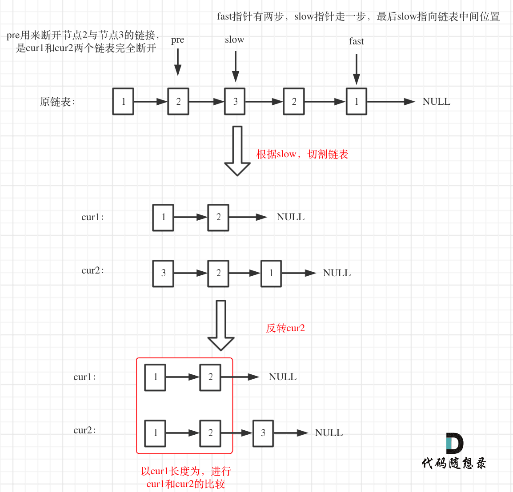

* [做專案（多個 C++、Java、Go、測試開發、前端專案）](https://www.programmercarl.com/other/kstar.html)
* [刷演算法（兩個月高強度學演算法）](https://www.programmercarl.com/xunlian/xunlianying.html)
* [背面試必考題（八股文）（40 天挑戰高頻面試題）](https://www.programmercarl.com/xunlian/bagu.html)


# 234. 回文鏈接串列

[LeetCode 題目連結](https://leetcode.cn/problems/palindrome-linked-list/)

請判斷一個鏈接串列（linked list）是否為回文（palindrome）鏈接串列。

範例 1:
* 輸入: 1->2
* 輸出: false

範例 2:
* 輸入: 1->2->2->1
* 輸出: true


## 解題思路

### 陣列（array）模擬（simulation）

最直接的想法，就是把鏈接串列轉成陣列，然後再判斷是否回文。

程式碼也比較簡單。如下：

```CPP
class Solution {
public:
    bool isPalindrome(ListNode* head) {
        vector<int> vec;
        ListNode* cur  = head;
        while (cur) {
            vec.push_back(cur->val);
            cur = cur->next;
        }
        // 比較陣列回文
        for (int i = 0, j = vec.size() - 1; i < j; i++, j--) {
            if (vec[i] != vec[j]) return false;
        }
        return true;
    }
};
```

上面程式碼可以再最佳化，就是先求出鏈接串列長度，然後給定 vector 的初始長度，這樣避免 vector 每次新增節點（node）重新開闢空間

```CPP
class Solution {
public:
    bool isPalindrome(ListNode* head) {

        ListNode* cur  = head;
        int length = 0;
        while (cur) {
            length++;
            cur = cur->next;
        }
        vector<int> vec(length, 0); // 給定 vector 的初始長度，這樣避免 vector 每次新增節點重新開闢空間
        cur = head;
        int index = 0;
        while (cur) {
            vec[index++] = cur->val;
            cur = cur->next;
        }
        // 比較陣列回文
        for (int i = 0, j = vec.size() - 1; i < j; i++, j--) {
            if (vec[i] != vec[j]) return false;
        }
        return true;
    }
};

```

### 反轉（reverse）後半部分鏈接串列

分為如下幾步：

* 用快慢指標（fast and slow pointers），快指標（pointer）走兩步，慢指標走一步，快指標遇到終止位置時，慢指標就在鏈接串列中間位置
* 同時用 pre 記錄慢指標指向節點的前一個節點，用來分割鏈接串列
* 將鏈接串列分為前後均等兩部分，如果鏈接串列長度是奇數，那麼後半部分多一個節點
* 將後半部分反轉 ，得 cur2，前半部分為 cur1
* 按照 cur1 的長度，依序比較（comparison） cur1 和 cur2 的節點數值

如圖所示：

 </img></div>

程式碼如下：

```CPP
class Solution {
public:
    bool isPalindrome(ListNode* head) {
        if (head == nullptr || head->next == nullptr) return true;
        ListNode* slow = head; // 慢指標，找到鏈接串列中間位置，作為分割
        ListNode* fast = head;
        ListNode* pre = head; // 記錄慢指標的前一個節點，用來分割鏈接串列
        while (fast && fast->next) {
            pre = slow;
            slow = slow->next;
            fast = fast->next->next;
        }
        pre->next = nullptr; // 分割鏈接串列

        ListNode* cur1 = head;  // 前半部分
        ListNode* cur2 = reverseList(slow); // 反轉後半部分，總鏈接串列長度如果是奇數，cur2 比 cur1 多一個節點

        // 開始兩個鏈接串列的比較
        while (cur1) {
            if (cur1->val != cur2->val) return false;
            cur1 = cur1->next;
            cur2 = cur2->next;
        }
        return true;
    }
    // 反轉鏈接串列
    ListNode* reverseList(ListNode* head) {
        ListNode* temp; // 儲存 cur 的下一個節點
        ListNode* cur = head;
        ListNode* pre = nullptr;
        while(cur) {
            temp = cur->next;  // 儲存一下 cur 的下一個節點，因為接下來要改變 cur->next
            cur->next = pre; // 反轉操作
            // 更新 pre 和 cur 指標
            pre = cur;
            cur = temp;
        }
        return pre;
    }
};
```


## 其他語言版本

### Java

```java
// 方法一，使用陣列
class Solution {
    public boolean isPalindrome(ListNode head) {
        int len = 0;
        // 統計鏈接串列長度
        ListNode cur = head;
        while (cur != null) {
            len++;
            cur = cur.next;
        }
        cur = head;
        int[] res = new int[len];
        // 將元素加到陣列之中
        for (int i = 0; i < res.length; i++){
            res[i] = cur.val;
            cur = cur.next;
        }
        // 比較回文
        for (int i = 0, j = len - 1; i < j; i++, j--){
            if (res[i] != res[j]){
                return false;
            }
        }
        return true;
    }
}

// 方法二，fast and slow pointers
class Solution {
    public boolean isPalindrome(ListNode head) {
        // 如果為空或者僅有一個節點，回傳 true
        if (head == null && head.next == null) return true;
        ListNode slow = head;
        ListNode fast = head;
        ListNode pre = head;
        while (fast != null && fast.next != null){
            pre = slow;  // 記錄 slow 的前一個結點
            slow = slow.next;
            fast = fast.next.next;
        }
        pre.next = null;  // 分割兩個鏈接串列

        // 前半部分
        ListNode cur1 = head;
        // 後半部分。這裡使用了反轉鏈接串列
        ListNode cur2 = reverseList(slow);

        while (cur1 != null){
            if (cur1.val != cur2.val) return false;

            // 注意要移動兩個結點
            cur1 = cur1.next;
            cur2 = cur2.next;
        }
        return true;
    }
    ListNode reverseList(ListNode head){
        // 反轉鏈接串列
        ListNode tmp = null;
        ListNode pre = null;
        while (head != null){
            tmp = head.next;
            head.next = pre;
            pre = head;
            head = tmp;
        }
        return pre;
    }
}
```

### Python

```python
#陣列模擬
class Solution:
    def isPalindrome(self, head: Optional[ListNode]) -> bool:
        list=[]
        while head: 
            list.append(head.val)
            head=head.next
        l,r=0, len(list)-1
        while l<=r: 
            if list[l]!=list[r]:
                return False
            l+=1
            r-=1
        return True   
      
#反轉後半部分鏈接串列
class Solution:
    def isPalindrome(self, head: Optional[ListNode]) -> bool:
        fast = slow = head

        # find mid point which including (first) mid point into the first half linked list
        while fast and fast.next:
            fast = fast.next.next
            slow = slow.next
        node = None

        # reverse second half linked list
        while slow:
            slow.next, slow, node = node, slow.next, slow

        # compare reversed and original half; must maintain reversed linked list is shorter than 1st half
        while node:
            if node.val != head.val:
                return False
            node = node.next
            head = head.next
        return True
```

### Go

```go
/**
 * Definition for singly-linked list.
 * type ListNode struct {
 *     Val int
 *     Next *ListNode
 * }
 */
//方法一，使用陣列
func isPalindrome(head *ListNode) bool{
    //計算切片長度，避免切片頻繁擴容
    cur,ln:=head,0
    for cur!=nil{
        ln++
        cur=cur.Next
    }
    nums:=make([]int,ln)
    index:=0
    for head!=nil{
        nums[index]=head.Val
        index++
        head=head.Next
    }
    //比較回文切片
    for i,j:=0,ln-1;i<=j;i,j=i+1,j-1{
        if nums[i]!=nums[j]{return false}
    }
    return true
}

// 方法二，fast and slow pointers
func isPalindrome(head *ListNode) bool {
    if head==nil&&head.Next==nil{return true}
    //慢指標，找到鏈接串列中間位置，作為分割
    slow:=head
    fast:=head
    //記錄慢指標的前一個節點，用來分割鏈接串列
    pre:=head
    for fast!=nil && fast.Next!=nil{
        pre=slow
        slow=slow.Next
        fast=fast.Next.Next
    }
    //分割鏈接串列
    pre.Next=nil
    //前半部分
    cur1:=head
    //反轉後半部分，總鏈接串列長度如果是奇數，cur2 比 cur1 多一個節點
    cur2:=ReverseList(slow)

    //開始兩個鏈接串列的比較
    for cur1!=nil{
        if cur1.Val!=cur2.Val{return false}
        cur1=cur1.Next
        cur2=cur2.Next
    }
    return true
}
//反轉鏈接串列
func ReverseList(head *ListNode) *ListNode{
    var pre *ListNode
    cur:=head
    for cur!=nil{
        tmp:=cur.Next
        cur.Next=pre
        pre=cur
        cur=tmp
    }
    return pre
}
```

### JavaScript

```js
var isPalindrome = function(head) {
    const reverseList = head => {// 反轉鏈接串列
        let temp = null;
        let pre = null;
        while(head != null){
            temp = head.next;
            head.next = pre;
            pre = head;
            head = temp;
        }
        return pre;
    }
    // 如果為空或者僅有一個節點，回傳 true
    if(!head && !head.next) return true;
    let slow = head;
    let fast = head;
    let pre = head;
    while(fast != null && fast.next != null){
        pre = slow; // 記錄 slow 的前一個結點
        slow = slow.next;
        fast = fast.next.next;
    }
    pre.next = null; // 分割兩個鏈接串列
    // 前半部分
    let cur1 = head;
    // 後半部分。這裡使用了反轉鏈接串列
    let cur2 = reverseList(slow);
    while(cur1 != null){
        if(cur1.val != cur2.val) return false;
        // 注意要移動兩個結點
        cur1 = cur1.next;
        cur2 = cur2.next;
    }
    return true;
};
```

### TypeScript

> 陣列模擬

```typescript
function isPalindrome(head: ListNode | null): boolean {
    const helperArr: number[] = [];
    let curNode: ListNode | null = head;
    while (curNode !== null) {
        helperArr.push(curNode.val);
        curNode = curNode.next;
    }
    let left: number = 0,
        right: number = helperArr.length - 1;
    while (left < right) {
        if (helperArr[left++] !== helperArr[right--]) return false;
    }
    return true;
};
```

> 反轉後半部分鏈接串列

```typescript
function isPalindrome(head: ListNode | null): boolean {
    if (head === null || head.next === null) return true;
    let fastNode: ListNode | null = head,
        slowNode: ListNode = head,
        preNode: ListNode = head;
    while (fastNode !== null && fastNode.next !== null) {
        preNode = slowNode;
        slowNode = slowNode.next!;
        fastNode = fastNode.next.next;
    }
    preNode.next = null;
    let cur1: ListNode | null = head;
    let cur2: ListNode | null = reverseList(slowNode);
    while (cur1 !== null) {
        if (cur1.val !== cur2!.val) return false;
        cur1 = cur1.next;
        cur2 = cur2!.next;
    }
    return true;
};
function reverseList(head: ListNode | null): ListNode | null {
    let curNode: ListNode | null = head,
        preNode: ListNode | null = null;
    while (curNode !== null) {
        let tempNode: ListNode | null = curNode.next;
        curNode.next = preNode;
        preNode = curNode;
        curNode = tempNode;
    }
    return preNode;
}
```


