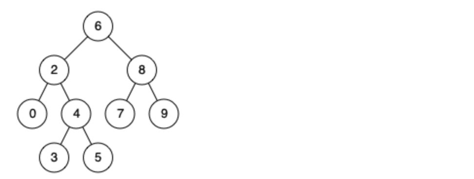
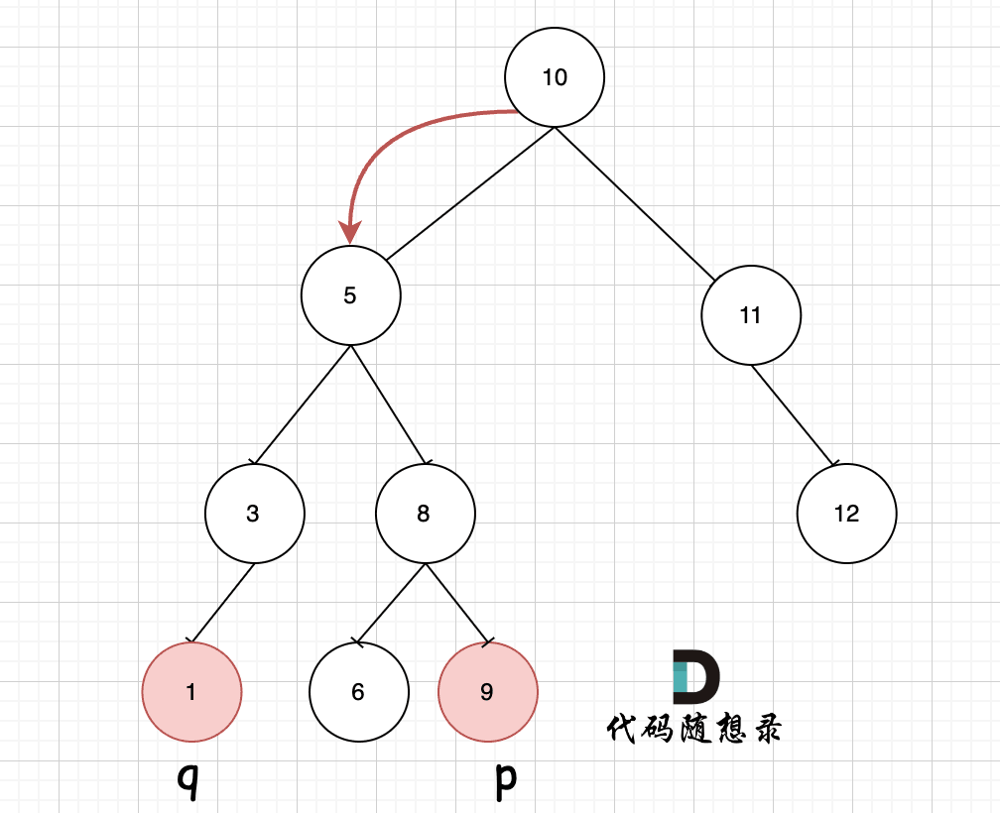
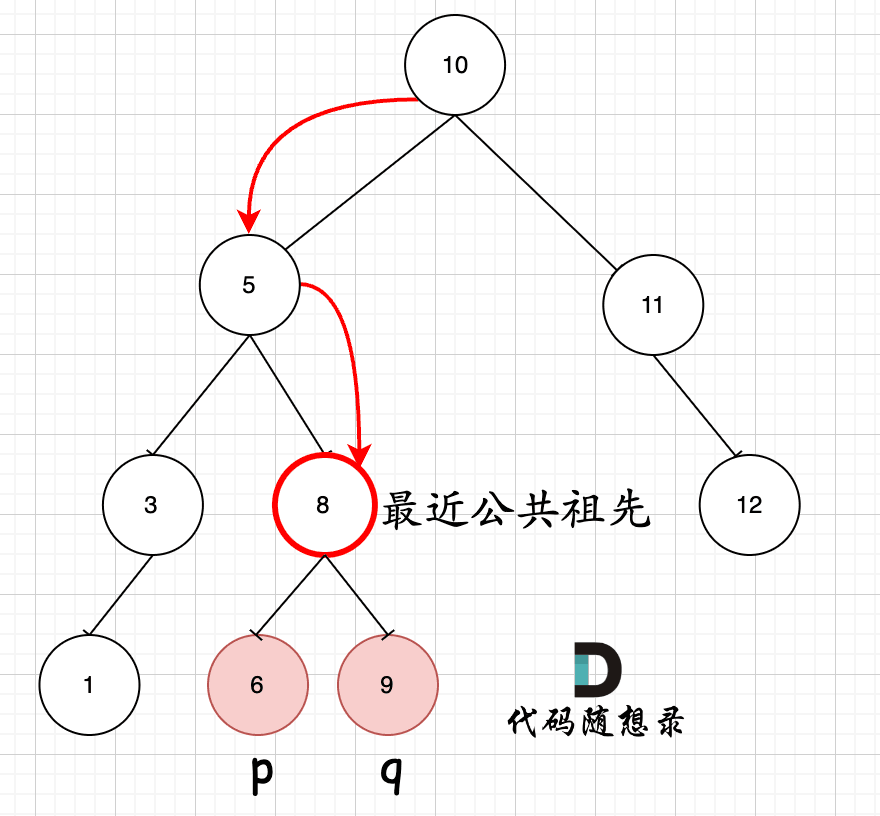

* [做專案（多個 C++、Java、Go、測試開發、前端專案）](https://www.programmercarl.com/other/kstar.html)
* [刷演算法（algorithm）（兩個月高強度學演算法）](https://www.programmercarl.com/xunlian/xunlianying.html)
* [背面試必考題（八股文）（40 天挑戰高頻面試題）](https://www.programmercarl.com/xunlian/bagu.html)


# 235. 二元搜尋樹的最低共用源始

[LeetCode 題目連結](https://leetcode.cn/problems/lowest-common-ancestor-of-a-binary-search-tree/)

給定一個二元搜尋樹（binary search tree, BST）, 找到該樹（tree）中兩個指定節點（node）的最低共用源始（lowest common ancestor）。

百度百科中最低共用源始的定義為：「對於有根樹 T 的兩個結點 p、q，最低共用源始表示為一個結點 x，滿足 x 是 p、q 的上代節點（ancestor node）且 x 的深度（depth）盡可能大（一個節點也可以是它自己的上代節點）。」

例如，給定如下二元搜尋樹: root = [6,2,8,0,4,7,9,null,null,3,5]




範例 1:

* 輸入: root = [6,2,8,0,4,7,9,null,null,3,5], p = 2, q = 8
* 輸出: 6
* 解釋: 節點 2 和節點 8 的最低共用源始是 6。

範例 2:

* 輸入: root = [6,2,8,0,4,7,9,null,null,3,5], p = 2, q = 4
* 輸出: 2
* 解釋: 節點 2 和節點 4 的最低共用源始是 2, 因為根據定義最低共用源始節點可以為節點本身。


說明:

* 所有節點的值都是唯一的。
* p、q 為不同節點且均存在於給定的二元搜尋樹中。

## 演算法公開課 

**[《程式碼隨想錄》演算法影片公開課](https://programmercarl.com/other/gongkaike.html)：[二元搜尋樹找祖先就有點不一樣了！| 235. 二元搜尋樹的最低共用源始](https://www.bilibili.com/video/BV1Zt4y1F7ww?share_source=copy_web)，相信結合影片再看本篇題解，更有助於大家對本題的理解**。

## 解題思路

做過[二元樹：共同祖先問題](https://programmercarl.com/0236.二叉树的最近公共祖先.html)題目的同學應該知道，利用回溯（backtracking）從底向上搜尋，遇到一個節點的左子樹（left subtree）裡有 p，右子樹（right subtree）裡有 q，那麼目前節點就是最低共用源始。

那麼本題是二元搜尋樹，二元搜尋樹是有序（ordered）的，那得好好利用一下這個特點。

在有序樹裡，如何判斷一個節點的左子樹裡有 p，右子樹裡有 q 呢？

因為是有序樹，所以如果中間節點是 q 和 p 的共同祖先，那麼中節點的數值一定是在 [p, q] 區間（interval）的。即 中節點 > p && 中節點 < q 或者 中節點 > q && 中節點 < p。 

那麼只要從上到下去遍歷（traversal），遇到 cur 節點是數值在 [p, q] 區間中則一定可以說明該節點 cur 就是 p 和 q 的共同祖先。那問題來了，**一定是最低共用源始嗎**？

如圖，我們從根節點（root node）搜尋，第一次遇到 cur 節點是數值在 [q, p] 區間中，即節點 5，此時可以說明 q 和 p 一定分別存在於節點 5 的左子樹，和右子樹中。 



此時節點 5 是不是最低共用源始？如果從節點 5 繼續向左遍歷，那麼將錯過成為 p 的祖先，如果從節點 5 繼續向右遍歷則錯過成為 q 的祖先。 

所以當我們從上向下去遞迴（recursion）遍歷，第一次遇到 cur 節點是數值在 [q, p] 區間中，那麼 cur 就是 q 和 p 的最低共用源始。

理解這一點，本題就很好解了。

而遞迴遍歷順序，本題就不涉及到前中後序了（這裡沒有中節點的處理邏輯，遍歷順序無所謂了）。

如圖所示：p 為節點 6，q 為節點 9




可以看出直接按照指定的方向，就可以找到節點 8，為最低共用源始，而且不需要遍歷整棵樹，找到結果直接回傳！

### 遞迴法

遞迴三部曲如下：

* 確定遞迴函式（recursive function）轉回值（return value）以及參數（parameter）

參數就是目前節點，以及兩個結點 p、q。

轉回值是要回傳最低共用源始，所以是 TreeNode * 。

程式碼如下：

```
TreeNode* traversal(TreeNode* cur, TreeNode* p, TreeNode* q)
```

* 確定終止條件（termination condition）

遇到空回傳就可以了，程式碼如下：

```
if (cur == NULL) return cur;
```

其實都不需要這個終止條件，因為題目中說了 p、q 為不同節點且均存在於給定的二元搜尋樹中。也就是說一定會找到共同祖先的，所以並不存在遇到空的情況。

* 確定單層遞迴的邏輯

在遍歷二元搜尋樹的時候就是尋找區間 [p->val, q->val]（注意這裡是左閉右閉）

那麼如果 cur->val 大於 p->val，同時 cur->val 大於 q->val，那麼就應該向左遍歷（說明目標區間在左子樹上）。

**需要注意的是此時不知道 p 和 q 誰大，所以兩個都要判斷**

程式碼如下：

```CPP
if (cur->val > p->val && cur->val > q->val) {
    TreeNode* left = traversal(cur->left, p, q);
    if (left != NULL) {
        return left;
    }
}
```

**細心的同學會發現，在這裡呼叫遞迴函式的地方，把遞迴函式的轉回值 left，直接 return**。


在[二元樹：共同祖先問題](https://programmercarl.com/0236.二叉树的最近公共祖先.html)中，如果遞迴函式有轉回值，如何區分要搜尋一條邊（edge），還是搜尋整個樹。

搜尋一條邊的寫法：

```
if (遞迴函式(root->left)) return ;
if (遞迴函式(root->right)) return ;
```

搜尋整個樹寫法：

```
left = 遞迴函式(root->left);
right = 遞迴函式(root->right);
left與right的邏輯處理;
```

本題就是標準的搜尋一條邊的寫法，遇到遞迴函式的轉回值，如果不為空，立刻回傳。


如果 cur->val 小於 p->val，同時 cur->val 小於 q->val，那麼就應該向右遍歷（目標區間在右子樹）。

```CPP
if (cur->val < p->val && cur->val < q->val) {
    TreeNode* right = traversal(cur->right, p, q);
    if (right != NULL) {
        return right;
    }
}
```

剩下的情況，就是 cur 節點在區間（p->val <= cur->val && cur->val <= q->val）或者 （q->val <= cur->val && cur->val <= p->val）中，那麼 cur 就是最低共用源始了，直接回傳 cur。

程式碼如下：

```
return cur;
```

那麼整體遞迴程式碼如下:

```CPP
class Solution {
private:
    TreeNode* traversal(TreeNode* cur, TreeNode* p, TreeNode* q) {
        if (cur == NULL) return cur;
                                                        // 中
        if (cur->val > p->val && cur->val > q->val) {   // 左
            TreeNode* left = traversal(cur->left, p, q);
            if (left != NULL) {
                return left;
            }
        }

        if (cur->val < p->val && cur->val < q->val) {   // 右
            TreeNode* right = traversal(cur->right, p, q);
            if (right != NULL) {
                return right;
            }
        }
        return cur;
    }
public:
    TreeNode* lowestCommonAncestor(TreeNode* root, TreeNode* p, TreeNode* q) {
        return traversal(root, p, q);
    }
};
```

精簡後程式碼如下：

```CPP
class Solution {
public:
    TreeNode* lowestCommonAncestor(TreeNode* root, TreeNode* p, TreeNode* q) {
        if (root->val > p->val && root->val > q->val) {
            return lowestCommonAncestor(root->left, p, q);
        } else if (root->val < p->val && root->val < q->val) {
            return lowestCommonAncestor(root->right, p, q);
        } else return root;
    }
};
```

### 疊代（iteration）法

對於二元搜尋樹的疊代法，大家應該在[二元樹：二元搜尋樹登場！](https://programmercarl.com/0700.二叉搜索树中的搜索.html)就了解了。

利用其有序性，疊代的方式還是比較簡單的，解題思路在遞迴中已經分析了。

疊代程式碼如下：

```CPP
class Solution {
public:
    TreeNode* lowestCommonAncestor(TreeNode* root, TreeNode* p, TreeNode* q) {
        while(root) {
            if (root->val > p->val && root->val > q->val) {
                root = root->left;
            } else if (root->val < p->val && root->val < q->val) {
                root = root->right;
            } else return root;
        }
        return NULL;
    }
};
```

靈魂拷問：是不是又被簡單的疊代法感動到痛哭流涕？

## 總結

對於二元搜尋樹的最低共用源始問題，其實要比[普通二元樹共同祖先問題](https://programmercarl.com/0236.二叉树的最近公共祖先.html)簡單得多。

不用使用回溯，二元搜尋樹自帶方向性，可以方便的從上向下查找目標區間，遇到目標區間內的節點，直接回傳。

最後給出了對應的疊代法，二元搜尋樹的疊代法甚至比遞迴更容易理解，也是因為其有序性（自帶方向性），按照目標區間找就行了。


## 其他語言版本


### Java 

遞迴法：
```java
class Solution {
    public TreeNode lowestCommonAncestor(TreeNode root, TreeNode p, TreeNode q) {
        if (root.val > p.val && root.val > q.val) return lowestCommonAncestor(root.left, p, q);
        if (root.val < p.val && root.val < q.val) return lowestCommonAncestor(root.right, p, q);
        return root;
    }
}
```

疊代法：
```java
class Solution {
    public TreeNode lowestCommonAncestor(TreeNode root, TreeNode p, TreeNode q) {
        while (true) {
            if (root.val > p.val && root.val > q.val) {
                root = root.left;
            } else if (root.val < p.val && root.val < q.val) {
                root = root.right;
            } else {
                break;
            }
        }
        return root;
    }
}
```


### Python

遞迴法（版本一）
```python
class Solution:
    def traversal(self, cur, p, q):
        if cur is None:
            return cur
                                                        # 中
        if cur.val > p.val and cur.val > q.val:           # 左
            left = self.traversal(cur.left, p, q)
            if left is not None:
                return left

        if cur.val < p.val and cur.val < q.val:           # 右
            right = self.traversal(cur.right, p, q)
            if right is not None:
                return right

        return cur

    def lowestCommonAncestor(self, root, p, q):
        return self.traversal(root, p, q)
```

遞迴法（版本二）精簡
```python
class Solution:
    def lowestCommonAncestor(self, root, p, q):
        if root.val > p.val and root.val > q.val:
            return self.lowestCommonAncestor(root.left, p, q)
        elif root.val < p.val and root.val < q.val:
            return self.lowestCommonAncestor(root.right, p, q)
        else:
            return root

```

疊代法
```python
class Solution:
    def lowestCommonAncestor(self, root, p, q):
        while root:
            if root.val > p.val and root.val > q.val:
                root = root.left
            elif root.val < p.val and root.val < q.val:
                root = root.right
            else:
                return root
        return None


```
### Go 

遞迴法
```go
func lowestCommonAncestor(root, p, q *TreeNode) *TreeNode {
    if root.Val > p.Val && root.Val > q.Val {
        return lowestCommonAncestor(root.Left, p, q)
    } else if root.Val < p.Val && root.Val < q.Val {
        return lowestCommonAncestor(root.Right, p, q)
    } else {
        return root
    }
}
```

疊代法
```go
func lowestCommonAncestor(root, p, q *TreeNode) *TreeNode {
    for root != nil {
        if root.Val > p.Val && root.Val > q.Val {
            root = root.Left
        } else if root.Val < p.Val && root.Val < q.Val {
            root = root.Right
        } else {
            return root
        }
    }
    return nil
}
```

### JavaScript 

遞迴法：
```javascript
var lowestCommonAncestor = function(root, p, q) {
    // 使用遞迴的方法
    // 1. 使用給定的遞迴函式 lowestCommonAncestor
    // 2. 確定遞迴終止條件
    if(root === null) {
        return root;
    }
    if(root.val > p.val && root.val > q.val) {
        // 向左子樹查詢
         return root.left = lowestCommonAncestor(root.left,p,q);
    }
    if(root.val < p.val && root.val < q.val) {
        // 向右子樹查詢
        return root.right = lowestCommonAncestor(root.right,p,q);
    }
    return root;
};
```

疊代法
```javascript
var lowestCommonAncestor = function(root, p, q) {
    // 使用疊代的方法
    while(root) {
        if(root.val > p.val && root.val > q.val) {
            root = root.left;
        }else if(root.val < p.val && root.val < q.val) {
            root = root.right;
        }else {
            return root;
        }
        
    }
    return null;
};
```

### TypeScript

> 遞迴法：

```typescript
function lowestCommonAncestor(root: TreeNode | null, p: TreeNode | null, q: TreeNode | null): TreeNode | null {
    if (root.val > p.val && root.val > q.val)
        return lowestCommonAncestor(root.left, p, q);
    if (root.val < p.val && root.val < q.val)
        return lowestCommonAncestor(root.right, p, q);
    return root;
};
```

> 疊代法：

```typescript
function lowestCommonAncestor(root: TreeNode | null, p: TreeNode | null, q: TreeNode | null): TreeNode | null {
    while (root !== null) {
        if (root.val > p.val && root.val > q.val) {
            root = root.left;
        } else if (root.val < p.val && root.val < q.val) {
            root = root.right;
        } else {
            return root;
        };
    };
    return null;
};
```

### Scala

遞迴:

```scala
object Solution {
  def lowestCommonAncestor(root: TreeNode, p: TreeNode, q: TreeNode): TreeNode = {
    // scala 中每個關鍵字都有其轉回值，於是可以不寫 return
    if (root.value > p.value && root.value > q.value) lowestCommonAncestor(root.left, p, q)
    else if (root.value < p.value && root.value < q.value) lowestCommonAncestor(root.right, p, q)
    else root
  }
}
```

疊代:

```scala
object Solution {
  def lowestCommonAncestor(root: TreeNode, p: TreeNode, q: TreeNode): TreeNode = {
    var curNode = root  // 因為 root 是不可變數，所以要賦值給 curNode 一個可變數
    while(curNode != null){
      if(curNode.value > p.value && curNode.value > q.value) curNode = curNode.left
      else if(curNode.value < p.value && curNode.value < q.value) curNode = curNode.right
      else return curNode
    }
    null
  }
}
```

### Rust

遞迴：

```rust
impl Solution {
    pub fn lowest_common_ancestor(
        root: Option<Rc<RefCell<TreeNode>>>,
        p: Option<Rc<RefCell<TreeNode>>>,
        q: Option<Rc<RefCell<TreeNode>>>,
    ) -> Option<Rc<RefCell<TreeNode>>> {
        let q_val = q.as_ref().unwrap().borrow().val;
        let p_val = p.as_ref().unwrap().borrow().val;
        let root_val = root.as_ref().unwrap().borrow().val;

        if root_val > q_val && root_val > p_val {
            return Self::lowest_common_ancestor(
                root.as_ref().unwrap().borrow().left.clone(),
                p,
                q,
            );
        };

        if root_val < q_val && root_val < p_val {
            return Self::lowest_common_ancestor(
                root.as_ref().unwrap().borrow().right.clone(),
                p,
                q,
            );
        }
        root
    }
}
```

疊代：

```rust
impl Solution {
    pub fn lowest_common_ancestor(
        mut root: Option<Rc<RefCell<TreeNode>>>,
        p: Option<Rc<RefCell<TreeNode>>>,
        q: Option<Rc<RefCell<TreeNode>>>,
    ) -> Option<Rc<RefCell<TreeNode>>> {
        let p_val = p.unwrap().borrow().val;
        let q_val = q.unwrap().borrow().val;
        while let Some(node) = root.clone() {
            let root_val = node.borrow().val;
            if root_val > q_val && root_val > p_val {
                root = node.borrow().left.clone();
            } else if root_val < q_val && root_val < p_val {
                root = node.borrow().right.clone();
            } else {
                return root;
            }
        }
        None
    }
}
```
### C#
```csharp
// 遞迴
public TreeNode LowestCommonAncestor(TreeNode root, TreeNode p, TreeNode q)
{
    if (root.val > p.val && root.val > q.val)
        return LowestCommonAncestor(root.left, p, q);
    if (root.val < p.val && root.val < q.val)
        return LowestCommonAncestor(root.right, p, q);
    return root;
}
// 疊代
public TreeNode LowestCommonAncestor(TreeNode root, TreeNode p, TreeNode q)
{
    while (root != null)
    {
        if (root.val > p.val && root.val > q.val)
            root = root.left;
        else if (root.val < p.val && root.val < q.val)
            root = root.right;
        else return root;
    }
    return null;
}
```


