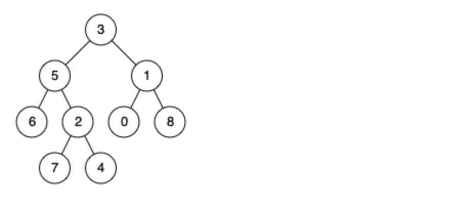
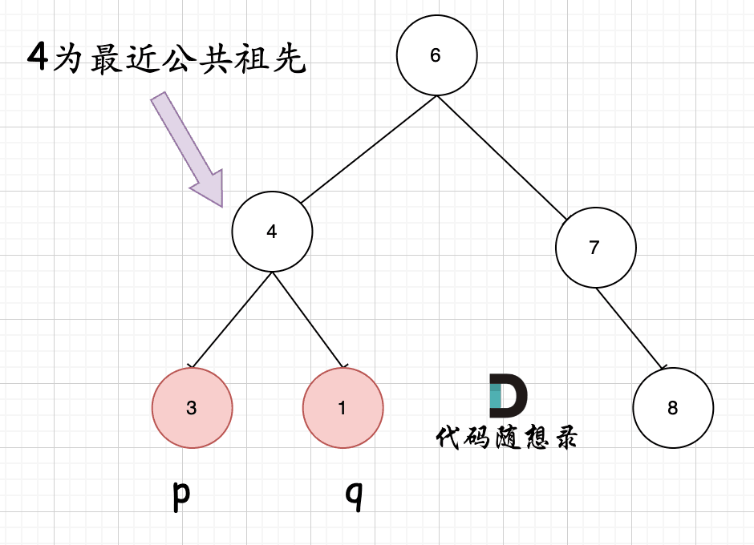
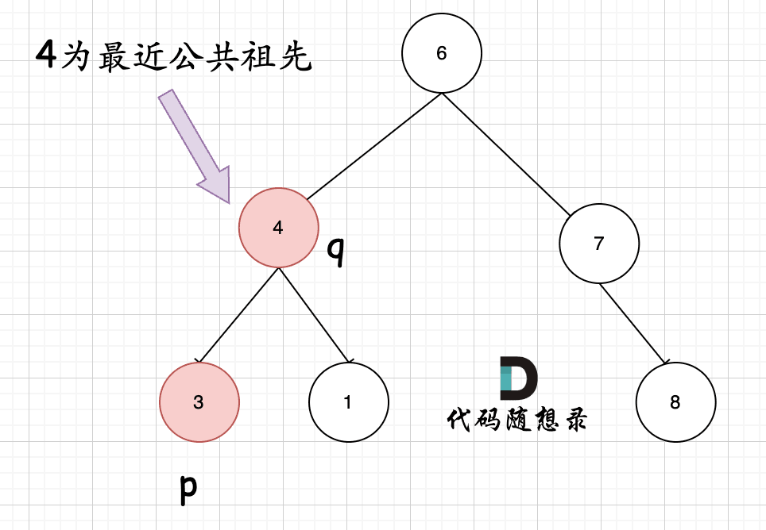
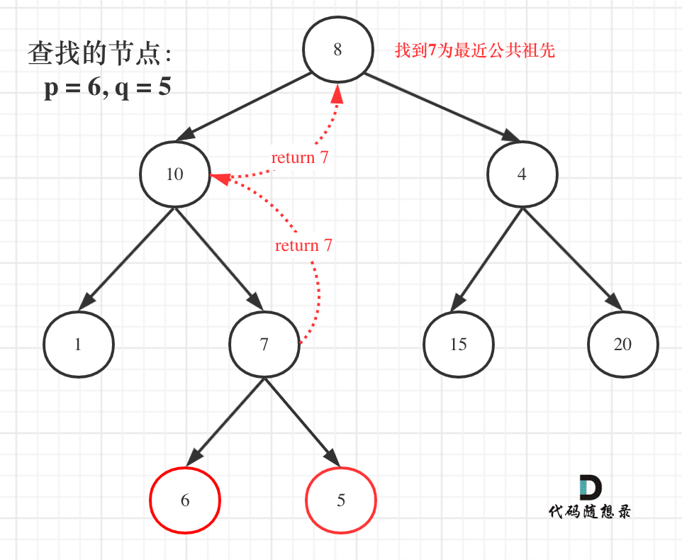
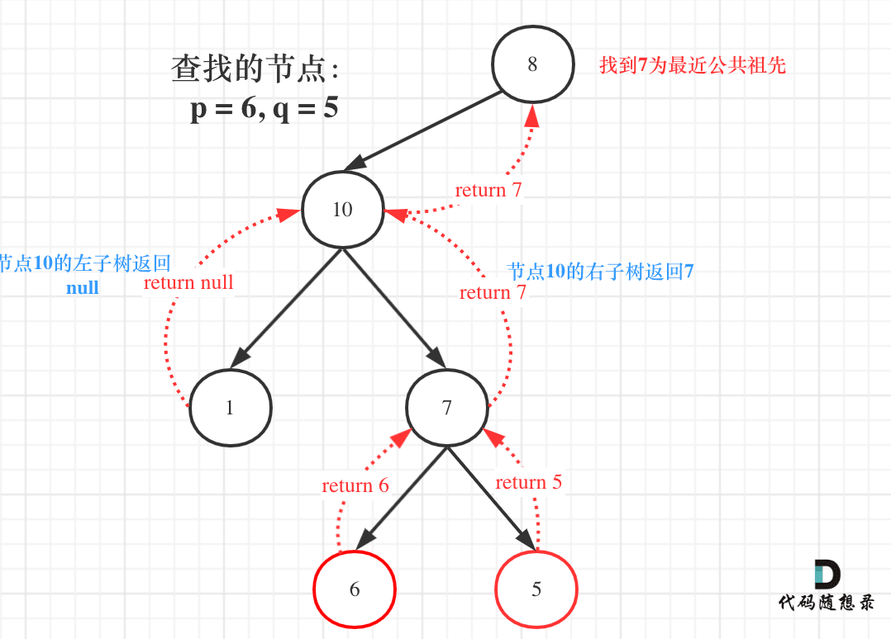
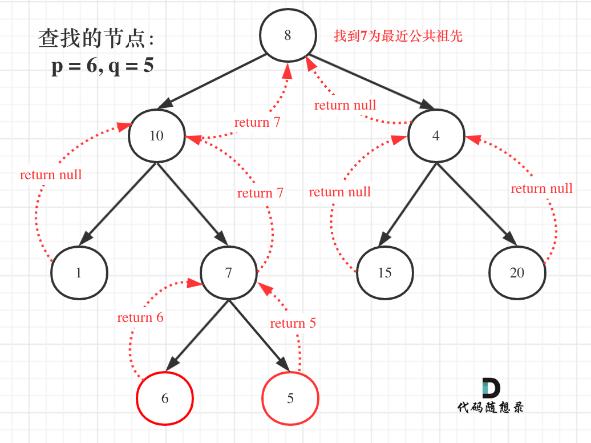

* [做專案（多個 C++、Java、Go、測試開發、前端專案）](https://www.programmercarl.com/other/kstar.html)
* [刷演算法（兩個月高強度學演算法）](https://www.programmercarl.com/xunlian/xunlianying.html)
* [背面試必考題（八股文）（40 天挑戰高頻面試題）](https://www.programmercarl.com/xunlian/bagu.html)


> 本來是打算將二元樹（binary tree）和二元搜尋樹（binary search tree, BST）的共同祖先問題一起講，後來發現篇幅過長了，只能先說一說二元樹的共同祖先問題。

# 236. 二元樹的最低共用源始

[LeetCode 題目連結](https://leetcode.com/problems/lowest-common-ancestor-of-a-binary-tree/)

給定一個二元樹, 找到該樹（tree）中兩個指定節點（node）的最低共用源始（lowest common ancestor, LCA）。

百度百科中LCA的定義為：「對於有根樹 T 的兩個結點 p、q，LCA表示為一個結點 x，滿足 x 是 p、q 的上代節點（ancestor node）且 x 的深度（depth）盡可能大（一個節點也可以是它自己的上代節點）。」

例如，給定如下二元樹: root = [3,5,1,6,2,0,8,null,null,7,4]




範例 1:
輸入: root = [3,5,1,6,2,0,8,null,null,7,4], p = 5, q = 1
輸出: 3
解釋: 節點 5 和節點 1 的LCA是節點 3。

範例 2:
輸入: root = [3,5,1,6,2,0,8,null,null,7,4], p = 5, q = 4
輸出: 5
解釋: 節點 5 和節點 4 的LCA是節點 5。因為根據定義LCA節點可以為節點本身。

說明:
* 所有節點的值都是唯一的。
* p、q 為不同節點且均存在於給定的二元樹中。

## 演算法公開課 

**[《程式碼隨想錄》演算法影片公開課](https://programmercarl.com/other/gongkaike.html)：[由下而上查找，有點難度！ | LeetCode：236. 二元樹的最低共用源始](https://www.bilibili.com/video/BV1jd4y1B7E2)，相信結合影片再看本篇題解，更有助於大家對本題的理解**。


## 解題思路

遇到這個題目首先想的是要是能由下而上（bottom-up）查找就好了，這樣就可以找到共同祖先了。

那麼二元樹如何可以由下而上查找呢？

回溯（backtracking）啊，二元樹回溯的過程就是從底到上。

後序遍歷（post-order traversal）（左右中）就是天然的回溯過程，可以根據左右子樹的轉回值（return value），來處理中節點的邏輯。 

接下來就看如何判斷一個節點是節點 q 和節點 p 的共同祖先呢。

**首先最容易想到的一個情況：如果找到一個節點，發現左子樹（left subtree）出現結點 p，右子樹（right subtree）出現節點 q，或者 左子樹出現結點 q，右子樹出現節點 p，那麼該節點就是節點 p 和 q 的LCA。** 即情況一： 



判斷邏輯是 如果遞迴（recursion）遍歷（traversal）遇到 q，就將 q 回傳，遇到 p 就將 p 回傳，那麼如果 左右子樹的轉回值都不為空，說明此時的中節點，一定是 q 和 p 的最近祖先。 

那麼有讀者／錄友可能疑惑，會不會左子樹遇到 q 回傳，右子樹也遇到 q 回傳，這樣並沒有找到 q 和 p 的最近祖先。

這麼想的讀者／錄友，要審題了，題目強調：**二元樹節點數值是不重複的，而且一定存在 q 和 p**。

**但是很多人容易忽略一個情況，就是節點本身 p(q)，它擁有一個子孫節點 q(p)。** 情況二： 



其實情況一 和 情況二 程式碼實作過程都是一樣的，也可以說，實作情況一的邏輯，順便包含了情況二。 

因為遇到 q 或者 p 就回傳，這樣也包含了 q 或者 p 本身就是共同祖先的情況。

這一點是很多讀者／錄友容易忽略的，在下面的程式碼講解中，可以再去體會。 

遞迴三部曲：

* 確定遞迴函數（recursive function）轉回值以及參數（parameter）

需要遞迴函數轉回值，來告訴我們是否找到節點 q 或者 p，那麼轉回值為布林（Boolean）類型就可以了。

但我們還要回傳最近公共節點，可以利用上題目中轉回值是 TreeNode * ，那麼如果遇到 p 或者 q，就把 q 或者 p 回傳，轉回值不為空，就說明找到了 q 或者 p。

程式碼如下：

```CPP 
TreeNode* lowestCommonAncestor(TreeNode* root, TreeNode* p, TreeNode* q)
```

* 確定終止條件（termination condition）

遇到空的話，因為樹都是空了，所以回傳空。

那麼我們來說一說，如果 root == q，或者 root == p，說明找到 q p ，則將其回傳，這個轉回值，後面在中節點的處理過程中會用到，那麼中節點的處理邏輯，下面講解。

程式碼如下：

```CPP 
if (root == q || root == p || root == NULL) return root;
```


* 確定單層遞迴邏輯

值得注意的是 本題函數有轉回值，是因為回溯的過程需要遞迴函數的轉回值做判斷，但本題我們依然要遍歷樹的所有節點。

我們在[二元樹：遞迴函數究竟什麼時候需要轉回值，什麼時候不要轉回值？](./0112.路徑總和.md)中說了 遞迴函數有轉回值就是要遍歷某一條邊（edge），但有轉回值也要看如何處理轉回值！

如果遞迴函數有轉回值，如何區分要搜尋一條邊，還是搜尋整個樹呢？

搜尋一條邊的寫法：

```CPP
if (遞迴函數(root->left)) return ;

if (遞迴函數(root->right)) return ;
```

搜尋整個樹寫法：

```CPP
left = 遞迴函數(root->left);  // 左
right = 遞迴函數(root->right); // 右
left與right的邏輯處理;         // 中 
```

看出區別了沒？

**在遞迴函數有轉回值的情況下：如果要搜尋一條邊，遞迴函數轉回值不為空的時候，立刻回傳，如果搜尋整個樹，直接用一個變數（variable） left、right 接住轉回值，這個 left、right 後序還有邏輯處理的需要，也就是後序遍歷中處理中間節點的邏輯（也是回溯）**。

那麼為什麼要遍歷整棵樹呢？直觀上來看，找到LCA，直接一路回傳就可以了。

如圖：



就像圖中一樣直接回傳 7。

但事實上還要遍歷根節點（root node）右子樹（即使此時已經找到了目標節點了），也就是圖中的節點 4、15、20。

因為在如下程式碼的後序遍歷中，如果想利用 left 和 right 做邏輯處理，不能立刻回傳，而是要等 left 與 right 邏輯處理完之後才能回傳。

```CPP 
left = 遞迴函數(root->left);  // 左
right = 遞迴函數(root->right); // 右
left與right的邏輯處理;         // 中 
```

所以此時大家要知道我們要遍歷整棵樹。知道這一點，對本題就有一定深度的理解了。


那麼先用 left 和 right 接住左子樹和右子樹的轉回值，程式碼如下：

```CPP
TreeNode* left = lowestCommonAncestor(root->left, p, q);
TreeNode* right = lowestCommonAncestor(root->right, p, q);

```

**如果 left 和 right 都不為空，說明此時 root 就是最近公共節點。這個比較好理解**

**如果 left 為空，right 不為空，就回傳 right，說明目標節點是透過 right 回傳的，反之亦然**。

這裡有的同學就理解不了了，為什麼 left 為空，right 不為空，目標節點透過 right 回傳呢？

如圖：



圖中節點 10 的左子樹回傳 null，右子樹回傳目標值 7，那麼此時節點 10 的處理邏輯就是把右子樹的轉回值（LCA 7）回傳上去！

這裡也很重要，可能刷過這道題目的同學，都不清楚結果究竟是如何從底層一層一層傳到頭節點（head node）的。

那麼如果 left 和 right 都為空，則回傳 left 或者 right 都是可以的，也就是回傳空。

程式碼如下：

```CPP
if (left == NULL && right != NULL) return right;
else if (left != NULL && right == NULL) return left;
else  { //  (left == NULL && right == NULL)
    return NULL;
}

```

那麼尋找LCA，完整流程圖如下：



**從圖中，大家可以看到，我們是如何回溯遍歷整棵二元樹，將結果回傳給頭節點的！**

整體程式碼如下：

```CPP
class Solution {
public:
    TreeNode* lowestCommonAncestor(TreeNode* root, TreeNode* p, TreeNode* q) {
        if (root == q || root == p || root == NULL) return root;
        TreeNode* left = lowestCommonAncestor(root->left, p, q);
        TreeNode* right = lowestCommonAncestor(root->right, p, q);
        if (left != NULL && right != NULL) return root;

        if (left == NULL && right != NULL) return right;
        else if (left != NULL && right == NULL) return left;
        else  { //  (left == NULL && right == NULL)
            return NULL;
        }

    }
};
```

稍加精簡，程式碼如下：

```CPP
class Solution {
public:
    TreeNode* lowestCommonAncestor(TreeNode* root, TreeNode* p, TreeNode* q) {
        if (root == q || root == p || root == NULL) return root;
        TreeNode* left = lowestCommonAncestor(root->left, p, q);
        TreeNode* right = lowestCommonAncestor(root->right, p, q);
        if (left != NULL && right != NULL) return root;
        if (left == NULL) return right;
        return left;
    }
};
```

## 總結

這道題目刷過的同學未必真正了解這裡面回溯的過程，以及結果是如何一層一層傳上去的。

**那麼我給大家歸納如下三點**：

1. 求LCA，需要從底向上遍歷，那麼二元樹，只能透過後序遍歷（即：回溯）實作從底向上的遍歷方式。

2. 在回溯的過程中，必然要遍歷整棵二元樹，即使已經找到結果了，依然要把其他節點遍歷完，因為要使用遞迴函數的轉回值（也就是程式碼中的 left 和 right）做邏輯判斷。

3. 要理解如果轉回值 left 為空，right 不為空為什麼要回傳 right，為什麼可以用回傳 right 傳給上一層結果。

可以說這裡每一步，都是有難度的，都需要對二元樹，遞迴和回溯有一定的理解。

本題沒有給出疊代（iteration）法，因為疊代法不適合模擬（simulation）回溯的過程。理解遞迴的解法就夠了。


## 其他語言版本


### Java 
遞迴
```Java
class Solution {
    public TreeNode lowestCommonAncestor(TreeNode root, TreeNode p, TreeNode q) {
        if (root == null || root == p || root == q) { // 遞迴結束條件
            return root;
        }

        // 後序遍歷
        TreeNode left = lowestCommonAncestor(root.left, p, q);
        TreeNode right = lowestCommonAncestor(root.right, p, q);

        if(left == null && right == null) { // 若未找到節點 p 或 q
            return null;
        }else if(left == null && right != null) { // 若找到一個節點
            return right;
        }else if(left != null && right == null) { // 若找到一個節點
            return left;
        }else { // 若找到兩個節點
            return root;
        }
    }
}

```
疊代
```Java
class Solution {
    public TreeNode lowestCommonAncestor(TreeNode root, TreeNode p, TreeNode q) {
        int max = Integer.MAX_VALUE;
        Stack<TreeNode> st = new Stack<>();
        TreeNode cur = root, pre = null;
        while (cur != null || !st.isEmpty()) {
            while (cur != null) {
                st.push(cur);
                cur = cur.left;
            }
            cur = st.pop();
            if (cur.right == null || cur.right == pre) {
                // p/q 是 中/左 或者 中/右 , 回傳中
                if (cur == p || cur == q) {
                    if ((cur.left != null && cur.left.val == max) || (cur.right != null && cur.right.val == max)) {
                        return cur;
                    }
                    cur.val = max;
                }
                // p/q 是 左/右 , 回傳中
                if (cur.left != null && cur.left.val == max && cur.right != null && cur.right.val == max) {
                    return cur;
                }
                // MAX_VALUE 往上傳遞
                if ((cur.left != null && cur.left.val == max) || (cur.right != null && cur.right.val == max)) {
                    cur.val = max;
                }
                pre = cur;
                cur = null;
            } else {
                st.push(cur);
                cur = cur.right;
            }
        }
        return null;
    }
}

```

### Python 
遞迴法（版本一）
```python
class Solution:
    def lowestCommonAncestor(self, root, p, q):
        if root == q or root == p or root is None:
            return root

        left = self.lowestCommonAncestor(root.left, p, q)
        right = self.lowestCommonAncestor(root.right, p, q)

        if left is not None and right is not None:
            return root

        if left is None and right is not None:
            return right
        elif left is not None and right is None:
            return left
        else: 
            return None
```
遞迴法（版本二）精簡
```python
class Solution:
    def lowestCommonAncestor(self, root, p, q):
        if root == q or root == p or root is None:
            return root

        left = self.lowestCommonAncestor(root.left, p, q)
        right = self.lowestCommonAncestor(root.right, p, q)

        if left is not None and right is not None:
            return root

        if left is None:
            return right
        return left

```
### Go 

```Go
func lowestCommonAncestor(root, p, q *TreeNode) *TreeNode {
    // check
    if root == nil {
        return root
    }
    // 相等 直接回傳 root 節點即可
    if root == p || root == q {
        return root
    }
    // Divide
    left := lowestCommonAncestor(root.Left, p, q)
    right := lowestCommonAncestor(root.Right, p, q)

    // Conquer
    // 左右兩邊都不為空，則根節點為祖先
    if left != nil && right != nil {
        return root
    }
    if left != nil {
        return left
    }
    if right != nil {
        return right
    }
    return nil
}
```

### JavaScript 

```javascript
var lowestCommonAncestor = function(root, p, q) {
    // 使用遞迴的方法
    // 需要從下到上，所以使用後序遍歷
    // 1. 確定遞迴的函數
    const travelTree = function(root,p,q) {
        // 2. 確定遞迴終止條件
        if(root === null || root === p || root === q) {
            return root;
        }
        // 3. 確定遞迴單層邏輯
        let left = travelTree(root.left,p,q);
        let right = travelTree(root.right,p,q);
        if(left !== null && right !== null) {
            return root;
        }
        if(left === null) {
            return right;
        }
        return left;
    }
   return  travelTree(root,p,q);
};
```

### TypeScript

```typescript
function lowestCommonAncestor(root: TreeNode | null, p: TreeNode | null, q: TreeNode | null): TreeNode | null {
    if (root === null || root === p || root === q) return root;
    const left = lowestCommonAncestor(root.left, p, q);
    const right = lowestCommonAncestor(root.right, p, q);
    if (left !== null && right !== null) return root;
    if (left !== null) return left;
    if (right !== null) return right;
    return null;
};
```

### Scala

```scala
object Solution {
  def lowestCommonAncestor(root: TreeNode, p: TreeNode, q: TreeNode): TreeNode = {
    // 遞迴結束條件
    if (root == null || root == p || root == q) {
      return root
    }

    var left = lowestCommonAncestor(root.left, p, q)
    var right = lowestCommonAncestor(root.right, p, q)

    if (left != null && right != null) return root
    if (left == null) return right
    left
  }
}
```

### Rust

```rust
impl Solution {
    pub fn lowest_common_ancestor(
        root: Option<Rc<RefCell<TreeNode>>>,
        p: Option<Rc<RefCell<TreeNode>>>,
        q: Option<Rc<RefCell<TreeNode>>>,
    ) -> Option<Rc<RefCell<TreeNode>>> {
        if root.is_none() {
            return root;
        }
        if Rc::ptr_eq(root.as_ref().unwrap(), p.as_ref().unwrap()) 
            || Rc::ptr_eq(root.as_ref().unwrap(), q.as_ref().unwrap()) {
            return root;
        }
        let left = Self::lowest_common_ancestor(
            root.as_ref().unwrap().borrow().left.clone(),
            p.clone(),
            q.clone(),
        );
        let right =
            Self::lowest_common_ancestor(root.as_ref().unwrap().borrow().right.clone(), p, q);
        match (&left, &right) {
            (None, Some(_)) => right,
            (Some(_), Some(_)) => root,
            _ => left,
        }
    }
}
```
### C#
```csharp
public TreeNode LowestCommonAncestor(TreeNode root, TreeNode p, TreeNode q)
{
    if (root == null || root == p || root == q) return root;
    TreeNode left = LowestCommonAncestor(root.left, p, q);
    TreeNode right = LowestCommonAncestor(root.right, p, q);
    if (left != null && right != null) return root;
    if (left == null && right != null) return right;
    if (left != null && right == null) return left;
    return null;
}
```


