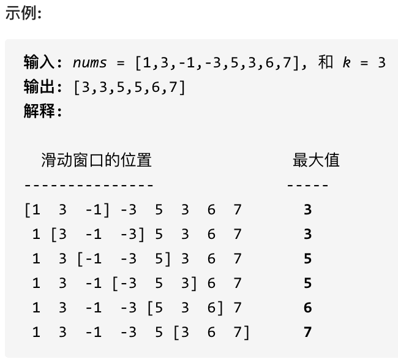
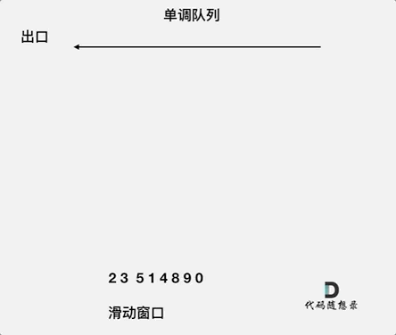
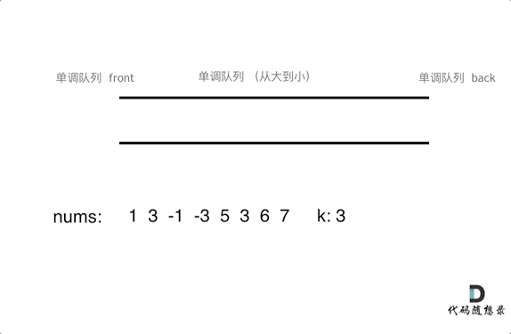

* [做專案（多個 C++、Java、Go、測試開發、前端（front end）專案）](https://www.programmercarl.com/other/kstar.html)
* [刷演算法（兩個月高強度學演算法）](https://www.programmercarl.com/xunlian/xunlianying.html)
* [準備面試必考題（八股文）（40 天挑戰高頻面試題）](https://www.programmercarl.com/xunlian/bagu.html)


> 要用什麼資料結構呢？

# 239. 滑動視窗（sliding windows）最大值

[LeetCode 題目連結](https://leetcode.com/problems/sliding-window-maximum/)

給定一個陣列（array） nums，有一個大小為 k 的滑動視窗從陣列的最左側移動到陣列的最右側。你只可以看到在滑動視窗內的 k 個數字。滑動視窗每次只向右移動一位。

回傳滑動視窗中的最大值。

進階：

你能線上性時間複雜度（time complexity）內解決此題嗎？

 </img></div>

提示：

* 1 <= nums.length <= 10^5
* -10^4 <= nums[i] <= 10^4
* 1 <= k <= nums.length

## 演算法公開課

**[《程式碼隨想錄》演算法影片公開課](https://programmercarl.com/other/gongkaike.html)：[monotonic queue 正式登場！| LeetCode：239. 滑動視窗最大值](https://www.bilibili.com/video/BV1XS4y1p7qj)，相信結合影片再看本篇題解，更有助於大家對本題的理解**。

## 解題思路

這是使用 monotonic queue 的經典題目。

難點是如何求一個區間（interval）裡的最大值呢？ （這好像是廢話），用蠻力（brute force）不就得了。

蠻力法，遍歷（traversal）一遍的過程中每次從視窗中再找到最大的數值，這樣很明顯是 O(n × k) 的演算法。

有的同學可能會想用一個最大堆（max heap）（優先佇列（priority queue））來存放這個視窗裡的 k 個數字，這樣就可以知道最大的最大值是多少了，**但是問題是這個視窗是移動的，而最大堆每次只能彈出最大值，我們無法移除其他數值，這樣就造成最大堆維護的不是滑動視窗裡面的數值了。所以不能用最大堆。**

此時我們需要一個佇列（queue），這個佇列呢，放進去視窗裡的元素（element），然後隨著視窗的移動，佇列也一進一出，每次移動之後，佇列告訴我們裡面的最大值是什麼。


這個佇列應該長這個樣子：

```cpp
class MyQueue {
public:
    void pop(int value) {
    }
    void push(int value) {
    }
    int front() {
        return que.front();
    }
};
```

每次視窗移動的時候，呼叫 que.pop(滑動視窗中移除元素的數值)，que.push(滑動視窗新增元素的數值)，然後 que.front() 就回傳我們要的最大值。

這麼個佇列香不香，要是有現成的這種資料結構是不是更香了！ 

其實在 C++ 中，可以使用 multiset 來模擬（simulation）這個過程，文末提供這個解法僅針對 C++，以下講解我們還是靠自己來實作這個 monotonic queue。

然後再分析一下，佇列裡的元素一定是要排序（sorting）的，而且要最大值放在出佇列口，要不然怎麼知道最大值呢。

但如果把視窗裡的元素都放進佇列裡，視窗移動的時候，佇列需要彈出元素。

那麼問題來了，已經排序之後的佇列 怎麼能把視窗要移除的元素（這個元素可不一定是最大值）彈出呢。

大家此時應該陷入深思.....

**其實佇列沒有必要維護視窗裡的所有元素，只需要維護有可能成為視窗裡最大值的元素就可以了，同時保證佇列裡的元素數值是由大到小的。**

那麼這個維護元素單調遞減的佇列就叫做**monotonic queue，即單調遞減或單調遞增的佇列。C++ 中沒有直接支援 monotonic queue，需要我們自己來實作一個 monotonic queue**

**不要以為實作的 monotonic queue 就是 對視窗裡面的數進行排序，如果排序的話，那和優先佇列又有什麼區別了呢。**

來看一下 monotonic queue 如何維護佇列裡的元素。

動畫如下：



對於視窗裡的元素{2, 3, 5, 1 ,4}，monotonic queue 裡只維護{5, 4} 就夠了，保持 monotonic queue 裡單調遞減，此時佇列出口元素就是視窗裡最大元素。

此時大家應該懷疑 monotonic queue 裡維護著{5, 4} 怎麼配合視窗進行滑動呢？

設計 monotonic queue 的時候，pop 和 push 操作要保持如下規則：

1. pop(value)：如果視窗移除的元素 value 等於 monotonic queue 的出口元素，那麼佇列彈出元素，否則不用任何操作
2. push(value)：如果 push 的元素 value 大於入口元素的數值，那麼就將佇列入口的元素彈出，直到 push 元素的數值小於等於佇列入口元素的數值為止

保持如上規則，每次視窗移動的時候，只要問 que.front() 就可以回傳目前視窗的最大值。

為了更直觀地感受到 monotonic queue 的工作過程，以題目範例為例，輸入: nums = [1,3,-1,-3,5,3,6,7], 和 k = 3，動畫如下：




那麼我們用什麼資料結構來實作這個 monotonic queue 呢？

使用 deque 最為合適，在文章[堆疊（stack）與佇列：來看看堆疊與佇列不為人知的一面](./堆疊與佇列理論基礎.md)中，我們就提到了常用的 queue 在沒有指定容器（container）的情況下，deque 就是預設（default）底層容器。

基於剛剛說過的 monotonic queue pop 和 push 的規則，程式碼不難實作，如下：

```CPP
class MyQueue { //monotonic queue（從大到小）
public:
    deque<int> que; // 使用deque來實作 單調佇列（monotonic queue）
    // 每次彈出的時候，比較目前要彈出的數值是否等於佇列出口元素的數值，如果相等則彈出。
    // 同時pop之前判斷佇列目前是否為空。
    void pop(int value) {
        if (!que.empty() && value == que.front()) {
            que.pop_front();
        }
    }
    // 如果push的數值大於入口元素的數值，那麼就將佇列後端的數值彈出，直到push的數值小於等於佇列入口元素的數值為止。
    // 這樣就保持了佇列裡的數值是單調從大到小的了。
    void push(int value) {
        while (!que.empty() && value > que.back()) {
            que.pop_back();
        }
        que.push_back(value);

    }
    // 查詢目前佇列裡的最大值 直接回傳佇列前端也就是front就可以了。
    int front() {
        return que.front();
    }
};
```


這樣我們就用 deque 實作了一個 monotonic queue，接下來解決滑動視窗最大值的問題就很簡單了，直接看程式碼吧。

C++ 程式碼如下：

```CPP
class Solution {
private:
    class MyQueue { //單調佇列（從大到小）
    public:
        deque<int> que; // 使用deque來實作 單調佇列
        // 每次彈出的時候，比較目前要彈出的數值是否等於佇列出口元素的數值，如果相等則彈出。
        // 同時pop之前判斷佇列目前是否為空。
        void pop(int value) {
            if (!que.empty() && value == que.front()) {
                que.pop_front();
            }
        }
        // 如果push的數值大於入口元素的數值，那麼就將佇列後端的數值彈出，直到push的數值小於等於佇列入口元素的數值為止。
        // 這樣就保持了佇列裡的數值是單調從大到小的了。
        void push(int value) {
            while (!que.empty() && value > que.back()) {
                que.pop_back();
            }
            que.push_back(value);

        }
        // 查詢目前佇列裡的最大值 直接回傳佇列前端也就是front就可以了。
        int front() {
            return que.front();
        }
    };
public:
    vector<int> maxSlidingWindow(vector<int>& nums, int k) {
        MyQueue que;
        vector<int> result;
        for (int i = 0; i < k; i++) { // 先將前k個元素放進佇列
            que.push(nums[i]);
        }
        result.push_back(que.front()); // result 記錄前k個元素的最大值
        for (int i = k; i < nums.size(); i++) {
            que.pop(nums[i - k]); // 滑動視窗移除最前面元素
            que.push(nums[i]); // 滑動視窗前加入最後面的元素
            result.push_back(que.front()); // 記錄對應的最大值
        }
        return result;
    }
};
```
* 時間複雜度: O(n)
* 空間複雜度（space complexity）: O(k)


再來看一下時間複雜度，使用 monotonic queue 的時間複雜度是 O(n)。

有的同學可能想了，在佇列中 push 元素的過程中，還有 pop 操作呢，感覺不是純粹的 O(n)。

其實，大家可以自己觀察一下 monotonic queue 的實作，nums 中的每個元素最多也就被 push_back 和 pop_back 各一次，沒有任何多餘操作，所以整體的複雜度還是 O(n)。

空間複雜度因為我們定義一個輔助佇列，所以是 O(k)。

## 擴充

大家貌似對 monotonic queue 都有一些疑惑，首先要明確的是，題解中 monotonic queue 裡的 pop 和 push 介面（interface），僅適用於本題哈。monotonic queue 不是一成不變的，而是不同場景不同寫法，總之要保證佇列裡單調遞減或遞增的原則，所以叫做 monotonic queue。 不要以為本題中的 monotonic queue 實作就是固定的寫法哈。

大家貌似對 deque 也有一些疑惑，C++ 中 deque 是 stack 和 queue 預設的底層實作容器（這個我們之前已經講過啦），deque 是可以兩邊擴展的，而且 deque 裡元素並不是嚴格的連續分佈的。


## 其他語言版本

### Java：

```Java
//解法一
//自訂陣列
class MyQueue {
    Deque<Integer> deque = new LinkedList<>();
    //彈出元素時，比較目前要彈出的數值是否等於佇列出口的數值，如果相等則彈出
    //同時判斷佇列目前是否為空
    void poll(int val) {
        if (!deque.isEmpty() && val == deque.peek()) {
            deque.poll();
        }
    }
    //新增元素時，如果要新增的元素大於入口處的元素，就將入口元素彈出
    //保證佇列元素單調遞減
    //比如此時佇列元素3,1，2將要入佇列，比1大，所以1彈出，此時佇列：3,2
    void add(int val) {
        while (!deque.isEmpty() && val > deque.getLast()) {
            deque.removeLast();
        }
        deque.add(val);
    }
    //佇列隊頂元素始終為最大值
    int peek() {
        return deque.peek();
    }
}

class Solution {
    public int[] maxSlidingWindow(int[] nums, int k) {
        if (nums.length == 1) {
            return nums;
        }
        int len = nums.length - k + 1;
        //存放結果元素的陣列
        int[] res = new int[len];
        int num = 0;
        //自訂佇列
        MyQueue myQueue = new MyQueue();
        //先將前k個元素放入佇列
        for (int i = 0; i < k; i++) {
            myQueue.add(nums[i]);
        }
        res[num++] = myQueue.peek();
        for (int i = k; i < nums.length; i++) {
            //滑動視窗移除最前面的元素，移除時判斷該元素是否放入佇列
            myQueue.poll(nums[i - k]);
            //滑動視窗加入最後面的元素
            myQueue.add(nums[i]);
            //記錄對應的最大值
            res[num++] = myQueue.peek();
        }
        return res;
    }
}

//解法二
//利用雙端佇列手動實作 monotonic queue
/**
 * 用一個 monotonic queue 來儲存對應的索引，每當視窗滑動的時候，直接取佇列的頭部指標對應的值放入結果集即可
 * 單調遞減佇列類似 （head -->） 3 --> 2 --> 1 --> 0 (--> tail) (左邊為頭節點，元素存的是索引)
 */
class Solution {
    public int[] maxSlidingWindow(int[] nums, int k) {
        ArrayDeque<Integer> deque = new ArrayDeque<>();
        int n = nums.length;
        int[] res = new int[n - k + 1];
        int idx = 0;
        for(int i = 0; i < n; i++) {
            // 根據題意，i為nums索引，是要在[i - k + 1, i] 中選到最大值，只需要保證兩點
            // 1.佇列頭節點需要在[i - k + 1, i]範圍內，不符合則要彈出
            while(!deque.isEmpty() && deque.peek() < i - k + 1){
                deque.poll();
            }
            // 2.維護單調遞減佇列：新元素若大於隊尾元素，則彈出隊尾元素，直到滿足單調性
            while(!deque.isEmpty() && nums[deque.peekLast()] < nums[i]) {
                deque.pollLast();
            }

            deque.offer(i);

            // 因為單調，當i增長到符合第一個k範圍的時候，每滑動一步都將佇列頭節點放入結果就行了
            if(i >= k - 1){
                res[idx++] = nums[deque.peek()];
            }
        }
        return res;
    }
}
```

### Python：
#### 解法一：使用自訂的 monotonic queue 類別（class）
```python
from collections import deque


class MyQueue: #單調佇列（從大到小）
    def __init__(self):
        self.queue = deque() #這裡需要使用deque實作 單調佇列，直接使用list會逾時
    
    #每次彈出的時候，比較目前要彈出的數值是否等於佇列出口元素的數值，如果相等則彈出。
    #同時pop之前判斷佇列目前是否為空。
    def pop(self, value):
        if self.queue and value == self.queue[0]:
            self.queue.popleft()#list.pop()時間複雜度為O(n),這裡需要使用collections.deque()
            
    #如果push的數值大於入口元素的數值，那麼就將佇列後端的數值彈出，直到push的數值小於等於佇列入口元素的數值為止。
    #這樣就保持了佇列裡的數值是單調從大到小的了。
    def push(self, value):
        while self.queue and value > self.queue[-1]:
            self.queue.pop()
        self.queue.append(value)
        
    #查詢目前佇列裡的最大值 直接回傳佇列前端也就是front就可以了。
    def front(self):
        return self.queue[0]
    
class Solution:
    def maxSlidingWindow(self, nums: List[int], k: int) -> List[int]:
        que = MyQueue()
        result = []
        for i in range(k): #先將前k個元素放進佇列
            que.push(nums[i])
        result.append(que.front()) #result 記錄前k個元素的最大值
        for i in range(k, len(nums)):
            que.pop(nums[i - k]) #滑動視窗移除最前面元素
            que.push(nums[i]) #滑動視窗前加入最後面的元素
            result.append(que.front()) #記錄對應的最大值
        return result
```


#### 解法二：直接用 monotonic queue
```python
from collections import deque
class Solution:
    def maxSlidingWindow(self, nums: List[int], k: int) -> List[int]:
        max_list = [] # 結果集合
        kept_nums = deque() # 單調佇列

        for i in range(len(nums)):
            update_kept_nums(kept_nums, nums[i]) # 右側新元素加入

            if i >= k and nums[i - k] == kept_nums[0]: # 左側舊元素如果等於 單調佇列 頭元素，需要移除頭元素
                kept_nums.popleft()

            if i >= k - 1:
                max_list.append(kept_nums[0])

        return max_list

def update_kept_nums(kept_nums, num): # num 是新加入的元素
    # 所有小於新元素的佇列尾部元素，在新元素出現後，都是沒有價值的，都需要被移除
    while kept_nums and num > kept_nums[-1]:
        kept_nums.pop()

    kept_nums.append(num)

```

### Go：

```go
// 封裝 單調佇列 的方式解題
type MyQueue struct {
    queue []int
}

func NewMyQueue() *MyQueue {
    return &MyQueue{
        queue: make([]int, 0),
    }
}

func (m *MyQueue) Front() int {
    return m.queue[0]
}

func (m *MyQueue) Back() int {
    return m.queue[len(m.queue)-1]
}

func (m *MyQueue) Empty() bool {
    return len(m.queue) == 0
}

func (m *MyQueue) Push(val int) {
    for !m.Empty() && val > m.Back() {
        m.queue = m.queue[:len(m.queue)-1]
    }
    m.queue = append(m.queue, val)
}

func (m *MyQueue) Pop(val int) {
    if !m.Empty() && val == m.Front() {
        m.queue = m.queue[1:]
    }
}

func maxSlidingWindow(nums []int, k int) []int {
    queue := NewMyQueue()
    length := len(nums)
    res := make([]int, 0)
    // 先將前k個元素放入佇列
    for i := 0; i < k; i++ {
        queue.Push(nums[i])
    }
    // 記錄前k個元素的最大值
    res = append(res, queue.Front())

    for i := k; i < length; i++ {
        // 滑動視窗移除最前面的元素
        queue.Pop(nums[i-k])
        // 滑動視窗加入最後面的元素
        queue.Push(nums[i])
        // 記錄最大值
        res = append(res, queue.Front())
    }
    return res
}
```

### JavaScript:

```javascript
/**
 * @param {number[]} nums
 * @param {number} k
 * @return {number[]}
 */
var maxSlidingWindow = function (nums, k) {
    class MonoQueue {
        queue;
        constructor() {
            this.queue = [];
        }
        enqueue(value) {
            let back = this.queue[this.queue.length - 1];
            while (back !== undefined && back < value) {
                this.queue.pop();
                back = this.queue[this.queue.length - 1];
            }
            this.queue.push(value);
        }
        dequeue(value) {
            let front = this.front();
            if (front === value) {
                this.queue.shift();
            }
        }
        front() {
            return this.queue[0];
        }
    }
    let helperQueue = new MonoQueue();
    let i = 0, j = 0;
    let resArr = [];
    while (j < k) {
        helperQueue.enqueue(nums[j++]);
    }
    resArr.push(helperQueue.front());
    while (j < nums.length) {
        helperQueue.enqueue(nums[j]);
        helperQueue.dequeue(nums[i]);
        resArr.push(helperQueue.front());
        i++, j++;
    }
    return resArr;
};
```

### TypeScript：

```typescript
function maxSlidingWindow(nums: number[], k: number): number[] {
    /** 單調遞減佇列 */
    class MonoQueue {
        private queue: number[];
        constructor() {
            this.queue = [];
        };
        /** 入佇列：value如果大於隊尾元素，則將隊尾元素刪除，直至隊尾元素大於value，或者佇列為空 */
        public enqueue(value: number): void {
            let back: number | undefined = this.queue[this.queue.length - 1];
            while (back !== undefined && back < value) {
                this.queue.pop();
                back = this.queue[this.queue.length - 1];
            }
            this.queue.push(value);
        };
        /** 出佇列：只有當隊頭元素等於value，才出佇列 */
        public dequeue(value: number): void {
            let top: number | undefined = this.top();
            if (top !== undefined && top === value) {
                this.queue.shift();
            }
        }
        public top(): number | undefined {
            return this.queue[0];
        }
    }
    const helperQueue: MonoQueue = new MonoQueue();
    let i: number = 0,
        j: number = 0;
    let resArr: number[] = [];
    while (j < k) {
        helperQueue.enqueue(nums[j++]);
    }
    resArr.push(helperQueue.top()!);
    while (j < nums.length) {
        helperQueue.enqueue(nums[j]);
        helperQueue.dequeue(nums[i]);
        resArr.push(helperQueue.top()!);
        j++, i++;
    }
    return resArr;
};
```

### Swift:

解法一:

```Swift
/// 雙鏈接串列
class DoublyListNode {
    var head: DoublyListNode?
    var tail: DoublyListNode?
    var next: DoublyListNode?
    var pre: DoublyListNode?
    var value: Int = 0
    init(_ value: Int = 0) {
        self.value = value
    }
    func isEmpty() -> Bool {
        return self.head == nil
    }
    func first() -> Int? {
        return self.head?.value
    }
    func last() -> Int? {
        return self.tail?.value
    }
    func removeFirst() {
        if isEmpty() {
            return
        }
        let next = self.head!.next
        self.head?.next = nil// 移除首節點
        next?.pre = nil
        self.head = next
    }
    func removeLast() {
        if let tail = self.tail {
            if let pre = tail.pre {
                self.tail?.pre = nil
                pre.next = nil
                self.tail = pre
            } else {
                self.head = nil
                self.tail = nil
            }
        }
    }
    func append(_ value: Int) {
        let node = DoublyListNode(value)
        if self.head != nil {
            node.pre = self.tail
            self.tail?.next = node
            self.tail = node
        } else {
            self.head = node
            self.tail = node
            self.pre = nil
            self.next = nil
        }
    }
}
// 單調佇列, 從大到小
class MyQueue {
//    var queue: [Int]!// 用陣列會逾時
    var queue: DoublyListNode!
    init() {
//        queue = [Int]()
        queue = DoublyListNode()
    }
    // 滑動視窗時彈出第一個元素, 如果相等再彈出
    func pop(x: Int) {
        if !queue.isEmpty() && front() == x {
            queue.removeFirst()
        }
    }
    // 滑動視窗時加入下一個元素, 移除隊尾比 x 小的元素 始終保證隊頭 > 隊尾
    func push(x: Int) {
        while !queue.isEmpty() && queue.last()! < x {
            queue.removeLast()
        }
        queue.append(x)
    }
    // 此時隊頭就是滑動視窗最大值
    func front() -> Int {
        return queue.first() ?? -1
    }
}

class Solution {
    func maxSlidingWindow(_ nums: [Int], _ k: Int) -> [Int] {
        // 存放結果
        var res = [Int]()
        let queue = MyQueue()
        // 先將前K個元素放入佇列
        for i in 0 ..< k {
            queue.push(x: nums[i])
        }
        // 加入目前佇列最大值到結果陣列
        res.append(queue.front())
        for i in k ..< nums.count {
            // 滑動視窗移除最前面元素
            queue.pop(x: nums[i - k])
            // 滑動視窗加入下一個元素
            queue.push(x: nums[i])
            // 儲存目前佇列最大值
            res.append(queue.front())
        }
        return res
    }
}
```

Swift 解法二：

```swift
func maxSlidingWindow(_ nums: [Int], _ k: Int) -> [Int] {
    var result = [Int]()
    var window = [Int]()
    var right = 0, left = right - k + 1

    while right < nums.count {
        let value = nums[right]

        // 因為視窗移動丟棄的左邊數
        if left > 0, left - 1 == window.first {
            window.removeFirst()
        }

        // 保證末尾的是最大的
        while !window.isEmpty, value > nums[window.last!] {
            window.removeLast()
        }
        window.append(right)

        if left >= 0 { // 視窗形成
            result.append(nums[window.first!])
        }

        right += 1
        left += 1
    }

    return result
}
```
### Scala:

```scala
import scala.collection.mutable.ArrayBuffer
object Solution {
  def maxSlidingWindow(nums: Array[Int], k: Int): Array[Int] = {
    var len = nums.length - k + 1   // 滑動視窗長度
    var res: Array[Int] = new Array[Int](len)   // 宣告儲存結果的陣列
    var index = 0   // 結果陣列指標
    val queue: MyQueue = new MyQueue    // 自訂佇列
    // 將前k個加入到queue
    for (i <- 0 until k) {
      queue.add(nums(i))
    }
    res(index) = queue.peek // 第一個滑動視窗的最大值
    index += 1
    for (i <- k until nums.length) {
      queue.poll(nums(i - k))   // 首先移除第i-k個元素
      queue.add(nums(i))        // 加入目前數字到佇列
      res(index) = queue.peek() // 賦值
      index+=1
    }
    // 最後回傳res，return關鍵字可以省略
    res
  }
 }

class MyQueue {
  var queue = ArrayBuffer[Int]()

  // 移除元素，如果傳遞進來的跟隊頭相等，那麼移除
  def poll(value: Int): Unit = {
    if (!queue.isEmpty && queue.head == value) {
      queue.remove(0)
    }
  }

  // 新增元素，當隊尾大於目前元素就刪除
  def add(value: Int): Unit = {
    while (!queue.isEmpty && value > queue.last) {
      queue.remove(queue.length - 1)
    }
    queue.append(value)
  }

  def peek(): Int = queue.head
}
```

### PHP:

```php
class Solution {
    /**
     * @param Integer[] $nums
     * @param Integer $k
     * @return Integer[]
     */
    function maxSlidingWindow($nums, $k) {
        $myQueue = new MyQueue();
        // 先將前k個元素放進佇列
        for ($i = 0; $i < $k; $i++) { 
            $myQueue->push($nums[$i]);
        }

        $result = [];
        $result[] = $myQueue->max(); // result 記錄前k個元素的最大值

        for ($i = $k; $i < count($nums); $i++) {
            $myQueue->pop($nums[$i - $k]); // 滑動視窗移除最前面元素
            $myQueue->push($nums[$i]); // 滑動視窗前加入最後面的元素
            $result[]= $myQueue->max(); // 記錄對應的最大值
        }
        return $result;
    }

}

// 單調佇列 建構
class MyQueue{
    private $queue;

    public function __construct(){
        $this->queue = new SplQueue(); //底層是雙鏈接串列實作。
    }

    public function pop($v){
        // 判斷目前佇列是否為空
        // 比較目前要彈出的數值是否等於佇列出口元素的數值，如果相等則彈出。
        // bottom 從鏈接串列前端查看元素, dequeue 從雙鏈接串列的開頭移動一個節點
        if(!$this->queue->isEmpty() && $v == $this->queue->bottom()){
            $this->queue->dequeue(); //彈出佇列
        }
    }

    public function push($v){
        // 判斷目前佇列是否為空
        // 如果push的數值大於入口元素的數值，那麼就將佇列後端的數值彈出，直到push的數值小於等於佇列入口元素的數值為止。
        // 這樣就保持了佇列裡的數值是單調從大到小的了。
        while (!$this->queue->isEmpty() && $v > $this->queue->top()) {
            $this->queue->pop(); // pop從鏈接串列末尾彈出一個元素，
        }
        $this->queue->enqueue($v);
    }

    // 查詢目前佇列裡的最大值 直接回傳隊首
    public function max(){
        // bottom 從鏈接串列前端查看元素, top從鏈接串列末尾查看元素
        return $this->queue->bottom(); 
    }

    // 輔助理解: 印出佇列元素
    public function println(){
        // "疊代器移動到鏈接串列頭部": 可理解為從頭遍歷鏈接串列元素做準備。
        // 【PHP中沒有指標概念，所以就沒說指標。從資料結構上理解，就是把指標指向鏈接串列頭部】
        $this->queue->rewind();

        echo "Println: ";
        while($this->queue->valid()){
            echo $this->queue->current()," -> ";
            $this->queue->next();
        }
        echo "\n";
    } 
}
```

### C#:

```csharp
class myDequeue{
        private LinkedList<int> linkedList = new LinkedList<int>();

        public void Enqueue(int n){
            while(linkedList.Count > 0 && linkedList.Last.Value < n){
                linkedList.RemoveLast();
            }
            linkedList.AddLast(n);
        }

        public int Max(){
            return linkedList.First.Value;
        }

        public void Dequeue(int n){
            if(linkedList.First.Value == n){
                linkedList.RemoveFirst();
            }   
        }
    }

    myDequeue window = new myDequeue();
    List<int> res = new List<int>();

    public int[] MaxSlidingWindow(int[] nums, int k) {
        for(int i = 0; i < k; i++){
            window.Enqueue(nums[i]);
        }
        res.Add(window.Max());
        for(int i = k; i < nums.Length; i++){
            window.Dequeue(nums[i-k]);
            window.Enqueue(nums[i]);
            res.Add(window.Max());
        }

        return res.ToArray();
    }
```

### Rust:

```rust
impl Solution {
    pub fn max_sliding_window(nums: Vec<i32>, k: i32) -> Vec<i32> {
        let mut res = vec![];
        let mut queue = VecDeque::with_capacity(k as usize);
        for (i, &v) in nums.iter().enumerate() {
            // 如果佇列長度超過 k，那麼需要移除隊首過期元素
            if i - queue.front().unwrap_or(&0) == k as usize {
                queue.pop_front();
            }
            while let Some(&index) = queue.back() {
                if nums[index] >= v {
                    break;
                }
                // 如果佇列第一個元素比目前元素小，那麼就把佇列第一個元素彈出
                queue.pop_back();
            }
            queue.push_back(i);
            if i >= k as usize - 1 {
                res.push(nums[queue[0]]);
            }
        }
        res
    }
}
```

### C++
使用 multiset 作為 monotonic queue

multiset（`multiset`）是用以有序（ordered）地儲存元素的容器。允許存在相等的元素。

在遍歷原陣列的時候，只需要把視窗的頭元素加入到 multiset 中，然後把視窗的尾元素刪除即可。因為 multiset 是有序的，並且提供了 *rbegin()，可以直接取得視窗最大值。
```cpp
class Solution {
public:
    vector<int> maxSlidingWindow(vector<int>& nums, int k) {
        多（重）集（multiset）<int> st;
        vector<int> ans;
        for (int i = 0; i < nums.size(); i++) {
            if (i >= k) st.erase(st.find(nums[i - k]));
            st.insert(nums[i]);
            if (i >= k - 1) ans.push_back(*st.rbegin());
        }
        return ans;
    }
};
```

### C

```c
int* maxSlidingWindow(int* nums, int numsSize, int k, int* returnSize) {
    *returnSize = numsSize - k + 1;
    int *res = (int*)malloc((*returnSize) * sizeof(int));
    assert(res);
    int *deque = (int*)malloc(numsSize * sizeof(int));
    assert(deque);
    int front = 0, rear = 0, idx = 0;

    for (int i  = 0 ; i < numsSize ; i++) {
        while (front < rear && deque[front] <= i - k) {
            front++;
        }

        while (front < rear && nums[deque[rear - 1]] <= nums[i]) {
            rear--;
        }

        deque[rear++] = i;

        if (i >= k - 1) {
            res[idx++] = nums[deque[front]];
        }
    }       

    return res;
}

```


