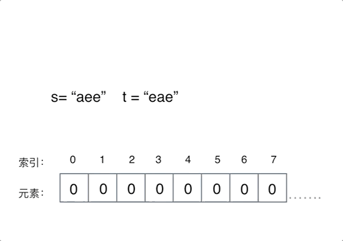

* [做專案（多個 C++、Java、Go、測試開發、前端（front end）專案）](https://www.programmercarl.com/other/kstar.html)
* [刷演算法（兩個月高強度學演算法）](https://www.programmercarl.com/xunlian/xunlianying.html)
* [準備面試必考題（八股文）（40 天挑戰高頻面試題）](https://www.programmercarl.com/xunlian/bagu.html)


> 陣列（array）就是簡單的雜湊表（hash table），但是陣列的大小可不是無限開闢的

# 242.有效的迴文（anagram）

[LeetCode 題目連結](https://leetcode.cn/problems/valid-anagram/)

給定兩個字串（string） s 和 t ，編寫一個函式（function）來判斷 t 是否是 s 的迴文。

範例 1:
輸入: s = "anagram", t = "nagaram"
輸出: true

範例 2:
輸入: s = "rat", t = "car"
輸出: false

**說明:**
你可以假設字串只包含小寫字母。

## 演算法公開課

**[《程式碼隨想錄》演算法影片公開課](https://programmercarl.com/other/gongkaike.html)：[學透雜湊表，陣列使用有技巧！Leetcode：242.有效的迴文](https://www.bilibili.com/video/BV1YG411p7BA)，相信結合影片再看本篇題解，更有助於大家對本題的理解**。

## 解題思路

先看蠻力（brute force）的解法，兩層 for 迴圈（loop），同時還要記錄字元（character）是否重複（duplicate）出現，很明顯時間複雜性（time complexity）是 O(n^2)。

蠻力的方法這裡就不做介紹了，直接看一下有沒有更優的方式。

**陣列其實就是一個簡單雜湊表**，而且這道題目中字串只有小寫字元，那麼就可以定義一個陣列，來記錄字串 s 裡字元出現的次數。

如果對雜湊表的理論基礎關於陣列，set，map 不了解的話可以看這篇：[關於雜湊表，你該了解這些！](https://programmercarl.com/哈希表理论基础.html)

需要定義一個多大的陣列呢，定一個陣列叫做 record，大小為 26 就可以了，初始化（initialization）為 0，因為字元 a 到字元 z 的 ASCII 也是 26 個連續的數值。

為了方便舉例，判斷一下字串 s= "aee", t = "eae"。

操作動畫如下：



定義一個陣列叫做 record 用來記錄字串 s 裡字元出現的次數。

需要把字元映射（mapping）到陣列也就是雜湊表的索引（index）下標（subscript）上，**因為字元 a 到字元 z 的 ASCII 是 26 個連續的數值，所以字元 a 映射為索引 0，相應的字元 z 映射為索引 25。**

再遍歷（traversal）字串 s 的時候，**只需要將 s[i] - ‘a’ 所在的元素（element）做 +1 操作即可，並不需要記住字元 a 的 ASCII，只要求出一個相對數值就可以了。** 這樣就將字串 s 中字元出現的次數，統計出來了。

那看一下如何檢查字串 t 中是否出現了這些字元，同樣在遍歷字串 t 的時候，對 t 中出現的字元映射雜湊表索引上的數值再做 -1 的操作。

那麼最後檢查一下，**record 陣列如果有的元素不為零 0，說明字串 s 和 t 一定是誰多了字元或者誰少了字元，return false。**

最後如果 record 陣列所有元素都為零 0，說明字串 s 和 t 是迴文，return true。

時間複雜性為 O(n)，空間上因為定義的是一個常數（constant）大小的輔助陣列，所以空間複雜度（space complexity）為 O(1)。


C++ 程式碼如下：
```CPP
class Solution {
public:
    bool isAnagram(string s, string t) {
        int record[26] = {0};
        for (int i = 0; i < s.size(); i++) {
            // 並不需要記住字元a的ASCII，只要求出一個相對數值就可以了
            record[s[i] - 'a']++;
        }
        for (int i = 0; i < t.size(); i++) {
            record[t[i] - 'a']--;
        }
        for (int i = 0; i < 26; i++) {
            if (record[i] != 0) {
                // record陣列如果有的元素不為零0，說明字串s和t 一定是誰多了字元或者誰少了字元。
                return false;
            }
        }
        // record陣列所有元素都為零0，說明字串s和t是迴文
        return true;
    }
};
```

* 時間複雜性: O(n)
* 空間複雜度: O(1)

## 其他語言版本

### Java：

```java
/**
 * 242. 有效的迴文 字典解法
 * 時間複雜性O(m+n) 空間複雜度O(1)
 */
class Solution {
    public boolean isAnagram(String s, String t) {
        int[] record = new int[26];

        for (int i = 0; i < s.length(); i++) {
            record[s.charAt(i) - 'a']++;     // 並不需要記住字元a的ASCII，只要求出一個相對數值就可以了
        }

        for (int i = 0; i < t.length(); i++) {
            record[t.charAt(i) - 'a']--;
        }
        
        for (int count: record) {
            if (count != 0) {               // record陣列如果有的元素不為零0，說明字串s和t 一定是誰多了字元或者誰少了字元。
                return false;
            }
        }
        return true;                        // record陣列所有元素都為零0，說明字串s和t是迴文
    }
}
```

### Python：

```python
class Solution:
    def isAnagram(self, s: str, t: str) -> bool:
        record = [0] * 26
        for i in s:
            #並不需要記住字元a的ASCII，只要求出一個相對數值就可以了
            record[ord(i) - ord("a")] += 1
        for i in t:
            record[ord(i) - ord("a")] -= 1
        for i in range(26):
            if record[i] != 0:
                #record陣列如果有的元素不為零0，說明字串s和t 一定是誰多了字元或者誰少了字元。
                return False
        return True
```
Python 寫法二（沒有使用陣列作為雜湊表，只是介紹 defaultdict 這樣一種解題思路）：

```python
class Solution:
    def isAnagram(self, s: str, t: str) -> bool:
        from collections import defaultdict
        
        s_dict = defaultdict(int)
        t_dict = defaultdict(int)
        for x in s:
            s_dict[x] += 1
        
        for x in t:
            t_dict[x] += 1
        return s_dict == t_dict
```
Python 寫法三(沒有使用陣列作為雜湊表，只是介紹 Counter 這種更方便的解題思路)：

```python
class Solution(object):
    def isAnagram(self, s: str, t: str) -> bool:
        from collections import Counter
        a_count = Counter(s)
        b_count = Counter(t)
        return a_count == b_count
```

### Go：

```go
func isAnagram(s string, t string) bool {
    record := [26]int{}
    
    for _, r := range s {
        record[r-rune('a')]++
    }
    for _, r := range t {
        record[r-rune('a')]--
    }

    return record == [26]int{}   // record陣列如果有的元素不為零0，說明字串s和t 一定是誰多了字元或者誰少了字元。
}
```

Go 寫法二(只對字串遍歷一次)
```go
func isAnagram(s string, t string) bool {
	if len(s) != len(t) {
		return false
	}
	records := [26]int{}
	for index := 0; index < len(s); index++ {
		if s[index] == t[index] {
			continue
		}
		sCharIndex := s[index] - 'a'
		records[sCharIndex]++
		tCharIndex := t[index] - 'a'
		records[tCharIndex]--
	}
	for _, record := range records {
		if record != 0 {
			return false
		}
	}
	return true
}
```

### JavaScript:

```js
/**
 * @param {string} s
 * @param {string} t
 * @return {boolean}
 */
var isAnagram = function(s, t) {
    if(s.length !== t.length) return false;
    const resSet = new Array(26).fill(0);
    const base = "a".charCodeAt();
    for(const i of s) {
        resSet[i.charCodeAt() - base]++;
    }
    for(const i of t) {
        if(!resSet[i.charCodeAt() - base]) return false;
        resSet[i.charCodeAt() - base]--;
    }
    return true;
};

var isAnagram = function(s, t) {
  if(s.length !== t.length) return false;
  let char_count = new Map();
  for(let item of s) {
    char_count.set(item, (char_count.get(item) || 0) + 1) ;
  }
  for(let item of t) {
    if(!char_count.get(item)) return false;
    char_count.set(item, char_count.get(item)-1);
  }
  return true;
};
```

### TypeScript：

```typescript
function isAnagram(s: string, t: string): boolean {
    if (s.length !== t.length) return false;
    let helperArr: number[] = new Array(26).fill(0);
    let pivot: number = 'a'.charCodeAt(0);
    for (let i = 0, length = s.length; i < length; i++) {
        helperArr[s.charCodeAt(i) - pivot]++;
        helperArr[t.charCodeAt(i) - pivot]--;
    }
    return helperArr.every(i => i === 0);
};
```

### Swift：

```Swift
func isAnagram(_ s: String, _ t: String) -> Bool {
    if s.count != t.count {
        return false
    }
    var record = Array(repeating: 0, count: 26)
    let aUnicodeScalar = "a".unicodeScalars.first!.value
    for c in s.unicodeScalars {
        record[Int(c.value - aUnicodeScalar)] += 1
    }
    for c in t.unicodeScalars {
        record[Int(c.value - aUnicodeScalar)] -= 1
    }
    for value in record {
        if value != 0 {
            return false
        }
    }
    return true
}
```

### PHP：

```php
class Solution {
    /**
     * @param String $s
     * @param String $t
     * @return Boolean
     */
    function isAnagram($s, $t) {
        if (strlen($s) != strlen($t)) {
            return false;
        }
        $table = [];
        for ($i = 0; $i < strlen($s); $i++) {
            if (!isset($table[$s[$i]])) {
                $table[$s[$i]] = 1;
            } else {
                $table[$s[$i]]++;
            }
            if (!isset($table[$t[$i]])) {
                $table[$t[$i]] = -1;
            } else {
                $table[$t[$i]]--;
            }
        }
        foreach ($table as $record) {
            if ($record != 0) {
                return false;
            }
        }
        return true;
    }
}
```

### Rust：

```rust
impl Solution {
    pub fn is_anagram(s: String, t: String) -> bool {      
        let mut record = vec![0; 26];
        
        let baseChar = 'a';
        
        for byte in s.bytes() {
            record[byte as usize - baseChar as usize] += 1;
        } 
        for byte in t.bytes() {
            record[byte as usize - baseChar as usize] -= 1;
        } 

        record.iter().filter(|x| **x != 0).count() == 0
    }
}
```

### Scala:

```scala
object Solution {
  def isAnagram(s: String, t: String): Boolean = {
    // 如果兩個字串的長度不等，直接回傳false
    if (s.length != t.length) return false
    val record = new Array[Int](26) // 記錄每個單字出現了多少次
    // 遍歷字串，對於s字串單字對應的記錄+=1，t字串對應的記錄-=1
    for (i <- 0 until s.length) {
      record(s(i) - 97) += 1
      record(t(i) - 97) -= 1
    }
    // 如果不等於則直接回傳false
    for (i <- 0 until 26) {
      if (record(i) != 0) {
        return false
      }
    }
    // 如果前面不回傳false，說明匹配成功，回傳true，return可以省略
    true
  }
}
```

### C#：

```csharp
 public bool IsAnagram(string s, string t) {
         int sl=s.Length,tl=t.Length;
        if(sl!=tl) return false;
        int[] a = new int[26];
        for(int i = 0; i < sl; i++){
             a[s[i] - 'a']++;
             a[t[i] - 'a']--;
        }       
        foreach (int i in a)
        {
            if (i != 0)
                return false;
        }
        return true;
    }
```

### C

```c
bool isAnagram(char* s, char* t) {
    int len1 = strlen(s), len2 = strlen(t);
    if (len1 != len2) {
        return false;
    }

    int map1[26] = {0}, map2[26] = {0};
    for (int i = 0; i < len1; i++) {
        map1[s[i] - 'a'] += 1;
        map2[t[i] - 'a'] += 1;
    }
    
    for (int i = 0; i < 26; i++) {
        if (map1[i] != map2[i]) {
            return false;
        }
    }
    
    return true;
}
```

## 相關題目

* [383.贖金信](https://programmercarl.com/0383.%E8%B5%8E%E9%87%91%E4%BF%A1.html)
* [49.迴文分組](https://leetcode.cn/problems/group-anagrams/)
* [438.找到字串中所有迴文](https://leetcode.cn/problems/find-all-anagrams-in-a-string/)


