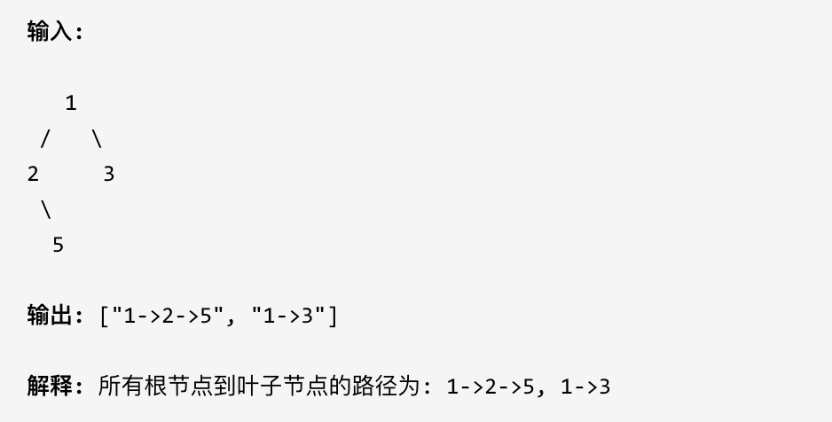
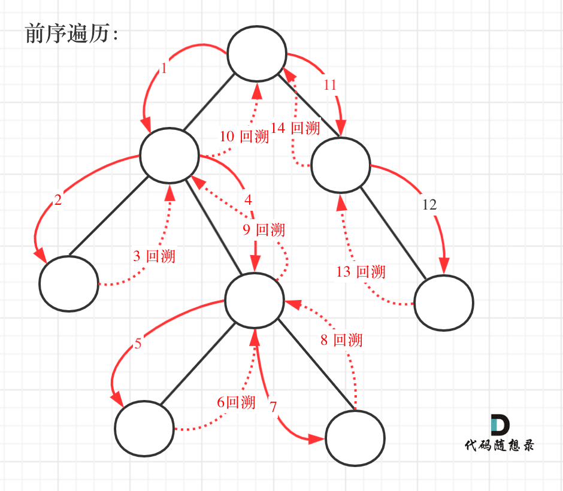
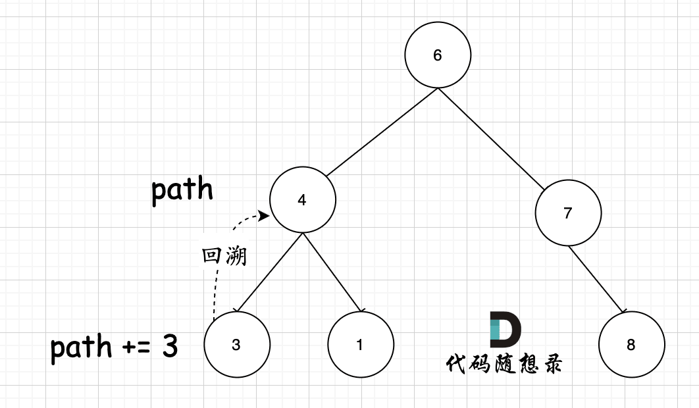

* [做專案（多個 C++、Java、Go、測試開發、前端（front end）專案）](https://www.programmercarl.com/other/kstar.html)
* [刷演算法（兩個月高強度學演算法）](https://www.programmercarl.com/xunlian/xunlianying.html)
* [準備面試必考題（八股文）（40 天挑戰高頻面試題）](https://www.programmercarl.com/xunlian/bagu.html)


> 以為只用了遞迴（recursion），其實還用了回溯（backtracking）

# 257. 二元樹（binary tree）的所有路徑（path）

[LeetCode 題目連結](https://leetcode.com/problems/binary-tree-paths/)

給定一個二元樹，回傳所有從根節點（root node）到葉節點（leaf node）的路徑。

說明: 葉節點是指沒有子節點（child node）的節點（node）。

範例:


## 演算法公開課

**[《程式碼隨想錄》演算法影片公開課](https://programmercarl.com/other/gongkaike.html)：[遞迴中帶著回溯，你感受到了沒？| LeetCode：257. 二元樹的所有路徑](https://www.bilibili.com/video/BV1ZG411G7Dh)，相信結合影片再看本篇題解，更有助於大家對本題的理解**。

## 解題思路

這道題目要求從根節點到葉子的路徑，所以需要前序遍歷（preorder traversal），這樣才方便讓父節點（father node）指向孩子節點，找到對應的路徑。

在這道題目中將第一次涉及到回溯，因為我們要把路徑記錄下來，需要回溯來回退一個路徑再進入另一個路徑。

前序遍歷以及回溯的過程如圖：



我們先使用遞迴的方式，來做前序遍歷。**要知道遞迴和回溯就是一家的，本題也需要回溯。**

### 遞迴

1. 遞迴函數（recursive function）參數（parameter）以及回傳值（return value）

要傳入根節點，記錄每一條路徑的 path，和存放結果集（result set）的 result，這裡遞迴不需要回傳值，程式碼如下：

```CPP
void traversal(TreeNode* cur, vector<int>& path, vector<string>& result)
```

2. 確定遞迴終止條件（termination condition）

在寫遞迴的時候都習慣了這麼寫：

```CPP
if (cur == NULL) {
    終止處理邏輯
}
```

但是本題的終止條件這樣寫會很麻煩，因為本題要找到葉節點，就開始結束的處理邏輯了（把路徑放進 result 裡）。

**那麼什麼時候算是找到了葉節點？** 是當 cur 不為空，其左右孩子都為空的時候，就找到葉節點。

所以本題的終止條件是：
```CPP
if (cur->left == NULL && cur->right == NULL) {
    終止處理邏輯
}
```

為什麼沒有判斷 cur 是否為空呢，因為下面的邏輯可以控制空節點不入迴圈（loop）。

再來看一下終止處理的邏輯。

這裡使用 `vector<int>` 結構 path 來記錄路徑，所以要把 `vector<int>` 結構的 path 轉為 string 格式，再把這個 string 放進 result 裡。

**那麼為什麼使用了 `vector<int>` 結構來記錄路徑呢？**  因為在下面處理單層遞迴邏輯的時候，要做回溯，使用 vector 方便來做回溯。

可能有的同學問了，我看有些人的程式碼也沒有回溯啊。

**其實是有回溯的，只不過隱藏在函數（function）呼叫時的參數賦值裡**，下文我還會提到。

這裡我們先使用 `vector<int>` 結構的 path 容器（container）來記錄路徑，那麼終止處理邏輯如下：

```CPP
if (cur->left == NULL && cur->right == NULL) { // 遇到葉節點
    string sPath;
    for (int i = 0; i < path.size() - 1; i++) { // 將path裡記錄的路徑轉為string格式
        sPath += to_string(path[i]);
        sPath += "->";
    }
    sPath += to_string(path[path.size() - 1]); // 記錄最後一個節點（葉節點）
    result.push_back(sPath); // 收集一個路徑
    return;
}
```

3. 確定單層遞迴邏輯

因為是前序遍歷，需要先處理中間節點，中間節點就是我們要記錄路徑上的節點，先放進 path 中。

`path.push_back(cur->val);`

然後是遞迴和回溯的過程，上面說過沒有判斷 cur 是否為空，那麼在這裡遞迴的時候，如果為空就不進行下一層遞迴了。

所以遞迴前要加上判斷語句，下面要遞迴的節點是否為空，如下

```CPP
if (cur->left) {
    traversal(cur->left, path, result);
}
if (cur->right) {
    traversal(cur->right, path, result);
}
```

此時還沒完，遞迴完，要做回溯啊，因為 path 不能一直加入節點，它還要刪節點，然後才能加入新的節點。

那麼回溯要怎麼回溯呢，一些同學會這麼寫，如下：

```CPP
if (cur->left) {
    traversal(cur->left, path, result);
}
if (cur->right) {
    traversal(cur->right, path, result);
}
path.pop_back();
```

這個回溯就有很大的問題，我們知道，**回溯和遞迴是一一對應的，有一個遞迴，就要有一個回溯**，這麼寫的話相當於把遞迴和回溯拆開了，一個在大括號（brace）裡，一個在大括號外。

**所以回溯要和遞迴永遠在一起，世界上最遙遠的距離是你在大括號裡，而我在大括號外！**

那麼程式碼應該這麼寫：

```CPP
if (cur->left) {
    traversal(cur->left, path, result);
    path.pop_back(); // 回溯
}
if (cur->right) {
    traversal(cur->right, path, result);
    path.pop_back(); // 回溯
}
```

那麼本題整體程式碼如下：

```CPP
// 版本一
class Solution {
private:

    void traversal(TreeNode* cur, vector<int>& path, vector<string>& result) {
        path.push_back(cur->val); // 中，中為什麼寫在這裡，因為最後一個節點也要加入到path中 
        // 這才到了葉節點
        if (cur->left == NULL && cur->right == NULL) {
            string sPath;
            for (int i = 0; i < path.size() - 1; i++) {
                sPath += to_string(path[i]);
                sPath += "->";
            }
            sPath += to_string(path[path.size() - 1]);
            result.push_back(sPath);
            return;
        }
        if (cur->left) { // 左 
            traversal(cur->left, path, result);
            path.pop_back(); // 回溯
        }
        if (cur->right) { // 右
            traversal(cur->right, path, result);
            path.pop_back(); // 回溯
        }
    }

public:
    vector<string> binaryTreePaths(TreeNode* root) {
        vector<string> result;
        vector<int> path;
        if (root == NULL) return result;
        traversal(root, path, result);
        return result;
    }
};
```
如上的 C++ 程式碼充分體現了回溯。

那麼如上程式碼可以精簡成如下程式碼：

```CPP
class Solution {
private:

    void traversal(TreeNode* cur, string path, vector<string>& result) {
        path += to_string(cur->val); // 中
        if (cur->left == NULL && cur->right == NULL) {
            result.push_back(path);
            return;
        }
        if (cur->left) traversal(cur->left, path + "->", result); // 左
        if (cur->right) traversal(cur->right, path + "->", result); // 右
    }

public:
    vector<string> binaryTreePaths(TreeNode* root) {
        vector<string> result;
        string path;
        if (root == NULL) return result;
        traversal(root, path, result);
        return result;

    }
};
```

如上程式碼精簡了不少，也隱藏了不少東西。

注意在函數定義的時候 `void traversal(TreeNode* cur, string path, vector<string>& result)` ，定義的是 `string path`，每次都是複製賦值，不用使用參考（reference），否則就無法做到回溯的效果。（這裡涉及到 C++ 語法知識）

那麼在如上程式碼中，**貌似沒有看到回溯的邏輯，其實不然，回溯就隱藏在 `traversal(cur->left, path + "->", result);` 中的 `path + "->"`。**  每次函數呼叫完，path 依然是沒有加上 "->" 的，這就是回溯了。

為了把這份精簡程式碼的回溯過程展現出來，大家可以試一試把：

```CPP
if (cur->left) traversal(cur->left, path + "->", result); // 左  回溯就隱藏在這裡
```

改成如下程式碼：

```CPP
path += "->";
traversal(cur->left, path, result); // 左
```

即：

```CPP
if (cur->left) {
    path += "->";
    traversal(cur->left, path, result); // 左
}
if (cur->right) {
    path += "->";
    traversal(cur->right, path, result); // 右
}
```

此時就沒有回溯了，這個程式碼就是通過不了的了。

如果想把回溯加上，就要 在上面程式碼的基礎上，加上回溯，就可以 AC 了。

```CPP
if (cur->left) {
    path += "->";
    traversal(cur->left, path, result); // 左
    path.pop_back(); // 回溯 '>'
    path.pop_back(); // 回溯 '-'
}
if (cur->right) {
    path += "->";
    traversal(cur->right, path, result); // 右
    path.pop_back(); // 回溯 '>' 
    path.pop_back(); //  回溯 '-' 
}
```

整體程式碼如下： 

```CPP 
//版本二
class Solution {
private:
    void traversal(TreeNode* cur, string path, vector<string>& result) {
        path += to_string(cur->val); // 中，中為什麼寫在這裡，因為最後一個節點也要加入到path中
        if (cur->left == NULL && cur->right == NULL) {
            result.push_back(path);
            return;
        }
        if (cur->left) {
            path += "->";
            traversal(cur->left, path, result); // 左
            path.pop_back(); // 回溯 '>'
            path.pop_back(); // 回溯 '-'
        }
        if (cur->right) {
            path += "->";
            traversal(cur->right, path, result); // 右
            path.pop_back(); // 回溯'>'
            path.pop_back(); // 回溯 '-'
        }
    }

public:
    vector<string> binaryTreePaths(TreeNode* root) {
        vector<string> result;
        string path;
        if (root == NULL) return result;
        traversal(root, path, result);
        return result;

    }
};

```

**大家應該可以感受出來，如果把 `path + "->"` 作為函數參數就是可以的，因為並沒有改變 path 的數值，執行完遞迴函數之後，path 依然是之前的數值（相當於回溯了）**


**綜合以上，第二種遞迴的程式碼雖然精簡但把很多重要的點隱藏在了程式碼細節裡，第一種遞迴寫法雖然程式碼多一些，但是把每一個邏輯處理都完整的展現出來了。**

### 拓展 

這裡講解本題解的寫法邏輯以及一些更具體的細節，下面的講解中，涉及到 C++ 語法特性，如果不是 C++ 的錄友，就可以不看了，避免越看越暈。 

如果是 C++ 的錄友，建議本題獨立刷過兩遍，再看下面的講解，同樣避免越看越暈，造成不必要的負擔。 

在第二版本的程式碼中，其實僅僅是回溯了 `->` 部分（呼叫兩次 pop_back，一個 pop `>` 一次 pop `-`），大家應該疑惑那麼 `path += to_string(cur->val);` 這一步為什麼沒有回溯呢？ 一條路徑能持續加節點 不做回溯嗎？  

其實關鍵還在於 參數，使用的是 `string path`，這裡並沒有加上參考 `&` ，即本層遞迴中，path + 該節點數值，但該層遞迴結束，上一層 path 的數值並不會受到任何影響。  如圖所示：

 

節點 4 的 path，在遍歷（traversal）到節點 3，path+3，遍歷節點 3 的遞迴結束之後，回傳節點 4（回溯的過程），path 並不會把 3 加上。 

所以這是參數中，不帶參考，不做位址（address）複製，只做內容複製的效果。（這裡涉及到 C++ 參考方面的知識） 

在第一個版本中，函數參數我就使用了參考，即 `vector<int>& path` ，這是會複製位址的，所以 本層遞迴邏輯如果有 `path.push_back(cur->val);` 就一定要有對應的 `path.pop_back()` 

那有同學可能想，為什麼不去定義一個 `string& path` 這樣的函數參數呢，然後也可能在遞迴函數中展現回溯的過程，但關鍵在於，`path += to_string(cur->val);` 每次是加上一個數字，這個數字如果是個位數，那好說，就呼叫一次 `path.pop_back()`，但如果是 十位數，百位數，千位數呢？ 百位數就要呼叫三次 `path.pop_back()`，才能實作對應的回溯操作，這樣程式碼實作就太冗餘（redundant）了。

所以，第一個程式碼版本中，我才使用 vector 類型的 path，這樣方便給大家演示程式碼中回溯的操作。 vector 類型的 path，不管 每次 路徑收集的數字是幾位數，總之一定是 int，所以就一次 pop_back 就可以。 


### 疊代（iteration）法


至於非遞迴的方式，我們可以依然可以使用前序遍歷的疊代方式來模擬（simulation）遍歷路徑的過程，對該疊代方式不了解的同學，可以看文章[二元樹：聽說遞迴能做的，堆疊（stack）也能做！](./二叉樹的疊代遍歷.md)和[二元樹：前中後序疊代方式統一寫法](./二叉樹的統一疊代法.md)。

這裡除了模擬遞迴需要一個堆疊，同時還需要一個堆疊來存放對應的遍歷路徑。

C++ 程式碼如下：

```CPP
class Solution {
public:
    vector<string> binaryTreePaths(TreeNode* root) {
        stack<TreeNode*> treeSt;// 儲存樹的遍歷節點
        stack<string> pathSt;   // 儲存遍歷路徑的節點
        vector<string> result;  // 儲存最終路徑集合
        if (root == NULL) return result;
        treeSt.push(root);
        pathSt.push(to_string(root->val));
        while (!treeSt.empty()) {
            TreeNode* node = treeSt.top(); treeSt.pop(); // 取出節點 中
            string path = pathSt.top();pathSt.pop();    // 取出該節點對應的路徑
            if (node->left == NULL && node->right == NULL) { // 遇到葉節點
                result.push_back(path);
            }
            if (node->right) { // 右
                treeSt.push(node->right);
                pathSt.push(path + "->" + to_string(node->right->val));
            }
            if (node->left) { // 左
                treeSt.push(node->left);
                pathSt.push(path + "->" + to_string(node->left->val));
            }
        }
        return result;
    }
};
```
當然，使用 java 的同學，可以直接定義一個成員變數（member variable）為 object 的堆疊 `Stack<Object> stack = new Stack<>();`，這樣就不用定義兩個堆疊了，都放到一個堆疊裡就可以了。

## 總結

**本文我們開始初步涉及到了回溯，很多同學過了這道題目，可能都不知道自己其實使用了回溯，回溯和遞迴都是相伴相生的。**

我在第一版遞迴程式碼中，把遞迴與回溯的細節都充分的展現了出來，大家可以自己感受一下。

第二版遞迴程式碼對於初學者其實非常不友好，程式碼看上去簡單，但是隱藏細節於無形。

最後我依然給出了疊代法。

對於本題充分了解遞迴與回溯的過程之後，有精力的同學可以再去實作疊代法。

## 其他語言版本

### Java：

```Java
//解法一

//方式一
class Solution {
    /**
     * 遞迴法
     */
    public List<String> binaryTreePaths(TreeNode root) {
        List<String> res = new ArrayList<>();// 存最終的結果
        if (root == null) {
            return res;
        }
        List<Integer> paths = new ArrayList<>();// 作為結果中的路徑
        traversal(root, paths, res);
        return res;
    }

    private void traversal(TreeNode root, List<Integer> paths, List<String> res) {
        paths.add(root.val);// 前序遍歷，中
        // 遇到葉節點
        if (root.left == null && root.right == null) {
            // 輸出
            StringBuilder sb = new StringBuilder();// StringBuilder用來拼接字串，速度更快
            for (int i = 0; i < paths.size() - 1; i++) {
                sb.append(paths.get(i)).append("->");
            }
            sb.append(paths.get(paths.size() - 1));// 記錄最後一個節點
            res.add(sb.toString());// 收集一個路徑
            return;
        }
        // 遞迴和回溯是同時進行，所以要放在同一個大括號裡
        if (root.left != null) { // 左
            traversal(root.left, paths, res);
            paths.remove(paths.size() - 1);// 回溯
        }
        if (root.right != null) { // 右
            traversal(root.right, paths, res);
            paths.remove(paths.size() - 1);// 回溯
        }
    }
}

//方式二
class Solution {

    List<String> result = new ArrayList<>();

    public List<String> binaryTreePaths(TreeNode root) {
        deal(root, "");
        return result;
    }

    public void deal(TreeNode node, String s) {
        if (node == null)
            return;
        if (node.left == null && node.right == null) {
            result.add(new StringBuilder(s).append(node.val).toString());
            return;
        }
        String tmp = new StringBuilder(s).append(node.val).append("->").toString();
        deal(node.left, tmp);
        deal(node.right, tmp);
    }
}
```
```java
// 解法二
class Solution {
    /**
     * 疊代法
     */
    public List<String> binaryTreePaths(TreeNode root) {
        List<String> result = new ArrayList<>();
        if (root == null)
            return result;
        Stack<Object> stack = new Stack<>();
        // 節點和路徑同時入堆疊
        stack.push(root);
        stack.push(root.val + "");
        while (!stack.isEmpty()) {
            // 節點和路徑同時出堆疊
            String path = (String) stack.pop();
            TreeNode node = (TreeNode) stack.pop();
            // 若找到葉節點
            if (node.left == null && node.right == null) {
                result.add(path);
            }
            //右子節點不為空
            if (node.right != null) {
                stack.push(node.right);
                stack.push(path + "->" + node.right.val);
            }
            //左子節點不為空
            if (node.left != null) {
                stack.push(node.left);
                stack.push(path + "->" + node.left.val);
            }
        }
        return result;
    }
}
```
---
### Python:  


遞迴法+回溯
```Python
# Definition for a binary tree node.
class Solution:
    def traversal(self, cur, path, result):
        path.append(cur.val)  # 中
        if not cur.left and not cur.right:  # 到達葉節點
            sPath = '->'.join(map(str, path))
            result.append(sPath)
            return
        if cur.left:  # 左
            self.traversal(cur.left, path, result)
            path.pop()  # 回溯
        if cur.right:  # 右
            self.traversal(cur.right, path, result)
            path.pop()  # 回溯

    def binaryTreePaths(self, root):
        result = []
        path = []
        if not root:
            return result
        self.traversal(root, path, result)
        return result


```
遞迴法+隱形回溯（版本一）
```Python
# Definition for a binary tree node.
# class TreeNode:
#     def __init__(self, val=0, left=None, right=None):
#         self.val = val
#         self.left = left
#         self.right = right
from typing import List, Optional

class Solution:
    def binaryTreePaths(self, root: Optional[TreeNode]) -> List[str]:
        if not root:
            return []
        result = []
        self.traversal(root, [], result)
        return result
    
    def traversal(self, cur: TreeNode, path: List[int], result: List[str]) -> None:
        if not cur:
            return
        path.append(cur.val)
        if not cur.left and not cur.right:
            result.append('->'.join(map(str, path)))
        if cur.left:
            self.traversal(cur.left, path[:], result)
        if cur.right:
            self.traversal(cur.right, path[:], result)

```

遞迴法+隱形回溯（版本二）
```Python
# Definition for a binary tree node.
# class TreeNode:
#     def __init__(self, val=0, left=None, right=None):
#         self.val = val
#         self.left = left
#         self.right = right
class Solution:
    def binaryTreePaths(self, root: TreeNode) -> List[str]:
        path = ''
        result = []
        if not root: return result
        self.traversal(root, path, result)
        return result
    
    def traversal(self, cur: TreeNode, path: str, result: List[str]) -> None:
        path += str(cur.val)
        # 若目前節點為leave，直接輸出
        if not cur.left and not cur.right:
            result.append(path)

        if cur.left:
            # + '->' 是隱藏回溯
            self.traversal(cur.left, path + '->', result)
        
        if cur.right:
            self.traversal(cur.right, path + '->', result)
```

疊代法：

```Python
class Solution:

    def binaryTreePaths(self, root: TreeNode) -> List[str]:
        # 題目中節點數至少為1
        stack, path_st, result = [root], [str(root.val)], []

        while stack:
            cur = stack.pop()
            path = path_st.pop()
            # 如果目前節點為葉節點，加入路徑到結果中
            if not (cur.left or cur.right):
                result.append(path)
            if cur.right:
                stack.append(cur.right)
                path_st.append(path + '->' + str(cur.right.val))
            if cur.left:
                stack.append(cur.left)
                path_st.append(path + '->' + str(cur.left.val))

        return result
```

---

### Go：

遞迴法：

```go
func binaryTreePaths(root *TreeNode) []string {
    res := make([]string, 0)
    var travel func(node *TreeNode, s string)
    travel = func(node *TreeNode, s string) {
        if node.Left == nil && node.Right == nil {
            v := s + strconv.Itoa(node.Val)
            res = append(res, v)
            return
        }
        s = s + strconv.Itoa(node.Val) + "->"
        if node.Left != nil {
            travel(node.Left, s)
        }
        if node.Right != nil {
            travel(node.Right, s)
        }
    }
    travel(root, "")
    return res
}
```

疊代法：

```go
func binaryTreePaths(root *TreeNode) []string {
	stack := []*TreeNode{}
	paths := make([]string, 0)
	res := make([]string, 0)
	if root != nil {
		stack = append(stack, root)
		paths = append(paths, "")
	}
	for len(stack) > 0 {
		l := len(stack)
		node := stack[l-1]
		path := paths[l-1]
		stack = stack[:l-1]
		paths = paths[:l-1]
		if node.Left == nil && node.Right == nil {
			res = append(res, path+strconv.Itoa(node.Val))
			continue
		}
		if node.Right != nil {
			stack = append(stack, node.Right)
			paths = append(paths, path+strconv.Itoa(node.Val)+"->")
		}
		if node.Left != nil {
			stack = append(stack, node.Left)
			paths = append(paths, path+strconv.Itoa(node.Val)+"->")
		}
	}
	return res
}
```

---
### JavaScript:

遞迴法：

```javascript
var binaryTreePaths = function(root) {
   //遞迴遍歷+遞迴三部曲
   let res = [];
   //1. 確定遞迴函數 函數參數
   const getPath = function(node,curPath) {
    //2. 確定終止條件，到葉節點就終止
       if(node.left === null && node.right === null) {
           curPath += node.val;
           res.push(curPath);
           return;
       }
       //3. 確定單層遞迴邏輯
       curPath += node.val + '->';
       node.left && getPath(node.left, curPath);
       node.right && getPath(node.right, curPath);
   }
   getPath(root, '');
   return res;
};
```

疊代法：

```javascript
var binaryTreePaths = function(root) {
  if (!root) return [];
  const stack = [root], paths = [''], res = [];
  while (stack.length) {
    const node = stack.pop();
    let path = paths.pop();
    if (!node.left && !node.right) { // 到葉節點終止, 加入路徑到結果中
      res.push(path + node.val);
      continue;
    }
    path += node.val + '->';
    if (node.right) { // 右節點存在
      stack.push(node.right);
      paths.push(path);
    }
    if (node.left) { // 左節點存在
      stack.push(node.left);
      paths.push(path);
    }
  }
  return res;
};  
```

### TypeScript：

> 遞迴法

```typescript
function binaryTreePaths(root: TreeNode | null): string[] {
    function recur(node: TreeNode, route: string, resArr: string[]): void {
        route += String(node.val);
        if (node.left === null && node.right === null) {
            resArr.push(route);
            return;
        }
        if (node.left !== null) recur(node.left, route + '->', resArr);
        if (node.right !== null) recur(node.right, route + '->', resArr);
    }
    const resArr: string[] = [];
    if (root === null) return resArr;
    recur(root, '', resArr);
    return resArr;
};
```

> 疊代法

```typescript
// 疊代法2
function binaryTreePaths(root: TreeNode | null): string[] {
    let helperStack: TreeNode[] = [];
    let tempNode: TreeNode;
    let routeArr: string[] = [];
    let resArr: string[] = [];
    if (root !== null) {
        helperStack.push(root);
        routeArr.push(String(root.val));
    };
    while (helperStack.length > 0) {
        tempNode = helperStack.pop()!;
        let route: string = routeArr.pop()!; // tempNode 對應的路徑
        if (tempNode.left === null && tempNode.right === null) {
            resArr.push(route);
        }
        if (tempNode.right !== null) {
            helperStack.push(tempNode.right);
            routeArr.push(route + '->' + tempNode.right.val);   // tempNode.right 對應的路徑
        }
        if (tempNode.left !== null) {
            helperStack.push(tempNode.left);
            routeArr.push(route + '->' + tempNode.left.val);    // tempNode.left 對應的路徑
        }
    }
    return resArr;
};
```

### Swift:

> 遞迴/回溯
```swift
func binaryTreePaths(_ root: TreeNode?) -> [String] {
    var res = [String]()
    guard let root = root else {
        return res
    }
    var path = [Int]()
    _binaryTreePaths(root, path: &path, res: &res)
    return res
}
func _binaryTreePaths(_ root: TreeNode, path: inout [Int], res: inout [String]) {
    path.append(root.val)
    if root.left ==  nil && root.right == nil {
        var str = ""
        for i in 0 ..< path.count - 1 {
            str.append("\(path[i])->")
        }
        str.append("\(path.last!)")
        res.append(str)
        return
    }
    if let left = root.left {
        _binaryTreePaths(left, path: &path, res: &res)
        path.removeLast()
    }
    if let right = root.right {
        _binaryTreePaths(right, path: &path, res: &res)
        path.removeLast()
    }
}
```

> 疊代
```swift
func binaryTreePaths(_ root: TreeNode?) -> [String] {
    var res = [String]()
    guard let root = root else {
        return res
    }
    var stackNode = [TreeNode]()
    stackNode.append(root)
    
    var stackStr = [String]()
    stackStr.append("\(root.val)")
    
    while !stackNode.isEmpty {
        let node = stackNode.popLast()!
        let str = stackStr.popLast()!
        if node.left == nil && node.right == nil {
            res.append(str)
        }
        if let left = node.left {
            stackNode.append(left)
            stackStr.append("\(str)->\(left.val)")
        }
        if let right = node.right {
            stackNode.append(right)
            stackStr.append("\(str)->\(right.val)")
        }
    }
    return res
}
```

### Scala:

遞迴:
```scala
object Solution {
  import scala.collection.mutable.ListBuffer
  def binaryTreePaths(root: TreeNode): List[String] = {
    val res = ListBuffer[String]()
    def traversal(curNode: TreeNode, path: ListBuffer[Int]): Unit = {
      path.append(curNode.value)
      if (curNode.left == null && curNode.right == null) {
        res.append(path.mkString("->")) // mkString函數: 將陣列的所有值按照指定字串拼接
        return // 處理完可以直接return
      }

      if (curNode.left != null) {
        traversal(curNode.left, path)
        path.remove(path.size - 1)
      }
      if (curNode.right != null) {
        traversal(curNode.right, path)
        path.remove(path.size - 1)
      }
    }
    traversal(root, ListBuffer[Int]())
    res.toList
  }
}
```

### Rust:

```rust
// 遞迴
impl Solution {
    pub fn binary_tree_paths(root: Option<Rc<RefCell<TreeNode>>>) -> Vec<String> {
        let mut res = vec![];
        Self::recur(&root, String::from(""), &mut res);
        res
    }
    pub fn recur(node: &Option<Rc<RefCell<TreeNode>>>, mut path: String, res: &mut Vec<String>) {
        let r = node.as_ref().unwrap().borrow();
        path += format!("{}", r.val).as_str();
        if r.left.is_none() && r.right.is_none() {
            res.push(path.to_string());
            return;
        }
        if r.left.is_some() {
            Self::recur(&r.left, path.clone() + "->", res);
        }
        if r.right.is_some() {
            Self::recur(&r.right, path + "->", res);
        }
    }
}
```
### C#
```csharp
public IList<string> BinaryTreePaths(TreeNode root)
{
    List<int> path = new();
    List<string> res = new();
    if (root == null) return res;
    Traversal(root, path, res);
    return res;
}
public void Traversal(TreeNode node, List<int> path, List<string> res)
{
    path.Add(node.val);
    if (node.left == null && node.right == null)
    {
        string sPath = "";
        for (int i = 0; i < path.Count - 1; i++)
        {
            sPath += path[i].ToString();
            sPath += "->";
        }
        sPath += path[path.Count - 1].ToString();
        res.Add(sPath);
        return;
    }
    if (node.left != null)
    {
        Traversal(node.left, path, res);
        path.RemoveAt(path.Count-1);
    }
    if (node.right != null)
    {
        Traversal(node.right, path, res);
        path.RemoveAt(path.Count-1);
    }
}
```

