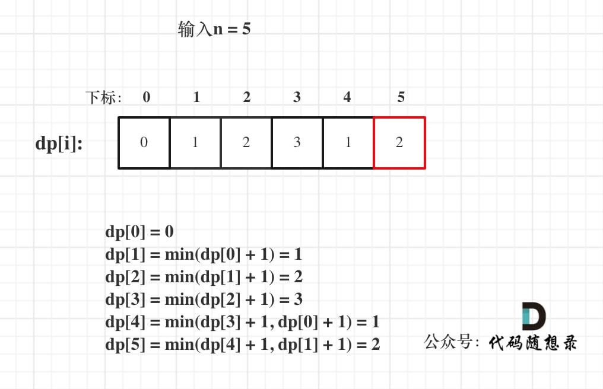

* [做專案（多個 C++、Java、Go、測試開發、前端（front end）專案）](https://www.programmercarl.com/other/kstar.html)
* [刷演算法（algorithm）（兩個月高強度學演算法）](https://www.programmercarl.com/xunlian/xunlianying.html)
* [準備面試必考題（八股文）（40 天挑戰高頻面試題）](https://www.programmercarl.com/xunlian/bagu.html)


# 279.完全平方（perfect square）

[LeetCode 題目連結](https://leetcode.cn/problems/perfect-squares/)

給定正整數（positive integer） n，找到若干個完全平方（比如 1, 4, 9, 16, ...）使得它們的和等於 n。你需要讓組成和的完全平方的個數最少。

給你一個整數（integer） n ，回傳和為 n 的完全平方的最少數量 。

完全平方 是一個整數，其值等於另一個整數的平方；換句話說，其值等於一個整數自乘的積。例如，1、4、9 和 16 都是完全平方，而 3 和 11 不是。

範例 1：
* 輸入：n = 12
* 輸出：3
* 解釋：12 = 4 + 4 + 4

範例 2：
* 輸入：n = 13
* 輸出：2
* 解釋：13 = 4 + 9

提示：
* 1 <= n <= 10^4

## 演算法公開課

**[《程式碼隨想錄》演算法影片公開課](https://programmercarl.com/other/gongkaike.html)：[換湯不換藥！| LeetCode：279.完全平方](https://www.bilibili.com/video/BV12P411T7Br/)，相信結合影片再看本篇題解，更有助於大家對本題的理解**。


## 解題思路

可能剛看這種題感覺沒什麼解題思路，又平方和的，又最小數的。

**我來把題目翻譯一下：完全平方就是物品（可以無限件使用），湊個正整數 n 就是背包，問湊滿這個背包最少有多少物品？**

感受出來了沒，這麼濃厚的無界背包問題（unbounded knapsack problem）氛圍，而且和昨天的題目[動態規劃（dynamic programming, DP）：322. 零錢兌換](https://programmercarl.com/0322.零钱兑换.html)就是一模一樣的！

動態規劃五部曲分析如下：

1. 確定 dp 陣列（array）（dp table）以及下標（subscript）的含義

**dp[j]：和為 j 的完全平方的最少數量為 dp[j]**

2. 確定遞迴公式（recurrence formula）

dp[j] 可以由 dp[j - i * i] 推出， dp[j - i * i] + 1 便可以湊成 dp[j]。

此時我們要選擇最小的 dp[j]，所以遞迴公式：dp[j] = min(dp[j - i * i] + 1, dp[j]);

3. dp 陣列如何初始化（initialization）

dp[0] 表示 和為 0 的完全平方的最小數量，那麼 dp[0] 一定是 0。

有同學問，那 0 * 0 也算是一種啊，為什麼 dp[0] 就是 0 呢？

看題目描述，找到若干個完全平方（比如 1, 4, 9, 16, ...），題目描述中可沒說要從 0 開始，dp[0]=0 完全是為了遞迴公式。

非 0 下標的 dp[j] 應該是多少呢？

從遞迴公式 dp[j] = min(dp[j - i * i] + 1, dp[j]); 中可以看出每次 dp[j] 都要選最小的，**所以非 0 下標的 dp[j] 一定要初始為最大值，這樣 dp[j] 在遞迴（recursion）的時候才不會被初始值覆蓋**。

4. 確定遍歷（traversal）順序

我們知道這是無界背包問題，

如果求組合（combination）數就是外層 for 迴圈（loop）遍歷物品，內層 for 遍歷背包。

如果求排列（permutation）數就是外層 for 遍歷背包，內層 for 迴圈遍歷物品。

在[動態規劃：322. 零錢兌換](https://programmercarl.com/0322.零钱兑换.html)中我們就深入探討了這個問題，本題也是一樣的，是求最小數！

**所以本題外層 for 遍歷背包，內層 for 遍歷物品，還是外層 for 遍歷物品，內層 for 遍歷背包，都是可以的！**

我這裡先給出外層遍歷背包，內層遍歷物品的程式碼：

```CPP
vector<int> dp(n + 1, INT_MAX);
dp[0] = 0;
for (int i = 0; i <= n; i++) { // 遍歷背包
    for (int j = 1; j * j <= i; j++) { // 遍歷物品
        dp[i] = min(dp[i - j * j] + 1, dp[i]);
    }
}

```

5. 舉例推導 dp 陣列

以輸入 n 為 5 為例，dp 狀態（state）圖如下：




dp[0] = 0
dp[1] = min(dp[0] + 1) = 1
dp[2] = min(dp[1] + 1) = 2
dp[3] = min(dp[2] + 1) = 3
dp[4] = min(dp[3] + 1, dp[0] + 1) = 1
dp[5] = min(dp[4] + 1, dp[1] + 1) = 2

最後的 dp[n] 為最終結果。

以上動態規劃五部曲分析完畢，C++ 程式碼如下：

```CPP
// 版本一
class Solution {
public:
    int numSquares(int n) {
        vector<int> dp(n + 1, INT_MAX);
        dp[0] = 0;
        for (int i = 0; i <= n; i++) { // 遍歷背包
            for (int j = 1; j * j <= i; j++) { // 遍歷物品
                dp[i] = min(dp[i - j * j] + 1, dp[i]);
            }
        }
        return dp[n];
    }
};
```

* 時間複雜性（time complexity）: O(n * √n)
* 空間複雜度（space complexity）: O(n)


同樣我再給出先遍歷物品，再遍歷背包的程式碼，一樣的可以 AC 的。

```CPP
// 版本二
class Solution {
public:
    int numSquares(int n) {
        vector<int> dp(n + 1, INT_MAX);
        dp[0] = 0;
        for (int i = 1; i * i <= n; i++) { // 遍歷物品
            for (int j = i * i; j <= n; j++) { // 遍歷背包
                dp[j] = min(dp[j - i * i] + 1, dp[j]);
            }
        }
        return dp[n];
    }
};
```
* 同上


## 總結

如果大家認真做了昨天的題目[動態規劃：322. 零錢兌換](https://programmercarl.com/0322.零钱兑换.html)，今天這道就非常簡單了，一樣的固定做法一樣的味道。

但如果沒有按照「程式碼隨想錄」的題目順序來做的話，做動態規劃或者做背包問題（knapsack problem），上來就做這道題，那還是挺難的！

經過前面的訓練這道題已經是簡單題了


## 其他語言版本

### Java：

```Java
class Solution {
    // 版本一，先遍歷物品, 再遍歷背包
    public int numSquares(int n) {
        int max = Integer.MAX_VALUE;
        int[] dp = new int[n + 1];
        //初始化
        for (int j = 0; j <= n; j++) {
            dp[j] = max;
        }
	//如果不想要寫for-loop填充陣列的話，也可以用JAVA內建的Arrays.fill()函式。
	//Arrays.fill(dp, Integer.MAX_VALUE);
	
        //當和為0時，組合的個數為0
        dp[0] = 0;
        // 遍歷物品
        for (int i = 1; i * i <= n; i++) {
            // 遍歷背包
            for (int j = i * i; j <= n; j++) {
                //if (dp[j - i * i] != max) {
                    dp[j] = Math.min(dp[j], dp[j - i * i] + 1);
                //}
		//不需要這個if statement，因為在完全平方這一題不會有"湊不成"的狀況發生（ 一定可以用"1"來組成任何一個n），故comment掉這個if statement。
            }
        }
        return dp[n];
    }
}

class Solution {
    // 版本二， 先遍歷背包, 再遍歷物品
    public int numSquares(int n) {
        int max = Integer.MAX_VALUE;
        int[] dp = new int[n + 1];
        // 初始化
        for (int j = 0; j <= n; j++) {
            dp[j] = max;
        }
        // 當和為0時，組合的個數為0
        dp[0] = 0;
        // 遍歷背包
        for (int j = 1; j <= n; j++) {
            // 遍歷物品
            for (int i = 1; i * i <= j; i++) {
                dp[j] = Math.min(dp[j], dp[j - i * i] + 1);
            }
        }
        return dp[n];
    }
}
```

### Python：

先遍歷背包, 再遍歷物品
```python
class Solution:
    def numSquares(self, n: int) -> int:
        dp = [float('inf')] * (n + 1)
        dp[0] = 0

        for i in range(1, n + 1):  # 遍歷背包
            for j in range(1, int(i ** 0.5) + 1):  # 遍歷物品
                # 更新湊成數字 i 所需的最少完全平方數量
                dp[i] = min(dp[i], dp[i - j * j] + 1)

        return dp[n]

```
先遍歷物品, 再遍歷背包
```python
class Solution:
    def numSquares(self, n: int) -> int:
        dp = [float('inf')] * (n + 1)
        dp[0] = 0

        for i in range(1, int(n ** 0.5) + 1):  # 遍歷物品
            for j in range(i * i, n + 1):  # 遍歷背包
                # 更新湊成數字 j 所需的最少完全平方數量
                dp[j] = min(dp[j - i * i] + 1, dp[j])

        return dp[n]


```
其他版本
```python
class Solution:
    def numSquares(self, n: int) -> int:
        # 建立動態規劃陣列，初始值為最大值
        dp = [float('inf')] * (n + 1)
        # 初始化已知情況
        dp[0] = 0

        # 遍歷背包容量
        for i in range(1, n + 1):
            # 遍歷完全平方作為物品
            j = 1
            while j * j <= i:
                # 更新最少完全平方的數量
                dp[i] = min(dp[i], dp[i - j * j] + 1)
                j += 1

        # 回傳結果
        return dp[n]

```
```python
class Solution(object):
    def numSquares(self, n):
        # 先把可以選的數準備好，更好理解
        nums, num = [], 1
        while num ** 2 <= n:
            nums.append(num ** 2)
            num += 1
        # dp陣列初始化
        dp = [float('inf')] * (n + 1)
        dp[0] = 0

        # 遍歷準備好的完全平方
        for i in range(len(nums)):
            # 遍歷背包容量
            for j in range(nums[i], n+1):
                dp[j] = min(dp[j], dp[j-nums[i]]+1)
        # 回傳結果
        return dp[-1]
        

```
### Go：

```go
// 版本一,先遍歷物品, 再遍歷背包
func numSquares1(n int) int {
	//定義
	dp := make([]int, n+1)
	// 初始化
	dp[0] = 0
	for i := 1; i <= n; i++ {
		dp[i] = math.MaxInt32
	}
	// 遍歷物品
	for i := 1; i <= n; i++ {
		// 遍歷背包
		for j := i*i; j <= n; j++ {
			dp[j] = min(dp[j], dp[j-i*i]+1)
		}
	}

	return dp[n]
}

// 版本二,先遍歷背包, 再遍歷物品
func numSquares2(n int) int {
	//定義
	dp := make([]int, n+1)
	// 初始化
	dp[0] = 0
	// 遍歷背包
	for j := 1; j <= n; j++ {
		//初始化
		dp[j] = math.MaxInt32
		// 遍歷物品
		for i := 1; i <= n; i++ {
			if j >= i*i {
				dp[j] = min(dp[j], dp[j-i*i]+1)
			}
		}
	}

	return dp[n]
}

func min(a, b int) int {
	if a < b {
		return a
	}
	return b
}
```

### JavaScript:

```Javascript
// 先遍歷物品，再遍歷背包
var numSquares1 = function(n) {
    let dp = new Array(n + 1).fill(Infinity)
    dp[0] = 0

    for(let i = 1; i**2 <= n; i++) {
        let val = i**2
        for(let j = val; j <= n; j++) {
            dp[j] = Math.min(dp[j], dp[j - val] + 1)
        }
    }
    return dp[n]
};
// 先遍歷背包，再遍歷物品
var numSquares2 = function(n) {
    let dp = new Array(n + 1).fill(Infinity)
    dp[0] = 0

    for(let i = 1; i <= n; i++) {
        for(let j = 1; j * j <= i; j++) {
            dp[i] = Math.min(dp[i - j * j] + 1, dp[i])
        }
    }

    return dp[n]
};
```

### TypeScript：

```typescript
// 先遍歷物品
function numSquares(n: number): number {
    const goodsNum: number = Math.floor(Math.sqrt(n));
    const dp: number[] = new Array(n + 1).fill(Infinity);
    dp[0] = 0;
    for (let i = 1; i <= goodsNum; i++) {
        const tempVal: number = i * i;
        for (let j = tempVal; j <= n; j++) {
            dp[j] = Math.min(dp[j], dp[j - tempVal] + 1);
        }
    }
    return dp[n];
};
```

```rust
// 先遍歷背包
function numSquares(n: number): number {
  const dp = Array(n + 1).fill(Infinity)
  dp[0] = 0;
  for(let i = 1; i <= n; i++){
      for(let j = 1; j * j <= i; j++){
          dp[i] = Math.min(dp[i], dp[i -j * j] + 1)
      }
  }
  return dp[n]
};
```

### C

```c
#define min(a, b) ((a) > (b) ? (b) : (a))

int numSquares(int n) {
    int* dp = (int*)malloc(sizeof(int) * (n + 1));
    for (int j = 0; j < n + 1; j++) {
        dp[j] = INT_MAX;
    }
    dp[0] = 0;
     // 遍歷背包
    for (int i = 0; i <= n; ++i) {
        // 遍歷物品
        for (int j = 1; j * j <= i; ++j) {
            dp[i] = min(dp[i - j * j] + 1, dp[i]);
        }
    }
    return dp[n];
}
```


### Rust:

```rust
// 先遍歷背包
impl Solution {
    pub fn num_squares(n: i32) -> i32 {
        let n = n as usize;
        let mut dp = vec![i32::MAX; n + 1];
        dp[0] = 0;
        for i in 0..=n {
            let mut j = 1;
            loop {
                match j * j > i {
                    true => break,
                    false => dp[i] = dp[i].min(dp[i - j * j] + 1),
                }
                j += 1;
            }
        }
        dp[n]
    }
}
```

```rust
// 先遍歷物品
impl Solution {
    pub fn num_squares(n: i32) -> i32 {
        let (n, mut goods) = (n as usize, 1);
        let mut dp = vec![i32::MAX; n + 1];
        dp[0] = 0;
        loop {
            if goods * goods > n {
                break;
            }
            for j in goods * goods..=n {
                dp[j] = dp[j].min(dp[j - goods * goods] + 1);
            }
            goods += 1;
        }
        dp[n]
    }
}
```


