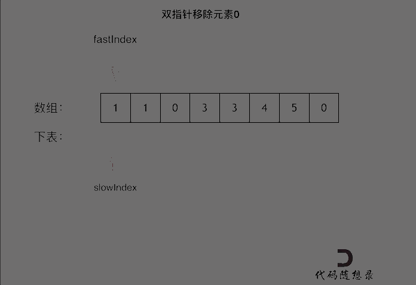

* [做專案（多個 C++、Java、Go、測試開發、前端（front end）專案）](https://www.programmercarl.com/other/kstar.html)
* [刷演算法（兩個月高強度學演算法）](https://www.programmercarl.com/xunlian/xunlianying.html)
* [準備面試必考題（八股文）（40 天挑戰高頻面試題）](https://www.programmercarl.com/xunlian/bagu.html)

# 283. 移動零：動態規劃（dynamic programming, DP）：一樣的固定做法，再求一次完全平方（perfect square）

[LeetCode 題目連結](https://leetcode.com/problems/move-zeroes/)

給定一個陣列（array） nums，編寫一個函數（function）將所有 0 移動到陣列的末尾，同時保持非零元素（element）的相對順序。

範例:

輸入: [0,1,0,3,12]
輸出: [1,3,12,0,0]
說明:

必須在原陣列上操作，不能複製額外的陣列。
盡量減少操作次數。


## 解題思路

做這道題目之前，大家可以做一做[27.移除元素](./0027.移除元素.md)

這道題目，使用蠻力（brute force）的解法，可以兩層 for 迴圈（loop），模擬（simulation）陣列刪除（delete）元素（也就是向前覆蓋）的過程。

好了，我們說一說雙指標（two pointers）法，大家如果對雙指標還不熟悉，可以看我的這篇總結[two pointers 法：總結篇！](./雙指標總結.md)。

雙指標法在陣列移除元素中，可以達到 O(n) 的時間複雜度（time complexity），在[27.移除元素](./0027.移除元素.md)裡已經詳細講解了，那麼本題和移除元素其實是一個固定做法。

**相當於對整個陣列移除元素 0，然後 slowIndex 之後都是移除元素 0 的冗餘（redundant）元素，把這些元素都賦值為 0 就可以了**。

如動畫所示：



C++ 程式碼如下：

```CPP
class Solution {
public:
    void moveZeroes(vector<int>& nums) {
        int slowIndex = 0;
        for (int fastIndex = 0; fastIndex < nums.size(); fastIndex++) {
            if (nums[fastIndex] != 0) {
                nums[slowIndex++] = nums[fastIndex];
            }
        }
        // 將slowIndex之後的冗餘元素賦值為0
        for (int i = slowIndex; i < nums.size(); i++) {
            nums[i] = 0;
        }
    }
};
```

## 其他語言版本

### Java：

```java
public void moveZeroes(int[] nums) {
        int slow = 0;
        for (int fast = 0; fast < nums.length; fast++) {
            if (nums[fast] != 0) {
                nums[slow++] = nums[fast];
            }
        }
        // 後面的元素全變成 0
        for (int j = slow; j < nums.length; j++) {
            nums[j] = 0;
        }
    }
```

### Python：

```python
    def moveZeroes(self, nums: List[int]) -> None:
        slow = 0
        for fast in range(len(nums)):
            if nums[fast] != 0:
                nums[slow] = nums[fast]
                slow += 1
        for i in range(slow, len(nums)):
            nums[i] = 0
```
交換（swap）前後變數（variable），避免補零
```python
    def moveZeroes(self, nums: List[int]) -> None:
        slow, fast = 0, 0
        while fast < len(nums):
            if nums[fast] != 0:
                nums[slow], nums[fast] = nums[fast], nums[slow]
                slow += 1 # 保持[0, slow)區間是沒有0的
            fast += 1
```

### Go：

```go
func moveZeroes(nums []int)  {
    slow := 0
    for fast := 0; fast < len(nums); fast ++ {
        if nums[fast] != 0 {
            temp := nums[slow]
            nums[slow] = nums[fast]
            nums[fast] = temp
            slow++
        }
    }
}
```

### JavaScript:

```javascript
var moveZeroes = function(nums) {
    let slow = 0;
    for(let fast = 0; fast < nums.length; fast++){
        if(nums[fast] != 0){//找到非0的元素
            nums[slow] = nums[fast];//把非0的元素賦值給陣列慢指標指向的索引處的值
            slow++;//慢指標向右移動
        }
    }
    // 後面的元素全變成 0
    for(let j = slow; j < nums.length; j++){
        nums[j] = 0;
    }
};
```

### TypeScript：

```typescript
function moveZeroes(nums: number[]): void {
    const length: number = nums.length;
    let slowIndex: number = 0,
        fastIndex: number = 0;
    while (fastIndex < length) {
        if (nums[fastIndex] !== 0) {
            nums[slowIndex++] = nums[fastIndex];
        };
        fastIndex++;
    }
    while (slowIndex < length) {
        nums[slowIndex++] = 0;
    }
};
```

### C

```c
void moveZeroes(int* nums, int numsSize){
    int fastIndex = 0, slowIndex = 0;
    for (; fastIndex < numsSize; fastIndex++) {
        if (nums[fastIndex] != 0) {
            nums[slowIndex++] = nums[fastIndex];
        }
    }

    // 將slowIndex之後的元素變為0
    for (; slowIndex < numsSize; slowIndex++) {
        nums[slowIndex] = 0;
    }
}
```

### Rust
```rust
impl Solution {
    pub fn move_zeroes(nums: &mut Vec<i32>) {
        let mut slow = 0;
        for fast in 0..nums.len() {
            if nums[fast] != 0 {
                nums.swap(slow, fast);
                slow += 1;
            }
        }
    }
}
```


