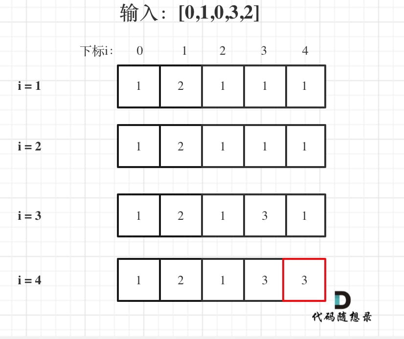

* [做專案（多個 C++、Java、Go、測試開發、前端（front end）專案）](https://www.programmercarl.com/other/kstar.html)
* [刷演算法（兩個月高強度學演算法）](https://www.programmercarl.com/xunlian/xunlianying.html)
* [準備面試必考題（八股文）（40 天挑戰高頻面試題）](https://www.programmercarl.com/xunlian/bagu.html)

# 300.最長遞增次序列（longest increasing subsequence）

[LeetCode 題目連結](https://leetcode.cn/problems/longest-increasing-subsequence/)

給你一個整數（integer）陣列（array） nums ，找到其中最長嚴格遞增次序列（subsequence）的長度。

次序列是由陣列派生而來的序列（sequence），刪除（delete）（或不刪除）陣列中的元素（element）而不改變其餘元素的順序。例如，[3,6,2,7] 是陣列 [0,3,1,6,2,2,7] 的次序列。


範例 1：
* 輸入：nums = [10,9,2,5,3,7,101,18]
* 輸出：4
* 解釋：最長遞增次序列是 [2,3,7,101]，因此長度為 4 。

範例 2：
* 輸入：nums = [0,1,0,3,2,3]
* 輸出：4

範例 3：
* 輸入：nums = [7,7,7,7,7,7,7]
* 輸出：1

提示：

* 1 <= nums.length <= 2500
* -10^4 <= nums[i] <= 104

## 演算法公開課

**[《程式碼隨想錄》演算法影片公開課](https://programmercarl.com/other/gongkaike.html)：[動態規劃（dynamic programming, DP）之次序列問題，元素不連續！| LeetCode：300.longest increasing subsequence](https://www.bilibili.com/video/BV1ng411J7xP)，相信結合影片再看本篇題解，更有助於大家對本題的理解**。


## 解題思路

首先透過本題大家要明確什麼是次序列，「次序列是由陣列派生而來的序列，刪除（或不刪除）陣列中的元素而不改變其餘元素的順序」。 

本題也是程式碼隨想錄中次序列問題的第一題，如果沒接觸過這種題目的話，本題還是很難的，甚至想用蠻力（brute force）去搜尋也不知道怎麼搜。 
次序列問題是動態規劃（dynamic programming, DP）解決的經典問題，目前下標（subscript） i 的遞增次序列長度，其實和 i 之前的下標 j 的次序列長度有關係，那又是什麼樣的關係呢。

接下來，我們依然用DP五部曲來詳細分析一波：

1. dp[i] 的定義

本題中，正確定義 dp 陣列的含義十分重要。 

**dp[i] 表示 i 之前包括 i 的以 nums[i] 結尾的 longest increasing subsequence 的長度** 

為什麼一定表示「以 nums[i] 結尾的 longest increasing subsequence」，因為我們在做遞增比較（comparison）的時候，如果比較 nums[j] 和 nums[i] 的大小，那麼兩個遞增次序列一定分別以 nums[j] 為結尾 和 nums[i] 為結尾，要不然這個比較就沒有意義了，不是尾部元素的比較那麼如何算遞增呢。 


2. 狀態變遷方程式（state transition equation）

位置 i 的 longest increasing subsequence 等於 j 從 0 到 i-1 各個位置的 longest increasing subsequence + 1 的最大值。

所以：if (nums[i] > nums[j]) dp[i] = max(dp[i], dp[j] + 1);

**注意這裡不是要 dp[i] 與 dp[j] + 1 進行比較，而是我們要取 dp[j] + 1 的最大值**。

3. dp[i] 的初始化（initialization）

每一個 i，對應的 dp[i]（即 longest increasing subsequence）起始大小至少都是 1.

4. 確定遍歷（traversal）順序

dp[i] 是由 0 到 i-1 各個位置的最長遞增次序列推導而來，那麼遍歷 i 一定是從前向後遍歷。

j 其實就是遍歷 0 到 i-1，那麼是從前到後，還是從後到前遍歷都無所謂，只要把 0 到 i-1 的元素都遍歷了就行了。 所以預設（default）習慣從前向後遍歷。 

遍歷 i 的迴圈（loop）在外層，遍歷 j 則在內層，程式碼如下：

```CPP
for (int i = 1; i < nums.size(); i++) {
    for (int j = 0; j < i; j++) {
        if (nums[i] > nums[j]) dp[i] = max(dp[i], dp[j] + 1);
    }
    if (dp[i] > result) result = dp[i]; // 取長的次序列
}
```

5. 舉例推導 dp 陣列

輸入：[0,1,0,3,2]，dp 陣列的變化如下：




如果程式碼寫出來，但一直 AC 不了，那麼就把 dp 陣列印出來，看看對不對！

以上五部分析完畢，C++ 程式碼如下：

```CPP
class Solution {
public:
    int lengthOfLIS(vector<int>& nums) {
        if (nums.size() <= 1) return nums.size();
        vector<int> dp(nums.size(), 1);
        int result = 0;
        for (int i = 1; i < nums.size(); i++) {
            for (int j = 0; j < i; j++) {
                if (nums[i] > nums[j]) dp[i] = max(dp[i], dp[j] + 1);
            }
            if (dp[i] > result) result = dp[i]; // 取長的次序列
        }
        return result;
    }
};
```
* 時間複雜度（time complexity）: O(n^2)
* 空間複雜度（space complexity）: O(n)


## 總結

本題最關鍵的是要想到 dp[i] 由哪些狀態（state）可以推出來，並取最大值，那麼很自然就能想到遞迴公式（recurrence formula）：dp[i] = max(dp[i], dp[j] + 1);

次序列問題是DP的一個重要系列，本題算是入門題目，好戲剛剛開始！

## 其他語言版本

### Java：

```Java
class Solution {
    public int lengthOfLIS(int[] nums) {
        if (nums.length <= 1) return nums.length;
        int[] dp = new int[nums.length];
        int res = 1;
        Arrays.fill(dp, 1);
        for (int i = 1; i < dp.length; i++) {
            for (int j = 0; j < i; j++) {
                if (nums[i] > nums[j]) {
                    dp[i] = Math.max(dp[i], dp[j] + 1);
                }
            }
            res = Math.max(res, dp[i]);
        }
        return res;
    }
}
```

### Python：

DP
```python
class Solution:
    def lengthOfLIS(self, nums: List[int]) -> int:
        if len(nums) <= 1:
            return len(nums)
        dp = [1] * len(nums)
        result = 1
        for i in range(1, len(nums)):
            for j in range(0, i):
                if nums[i] > nums[j]:
                    dp[i] = max(dp[i], dp[j] + 1)
            result = max(result, dp[i]) #取長的次序列
        return result
```
貪心法（greedy）
```python
class Solution:
    def lengthOfLIS(self, nums: List[int]) -> int:
        if len(nums) <= 1:
            return len(nums)
        
        tails = [nums[0]]  # 儲存遞增次序列的尾部元素
        for num in nums[1:]:
            if num > tails[-1]:
                tails.append(num)  # 如果目前元素大於遞增次序列的最後一個元素，直接加入到次序列末尾
            else:
                # 使用二元搜尋找到目前元素在遞增次序列中的位置，並替換對應位置的元素
                left, right = 0, len(tails) - 1
                while left < right:
                    mid = (left + right) // 2
                    if tails[mid] < num:
                        left = mid + 1
                    else:
                        right = mid
                tails[left] = num
        
        return len(tails)  # 回傳遞增次序列的長度

```
### Go：

```go
// 動態規劃求解
func lengthOfLIS(nums []int) int {
    // dp陣列的定義 dp[i]表示取第i個元素的時候，表示次序列的長度，其中包括 nums[i] 這個元素
    dp := make([]int, len(nums))

    // 初始化，所有的元素都應該初始化為1
    for i := range dp {
        dp[i] = 1
    }

    ans := dp[0]
    for i := 1; i < len(nums); i++ {
        for j := 0; j < i; j++ {
            if nums[i] > nums[j] {
                dp[i] = max(dp[i], dp[j] + 1)
            }
        }
        if dp[i] > ans {
            ans = dp[i]
        }
    }
    return ans
}

func max(x, y int) int {
    if x > y {
        return x
    }
    return y
}
```
貪心法+二元搜尋（binary search）最佳化
```go
func lengthOfLIS(nums []int ) int {
  dp := []int{}
  for _, num := range nums {
      if len(dp) == 0 || dp[len(dp) - 1] < num {
      dp = append(dp, num)
    } else {
          l, r := 0, len(dp) - 1
          pos := r
          for l <= r {
              mid := (l + r) >> 1
              if dp[mid] >= num {
                  pos = mid;
                  r = mid - 1
              } else {
                  l = mid + 1
              }
          }
          dp[pos] = num
      }//二元搜尋
  }
    return len(dp)
}
```

### JavaScript:

```javascript
const lengthOfLIS = (nums) => {
    let dp = Array(nums.length).fill(1);
    let result = 1;

    for(let i = 1; i < nums.length; i++) {
        for(let j = 0; j < i; j++) {
            if(nums[i] > nums[j]) {
                dp[i] = Math.max(dp[i], dp[j]+1);
            }
        }
        result = Math.max(result, dp[i]);
    }

    return result;
};
```

### TypeScript：

```typescript
function lengthOfLIS(nums: number[]): number {
    /**
        dp[i]: 前i個元素中，以nums[i]結尾，最長次序列的長度
     */
    const dp: number[] = new Array(nums.length).fill(1);
    let resMax: number = 0;
    for (let i = 0, length = nums.length; i < length; i++) {
        for (let j = 0; j < i; j++) {
            if (nums[i] > nums[j]) {
                dp[i] = Math.max(dp[i], dp[j] + 1);
            }
        }
        resMax = Math.max(resMax, dp[i]);
    }
    return resMax;
};
```

### C:

```c
#define max(a, b) ((a) > (b) ? (a) : (b))

int lengthOfLIS(int* nums, int numsSize) {
    if(numsSize <= 1){
        return numsSize;
    }
    int dp[numsSize];
    for(int i = 0; i < numsSize; i++){
        dp[i]=1;
    }
    int result = 1;
    for (int i = 1; i < numsSize; ++i) {
        for (int j = 0; j < i; ++j) {
            if(nums[i] > nums[j]){
                dp[i] = max(dp[i], dp[j] + 1);
            }
            if(dp[i] > result){
                result = dp[i];
            }
        }
    }
    return result;
}
```


### Rust:

```rust
pub fn length_of_lis(nums: Vec<i32>) -> i32 {
    let mut dp = vec![1; nums.len()];
    let mut result = 1;
    for i in 1..nums.len() {
        for j in 0..i {
            if nums[j] < nums[i] {
                dp[i] = dp[i].max(dp[j] + 1);
            }
            result = result.max(dp[i]);
        }
    }
    result
}
```

### Cangjie:

```cangjie
func lengthOfLIS(nums: Array<Int64>): Int64 {
    let n = nums.size
    if (n <= 1) {
        return n
    }

    let dp = Array(n, item: 1)
    var res = 0
    for (i in 1..n) {
        for (j in 0..i) {
            if (nums[i] > nums[j]) {
                dp[i] = max(dp[i], dp[j] + 1)
            }
        }
        res = max(dp[i], res)
    }
    return res
}
```


