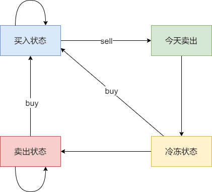
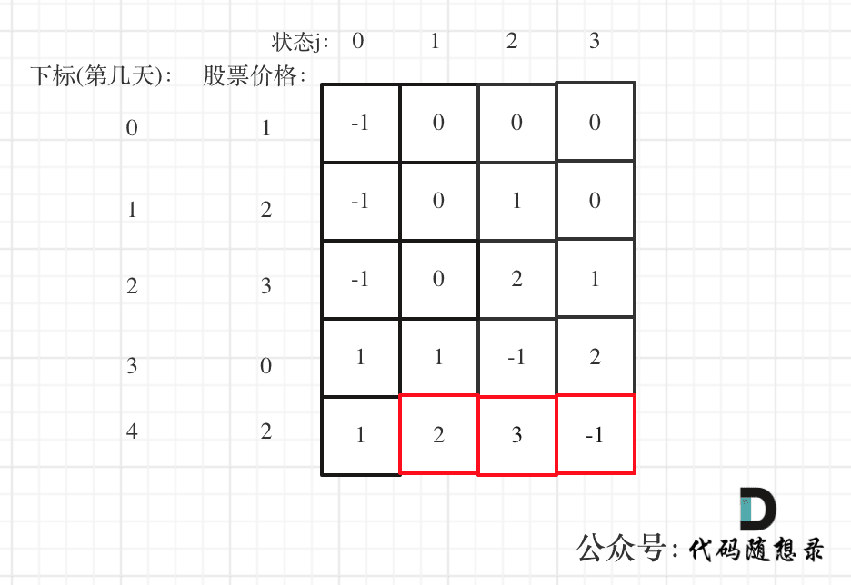

* [做專案（多個 C++、Java、Go、測開、前端（front end）專案）](https://www.programmercarl.com/other/kstar.html)
* [刷演算法（兩個月高強度學演算法）](https://www.programmercarl.com/xunlian/xunlianying.html)
* [背八股（40 天挑戰高頻面試題）](https://www.programmercarl.com/xunlian/bagu.html)

# 309. 最佳買賣股票時機含冷凍期

[LeetCode 題目連結](https://leetcode.com/problems/best-time-to-buy-and-sell-stock-with-cooldown/)

給定一個整數（integer）陣列（array），其中第 i 個元素（element）代表了第 i 天的股票價格。

設計一個演算法計算出最大利潤。在滿足以下約束條件下，你可以盡可能地完成更多的交易（多次買賣一支股票）：

* 你不能同時參與多筆交易（你必須在再次購買前出售掉之前的股票）。
* 賣出股票後，你無法在第二天買入股票（即冷凍期為 1 天）。

範例：
* 輸入：[1,2,3,0,2]
* 輸出：3
* 解釋：對應的交易狀態為：[買入, 賣出, 冷凍期, 買入, 賣出]

## 演算法公開課

**[《程式碼隨想錄》演算法影片公開課](https://programmercarl.com/other/gongkaike.html)：[動態規劃（dynamic programming, DP）來決定最佳時機，這次有冷凍期！| LeetCode：309. 買賣股票的最佳時機含冷凍期](https://www.bilibili.com/video/BV1rP4y1D7ku)，相信結合影片再看本篇題解，更有助於大家對本題的理解**。


## 解題思路


相對於[動態規劃：122. 買賣股票的最佳時機 II](./0122.買賣股票的最佳時機II（動態規劃）.md)，本題加上了一個冷凍期


在[動態規劃：122. 買賣股票的最佳時機 II](./0122.買賣股票的最佳時機II（動態規劃）.md) 中有兩個狀態（state），持有股票後的最多現金，和不持有股票的最多現金。

動態規劃（dynamic programming, DP）五部曲，分析如下：

1. 確定 dp 陣列以及下標（subscript）的含義

dp[i][j]，第 i 天狀態為 j，所剩的最多現金為 dp[i][j]。

**其實本題很多同學搞得比較懵，是因為出現冷凍期之後，狀態其實是比較複雜的**，例如今天買入股票、今天賣出股票、今天是冷凍期，都是不能操作股票的。

具體可以區分出如下四個狀態：

* 狀態一：持有股票狀態（今天買入股票，或者是之前就買入了股票然後沒有操作，一直持有）
* 不持有股票狀態，這裡就有兩種賣出股票狀態
    * 狀態二：保持賣出股票的狀態（兩天前就賣出了股票，度過一天冷凍期。或者是前一天就是賣出股票狀態，一直沒操作）
    * 狀態三：今天賣出股票
* 狀態四：今天為冷凍期狀態，但冷凍期狀態不可持續，只有一天！



j 的狀態為：

* 0：狀態一
* 1：狀態二
* 2：狀態三
* 3：狀態四

很多題解為什麼講得比較模糊，是因為把這四個狀態合併成三個狀態了，其實就是把狀態二和狀態四合併在一起了。

從程式碼上來看確實可以合併，但從邏輯上分析合併之後就很難理解了，所以我下面的講解是按照這四個狀態來的，把每一個狀態分析清楚。

如果大家按照《程式碼隨想錄》順序來練習的話，會發現買賣股票最佳時機 1，2，3，4 的題目講解中

* [動態規劃：121. 買賣股票的最佳時機](./0121.買賣股票的最佳時機.md)
* [動態規劃：122. 買賣股票的最佳時機 II](./0122.買賣股票的最佳時機II（動態規劃）.md)
* [動態規劃：123. 買賣股票的最佳時機 III](./0123.買賣股票的最佳時機III.md)
* [動態規劃：188. 買賣股票的最佳時機 IV](./0188.買賣股票的最佳時機IV.md)

「今天賣出股票」我是沒有單獨列出一個狀態的，而是歸類為「不持有股票的狀態」，而本題為什麼要單獨列出「今天賣出股票」一個狀態呢？

因為本題我們有冷凍期，而冷凍期的前一天，只能是「今天賣出股票」狀態，如果是「不持有股票狀態」那麼就很模糊，因為不一定是賣出股票的操作。

如果沒有按照《程式碼隨想錄》順序去刷題的錄友，可能看這裡的講解會有點困惑，建議把《程式碼隨想錄》本篇之前股票內容的講解都看一下，領會一下每天狀態的設定。

**注意這裡的每一個狀態，例如狀態一，是持有股票狀態，並不是說今天一定就買入股票，而是說保持買入股票的狀態，即：可能是前幾天買入的，之後一直沒操作，所以保持買入股票的狀態**。

1. 確定遞迴公式（recurrence formula）

**達到買入股票狀態**（狀態一）即：dp[i][0]，有兩個具體操作：

* 操作一：前一天就是持有股票狀態（狀態一），dp[i][0] = dp[i - 1][0]
* 操作二：今天買入了，有兩種情況
    * 前一天是冷凍期（狀態四），dp[i - 1][3] - prices[i]
    * 前一天是保持賣出股票的狀態（狀態二），dp[i - 1][1] - prices[i]

那麼 dp[i][0] = max(dp[i - 1][0], dp[i - 1][3] - prices[i], dp[i - 1][1] - prices[i]);

**達到保持賣出股票狀態**（狀態二）即：dp[i][1]，有兩個具體操作：

* 操作一：前一天就是狀態二
* 操作二：前一天是冷凍期（狀態四）

dp[i][1] = max(dp[i - 1][1], dp[i - 1][3]);

**達到今天就賣出股票狀態**（狀態三），即：dp[i][2]，只有一個操作：

昨天一定是持有股票狀態（狀態一），今天賣出

即：dp[i][2] = dp[i - 1][0] + prices[i];

**達到冷凍期狀態**（狀態四），即：dp[i][3]，只有一個操作：

昨天賣出了股票（狀態三）

dp[i][3] = dp[i - 1][2];

綜上分析，遞推程式碼如下：

```CPP
dp[i][0] = max(dp[i - 1][0], max(dp[i - 1][3], dp[i - 1][1]) - prices[i]);
dp[i][1] = max(dp[i - 1][1], dp[i - 1][3]);
dp[i][2] = dp[i - 1][0] + prices[i];
dp[i][3] = dp[i - 1][2];
```

3. dp 陣列如何初始化

這裡主要討論一下第 0 天如何初始化。

如果是持有股票狀態（狀態一）那麼：dp[0][0] = -prices[0]，一定是當天買入股票。

保持賣出股票狀態（狀態二），這裡其實從「狀態二」的定義來說，很難明確應該初始多少，這種情況我們就看遞迴公式需要我們給他初始成什麼數值。

如果 i 為 1，第 1 天買入股票，那麼遞迴公式中需要計算 dp[i - 1][1] - prices[i]，即 dp[0][1] - prices[1]，那麼大家感受一下 dp[0][1]（即第 0 天的狀態二）應該初始成多少，只能初始為 0。想一想如果初始為其他數值，我們第 1 天買入股票後手裡還剩的現金數量是不是就不對了。

今天賣出了股票（狀態三），同上分析，dp[0][2] 初始化為 0，dp[0][3] 也初始為 0。


4. 確定遍歷（traversal）順序

從遞迴公式上可以看出，dp[i] 依賴於 dp[i-1]，所以是從前向後遍歷。

5. 舉例推導 dp 陣列

以 [1,2,3,0,2] 為例，dp 陣列如下：




最後結果是取狀態二、狀態三和狀態四的最大值，不少同學會把狀態四忘了，狀態四是冷凍期，最後一天如果是冷凍期也可能是最大值。

程式碼如下：

```CPP
class Solution {
public:
    int maxProfit(vector<int>& prices) {
        int n = prices.size();
        if (n == 0) return 0;
        vector<vector<int>> dp(n, vector<int>(4, 0));
        dp[0][0] -= prices[0]; // 持有股票
        for (int i = 1; i < n; i++) {
            dp[i][0] = max(dp[i - 1][0], max(dp[i - 1][3] - prices[i], dp[i - 1][1] - prices[i]));
            dp[i][1] = max(dp[i - 1][1], dp[i - 1][3]);
            dp[i][2] = dp[i - 1][0] + prices[i];
            dp[i][3] = dp[i - 1][2];
        }
        return max(dp[n - 1][3], max(dp[n - 1][1], dp[n - 1][2]));
    }
};
```

* 時間複雜度（time complexity）：O(n)
* 空間複雜度（space complexity）：O(n)

當然，空間複雜度可以最佳化，定義一個 dp[2][4] 大小的陣列就可以了，就保存前一天的當前狀態，感興趣的同學可以自己去寫一寫，想法是一樣的。

## 總結

這次把冷凍期這道題目講得很透徹了，細分為四個狀態，其狀態轉移也十分清晰，建議大家都按照四個狀態來分析，如果只劃分三個狀態確實很容易把自己繞進去。

## 其他語言版本

### Java：

```java
class Solution {
    public int maxProfit(int[] prices) {
        if (prices == null || prices.length < 2) {
            return 0;
        }
        int[][] dp = new int[prices.length][2];

        // bad case
        dp[0][0] = 0;
        dp[0][1] = -prices[0];
        dp[1][0] = Math.max(dp[0][0], dp[0][1] + prices[1]);
        dp[1][1] = Math.max(dp[0][1], -prices[1]);

        for (int i = 2; i < prices.length; i++) {
            // dp 公式
            dp[i][0] = Math.max(dp[i - 1][0], dp[i - 1][1] + prices[i]);
            dp[i][1] = Math.max(dp[i - 1][1], dp[i - 2][0] - prices[i]);
        }

        return dp[prices.length - 1][0];
    }
}
```
```java
//using 2*4 array for space optimization
//這裡稍微說一下，我在 LeetCode 提交的時候，2*4 2-D array 的 performance 基本上和下面的 1-D array performance 差不多
//都是 time: 1ms, space: 40.X MB （其實 length*4 的 2-D array 也僅僅是 space:41.X MB，看起來不多）
//股票類的 DP 題目大致上都是這樣，就當作是一個延伸就好了。真的有人問如何優化，最起碼有東西可以講。
class Solution {
    /**
    1. [i][0] holding the stock
    2. [i][1] after cooldown but stil not buing the stock
    3. [i][2] selling the stock
    4. [i][3] cooldown
     */
    public int maxProfit(int[] prices) {
        int len = prices.length;
        int dp[][] = new int [2][4];
        dp[0][0] = -prices[0];
        
        for(int i = 1; i < len; i++){
            dp[i % 2][0] = Math.max(Math.max(dp[(i - 1) % 2][0], dp[(i - 1) % 2][1] - prices[i]), dp[(i - 1) % 2][3] - prices[i]);
            dp[i % 2][1] = Math.max(dp[(i - 1) % 2][1], dp[(i - 1) % 2][3]);
            dp[i % 2][2] = dp[(i - 1) % 2][0] + prices[i];
            dp[i % 2][3] = dp[(i - 1) % 2][2];
        }
        return Math.max(Math.max(dp[(len - 1) % 2][1], dp[(len - 1) % 2][2]), dp[(len - 1) % 2][3]);
    }
}
```
```java
// 一維陣列最佳化
class Solution {
    public int maxProfit(int[] prices) {
        int[] dp=new int[4];

        dp[0] = -prices[0];
        dp[1] = 0;
        for(int i = 1; i <= prices.length; i++){
          	// 使用暫存變數來保存 dp[0], dp[2]
            // 因為馬上 dp[0] 和 dp[2] 的資料都會變
            int temp = dp[0];
            int temp1 = dp[2];
            dp[0] = Math.max(dp[0], Math.max(dp[3], dp[1]) - prices[i]);
            dp[1] = Math.max(dp[1], dp[3]);
            dp[2] = temp + prices[i];
            dp[3] = temp1;
        }
        return Math.max(dp[3],Math.max(dp[1],dp[2]));
    }
}
```
```java
//另一種解題思路
class Solution {
    public int maxProfit(int[] prices) {
        int[][] dp = new int[prices.length + 1][2];
        dp[1][0] = -prices[0];

        for (int i = 2; i <= prices.length; i++) {
            /*
            dp[i][0] 第 i 天持有股票收益;
            dp[i][1] 第 i 天不持有股票收益;
            情況一：第 i 天是冷靜期，不能以 dp[i-1][1] 購買股票，所以以 dp[i - 2][1] 買股票，沒問題
            情況二：第 i 天不是冷靜期，理論上應該以 dp[i-1][1] 購買股票，但是第 i 天不是冷靜期說明第 i-1 天沒有賣出股票，
                則 dp[i-1][1]=dp[i-2][1]，所以可以用 dp[i-2][1] 買股票，沒問題
             */
            dp[i][0] = Math.max(dp[i - 1][0], dp[i - 2][1] - prices[i - 1]);
            dp[i][1] = Math.max(dp[i - 1][1], dp[i - 1][0] + prices[i - 1]);
        }

        return dp[prices.length][1];
    }
}
```

### Python：
> 版本一

```python
from typing import List

class Solution:
    def maxProfit(self, prices: List[int]) -> int:
        n = len(prices)
        if n == 0:
            return 0
        dp = [[0] * 4 for _ in range(n)]  # 建立動態規劃陣列，4 個狀態分別表示持有股票、不持有股票且處於冷凍期、不持有股票且不處於冷凍期、不持有股票且當天賣出後處於冷凍期
        dp[0][0] = -prices[0]  # 初始狀態：第一天持有股票的最大利潤為買入股票的價格
        for i in range(1, n):
            dp[i][0] = max(dp[i-1][0], max(dp[i-1][3], dp[i-1][1]) - prices[i])  # 當前持有股票的最大利潤等於前一天持有股票的最大利潤，或者前一天不持有股票且不處於冷凍期的最大利潤減去當前股票的價格
            dp[i][1] = max(dp[i-1][1], dp[i-1][3])  # 當前不持有股票且處於冷凍期的最大利潤等於前一天持有股票的最大利潤加上當前股票的價格
            dp[i][2] = dp[i-1][0] + prices[i]  # 當前不持有股票且不處於冷凍期的最大利潤等於前一天不持有股票的最大利潤或者前一天處於冷凍期的最大利潤
            dp[i][3] = dp[i-1][2]  # 當前不持有股票且當天賣出後處於冷凍期的最大利潤等於前一天不持有股票且不處於冷凍期的最大利潤
        return max(dp[n-1][3], dp[n-1][1], dp[n-1][2])  # 回傳最後一天不持有股票的最大利潤

```

> 版本二
```python
class Solution:
    def maxProfit(self, prices: List[int]) -> int:
        n = len(prices)
        if n < 2:
            return 0

        # 定義三種狀態的動態規劃陣列
        dp = [[0] * 3 for _ in range(n)]
        dp[0][0] = -prices[0]  # 持有股票的最大利潤
        dp[0][1] = 0           # 不持有股票，且處於冷凍期的最大利潤
        dp[0][2] = 0           # 不持有股票，不處於冷凍期的最大利潤

        for i in range(1, n):
            # 當前持有股票的最大利潤等於前一天持有股票的最大利潤，或者前一天不持有股票且不處於冷凍期的最大利潤減去當前股票的價格
            dp[i][0] = max(dp[i-1][0], dp[i-1][2] - prices[i])
            # 當前不持有股票且處於冷凍期的最大利潤等於前一天持有股票的最大利潤加上當前股票的價格
            dp[i][1] = dp[i-1][0] + prices[i]
            # 當前不持有股票且不處於冷凍期的最大利潤等於前一天不持有股票的最大利潤或者前一天處於冷凍期的最大利潤
            dp[i][2] = max(dp[i-1][2], dp[i-1][1])

        # 回傳最後一天不持有股票的最大利潤
        return max(dp[-1][1], dp[-1][2])

```

> 版本三
```python
class Solution:
    def maxProfit(self, prices: List[int]) -> int:
        # 0: holding stocks 
        #    (1) keep holding stocks: dp[i][0] = dp[i - 1][0]
        #    (2) buy stocks: dp[i][0] = dp[i - 1][1] - price, or dp[i - 1][3] - price
        # 1: keep no stocks: dp[i][1] = dp[i - 1][1]
        # 2: sell stocks: dp[i][2] = dp[i - 1][0] + price
        # 3: cooldown day: dp[i][3] = dp[i - 1][2]
        dp = [-prices[0], 0, 0, 0]

        for price in prices[1:]:
            dc = dp.copy() # 這句話是關鍵，把前一天的 dp 狀態保存下來，防止被覆蓋掉，後面只用它，不用 dp，邏輯簡單易懂
            dp[0] = max(
                dc[0],
                dc[1] - price,
                dc[3] - price
            )
            dp[1] = max(
                dc[1],
                dc[3]
            )
            dp[2] = dc[0] + price
            dp[3] = dc[2]

        return max(dp)
```

### Go：

```go
// 最佳買賣股票時機含冷凍期 動態規劃
// 時間複雜度 O(n) 空間複雜度 O(n)
func maxProfit(prices []int) int {
    n := len(prices)
    if n < 2 {
        return 0
    }

    dp := make([][]int, n)
    status := make([]int, n * 4)
    for i := range dp {
        dp[i] = status[:4]
        status = status[4:]
    }
    dp[0][0] = -prices[0]
    
    for i := 1; i < n; i++ {
        dp[i][0] = max(dp[i - 1][0], max(dp[i - 1][1] - prices[i], dp[i - 1][3] - prices[i]))
        dp[i][1] = max(dp[i - 1][1], dp[i - 1][3])
        dp[i][2] = dp[i - 1][0] + prices[i]
        dp[i][3] = dp[i - 1][2]
    }
    
    return max(dp[n - 1][1], max(dp[n - 1][2], dp[n - 1][3]))
}

func max(a, b int) int {
    if a > b {
        return a
    }
    return b
}
```

```go
// 一維最佳化版本
// 時間複雜度 O(n), 空間複雜度 O(1)
func maxProfit(prices []int) int {
    
	// 0: 持有，一直持有和買入
	// 1: 不持有，一直不持有（不包含前一天賣出，因為這樣的一天是冷靜期，狀態有區別）
	// 2：不持有，今天賣出
	// 3：冷靜期，前一天賣出（一直不持有）
	dp0, dp1, dp2, dp3 := -prices[0], 0, 0, 0
    
	n := len(prices)
    
	for i := 1; i < n; i++ {
        t0 := max(dp0, max(dp1, dp3)-prices[i])
        t1 := max(dp1, dp3)
        t2 := dp0 + prices[i]
        t3 := dp2
        
        // 更新
		dp0, dp1, dp2, dp3 = t0, t1, t2, t3
	}
    
	return max(dp1, max(dp2, dp3))
}

func max(a, b int) int {
	if a > b {
		return a
	}
	return b
}
```


### JavaScript:

> 不同的狀態定義 感覺更容易理解些
```javascript
function maxProfit(prices) {
  // 第 i 天狀態 持股 賣出 非冷凍期(不持股) 處於冷凍期
  const dp = new Array(prices.length).fill(0).map(() => [0, 0, 0, 0]);
  dp[0][0] = -prices[0];
  for (let i = 1; i < prices.length; i++) {
    // 持股
    dp[i][0] = Math.max(dp[i - 1][0], dp[i - 1][2] - prices[i]);
    // 賣出
    dp[i][1] = dp[i - 1][0] + prices[i];
    // 非冷凍期（不持股）
    dp[i][2] = Math.max(dp[i - 1][2], dp[i - 1][1]);
    // 冷凍期（上一天賣出）
    dp[i][3] = dp[i - 1][1];
  }
  return Math.max(...dp.pop());
};
```

```javascript
const maxProfit = (prices) => {
    if(prices.length < 2) {
        return 0
    } else if(prices.length < 3) {
        return Math.max(0, prices[1] - prices[0]);
    }

    let dp = Array.from(Array(prices.length), () => Array(4).fill(0));
    dp[0][0] = 0 - prices[0];

    for(i = 1; i < prices.length; i++) {
        dp[i][0] = Math.max(dp[i - 1][0], Math.max(dp[i-1][1], dp[i-1][3]) - prices[i]);
        dp[i][1] = Math.max(dp[i -1][1], dp[i - 1][3]);
        dp[i][2] = dp[i-1][0] + prices[i];
        dp[i][3] = dp[i-1][2];
    }

    return Math.max(dp[prices.length - 1][1], dp[prices.length - 1][2], dp[prices.length - 1][3]);
};
```

```javascript
// 一維陣列空間最佳化
const maxProfit = (prices) => {
  const n = prices.length
  const dp = new Array(4).fill(0)
  dp[0] = -prices[0]
  for (let i = 1; i < n; i ++) {
    const temp = dp[0] // 快取上一次的狀態
    const temp1 = dp[2]
    dp[0] = Math.max(dp[0], Math.max(dp[3] - prices[i], dp[1] - prices[i])) // 持有狀態
    dp[1] = Math.max(dp[1], dp[3]) // 今天不操作且不持有股票
    dp[2] = temp + prices[i] // 今天賣出股票
    dp[3] = temp1 // 冷凍期
  }
  return Math.max(...dp)
};
```

### TypeScript：

> 版本一，與本文想法一致

```typescript
function maxProfit(prices: number[]): number {
    /**
        dp[i][0]: 持股狀態；
        dp[i][1]: 無股狀態，當天為非冷凍期；
        dp[i][2]: 無股狀態，當天賣出；
        dp[i][3]: 無股狀態，當天為冷凍期；
     */
    const length: number = prices.length;
    const dp: number[][] = new Array(length).fill(0).map(_ => []);
    dp[0][0] = -prices[0];
    dp[0][1] = dp[0][2] = dp[0][3] = 0;
    for (let i = 1; i < length; i++) {
        dp[i][0] = Math.max(
            dp[i - 1][0],
            Math.max(dp[i - 1][1], dp[i - 1][3]) - prices[i]
        );
        dp[i][1] = Math.max(dp[i - 1][1], dp[i - 1][3]);
        dp[i][2] = dp[i - 1][0] + prices[i];
        dp[i][3] = dp[i - 1][2];
    }
    const lastEl: number[] = dp[length - 1];
    return Math.max(lastEl[1], lastEl[2], lastEl[3]);
};
```

> 版本二，狀態定義略有不同，可以幫助理解

```typescript
function maxProfit(prices: number[]): number {
    /**
        dp[i][0]: 持股狀態，當天買入；
        dp[i][1]: 持股狀態，當天未買入；
        dp[i][2]: 無股狀態，當天賣出；
        dp[i][3]: 無股狀態，當天未賣出；
        
        買入有冷凍期限制，其實就是狀態 [0] 只能由前一天的狀態 [3] 得到；
        如果賣出有冷凍期限制，其實就是 [2] 由 [1] 得到。
     */
    const length: number = prices.length;
    const dp: number[][] = new Array(length).fill(0).map(_ => []);
    dp[0][0] = -prices[0];
    dp[0][1] = -Infinity;
    dp[0][2] = dp[0][3] = 0;
    for (let i = 1; i < length; i++) {
        dp[i][0] = dp[i - 1][3] - prices[i];
        dp[i][1] = Math.max(dp[i - 1][1], dp[i - 1][0]);
        dp[i][2] = Math.max(dp[i - 1][0], dp[i - 1][1]) + prices[i];
        dp[i][3] = Math.max(dp[i - 1][3], dp[i - 1][2]);
    }
    return Math.max(dp[length - 1][2], dp[length - 1][3]);
};
```

### C:

```c
#define max(a, b) ((a) > (b) ? (a) : (b))

/**
 * 狀態一：持有股票狀態（今天買入股票，
 * 或者是之前就買入了股票然後沒有操作，一直持有）
 * 不持有股票狀態，這裡就有兩種賣出股票狀態
 * 狀態二：保持賣出股票的狀態（兩天前就賣出了股票，度過一天冷凍期。
 * 或者是前一天就是賣出股票狀態，一直沒操作）
 * 狀態三：今天賣出股票
 * 狀態四：今天為冷凍期狀態，但冷凍期狀態不可持續，只有一天！

 */
int maxProfit(int* prices, int pricesSize) {
    if(pricesSize == 0){
        return 0;
    }
    int dp[pricesSize][4];
    memset(dp, 0, sizeof (int ) * pricesSize * 4);
    dp[0][0] = -prices[0];
    for (int i = 1; i < pricesSize; ++i) {
        dp[i][0] = max(dp[i - 1][0], max(dp[i - 1][1] - prices[i], dp[i - 1][3] - prices[i]));
        dp[i][1] = max(dp[i - 1][1], dp[i - 1][3]);
        dp[i][2] = dp[i - 1][0] + prices[i];
        dp[i][3] = dp[i - 1][2];
    }
    return max(dp[pricesSize - 1][1], max(dp[pricesSize - 1][2], dp[pricesSize - 1][3]));
}
```


### Rust：

```rust
impl Solution {
    pub fn max_profit(prices: Vec<i32>) -> i32 {
        /*
         * dp[i][0]: 持股狀態；
         * dp[i][1]: 無股狀態，當天為非冷凍期；
         * dp[i][2]: 無股狀態，當天賣出；
         * dp[i][3]: 無股狀態，當天為冷凍期；
         */
        let mut dp = vec![vec![0; 4]; prices.len()];
        dp[0][0] = -prices[0];
        for (i, &p) in prices.iter().enumerate().skip(1) {
            dp[i][0] = dp[i - 1][0].max((dp[i - 1][3] - p).max(dp[i - 1][1] - p));
            dp[i][1] = dp[i - 1][1].max(dp[i - 1][3]);
            dp[i][2] = dp[i - 1][0] + p;
            dp[i][3] = dp[i - 1][2];
        }
        *dp[prices.len() - 1].iter().skip(1).max().unwrap()
    }
}
```
