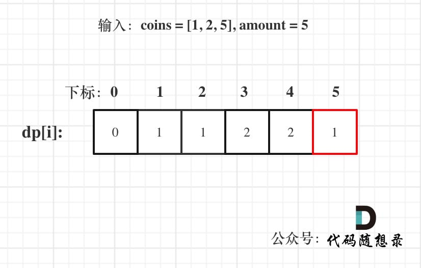

* [做專案（多個 C++、Java、Go、測開、前端（front end）專案）](https://www.programmercarl.com/other/kstar.html)
* [刷演算法（兩個月高強度學演算法）](https://www.programmercarl.com/xunlian/xunlianying.html)
* [背八股（40 天挑戰高頻面試題）](https://www.programmercarl.com/xunlian/bagu.html)

# 322. 零錢兌換

[LeetCode 題目連結](https://leetcode.cn/problems/coin-change/)

給定不同面額的硬幣 coins 和一個總金額 amount。編寫一個函式（function）來計算可以湊成總金額所需的最少的硬幣個數。如果沒有任何一種硬幣組合（combination）能組成總金額，回傳 -1。

你可以認為每種硬幣的數量是無限的。

範例 1：
* 輸入：coins = [1, 2, 5], amount = 11
* 輸出：3
* 解釋：11 = 5 + 5 + 1

範例 2：
* 輸入：coins = [2], amount = 3
* 輸出：-1

範例 3：
* 輸入：coins = [1], amount = 0
* 輸出：0

範例 4：
* 輸入：coins = [1], amount = 1
* 輸出：1

範例 5：
* 輸入：coins = [1], amount = 2
* 輸出：2

提示：

* 1 <= coins.length <= 12
* 1 <= coins[i] <= 2^31 - 1
* 0 <= amount <= 10^4

## 演算法公開課

**[《程式碼隨想錄》演算法影片公開課](https://programmercarl.com/other/gongkaike.html)：[裝滿背包最少的物品件數是多少？| LeetCode：322. 零錢兌換](https://www.bilibili.com/video/BV14K411R7yv/)，相信結合影片再看本篇題解，更有助於大家對本題的理解**。


## 解題思路

在[動態規劃（dynamic programming, DP）：518. 零錢兌換 II](https://programmercarl.com/0518.零钱兑换II.html)中我們已經兌換一次零錢了，這次又要兌換，解法模式不一樣！

題目中說每種硬幣的數量是無限的，可以看出是典型的無界背包問題（unbounded knapsack problem）。

動態規劃五部曲分析如下：

1. 確定 dp 陣列（array）以及下標（subscript）的含義

**dp[j]：湊足總額為 j 所需錢幣的最少個數為 dp[j]**

2. 確定遞迴公式（recurrence formula）

湊足總額為 j - coins[i] 的最少個數為 dp[j - coins[i]]，那麼只需要加上一個錢幣 coins[i] 即 dp[j - coins[i]] + 1 就是 dp[j]（考慮 coins[i]）

所以 dp[j] 要取所有 dp[j - coins[i]] + 1 中最小的。

遞迴公式：dp[j] = min(dp[j - coins[i]] + 1, dp[j]);

3. dp 陣列如何初始化

首先湊足總金額為 0 所需錢幣的個數一定是 0，那麼 dp[0] = 0;

其他下標對應的數值呢？

考慮到遞迴公式的特性，dp[j] 必須初始化為一個最大的數，否則就會在 min(dp[j - coins[i]] + 1, dp[j]) 比較的過程中被初始值覆蓋。

所以下標非 0 的元素（element）都應該是最大值。

程式碼如下：

```
vector<int> dp(amount + 1, INT_MAX);
dp[0] = 0;
```

4. 確定遍歷（traversal）順序

本題求錢幣最小個數，**那麼錢幣有順序和沒有順序都可以，都不影響錢幣的最小個數**。

所以本題並不強調集合（set）是組合還是排列（permutation）。

**如果求組合數就是外層 for 迴圈（for-loop）遍歷物品，內層 for 遍歷背包**。

**如果求排列數就是外層 for 遍歷背包，內層 for 迴圈遍歷物品**。

在動態規劃專題我們講過了求組合數是[動態規劃：518. 零錢兌換 II](https://programmercarl.com/0518.零钱兑换II.html)，求排列數是[動態規劃：377. 組合總和 Ⅳ](https://programmercarl.com/0377.组合总和Ⅳ.html)。

**所以本題的兩個 for 迴圈的關係是：外層 for 迴圈遍歷物品，內層 for 遍歷背包，或者外層 for 遍歷背包，內層 for 迴圈遍歷物品都是可以的！**

那麼我採用 coins 放在外迴圈，target 在內迴圈的方式。

本題錢幣數量可以無限使用，那麼是無界背包問題。所以遍歷的內迴圈是正序

綜上所述，遍歷順序為：coins（物品）放在外迴圈，target（背包）在內迴圈。且內迴圈正序。

5. 舉例推導 dp 陣列

以輸入：coins = [1, 2, 5], amount = 5 為例



dp[amount] 為最終結果。

以上分析完畢，C++ 程式碼如下：

```CPP
// 版本一
class Solution {
public:
    int coinChange(vector<int>& coins, int amount) {
        vector<int> dp(amount + 1, INT_MAX);
        dp[0] = 0;
        for (int i = 0; i < coins.size(); i++) { // 遍歷物品
            for (int j = coins[i]; j <= amount; j++) { // 遍歷背包
                if (dp[j - coins[i]] != INT_MAX) { // 如果 dp[j - coins[i]] 是初始值則跳過
                    dp[j] = min(dp[j - coins[i]] + 1, dp[j]);
                }
            }
        }
        if (dp[amount] == INT_MAX) return -1;
        return dp[amount];
    }
};
```

* 時間複雜性（time complexity）: O(n * amount)，其中 n 為 coins 的長度
* 空間複雜度（space complexity）: O(amount)


對於遍歷方式將遍歷背包放在外迴圈，遍歷物品放在內迴圈也是可以的，我就直接給出程式碼了

```CPP
// 版本二
class Solution {
public:
    int coinChange(vector<int>& coins, int amount) {
        vector<int> dp(amount + 1, INT_MAX);
        dp[0] = 0;
        for (int i = 1; i <= amount; i++) {  // 遍歷背包
            for (int j = 0; j < coins.size(); j++) { // 遍歷物品
                if (i - coins[j] >= 0 && dp[i - coins[j]] != INT_MAX ) {
                    dp[i] = min(dp[i - coins[j]] + 1, dp[i]);
                }
            }
        }
        if (dp[amount] == INT_MAX) return -1;
        return dp[amount];
    }
};
```
* 同上


## 總結

細心的同學看網上的題解，**可能看一篇是遍歷背包的 for 迴圈放外面，看一篇又是遍歷背包的 for 迴圈放裡面，看多了都看暈了**，到底兩個 for 迴圈應該是什麼先後關係。

能把遍歷順序講明白的文章幾乎找不到！

這也是大多數同學學習動態規劃的苦惱所在，有的時候遞迴公式很簡單，難在遍歷順序上！

但最終又可以稀裡糊塗地把題目過了，也不知道為什麼這樣可以過，反正就是過了。

那麼這篇文章就把遍歷順序分析得清清楚楚。

[動態規劃：518. 零錢兌換 II](https://programmercarl.com/0518.零钱兑换II.html)中求的是組合數，[動態規劃：377. 組合總和 Ⅳ](https://programmercarl.com/0377.组合总和Ⅳ.html)中求的是排列數。

**而本題是要求最少硬幣數量，硬幣是組合數還是排列數都無所謂！所以兩個 for 迴圈先後順序怎樣都可以！**

這也是我為什麼要先講 518. 零錢兌換 II 然後再講本題即：322. 零錢兌換，這是 Carl 的良苦用心啊。

相信大家看完之後，對背包問題中的遍歷順序有更深的理解了。


## 其他語言版本

### Java：

```Java
class Solution {
    public int coinChange(int[] coins, int amount) {
        int max = Integer.MAX_VALUE;
        int[] dp = new int[amount + 1];
        //初始化 dp 陣列為最大值
        for (int j = 0; j < dp.length; j++) {
            dp[j] = max;
        }
        //當金額為 0 時需要的硬幣數目為 0
        dp[0] = 0;
        for (int i = 0; i < coins.length; i++) {
            //正序遍歷：完全背包每個硬幣可以選擇多次
            for (int j = coins[i]; j <= amount; j++) {
                //只有 dp[j-coins[i]] 不是初始最大值時，該位才有選擇的必要
                if (dp[j - coins[i]] != max) {
                    //選擇硬幣數目最小的情況
                    dp[j] = Math.min(dp[j], dp[j - coins[i]] + 1);
                }
            }
        }
        return dp[amount] == max ? -1 : dp[amount];
    }
}
```

### Python：


先遍歷物品 後遍歷背包
```python
class Solution:
    def coinChange(self, coins: List[int], amount: int) -> int:
        dp = [float('inf')] * (amount + 1)  # 建立動態規劃陣列，初始值為正無窮大
        dp[0] = 0  # 初始化背包容量為 0 時的最小硬幣數量為 0

        for coin in coins:  # 遍歷硬幣列表，相當於遍歷物品
            for i in range(coin, amount + 1):  # 遍歷背包容量
                if dp[i - coin] != float('inf'):  # 如果 dp[i - coin] 不是初始值，則進行狀態轉移
                    dp[i] = min(dp[i - coin] + 1, dp[i])  # 更新最小硬幣數量

        if dp[amount] == float('inf'):  # 如果最終背包容量的最小硬幣數量仍為正無窮大，表示無解
            return -1
        return dp[amount]  # 回傳背包容量為 amount 時的最小硬幣數量

```

先遍歷背包 後遍歷物品
```python
class Solution:
    def coinChange(self, coins: List[int], amount: int) -> int:
        dp = [float('inf')] * (amount + 1)  # 建立動態規劃陣列，初始值為正無窮大
        dp[0] = 0  # 初始化背包容量為 0 時的最小硬幣數量為 0

        for i in range(1, amount + 1):  # 遍歷背包容量
            for j in range(len(coins)):  # 遍歷硬幣列表，相當於遍歷物品
                if i - coins[j] >= 0 and dp[i - coins[j]] != float('inf'):  # 如果 dp[i - coins[j]] 不是初始值，則進行狀態轉移
                    dp[i] = min(dp[i - coins[j]] + 1, dp[i])  # 更新最小硬幣數量

        if dp[amount] == float('inf'):  # 如果最終背包容量的最小硬幣數量仍為正無窮大，表示無解
            return -1
        return dp[amount]  # 回傳背包容量為 amount 時的最小硬幣數量

```
先遍歷物品 後遍歷背包（最佳化版）
```python
class Solution:
    def coinChange(self, coins: List[int], amount: int) -> int:
        dp = [float('inf')] * (amount + 1)
        dp[0] = 0

        for coin in coins:
            for i in range(coin, amount + 1): # 進行最佳化，從能裝得下的背包開始計算，則不需要進行比較
                # 更新湊成金額 i 所需的最少硬幣數量
                dp[i] = min(dp[i], dp[i - coin] + 1)

        return dp[amount] if dp[amount] != float('inf') else -1


```
先遍歷背包 後遍歷物品（最佳化版）
```python
class Solution:
    def coinChange(self, coins: List[int], amount: int) -> int:
        dp = [float('inf')] * (amount + 1)
        dp[0] = 0

        for i in range(1, amount + 1):  # 遍歷背包容量
            for coin in coins:  # 遍歷物品
                if i - coin >= 0:
                    # 更新湊成金額 i 所需的最少硬幣數量
                    dp[i] = min(dp[i], dp[i - coin] + 1)

        return dp[amount] if dp[amount] != float('inf') else -1


```

### Go：

```go
// 版本一, 先遍歷物品,再遍歷背包
func coinChange1(coins []int, amount int) int {
	dp := make([]int, amount+1)
	// 初始化 dp[0]
	dp[0] = 0
	// 初始化為 math.MaxInt32
	for j := 1; j <= amount; j++ {
		dp[j] = math.MaxInt32
	}

	// 遍歷物品
	for i := 0; i < len(coins); i++ {
		// 遍歷背包
		for j := coins[i]; j <= amount; j++ {
			if dp[j-coins[i]] != math.MaxInt32 {
				// 推導公式
				dp[j] = min(dp[j], dp[j-coins[i]]+1)
				//fmt.Println(dp,j,i)
			}
		}
	}
	// 沒找到能裝滿背包的, 就回傳 -1
	if dp[amount] == math.MaxInt32 {
		return -1
	}
	return dp[amount]
}

// 版本二,先遍歷背包,再遍歷物品
func coinChange2(coins []int, amount int) int {
	dp := make([]int, amount+1)
	// 初始化 dp[0]
	dp[0] = 0
	// 遍歷背包,從 1 開始
	for j := 1; j <= amount; j++ {
		// 初始化為 math.MaxInt32
		dp[j] = math.MaxInt32
		// 遍歷物品
		for i := 0; i < len(coins); i++ {
			if j >= coins[i] && dp[j-coins[i]] != math.MaxInt32 {
				// 推導公式
				dp[j] = min(dp[j], dp[j-coins[i]]+1)
				//fmt.Println(dp)
			}
		}
	}
	// 沒找到能裝滿背包的, 就回傳 -1
	if dp[amount] == math.MaxInt32 {
		return -1
	}
	return dp[amount]
}

func min(a, b int) int {
	if a < b {
		return a
	}
	return b
}

```

## C

```c
#define min(a, b) ((a) > (b) ? (b) : (a))

int coinChange(int* coins, int coinsSize, int amount) {
    int* dp = (int*)malloc(sizeof(int) * (amount + 1));
    for (int j = 0; j < amount + 1; j++) {
        dp[j] = INT_MAX;
    }
    dp[0] = 0;
    // 遍歷背包
    for(int i = 0; i <= amount; i++){
        // 遍歷物品
        for(int j = 0; j < coinsSize; j++){
            if(i - coins[j] >= 0 && dp[i - coins[j]] != INT_MAX){
                dp[i] = min(dp[i], dp[i - coins[j]] + 1);
            }
        }
    }
    if(dp[amount] == INT_MAX){
        return -1;
    }
    return dp[amount];
}
```


### Rust:

```rust
// 遍歷物品
impl Solution {
    pub fn coin_change(coins: Vec<i32>, amount: i32) -> i32 {
        let amount = amount as usize;
        let mut dp = vec![i32::MAX; amount + 1];
        dp[0] = 0;
        for coin in coins {
            for i in coin as usize..=amount {
                if dp[i - coin as usize] != i32::MAX {
                    dp[i] = dp[i].min(dp[i - coin as usize] + 1);
                }
            }
        }
        if dp[amount] == i32::MAX {
            return -1;
        }
        dp[amount]
    }
}
```

```rust
// 遍歷背包
impl Solution {
    pub fn coin_change(coins: Vec<i32>, amount: i32) -> i32 {
        let amount = amount as usize;
        let mut dp = vec![i32::MAX; amount + 1];
        dp[0] = 0;
        for i in 1..=amount {
            for &coin in &coins {
                if i >= coin as usize && dp[i - coin as usize] != i32::MAX {
                    dp[i] = dp[i].min(dp[i - coin as usize] + 1)
                }
            }
        }
        if dp[amount] == i32::MAX {
            return -1;
        }
        dp[amount]
    }    
}
```

### JavaScript：

```javascript
// 遍歷物品
const coinChange = (coins, amount) => {
    if(!amount) {
        return 0;
    }

    let dp = Array(amount + 1).fill(Infinity);
    dp[0] = 0;

    for(let i = 0; i < coins.length; i++) {
        for(let j = coins[i]; j <= amount; j++) {
            dp[j] = Math.min(dp[j - coins[i]] + 1, dp[j]);
        }
    }

    return dp[amount] === Infinity ? -1 : dp[amount];
}
```

```javascript
// 遍歷背包
var coinChange = function(coins, amount) {
  const dp = Array(amount + 1).fill(Infinity)
  dp[0] = 0
  for (let i = 1; i <= amount; i++) {
    for (let j = 0; j < coins.length; j++) {
      if (i >= coins[j] && dp[i - coins[j]] !== Infinity) {
        dp[i] = Math.min(dp[i], dp[i - coins[j]] + 1)
      }
    }
  }
  return dp[amount] === Infinity ? -1 : dp[amount]
}
```

### TypeScript：

```typescript
// 遍歷物品
function coinChange(coins: number[], amount: number): number {
    const dp: number[] = new Array(amount + 1).fill(Infinity);
    dp[0] = 0;
    for (let i = 0; i < coins.length; i++) {
        for (let j = coins[i]; j <= amount; j++) {
            if (dp[j - coins[i]] === Infinity) continue;
            dp[j] = Math.min(dp[j], dp[j - coins[i]] + 1);
        }
    }
    return dp[amount] === Infinity ? -1 : dp[amount];
};
```

```typescript
// 遍歷背包
function coinChange(coins: number[], amount: number): number {
  const dp: number[] = Array(amount + 1).fill(Infinity)
  dp[0] = 0
  for (let i = 1; i <= amount; i++) {
    for (let j = 0; j < coins.length; j++) {
      if (i >= coins[j] && dp[i - coins[j]] !== Infinity) {
        dp[i] = Math.min(dp[i], dp[i - coins[j]] + 1)
      }
    }
  }
  return dp[amount] === Infinity ? -1 : dp[amount]
}
```


=== END PROSE ===