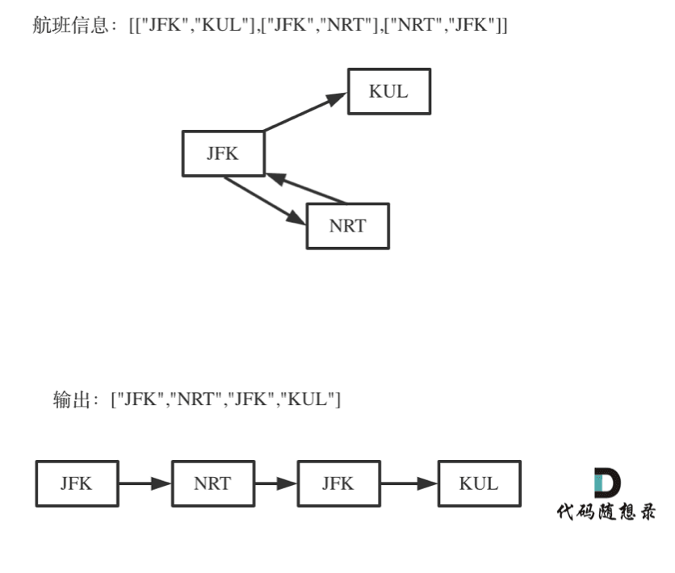
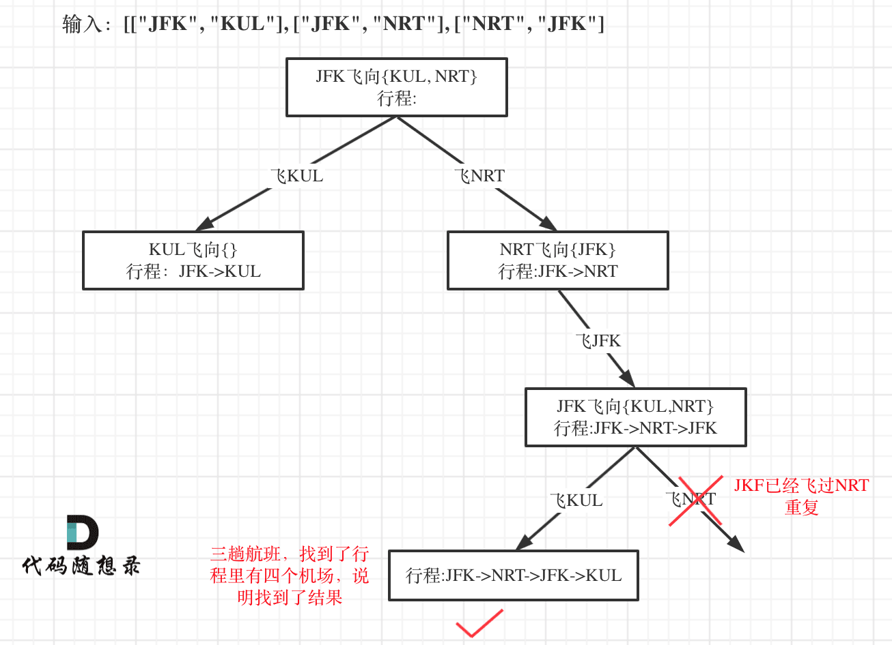

* [做專案（多個 C++、Java、Go、測開、前端（front end）專案）](https://www.programmercarl.com/other/kstar.html)
* [刷演算法（兩個月高強度學演算法）](https://www.programmercarl.com/xunlian/xunlianying.html)
* [背八股（40 天挑戰高頻面試題）](https://www.programmercarl.com/xunlian/bagu.html)


> 這也可以用回溯（backtracking）？其實深度優先搜尋（depth-first search, DFS）和回溯也是相輔相成的，畢竟都用遞迴（recursion）。

# 332. 重新安排行程

[LeetCode 題目連結](https://leetcode.com/problems/reconstruct-itinerary/)

給定一個機票的字串（string）二維（2D）陣列（array） [from, to]，子陣列（subarray）中的兩個成員分別表示飛機出發和降落的機場地點，對該行程進行重新規劃排序（sorting）。所有這些機票都屬於一個從 JFK（甘迺迪國際機場）出發的先生，所以該行程必須從 JFK 開始。

提示：
* 如果存在多種有效的行程，請你按字元（character）自然排序回傳最小的行程組合（combination）。例如，行程 ["JFK", "LGA"] 與 ["JFK", "LGB"] 相比就更小，排序更靠前
* 所有的機場都用三個大寫字母表示（機場代碼）。
* 假定所有機票至少存在一種合理的行程。
* 所有的機票必須都用一次 且 只能用一次。


範例 1：
* 輸入：[["MUC", "LHR"], ["JFK", "MUC"], ["SFO", "SJC"], ["LHR", "SFO"]]
* 輸出：["JFK", "MUC", "LHR", "SFO", "SJC"]

範例 2：
* 輸入：[["JFK","SFO"],["JFK","ATL"],["SFO","ATL"],["ATL","JFK"],["ATL","SFO"]]
* 輸出：["JFK","ATL","JFK","SFO","ATL","SFO"]
* 解釋：另一種有效的行程是 ["JFK","SFO","ATL","JFK","ATL","SFO"]。但是它自然排序更大更靠後。

## 演算法公開課

**[《程式碼隨想錄》演算法影片公開課](https://programmercarl.com/other/gongkaike.html)：[帶你學透回溯演算法（理論篇）](https://www.bilibili.com/video/BV1cy4y167mM/)，相信結合影片再看本篇題解，更有助於大家對本題的理解**。

## 解題思路


這道題目還是很難的，之前我們用回溯法解決了如下問題：[組合問題](./0077.組合.md)，[分割問題](./0093.復原IP位址.md)，[子集（subset）問題](./0078.子集.md)，[排列（permutation）問題](./0046.全排列.md)。

直覺上來看，這道題和回溯法沒有什麼關係，更像是圖論（graph theory）中的DFS。

實際上確實是深搜，但這是深搜中使用了回溯的例子，在尋找路徑（path）的時候，如果不回溯，怎麼能查到目標路徑呢。

所以我傾向於說本題應該使用回溯法，那麼我也用回溯法的解題思路來講解本題，其實深搜一般都使用了回溯法的思路，在圖論系列中我會再詳細講解深搜。

**這裡就是先給大家拓展一下，原來回溯法還可以這麼玩！**

**這道題目有幾個難點：**

1. 一個行程中，如果航班處理不好容易變成一個圈，成為無限迴路（infinite loop）
2. 有多種解答（solution），字母序靠前排在前面，讓很多同學望而卻步，該如何記錄映射（map / mapping）關係呢？
3. 使用回溯法（也可以說深搜）的話，那麼終止條件（termination condition）是什麼呢？
4. 搜尋的過程中，如何遍歷（traversal）一個機場所對應的所有機場。

針對以上問題我來逐一解答！

### 如何理解無限迴路

對於無限迴路，我來舉一個有重複機場的例子：



為什麼要舉這個例子呢，就是告訴大家，出發機場和到達機場也會重複的，**如果在解題的過程中沒有對集合（set）元素（element）處理好，就會進入無限迴路。**

### 該記錄映射關係

有多種解法，字母序靠前排在前面，讓很多同學望而卻步，該如何記錄映射關係呢？

一個機場映射多個機場，機場之間要靠字母序排列，一個機場映射多個機場，可以使用 std::unordered_map，如果讓多個機場之間再有順序的話，就是用 std::map 或者 std::multimap 或者 std::多（重）集（multiset）。

如果對 map 和 set 的實作機制不太了解，也不清楚為什麼 map、multimap 就是有序的同學，可以看這篇文章[關於雜湊表（hash table），你該了解這些！](./雜湊表理論基礎.md)。

這樣存放映射關係可以定義為 `unordered_map<string, multiset<string>> targets` 或者 `unordered_map<string, map<string, int>> targets`。

含義如下：

unordered_map<string, multiset<string>> targets：unordered_map<出發機場, 到達機場的集合> targets

unordered_map<string, map<string, int>> targets：unordered_map<出發機場, map<到達機場, 航班次數>> targets

這兩個結構，我選擇了後者，因為如果使用 `unordered_map<string, multiset<string>> targets` 遍歷多（重）集的時候，不能刪除元素，一旦刪除元素，疊代器（iterator）就失效了。

**再說一下為什麼一定要增刪元素呢，正如開篇我給出的圖中所示，出發機場和到達機場是會重複的，搜尋的過程沒及時刪除目的機場就會陷入無限迴路。**

所以搜尋的過程中就是要不斷地刪多（重）集裡的元素，那麼推薦使用 `unordered_map<string, map<string, int>> targets`。

在遍歷 `unordered_map<出發機場, map<到達機場, 航班次數>> targets` 的過程中，**可以使用「航班次數」這個欄位的數字做相應的增減，來標記到達機場是否使用過了。**


如果「航班次數」大於零，說明目的地還可以飛，如果「航班次數」等於零說明目的地不能飛了，而不用對集合做刪除元素或者增加元素的操作。

**相當於說我不刪，我就做一個標記！**

### 回溯法

這道題目我使用回溯法，那麼下面按照我總結的回溯模板來：

```
void backtracking(參數) {
    if (終止條件) {
        存放結果;
        return;
    }

    for (選擇：本層集合中元素（樹中節點孩子的數量就是集合的大小）) {
        處理節點;
        backtracking(路徑，選擇列表); // 遞迴
        回溯，撤銷處理結果
    }
}
```

本題以輸入：[["JFK", "KUL"], ["JFK", "NRT"], ["NRT", "JFK"]] 為例，抽象為樹狀結構（tree structure）如下：



開始回溯三部曲講解：

* 遞迴函數（recursive function）參數（parameter）

在講解映射關係的時候，已經講過了，使用 `unordered_map<string, map<string, int>> targets;` 來記錄航班的映射關係，我定義為全域變數（global variable）。

當然把參數放進函數（function）裡傳進去也是可以的，我是盡量控制函數裡參數的長度。

參數裡還需要 ticketNum，表示有多少個航班（終止條件會用上）。

程式碼如下：

```cpp
// unordered_map<出發機場, map<到達機場, 航班次數>> targets
unordered_map<string, map<string, int>> targets;
bool backtracking(int ticketNum, vector<string>& result) {
```

**注意函數轉回值（return value）我用的是 bool！**

我們之前講解回溯演算法的時候，一般函數轉回值都是 void，這次為什麼是 bool 呢？

因為我們只需要找到一個行程，就是在樹狀結構中唯一的一條通向葉節點（leaf node）的路線，如圖：


所以找到了這個葉節點就直接回傳，這個遞迴函數的轉回值問題我們在講解二元樹（binary tree）的系列的時候，在這篇[二元樹：遞迴函數究竟什麼時候需要轉回值，什麼時候不要轉回值？](./0112.路徑總和.md)詳細介紹過。

當然本題的 targets 和 result 都需要初始化，程式碼如下：

```cpp
for (const vector<string>& vec : tickets) {
    targets[vec[0]][vec[1]]++; // 記錄映射關係
}
result.push_back("JFK"); // 起始機場
```

* 遞迴終止條件

拿題目中的範例為例，輸入：[["MUC", "LHR"], ["JFK", "MUC"], ["SFO", "SJC"], ["LHR", "SFO"]]，這是有 4 個航班，那麼只要找出一種行程，行程裡的機場個數是 5 就可以了。

所以終止條件是：我們回溯遍歷的過程中，遇到的機場個數，如果達到了（航班數量 + 1），那麼我們就找到了一個行程，把所有航班串在一起了。

程式碼如下：

```cpp
if (result.size() == ticketNum + 1) {
    return true;
}
```

已經看習慣回溯法程式碼的同學，到葉節點了習慣性地想要收集結果，但發現並不需要，本題的 result 相當於 [回溯演算法：求組合總和！](./0216.組合總和III.md)中的 path，也就是本題的 result 就是記錄路徑的（就一條），在如下單層搜尋的邏輯中 result 就新增元素了。

* 單層搜尋的邏輯

回溯的過程中，如何遍歷一個機場所對應的所有機場呢？

這裡剛剛說過，在選擇映射函數的時候，不能選擇 `unordered_map<string, multiset<string>> targets`，因為一旦有元素增刪多（重）集的疊代器就會失效，當然可能有超強的容器（container）刪除元素疊代器不會失效，這裡就不再討論了。

**可以說本題既要找到一個對資料進行排序的容器，而且還要容易增刪元素，疊代器還不能失效**。

所以我選擇了 `unordered_map<string, map<string, int>> targets` 來做機場之間的映射。

遍歷過程如下：

```CPP
for (pair<const string, int>& target : targets[result[result.size() - 1]]) {
    if (target.second > 0 ) { // 記錄到達機場是否飛過了
        result.push_back(target.first);
        target.second--;
        if (backtracking(ticketNum, result)) return true;
        result.pop_back();
        target.second++;
    }
}
```

可以看出透過 `unordered_map<string, map<string, int>> targets` 裡的 int 欄位來判斷這個集合裡的機場是否使用過，這樣避免了直接去刪元素。

分析完畢，此時完整 C++ 程式碼如下：

```CPP
class Solution {
private:
// unordered_map<出發機場, map<到達機場, 航班次數>> targets
unordered_map<string, map<string, int>> targets;
bool backtracking(int ticketNum, vector<string>& result) {
    if (result.size() == ticketNum + 1) {
        return true;
    }
    for (pair<const string, int>& target : targets[result[result.size() - 1]]) {
        if (target.second > 0 ) { // 記錄到達機場是否飛過了
            result.push_back(target.first);
            target.second--;
            if (backtracking(ticketNum, result)) return true;
            result.pop_back();
            target.second++;
        }
    }
    return false;
}
public:
    vector<string> findItinerary(vector<vector<string>>& tickets) {
        targets.clear();
        vector<string> result;
        for (const vector<string>& vec : tickets) {
            targets[vec[0]][vec[1]]++; // 記錄映射關係
        }
        result.push_back("JFK"); // 起始機場
        backtracking(tickets.size(), result);
        return result;
    }
};
```

一波分析之後，可以看出我就是按照回溯演算法的模板來的。

程式碼中

```cpp
for (pair<const string, int>& target : targets[result[result.size() - 1]])
```

一定要加上參考（reference）即 `& target`，因為後面有對 target.second 做遞減操作，如果沒有參考，單純複製，這個結果就沒記錄下來，那最後的結果就不對了。

加上參考之後，就必須在 string 前面加上 const，因為 map 中的鍵（key）是不可修改的，這就是語法規定了。


## 總結

本題其實可以算是一道 hard 的題目了，關於本題的難點我在文中已經列出了。

**如果單純的回溯搜尋（深搜）並不難，難還難在容器的選擇和使用上**。

本題其實是一道DFS的題目，但是我完全使用回溯法的思路來講解這道題目，**算是給大家拓展一下思維方式，其實深搜和回溯也是分不開的，畢竟最終都是用遞迴**。

如果看最終程式碼，發現照著回溯法模板畫的話好像也能畫出來，但難就難在如何知道可以使用回溯，以及如何套進去，所以我才寫了這麼長的一篇來詳細講解。


## 其他語言版本

### Java 

```java
class Solution {
    private LinkedList<String> res;
    private LinkedList<String> path = new LinkedList<>();

    public List<String> findItinerary(List<List<String>> tickets) {
        Collections.sort(tickets, (a, b) -> a.get(1).compareTo(b.get(1)));
        path.add("JFK");
        boolean[] used = new boolean[tickets.size()];
        backTracking((ArrayList) tickets, used);
        return res;
    }

    public boolean backTracking(ArrayList<List<String>> tickets, boolean[] used) {
        if (path.size() == tickets.size() + 1) {
            res = new LinkedList(path);
            return true;
        }

        for (int i = 0; i < tickets.size(); i++) {
            if (!used[i] && tickets.get(i).get(0).equals(path.getLast())) {
                path.add(tickets.get(i).get(1));
                used[i] = true;

                if (backTracking(tickets, used)) {
                    return true;
                }

                used[i] = false;
                path.removeLast();
            }
        }
        return false;
    }
}
```

```java
class Solution {
    private Deque<String> res;
    private Map<String, Map<String, Integer>> map;

    private boolean backTracking(int ticketNum){
        if(res.size() == ticketNum + 1){
            return true;
        }
        String last = res.getLast();
        if(map.containsKey(last)){//防止出現 null
            for(Map.Entry<String, Integer> target : map.get(last).entrySet()){
                int count = target.getValue();
                if(count > 0){
                    res.add(target.getKey());
                    target.setValue(count - 1);
                    if(backTracking(ticketNum)) return true;
                    res.removeLast();
                    target.setValue(count);
                }
            }
        }
        return false;
    }

    public List<String> findItinerary(List<List<String>> tickets) {
        map = new HashMap<String, Map<String, Integer>>();
        res = new LinkedList<>();
        for(List<String> t : tickets){
            Map<String, Integer> temp;
            if(map.containsKey(t.get(0))){
                temp = map.get(t.get(0));
                temp.put(t.get(1), temp.getOrDefault(t.get(1), 0) + 1);
            }else{
                temp = new TreeMap<>();//升序 Map
                temp.put(t.get(1), 1);
            }
            map.put(t.get(0), temp);

        }
        res.add("JFK");
        backTracking(tickets.size());
        return new ArrayList<>(res);
    }
}
```

```java
/*  該方法是對第二個方法的改進，主要變化在於將某點的所有終點變更為鏈接串列的形式，優點在於
        1.新增終點時直接在對應位置新增節點，避免了 TreeMap 增元素時的頻繁調整
        2.同時每次對終點進行增加刪除查詢時直接透過下標操作，避免 hashMap 反覆計算 hash*/
class Solution {
    //key 為起點，value 是有序的終點的列表
    Map<String, LinkedList<String>> ticketMap = new HashMap<>();
    LinkedList<String> result = new LinkedList<>();
    int total;

    public List<String> findItinerary(List<List<String>> tickets) {
        total = tickets.size() + 1;
        //遍歷 tickets，存入 ticketMap 中
        for (List<String> ticket : tickets) {
            addNew(ticket.get(0), ticket.get(1));
        }
        deal("JFK");
        return result;
    }

    boolean deal(String currentLocation) {
        result.add(currentLocation);
        //機票全部用完，找到最小字元路徑
        if (result.size() == total) {
            return true;
        }
        //當前位置的終點列表
        LinkedList<String> targetLocations = ticketMap.get(currentLocation);
        //沒有從當前位置出發的機票了，說明這條路走不通
        if (targetLocations != null && !targetLocations.isEmpty()) {
            //終點列表中遍歷到的終點
            String targetLocation;
            //遍歷從當前位置出發的機票
            for (int i = 0; i < targetLocations.size(); i++) {
		//去重，否則在最後一個測試案例中遇到迴圈時會無限遞迴
                if(i > 0 && targetLocations.get(i).equals(targetLocations.get(i - 1))) continue;
                targetLocation = targetLocations.get(i);
                //刪除終點列表中當前的終點
                targetLocations.remove(i);
                //遞迴
                if (deal(targetLocation)) {
                    return true;
                }
                //路線走不通，將機票重新加回去
                targetLocations.add(i, targetLocation);
                result.removeLast();
            }
        }
        return false;
    }

    /**
     * 在 map 中按照字典順序新增新元素
     *
     * @param start 起點
     * @param end   終點
     */
    void addNew(String start, String end) {
        LinkedList<String> startAllEnd = ticketMap.getOrDefault(start, new LinkedList<>());
        if (!startAllEnd.isEmpty()) {
            for (int i = 0; i < startAllEnd.size(); i++) {
                if (end.compareTo(startAllEnd.get(i)) < 0) {
                    startAllEnd.add(i, end);
                    return;
                }
            }
            startAllEnd.add(startAllEnd.size(), end);
        } else {
            startAllEnd.add(end);
            ticketMap.put(start, startAllEnd);
        }
    }
}
```

### Python
回溯 使用字典（dictionary）
```python	
class Solution:
    def findItinerary(self, tickets: List[List[str]]) -> List[str]:
        self.adj = {}

        # sort by the destination alphabetically
        # 根據航班每一站的終點字母順序排序
        tickets.sort(key=lambda x:x[1])

        # get all possible connection for each destination
        # 羅列每一站的下一個可選項
        for u,v in tickets:
            if u in self.adj: self.adj[u].append(v)
            else: self.adj[u] = [v]

        # 從 JFK 出發
        self.result = []
        self.dfs("JFK")  # start with JFK

        return self.result[::-1]  # reverse to get the result

    def dfs(self, s):
        # if depart city has flight and the flight can go to another city
        while s in self.adj and len(self.adj[s]) > 0:
            # 找到 s 能到哪裡，選能到的第一個機場
            v = self.adj[s][0]  # we go to the 1 choice of the city
            # 在之後的可選項機場中去掉這個機場
            self.adj[s].pop(0)  # get rid of this choice since we used it
            # 從當前的新出發點開始
            self.dfs(v)  # we start from the new airport

        self.result.append(s)  # after append, it will back track to last node, thus the result list is in reversed order

```
回溯 使用字典 逆序
```python	
from collections import defaultdict

class Solution:
    def findItinerary(self, tickets):
        targets = defaultdict(list)  # 建立預設字典，用於儲存機場映射關係
        for ticket in tickets:
            targets[ticket[0]].append(ticket[1])  # 將機票輸入到字典中
        
        for key in targets:
            targets[key].sort(reverse=True)  # 對到達機場列表進行字母逆序排序
        
        result = []
        self.backtracking("JFK", targets, result)  # 呼叫回溯函數開始搜尋路徑
        return result[::-1]  # 回傳逆序的行程路徑
    
    def backtracking(self, airport, targets, result):
        while targets[airport]:  # 當機場還有可到達的機場時
            next_airport = targets[airport].pop()  # 彈出下一個機場
            self.backtracking(next_airport, targets, result)  # 遞迴呼叫回溯函數進行深度優先搜尋
        result.append(airport)  # 將當前機場新增到行程路徑中
```

### Go
```go
type pair struct {
	target  string
	visited bool
}
type pairs []*pair

func (p pairs) Len() int {
	return len(p)
}
func (p pairs) Swap(i, j int) {
	p[i], p[j] = p[j], p[i]
}
func (p pairs) Less(i, j int) bool {
	return p[i].target < p[j].target
}

func findItinerary(tickets [][]string) []string {
	result := []string{}
	// map[出發機場] pair{目的地,是否被存取過}
	targets := make(map[string]pairs)
	for _, ticket := range tickets {
		if targets[ticket[0]] == nil {
			targets[ticket[0]] = make(pairs, 0)
		}
		targets[ticket[0]] = append(targets[ticket[0]], &pair{target: ticket[1], visited: false})
	}
	for k, _ := range targets {
		sort.Sort(targets[k])
	}
	result = append(result, "JFK")
	var backtracking func() bool
	backtracking = func() bool {
		if len(tickets)+1 == len(result) {
			return true
		}
		// 取出起飛航班對應的目的地
		for _, pair := range targets[result[len(result)-1]] {
			if pair.visited == false {
				result = append(result, pair.target)
				pair.visited = true
				if backtracking() {
					return true
				}
				result = result[:len(result)-1]
				pair.visited = false
			}
		}
		return false
	}

	backtracking()

	return result
}
```

### JavaScript 

```Javascript

var findItinerary = function(tickets) {
    let result = ['JFK']
    let map = {}

    for (const tickt of tickets) {
        const [from, to] = tickt
        if (!map[from]) {
            map[from] = []
        }
        map[from].push(to)
    }

    for (const city in map) {
        // 對到達城市列表排序
        map[city].sort()
    }
    function backtracing() {
        if (result.length === tickets.length + 1) {
            return true
        }
        if (!map[result[result.length - 1]] || !map[result[result.length - 1]].length) {
            return false
        }
        for(let i = 0 ; i <  map[result[result.length - 1]].length; i++) {
            let city = map[result[result.length - 1]][i]
            // 刪除已走過航線，防止無限迴路
            map[result[result.length - 1]].splice(i, 1)
            result.push(city)
            if (backtracing()) {
                return true
            }
            result.pop()
            map[result[result.length - 1]].splice(i, 0, city)
        }
    }
    backtracing()
    return result
};

```

**javascript 版本二 處理物件（object）key 無序的（unordered）問題**

```javascript
/**
 * @param {string[][]} tickets
 * @return {string[]}
 */
var findItinerary = function (tickets) {
	const ans = ["JFK"];
	let map = {};
	// 整理每個站點的終點站資訊
	tickets.forEach((t) => {
		let targets = map[t[0]];
		if (!targets) {
			targets = { [t[1]]: 0 };
			map[t[0]] = targets;
		}
		targets[t[1]] = (targets[t[1]] || 0) + 1;
	});
	// 按照 key 詞典編纂次序排序物件
	const sortObject = (obj) => {
		const newObj = {};
		const keys = Object.keys(obj);
		keys.sort((k1, k2) => (k1 < k2 ? -1 : 1));
		keys.forEach((key) => {
			if (obj[key] !== null && typeof obj[key] === "object") {
				newObj[key] = sortObject(obj[key]);
			} else {
				newObj[key] = obj[key];
			}
		});
		return newObj;
	};
	const backtrack = (tickets, targets) => {
		if (ans.length === tickets.length + 1) {
			return true;
		}
		const target = targets[ans[ans.length - 1]];
		// 沒有下一站
		if (!target) {
			return false;
		}
		// 或者在這裡排序
		// const keyList = Object.keys(target).sort((k1, k2) => (k1 < k2 ? -1 : 1));
		const keyList = Object.keys(target);
		for (const key of keyList) {
			// 判斷當前站是否還能飛
			if (target[key] > 0) {
				target[key]--;
				ans.push(key);
				// 物件 key 有序 此時的行程就是字典序最小的 直接跳出
				if (backtrack(tickets, targets)) {
					return true;
				}
				target[key]++;
				ans.pop();
			}
		}
		return false;
	};
	map = sortObject(map);
	backtrack(tickets, map);
	return ans;
};
```


### TypeScript

```typescript
function findItinerary(tickets: string[][]): string[] {
    /**
        TicketsMap 實例：
        { NRT: Map(1) { 'JFK' => 1 }, JFK: Map(2) { 'KUL' => 1, 'NRT' => 1 } }
        這裡選擇 Map 資料結構的原因是：與 Object 類型的一個主要差異是，Map 實例會維護鍵值對的插入順序。
     */
    type TicketsMap = {
        [index: string]: Map<string, number>
    };
    tickets.sort((a, b) => {
        return a[1] < b[1] ? -1 : 1;
    });
    const ticketMap: TicketsMap = {};
    for (const [from, to] of tickets) {
        if (ticketMap[from] === undefined) {
            ticketMap[from] = new Map();
        }
        ticketMap[from].set(to, (ticketMap[from].get(to) || 0) + 1);
    }
    const resRoute = ['JFK'];
    backTracking(tickets.length, ticketMap, resRoute);
    return resRoute;
    function backTracking(ticketNum: number, ticketMap: TicketsMap, route: string[]): boolean {
        if (route.length === ticketNum + 1) return true;
        const targetMap = ticketMap[route[route.length - 1]];
        if (targetMap !== undefined) {
            for (const [to, count] of targetMap.entries()) {
                if (count > 0) {
                    route.push(to);
                    targetMap.set(to, count - 1);
                    if (backTracking(ticketNum, ticketMap, route) === true) return true;
                    targetMap.set(to, count);
                    route.pop();
                }
            }
        }
        return false;
    }
};
```

### C

```C
typedef struct {
    char *name;        /* key */
    int cnt;           /* 記錄到達機場是否飛過了 */
    UT_hash_handle hh; /* makes this structure hashable */
} to_airport_t;

typedef struct {
    char *name; /* key */
    to_airport_t *to_airports;
    UT_hash_handle hh; /* makes this structure hashable */
} from_airport_t;

void to_airport_destroy(to_airport_t *airports) {
    to_airport_t *airport, *tmp;
    HASH_ITER(hh, airports, airport, tmp) {
        HASH_DEL(airports, airport);
        free(airport);
    }
}

void from_airport_destroy(from_airport_t *airports) {
    from_airport_t *airport, *tmp;
    HASH_ITER(hh, airports, airport, tmp) {
        to_airport_destroy(airport->to_airports);
        HASH_DEL(airports, airport);
        free(airport);
    }
}

int name_sort(to_airport_t *a, to_airport_t *b) {
    return strcmp(a->name, b->name);
}

bool backtracking(from_airport_t *airports, int target_path_len, char **path,
                  int path_len) {
    if (path_len == target_path_len) return true;

    from_airport_t *from_airport = NULL;
    HASH_FIND_STR(airports, path[path_len - 1], from_airport);
    if (!from_airport) return false;

    for (to_airport_t *to_airport = from_airport->to_airports;
         to_airport != NULL; to_airport = to_airport->hh.next) {
        if (to_airport->cnt == 0) continue;
        to_airport->cnt--;
        path[path_len] = to_airport->name;
        if (backtracking(airports, target_path_len, path, path_len + 1))
            return true;
        to_airport->cnt++;
    }
    return false;
}

char **findItinerary(char ***tickets, int ticketsSize, int *ticketsColSize,
                     int *returnSize) {
    from_airport_t *airports = NULL;

    // 記錄映射關係
    for (int i = 0; i < ticketsSize; i++) {
        from_airport_t *from_airport = NULL;
        to_airport_t *to_airport = NULL;
        HASH_FIND_STR(airports, tickets[i][0], from_airport);
        if (!from_airport) {
            from_airport = malloc(sizeof(from_airport_t));
            from_airport->name = tickets[i][0];
            from_airport->to_airports = NULL;
            HASH_ADD_KEYPTR(hh, airports, from_airport->name,
                            strlen(from_airport->name), from_airport);
        }
        HASH_FIND_STR(from_airport->to_airports, tickets[i][1], to_airport);
        if (!to_airport) {
            to_airport = malloc(sizeof(to_airport_t));
            to_airport->name = tickets[i][1];
            to_airport->cnt = 0;
            HASH_ADD_KEYPTR(hh, from_airport->to_airports, to_airport->name,
                            strlen(to_airport->name), to_airport);
        }
        to_airport->cnt++;
    }

    // 機場排序
    for (from_airport *from_airport = airports; from_airport != NULL;
         from_airport = from_airport->hh.next) {
        HASH_SRT(hh, from_airport->to_airports, name_sort);
    }

    char **path = malloc(sizeof(char *) * (ticketsSize + 1));
    path[0] = "JFK";  // 起始機場
    backtracking(airports, ticketsSize + 1, path, 1);

    from_airport_destroy(airports);

    *returnSize = ticketsSize + 1;
    return path;
}
```

### Swift

直接疊代（iteration）tickets 陣列：

```swift
func findItinerary(_ tickets: [[String]]) -> [String] {
    // 先對路線進行排序
    let tickets = tickets.sorted { (arr1, arr2) -> Bool in
        if arr1[0] < arr2[0] {
            return true
        } else if arr1[0] > arr2[0] {
            return false
        }
        if arr1[1] < arr2[1] {
            return true
        } else if arr1[1] > arr2[1] {
            return false
        }
        return true
    }
    var path = ["JFK"]
    var used = [Bool](repeating: false, count: tickets.count)

    @discardableResult
    func backtracking() -> Bool {
        // 結束條件：滿足一條路徑的數量
        if path.count == tickets.count + 1 { return true }

        for i in 0 ..< tickets.count {
            // 巧妙之處！跳過處理過或出發站不是 path 末尾站的線路，即篩選出未處理的又可以銜接 path 的線路
            guard !used[i], tickets[i][0] == path.last! else { continue }
            // 處理
            used[i] = true
            path.append(tickets[i][1])
            // 遞迴
            if backtracking() { return true }
            // 回溯
            path.removeLast()
            used[i] = false
        }
        return false
    }
    backtracking()
    return path
}
```

使用字典最佳化疊代遍歷：

```swift
func findItinerary(_ tickets: [[String]]) -> [String] {
    // 建立出發站和目的站的一對多關係，要對目的地進行排序
    typealias Destination = (name: String, used: Bool)
    var targets = [String: [Destination]]()
    for line in tickets {
        let src = line[0], des = line[1]
        var value = targets[src] ?? []
        value.append((des, false))
        targets[src] = value
    }
    for (k, v) in targets {
        targets[k] = v.sorted { $0.name < $1.name }
    }

    var path = ["JFK"]
    let pathCount = tickets.count + 1
    @discardableResult
    func backtracking() -> Bool {
        if path.count == pathCount { return true }

        let startPoint = path.last!
        guard let end = targets[startPoint]?.count, end > 0 else { return false }
        for i in 0 ..< end {
            // 排除處理過的線路
            guard !targets[startPoint]![i].used else { continue }
            // 處理
            targets[startPoint]![i].used = true
            path.append(targets[startPoint]![i].name)
            // 遞迴
            if backtracking() { return true }
            // 回溯
            path.removeLast()
            targets[startPoint]![i].used = false
        }
        return false
    }
    backtracking()
    return path
}
```

使用插入時排序最佳化 targets 字典的構造：

```swift
// 建立出發站和目的站的一對多關係，在建構的時候進行插入分類
typealias Destination = (name: String, used: Bool)
var targets = [String: [Destination]]()
func sortedInsert(_ element: Destination, to array: inout [Destination]) {
    var left = 0, right = array.count - 1
    while left <= right {
        let mid = left + (right - left) / 2
        if array[mid].name < element.name {
            left = mid + 1
        } else if array[mid].name > element.name {
            right = mid - 1
        } else {
            left = mid
            break
        }
    }
    array.insert(element, at: left)
}
for line in tickets {
    let src = line[0], des = line[1]
    var value = targets[src] ?? []
    sortedInsert((des, false), to: &value)
    targets[src] = value
}
```

### Rust
**文中的 Hashmap 巢狀 Hashmap 的方法因為 Rust 的所有權問題暫時無法實作，此方法為刪除雜湊表中元素法**
```Rust
use std::collections::HashMap;
impl Solution {
    fn backtracking(airport: String, targets: &mut HashMap<&String, Vec<&String>>, result: &mut Vec<String>) {
        while let Some(next_airport) = targets.get_mut(&airport).unwrap_or(&mut vec![]).pop() {
            Self::backtracking(next_airport.clone(), targets, result);
        }
        result.push(airport.clone());
    }

    pub fn find_itinerary(tickets: Vec<Vec<String>>) -> Vec<String> {
        let mut targets: HashMap<&String, Vec<&String>> = HashMap::new();
        let mut result = Vec::new();
        for t in 0..tickets.len() {
            targets.entry(&tickets[t][0]).or_default().push(&tickets[t][1]);
        }
            for (_, target) in targets.iter_mut() {
            target.sort_by(|a, b| b.cmp(a));
        }
        Self::backtracking("JFK".to_string(), &mut targets, &mut result);
        result.reverse();
        result
    }
}
```
