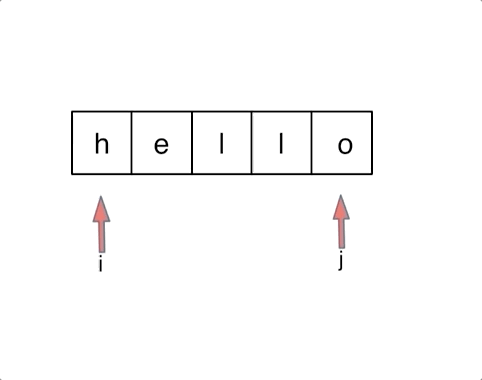

* [做專案（多個 C++、Java、Go、測試開發、前端專案）](https://www.programmercarl.com/other/kstar.html)
* [刷演算法（兩個月高強度學演算法）](https://www.programmercarl.com/xunlian/xunlianying.html)
* [背八股文（40 天挑戰高頻面試題）](https://www.programmercarl.com/xunlian/bagu.html)


> 打基礎的時候，不要太迷戀於程式館函數（library function）。

# 344. 反轉字串

[LeetCode 題目連結](https://leetcode.cn/problems/reverse-string/)

編寫一個函數（function），其作用是將輸入的字串（string）反轉（reverse）過來。輸入字串以字元陣列（character array） char[] 的形式給出。

不要給另外的陣列（array）分配額外的空間，你必須原地修改輸入陣列、使用 O(1) 的額外空間解決這一問題。

你可以假設陣列中的所有字元（character）都是 ASCII 碼表中的可列印字元（printable character）。

範例 1：
輸入：["h","e","l","l","o"]
輸出：["o","l","l","e","h"]

範例 2：
輸入：["H","a","n","n","a","h"]
輸出：["h","a","n","n","a","H"]

## 演算法公開課

**[《程式碼隨想錄》演算法影片公開課](https://programmercarl.com/other/gongkaike.html)：[字串基礎操作！ | LeetCode：344. 反轉字串](https://www.bilibili.com/video/BV1fV4y17748)，相信結合影片再看本篇題解，更有助於大家對本題的理解**。


## 解題思路

先說一說題外話：

對於這道題目一些同學直接用 C++ 裡的一個程式館函數 reverse，呼叫一下直接完事了，相信每一門程式設計語言（programming language）都有這樣的程式館函數。

如果這麼做題的話，大家就不會清楚反轉字串的實作原理了。

但是也不是說程式館函數就不能用，是要分場景的。

如果在現場面試中，我們什麼時候使用程式館函數，什麼時候不要用程式館函數呢？

**如果題目關鍵的部分直接用程式館函數就可以解決，建議不要使用程式館函數。**

畢竟面試官一定不是考察你對程式館函數的熟悉程度，如果使用 Python 和 Java 的同學更需要注意這一點，因為 Python、Java 提供的程式館函數十分豐富。

**如果程式館函數僅僅是解題過程中的一小部分，並且你已經很清楚這個程式館函數的內部實作原理的話，可以考慮使用程式館函數。**

建議大家平時在 LeetCode 上練習演算法的時候本著這樣的原則去練習，這樣才有助於我們對演算法的理解。

不要沉迷於使用程式館函數一行程式碼解決題目之類的技巧，不是說這些技巧不好，而是說這些技巧可以用來娛樂一下。

真正自己寫的時候，要保證理解並能實作相應的功能。

接下來再來講一下如何解決反轉字串的問題。

大家應該還記得，我們已經講過了 [206. 反轉鏈接串列](https://programmercarl.com/0206.翻转链表.html)。

在反轉鏈接串列（linked list）中，使用了 雙指標（two pointers） 的方法。

那麼反轉字串依然是使用 雙指標 的方法，只不過對於字串的反轉，其實要比鏈接串列簡單一些。

因為字串也是一種陣列，所以元素（element）在記憶體（memory）中是連續分布的，這就決定了反轉鏈接串列和反轉字串方式上還是有所差異的。

如果對陣列和鏈接串列原理不清楚的同學，可以看這兩篇，[關於鏈接串列，你該了解這些！](https://programmercarl.com/链表理论基础.html)，[必須掌握的陣列理論知識](https://programmercarl.com/数组理论基础.html)。

對於字串，我們定義兩個指標（pointer）（也可以說是索引（index）下標（subscript）），一個從字串前面，一個從字串後面，兩個指標同時向中間移動，並交換元素。

以字串 `hello` 為例，過程如下：




不難寫出如下 C++ 程式碼:

```CPP
void reverseString(vector<char>& s) {
    for (int i = 0, j = s.size() - 1; i < s.size()/2; i++, j--) {
        swap(s[i],s[j]);
    }
}
```

迴圈（loop）裡只要做交換 s[i] 和 s[j] 的操作就可以了，那麼我這裡使用了 swap 這個程式館函數。大家可以使用。

因為相信大家都知道交換函數如何實作，而且這個程式館函數僅僅是解題中的一部分，所以這裡使用程式館函數也是可以的。

swap 可以有兩種實作。

一種就是常見的交換數值：

```CPP
int tmp = s[i];
s[i] = s[j];
s[j] = tmp;

```

一種就是透過按位元運算（bitwise operation）：

```CPP
s[i] ^= s[j];
s[j] ^= s[i];
s[i] ^= s[j];
```

這道題目還是比較簡單的，但是我正好可以透過這道題目說一說在刷題的時候，使用程式館函數的原則。

如果題目關鍵的部分直接用程式館函數就可以解決，建議不要使用程式館函數。

如果程式館函數僅僅是解題過程中的一小部分，並且你已經很清楚這個程式館函數的內部實作原理的話，可以考慮使用程式館函數。

本著這樣的原則，我沒有使用 reverse 程式館函數，而使用 swap 程式館函數。

**在字串相關的題目中，程式館函數對大家的誘惑力是非常大的，因為會有各種反轉，切割取詞之類的操作**，這也是為什麼字串的程式館函數這麼豐富的原因。

相信大家本著我所講述的原則來做字串相關的題目，在選擇程式館函數的角度上會有所原則，也會有所收穫。

C++ 程式碼如下：

```CPP
class Solution {
public:
    void reverseString(vector<char>& s) {
        for (int i = 0, j = s.size() - 1; i < s.size()/2; i++, j--) {
            swap(s[i],s[j]);
        }
    }
};
```

* 時間複雜度（time complexity）: O(n)
* 空間複雜度（space complexity）: O(1)


## 其他語言版本

### Java：

```Java
class Solution {
    public void reverseString(char[] s) {
        int l = 0;
        int r = s.length - 1;
        while (l < r) {
            s[l] ^= s[r];  //構造 a ^ b 的結果，並放在 a 中
            s[r] ^= s[l];  //將 a ^ b 這一結果再 ^ b ，存入 b 中，此時 b = a, a = a ^ b
            s[l] ^= s[r];  //a ^ b 的結果再 ^ a ，存入 a 中，此時 b = a, a = b 完成交換
            l++;
            r--;
        }
    }
}

// 第二種方法用 temp 來交換數值比較多人容易理解些
class Solution {
    public void reverseString(char[] s) {
        int l = 0;
        int r = s.length - 1;
        while(l < r){
            char temp = s[l];
            s[l] = s[r];
            s[r] = temp;
            l++;
            r--;
        }
    }
}


```

### Python：
（版本一） 雙指標

```python
class Solution:
    def reverseString(self, s: List[str]) -> None:
        """
        Do not return anything, modify s in-place instead.
        """
        left, right = 0, len(s) - 1
        
        # 該方法已經不需要判斷奇偶數，經測試後時間空間複雜度比用 for i in range(len(s)//2) 更低
        # 因為 while 每次迴圈需要進行條件判斷，而 range 函數不需要，直接產生數字，因此時間複雜度更低。推薦使用 range
        while left < right:
            s[left], s[right] = s[right], s[left]
            left += 1
            right -= 1
       
```
（版本二） 使用堆疊（stack）
```python
class Solution:
    def reverseString(self, s: List[str]) -> None:
        """
        Do not return anything, modify s in-place instead.
        """
        stack = []
        for char in s:
            stack.append(char)
        for i in range(len(s)):
            s[i] = stack.pop()
       
```
（版本三） 使用 range
```python
class Solution:
    def reverseString(self, s: List[str]) -> None:
        """
        Do not return anything, modify s in-place instead.
        """
        n = len(s)
        for i in range(n // 2):
            s[i], s[n - i - 1] = s[n - i - 1], s[i]
       
```
（版本四） 使用 reversed
```python
class Solution:
    def reverseString(self, s: List[str]) -> None:
        """
        Do not return anything, modify s in-place instead.
        """
        s[:] = reversed(s)
       
```
（版本五） 使用切片（slicing）
```python
class Solution:
    def reverseString(self, s: List[str]) -> None:
        """
        Do not return anything, modify s in-place instead.
        """
        s[:] = s[::-1]
       
```
（版本六） 使用 串列生成式（list comprehension）
```python
class Solution:
    def reverseString(self, s: List[str]) -> None:
        """
        Do not return anything, modify s in-place instead.
        """
        s[:] = [s[i] for i in range(len(s) - 1, -1, -1)]
       
```

（版本七） 使用 reverse()

```python
class Solution:
    def reverseString(self, s: List[str]) -> None:
        """
        Do not return anything, modify s in-place instead.
        """
        # 原地反轉，無轉回值
        s.reverse()
       
```

### Go：

```Go
func reverseString(s []byte) {
    left := 0
    right := len(s)-1
    for left < right {
        s[left], s[right] = s[right], s[left]
        left++
        right--
    }
}
```

### JavaScript:

```js
/**
 * @param {character[]} s
 * @return {void} Do not return anything, modify s in-place instead.
 */
var reverseString = function(s) {
    //Do not return anything, modify s in-place instead.
    reverse(s)
};

var reverse = function(s) {
    let l = -1, r = s.length;
    while(++l < --r) [s[l], s[r]] = [s[r], s[l]];
};
```

### TypeScript：

```typescript
/**
 Do not return anything, modify s in-place instead.
 */
function reverseString(s: string[]): void {
    let length: number = s.length;
    let left: number = 0,
        right: number = length - 1;
    let tempStr: string;
    while (left < right) {
        tempStr = s[left];
        s[left] = s[right];
        s[right] = tempStr;
        left++;
        right--;
    }
};
```

### Swift:

```swift
// two pointers - 元組
func reverseString(_ s: inout [Character]) {
    var l = 0
    var r = s.count - 1
    while l < r {
      	// 使用元組
        (s[l], s[r]) = (s[r], s[l])
        l += 1
        r -= 1
    }
}

```

### Rust:

```Rust
impl Solution {
    pub fn reverse_string(s: &mut Vec<char>) {
        let (mut left, mut right) = (0, s.len()-1);
        while left < right {
            let temp = s[left];
            s[left] = s[right];
            s[right] = temp;
            left += 1;
            right -= 1;
        }
    }
}
```

### C:

```c
void reverseString(char* s, int sSize){
    int left = 0;
    int right = sSize - 1;

    while(left < right) {
        char temp = s[left];
        s[left++] = s[right];
        s[right--] = temp;

    }
}
```

### C#：

```csharp
public class Solution
{
    public void ReverseString(char[] s)
    {
        for (int i = 0, j = s.Length - 1; i < j; i++, j--)
        {
            (s[i], s[j]) = (s[j], s[i]);
        }
    }
}
```

### PHP：

```php
// two pointers
// 一：
function reverseString(&$s) {
    $left = 0;
    $right = count($s)-1;
    while($left<$right){
        $temp = $s[$left];
        $s[$left] = $s[$right];
        $s[$right] = $temp;
        $left++;
        $right--;
    }
}

// 二：
function reverseString(&$s) {
    $this->reverse($s,0,count($s)-1);
}
// 按指定位置交換元素
function reverse(&$s, $start, $end) {
    for ($i = $start, $j = $end; $i < $j; $i++, $j--) {
        $tmp = $s[$i];
        $s[$i] = $s[$j];
        $s[$j] = $tmp;
    }
    }
```

### Scala:

```scala
object Solution {
  def reverseString(s: Array[Char]): Unit = {
    var (left, right) = (0, s.length - 1)
    while (left < right) {
      var tmp = s(left)
      s(left) = s(right)
      s(right) = tmp
      left += 1
      right -= 1
    }
  }
}
```
