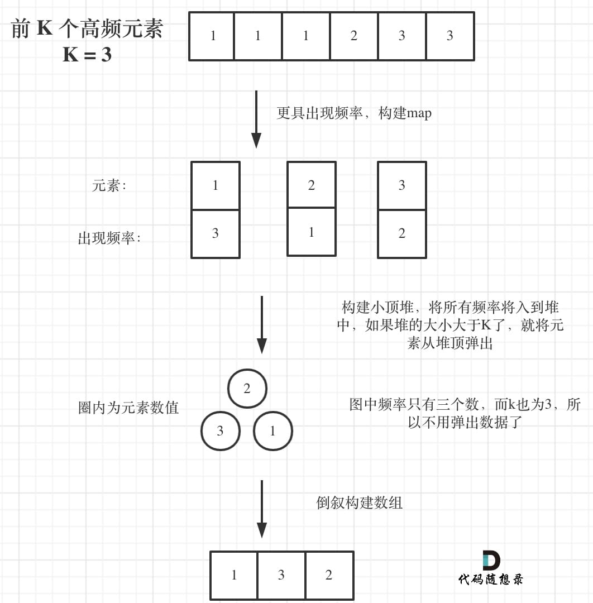

* [做專案（多個 C++、Java、Go、測試開發、前端專案）](https://www.programmercarl.com/other/kstar.html)
* [刷演算法（兩個月高強度學演算法）](https://www.programmercarl.com/xunlian/xunlianying.html)
* [背八股文（40 天挑戰高頻面試題）](https://www.programmercarl.com/xunlian/bagu.html)


> 前 K 個大數問題，老生常談，不得不談

# 347. 前 K 個高頻元素

[LeetCode 題目連結](https://leetcode.cn/problems/top-k-frequent-elements/)

給定一個非空的整數（integer）陣列（array），回傳其中出現頻率前 k 高的元素（element）。

範例 1:
* 輸入: nums = [1,1,1,2,2,3], k = 2
* 輸出: [1,2]

範例 2:
* 輸入: nums = [1], k = 1
* 輸出: [1]

提示：
* 你可以假設給定的 k 總是合理的，且 1 ≤ k ≤ 陣列中不相同的元素的個數。
* 你的演算法的時間複雜度（time complexity）必須優於 $O(n \log n)$，n 是陣列的大小。
* 題目資料保證答案唯一，換句話說，陣列中前 k 個高頻元素的集合（set）是唯一的。
* 你可以按任意順序回傳答案。

## 演算法公開課

**[《程式碼隨想錄》演算法影片公開課](https://programmercarl.com/other/gongkaike.html)：[優先佇列（priority queue）正式登場！最大堆（max heap）、最小堆積（min heap）該怎麼用？| LeetCode：347. 前 K 個高頻元素](https://www.bilibili.com/video/BV1Xg41167Lz)，相信結合影片再看本篇題解，更有助於大家對本題的理解**。

## 解題思路

這道題目主要涉及到如下三塊內容：
1. 要統計元素出現頻率
2. 對頻率排序（sorting）
3. 找出前 K 個高頻元素

首先統計元素出現的頻率，這一類的問題可以使用 map 來進行統計。

然後是對頻率進行排序，這裡我們可以使用一種容器配接器（container adapter）就是**優先佇列**。

什麼是優先佇列呢？

其實**就是一個披著佇列（queue）外衣的堆積（heap）**，因為優先佇列對外介面（interface）只是從佇列頭取元素，從佇列尾添加元素，再無其他取元素的方式，看起來就是一個佇列。

而且優先佇列內部元素是自動依照元素的權重（weight）排列。那麼它是如何有序（ordered）排列的呢？

預設情況下 priority_queue 利用最大堆完成對元素的排序，這個最大堆是以 vector 為表現形式的完全二元樹（complete binary tree）。

什麼是堆積呢？

**堆積是一棵完全二元樹，樹（tree）中每個節點（node）的值都不小於（或不大於）其左右孩子的值。** 如果父節點（father node）是大於等於左右孩子就是最大堆，小於等於左右孩子就是最小堆積。

所以大家經常說的最大堆（堆頭是最大元素），最小堆積（堆頭是最小元素），如果懶得自己實作的話，就直接用 priority_queue（優先佇列）就可以了，底層實作都是一樣的，從小到大排就是最小堆積，從大到小排就是最大堆。

本題我們就要使用優先佇列來對部分頻率進行排序。

為什麼不用快速排序（quick sort）呢？使用快速排序要將 map 轉換為 vector 的結構（structure），然後對整個陣列進行排序，而這種場景下，我們其實只需要維護 k 個有序的序列（sequence）就可以了，所以使用優先佇列是最優的。

此時要思考一下，是使用最小堆積呢，還是最大堆？

有的同學一想，題目要求前 K 個高頻元素，那麼果斷用最大堆啊。

那麼問題來了，定義一個大小為 k 的最大堆，在每次移動更新最大堆的時候，每次彈出都把最大的元素彈出去了，那麼怎麼保留下來前 K 個高頻元素呢。

而且使用最大堆就要把所有元素都進行排序，那能不能只排序 k 個元素呢？

**所以我們要用最小堆積，因為要統計最大前 k 個元素，只有最小堆積每次將最小的元素彈出，最後最小堆積裡累積的才是前 k 個最大元素。**

尋找前 k 個最大元素流程如圖所示：（圖中的頻率只有三個，所以正好構成一個大小為 3 的最小堆積，如果頻率更多一些，則用這個最小堆積進行掃描）




我們來看一下 C++ 程式碼：


```CPP
class Solution {
public:
    // 最小堆積
    class mycomparison {
    public:
        bool operator()(const pair<int, int>& lhs, const pair<int, int>& rhs) {
            return lhs.second > rhs.second;
        }
    };
    vector<int> topKFrequent(vector<int>& nums, int k) {
        // 要統計元素出現頻率
        unordered_map<int, int> map; // map<nums[i], 對應出現的次數>
        for (int i = 0; i < nums.size(); i++) {
            map[nums[i]]++;
        }

        // 對頻率排序
        // 定義一個最小堆積，大小為 k
        priority_queue<pair<int, int>, vector<pair<int, int>>, mycomparison> pri_que;

        // 用固定大小為 k 的最小堆積，掃描所有頻率的數值
        for (unordered_map<int, int>::iterator it = map.begin(); it != map.end(); it++) {
            pri_que.push(*it);
            if (pri_que.size() > k) { // 如果堆積的大小大於了 K，則佇列彈出，保證堆積的大小一直為 k
                pri_que.pop();
            }
        }

        // 找出前 K 個高頻元素，因為最小堆積先彈出的是最小的，所以倒序來輸出到陣列
        vector<int> result(k);
        for (int i = k - 1; i >= 0; i--) {
            result[i] = pri_que.top().first;
            pri_que.pop();
        }
        return result;

    }
};
```

* 時間複雜度: O(nlogk)
* 空間複雜度（space complexity）: O(n)

## 拓展
大家對這個比較運算（comparison operation）在建立堆積時是如何應用的，為什麼左大於右就會建立最小堆積，反而建立最大堆比較困惑。

確實，例如我們在寫快速排序的 cmp 函數（function）的時候，`return left>right` 就是從大到小，`return left<right` 就是從小到大。

優先佇列的定義正好反過來了，可能和優先佇列的原始碼（source code）實作有關（我沒有仔細研究），我估計是底層實作上優先佇列佇列首指向後面，佇列尾指向最前面的緣故！


## 其他語言版本

### Java：

```java

/*Comparator 介面說明:
 * 回傳負數，形式參數中第一個參數排在前面；回傳正數，形式參數中第二個參數排在前面
 * 對於佇列：排在前面意味著往佇列頭靠
 * 對於堆積（使用 PriorityQueue 實作）：從佇列頭到佇列尾按從小到大排就是最小堆積，
 *                                從佇列頭到佇列尾按從大到小排就是最大堆--->佇列頭元素相當於堆積的根節點
 * */
class Solution {
    //解法 1：基於最大堆實作
    public int[] topKFrequent1(int[] nums, int k) {
        Map<Integer,Integer> map = new HashMap<>(); //key 為陣列元素值, val 為對應出現次數
        for (int num : nums) {
            map.put(num, map.getOrDefault(num,0) + 1);
        }
        //在優先佇列中儲存二元組 (num, cnt), cnt 表示元素值 num 在陣列中的出現次數
        //出現次數按從佇列頭到佇列尾的順序是從大到小排, 出現次數最多的在佇列頭（相當於最大堆）
        PriorityQueue<int[]> pq = new PriorityQueue<>((pair1, pair2) -> pair2[1] - pair1[1]);
        for (Map.Entry<Integer, Integer> entry : map.entrySet()) {//最大堆需要對所有元素進行排序
            pq.add(new int[]{entry.getKey(), entry.getValue()});
        }
        int[] ans = new int[k];
        for (int i = 0; i < k; i++) { //依次從佇列頭彈出 k 個, 就是出現頻率前 k 高的元素
            ans[i] = pq.poll()[0];
        }
        return ans;
    }
    //解法 2：基於最小堆積實作
    public int[] topKFrequent2(int[] nums, int k) {
        Map<Integer,Integer> map = new HashMap<>(); //key 為陣列元素值, val 為對應出現次數
        for (int num : nums) {
            map.put(num, map.getOrDefault(num, 0) + 1);
        }
        //在優先佇列中儲存二元組 (num, cnt), cnt 表示元素值 num 在陣列中的出現次數
        //出現次數按從佇列頭到佇列尾的順序是從小到大排, 出現次數最低的在佇列頭（相當於最小堆積）
        PriorityQueue<int[]> pq = new PriorityQueue<>((pair1, pair2) -> pair1[1] - pair2[1]);
        for (Map.Entry<Integer, Integer> entry : map.entrySet()) { //最小堆積只需要維持 k 個元素有序
            if (pq.size() < k) { //最小堆積元素個數小於 k 個時直接加
                pq.add(new int[]{entry.getKey(), entry.getValue()});
            } else {
                if (entry.getValue() > pq.peek()[1]) { //當前元素出現次數大於最小堆積的根節點（這 k 個元素中出現次數最少的這個）
                    pq.poll(); //彈出佇列頭（最小堆積的根節點）, 即把堆積裡出現次數最少的這個刪除, 留下的就是出現次數多的了
                    pq.add(new int[]{entry.getKey(), entry.getValue()});
                }
            }
        }
        int[] ans = new int[k];
        for (int i = k - 1; i >= 0; i--) { //依次彈出最小堆積, 先彈出的是堆積的根, 出現次數少, 後面彈出的出現次數多
            ans[i] = pq.poll()[0];
        }
        return ans;
    }
}
```
簡化版程式碼：
```java
class Solution {
    public int[] topKFrequent(int[] nums, int k) {
        // 優先佇列，為了避免複雜 api 操作，pq 儲存陣列
        // lambda 表式設定優先佇列從大到小儲存 o1 - o2 為從小到大，o2 - o1 反之
        PriorityQueue<int[]> pq = new PriorityQueue<>((o1, o2) -> o1[1] - o2[1]);
        int[] res = new int[k]; // 答案陣列為 k 個元素
        Map<Integer, Integer> map = new HashMap<>(); // 記錄元素出現次數
        for (int num : nums) map.put(num, map.getOrDefault(num, 0) + 1);
        for (var x : map.entrySet()) { // entrySet 取得 k-v Set 集合
            // 將 kv 轉化成陣列
            int[] tmp = new int[2];
            tmp[0] = x.getKey();
            tmp[1] = x.getValue();
            pq.offer(tmp);
            // 下面的程式碼是根據最小堆積實作的，我只保留優先佇列的最後的 k 個，只要超出了 k 我就將最小的彈出，剩餘的 k 個就是答案
            if(pq.size() > k) {
                pq.poll();
            }
        }
        for (int i = 0; i < k; i++) {
            res[i] = pq.poll()[0]; // 取得優先佇列裡的元素
        }
        return res;
    }
}
```

### Python：
解法一：
```python
#時間複雜度：O(nlogk)
#空間複雜度：O(n)
import heapq
class Solution:
    def topKFrequent(self, nums: List[int], k: int) -> List[int]:
        #要統計元素出現頻率
        map_ = {} #nums[i]:對應出現的次數
        for i in range(len(nums)):
            map_[nums[i]] = map_.get(nums[i], 0) + 1
        
        #對頻率排序
        #定義一個最小堆積，大小為 k
        pri_que = [] #最小堆積
        
        #用固定大小為 k 的最小堆積，掃描所有頻率的數值
        for key, freq in map_.items():
            heapq.heappush(pri_que, (freq, key))
            if len(pri_que) > k: #如果堆積的大小大於了 K，則佇列彈出，保證堆積的大小一直為 k
                heapq.heappop(pri_que)
        
        #找出前 K 個高頻元素，因為最小堆積先彈出的是最小的，所以倒序來輸出到陣列
        result = [0] * k
        for i in range(k-1, -1, -1):
            result[i] = heapq.heappop(pri_que)[1]
        return result
```
解法二：
```python
class Solution:
    def topKFrequent(self, nums: List[int], k: int) -> List[int]:
        # 使用字典統計數字出現次數
        time_dict = defaultdict(int)
        for num in nums:
            time_dict[num] += 1
        # 更改字典，key 為出現次數，value 為相應的數字的集合
        index_dict = defaultdict(list)
        for key in time_dict:
            index_dict[time_dict[key]].append(key)
        # 排序
        key = list(index_dict.keys())
        key.sort()
        result = []
        cnt = 0
        # 取得前 k 項
        while key and cnt != k:
            result += index_dict[key[-1]]
            cnt += len(index_dict[key[-1]])
            key.pop()

        return result[0: k]
```

### Go：

```go
//方法一：最小堆積
func topKFrequent(nums []int, k int) []int {
    map_num:=map[int]int{}
    //記錄每個元素出現的次數
    for _,item:=range nums{
        map_num[item]++
    }
    h:=&IHeap{}
    heap.Init(h)
    //所有元素入堆積，堆積的長度為 k
    for key,value:=range map_num{
        heap.Push(h,[2]int{key,value})
        if h.Len()>k{
            heap.Pop(h)
        }
    }
    res:=make([]int,k)
    //按順序回傳堆積中的元素
    for i:=0;i<k;i++{
        res[k-i-1]=heap.Pop(h).([2]int)[0]
    }
    return res
}

//建構最小堆積
type IHeap [][2]int

func (h IHeap) Len()int {
    return len(h)
}

func (h IHeap) Less (i,j int) bool {
    return h[i][1]<h[j][1]
}

func (h IHeap) Swap(i,j int) {
    h[i],h[j]=h[j],h[i]
}

func (h *IHeap) Push(x interface{}){
    *h=append(*h,x.([2]int))
}
func (h *IHeap) Pop() interface{}{
    old:=*h
    n:=len(old)
    x:=old[n-1]
    *h=old[0:n-1]
    return x
}


//方法二:利用 O(nlogn) 排序
func topKFrequent(nums []int, k int) []int {
    ans:=[]int{}
    map_num:=map[int]int{}
    for _,item:=range nums {
        map_num[item]++
    }
    for key,_:=range map_num{
        ans=append(ans,key)
    }
    //核心思想：排序
    //可以不用套件函數，自己實作快速排序
    sort.Slice(ans,func (a,b int)bool{
        return map_num[ans[a]]>map_num[ans[b]]
    })
    return ans[:k]
}
```


### JavaScript:

解法一：  
LeetCode 提供了優先佇列的程式館（library），具體文件可以參見 [@datastructures-js/priority-queue](https://github.com/datastructures-js/priority-queue/blob/v5/README.md)。  

```js
var topKFrequent = function (nums, k) {
  const map = new Map();
  const res = [];
  //使用 map 統計元素出現頻率
  for (const num of nums) {
    map.set(num, (map.get(num) || 0) + 1);
  }
  //建立最小堆積
  const heap = new PriorityQueue({
    compare: (a, b) => a.value - b.value
  })
  for (const [key, value] of map) {
    heap.enqueue({ key, value });
    if (heap.size() > k) heap.dequeue();
  }
  //處理輸出
  while (heap.size()) res.push(heap.dequeue().key);
  return res;
};
```

解法二：  
手寫實作優先佇列  

```js
// js 沒有堆積需要自己構造
class Heap {
    constructor(compareFn) {
        this.compareFn = compareFn;
        this.queue = [];
    }

    // 添加
    push(item) {
        // 推入元素
        this.queue.push(item);

        // 上浮
        let index = this.size() - 1; // 記錄推入元素下標
        let parent = Math.floor((index - 1) / 2); // 記錄父節點下標

        while (parent >= 0 && this.compare(parent, index) > 0) { // 注意 compare 參數順序
            [this.queue[index], this.queue[parent]] = [this.queue[parent], this.queue[index]];

            // 更新下標
            index = parent;
            parent = Math.floor((index - 1) / 2);
        }
    }

    // 取得堆頂元素並移除
    pop() {
        // 邊界情況，只有一個元素或沒有元素應直接彈出
        if (this.size() <= 1) {
            return this.queue.pop()
        }

        // 堆頂元素
        const out = this.queue[0];

        // 移除堆頂元素 填入最後一個元素
        this.queue[0] = this.queue.pop();

        // 下沉
        let index = 0; // 記錄下沉元素下標
        let left = 1; // left 是左子節點下標 left + 1 則是右子節點下標
        let searchChild = this.compare(left, left + 1) > 0 ? left + 1 : left;

        while (this.compare(index, searchChild) > 0) { // 注意 compare 參數順序
            [this.queue[index], this.queue[searchChild]] = [this.queue[searchChild], this.queue[index]];

            // 更新下標
            index = searchChild;
            left = 2 * index + 1;
            searchChild = this.compare(left, left + 1) > 0 ? left + 1 : left;
        }

        return out;
    }

    size() {
        return this.queue.length;
    }

    // 使用傳入的 compareFn 比較兩個位置的元素
    compare(index1, index2) {
        // 處理下標越界問題
        if (this.queue[index1] === undefined) return 1;
        if (this.queue[index2] === undefined) return -1;

        return this.compareFn(this.queue[index1], this.queue[index2]);
    }

}

const topKFrequent = function (nums, k) {
    const map = new Map();

    for (const num of nums) {
        map.set(num, (map.get(num) || 0) + 1);
    }

    // 建立最小堆積
    const heap= new Heap((a, b) => a[1] - b[1]);

    // entry 是一個長度為 2 的陣列，0 位置儲存 key，1 位置儲存 value
    for (const entry of map.entries()) {
        heap.push(entry);

        if (heap.size() > k) {
            heap.pop();
        }
    }

    // return heap.queue.map(e => e[0]);

    const res = [];

    for (let i = heap.size() - 1; i >= 0; i--) {
        res[i] = heap.pop()[0];
    }

    return res;
};
```

### TypeScript：

```typescript
function topKFrequent(nums: number[], k: number): number[] {
    const countMap: Map<number, number> = new Map();
    for (let num of nums) {
        countMap.set(num, (countMap.get(num) || 0) + 1);
    }
    // TS 沒有最小堆積的資料結構，所以直接對整個陣列進行排序，取前 k 個元素
    return [...countMap.entries()]
        .sort((a, b) => b[1] - a[1])
        .slice(0, k)
        .map(i => i[0]);
};
```

### C#:

```csharp
 public int[] TopKFrequent(int[] nums, int k) {
        //雜湊表-標權重
        Dictionary<int,int> dic = new();
        for(int i = 0; i < nums.Length; i++){
            if(dic.ContainsKey(nums[i])){
                dic[nums[i]]++;
            }else{
                dic.Add(nums[i], 1);
            }
        }
        //優先佇列-從小到大排列
        PriorityQueue<int,int> pq = new();
        foreach(var num in dic){
            pq.Enqueue(num.Key, num.Value);
            if(pq.Count > k){
                pq.Dequeue();
            }
        }
        
        // //Stack-倒置
        // Stack<int> res = new();
        // while(pq.Count > 0){
        //     res.Push(pq.Dequeue());
        // }
        // return res.ToArray();

        //陣列倒裝
        int[] res = new int[k];
        for(int i = k - 1; i >= 0; i--){
            res[i] = pq.Dequeue();
        }
        return res;
    }
    
```

### Scala:

解法一: 優先佇列
```scala
object Solution {
  import scala.collection.mutable
  def topKFrequent(nums: Array[Int], k: Int): Array[Int] = {
    val map = mutable.HashMap[Int, Int]()
    // 將所有元素都放入 Map
    for (num <- nums) {
      map.put(num, map.getOrElse(num, 0) + 1)
    }
    // 宣告一個優先佇列，在函數柯里化那塊需要指明排序方式
    var queue = mutable.PriorityQueue[(Int, Int)]()(Ordering.fromLessThan((x, y) => x._2 > y._2))
    // 將 map 裡面的元素送入優先佇列
    for (elem <- map) {
      queue.enqueue(elem)
      if(queue.size > k){ 
        queue.dequeue // 如果佇列元素大於 k 個，出佇列
      }
    }
    // 最終只需要 key 的 Array 形式就可以了，return 關鍵字可以省略
    queue.map(_._1).toArray
  }
}
```
解法二: 相當於一個 wordCount 程式
```scala
object Solution {
  def topKFrequent(nums: Array[Int], k: Int): Array[Int] = {
    // 首先將資料變為 (x,1)，然後按照 x 分組，再使用 map 進行轉換 (x,sum)，變換為 Array
    // 再使用 sort 針對 sum 進行排序，最後 take 前 k 個，再把資料變為 x,y,z 這種格式
    nums.map((_, 1)).groupBy(_._1)
      .map {
        case (x, arr) => (x, arr.map(_._2).sum)
      }
      .toArray
      .sortWith(_._2 > _._2)
      .take(k)
      .map(_._1)
  }
}
```

### Rust

最小堆積

```rust
use std::cmp::Reverse;
use std::collections::{BinaryHeap, HashMap};
impl Solution {
    pub fn top_k_frequent(nums: Vec<i32>, k: i32) -> Vec<i32> {
        let mut hash = HashMap::new();
        let mut heap = BinaryHeap::with_capacity(k as usize);
        nums.into_iter().for_each(|k| {
            *hash.entry(k).or_insert(0) += 1;
        });

        for (k, v) in hash {
            if heap.len() == heap.capacity() {
                if *heap.peek().unwrap() < (Reverse(v), k) {
                    continue;
                } else {
                    heap.pop();
                }
            }
            heap.push((Reverse(v), k));
        }
        heap.into_iter().map(|(_, k)| k).collect()
    }
}
```


