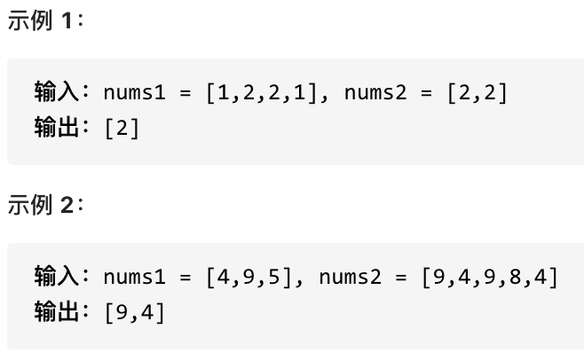
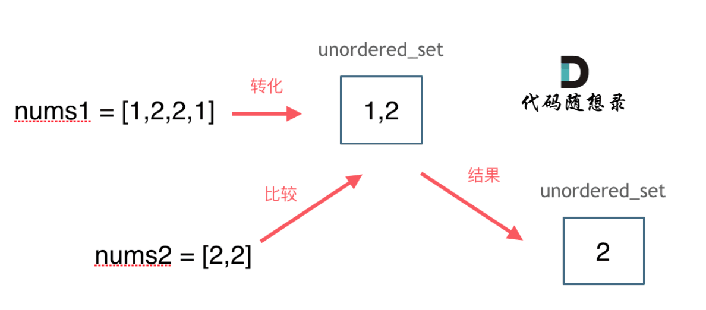

* [做專案（多個 C++、Java、Go、測試開發、前端專案）](https://www.programmercarl.com/other/kstar.html)
* [刷演算法（兩個月高強度學演算法）](https://www.programmercarl.com/xunlian/xunlianying.html)
* [背八股文（40 天挑戰高頻面試題）](https://www.programmercarl.com/xunlian/bagu.html)


> 如果雜湊（hash）值比較少、特別分散、跨度非常大，使用陣列（array）就造成空間的極大浪費！


# 349. 兩個陣列的交集（intersection）

[LeetCode 題目連結](https://leetcode.com/problems/intersection-of-two-arrays/)

題意：給定兩個陣列，編寫一個函數（function）來計算它們的交集。



**說明：**
輸出結果中的每個元素（element）一定是唯一的。
我們可以不考慮輸出結果的順序。

## 演算法公開課

**[《程式碼隨想錄》演算法影片公開課](https://programmercarl.com/other/gongkaike.html)：[學透雜湊表（hash table），set 使用有技巧！LeetCode：349. 兩個陣列的交集](https://www.bilibili.com/video/BV1ba411S7wu)，相信結合影片再看本篇題解，更有助於大家對本題的理解**。

## 解題思路

這道題目，主要要學會使用一種雜湊資料結構：unordered_set，這個資料結構可以解決很多類似的問題。

注意題目特意說明：**輸出結果中的每個元素一定是唯一的，也就是說輸出結果是去重複的，同時可以不考慮輸出結果的順序**

這道題用蠻力（brute force）的解法時間複雜度（time complexity）是 O(n^2)，那來看看使用雜湊法進一步最佳化。

那麼用陣列來做雜湊表也是不錯的選擇，例如 [242. 有效的迴文（anagram）](./0242.有效的字母異位詞.md)

但是要注意，**使用陣列來做雜湊的題目，是因為題目都限制了數值的大小。**

而這道題目沒有限制數值的大小，就無法使用陣列來做雜湊表了。

**而且如果雜湊值比較少、特別分散、跨度非常大，使用陣列就造成空間的極大浪費。**

此時就要使用另一種結構（structure）了，set，關於 set，C++ 給提供了如下三種可用的資料結構：

* std::set
* std::多（重）集（multiset）
* std::unordered_set

std::set 和 std::多（重）集底層實作都是紅-黑樹（red-black tree），std::unordered_set 的底層實作是雜湊表，使用 unordered_set 讀寫效率是最高的，並不需要對資料進行排序（sorting），而且還不要讓資料重複，所以選擇 unordered_set。

解題思路如圖所示：




C++ 程式碼如下：

```CPP
class Solution {
public:
    vector<int> intersection(vector<int>& nums1, vector<int>& nums2) {
        unordered_set<int> result_set; // 存放結果，之所以用 set 是為了給結果集去重複
        unordered_set<int> nums_set(nums1.begin(), nums1.end());
        for (int num : nums2) {
            // 發現 nums2 的元素在 nums_set 裡又出現過
            if (nums_set.find(num) != nums_set.end()) {
                result_set.insert(num);
            }
        }
        return vector<int>(result_set.begin(), result_set.end());
    }
};
```

* 時間複雜度: O(n + m)  m 是最後要把 set 轉成 vector
* 空間複雜度（space complexity）: O(n)

## 拓展

那有同學可能問了，遇到雜湊問題我直接都用 set 不就得了，用什麼陣列啊。

直接使用 set 不僅占用空間比陣列大，而且速度要比陣列慢，set 把數值映射（mapping）到 key 上都要做 hash 計算的。

不要小瞧這個耗時，在資料量大的情況，差距是很明顯的。

## 後記 

本題後面 LeetCode 改了題目描述和後台測試資料（test data），增添了數值範圍： 

* 1 <= nums1.length, nums2.length <= 1000
* 0 <= nums1[i], nums2[i] <= 1000

所以就可以使用陣列來做雜湊表了，因為陣列都是 1000 以內的。 

對應 C++ 程式碼如下：

```CPP
class Solution {
public:
    vector<int> intersection(vector<int>& nums1, vector<int>& nums2) {
        unordered_set<int> result_set; // 存放結果，之所以用 set 是為了給結果集去重複
        int hash[1005] = {0}; // 預設數值為 0
        for (int num : nums1) { // nums1 中出現的數字在 hash 陣列中做記錄
            hash[num] = 1;
        }
        for (int num : nums2) { // nums2 中出現的話，result 記錄
            if (hash[num] == 1) {
                result_set.insert(num);
            }
        }
        return vector<int>(result_set.begin(), result_set.end());
    }
};
```

* 時間複雜度: O(m + n)
* 空間複雜度: O(n)

## 其他語言版本

### Java：
版本一：使用 HashSet
```Java
// 時間複雜度 O(n+m+k) 空間複雜度 O(n+k)
// 其中 n 是陣列 nums1 的長度，m 是陣列 nums2 的長度，k 是交集元素的個數

import java.util.HashSet;
import java.util.Set;

class Solution {
    public int[] intersection(int[] nums1, int[] nums2) {
        if (nums1 == null || nums1.length == 0 || nums2 == null || nums2.length == 0) {
            return new int[0];
        }
        Set<Integer> set1 = new HashSet<>();
        Set<Integer> resSet = new HashSet<>();
        //遍歷陣列 1
        for (int i : nums1) {
            set1.add(i);
        }
        //遍歷陣列 2 的過程中判斷雜湊表中是否存在該元素
        for (int i : nums2) {
            if (set1.contains(i)) {
                resSet.add(i);
            }
        }
      
        //方法 1：將結果集合轉為陣列
        return res.stream().mapToInt(Integer::intValue).toArray();
        /**
         * 將 Set<Integer> 轉換為 int[] 陣列：
         * 1. stream() : Collection 介面的方法，將集合轉換為 Stream<Integer>
         * 2. mapToInt(Integer::intValue) : 
         *    - 中間操作，將 Stream<Integer> 轉換為 IntStream
         *    - 使用方法參考 Integer::intValue，將 Integer 物件 拆箱（unboxing） 為 int 基本資料類型
         * 3. toArray() : 終端操作，將 IntStream 轉換為 int[] 陣列。
         */
        
        //方法 2：另外申請一個陣列存放 setRes 中的元素,最後回傳陣列
        int[] arr = new int[resSet.size()];
        int j = 0;
        for(int i : resSet){
            arr[j++] = i;
        }
        
        return arr;
    }
}
```
版本二：使用 Hash 陣列
```java
class Solution {
    public int[] intersection(int[] nums1, int[] nums2) {
        int[] hash1 = new int[1002];
        int[] hash2 = new int[1002];
        for(int i : nums1)
            hash1[i]++;
        for(int i : nums2)
            hash2[i]++;
        List<Integer> resList = new ArrayList<>();
        for(int i = 0; i < 1002; i++)
            if(hash1[i] > 0 && hash2[i] > 0)
                resList.add(i);
        int index = 0;
        int res[] = new int[resList.size()];
        for(int i : resList)
            res[index++] = i;
        return res;
    }
}
```
### Python3：
（版本一）使用字典（dictionary）和集合（set）

```python
class Solution:
    def intersection(self, nums1: List[int], nums2: List[int]) -> List[int]:
    # 使用雜湊表儲存一個陣列中的所有元素
        table = {}
        for num in nums1:
            table[num] = table.get(num, 0) + 1
        
        # 使用集合儲存結果
        res = set()
        for num in nums2:
            if num in table:
                res.add(num)
                del table[num]
        
        return list(res)
```
（版本二）使用陣列

```python
	
class Solution:
    def intersection(self, nums1: List[int], nums2: List[int]) -> List[int]:
        count1 = [0]*1001
        count2 = [0]*1001
        result = []
        for i in range(len(nums1)):
            count1[nums1[i]]+=1
        for j in range(len(nums2)):
            count2[nums2[j]]+=1
        for k in range(1001):
            if count1[k]*count2[k]>0:
                result.append(k)
        return result
	
```
（版本三）使用集合

```python
class Solution:
    def intersection(self, nums1: List[int], nums2: List[int]) -> List[int]:
        return list(set(nums1) & set(nums2))
	
```

### Go：

（版本一）使用字典和集合

```go
func intersection(nums1 []int, nums2 []int) []int {
    set:=make(map[int]struct{},0)  // 用 map 模擬 set
    res:=make([]int,0)
    for _,v:=range nums1{
        if _,ok:=set[v];!ok{
            set[v]=struct{}{}
        }
    }
    for _,v:=range nums2{
        //如果存在於上一個陣列中，則加入結果集，並清空該 set 值
        if _,ok:=set[v];ok{
            res=append(res,v)
            delete(set, v)
        }
    }
    return res
}
```

（版本二）使用陣列

```go
func intersection(nums1 []int, nums2 []int) []int {
    count1 := make([]int, 1001, 1001)
    count2 := make([]int, 1001, 1001)
    res := make([]int, 0)
    for _, v := range nums1 {
        count1[v] = 1
    }
    for _, v := range nums2 {
        count2[v] = 1
    }
    for i := 0; i <= 1000; i++ {
        if count1[i] + count2[i] == 2 {
            res = append(res, i)
        }
    }
    return res
}
```

### JavaScript:

```js
/**
 * @param {number[]} nums1
 * @param {number[]} nums2
 * @return {number[]}
 */
var intersection = function(nums1, nums2) {
    // 根據陣列大小交換操作的陣列
    if(nums1.length < nums2.length) {
        const _ = nums1;
        nums1 = nums2;
        nums2 = _;
    }
    const nums1Set = new Set(nums1);
    const resSet = new Set();
    // for(const n of nums2) {
    //     nums1Set.has(n) && resSet.add(n);
    // }
    // 迴圈比疊代器快
    for(let i = nums2.length - 1; i >= 0; i--) {
        nums1Set.has(nums2[i]) && resSet.add(nums2[i]);
    }
    return Array.from(resSet);
};
```

### TypeScript:

版本一（正常解法）：

```typescript
function intersection(nums1: number[], nums2: number[]): number[] {
    let resSet: Set<number> = new Set(),
        nums1Set: Set<number> = new Set(nums1);
    for (let i of nums2) {
        if (nums1Set.has(i)) {
            resSet.add(i);
        }
    }
    return Array.from(resSet);
};
```

版本二（秀操作）：

```typescript
function intersection(nums1: number[], nums2: number[]): number[] {
    return Array.from(new Set(nums1.filter(i => nums2.includes(i))))
};
```

### Swift：

```swift
func intersection(_ nums1: [Int], _ nums2: [Int]) -> [Int] {
    var set1 = Set<Int>()
    var set2 = Set<Int>()
    for num in nums1 {
        set1.insert(num)
    }
    for num in nums2 {
        if set1.contains(num) {
            set2.insert(num)
        }
    }
    return Array(set2)
}
```

### PHP:

```php
class Solution {
    /**
     * @param Integer[] $nums1
     * @param Integer[] $nums2
     * @return Integer[]
     */
    function intersection($nums1, $nums2) {
        if (count($nums1) == 0 || count($nums2) == 0) {
            return [];
        }
        $counts = [];
        $res = [];
        foreach ($nums1 as $num) {
            $counts[$num] = 1;
        }
        foreach ($nums2 as $num) {
            if (isset($counts[$num])) {
                $res[] = $num;
            }
            unset($counts[$num]);
        }
        
        return $res;
    }
}
```

### Rust:

```rust
use std::collections::HashSet;
impl Solution {
    pub fn intersection(nums1: Vec<i32>, nums2: Vec<i32>) -> Vec<i32> {
        let mut resultSet: HashSet<i32> = HashSet::with_capacity(1000);
        let nums1Set: HashSet<i32> = nums1.into_iter().collect();
        
        for num in nums2.iter() {
            if nums1Set.contains(num) {
                resultSet.insert(*num);
            }          
        }
        
        let ret: Vec<i32> = resultSet.into_iter().collect();
        ret
    }
}
```

解法 2:

```rust
use std::collections::HashSet;
impl Solution {
    pub fn intersection(nums1: Vec<i32>, nums2: Vec<i32>) -> Vec<i32> {
        nums1
            .into_iter()
            .collect::<HashSet<_>>()
            .intersection(&nums2.into_iter().collect::<HashSet<_>>())
            .copied()
            .collect()
    }
}
```

### C:

```C
int* intersection1(int* nums1, int nums1Size, int* nums2, int nums2Size, int* returnSize){

    int nums1Cnt[1000] = {0};
    int lessSize = nums1Size < nums2Size ? nums1Size : nums2Size;
    int * result = (int *) calloc(lessSize, sizeof(int));
    int resultIndex = 0;
    int* tempNums;
    
    int i;

    /* Calculate the number's counts for nums1 array */
    for(i = 0; i < nums1Size; i ++) {
        nums1Cnt[nums1[i]]++;
    }

    /* Check if the value in nums2 is existing in nums1 count array */
    for(i = 0; i < nums2Size; i ++) {
        if(nums1Cnt[nums2[i]] > 0) {
            result[resultIndex] = nums2[i];
            resultIndex ++;
            /* Clear this count to avoid duplicated value */
            nums1Cnt[nums2[i]] = 0;
        }
    }
    * returnSize = resultIndex;
    return result;
}
```

### Scala:

正常解法:
```scala
object Solution {
  def intersection(nums1: Array[Int], nums2: Array[Int]): Array[Int] = {
    // 匯入 mutable
    import scala.collection.mutable
    // 臨時 Set，用於記錄陣列 1 出現的每個元素
    val tmpSet: mutable.HashSet[Int] = new mutable.HashSet[Int]()
    // 結果 Set，儲存最終結果
    val resSet: mutable.HashSet[Int] = new mutable.HashSet[Int]()
    // 遍歷 nums1，把每個元素添加到 tmpSet
    nums1.foreach(tmpSet.add(_))
    // 遍歷 nums2，如果在 tmpSet 存在就添加到 resSet
    nums2.foreach(elem => {
      if (tmpSet.contains(elem)) {
        resSet.add(elem)
      }
    })
    // 將結果轉換為 Array 回傳，return 可以省略
    resSet.toArray
  }
}
```
進階寫法 1:
```scala
object Solution {
  def intersection(nums1: Array[Int], nums2: Array[Int]): Array[Int] = {
    // 先轉為 Set，然後取交集，最後轉換為 Array
    (nums1.toSet).intersect(nums2.toSet).toArray
  }
}
```
進階寫法 2:
```scala
object Solution {
  def intersection(nums1: Array[Int], nums2: Array[Int]): Array[Int] = {
    // distinct 去重複，然後取交集
    (nums1.distinct).intersect(nums2.distinct)
  }
}

```

### C#:

```csharp
 public int[] Intersection(int[] nums1, int[] nums2) {
    if(nums1==null||nums1.Length==0||nums2==null||nums1.Length==0)
    	return new int[0]; //注意陣列條件
    HashSet<int> one = Insert(nums1);
    HashSet<int> two = Insert(nums2);
    one.IntersectWith(two);
    return one.ToArray();
	}
 public HashSet<int> Insert(int[] nums){
    HashSet<int> one = new HashSet<int>();
    foreach(int num in nums){
    	one.Add(num);         
    	}
        return one;
	}

```

### Ruby:
```ruby
def intersection(nums1, nums2)
  hash = {}
  result = {}

  nums1.each do |num|
    hash[num] = 1 if hash[num].nil?
  end

  nums2.each do |num|
    #取 nums1 和 nums2 交集
    result[num] = 1 if hash[num] != nil
  end

  return result.keys
end
```
## 相關題目

* [350. 兩個陣列的交集 II](https://leetcode.com/problems/intersection-of-two-arrays-ii/)


