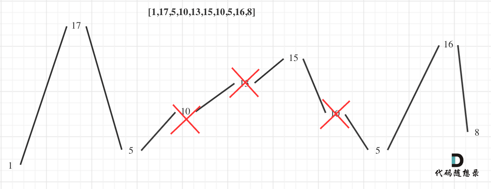
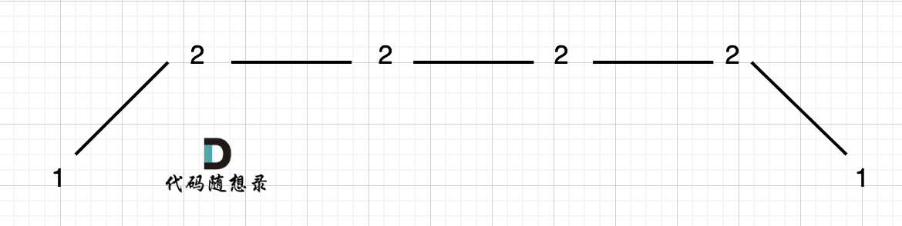
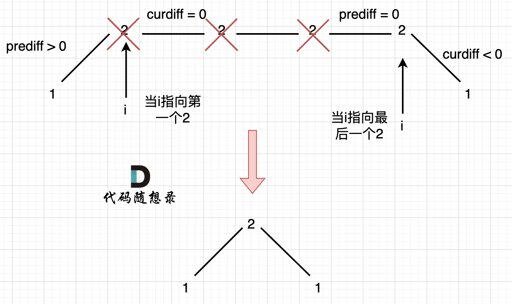
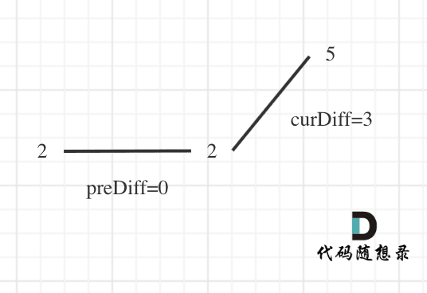
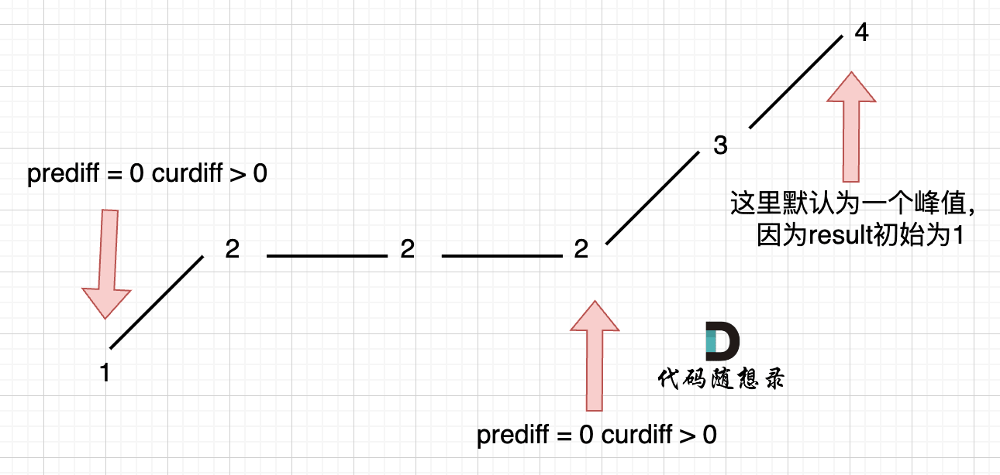
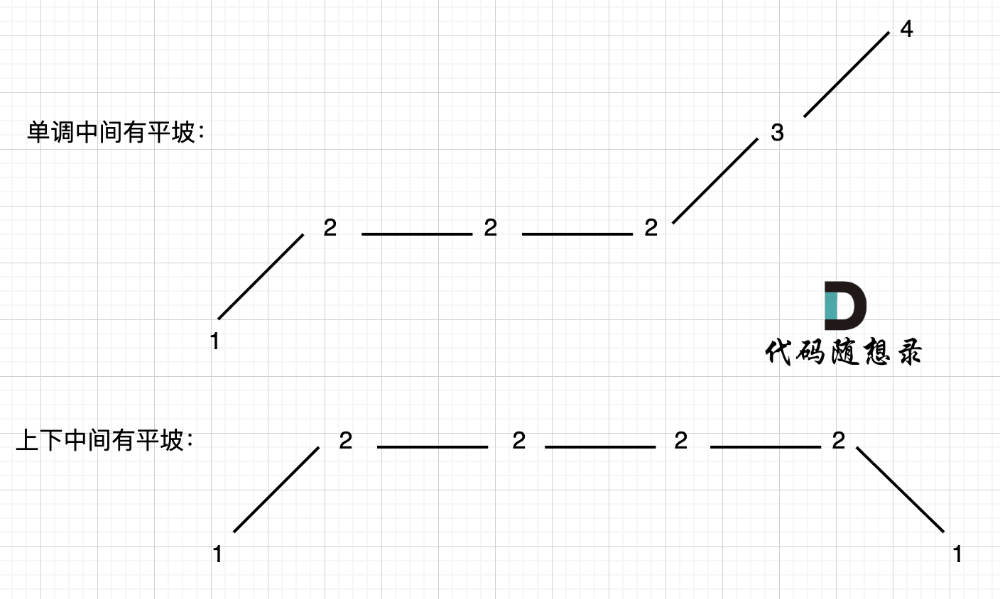

* [做專案（多個 C++、Java、Go、測試開發、前端專案）](https://www.programmercarl.com/other/kstar.html)
* [刷演算法（兩個月高強度學演算法）](https://www.programmercarl.com/xunlian/xunlianying.html)
* [背八股文（40 天挑戰高頻面試題）](https://www.programmercarl.com/xunlian/bagu.html)


# 376. 擺動序列

[LeetCode 題目連結](https://leetcode.cn/problems/wiggle-subsequence/)

如果連續數字之間的差嚴格地在正數和負數（negative number）之間交替，則數字序列（sequence）稱為擺動序列。第一個差（如果存在的話）可能是正數或負數。少於兩個元素（element）的序列也是擺動序列。

例如，[1,7,4,9,2,5] 是一個擺動序列，因為差值 (6,-3,5,-7,3) 是正負交替出現的。相反，[1,4,7,2,5] 和 [1,7,4,5,5] 不是擺動序列，第一個序列是因為它的前兩個差值都是正數，第二個序列是因為它的最後一個差值為零。

給定一個整數（integer）序列，回傳作為擺動序列的最長次序列（subsequence）的長度。透過從原始序列中刪除一些（也可以不刪除）元素來獲得次序列，剩下的元素保持其原始順序。

範例 1:

- 輸入: [1,7,4,9,2,5]
- 輸出: 6
- 解釋: 整個序列均為擺動序列。

範例 2:

- 輸入: [1,17,5,10,13,15,10,5,16,8]
- 輸出: 7
- 解釋: 這個序列包含幾個長度為 7 的擺動序列，其中一個可為 [1,17,10,13,10,16,8]。

範例 3:

- 輸入: [1,2,3,4,5,6,7,8,9]
- 輸出: 2

## 演算法公開課

**[《程式碼隨想錄》演算法影片公開課](https://programmercarl.com/other/gongkaike.html)：[貪心演算法（greedy algorithm），尋找擺動有細節！| LeetCode：376. 擺動序列](https://www.bilibili.com/video/BV17M411b7NS)，相信結合影片再看本篇題解，更有助於大家對本題的理解**。

## 解題思路

### 解題思路 1（貪心法（greedy）解法）

本題要求透過從原始序列中刪除一些（也可以不刪除）元素來獲得次序列，剩下的元素保持其原始順序。

相信這麼一說嚇退不少同學，這要求最大擺動序列又可以修改陣列（array），這得如何修改呢？

來分析一下，要求刪除元素使其達到最大擺動序列，應該刪除什麼元素呢？

用範例二來舉例，如圖所示：



**局部最佳化（local optimization）：刪除單調（monotonic）坡度上的節點（node）（不包括單調坡度兩端的節點），那麼這個坡度就可以有兩個局部峰值**。

**總體最佳（global optimum）：整個序列有最多的局部峰值，從而達到最長擺動序列**。

局部最佳化推出總體最佳，並舉不出反例，那麼試試貪心法！

（為方便表述，以下說的峰值都是指局部峰值）

**實際操作上，其實連刪除的操作都不用做，因為題目要求的是最長擺動次序列的長度，所以只需要統計陣列的峰值數量就可以了（相當於是刪除單一坡度上的節點，然後統計長度）**

**這就是貪心法所貪的地方，讓峰值盡可能地保持峰值，然後刪除單一坡度上的節點**

在計算是否有峰值的時候，大家知道遍歷（traversal）的下標（subscript） i，計算 prediff（nums[i] - nums[i-1]）和 curdiff（nums[i+1] - nums[i]），如果 `prediff < 0 && curdiff > 0` 或者 `prediff > 0 && curdiff < 0` 此時就有波動就需要統計。

這是我們思考本題的一個大體解題思路，但本題要考慮三種情況：

1. 情況一：上下坡中有平坡
2. 情況二：陣列首尾兩端
3. 情況三：單調坡中有平坡

#### 情況一：上下坡中有平坡

例如 [1,2,2,2,2,1] 這樣的陣列，如圖：



它的擺動序列長度是多少呢？**其實長度是 3**，也就是我們在刪除的時候要不刪除左邊的三個 2，要不就刪除右邊的三個 2。

如圖，可以統一規則，刪除左邊的三個 2：



在圖中，當 i 指向第一個 2 的時候，`prediff > 0 && curdiff = 0`，當 i 指向最後一個 2 的時候 `prediff = 0 && curdiff < 0`。

如果我們採用刪左邊三個 2 的規則，那麼當 `prediff = 0 && curdiff < 0` 也要記錄一個峰值，因為它是把之前相同的元素都刪掉留下的峰值。

所以我們記錄峰值的條件應該是：`(preDiff <= 0 && curDiff > 0) || (preDiff >= 0 && curDiff < 0)`，為什麼這裡允許 prediff == 0，就是為了上面我說的這種情況。

#### 情況二：陣列首尾兩端

所以本題統計峰值的時候，陣列最左邊和最右邊如何統計呢？

題目中說了，如果只有兩個不同的元素，那擺動序列也是 2。

例如序列 [2,5]，如果靠統計差值來計算峰值個數就需要考慮陣列最左邊和最右邊的特殊情況。

因為我們在計算 prediff（nums[i] - nums[i-1]）和 curdiff（nums[i+1] - nums[i]）的時候，至少需要三個數字才能計算，而陣列只有兩個數字。

這裡我們可以寫死，就是如果只有兩個元素，且元素不同，那麼結果為 2。

不寫死的話，如何和我們的判斷規則結合在一起呢？

可以假設，陣列最前面還有一個數字，那這個數字應該是什麼呢？

之前我們在討論情況一「相同數字連續」的時候，prediff = 0，curdiff < 0 或者 > 0 也記為波谷。

那麼為了規則統一，針對序列 [2,5]，可以假設為 [2,2,5]，這樣它就有坡度了即 preDiff = 0，如圖：



針對以上情形，result 初始為 1（預設最右邊有一個峰值），此時 curDiff > 0 && preDiff <= 0，那麼 result++（計算了左邊的峰值），最後得到的 result 就是 2（峰值個數為 2 即擺動序列長度為 2）

經過以上分析後，我們可以寫出如下程式碼：

```CPP
// 版本一
class Solution {
public:
    int wiggleMaxLength(vector<int>& nums) {
        if (nums.size() <= 1) return nums.size();
        int curDiff = 0; // 當前一對差值
        int preDiff = 0; // 前一對差值
        int result = 1;  // 記錄峰值個數，序列預設最右邊有一個峰值
        for (int i = 0; i < nums.size() - 1; i++) {
            curDiff = nums[i + 1] - nums[i];
            // 出現峰值
            if ((preDiff <= 0 && curDiff > 0) || (preDiff >= 0 && curDiff < 0)) {
                result++;
            }
            preDiff = curDiff;
        }
        return result;
    }
};
```

- 時間複雜度（time complexity）：O(n)
- 空間複雜度（space complexity）：O(1)

此時大家是不是發現以上程式碼提交也不能通過本題？

所以此時我們要討論情況三！

#### 情況三：單調坡度有平坡

在版本一中，我們忽略了一種情況，即如果在一個單調坡度上有平坡，例如 [1,2,2,2,3,4]，如圖：



圖中，我們可以看出，版本一的程式碼在三個地方記錄峰值，但其實結果應該為 2，因為單調中的平坡不能算峰值（即擺動）。

之所以版本一會出問題，是因為我們即時更新了 prediff。

那麼我們應該什麼時候更新 prediff 呢？

我們只需要在這個坡度擺動變化的時候，更新 prediff 就行，這樣 prediff 在單調區間（interval）有平坡的時候就不會發生變化，造成我們的誤判。

所以本題的最終程式碼為：

```CPP

// 版本二
class Solution {
public:
    int wiggleMaxLength(vector<int>& nums) {
        if (nums.size() <= 1) return nums.size();
        int curDiff = 0; // 當前一對差值
        int preDiff = 0; // 前一對差值
        int result = 1;  // 記錄峰值個數，序列預設最右邊有一個峰值
        for (int i = 0; i < nums.size() - 1; i++) {
            curDiff = nums[i + 1] - nums[i];
            // 出現峰值
            if ((preDiff <= 0 && curDiff > 0) || (preDiff >= 0 && curDiff < 0)) {
                result++;
                preDiff = curDiff; // 注意這裡，只在擺動變化的時候更新 prediff
            }
        }
        return result;
    }
};
```

其實本題看起來好像簡單，但需要考慮的情況還是很複雜的，而且很難一次性想到位。

**本題異常情況的本質，就是要考慮平坡**，平坡分兩種，一個是上下中間有平坡，一個是單調有平坡，如圖：



### 解題思路 2（動態規劃（dynamic programming, DP））

考慮用動態規劃（dynamic programming, DP）的思想來解決這個問題。

很容易可以發現，對於我們當前考慮的這個數，要麼是作為山峰（即 nums[i] > nums[i-1]），要麼是作為山谷（即 nums[i] < nums[i - 1]）。

- 設 dp 狀態（state） `dp[i][0]`，表示考慮前 i 個數，第 i 個數作為山峰的擺動次序列的最長長度
- 設 dp 狀態 `dp[i][1]`，表示考慮前 i 個數，第 i 個數作為山谷的擺動次序列的最長長度

則狀態變遷方程式（state transition equation）為：

- `dp[i][0] = max(dp[i][0], dp[j][1] + 1)`，其中 `0 < j < i` 且 `nums[j] < nums[i]`，表示將 nums[i] 接到前面某個山谷後面，作為山峰。
- `dp[i][1] = max(dp[i][1], dp[j][0] + 1)`，其中 `0 < j < i` 且 `nums[j] > nums[i]`，表示將 nums[i] 接到前面某個山峰後面，作為山谷。

初始狀態：

由於一個數可以接到前面的某個數後面，也可以以自身為次序列的起點，所以初始狀態為：`dp[0][0] = dp[0][1] = 1`。

C++ 程式碼如下：

```CPP
class Solution {
public:
    int dp[1005][2];
    int wiggleMaxLength(vector<int>& nums) {
        memset(dp, 0, sizeof dp);
        dp[0][0] = dp[0][1] = 1;
        for (int i = 1; i < nums.size(); ++i) {
            dp[i][0] = dp[i][1] = 1;
            for (int j = 0; j < i; ++j) {
                if (nums[j] > nums[i]) dp[i][1] = max(dp[i][1], dp[j][0] + 1);
            }
            for (int j = 0; j < i; ++j) {
                if (nums[j] < nums[i]) dp[i][0] = max(dp[i][0], dp[j][1] + 1);
            }
        }
        return max(dp[nums.size() - 1][0], dp[nums.size() - 1][1]);
    }
};
```

- 時間複雜度：O(n^2)
- 空間複雜度：O(n)

**進階**

可以用兩棵 線段樹（segment tree） 來維護區間的最大值

- 每次更新 `dp[i][0]`，則在 `tree1` 的 `nums[i]` 位置值更新為 `dp[i][0]`
- 每次更新 `dp[i][1]`，則在 `tree2` 的 `nums[i]` 位置值更新為 `dp[i][1]`
- 則 dp 狀態變遷方程式中就沒有必要 j 從 0 遍歷到 i-1，可以直接在 線段樹 中查詢指定區間的值即可。

時間複雜度：O(nlog n)

空間複雜度：O(n)

## 其他語言版本

### Java

```Java
class Solution {
    public int wiggleMaxLength(int[] nums) {
        if (nums.length <= 1) {
            return nums.length;
        }
        //當前差值
        int curDiff = 0;
        //上一個差值
        int preDiff = 0;
        int count = 1;
        for (int i = 1; i < nums.length; i++) {
            //得到當前差值
            curDiff = nums[i] - nums[i - 1];
            //如果當前差值和上一個差值為一正一負
            //等於 0 的情況表示初始時的 preDiff
            if ((curDiff > 0 && preDiff <= 0) || (curDiff < 0 && preDiff >= 0)) {
                count++;
                preDiff = curDiff;
            }
        }
        return count;
    }
}
```

```java
// DP
class Solution {
    public int wiggleMaxLength(int[] nums) {
        // 0 i 作為波峰的最大長度
        // 1 i 作為波谷的最大長度
        int dp[][] = new int[nums.length][2];

        dp[0][0] = dp[0][1] = 1;
        for (int i = 1; i < nums.length; i++){
            //i 自己可以成為波峰或者波谷
            dp[i][0] = dp[i][1] = 1;

            for (int j = 0; j < i; j++){
                if (nums[j] > nums[i]){
                    // i 是波谷
                    dp[i][1] = Math.max(dp[i][1], dp[j][0] + 1);
                }
                if (nums[j] < nums[i]){
                    // i 是波峰
                    dp[i][0] = Math.max(dp[i][0], dp[j][1] + 1);
                }
            }
        }

        return Math.max(dp[nums.length - 1][0], dp[nums.length - 1][1]);
    }
}
```

### Python

貪心法（版本一）

```python
class Solution:
    def wiggleMaxLength(self, nums):
        if len(nums) <= 1:
            return len(nums)  # 如果陣列長度為 0 或 1，則回傳陣列長度
        curDiff = 0  # 當前一對元素的差值
        preDiff = 0  # 前一對元素的差值
        result = 1  # 記錄峰值的個數，初始為 1（預設最右邊的元素被視為峰值）
        for i in range(len(nums) - 1):
            curDiff = nums[i + 1] - nums[i]  # 計算下一個元素與當前元素的差值
            # 如果遇到一個峰值
            if (preDiff <= 0 and curDiff > 0) or (preDiff >= 0 and curDiff < 0):
                result += 1  # 峰值個數加 1
                preDiff = curDiff  # 注意這裡，只在擺動變化的時候更新 preDiff
        return result  # 回傳最長擺動次序列的長度

```
貪心法（版本二）

```python
class Solution:
    def wiggleMaxLength(self, nums: List[int]) -> int:
        if len(nums) <= 1:
            return len(nums)  # 如果陣列長度為 0 或 1，則回傳陣列長度
        preDiff,curDiff ,result  = 0,0,1  #題目裡 nums 長度大於等於 1，當長度為 1 時，其實到不了 for 迴圈裡去，所以不用考慮 nums 長度
        for i in range(len(nums) - 1):
            curDiff = nums[i + 1] - nums[i]
            if curDiff * preDiff <= 0 and curDiff !=0:  #差值為 0 時，不算擺動
                result += 1
                preDiff = curDiff  #如果當前差值和上一個差值為一正一負時，才需要用當前差值替代上一個差值
        return result

```

DP

```python
class Solution:
    def wiggleMaxLength(self, nums: List[int]) -> int:
        # 0 i 作為波峰的最大長度
        # 1 i 作為波谷的最大長度
        # dp 是一個串列，串列中每個元素是長度為 2 的串列
        dp = []
        for i in range(len(nums)):
            # 初始為 [1, 1]
            dp.append([1, 1])
            for j in range(i):
                # nums[i] 為波谷
                if nums[j] > nums[i]:
                    dp[i][1] = max(dp[i][1], dp[j][0] + 1)
                # nums[i] 為波峰
                if nums[j] < nums[i]:
                    dp[i][0] = max(dp[i][0], dp[j][1] + 1)
        return max(dp[-1][0], dp[-1][1])
```

DP

```python
class Solution:
    def wiggleMaxLength(self, nums):
        dp = [[0, 0] for _ in range(len(nums))]  # 建立二維 dp 陣列，用於記錄擺動序列的最大長度
        dp[0][0] = dp[0][1] = 1  # 初始條件，序列中的第一個元素預設為峰值，最小長度為 1
        for i in range(1, len(nums)):
            dp[i][0] = dp[i][1] = 1  # 初始化當前位置的 dp 值為 1
            for j in range(i):
                if nums[j] > nums[i]:
                    dp[i][1] = max(dp[i][1], dp[j][0] + 1)  # 如果前一個數比當前數大，可以形成一個上升峰值，更新 dp[i][1]
            for j in range(i):
                if nums[j] < nums[i]:
                    dp[i][0] = max(dp[i][0], dp[j][1] + 1)  # 如果前一個數比當前數小，可以形成一個下降峰值，更新 dp[i][0]
        return max(dp[-1][0], dp[-1][1])  # 回傳最大的擺動序列長度

```

DP最佳化

```python
class Solution:
    def wiggleMaxLength(self, nums):
        if len(nums) <= 1:
            return len(nums)  # 如果陣列長度為 0 或 1，則回傳陣列長度
        
        up = down = 1  # 記錄上升和下降擺動序列的最大長度
        for i in range(1, len(nums)):
            if nums[i] > nums[i-1]:
                up = down + 1  # 如果當前數比前一個數大，則可以形成一個上升峰值
            elif nums[i] < nums[i-1]:
                down = up + 1  # 如果當前數比前一個數小，則可以形成一個下降峰值
        
        return max(up, down)  # 回傳上升和下降擺動序列的最大長度


```
### Go

**貪心法**

```go
func wiggleMaxLength(nums []int) int {
	n := len(nums)
	if n < 2 {
		return n
	}
	ans := 1
	prevDiff := nums[1] - nums[0]
	if prevDiff != 0 {
		ans = 2
	}
	for i := 2; i < n; i++ {
		diff := nums[i] - nums[i-1]
		if diff > 0 && prevDiff <= 0 || diff < 0 && prevDiff >= 0 {
			ans++
			prevDiff = diff
		}
	}
	return ans
}
```

**DP**

```go
func wiggleMaxLength(nums []int) int {
	n := len(nums)
	if n <= 1 {
		return n
	}
	dp := make([][2]int, n)
	//  i 0 作為波峰的最大長度
	//  i 1 作為波谷的最大長度
	dp[0][0] = 1
	dp[0][1] = 1
	for i := 0; i < n; i++ {
		for j := 0; j < i; j++ {
			if nums[j] > nums[i] { //nums[i] 為波谷
				dp[i][1] = max(dp[i][1], dp[j][0]+1)
			}
			if nums[j] < nums[i] { //nums[i] 為波峰 或者相等
				dp[i][0] = max(dp[i][0], dp[j][1]+1)
			}
			if nums[j] == nums[i] { //添加一種情況，nums[i] 為相等
				dp[i][0] = max(dp[i][0], dp[j][0]) //波峰
				dp[i][1] = max(dp[i][1], dp[j][1]) //波谷
			}
		}
	}
	return max(dp[n-1][0], dp[n-1][1])
}
func max(a, b int) int {
	if a > b {
		return a
	} else {
		return b
	}
}
```

### JavaScript

**貪心法**

```Javascript
var wiggleMaxLength = function(nums) {
    if(nums.length <= 1) return nums.length
    let result = 1
    let preDiff = 0
    let curDiff = 0
    for(let i = 0; i < nums.length - 1; i++) {
        curDiff = nums[i + 1] - nums[i]
        if((curDiff > 0 && preDiff <= 0) || (curDiff < 0 && preDiff >= 0)) {
            result++
            preDiff = curDiff
        }
    }
    return result
};
```

**DP**

```Javascript
var wiggleMaxLength = function(nums) {
    if (nums.length === 1) return 1;
    // 考慮前 i 個數，當第 i 個值作為峰谷時的情況（則第 i-1 是峰頂）
    let down = 1;
    // 考慮前 i 個數，當第 i 個值作為峰頂時的情況（則第 i-1 是峰谷）
    let up = 1;
    for (let i = 1; i < nums.length; i++) {
        if (nums[i] < nums[i - 1]) {
            down = Math.max(up + 1, down);
        }
        if (nums[i] > nums[i - 1]) {
            up = Math.max(down + 1, up)
        }
    }
    return Math.max(down, up);
};
```

### Rust

**貪心法**

```Rust
impl Solution {
    pub fn wiggle_max_length(nums: Vec<i32>) -> i32 {
        if nums.len() == 1 {
            return 1;
        }
        let mut res = 1;
        let mut pre_diff = 0;
        for i in 0..nums.len() - 1 {
            let cur_diff = nums[i + 1] - nums[i];
            if (pre_diff <= 0 && cur_diff > 0) || (pre_diff >= 0 && cur_diff < 0) {
                res += 1;
                pre_diff = cur_diff;
            }
        }
        res
    }
}
```

**DP**

```rust
impl Solution {
    pub fn wiggle_max_length(nums: Vec<i32>) -> i32 {
        if nums.len() == 1 {
            return 1;
        }
        let (mut down, mut up) = (1, 1);
        for i in 1..nums.len() {
            // i - 1 為峰頂
            if nums[i] < nums[i - 1] {
                down = down.max(up + 1);
            }
            // i - 1 為峰谷
            if nums[i] > nums[i - 1] {
                up = up.max(down + 1);
            }
        }
        down.max(up)
    }
}
```

### C

**貪心法**

```c
int wiggleMaxLength(int* nums, int numsSize){
    if(numsSize <= 1)
        return numsSize;

    int length = 1;
    int preDiff , curDiff;
    preDiff = curDiff = 0;
    for(int i = 0; i < numsSize - 1; ++i) {
        // 計算當前 i 元素與 i+1 元素差值
        curDiff = nums[i+1] - nums[i];

        // 若 preDiff 與 curDiff 符號不符，則次序列長度 +1。更新 preDiff 的符號
        // 若 preDiff 與 curDiff 符號一致，當前 i 元素為連續升序/連續降序次序列的中間元素。不被記錄入長度
        // 注：當 preDiff 為 0 時，curDiff 為正或為負都屬於符號不同
        if((curDiff > 0 && preDiff <= 0) || (preDiff >= 0 && curDiff < 0)) {
            preDiff = curDiff;
            length++;
        }
    }

    return length;
}
```

**DP**

```c
int max(int left, int right)
{
    return left > right ? left : right;
}
int wiggleMaxLength(int* nums, int numsSize){
    if(numsSize <= 1)
    {
        return numsSize;
    }
    // 0   i 作為波峰的最大長度
    // 1   i 作為波谷的最大長度
    int dp[numsSize][2];
    for(int i = 0; i < numsSize; i++)
    {
        dp[i][0] = 1;
        dp[i][1] = 1;
        for(int j = 0; j < i; j++)
        {
            // nums[i] 為山谷
            if(nums[j] > nums[i])
            {
                dp[i][1] = max(dp[i][1], dp[j][0] + 1);
            }
            // nums[i] 為山峰
            if(nums[j] < nums[i])
            {
                dp[i][0] = max(dp[i][0], dp[j][1] + 1);
            }
        }
    }
    return max(dp[numsSize - 1][0], dp[numsSize - 1][1]);
}
```

### TypeScript

**貪心法**

```typescript
function wiggleMaxLength(nums: number[]): number {
  let length: number = nums.length;
  if (length <= 1) return length;
  let preDiff: number = 0;
  let curDiff: number = 0;
  let count: number = 1;
  for (let i = 1; i < length; i++) {
    curDiff = nums[i] - nums[i - 1];
    if ((preDiff <= 0 && curDiff > 0) || (preDiff >= 0 && curDiff < 0)) {
      preDiff = curDiff;
      count++;
    }
  }
  return count;
}
```

**DP**

```typescript
function wiggleMaxLength(nums: number[]): number {
  const length: number = nums.length;
  if (length <= 1) return length;
  const dp: number[][] = new Array(length).fill(0).map((_) => []);
  dp[0][0] = 1; // 第一個數作為波峰
  dp[0][1] = 1; // 第一個數作為波谷
  for (let i = 1; i < length; i++) {
    dp[i][0] = 1;
    dp[i][1] = 1;
    for (let j = 0; j < i; j++) {
      if (nums[j] < nums[i]) dp[i][0] = Math.max(dp[i][0], dp[j][1] + 1);
    }
    for (let j = 0; j < i; j++) {
      if (nums[j] > nums[i]) dp[i][1] = Math.max(dp[i][1], dp[j][0] + 1);
    }
  }
  return Math.max(dp[length - 1][0], dp[length - 1][1]);
}
```

### Scala

```scala
object Solution {
  def wiggleMaxLength(nums: Array[Int]): Int = {
    if (nums.length <= 1) return nums.length
    var result = 1
    var curDiff = 0 // 當前一對的差值
    var preDiff = 0 // 前一對的差值

    for (i <- 1 until nums.length) {
      curDiff = nums(i) - nums(i - 1) // 計算當前這一對的差值
      // 當 curDiff > 0 的情況，preDiff <= 0
      // 當 curDiff < 0 的情況，preDiff >= 0
      // 這兩種情況算是兩個峰值
      if ((curDiff > 0 && preDiff <= 0) || (curDiff < 0 && preDiff >= 0)) {
        result += 1 // 結果集加 1
        preDiff = curDiff // 當前差值賦值給上一輪
      }
    }

    result
  }
}
```
### C#
```csharp
public class Solution
{
    public int WiggleMaxLength(int[] nums)
    {
        if (nums.Length < 2) return nums.Length;
        int curDiff = 0, preDiff = 0, res = 1;
        for (int i = 0; i < nums.Length - 1; i++)
        {
            curDiff = nums[i + 1] - nums[i];
            if ((curDiff > 0 && preDiff <= 0) || (curDiff < 0 && preDiff >= 0))
            {
                res++;
                preDiff = curDiff;
            }
        }
        return res;
    }
}
```

