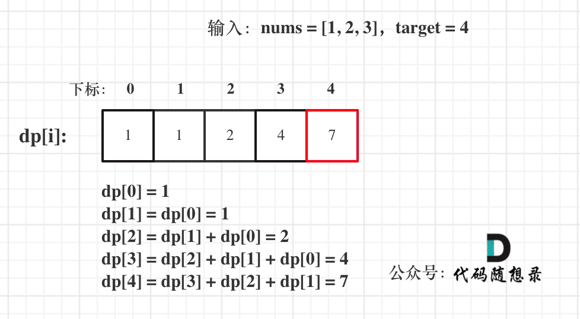

* [做專案（多個 C++、Java、Go、測試開發、前端專案）](https://www.programmercarl.com/other/kstar.html)
* [練習演算法（algorithm）（兩個月高強度學演算法）](https://www.programmercarl.com/xunlian/xunlianying.html)
* [背八股文（40 天挑戰高頻面試題）](https://www.programmercarl.com/xunlian/bagu.html)


# 377. 組合總和 Ⅳ

[LeetCode 題目連結](https://leetcode.cn/problems/combination-sum-iv/)

難度：中等

給定一個由正整數（positive integer）組成且不存在重複（duplicate）數字的陣列（array），找出和為給定目標正整數的組合（combination）的個數。

範例:

* nums = [1, 2, 3]
* target = 4

所有可能的組合為：
(1, 1, 1, 1)
(1, 1, 2)
(1, 2, 1)
(1, 3)
(2, 1, 1)
(2, 2)
(3, 1)

請注意，順序不同的序列（sequence）被視作不同的組合。

因此輸出為 7。

## 演算法公開課

**[《程式碼隨想錄》演算法影片公開課](https://programmercarl.com/other/gongkaike.html)：[裝滿背包有幾種方法？求排列數？| LeetCode：377.組合總和IV](https://www.bilibili.com/video/BV1V14y1n7B6/)，相信結合影片再看本篇題解，更有助於大家對本題的理解**。

## 解題思路

對無界背包問題（unbounded knapsack problem）還不了解的同學，可以看這篇：[動態規劃（dynamic programming, DP）：關於完全背包，你該了解這些！](https://programmercarl.com/背包问题理论基础完全背包.html)

本題題目描述說是求組合，但又說是可以元素（element）相同順序不同的組合算兩個組合，**其實就是求排列（permutation）！**

弄清什麼是組合，什麼是排列很重要。

組合不強調順序，(1,5) 和 (5,1) 是同一個組合。

排列強調順序，(1,5) 和 (5,1) 是兩個不同的排列。

大家在公眾號（WeChat Official Account）裡學習回溯演算法（backtracking algorithm）專題的時候，一定做過這兩道題目 [回溯演算法：39.組合總和](https://programmercarl.com/0039.组合总和.html) 和 [回溯演算法：40.組合總和II](https://programmercarl.com/0040.组合总和II.html)，會感覺這兩題和本題很像！

但其本質是本題求的是排列總和，而且僅僅是求排列總和的個數，並不是把所有的排列都列出來。

**如果本題要把排列都列出來的話，只能使用回溯演算法暴力搜尋**。

動態規劃五部曲分析如下：

1. 確定 dp 陣列以及下標（subscript）的含義

**dp[i]: 湊成目標正整數為 i 的排列個數為 dp[i]**

2. 確定遞迴公式（recurrence formula）

dp[i]（考慮 nums[j]）可以由 dp[i - nums[j]]（不考慮 nums[j]）推導出來。

因為只要得到 nums[j]，排列個數 dp[i - nums[j]]，就是 dp[i] 的一部分。

在 [動態規劃：494.目標和](https://programmercarl.com/0494.目标和.html) 和 [動態規劃：518.零錢兌換II](https://programmercarl.com/0518.零钱兑换II.html) 中我們已經講過了，求裝滿背包有幾種方法，遞迴公式一般都是 dp[i] += dp[i - nums[j]];

本題也一樣。

3. dp 陣列如何初始化（initialization）

因為遞迴公式 dp[i] += dp[i - nums[j]] 的緣故，dp[0] 要初始化為 1，這樣遞迴（recursion）其他 dp[i] 的時候才會有數值基礎。

至於 dp[0] = 1 有沒有意義呢？

其實沒有意義，所以我也不去強行解釋它的意義了，因為題目中也說了：給定目標值是正整數！所以 dp[0] = 1 是沒有意義的，僅僅是為了推導遞迴公式。

至於非 0 下標的 dp[i] 應該初始為多少呢？

初始化為 0，這樣才不會影響 dp[i] 累加所有的 dp[i - nums[j]]。


4. 確定遍歷（traversal）順序

個數可以不限使用，說明這是一個無界背包問題。

得到的集合（set）是排列，說明需要考慮元素之間的順序。


本題要求的是排列，那麼這個 for 迴圈（for-loop）巢狀的順序可以有說法了。

在 [動態規劃：518.零錢兌換II](https://programmercarl.com/0518.零钱兑换II.html) 中就已經講過了。

**如果求組合數就是外層 for 迴圈遍歷物品，內層 for 遍歷背包**。

**如果求排列數就是外層 for 遍歷背包，內層 for 迴圈遍歷物品**。

如果把遍歷 nums（物品）放在外迴圈，遍歷 target 的作為內迴圈的話，舉一個例子：計算 dp[4] 的時候，結果集（result set）只有 {1,3} 這樣的集合，不會有 {3,1} 這樣的集合，因為 nums 遍歷放在外層，3 只能出現在 1 後面！

所以本題最終遍歷順序：**target（背包）放在外迴圈，將 nums（物品）放在內迴圈，內迴圈從前到後遍歷**。

5. 舉例來推導 dp 陣列

我們再用範例中的例子推導一下：



如果程式碼執行的結果不是想要的結果，就把 dp[i] 都印出來，看看和我們推導的一不一樣。

以上分析完畢，C++ 程式碼如下：

```CPP
class Solution {
public:
    int combinationSum4(vector<int>& nums, int target) {
        vector<int> dp(target + 1, 0);
        dp[0] = 1;
        for (int i = 0; i <= target; i++) { // 遍歷背包
            for (int j = 0; j < nums.size(); j++) { // 遍歷物品
                if (i - nums[j] >= 0 && dp[i] <= INT_MAX - dp[i - nums[j]]) {
                    dp[i] += dp[i - nums[j]];
                }
            }
        }
        return dp[target];
    }
};

```

* 時間複雜性（time complexity）: O(target * n)，其中 n 為 nums 的長度
* 空間複雜度（space complexity）: O(target)


C++ 測試案例（test case）有兩個數相加超過 int 的資料，所以需要在 if 裡加上 dp[i] < INT_MAX - dp[i - num]。

但 Java 就不用考慮這個限制，Java 裡的 int 也是四個位元組（byte）吧，也有可能 LeetCode 後台對不同語言的測試資料不一樣。

## 總結

**求裝滿背包有幾種方法，遞迴公式都是一樣的，沒有什麼差別，但關鍵在於遍歷順序！**

本題與 [動態規劃：518.零錢兌換II](https://programmercarl.com/0518.零钱兑换II.html) 就是一個鮮明的對比，一個是求排列，一個是求組合，遍歷順序完全不同。

如果對遍歷順序沒有深度理解的話，做這種無界背包的題目會很困惑，即使題目刷過了可能也不太清楚具體是怎麼過的。

此時大家應該對動態規劃中的遍歷順序又有更深的理解了。


## 其他語言版本

### Java：

```Java
class Solution {
    public int combinationSum4(int[] nums, int target) {
        int[] dp = new int[target + 1];
        dp[0] = 1;
        for (int i = 0; i <= target; i++) {
            for (int j = 0; j < nums.length; j++) {
                if (i >= nums[j]) {
                    dp[i] += dp[i - nums[j]];
                }
            }
        }
        return dp[target];
    }
}
```

### Python：


卡哥版
```python
class Solution:
    def combinationSum4(self, nums: List[int], target: int) -> int:
        dp = [0] * (target + 1)
        dp[0] = 1
        for i in range(1, target + 1):  # 遍歷背包
            for j in range(len(nums)):  # 遍歷物品
                if i - nums[j] >= 0:
                    dp[i] += dp[i - nums[j]]
        return dp[target]

```
最佳化版

```python
class Solution:
    def combinationSum4(self, nums: List[int], target: int) -> int:
        dp = [0] * (target + 1)  # 建立動態規劃陣列，用於儲存組合總數
        dp[0] = 1  # 初始化背包容量為0時的組合總數為1

        for i in range(1, target + 1):  # 遍歷背包容量
            for j in nums:  # 遍歷物品列表
                if i >= j:  # 當背包容量大於等於目前物品重量時
                    dp[i] += dp[i - j]  # 更新組合總數

        return dp[-1]  # 回傳背包容量為target時的組合總數


```
二維（two-dimensional）DP 版
```python
class Solution:
    def combinationSum4(self, nums: List[int], target: int) -> int:
        # dp[][j]和為j的組合的總數
        dp = [[0] * (target+1) for _ in nums]
        
        for i in range(len(nums)):
            dp[i][0] = 1
            
        # 這裡不能初始化dp[0][j]。dp[0][j]的值依賴於dp[-1][j-nums[0]]
            
        for j in range(1, target+1):
            for i in range(len(nums)):
                
                if j - nums[i] >= 0:
                    dp[i][j] = (
                        # 不放nums[i]
                        # i = 0 時，dp[-1][j]恰好為0，所以沒有特殊處理
                        dp[i-1][j] +
                        # 放nums[i]。對於和為j的組合，只有試過全部物品，才能知道有幾種組合方式。所以取最後一個物品dp[-1][j-nums[i]]
                        dp[-1][j-nums[i]]
                    )
                else:
                    dp[i][j] = dp[i-1][j]
        return dp[-1][-1]
```

### Go：

```go
func combinationSum4(nums []int, target int) int {
	//定義dp陣列
	dp := make([]int, target+1)
	// 初始化
	dp[0] = 1
	// 遍歷順序, 先遍歷背包,再迴圈遍歷物品
	for j:=0;j<=target;j++ {
		for i:=0 ;i < len(nums);i++ {
			if j >= nums[i] {
				dp[j] += dp[j-nums[i]]
			}
		}
	}
	return dp[target]
}
```

### JavaScript：

```javascript
const combinationSum4 = (nums, target) => {

    let dp = Array(target + 1).fill(0);
    dp[0] = 1;

    for(let i = 0; i <= target; i++) {
        for(let j = 0; j < nums.length; j++) {
            if (i >= nums[j]) {
                dp[i] += dp[i - nums[j]];
            }
        }
    }

    return dp[target];
};
```

### TypeScript：

```typescript
function combinationSum4(nums: number[], target: number): number {
    const dp: number[] = new Array(target + 1).fill(0);
    dp[0] = 1;
    // 遍歷背包
    for (let i = 1; i <= target; i++) {
        // 遍歷物品
        for (let j = 0, length = nums.length; j < length; j++) {
            if (i >= nums[j]) {
                dp[i] += dp[i - nums[j]];
            }
        }
    }
    return dp[target];
};
```

### Rust: 

```Rust
impl Solution {
    pub fn combination_sum4(nums: Vec<i32>, target: i32) -> i32 {
        let target = target as usize;
        let mut dp = vec![0; target + 1];
        dp[0] = 1;
        for i in 1..=target {
            for &n in &nums {
                if i >= n as usize {
                    dp[i] += dp[i - n as usize];
                }
            }
        }
        dp[target]
    }
}
```
### C

```c
int combinationSum4(int* nums, int numsSize, int target) {
    int dp[target + 1];
    memset(dp, 0, sizeof (dp ));
    dp[0] = 1;
    for(int i = 0; i <= target; i++){
        for(int j = 0; j < numsSize; j++){
            if(i - nums[j] >= 0 && dp[i] < INT_MAX - dp[i - nums[j]]){
                dp[i] += dp[i - nums[j]];
            }
        }
    }
    return dp[target];
}
```


### C#

```csharp
public class Solution
{
    public int CombinationSum4(int[] nums, int target)
    {
        int[] dp = new int[target + 1];
        dp[0] = 1;
        for (int i = 0; i <= target; i++)
        {
            for (int j = 0; j < nums.Length; j++)
            {
                if (i >= nums[j] && dp[i] < int.MaxValue - dp[i - nums[j]])
                {
                    dp[i] += dp[i - nums[j]];
                }
            }
        }
        return dp[target];
    }
}
```


