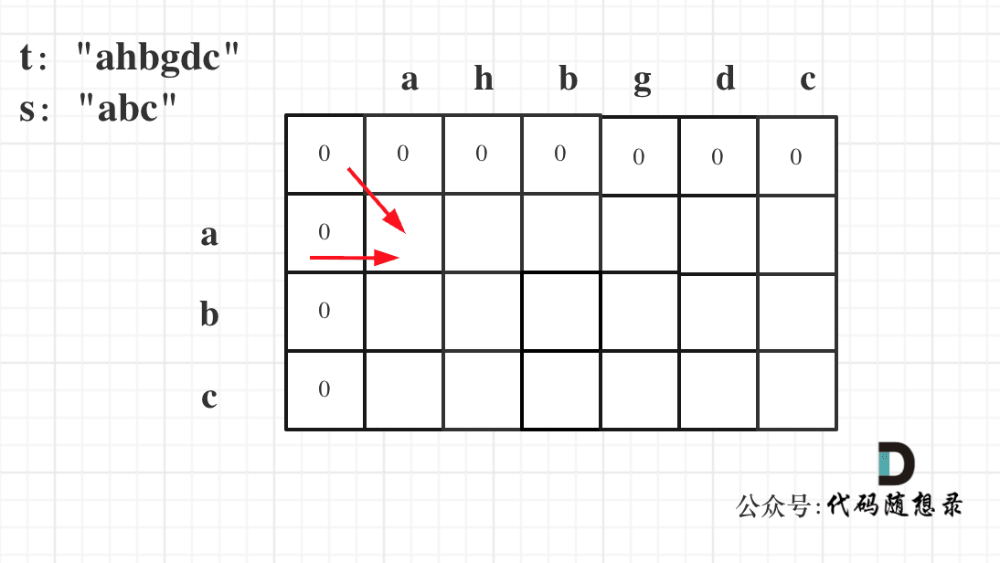
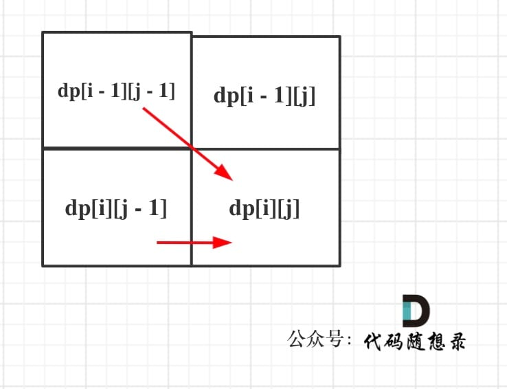
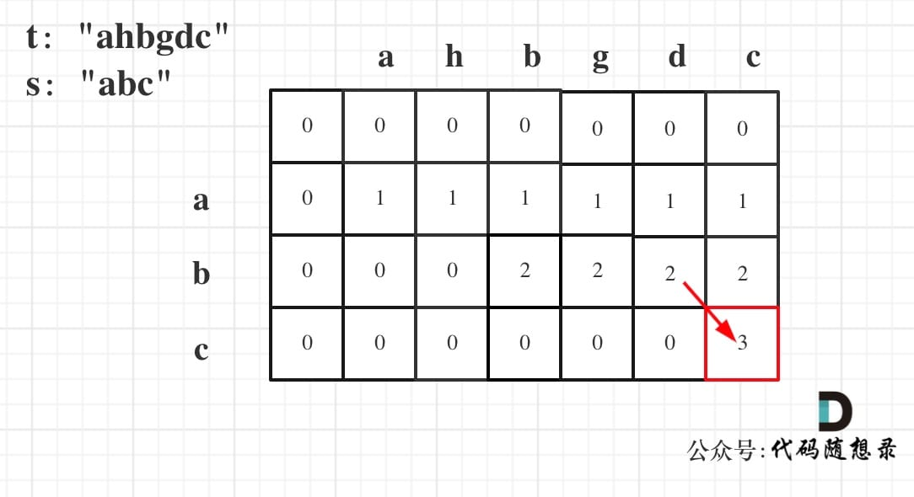

* [做專案（多個 C++、Java、Go、測試開發、前端專案）](https://www.programmercarl.com/other/kstar.html)
* [練習演算法（兩個月高強度學演算法）](https://www.programmercarl.com/xunlian/xunlianying.html)
* [背八股文（40 天挑戰高頻面試題）](https://www.programmercarl.com/xunlian/bagu.html)


# 392.判斷次序列（subsequence）

[LeetCode 題目連結](https://leetcode.cn/problems/is-subsequence/)

給定字串（string） s 和 t ，判斷 s 是否為 t 的次序列。

字串的一個次序列是原始字串刪除（delete）一些（也可以不刪除）字元（character）而不改變剩餘字元相對位置形成的新字串。（例如，"ace" 是 "abcde" 的一個次序列，而 "aec" 不是）。

範例 1：
* 輸入：s = "abc", t = "ahbgdc"
* 輸出：true

範例 2：
* 輸入：s = "axc", t = "ahbgdc"
* 輸出：false

提示：

* 0 <= s.length <= 100
* 0 <= t.length <= 10^4

兩個字串都只由小寫字元組成。

## 演算法公開課

**[《程式碼隨想錄》演算法影片公開課](https://programmercarl.com/other/gongkaike.html)：[動態規劃（dynamic programming, DP），用相似思路解決複雜問題 | LeetCode：392.判斷子序列](https://www.bilibili.com/video/BV1tv4y1B7ym/)，相信結合影片再看本篇題解，更有助於大家對本題的理解**。


## 解題思路

（這道題也可以用 two pointers 的思路來實作，時間複雜度（time complexity）也是 O(n)）

這道題應該算是 edit distance 的入門題目，因為從題意中我們也可以發現，只需要計算刪除的情況，不用考慮增加和替換的情況。

**所以掌握本題的動態規劃（dynamic programming, DP）解法是對後面要講解的 edit distance 的題目打下基礎**。

DP五部曲分析如下：

1. 確定 dp 陣列（array）（dp table）以及下標（subscript）的含義

**dp[i][j] 表示以下標 i-1 為結尾的字串 s，和以下標 j-1 為結尾的字串 t，相同次序列的長度為 dp[i][j]**。

注意這裡是判斷 s 是否為 t 的次序列。即 t 的長度是大於等於 s 的。

有同學問了，為什麼要表示下標 i-1 為結尾的字串呢，為什麼不表示下標 i 為結尾的字串呢？

為什麼這麼定義我在 [718. 最長重複子陣列（subarray）](https://programmercarl.com/0718.最长重复子数组.html) 中做了詳細的講解。

其實用 i 來表示也可以！

但我統一以下標 i-1 為結尾的字串來計算，這樣在下面的遞迴公式（recurrence formula）中會容易理解一些，如果還有疑惑，可以繼續往下看。

2. 確定遞迴公式

在確定遞迴公式的時候，首先要考慮如下兩種操作，整理如下：

* if (s[i - 1] == t[j - 1])
    * t 中找到了一個字元在 s 中也出現了
* if (s[i - 1] != t[j - 1])
    * 相當於 t 要刪除元素（element），繼續匹配

if (s[i - 1] == t[j - 1])，那麼 dp[i][j] = dp[i - 1][j - 1] + 1;，因為找到了一個相同的字元，相同次序列長度自然要在 dp[i-1][j-1] 的基礎上加 1（**如果不理解，再回頭看一下 dp[i][j] 的定義**）

if (s[i - 1] != t[j - 1])，此時相當於 t 要刪除元素，t 如果把目前元素 t[j - 1] 刪除，那麼 dp[i][j] 的數值就是看 s[i - 1] 與 t[j - 2] 的比較結果了，即：dp[i][j] = dp[i][j - 1];

其實這裡大家可以發現和 [1143.最長公用次序列（longest common subsequence）](https://programmercarl.com/1143.最长公共子序列.html) 的遞迴公式基本是一樣的，區別就是本題如果刪元素一定是字串 t，而 1143.最長公用次序列 是兩個字串都可以刪元素。


3. dp 陣列如何初始化（initialization）

從遞迴公式可以看出 dp[i][j] 都是依賴於 dp[i - 1][j - 1] 和 dp[i][j - 1]，所以 dp[0][0] 和 dp[i][0] 是一定要初始化的。

這裡大家已經可以發現，在定義 dp[i][j] 含義的時候為什麼要**表示以下標 i-1 為結尾的字串 s，和以下標 j-1 為結尾的字串 t，相同次序列的長度為 dp[i][j]**。

因為這樣的定義在 dp 二維（two-dimensional）矩陣（matrix）中可以留出初始化的區間（interval），如圖：




如果要是定義的 dp[i][j] 是以下標 i 為結尾的字串 s 和以下標 j 為結尾的字串 t，初始化就比較麻煩了。

dp[i][0] 表示以下標 i-1 為結尾的字串，與空字串（empty string）的相同次序列長度，所以為 0。dp[0][j] 同理。 


```CPP
vector<vector<int>> dp(s.size() + 1, vector<int>(t.size() + 1, 0));
```

4. 確定遍歷（traversal）順序

同理從遞迴公式可以看出 dp[i][j] 都是依賴於 dp[i - 1][j - 1] 和 dp[i][j - 1]，那麼遍歷順序也應該是從上到下，從左到右

如圖所示：




5. 舉例推導 dp 陣列

以範例一為例，輸入：s = "abc", t = "ahbgdc"，dp 狀態轉移圖如下：




dp[i][j] 表示以下標 i-1 為結尾的字串 s 和以下標 j-1 為結尾的字串 t 相同次序列的長度，所以如果 dp[s.size()][t.size()] 與字串 s 的長度相同，說明：s 與 t 的最長相同次序列就是 s，那麼 s 就是 t 的次序列。

圖中 dp[s.size()][t.size()] = 3，而 s.size() 也為 3。所以 s 是 t 的次序列，回傳 true。

DP五部曲分析完畢，C++ 程式碼如下：

```CPP
class Solution {
public:
    bool isSubsequence(string s, string t) {
        vector<vector<int>> dp(s.size() + 1, vector<int>(t.size() + 1, 0));
        for (int i = 1; i <= s.size(); i++) {
            for (int j = 1; j <= t.size(); j++) {
                if (s[i - 1] == t[j - 1]) dp[i][j] = dp[i - 1][j - 1] + 1;
                else dp[i][j] = dp[i][j - 1];
            }
        }
        if (dp[s.size()][t.size()] == s.size()) return true;
        return false;
    }
};
```

* 時間複雜度：O(n × m)
* 空間複雜度（space complexity）：O(n × m)

## 總結

這道題目算是 edit distance 的入門題目（畢竟這裡只是涉及到減法），也是DP解決的經典題型。 

這一類題都是題目讀上去感覺很複雜，模擬（simulation）一下也發現很複雜，用DP分析完了也感覺很複雜，但是最終程式碼卻很簡短。

在之前的題目講解中，我們講了 [1143.最長公用次序列](https://programmercarl.com/1143.最长公共子序列.html)，大家會發現本題和 1143.最長公用次序列 的相似之處。

edit distance 的題目最能體現出DP精髓和巧妙之處，大家可以好好體會一下。


## 其他語言版本

### Java:

```java
class Solution {
    public boolean isSubsequence(String s, String t) {
        int length1 = s.length(); int length2 = t.length();
        int[][] dp = new int[length1+1][length2+1];
        for(int i = 1; i <= length1; i++){
            for(int j = 1; j <= length2; j++){
                if(s.charAt(i-1) == t.charAt(j-1)){
                    dp[i][j] = dp[i-1][j-1] + 1;
                }else{
                    dp[i][j] = dp[i][j-1];
                }
            }
        }
        if(dp[length1][length2] == length1){
            return true;
        }else{
            return false;
        }
    }
}
```
> 修改遍歷順序後，可以利用滾動陣列（rolling array），對 dp 陣列進行壓縮
```java
class Solution {
    public boolean isSubsequence(String s, String t) {
        // 修改遍歷順序，外圈遍歷t，內圈遍歷s。使得dp的推算只依賴正上方和左上方，方便壓縮。
        int[][] dp = new int[t.length() + 1][s.length() + 1];
        for (int i = 1; i < dp.length; i++) { // 遍歷t字串
            for (int j = 1; j < dp[i].length; j++) { // 遍歷s字串
                if (t.charAt(i - 1) == s.charAt(j - 1)) {
                    dp[i][j] = dp[i - 1][j - 1] + 1;
                } else {
                    dp[i][j] = dp[i - 1][j];
                }
            }
            System.out.println(Arrays.toString(dp[i]));
        }
        return dp[t.length()][s.length()] == s.length();
    }
}
```
> 狀態壓縮（state compression）
```java
class Solution {
    public boolean isSubsequence(String s, String t) {
        int[] dp = new int[s.length() + 1];
        for (int i = 0; i < t.length(); i ++) {
            // 需要使用上一輪的dp[j - 1]，所以使用倒序遍歷
            for (int j = dp.length - 1; j > 0; j --) {
                // i遍歷的是t字串，j遍歷的是dp陣列，dp陣列的長度比s的大1，因此需要減1。
                if (t.charAt(i) == s.charAt(j - 1)) {
                    dp[j] = dp[j - 1] + 1;
                }
            }
        }
        return dp[s.length()] == s.length();
    }
}
```
> 將 dp 定義為 boolean 類型，dp[i] 直接表示 s.substring(0, i) 是否為 t 的次序列

```java
class Solution { 
    public boolean isSubsequence(String s, String t) {
        boolean[] dp = new boolean[s.length() + 1];
        // 表示 “” 是t的次序列
        dp[0] = true;
        for (int i = 0; i < t.length(); i ++) {
            for (int j = dp.length - 1; j > 0; j --) {
                if (t.charAt(i) == s.charAt(j - 1)) {
                    dp[j] = dp[j - 1];
                }
            }
        }
        return dp[dp.length - 1];
    }
}
```

### Python：

```python
class Solution:
    def isSubsequence(self, s: str, t: str) -> bool:
        dp = [[0] * (len(t)+1) for _ in range(len(s)+1)]
        for i in range(1, len(s)+1):
            for j in range(1, len(t)+1):
                if s[i-1] == t[j-1]:
                    dp[i][j] = dp[i-1][j-1] + 1
                else:
                    dp[i][j] = dp[i][j-1]
        if dp[-1][-1] == len(s):
            return True
        return False
```

### JavaScript：

```javascript
const isSubsequence = (s, t) => {
    // s、t的長度
    const [m, n] = [s.length, t.length];
    // dp全初始化為0
    const dp = new Array(m + 1).fill(0).map(x => new Array(n + 1).fill(0));
    for (let i = 1; i <= m; i++) {
        for (let j = 1; j <= n; j++) {
            // 更新dp[i][j]，兩種情況
            if (s[i - 1] === t[j - 1]) {
                dp[i][j] = dp[i - 1][j - 1] + 1;
            } else {
                dp[i][j] = dp[i][j - 1];
            }
        }
    }
    // 遍歷結束，判斷dp右下角的數是否等於s的長度
    return dp[m][n] === m ? true : false;
};
```

### TypeScript：

> 二維陣列

```typescript
function isSubsequence(s: string, t: string): boolean {
    /**
        dp[i][j]: s的前i-1個，t的前j-1個，最長公用次序列的長度
     */
    const sLen = s.length
    const tLen = t.length
    const dp: number[][] = new Array(sLen + 1).fill(0).map(_ => new Array(tLen + 1).fill(0))

    for (let i = 1; i <= sLen; i++) {
        for (let j = 1; j <= tLen; j++) {
            if (s[i - 1] === t[j - 1]) dp[i][j] = dp[i - 1][j - 1] + 1
            // 只需要取 j-2 的 dp 值即可，不用考慮 i-2
            else dp[i][j] = dp[i][j - 1]
        }
    }
    return dp[sLen][tLen] === s.length
}
```

> 滾動陣列
```typescript
function isSubsequence(s: string, t: string): boolean {
    const sLen = s.length
    const tLen = t.length
    const dp: number[] = new Array(tLen + 1).fill(0)

    for (let i = 1; i <= sLen; i++) {
        let prev: number = 0;
        let temp: number = 0;
        for (let j = 1; j <= tLen; j++) {
            // 備份一下目前狀態（經過上層疊代後的）
            temp = dp[j]
            // prev 相當於 dp[j-1]（累加了上層的狀態）
            // 如果單純 dp[j-1] 則不會包含上層狀態
            if (s[i - 1] === t[j - 1]) dp[j] = prev + 1
            else dp[j] = dp[j - 1]
            // 繼續使用上一層狀態更新參數用於目前層下一個狀態
            prev = temp
        }
    }
    return dp[tLen] === sLen
}
```

### Go：

二維 DP：

```go
func isSubsequence(s string, t string) bool {
    dp := make([][]int, len(s) + 1)
    for i := 0; i < len(dp); i ++{
        dp[i] = make([]int, len(t) + 1)
    }
    for i := 1; i < len(dp); i ++{
        for j := 1; j < len(dp[i]); j ++{
            if s[i - 1] == t[j - 1] {
                dp[i][j] = dp[i - 1][j - 1] +1
            }else{
                dp[i][j] = dp[i][j - 1]
            }
        }
    }
    return dp[len(s)][len(t)] == len(s)
}
```

一維（one dimensional）DP：

```go
func isSubsequence(s string, t string) bool {
    dp := make([]int, len(s) + 1)
    for i := 1; i <= len(t); i ++ {
        for j := len(s); j >= 1; j -- {
            if t[i - 1] == s[j - 1] {
                dp[j] = dp[j - 1] + 1
            }
        }
    }
    return dp[len(s)] == len(s)
}
```


### Rust：

```rust
impl Solution {
    pub fn is_subsequence(s: String, t: String) -> bool {
        let mut dp = vec![vec![0; t.len() + 1]; s.len() + 1];
        for (i, char_s) in s.chars().enumerate() {
            for (j, char_t) in t.chars().enumerate() {
                if char_s == char_t {
                    dp[i + 1][j + 1] = dp[i][j] + 1;
                    continue;
                }
                dp[i + 1][j + 1] = dp[i + 1][j]
            }
        }
        dp[s.len()][t.len()] == s.len()
    }
}
```

> 滾動陣列

```rust
impl Solution {
    pub fn is_subsequence(s: String, t: String) -> bool {
        let mut dp = vec![0; t.len() + 1];
        let (s, t) = (s.as_bytes(), t.as_bytes());
        for &byte_s in s {
            let mut pre = 0;
            for j in 0..t.len() {
                let temp = dp[j + 1];
                if byte_s == t[j] {
                    dp[j + 1] = pre + 1;
                } else {
                    dp[j + 1] = dp[j];
                }
                pre = temp;
            }
        }
        dp[t.len()] == s.len()
    }
}
```


