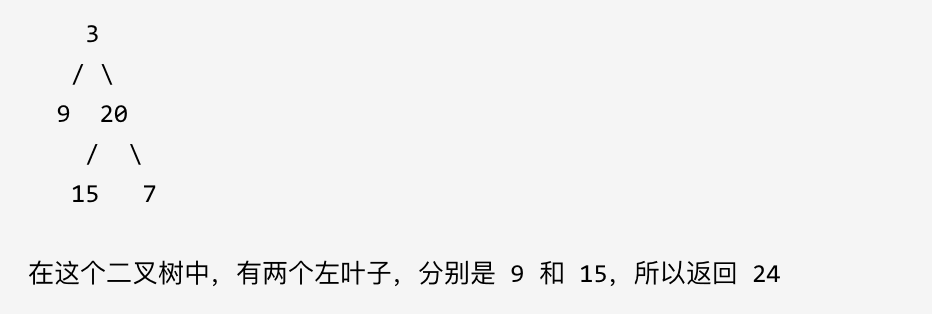
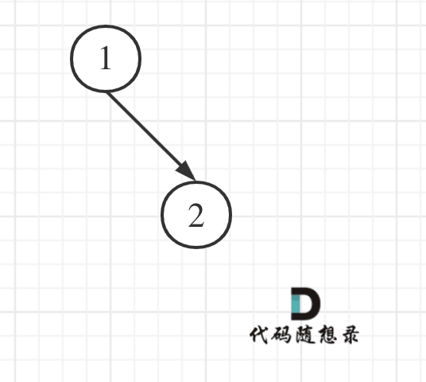
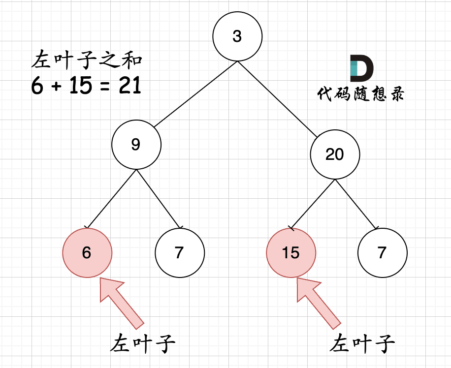

* [做專案（多個 C++、Java、Go、測試開發、前端專案）](https://www.programmercarl.com/other/kstar.html)
* [練習演算法（algorithm）（兩個月高強度學演算法）](https://www.programmercarl.com/xunlian/xunlianying.html)
* [背八股文（40 天挑戰高頻面試題）](https://www.programmercarl.com/xunlian/bagu.html)


# 404.左葉子之和

[LeetCode 題目連結](https://leetcode.cn/problems/sum-of-left-leaves/)

計算給定二元樹（binary tree）的所有左葉子之和。

範例：




## 演算法公開課

**[《程式碼隨想錄》演算法影片公開課](https://programmercarl.com/other/gongkaike.html)：[二元樹的題目中，總有一些規則讓你找不到北 | LeetCode：404.左葉子之和](https://www.bilibili.com/video/BV1GY4y1K7z8)，相信結合影片再看本篇題解，更有助於大家對本題的理解**。

## 解題思路

**首先要注意是判斷左葉子，不是二元樹左側節點（node），所以不要上來就想著層次序走訪（level order traversal）。**

因為題目中其實沒有說清楚左葉子究竟是什麼節點，那麼我來給出左葉子的明確定義：**節點 A 的左孩子不為空，且左孩子的左右孩子都為空（說明是葉節點（leaf node）），那麼 A 節點的左孩子為左葉子節點**

大家思考一下如下圖中的二元樹，左葉子之和究竟是多少？


**其實是 0，因為這棵樹根本沒有左葉子！**

但看這個圖的左葉子之和是多少？ 



相信透過這兩個圖，大家對左葉子的定義有明確理解了。 

那麼**判斷目前節點是不是左葉子是無法判斷的，必須要透過節點的父節點（father node）來判斷其左孩子是不是左葉子。**


如果該節點的左節點不為空，該節點的左節點的左節點為空，該節點的左節點的右節點為空，則找到了一個左葉子，判斷程式碼如下：

```CPP
if (node->left != NULL && node->left->left == NULL && node->left->right == NULL) {
    左葉子節點處理邏輯
}
```

### 遞迴（recursion）法

遞迴的遍歷（traversal）順序為後序遍歷（post-order traversal）（左右中），是因為要透過遞迴函數（recursive function）的轉回值（return value）來累加求取左葉子數值之和。

遞迴三部曲：

1. 確定遞迴函數的參數（parameter）和轉回值

判斷一棵樹的左葉子節點之和，那麼一定要傳入樹的根節點（root node），遞迴函數的轉回值為數值之和，所以為 int

使用題目中給出的函式就可以了。

2. 確定終止條件（termination condition）

如果遍歷到空節點，那麼左葉子值一定是 0 

```CPP
if (root == NULL) return 0;
```

注意，只有目前遍歷的節點是父節點，才能判斷其子節點（child node）是不是左葉子。所以如果目前遍歷的節點是葉節點，那其左葉子也必定是 0，那麼終止條件為： 

```CPP
if (root == NULL) return 0;
if (root->left == NULL && root->right== NULL) return 0; //其實這個也可以不寫，如果不寫不影響結果，但就會讓遞迴多進行了一層。
```


3. 確定單層遞迴的邏輯

當遇到左葉子節點的時候，記錄數值，然後透過遞迴求取左子樹（left subtree）左葉子之和，和右子樹（right subtree）左葉子之和，相加便是整棵樹的左葉子之和。

程式碼如下：

```CPP
int leftValue = sumOfLeftLeaves(root->left);    // 左
if (root->left && !root->left->left && !root->left->right) {
    leftValue = root->left->val;
}
int rightValue = sumOfLeftLeaves(root->right);  // 右

int sum = leftValue + rightValue;               // 中
return sum;

```


整體遞迴程式碼如下：

```CPP
class Solution {
public:
    int sumOfLeftLeaves(TreeNode* root) {
        if (root == NULL) return 0;
        if (root->left == NULL && root->right== NULL) return 0;

        int leftValue = sumOfLeftLeaves(root->left);    // 左
        if (root->left && !root->left->left && !root->left->right) { // 左子樹就是一個左葉子的情況
            leftValue = root->left->val;
        }
        int rightValue = sumOfLeftLeaves(root->right);  // 右

        int sum = leftValue + rightValue;               // 中
        return sum;
    }
};

```

以上程式碼精簡之後如下：

```CPP
class Solution {
public:
    int sumOfLeftLeaves(TreeNode* root) {
        if (root == NULL) return 0;
        int leftValue = 0;
        if (root->left != NULL && root->left->left == NULL && root->left->right == NULL) {
            leftValue = root->left->val;
        }
        return leftValue + sumOfLeftLeaves(root->left) + sumOfLeftLeaves(root->right);
    }
};
```

精簡之後的程式碼其實看不出來用的是什麼遍歷方式了，對於演算法初學者以上先根據第一個版本來學習。 

### 疊代（iteration）法

本題疊代法使用前中後序都是可以的，只要把左葉子節點統計出來，就可以了，那麼參考文章 [二元樹：聽說遞迴能做的，堆疊（stack）也能做！](https://programmercarl.com/二叉树的迭代遍历.html) 和 [二元樹：疊代法統一寫法](https://programmercarl.com/二叉树的统一迭代法.html) 中的寫法，可以寫出一個前序遍歷（preorder traversal）的疊代法。

判斷條件都是一樣的，程式碼如下：

```CPP

class Solution {
public:
    int sumOfLeftLeaves(TreeNode* root) {
        stack<TreeNode*> st;
        if (root == NULL) return 0;
        st.push(root);
        int result = 0;
        while (!st.empty()) {
            TreeNode* node = st.top();
            st.pop();
            if (node->left != NULL && node->left->left == NULL && node->left->right == NULL) {
                result += node->left->val;
            }
            if (node->right) st.push(node->right);
            if (node->left) st.push(node->left);
        }
        return result;
    }
};
```

## 總結

這道題目要求左葉子之和，其實是比較繞的，因為不能判斷本節點是不是左葉子節點。

此時就要透過節點的父節點來判斷其左孩子是不是左葉子了。

**平時我們解二元樹的題目時，已經習慣了透過節點的左右孩子判斷本節點的屬性，而本題我們要透過節點的父節點判斷本節點的屬性。**

希望透過這道題目，可以擴展大家對二元樹的解題思路。


## 其他語言版本

### Java：

**遞迴**

```java
class Solution {
    public int sumOfLeftLeaves(TreeNode root) {
        if (root == null) return 0;
        int leftValue = sumOfLeftLeaves(root.left);    // 左
        int rightValue = sumOfLeftLeaves(root.right);  // 右
                                                       
        int midValue = 0;
        if (root.left != null && root.left.left == null && root.left.right == null) { 
            midValue = root.left.val;
        }
        int sum = midValue + leftValue + rightValue;  // 中
        return sum;
    }
}
```

**疊代**

```java
class Solution {
    public int sumOfLeftLeaves(TreeNode root) {
        if (root == null) return 0;
        Stack<TreeNode> stack = new Stack<> ();
        stack.add(root);
        int result = 0;
        while (!stack.isEmpty()) {
            TreeNode node = stack.pop();
            if (node.left != null && node.left.left == null && node.left.right == null) {
                result += node.left.val;
            }
            if (node.right != null) stack.add(node.right);
            if (node.left != null) stack.add(node.left);
        }
        return result;
    }
}
```
```java
// 層次序走訪疊代法
class Solution {
    public int sumOfLeftLeaves(TreeNode root) {
        int sum = 0;
        if (root == null) return 0;
        Queue<TreeNode> queue = new LinkedList<>();
        queue.offer(root);
        while (!queue.isEmpty()) {
            int size = queue.size();
            while (size -- > 0) {
                TreeNode node = queue.poll();
                if (node.left != null) { // 左節點不為空
                    queue.offer(node.left);
                    if (node.left.left == null && node.left.right == null){ // 左葉子節點
                        sum += node.left.val;
                    }
                }
                if (node.right != null) queue.offer(node.right);
            }
        }
        return sum;
    }
}
```


### Python:
遞迴
```python
# Definition for a binary tree node.
# class TreeNode:
#     def __init__(self, val=0, left=None, right=None):
#         self.val = val
#         self.left = left
#         self.right = right
class Solution:
    def sumOfLeftLeaves(self, root):
        if root is None:
            return 0
        if root.left is None and root.right is None:
            return 0
        
        leftValue = self.sumOfLeftLeaves(root.left)  # 左
        if root.left and not root.left.left and not root.left.right:  # 左子樹是左葉子的情況
            leftValue = root.left.val
            
        rightValue = self.sumOfLeftLeaves(root.right)  # 右

        sum_val = leftValue + rightValue  # 中
        return sum_val
```
遞迴精簡版

```python
# Definition for a binary tree node.
# class TreeNode:
#     def __init__(self, val=0, left=None, right=None):
#         self.val = val
#         self.left = left
#         self.right = right
class Solution:
    def sumOfLeftLeaves(self, root):
        if root is None:
            return 0
        leftValue = 0
        if root.left is not None and root.left.left is None and root.left.right is None:
            leftValue = root.left.val
        return leftValue + self.sumOfLeftLeaves(root.left) + self.sumOfLeftLeaves(root.right)
```

疊代法
```python
# Definition for a binary tree node.
# class TreeNode:
#     def __init__(self, val=0, left=None, right=None):
#         self.val = val
#         self.left = left
#         self.right = right
class Solution:
    def sumOfLeftLeaves(self, root):
        if root is None:
            return 0
        st = [root]
        result = 0
        while st:
            node = st.pop()
            if node.left and node.left.left is None and node.left.right is None:
                result += node.left.val
            if node.right:
                st.append(node.right)
            if node.left:
                st.append(node.left)
        return result

```

### Go:

**遞迴法**

```go
func sumOfLeftLeaves(root *TreeNode) int {
    if root == nil {
        return 0
    }
    leftValue := sumOfLeftLeaves(root.Left)   // 左

    if root.Left != nil && root.Left.Left == nil && root.Left.Right == nil {
        leftValue = root.Left.Val             // 中
    }

    rightValue := sumOfLeftLeaves(root.Right) // 右

    return leftValue + rightValue
}
```

**遞迴精簡版**

```go
func sumOfLeftLeaves(root *TreeNode) int {
    if root == nil {
        return 0
    }
    leftValue := 0
    if root.Left != nil && root.Left.Left == nil && root.Left.Right == nil {
        leftValue = root.Left.Val
    }
    return leftValue + sumOfLeftLeaves(root.Left) + sumOfLeftLeaves(root.Right)
}
```

**疊代法(前序遍歷)**

```go
func sumOfLeftLeaves(root *TreeNode) int {
        st := make([]*TreeNode, 0)
        if root == nil {
            return 0
        }
        st = append(st, root)
        result := 0

        for len(st) != 0 {
            node := st[len(st)-1]
            st = st[:len(st)-1]
            if node.Left != nil && node.Left.Left == nil && node.Left.Right == nil {
                result += node.Left.Val
            }
            if node.Right != nil {
                st = append(st, node.Right)
            }
            if node.Left != nil {
                st = append(st, node.Left)
            } 
        }

        return result
}

```


### JavaScript:

**遞迴法** 

```javascript
var sumOfLeftLeaves = function(root) {
    //採用後序遍歷 遞迴遍歷
    // 1. 確定遞迴函數參數
    const nodesSum = function(node) {
        // 2. 確定終止條件
        if(node === null) {
            return 0;
        }
        let leftValue = nodesSum(node.left);
        let rightValue = nodesSum(node.right);
        // 3. 單層遞迴邏輯
        let midValue = 0;
        if(node.left && node.left.left === null && node.left.right === null) {
            midValue = node.left.val;
        }
        let sum = midValue + leftValue + rightValue;
        return sum;
    }
    return nodesSum(root);
};
```

**疊代法**
```javascript
var sumOfLeftLeaves = function(root) {
   //採用層次序走訪
   if(root === null) {
       return null;
   }
   let queue = [];
   let sum = 0;
   queue.push(root);
   while(queue.length) {
     let node = queue.shift();
     if(node.left !== null && node.left.left === null && node.left.right === null) {
         sum+=node.left.val;
     }
     node.left && queue.push(node.left);
     node.right && queue.push(node.right);
   }
   return sum;
};
```

### TypeScript:

> 遞迴法

```typescript
function sumOfLeftLeaves(root: TreeNode | null): number {
    if (root === null) return 0;
    let midVal: number = 0;
    if (
        root.left !== null &&
        root.left.left === null &&
        root.left.right === null
    ) {
        midVal = root.left.val;
    }
    let leftVal: number = sumOfLeftLeaves(root.left);
    let rightVal: number = sumOfLeftLeaves(root.right);
    return midVal + leftVal + rightVal;
};
```

> 疊代法

```typescript
function sumOfLeftLeaves(root: TreeNode | null): number {
    let helperStack: TreeNode[] = [];
    let tempNode: TreeNode;
    let sum: number = 0;
    if (root !== null) helperStack.push(root);
    while (helperStack.length > 0) {
        tempNode = helperStack.pop()!;
        if (
            tempNode.left !== null &&
            tempNode.left.left === null &&
            tempNode.left.right === null
        ) {
            sum += tempNode.left.val;
        }
        if (tempNode.right !== null) helperStack.push(tempNode.right);
        if (tempNode.left !== null) helperStack.push(tempNode.left);
    }
    return sum;
};
```

### Swift:

**遞迴法** 
```swift
func sumOfLeftLeaves(_ root: TreeNode?) -> Int {
    guard let root = root else {
        return 0
    }

    let leftValue = sumOfLeftLeaves(root.left)
    let rightValue = sumOfLeftLeaves(root.right)

    var midValue: Int = 0
    if root.left != nil && root.left?.left == nil && root.left?.right == nil {
        midValue = root.left!.val
    }

    let sum = midValue + leftValue + rightValue
    return sum
}
```
**疊代法**
```swift
func sumOfLeftLeaves(_ root: TreeNode?) -> Int {
    guard let root = root else {
        return 0
    }

    var stack = Array<TreeNode>()
    stack.append(root)
    var sum = 0

    while !stack.isEmpty {
        let lastNode = stack.removeLast()

        if lastNode.left != nil && lastNode.left?.left == nil && lastNode.left?.right == nil {
            sum += lastNode.left!.val
        }
        if let right = lastNode.right {
            stack.append(right)
        }
        if let left = lastNode.left {
            stack.append(left)
        }
    }
    return sum
}
```

### C:
遞迴法：
```c
int sumOfLeftLeaves(struct TreeNode* root){
    // 遞迴結束條件：若目前節點為空，回傳0
    if(!root)
        return 0;
    
    // 遞迴取左子樹的左節點和和右子樹的左節點和
    int leftValue = sumOfLeftLeaves(root->left);
    int rightValue = sumOfLeftLeaves(root->right);

    // 若目前節點的左節點存在，且其為葉子節點。取它的值
    int midValue = 0;
    if(root->left && (!root->left->left && !root->left->right))
        midValue = root->left->val;
    
    return leftValue + rightValue + midValue;
}
```

疊代法:
```c
int sumOfLeftLeaves(struct TreeNode* root){
    struct TreeNode* stack[1000];
    int stackTop = 0;

    // 若傳入root節點不為空，將其入堆疊
    if(root)
        stack[stackTop++] = root;
    
    int sum = 0;
    //若堆疊不為空，進行迴圈
    while(stackTop) {
        // 出堆疊頂端元素
        struct TreeNode *topNode = stack[--stackTop];
        // 若堆疊頂端元素的左孩子為左葉子節點，將其值加入sum中
        if(topNode->left && (!topNode->left->left && !topNode->left->right))
            sum += topNode->left->val;
        
        // 若目前堆疊頂端節點有左右孩子。將他們加入堆疊中進行遍歷
        if(topNode->right)
            stack[stackTop++] = topNode->right;
        if(topNode->left)
            stack[stackTop++] = topNode->left;
    }
    return sum;
}
```

### Scala:

**遞迴:**
```scala
object Solution {
  def sumOfLeftLeaves(root: TreeNode): Int = {
    if(root == null) return 0
    var midValue = 0
    if(root.left != null && root.left.left == null && root.left.right == null){
      midValue = root.left.value
    }
    // return關鍵字可以省略
    midValue + sumOfLeftLeaves(root.left) + sumOfLeftLeaves(root.right)
  }
}
```

**疊代:**
```scala
object Solution {
  import scala.collection.mutable
  def sumOfLeftLeaves(root: TreeNode): Int = {
    val stack = mutable.Stack[TreeNode]()
    if (root == null) return 0
    stack.push(root)
    var sum = 0
    while (!stack.isEmpty) {
      val curNode = stack.pop()
      if (curNode.left != null && curNode.left.left == null && curNode.left.right == null) {
        sum += curNode.left.value // 如果滿足條件就累加
      }
      if (curNode.right != null) stack.push(curNode.right)
      if (curNode.left != null) stack.push(curNode.left)
    }
    sum
  }
}
```

### Rust:

**遞迴**

```rust
use std::cell::RefCell;
use std::rc::Rc;
impl Solution {
    pub fn sum_of_left_leaves(root: Option<Rc<RefCell<TreeNode>>>) -> i32 {
        let mut res = 0;
        if let Some(node) = root {
            if let Some(left) = &node.borrow().left {
                if left.borrow().right.is_none() && left.borrow().right.is_none() {
                    res += left.borrow().val;
                }
            }
            res + Self::sum_of_left_leaves(node.borrow().left.clone())
                + Self::sum_of_left_leaves(node.borrow().right.clone())
        } else {
            0
        }
    }
}
```

**疊代：**

```rust
use std::cell::RefCell;
use std::rc::Rc;
impl Solution {
    pub fn sum_of_left_leaves(root: Option<Rc<RefCell<TreeNode>>>) -> i32 {
        let mut res = 0;
        let mut stack = vec![root];
        while !stack.is_empty() {
            if let Some(node) = stack.pop().unwrap() {
                if let Some(left) = &node.borrow().left {
                    if left.borrow().left.is_none() && left.borrow().right.is_none() {
                        res += left.borrow().val;
                    }
                    stack.push(Some(left.to_owned()));
                }
                if let Some(right) = &node.borrow().right {
                    stack.push(Some(right.to_owned()));
                }
            }
        }
        res
    }
}
```
### C#
```csharp
// 遞迴
public int SumOfLeftLeaves(TreeNode root)
{
    if (root == null) return 0;

    int leftValue = SumOfLeftLeaves(root.left);
    if (root.left != null && root.left.left == null && root.left.right == null)
    {
        leftValue += root.left.val;
    }
    int rightValue = SumOfLeftLeaves(root.right);
    return leftValue + rightValue;

}
```


