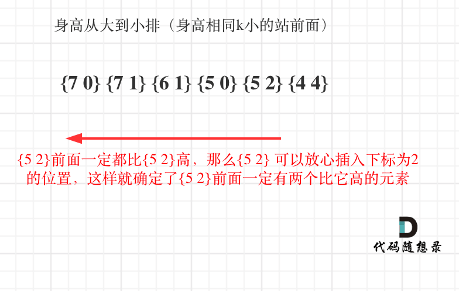

* [做專案（多個 C++、Java、Go、測試開發、前端專案）](https://www.programmercarl.com/other/kstar.html)
* [練習演算法（兩個月高強度學演算法）](https://www.programmercarl.com/xunlian/xunlianying.html)
* [背八股文（40 天挑戰高頻面試題）](https://www.programmercarl.com/xunlian/bagu.html)


# 406.根據身高重建佇列（queue）

[LeetCode 題目連結](https://leetcode.cn/problems/queue-reconstruction-by-height/)

假設有打亂順序的一群人站成一個佇列，陣列（array） people 表示佇列中一些人的屬性（不一定按順序）。每個 people[i] = [hi, ki] 表示第 i 個人的身高為 hi ，前面 正好 有 ki 個身高大於或等於 hi 的人。

請你重新構造並回傳輸入陣列 people 所表示的佇列。回傳的佇列應該格式化為陣列 queue ，其中 queue[j] = [hj, kj] 是佇列中第 j 個人的屬性（queue[0] 是排在佇列前面的人）。

範例 1：
* 輸入：people = [[7,0],[4,4],[7,1],[5,0],[6,1],[5,2]]
* 輸出：[[5,0],[7,0],[5,2],[6,1],[4,4],[7,1]]
* 解釋：
    * 編號為 0 的人身高為 5 ，沒有身高更高或者相同的人排在他前面。
    * 編號為 1 的人身高為 7 ，沒有身高更高或者相同的人排在他前面。
    * 編號為 2 的人身高為 5 ，有 2 個身高更高或者相同的人排在他前面，即編號為 0 和 1 的人。
    * 編號為 3 的人身高為 6 ，有 1 個身高更高或者相同的人排在他前面，即編號為 1 的人。
    * 編號為 4 的人身高為 4 ，有 4 個身高更高或者相同的人排在他前面，即編號為 0、1、2、3 的人。
    * 編號為 5 的人身高為 7 ，有 1 個身高更高或者相同的人排在他前面，即編號為 1 的人。
    * 因此 [[5,0],[7,0],[5,2],[6,1],[4,4],[7,1]] 是重新構造後的佇列。

範例 2：
* 輸入：people = [[6,0],[5,0],[4,0],[3,2],[2,2],[1,4]]
* 輸出：[[4,0],[5,0],[2,2],[3,2],[1,4],[6,0]]

提示：

* 1 <= people.length <= 2000
* 0 <= hi <= 10^6
* 0 <= ki < people.length

題目資料確保佇列可以被重建

## 演算法公開課

**[《程式碼隨想錄》演算法影片公開課](https://programmercarl.com/other/gongkaike.html)：[貪心演算法（greedy algorithm），不要兩邊一起貪，會顧此失彼 | LeetCode：406.根據身高重建佇列](https://www.bilibili.com/video/BV1EA411675Y)，相信結合影片再看本篇題解，更有助於大家對本題的理解**。

## 解題思路

本題有兩個維度，h 和 k，看到這種題目一定要想如何確定一個維度，然後再按照另一個維度重新排列。

其實如果大家認真做了 [135. 分發糖果](https://programmercarl.com/0135.分发糖果.html)，就會發現和此題有點像。

在 [135. 分發糖果](https://programmercarl.com/0135.分发糖果.html) 我就強調過一次，遇到兩個維度權衡的時候，一定要先確定一個維度，再確定另一個維度。

**如果兩個維度一起考慮一定會顧此失彼**。

對於本題相信大家困惑的點是先確定 k 還是先確定 h 呢，也就是究竟先按 h 排序（sorting）呢，還是先按照 k 排序呢？

如果按照 k 來從小到大排序，排完之後，會發現 k 的排列（permutation）並不符合條件，身高也不符合條件，兩個維度哪一個都沒確定下來。

那麼按照身高 h 來排序呢，身高一定是從大到小排（身高相同的話則 k 小的站前面），讓高個子在前面。

**此時我們可以確定一個維度了，就是身高，前面的節點（node）一定都比本節點高！**

那麼只需要按照 k 為下標（subscript）重新插入佇列就可以了，為什麼呢？

以圖中 {5,2} 為例：




按照身高排序之後，優先按身高高的 people 的 k 來插入，後續插入節點也不會影響前面已經插入的節點，最終按照 k 的規則完成了佇列。

所以在按照身高從大到小排序後：

**區域最佳（local optimum）：優先按身高高的 people 的 k 來插入。插入操作過後的 people 滿足佇列屬性**

**總體最佳（global optimum）：最後都做完插入操作，整個佇列滿足題目佇列屬性**

區域最佳可推出總體最佳，找不出反例，那就試試貪心法。

一些同學可能也會疑惑，你怎麼知道區域最佳就可以推出總體最佳呢？有數學證明嗎？

在貪心系列開篇詞 [關於貪心演算法，你該了解這些！](https://programmercarl.com/贪心算法理论基础.html) 中，我已經講過了這個問題了。

練習題目或者面試的時候，手動模擬（simulation）一下感覺可以區域最佳推出總體最佳，而且想不到反例，那麼就試一試貪心法，至於嚴格的數學證明，就不在討論範圍內了。

如果沒有讀過 [關於貪心演算法，你該了解這些！](https://programmercarl.com/贪心算法理论基础.html) 的同學建議讀一下，相信對貪心法就有初步的了解了。

回歸本題，整個插入過程如下：

排序完的 people：
[[7,0], [7,1], [6,1], [5,0], [5,2], [4,4]]

插入的過程：
* 插入 [7,0]：[[7,0]]
* 插入 [7,1]：[[7,0],[7,1]]
* 插入 [6,1]：[[7,0],[6,1],[7,1]]
* 插入 [5,0]：[[5,0],[7,0],[6,1],[7,1]]
* 插入 [5,2]：[[5,0],[7,0],[5,2],[6,1],[7,1]]
* 插入 [4,4]：[[5,0],[7,0],[5,2],[6,1],[4,4],[7,1]]

此時就按照題目的要求完成了重新排列。

C++ 程式碼如下：

```CPP
// 版本一
class Solution {
public:
    static bool cmp(const vector<int>& a, const vector<int>& b) {
        if (a[0] == b[0]) return a[1] < b[1];
        return a[0] > b[0];
    }
    vector<vector<int>> reconstructQueue(vector<vector<int>>& people) {
        sort (people.begin(), people.end(), cmp);
        vector<vector<int>> que;
        for (int i = 0; i < people.size(); i++) {
            int position = people[i][1];
            que.insert(que.begin() + position, people[i]);
        }
        return que;
    }
};
```
* 時間複雜性（time complexity）：O(nlog n + n^2)
* 空間複雜度（space complexity）：O(n)

但使用 vector 是非常費時的，C++ 中 vector（可以理解是一個 dynamic array，底層是普通陣列實作的）如果插入元素大於預先普通陣列大小，vector 底部會有一個擴容的操作，即申請兩倍於原先普通陣列的大小，然後把資料複製到另一個更大的陣列上。

所以使用 vector（dynamic array）來 insert，是費時的，插入再複製的話，單純一個插入的操作就是 O(n^2) 了，甚至可能複製好幾次，就不止 O(n^2) 了。

改成鏈接串列（linked list）之後，C++ 程式碼如下：

```CPP
// 版本二
class Solution {
public:
    // 身高從大到小排（身高相同k小的站前面）
    static bool cmp(const vector<int>& a, const vector<int>& b) {
        if (a[0] == b[0]) return a[1] < b[1];
        return a[0] > b[0];
    }
    vector<vector<int>> reconstructQueue(vector<vector<int>>& people) {
        sort (people.begin(), people.end(), cmp);
        list<vector<int>> que; // list底層是鏈接串列實作，插入效率比vector高得多
        for (int i = 0; i < people.size(); i++) {
            int position = people[i][1]; // 插入到下標為position的位置
            std::list<vector<int>>::iterator it = que.begin();
            while (position--) { // 尋找插入位置
                it++;
            }
            que.insert(it, people[i]);
        }
        return vector<vector<int>>(que.begin(), que.end());
    }
};
```

* 時間複雜性：O(nlog n + n^2)
* 空間複雜度：O(n)

大家可以把兩個版本的程式碼提交一下試試，就可以發現其差別了！

關於本題使用陣列還是使用鏈接串列的效能差異，我在 [貪心演算法：根據身高重建佇列（續集）](https://programmercarl.com/根据身高重建队列（vector原理讲解）.html) 中詳細講解了一波

## 總結

關於出現兩個維度一起考慮的情況，我們已經做過兩道題目了，另一道就是 [135. 分發糖果](https://programmercarl.com/0135.分发糖果.html)。

**其技巧都是確定一邊然後貪心另一邊，兩邊一起考慮，就會顧此失彼**。

這道題目可以說比 [135. 分發糖果](https://programmercarl.com/0135.分发糖果.html) 難不少，其貪心的策略也是比較巧妙。

最後我給出了兩個版本的程式碼，可以明顯看出使用 C++ 中的 list（底層鏈接串列實作）比 vector（陣列）效率高得多。

**對某一種語言容器（container）的使用，特性的選擇都會不同程度上影響效率**。

所以很多人都說寫演算法題用什麼語言都可以，主要體現在演算法思維上，其實我是同意的但也不同意。

對於看別人題解的同學，題解用什麼語言其實影響不大，只要題解把所使用語言特性最佳化的點講出來，大家都可以看懂，並使用自己語言的時候注意一下。

對於寫題解的同學，刷題用什麼語言影響就非常大，如果自己語言沒有學好而強調演算法和程式語言沒關係，其實是會誤傷別人的。

**這也是我為什麼統一使用 C++ 寫題解的原因**


## 其他語言版本


### Java 
```java
class Solution {
    public int[][] reconstructQueue(int[][] people) {
        // 身高從大到小排（身高相同k小的站前面）
        Arrays.sort(people, (a, b) -> {
            if (a[0] == b[0]) return a[1] - b[1];   // a - b 是升序排列，故在a[0] == b[0]的狀況下，會根據k值升序排列
            return b[0] - a[0];   //b - a 是遞降次序排列，在a[0] != b[0]，的狀況會根據h值遞降次序排列
        });

        LinkedList<int[]> que = new LinkedList<>();

        for (int[] p : people) {
            que.add(p[1],p);   //Linkedlist.add(index, value)，會將value插入到指定index裡。
        }

        return que.toArray(new int[people.length][]);
    }
}
```

### Python
```python
class Solution:
    def reconstructQueue(self, people: List[List[int]]) -> List[List[int]]:
    	# 先按照h維度的身高順序從高到低排序。確定第一個維度
        # lambda回傳的是一個元組：當-x[0](維度h）相同時，再根據x[1]（維度k）從小到大排序
        people.sort(key=lambda x: (-x[0], x[1]))
        que = []
	
	# 根據每個元素的第二個維度k，貪心演算法，進行插入
        # people已經排序過了：同一高度時k值小的排前面。
        for p in people:
            que.insert(p[1], p)
        return que
```

### Go
```go
func reconstructQueue(people [][]int) [][]int {
    // 先將身高從大到小排序，確定最大個子的相對位置
    sort.Slice(people, func(i, j int) bool {
        if people[i][0] == people[j][0] {
            return people[i][1] < people[j][1]   // 當身高相同時，將K按照從小到大排序
        }
        return people[i][0] > people[j][0]     // 身高按照由大到小的順序來排
    })

    // 再按照K進行插入分類，優先插入K小的
	for i, p := range people {
		copy(people[p[1]+1 : i+1], people[p[1] : i+1])  // 空出一個位置
		people[p[1]] = p
	}
	return people
}
```
```go
// 鏈接串列實作
func reconstructQueue(people [][]int) [][]int {
     sort.Slice(people,func (i,j int) bool {
        if people[i][0] == people[j][0] {
            return people[i][1] < people[j][1]    //當身高相同時，將K按照從小到大排序
        }
        return people[i][0] > people[j][0]
    })
    l := list.New()      //建立鏈接串列
    for i:=0; i < len(people); i++ {
        position := people[i][1]
        mark := l.PushBack(people[i])      //插入元素
        e := l.Front()
        for position != 0 {      //取得相對位置
            position--
            e = e.Next()
        }
        l.MoveBefore(mark, e)    //移動位置
        
    }
    res := [][]int{}
    for e := l.Front(); e != nil; e = e.Next() {
        res = append(res, e.Value.([]int))
    }
    return res
}
```

### JavaScript 

```Javascript
var reconstructQueue = function(people) {
    let queue = []
    people.sort((a, b ) => {
        if(b[0] !== a[0]) {
            return b[0] - a[0]
        } else {
            return a[1] - b[1]
        }
        
    })

    for(let i = 0; i < people.length; i++) {
        queue.splice(people[i][1], 0, people[i])
    }
    return queue
};
```

### Rust

```Rust
impl Solution {
    pub fn reconstruct_queue(mut people: Vec<Vec<i32>>) -> Vec<Vec<i32>> {
        let mut queue = vec![];
        people.sort_by(|a, b| {
            if a[0] == b[0] {
                return a[1].cmp(&b[1]);
            }
            b[0].cmp(&a[0])
        });
        queue.push(people[0].clone());
        for v in people.iter().skip(1) {
            queue.insert(v[1] as usize, v.clone());
        }
        queue
    }
}
```

### C
```c
int cmp(const void *p1, const void *p2) {
    int *pp1 = *(int**)p1;
    int *pp2 = *(int**)p2;
    // 若身高相同，則按照k從小到大排列
    // 若身高不同，按身高從大到小排列
    return pp1[0] == pp2[0] ? pp1[1] - pp2[1] : pp2[0] - pp1[0];
}

// 將start與end中間的元素都後移一位
// start為將要新插入元素的位置
void moveBack(int **people, int peopleSize, int start, int end) {
    int i;
    for(i = end; i > start; i--) {
        people[i] = people[i-1];
    }
}

int** reconstructQueue(int** people, int peopleSize, int* peopleColSize, int* returnSize, int** returnColumnSizes){
    int i;
    // 將people按身高從大到小排列（若身高相同，按k從小到大排列）
    qsort(people, peopleSize, sizeof(int*), cmp);

    for(i = 0; i < peopleSize; ++i) {
        // people[i]要插入的位置
        int position = people[i][1];
        int *temp = people[i];
        // 將position到i中間的元素後移一位
        // 注：因為已經排好序，position不會比i大。(舉例：排序後people最後一位元素最小，其可能的k最大值為peopleSize-2，小於此時的i)
        moveBack(people, peopleSize, position, i);
        // 將temp放置到position處
        people[position] = temp;

    }
    

    // 設定回傳二維陣列的大小以及裡面每個一維陣列的長度
    *returnSize = peopleSize;
    *returnColumnSizes = (int*)malloc(sizeof(int) * peopleSize);
    for(i = 0; i < peopleSize; ++i) {
        (*returnColumnSizes)[i] = 2;
    }
    return people;
}
```

### TypeScript

```typescript
function reconstructQueue(people: number[][]): number[][] {
    people.sort((a, b) => {
        if (a[0] === b[0]) return a[1] - b[1];
        return b[0] - a[0];
    });
    const resArr: number[][] = [];
    for (let i = 0, length = people.length; i < length; i++) {
        resArr.splice(people[i][1], 0, people[i]);
    }
    return resArr;
};
```

### Scala

```scala
object Solution {
  import scala.collection.mutable
  def reconstructQueue(people: Array[Array[Int]]): Array[Array[Int]] = {
    val person = people.sortWith((a, b) => {
      if (a(0) == b(0)) a(1) < b(1)
      else a(0) > b(0)
    })

    var que = mutable.ArrayBuffer[Array[Int]]()

    for (per <- person) {
      que.insert(per(1), per)
    }

    que.toArray
  }
}
```
### C#
```csharp
public class Solution
{
    public int[][] ReconstructQueue(int[][] people)
    {
        Array.Sort(people, (a, b) =>
        {
            if (a[0] == b[0])
            {
                return a[1] - b[1];
            }
            return b[0] - a[0];
        });
        var res = new List<int[]>();
        for (int i = 0; i < people.Length; i++)
        {
            res.Insert(people[i][1], people[i]);
        }
        return res.ToArray();
    }
}
```


