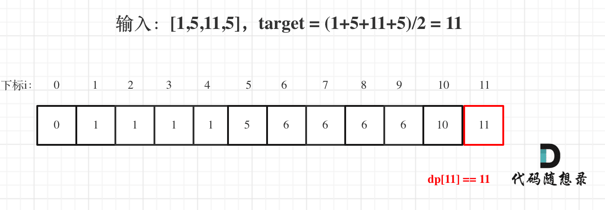

* [做專案（多個 C++、Java、Go、測試開發、前端專案）](https://www.programmercarl.com/other/kstar.html)
* [練習演算法（algorithm）（兩個月高強度學演算法）](https://www.programmercarl.com/xunlian/xunlianying.html)
* [背八股文（40 天挑戰高頻面試題）](https://www.programmercarl.com/xunlian/bagu.html)


# 416. 分割等和子集

[LeetCode 題目連結](https://leetcode.cn/problems/partition-equal-subset-sum/)

題目難易：中等

給定一個只包含正整數（positive integer）的非空陣列（array）。是否可以將這個陣列分割成兩個子集（subset），使得兩個子集的元素（element）和相等。

注意:
每個陣列中的元素不會超過 100
陣列的大小不會超過 200

範例 1:
* 輸入: [1, 5, 11, 5]
* 輸出: true
* 解釋: 陣列可以分割成 [1, 5, 5] 和 [11].

範例 2:
* 輸入: [1, 2, 3, 5]
* 輸出: false
* 解釋: 陣列不能分割成兩個元素和相等的子集.

提示：
* 1 <= nums.length <= 200
* 1 <= nums[i] <= 100

## 演算法公開課

**[《程式碼隨想錄》演算法影片公開課](https://programmercarl.com/other/gongkaike.html)：[動態規劃（dynamic programming, DP）之背包問題（knapsack problem），這個包能裝滿嗎？| LeetCode：416.分割等和子集](https://www.bilibili.com/video/BV1rt4y1N7jE/)，相信結合影片再看本篇題解，更有助於大家對本題的理解**。


## 解題思路

這道題目初步看，和如下兩題幾乎是一樣的，大家可以用回溯（backtracking）法，解決如下兩題

* 698.劃分為 k 個相等的子集
* 473.火柴拼正方形

這道題目是要找是否可以將這個陣列分割成兩個子集，使得兩個子集的元素和相等。

那麼只要找到集合（set）裡能夠出現 sum / 2 的子集總和，就算是可以分割成兩個相同元素和子集了。

本題是可以用回溯暴力搜尋出所有答案的，但最後逾時了，也不想再最佳化了，放棄回溯。

是否有其他解法可以解決此題。 

本題的本質是，能否把容量為 sum / 2 的背包裝滿。 

**這是背包演算法可以解決的經典類型題目**。 

如果對 0/1 背包問題（0/1 knapsack problem）不夠了解，建議仔細看完如下兩篇：

* [動態規劃：關於 01 背包問題，你該了解這些！](https://programmercarl.com/背包理论基础01背包-1.html)
* [動態規劃：關於 01 背包問題，你該了解這些！（rolling array）](https://programmercarl.com/背包理论基础01背包-2.html)

## 01 背包問題

01 背包問題，大家都知道，有 N 件物品和一個最多能背重量為 W 的背包。第 i 件物品的重量是 weight[i]，得到的價值是 value[i] 。每件物品只能用一次，求解將哪些物品裝入背包裡物品價值總和最大。

**背包問題有多種背包方式，常見的有：01 背包、無界背包問題（unbounded knapsack problem）、bounded knapsack、分組背包和混合背包等等。**

要注意題目描述中商品是不是可以重複放入。

**即一個商品如果可以重複多次放入是完全背包，而只能放入一次是 01 背包，寫法還是不一樣的。**

**元素我們只能用一次，如果使用背包，那麼也是 01 背包**

回歸主題：首先，本題要求集合裡能否出現總和為 sum / 2 的子集。

即有一個只能裝重量為 sum / 2 的背包，商品為數字，這些數字能不能把這個背包裝滿。 

那每一件商品是數字的話，對應的重量和價值是多少呢？  

一個數字只有一個維度，即重量等於價值。  

當數字可以裝滿承載重量為 sum / 2 的背包時，這個背包的價值也是 sum / 2。

那麼這道題就是裝滿承載重量為 sum / 2 的背包，價值最大是多少？ 

如果最大價值是 sum / 2，說明正好被商品裝滿了。

因為商品是數字，重量和對應的價值是相同的。

以上分析完，我們就可以直接用 01 背包來解決這個問題了。

動態規劃五部曲分析如下：

### 1. 確定 dp 陣列以及下標（subscript）的含義

01 背包中，dp[j] 表示：容量（所能裝的重量）為 j 的背包，所背的物品價值最大可以為 dp[j]。

如果背包所載重量為 target，dp[target] 就是裝滿背包之後的總價值，因為本題中每一個元素的數值既是重量，也是價值，所以，當 dp[target] == target 的時候，背包就裝滿了。

有錄友可能想，那還有裝不滿的時候？ 

拿輸入陣列 [1, 5, 11, 5] 舉例，dp[7] 只能等於 6，因為只能放進 1 和 5。

而 dp[6] 就可以等於 6 了，放進 1 和 5，那麼 dp[6] == 6，說明背包裝滿了。

### 2. 確定遞迴公式（recurrence formula）

01 背包的遞迴公式為：dp[j] = max(dp[j], dp[j - weight[i]] + value[i]);

本題，相當於背包裡放入數值，那麼物品 i 的重量是 nums[i]，其價值也是 nums[i]。

所以遞迴公式：dp[j] = max(dp[j], dp[j - nums[i]] + nums[i]);


### 3. dp 陣列如何初始化（initialization）

在 01 背包，一維（one dimensional）dp 如何初始化，已經講過，

從 dp[j] 的定義來看，首先 dp[0] 一定是 0。

如果題目給的價值都是正整數，那麼非 0 下標都初始化為 0 就可以了，如果題目給的價值有負數，那麼非 0 下標就要初始化為負無窮。

**這樣才能讓 dp 陣列在遞迴的過程中取得最大的價值，而不是被初始值覆蓋了**。

本題題目中只包含正整數的非空陣列，所以非 0 下標的元素初始化為 0 就可以了。

程式碼如下：

```CPP
// 題目中說：每個陣列中的元素不會超過 100，陣列的大小不會超過 200
// 總和不會大於20000，背包最大只需要其中一半，所以10001大小就可以了
vector<int> dp(10001, 0);
```

### 4. 確定遍歷（traversal）順序

在 [動態規劃：關於 01 背包問題，你該了解這些！（rolling array）](https://programmercarl.com/背包理论基础01背包-2.html) 中就已經說明：如果使用一維 dp 陣列，物品遍歷的 for 迴圈（for-loop）放在外層，遍歷背包的 for 迴圈放在內層，且內層 for 迴圈倒序遍歷！

程式碼如下：

```CPP
// 開始 01背包
for(int i = 0; i < nums.size(); i++) {
    for(int j = target; j >= nums[i]; j--) { // 每一個元素一定是不可重複放入，所以從大到小遍歷
        dp[j] = max(dp[j], dp[j - nums[i]] + nums[i]);
    }
}
```

### 5. 舉例推導 dp 陣列

dp[j] 的數值一定是小於等於 j 的。

**如果 dp[j] == j 說明，集合中的子集總和正好可以湊成總和 j，理解這一點很重要。**

用例 1，輸入 [1,5,11,5] 為例，如圖：




最後 dp[11] == 11，說明可以將這個陣列分割成兩個子集，使得兩個子集的元素和相等。

綜上分析完畢，C++ 程式碼如下：

```CPP
class Solution {
public:
    bool canPartition(vector<int>& nums) {
        int sum = 0;

        // dp[i]中的i表示背包內總和
        // 題目中說：每個陣列中的元素不會超過 100，陣列的大小不會超過 200
        // 總和不會大於20000，背包最大只需要其中一半，所以10001大小就可以了
        vector<int> dp(10001, 0);
        for (int i = 0; i < nums.size(); i++) {
            sum += nums[i];
        }
        // 也可以使用程式館函數一步求和
        // int sum = accumulate(nums.begin(), nums.end(), 0);
        if (sum % 2 == 1) return false;
        int target = sum / 2;

        // 開始 01背包
        for(int i = 0; i < nums.size(); i++) {
            for(int j = target; j >= nums[i]; j--) { // 每一個元素一定是不可重複放入，所以從大到小遍歷
                dp[j] = max(dp[j], dp[j - nums[i]] + nums[i]);
            }
        }
        // 集合中的元素正好可以湊成總和target
        if (dp[target] == target) return true;
        return false;
    }
};
```

* 時間複雜性（time complexity）：O(n^2)
* 空間複雜度（space complexity）：O(n)，雖然 dp 陣列大小為一個常數（constant），但是大常數

## 總結

這道題目就是一道 01 背包經典應用類的題目，需要我們拆解題目，然後才能發現可以使用 01 背包。

01 背包相對於本題，主要要理解，題目中物品是 nums[i]，重量是 nums[i]，價值也是 nums[i]，背包體積是 sum/2。

做完本題後，需要大家清晰：背包問題，不僅可以求背包能背的最大價值，還可以求這個背包是否可以裝滿。

## 其他語言版本


### Java：
```Java
class Solution {
    public boolean canPartition(int[] nums) {
        if(nums == null || nums.length == 0) return false;
        int n = nums.length;
        int sum = 0;
        for(int num : nums) {
            sum += num;
        }
        //總和為奇數，不能平分
        if(sum % 2 != 0) return false;
        int target = sum / 2;
        int[] dp = new int[target + 1];
        for(int i = 0; i < n; i++) {
            for(int j = target; j >= nums[i]; j--) {
                //物品 i 的重量是 nums[i]，其價值也是 nums[i]
                dp[j] = Math.max(dp[j], dp[j - nums[i]] + nums[i]);
            }
           
            //修剪一下，每一次完成內層的for-loop，立即檢查是否dp[target] == target，最佳化時間複雜性（26ms -> 20ms）
            if(dp[target] == target)
                return true;
        }
        return dp[target] == target;
    }
}
```

二維（two-dimensional）陣列版本（易於理解）：
```java
public class Solution {
    public static void main(String[] args) {
        int num[] = {1,5,11,5};
        canPartition(num);

    }
    public static boolean canPartition(int[] nums) {
        int len = nums.length;
        // 題目已經說非空陣列，可以不做非空判斷
        int sum = 0;
        for (int num : nums) {
            sum += num;
        }
        // 特判：如果是奇數，就不符合要求
        if ((sum %2 ) != 0) {
            return false;
        }

        int target = sum / 2; //目標背包容量
        // 建立二維狀態陣列，列：物品索引，行：容量（包括 0）
        /*
        dp[i][j]表示從陣列的 [0, i] 這個子區間內挑選一些正整數
          每個數只能用一次，使得這些數的和恰好等於 j。
        */
        boolean[][] dp = new boolean[len][target + 1];

        // 先填表格第 0 列，第 1 個數只能讓容積為它自己的背包恰好裝滿  （這裡的dp[][]陣列的含義就是“恰好”，所以就算容積比它大的也不要）
        if (nums[0] <= target) {
            dp[0][nums[0]] = true;
        }
        // 再填表格後面幾列
        //外層遍歷物品
        for (int i = 1; i < len; i++) {
            //內層遍歷背包
            for (int j = 0; j <= target; j++) {
                // 直接從上一列先把結果抄下來，然後再修正
                dp[i][j] = dp[i - 1][j];

                //如果某個物品單獨的重量恰好就等於背包的重量，那麼也是滿足dp陣列的定義的
                if (nums[i] == j) {
                    dp[i][j] = true;
                    continue;
                }
                //如果某個物品的重量小於j，那就可以看該物品是否放入背包
                //dp[i - 1][j]表示該物品不放入背包，如果在 [0, i - 1] 這個子區間內已經有一部分元素，使得它們的和為 j ，那麼 dp[i][j] = true；
                //dp[i - 1][j - nums[i]]表示該物品放入背包。如果在 [0, i - 1] 這個子區間內就得找到一部分元素，使得它們的和為 j - nums[i]。
                if (nums[i] < j) {
                    dp[i][j] = dp[i - 1][j] || dp[i - 1][j - nums[i]];
                }
            }
        }
        for (int i = 0; i < len; i++) {
            for (int j = 0; j <= target; j++) {
                System.out.print(dp[i][j]+" ");
            }
            System.out.println();
        }
        return dp[len - 1][target];
    }
}
//dp陣列的印出結果
false true false false false false false false false false false false 
false true false false false true true false false false false false 
false true false false false true true false false false false true 
false true false false false true true false false false true true 
```
二維陣列整數（integer）版本
```Java
class Solution {
    public boolean canPartition(int[] nums) {
        //using 2-D DP array.
        int len = nums.length;
        //check edge cases;
        if(len == 0)
            return false;

        int sum = 0;
        for (int num : nums)
            sum += num;
        //we only deal with even numbers. If sum is odd, return false;
        if(sum % 2 == 1)
            return false;
        
        int target = sum / 2;
        int[][] dp = new int[nums.length][target + 1];

        // for(int j = 0; j <= target; j++){
        //     if(j < nums[0])
        //         dp[0][j] = 0;
        //     else
        //         dp[0][j] = nums[0];
        // }

        //initialize dp array
        for(int j = nums[0]; j <= target; j++){
            dp[0][j] = nums[0];
        }

        for(int i = 1; i < len; i++){
            for(int j = 0; j <= target; j++){
                if (j < nums[i]) 
                    dp[i][j] = dp[i - 1][j];
                else 
                    dp[i][j] = Math.max(dp[i - 1][j], dp[i - 1][j - nums[i]] + nums[i]);
            }
        }

        //print out DP array
        // for(int x : dp){
        //     System.out.print(x + ",");
        // }
        // System.out.print("    "+i+" row"+"\n");
        return dp[len - 1][target] == target;
    }
}
//dp陣列的印出結果 for test case 1.
0, 1, 1, 1, 1, 1, 1, 1, 1, 1, 1, 1, 
0, 1, 1, 1, 1, 5, 6, 6, 6, 6, 6, 6, 
0, 1, 1, 1, 1, 5, 6, 6, 6, 6, 6, 11, 
0, 1, 1, 1, 1, 5, 6, 6, 6, 6, 10, 11, 
```

### Python：
卡哥版
```python
class Solution:
    def canPartition(self, nums: List[int]) -> bool:
        _sum = 0

        # dp[i]中的i表示背包內總和
        # 題目中說：每個陣列中的元素不會超過 100，陣列的大小不會超過 200
        # 總和不會大於20000，背包最大只需要其中一半，所以10001大小就可以了
        dp = [0] * 10001
        for num in nums:
            _sum += num
        # 也可以使用內建函數一步求和
        # _sum = sum(nums)
        if _sum % 2 == 1:
            return False
        target = _sum // 2

        # 開始 0-1背包
        for num in nums:
            for j in range(target, num - 1, -1):  # 每一個元素一定是不可重複放入，所以從大到小遍歷
                dp[j] = max(dp[j], dp[j - num] + num)

        # 集合中的元素正好可以湊成總和target
        if dp[target] == target:
            return True
        return False

```

卡哥版(簡化版)
```python
class Solution:
    def canPartition(self, nums: List[int]) -> bool:
        if sum(nums) % 2 != 0:
            return False
        target = sum(nums) // 2
        dp = [0] * (target + 1)
        for num in nums:
            for j in range(target, num-1, -1):
                dp[j] = max(dp[j], dp[j-num] + num)
        return dp[-1] == target

```
二維 DP 版
```python
class Solution:
    def canPartition(self, nums: List[int]) -> bool:
        
        total_sum = sum(nums)

        if total_sum % 2 != 0:
            return False

        target_sum = total_sum // 2
        dp = [[False] * (target_sum + 1) for _ in range(len(nums) + 1)]

        # 初始化第一列（空子集可以得到和為0）
        for i in range(len(nums) + 1):
            dp[i][0] = True

        for i in range(1, len(nums) + 1):
            for j in range(1, target_sum + 1):
                if j < nums[i - 1]:
                    # 目前數字大於目標和時，無法使用該數字
                    dp[i][j] = dp[i - 1][j]
                else:
                    # 目前數字小於等於目標和時，可以選擇使用或不使用該數字
                    dp[i][j] = dp[i - 1][j] or dp[i - 1][j - nums[i - 1]]

        return dp[len(nums)][target_sum]

```
一維 DP 版
```python
class Solution:
    def canPartition(self, nums: List[int]) -> bool:

        total_sum = sum(nums)

        if total_sum % 2 != 0:
            return False

        target_sum = total_sum // 2
        dp = [False] * (target_sum + 1)
        dp[0] = True

        for num in nums:
            # 從target_sum逆序疊代到num，步長為-1
            for i in range(target_sum, num - 1, -1):
                dp[i] = dp[i] or dp[i - num]
        return dp[target_sum]

 
```

### Go：
一維 dp
```go
// 分割等和子集 動態規劃
// 時間複雜性O(n^2) 空間複雜度O(n)
func canPartition(nums []int) bool {
    sum := 0
    for _, num := range nums {
        sum += num
    }
    // 如果 nums 的總和為奇數則不可能平分成兩個子集
    if sum % 2 == 1 {
        return false
    }
    
    target := sum / 2
    dp := make([]int, target + 1)

    for _, num := range nums {
        for j := target; j >= num; j-- {
            if dp[j] < dp[j - num] + num {
                dp[j] = dp[j - num] + num
            }
        }
    }
    return dp[target] == target
}
```

二維 dp
```go
func canPartition(nums []int) bool {
    sum := 0
    for _, val := range nums {
        sum += val
    }
    if sum % 2 == 1 {
        return false
    }
    target := sum / 2
    dp := make([][]int, len(nums))
    for i := range dp {
        dp[i] = make([]int, target + 1)
    }
    for j := nums[0]; j <= target; j++ {
        dp[0][j] = nums[0]
    }
    for i := 1; i < len(nums); i++ {
        for j := 0; j <= target; j++ {
            if j < nums[i] {
                dp[i][j] = dp[i-1][j]
            } else {
                dp[i][j] = max(dp[i-1][j], dp[i-1][j-nums[i]] + nums[i])
            }
        }  
    }
    return dp[len(nums)-1][target] == target
}

func max(x, y int) int {
    if x > y {
        return x
    }
    return y
}
```

### JavaScript: 

```js
var canPartition = function(nums) {
    const sum = (nums.reduce((p, v) => p + v));
    if (sum & 1) return false;
    const dp = Array(sum / 2 + 1).fill(0);
    for(let i = 0; i < nums.length; i++) {
        for(let j = sum / 2; j >= nums[i]; j--) {
            dp[j] = Math.max(dp[j], dp[j - nums[i]] + nums[i]);
            if (dp[j] === sum / 2) {
                return true;
            }
        }
    }
    return dp[sum / 2] === sum / 2;
};
```


### Rust:

```Rust
impl Solution {
    pub fn can_partition(nums: Vec<i32>) -> bool {
        let sum = nums.iter().sum::<i32>() as usize;
        if sum % 2 == 1 {
            return false;
        }
        let target = sum / 2;
        let mut dp = vec![0; target + 1];
        for n in nums {
            for j in (n as usize..=target).rev() {
                dp[j] = dp[j].max(dp[j - n as usize] + n)
            }
        }
        if dp[target] == target as i32 {
            return true;
        }
        false
    }
}
```


### C:

二維 dp：
```c
/**
1. dp陣列含義：dp[i][j]為背包重量為j時，從[0-i]元素和最大值
2. 遞迴公式：dp[i][j] = max(dp[i - 1][j], dp[i - 1][j - nums[i]] + nums[i])
3. 初始化：dp[i][0]初始化為0。因為背包重量為0時，不可能放入元素。dp[0][j] = nums[0]，當j >= nums[0] && j < target時
4. 遍歷順序：先遍歷物品，再遍歷背包
*/
#define MAX(a, b) (((a) > (b)) ? (a) : (b))

int getSum(int* nums, int numsSize) {
    int sum = 0;

    int i;
    for(i = 0; i < numsSize; ++i) {
        sum += nums[i];
    }
    return sum;
}

bool canPartition(int* nums, int numsSize){
    // 求出元素總和
    int sum = getSum(nums, numsSize);
    // 若元素總和為奇數，則不可能得到兩個和相等的子陣列
    if(sum % 2)
        return false;

    // 若子陣列的和等於target，則nums可以被分割
    int target = sum / 2;
    // 初始化dp陣列
    int dp[numsSize][target + 1];
    // dp[j][0]都應被設定為0。因為當背包重量為0時，不可放入元素
    memset(dp, 0, sizeof(int) * numsSize * (target + 1));

    int i, j;
    // 當背包重量j大於nums[0]時，可以在dp[0][j]中放入元素nums[0]
    for(j = nums[0]; j <= target; ++j) {
        dp[0][j] = nums[0];
    }

    for(i = 1; i < numsSize; ++i) {
        for(j = 1; j <= target; ++j) {
            // 若目前背包重量j小於nums[i]，則其值等於只考慮0到i-1物品時的值
            if(j < nums[i])
                dp[i][j] = dp[i - 1][j];
            // 否則，背包重量等於在背包中放入num[i]/不放入nums[i]的較大值
            else
                dp[i][j] = MAX(dp[i - 1][j], dp[i - 1][j  - nums[i]] + nums[i]);
        }
    }
    // 判斷背包重量為target，且考慮到所有物品時，放入的元素和是否等於target
    return dp[numsSize - 1][target] == target;
}
```
rolling array：
```c
/**
1. dp陣列含義：dp[j]為背包重量為j時，其中可放入元素的最大值
2. 遞迴公式：dp[j] = max(dp[j], dp[j - nums[i]] + nums[i])
3. 初始化：均初始化為0即可
4. 遍歷順序：先遍歷物品，再後序遍歷背包
*/
#define MAX(a, b) (((a) > (b)) ? (a) : (b))

int getSum(int* nums, int numsSize) {
    int sum = 0;

    int i;
    for(i = 0; i < numsSize; ++i) {
        sum += nums[i];
    }
    return sum;
}

bool canPartition(int* nums, int numsSize){
    // 求出元素總和
    int sum = getSum(nums, numsSize);
    // 若元素總和為奇數，則不可能得到兩個和相等的子陣列
    if(sum % 2)
        return false;
    // 背包容量
    int target = sum / 2;

    // 初始化dp陣列，元素均為0
    int dp[target + 1];
    memset(dp, 0, sizeof(int) * (target + 1));

    int i, j;
    // 先遍歷物品，後遍歷背包
    for(i = 0; i < numsSize; ++i) {
        for(j = target; j >= nums[i]; --j) {
            dp[j] = MAX(dp[j], dp[j - nums[i]] + nums[i]);
        }
    }
    
    // 查看背包容量為target時，元素總和是否等於target
    return dp[target] == target;
}
```

### TypeScript:

> 一維陣列，簡潔

```typescript
function canPartition(nums: number[]): boolean {
    const sum: number = nums.reduce((pre, cur) => pre + cur);
    if (sum % 2 === 1) return false;
    const bagSize: number = sum / 2;
    const goodsNum: number = nums.length;
    const dp: number[] = new Array(bagSize + 1).fill(0);
    for (let i = 0; i < goodsNum; i++) {
        for (let j = bagSize; j >= nums[i]; j--) {
            dp[j] = Math.max(dp[j], dp[j - nums[i]] + nums[i]);
        }
    }
    return dp[bagSize] === bagSize;
};
```

> 二維陣列，易懂

```typescript
function canPartition(nums: number[]): boolean {
    /**
        weightArr = nums;
        valueArr = nums;
        bagSize = sum / 2; (sum為nums各元素總和);
        按照0-1背包處理
     */
    const sum: number = nums.reduce((pre, cur) => pre + cur);
    if (sum % 2 === 1) return false;
    const bagSize: number = sum / 2;
    const weightArr: number[] = nums;
    const valueArr: number[] = nums;
    const goodsNum: number = weightArr.length;
    const dp: number[][] = new Array(goodsNum)
    	.fill(0)
    	.map(_ => new Array(bagSize + 1).fill(0));
    for (let i = weightArr[0]; i <= bagSize; i++) {
        dp[0][i] = valueArr[0];
    }
    for (let i = 1; i < goodsNum; i++) {
        for (let j = 0; j <= bagSize; j++) {
            if (j < weightArr[i]) {
                dp[i][j] = dp[i - 1][j];
            } else {
                dp[i][j] = Math.max(dp[i - 1][j], dp[i - 1][j - weightArr[i]] + valueArr[i]);
            }
        }
    }
    return dp[goodsNum - 1][bagSize] === bagSize;
};
```

### Scala:

rolling array:
```scala
object Solution {
  def canPartition(nums: Array[Int]): Boolean = {
    var sum = nums.sum
    if (sum % 2 != 0) return false
    var half = sum / 2
    var dp = new Array[Int](half + 1)

    // 遍歷
    for (i <- 0 until nums.length; j <- half to nums(i) by -1) {
      dp(j) = math.max(dp(j), dp(j - nums(i)) + nums(i))
    }

    if (dp(half) == half) true else false
  }
}
```

二維陣列:
```scala
object Solution {
  def canPartition(nums: Array[Int]): Boolean = {
    var sum = nums.sum
    if (sum % 2 != 0) return false
    var half = sum / 2
    var dp = Array.ofDim[Int](nums.length, half + 1)
    
    // 初始化
    for (j <- nums(0) to half) dp(0)(j) = nums(0)

    // 遍歷
    for (i <- 1 until nums.length; j <- 1 to half) {
      if (j - nums(i) >= 0) dp(i)(j) = nums(i) + dp(i - 1)(j - nums(i))
      dp(i)(j) = math.max(dp(i)(j), dp(i - 1)(j))
    }
    
    // 如果等於half就回傳true，否則回傳false
    if (dp(nums.length - 1)(half) == half) true else false
  }
}
```
### C#
```csharp
public class Solution
{
    public bool CanPartition(int[] nums)
    {
        int sum = 0;
        int[] dp = new int[10001];
        foreach (int num in nums)
        {
            sum += num;
        }
        if (sum % 2 == 1) return false;
        int tartget = sum / 2;
        for (int i = 0; i < nums.Length; i++)
        {
            for (int j = tartget; j >= nums[i]; j--)
            {
                dp[j] = Math.Max(dp[j], dp[j - nums[i]] + nums[i]);
            }
        }
        if (dp[tartget] == tartget)
            return true;

        return false;

    }
}
```

