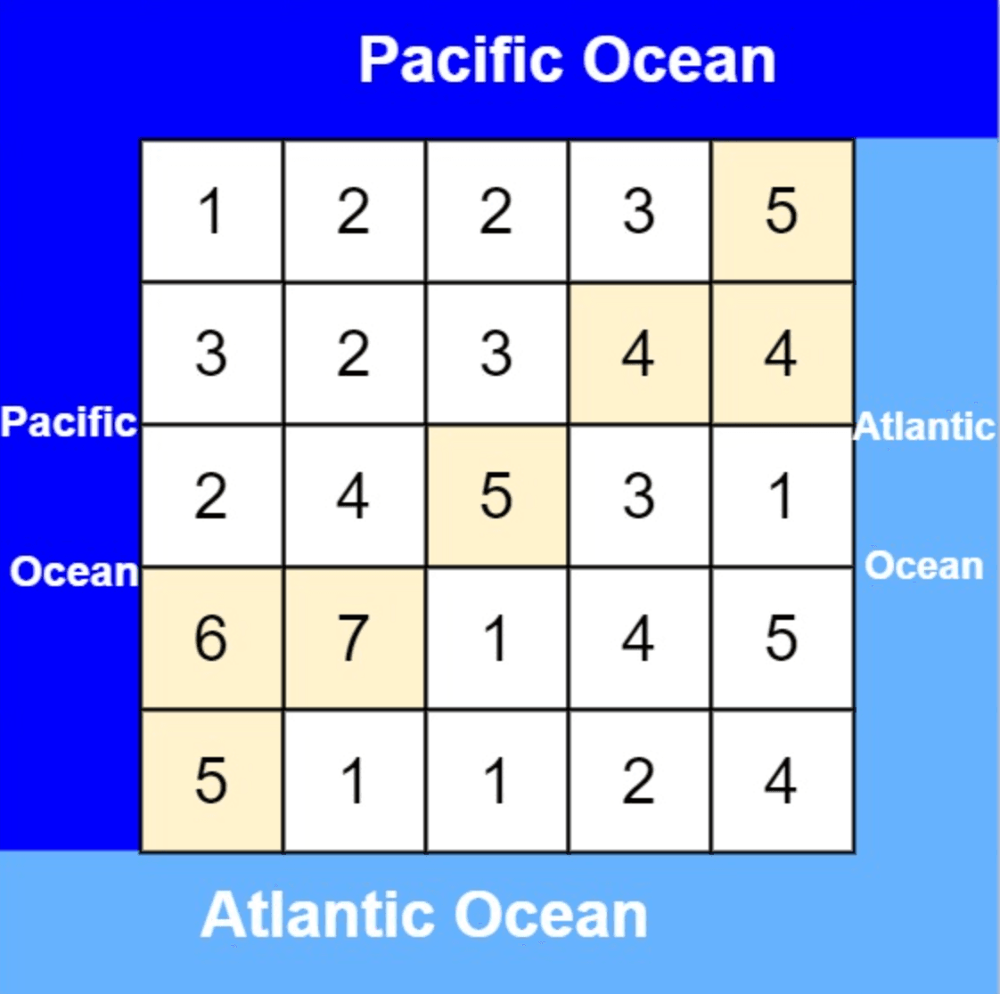
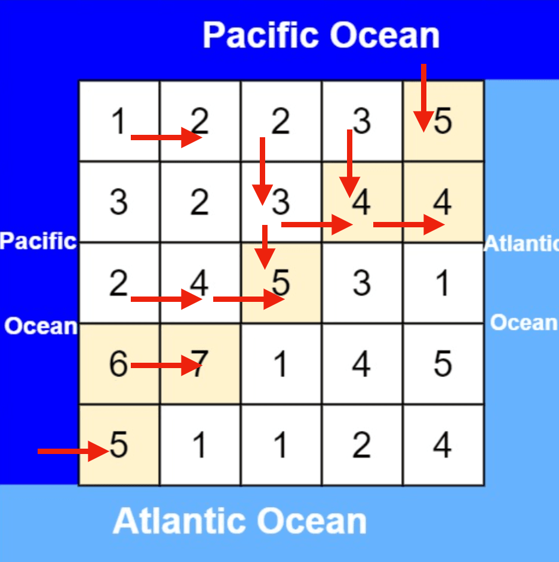
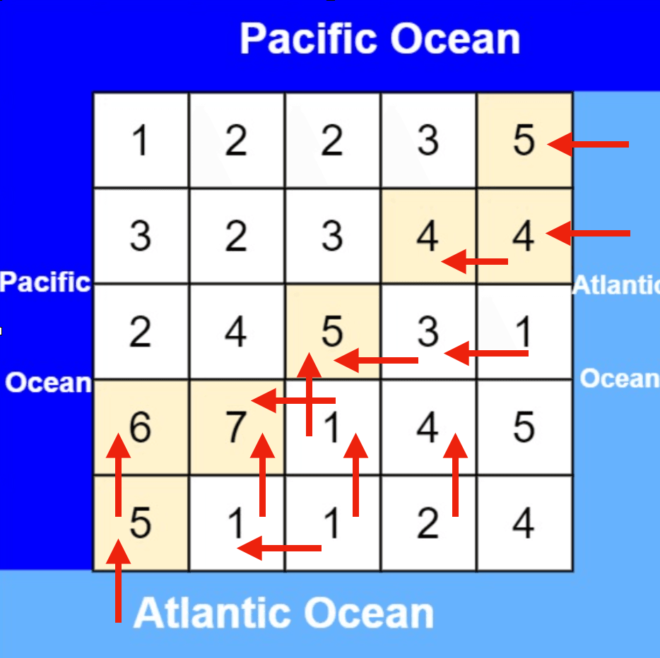

* [做專案（多個 C++、Java、Go、測開、前端專案）](https://www.programmercarl.com/other/kstar.html)
* [刷演算法（兩個月高強度學演算法）](https://www.programmercarl.com/xunlian/xunlianying.html)
* [背八股（40 天挑戰高頻面試題）](https://www.programmercarl.com/xunlian/bagu.html)


# 417. 太平洋大西洋水流問題 

[題目連結](https://leetcode.cn/problems/pacific-atlantic-water-flow/)

有一個 m × n 的矩形（rectangle）島嶼，與 太平洋 和 大西洋 相鄰。「太平洋」處於大陸的左邊界（boundary）和上邊界，而「大西洋」處於大陸的右邊界和下邊界。

這個島被分割成一個由若干方形單元格組成的格子（grid）。給定一個 m x n 的整數（integer）矩陣（matrix） heights ， heights[r][c] 表示坐標（coordinate） (r, c) 上單元格 高於海平面的高度 。

島上雨水較多，如果相鄰單元格的高度 小於或等於 目前單元格的高度，雨水可以直接向北、南、東、西流向相鄰單元格。水可以從海洋附近的任何單元格流入海洋。

回傳網格坐標 result 的 二維（two-dimensional）串列（list） ，其中 result[i] = [ri, ci] 表示雨水從單元格 (ri, ci) 流動 既可流向太平洋也可流向大西洋 。

範例 1：

 

* 輸入: heights = [[1,2,2,3,5],[3,2,3,4,4],[2,4,5,3,1],[6,7,1,4,5],[5,1,1,2,4]]
* 輸出: [[0,4],[1,3],[1,4],[2,2],[3,0],[3,1],[4,0]] 

範例 2：

* 輸入: heights = [[2,1],[1,2]]
* 輸出: [[0,0],[0,1],[1,0],[1,1]]

提示：

* m == heights.length
* n == heights[r].length
* 1 <= m, n <= 200
* 0 <= heights[r][c] <= 10^5


## 解題思路

不少同學可能被這道題的題目描述迷惑了，其實就是找到哪些點 可以同時到達太平洋和大西洋。 流動的方式只能從高往低流。 

那麼一個比較直白的想法，其實就是 遍歷（traversal）每個點，然後看這個點 能不能同時到達太平洋和大西洋。

至於遍歷方式，可以用 dfs，也可以用 bfs，以下用 dfs 來舉例。 

那麼這種想法的實作程式碼如下：

```CPP 
class Solution {
private:
    int dir[4][2] = {-1, 0, 0, -1, 1, 0, 0, 1};
    void dfs(vector<vector<int>>& heights, vector<vector<bool>>& visited, int x, int y) {
        if (visited[x][y]) return;

        visited[x][y] = true;

        for (int i = 0; i < 4; i++) {
            int nextx = x + dir[i][0];
            int nexty = y + dir[i][1];
            if (nextx < 0 || nextx >= heights.size() || nexty < 0 || nexty >= heights[0].size()) continue;
            if (heights[x][y] < heights[nextx][nexty]) continue; // 高度不合適

            dfs (heights, visited, nextx, nexty);
        }
        return;
    }
    bool isResult(vector<vector<int>>& heights, int x, int y) {
        vector<vector<bool>> visited = vector<vector<bool>>(heights.size(), vector<bool>(heights[0].size(), false));

        // 深度優先搜尋（depth-first search, DFS），將 x, y 出發能到的節點都標記上。 
        dfs(heights, visited, x, y);
        bool isPacific = false;
        bool isAtlantic = false;

        // 以下就是判斷 x，y 出發，是否到達太平洋和大西洋 
        for (int j = 0; j < heights[0].size(); j++) {
            if (visited[0][j]) {
                isPacific = true;
                break;
            }
        }
        for (int i = 0; i < heights.size(); i++) {
            if (visited[i][0]) {
                isPacific = true;
                break;
            }
        }
        for (int j = 0; j < heights[0].size(); j++) {
            if (visited[heights.size() - 1][j]) {
                isAtlantic = true;
                break;
            }
        }
        for (int i = 0; i < heights.size(); i++) {
            if (visited[i][heights[0].size() - 1]) {
                isAtlantic = true;
                break;
            }
        }
        if (isAtlantic && isPacific) return true;
        return false;
    }
public:

    vector<vector<int>> pacificAtlantic(vector<vector<int>>& heights) {
        vector<vector<int>> result;
        // 遍歷每一個點，看是否能同時到達太平洋和大西洋 
        for (int i = 0; i < heights.size(); i++) {
            for (int j = 0; j < heights[0].size(); j++) {
                if (isResult(heights, i, j)) result.push_back({i, j});
            }
        }
        return result;
    }
};

```

這種想法很直白，但很明顯，以上程式碼逾時了。 來看看時間複雜度（time complexity）。 

遍歷每一個節點（node），是 m * n，遍歷每一個節點的時候，都要做深度優先搜尋（depth-first search, DFS），DFS的時間複雜度是： m * n 

那麼整體時間複雜度 就是 O(m^2 * n^2) ，這是一個四次方的時間複雜度。 

## 最佳化 

那麼我們可以 反過來想，從太平洋邊上的節點 逆流而上，將遍歷過的節點都標記上。 從大西洋的邊上節點 逆流而上，將遍歷過的節點也標記上。 然後兩方都標記過的節點就是既可以流太平洋也可以流大西洋的節點。

從太平洋邊上節點出發，如圖：  



從大西洋邊上節點出發，如圖：  



按照這樣的邏輯，就可以寫出如下遍歷程式碼：（詳細註解）

（如果對 dfs 基礎內容就不懂，建議看 [「程式碼隨想錄」DFS 演算法精講！](https://programmercarl.com/图论深搜理论基础.html)，還可以順便解決 [797. 所有可能的路徑](https://programmercarl.com/0797.%E6%89%80%E6%9C%89%E5%8F%AF%E8%83%BD%E7%9A%84%E8%B7%AF%E5%BE%84.html)）

```CPP
class Solution {
private:
    int dir[4][2] = {-1, 0, 0, -1, 1, 0, 0, 1}; // 儲存四個方向

    // 從低向高遍歷，注意這裡 visited 是參考，亦即可以改變傳入的 pacific 和 atlantic 的值
    void dfs(vector<vector<int>>& heights, vector<vector<bool>>& visited, int x, int y) {
        if (visited[x][y]) return;
        visited[x][y] = true;
        for (int i = 0; i < 4; i++) { // 向四個方向遍歷
            int nextx = x + dir[i][0];
            int nexty = y + dir[i][1];
            // 超過邊界
            if (nextx < 0 || nextx >= heights.size() || nexty < 0 || nexty >= heights[0].size()) continue;
            // 高度不合適，注意這裡是從低向高判斷
            if (heights[x][y] > heights[nextx][nexty]) continue;

            dfs (heights, visited, nextx, nexty);
        }
        return;

    }

public:

    vector<vector<int>> pacificAtlantic(vector<vector<int>>& heights) {
        vector<vector<int>> result;
        int n = heights.size();
        int m = heights[0].size(); // 這裡不用擔心空指標，題目要求說了長寬都大於 1

        // 記錄從太平洋邊出發，可以遍歷的節點
        vector<vector<bool>> pacific = vector<vector<bool>>(n, vector<bool>(m, false));

        // 記錄從大西洋出發，可以遍歷的節點
        vector<vector<bool>> atlantic = vector<vector<bool>>(n, vector<bool>(m, false));
        
        // 從最左最右行的節點出發，向高處遍歷
        for (int i = 0; i < n; i++) {
            dfs (heights, pacific, i, 0); // 遍歷最左行，接觸太平洋 
            dfs (heights, atlantic, i, m - 1); // 遍歷最右行，接觸大西洋 
        }

        // 從最上最下列的節點出發，向高處遍歷
        for (int j = 0; j < m; j++) {
            dfs (heights, pacific, 0, j); // 遍歷最上列，接觸太平洋
            dfs (heights, atlantic, n - 1, j); // 遍歷最下列，接觸大西洋
        }
        for (int i = 0; i < n; i++) {
            for (int j = 0; j < m; j++) {
                // 如果這個節點，從太平洋和大西洋出發都遍歷過，就是結果
                if (pacific[i][j] && atlantic[i][j]) result.push_back({i, j});
            }
        }
        return result;
    }
};

```

時間複雜度分析， 關於 dfs 函數（function）搜尋的過程 時間複雜度是 O(n * m)，這個大家比較容易想。 

關鍵看主函數，那麼每次 dfs 的時候，上面還是有 for 迴圈（for-loop）的。 

第一個 for 迴圈，時間複雜度是：n * (n * m) 。

第二個 for 迴圈，時間複雜度是：m * (n * m)。 

所以本題看起來 時間複雜度好像是 ： n * (n * m) + m * (n * m) = (m * n) * (m + n)  。 

其實這是一個誤區，大家再自己看 dfs 函數的實作，其實 有 visited 函數記錄 走過的節點，而走過的節點是不會再走第二次的。 

所以 呼叫 dfs 函數，**只要參數（parameter）傳入的是 陣列（array） pacific，那麼地圖中 每一個節點其實就遍歷一次，無論你呼叫多少次**。 

同理，呼叫 dfs 函數，只要 參數傳入的是 陣列 atlantic，地圖中每個節點也只會遍歷一次。 

所以，以下這段程式碼的時間複雜度是 2 * n * m。 地圖中每個節點就遍歷了兩次，參數傳入 pacific 的時候遍歷一次，參數傳入 atlantic 的時候遍歷一次。
```CPP 
// 從最上最下列的節點出發，向高處遍歷
for (int i = 0; i < n; i++) {
    dfs (heights, pacific, i, 0); // 遍歷最上列，接觸太平洋
    dfs (heights, atlantic, i, m - 1); // 遍歷最下列，接觸大西洋
}

// 從最左最右行的節點出發，向高處遍歷
for (int j = 0; j < m; j++) {
    dfs (heights, pacific, 0, j); // 遍歷最左行，接觸太平洋
    dfs (heights, atlantic, n - 1, j); // 遍歷最右行，接觸大西洋
}
```

那麼本題整體的時間複雜度其實是：  2 * n * m + n * m ，所以最終時間複雜度為  O(n * m)  。

空間複雜度（space complexity）為：O(n * m) 這個就不難理解了。開了幾個 n * m 的陣列。 

## 其他語言版本

### Java

depth-first traversal：

```Java
class Solution {
    // 四個位置
    private static final int[][] position = {{-1, 0}, {0, 1}, {1, 0}, {0, -1}};

    /**
     * @param heights 題目給定的二維陣列
     * @param row 目前位置的列號
     * @param col 目前位置的行號
     * @param sign 記錄是哪一條河，兩條河中可以一個為 0，一個為 1
     * @param visited 記錄這個位置可以到哪條河
     */
    public void dfs(int[][] heights, int row, int col, int sign, boolean[][][] visited) {
        for (int[] current: position) {
            int curRow = row + current[0], curCol = col + current[1];
            // 越界
            if (curRow < 0 || curRow >= heights.length || curCol < 0 || curCol >= heights[0].length)
                continue;
            // 高度不合適或者已經被存取過了
            if (heights[curRow][curCol] < heights[row][col] || visited[curRow][curCol][sign]) continue;
            visited[curRow][curCol][sign] = true;
            dfs(heights, curRow, curCol, sign, visited);
        }
    }

    public List<List<Integer>> pacificAtlantic(int[][] heights) {
        int rowSize = heights.length, colSize = heights[0].length;
        List<List<Integer>> ans = new ArrayList<>();
        // 記錄 [row, col] 位置是否可以到某條河，可以為 true，反之為 false；
        // 假設太平洋的標記為 1，大西洋為 0
        boolean[][][] visited = new boolean[rowSize][colSize][2];
        for (int row = 0; row < rowSize; row++) {
            visited[row][colSize - 1][0] = true;
            visited[row][0][1] = true;
            dfs(heights, row, colSize - 1, 0, visited);
            dfs(heights, row, 0, 1, visited);
        }
        for (int col = 0; col < colSize; col++) {
            visited[rowSize - 1][col][0] = true;
            visited[0][col][1] = true;
            dfs(heights, rowSize - 1, col, 0, visited);
            dfs(heights, 0, col, 1, visited);
        }
        for (int row = 0; row < rowSize; row++) {
            for (int col = 0; col < colSize; col++) {
                // 如果該位置既可以到太平洋又可以到大西洋，就放入答案陣列
                if (visited[row][col][0] && visited[row][col][1])
                    ans.add(List.of(row, col));
            }
        }
        return ans;
    }
}
```

```Java
class Solution {
    
    // 和 Carl 題解更加符合的 Java DFS
    private int[][] directions = {{-1, 0}, {1, 0}, {0, 1}, {0, -1}};

     /**
     * @param heights 題目給定的二維陣列
     * @param m 目前位置的列號
     * @param n 目前位置的行號
     * @param visited 記錄這個位置可以到哪條河
     */

    public void dfs(int[][] heights, boolean[][] visited, int m, int n){
        if(visited[m][n]) return;        
        visited[m][n] = true;

        for(int[] dir: directions){
            int nextm = m + dir[0];
            int nextn = n + dir[1];
            // 超出 2D array 的邊界，continue
            if(nextm < 0||nextm == heights.length||nextn <0||nextn== heights[0].length) continue;
            // 下一個位置比目前位置還要低，跳過，繼續找下一個更高的位置
            if(heights[m][n] > heights[nextm][nextn]) continue;
            dfs(heights, visited, nextm, nextn);
        }
    }


    public List<List<Integer>> pacificAtlantic(int[][] heights) {
        int m = heights.length;
        int n = heights[0].length;

        // 記錄從太平洋邊出發，可以遍歷的節點
        boolean[][] pacific = new boolean[m][n];
        // 記錄從大西洋出發，可以遍歷的節點
        boolean[][] atlantic = new boolean[m][n];
        
        // 從最左最右行的節點出發，向高處遍歷
        for(int i = 0; i<m; i++){
            dfs(heights, pacific, i, 0); // 遍歷 pacific 最左邊
            dfs(heights, atlantic, i, n-1); // 遍歷 atlantic 最右邊
        }
        
        // 從最上最下列的節點出發，向高處遍歷
        for(int j = 0; j<n; j++){
            dfs(heights, pacific, 0, j); // 遍歷 pacific 最上邊
            dfs(heights, atlantic, m-1, j); // 遍歷 atlantic 最下邊
        }

        List<List<Integer>> result = new ArrayList<>();
        for(int a = 0; a<m; a++){
            for(int b = 0; b<n; b++){
                // 如果這個節點，從太平洋和大西洋出發都遍歷過，就是結果
                if(pacific[a][b] && atlantic[a][b]){
                   List<Integer> pair = new ArrayList<>();
                   pair.add(a);
                   pair.add(b);
                   result.add(pair);
                }
            }
        }
        return result;
    }
}
```

breadth-first traversal：

```Java
class Solution {
    // 四個位置
    private static final int[][] position = {{-1, 0}, {0, 1}, {1, 0}, {0, -1}};

    /**
     * @param heights 題目給定的二維陣列
     * @param queue 記錄可以到達邊界的節點
     * @param visited 記錄這個位置可以到哪條河
     */
    public void bfs(int[][] heights, Queue<int[]> queue, boolean[][][] visited) {
        while (!queue.isEmpty()) {
            int[] curPos = queue.poll();
            for (int[] current: position) {
                int row = curPos[0] + current[0], col = curPos[1] + current[1], sign = curPos[2];
                // 越界
                if (row < 0 || row >= heights.length || col < 0 || col >= heights[0].length) continue;
                // 高度不合適或者已經被存取過了
                if (heights[row][col] < heights[curPos[0]][curPos[1]] || visited[row][col][sign]) continue;
                visited[row][col][sign] = true;
                queue.add(new int[]{row, col, sign});
            }
        }
    }

    public List<List<Integer>> pacificAtlantic(int[][] heights) {
        int rowSize = heights.length, colSize = heights[0].length;
        List<List<Integer>> ans = new ArrayList<>();
        boolean[][][] visited = new boolean[rowSize][colSize][2];
        // 佇列，儲存的資料為 [列號, 行號, 標記]
        // 假設太平洋的標記為 1，大西洋為 0
        Queue<int[]> queue = new ArrayDeque<>();
        for (int row = 0; row < rowSize; row++) {
            visited[row][colSize - 1][0] = true;
            visited[row][0][1] = true;
            queue.add(new int[]{row, colSize - 1, 0});
            queue.add(new int[]{row, 0, 1});
        }
        for (int col = 0; col < colSize; col++) {
            visited[rowSize - 1][col][0] = true;
            visited[0][col][1] = true;
            queue.add(new int[]{rowSize - 1, col, 0});
            queue.add(new int[]{0, col, 1});
        }
        bfs(heights, queue, visited);
        for (int row = 0; row < rowSize; row++) {
            for (int col = 0; col < colSize; col++) {
                // 如果該位置既可以到太平洋又可以到大西洋，就放入答案陣列
                if (visited[row][col][0] && visited[row][col][1])
                    ans.add(List.of(row, col));
            }
        }
        return ans;
    }
}
```

### Python

depth-first traversal

```Python3
class Solution:
    def __init__(self):
        self.position = [[-1, 0], [0, 1], [1, 0], [0, -1]]	# 四個方向

    # heights：題目給定的二維陣列， row：目前位置的列號， col：目前位置的行號
    # sign：記錄是哪一條河，兩條河中可以一個為 0，一個為 1
    # visited：記錄這個位置可以到哪條河
    def dfs(self, heights: List[List[int]], row: int, col: int, sign: int, visited: List[List[List[int]]]):
        for current in self.position:
            curRow, curCol = row + current[0], col + current[1]
            # 索引下標越界
            if curRow < 0 or curRow >= len(heights) or curCol < 0 or curCol >= len(heights[0]): continue
            # 不滿足條件或者已經被存取過
            if heights[curRow][curCol] < heights[row][col] or visited[curRow][curCol][sign]: continue
            visited[curRow][curCol][sign] = True
            self.dfs(heights, curRow, curCol, sign, visited)

    def pacificAtlantic(self, heights: List[List[int]]) -> List[List[int]]:
        rowSize, colSize = len(heights), len(heights[0])
        # visited 記錄 [row, col] 位置是否可以到某條河，可以為 true，反之為 false；
        # 假設太平洋的標記為 1，大西洋為 0
        # ans 用來儲存滿足條件的答案
        ans, visited = [], [[[False for _ in range(2)] for _ in range(colSize)] for _ in range(rowSize)]
        for row in range(rowSize):
            visited[row][0][1] = True
            visited[row][colSize - 1][0] = True
            self.dfs(heights, row, 0, 1, visited)
            self.dfs(heights, row, colSize - 1, 0, visited)
        for col in range(0, colSize):
            visited[0][col][1] = True
            visited[rowSize - 1][col][0] = True
            self.dfs(heights, 0, col, 1, visited)
            self.dfs(heights, rowSize - 1, col, 0, visited)
        for row in range(rowSize):
            for col in range(colSize):
                # 如果該位置既可以到太平洋又可以到大西洋，就放入答案陣列
                if visited[row][col][0] and visited[row][col][1]:
                    ans.append([row, col])
        return ans
```

breadth-first traversal

```Python3
class Solution:
    def __init__(self):
        self.position = [[-1, 0], [0, 1], [1, 0], [0, -1]]

    # heights：題目給定的二維陣列，visited：記錄這個位置可以到哪條河
    def bfs(self, heights: List[List[int]], queue: deque, visited: List[List[List[int]]]):
        while queue:
            curPos = queue.popleft()
            for current in self.position:
                row, col, sign = curPos[0] + current[0], curPos[1] + current[1], curPos[2]
                # 越界
                if row < 0 or row >= len(heights) or col < 0 or col >= len(heights[0]): continue
                # 不滿足條件或已經存取過
                if heights[row][col] < heights[curPos[0]][curPos[1]] or visited[row][col][sign]: continue
                visited[row][col][sign] = True
                queue.append([row, col, sign])

    def pacificAtlantic(self, heights: List[List[int]]) -> List[List[int]]:
        rowSize, colSize = len(heights), len(heights[0])
        # visited 記錄 [row, col] 位置是否可以到某條河，可以為 true，反之為 false；
        # 假設太平洋的標記為 1，大西洋為 0
        # ans 用來儲存滿足條件的答案
        ans, visited = [], [[[False for _ in range(2)] for _ in range(colSize)] for _ in range(rowSize)]
        # 佇列，儲存的資料為 [列號, 行號, 標記]
        # 假設太平洋的標記為 1，大西洋為 0
        queue = deque()
        for row in range(rowSize):
            visited[row][0][1] = True
            visited[row][colSize - 1][0] = True
            queue.append([row, 0, 1])
            queue.append([row, colSize - 1, 0])
        for col in range(0, colSize):
            visited[0][col][1] = True
            visited[rowSize - 1][col][0] = True
            queue.append([0, col, 1])
            queue.append([rowSize - 1, col, 0])
        self.bfs(heights, queue, visited)	# 廣度優先遍歷（breadth-first traversal）
        for row in range(rowSize):
            for col in range(colSize):
                # 如果該位置既可以到太平洋又可以到大西洋，就放入答案陣列
                if visited[row][col][0] and visited[row][col][1]:
                    ans.append([row, col])
        return ans
```

### JavaScript
```JavaScript
/**
 * @description DFS
 * @param {number[][]} heights
 * @return {number[][]}
 */
function pacificAtlantic(heights) {
  const dir = [[-1, 0], [0, -1], [1, 0], [0, 1]];
  const [rowSize, colSize] = [heights.length, heights[0].length];
  const visited = Array.from({ length: rowSize }, _ =>
    Array.from({ length: colSize }, _ => new Array(2).fill(false))
  );
  const result = [];

  function dfs(heights, visited, x, y, sign) {
    if (visited[x][y][sign]) {
      return;
    }
    visited[x][y][sign] = true;
    for (let i = 0; i < 4; i++) {
      const nextX = x + dir[i][0];
      const nextY = y + dir[i][1];
      if (nextX < 0 || nextX >= rowSize || nextY < 0 || nextY >= colSize) {
        continue;
      }
      if (heights[x][y] > heights[nextX][nextY]) {
        continue;
      }
      dfs(heights, visited, nextX, nextY, sign);
    }
  }

  for (let i = 0; i < rowSize; i++) {
    dfs(heights, visited, i, 0, 0);
    dfs(heights, visited, i, colSize - 1, 1);
  }

  for (let i = 0; i < colSize; i++) {
    dfs(heights, visited, 0, i, 0);
    dfs(heights, visited, rowSize - 1, i, 1);
  }

  for (let i = 0; i < rowSize; i++) {
    for (let k = 0; k < colSize; k++) {
      if (visited[i][k][0] && visited[i][k][1]) {
        result.push([i, k]);
      }
    }
  }

  return result;
}

/**
 * @description 廣度優先搜尋
 * @param {number[][]} heights
 * @return {number[][]}
 */
function pacificAtlantic(heights) {
  const dir = [[-1, 0], [0, -1], [1, 0], [0, 1]];
  const [rowSize, colSize] = [heights.length, heights[0].length];
  const visited = Array.from({ length: rowSize }, _ =>
    Array.from({ length: colSize }, _ => new Array(2).fill(false))
  );
  const result = [];

  function bfs(heights, visited, x, y, sign) {
    if (visited[x][y][sign]) {
      return;
    }
    visited[x][y][sign] = true;
    const stack = [y, x];
    while (stack.length !== 0) {
      [x, y] = [stack.pop(), stack.pop()];
      for (let i = 0; i < 4; i++) {
        const nextX = x + dir[i][0];
        const nextY = y + dir[i][1];
        if (nextX < 0 || nextX >= rowSize || nextY < 0 || nextY >= colSize) {
          continue;
        }
        if (heights[x][y] > heights[nextX][nextY] || visited[nextX][nextY][sign]) {
          continue;
        }
        visited[nextX][nextY][sign] = true;
        stack.push(nextY, nextX);
      }
    }
  }

  for (let i = 0; i < rowSize; i++) {
    bfs(heights, visited, i, 0, 0);
    bfs(heights, visited, i, colSize - 1, 1);
  }

  for (let i = 0; i < colSize; i++) {
    bfs(heights, visited, 0, i, 0);
    bfs(heights, visited, rowSize - 1, i, 1);
  }

  for (let i = 0; i < rowSize; i++) {
    for (let k = 0; k < colSize; k++) {
      if (visited[i][k][0] && visited[i][k][1]) {
        result.push([i, k]);
      }
    }
  }

  return result;
}
```

### go

dfs:

```go
var DIRECTIONS = [4][2]int{{-1, 0}, {1, 0}, {0, -1}, {0, 1}}

func pacificAtlantic(heights [][]int) [][]int {
	res := make([][]int, 0)
	pacific := make([][]bool, len(heights))
	atlantic := make([][]bool, len(heights))
	for i := 0; i < len(heights); i++ {
		pacific[i] = make([]bool, len(heights[0]))
		atlantic[i] = make([]bool, len(heights[0]))
	}
	// 行
	for i := 0; i < len(heights); i++ {
		dfs(heights, pacific, i, 0)
		dfs(heights, atlantic, i, len(heights[0])-1)
	}
	// 列
	for j := 0; j < len(heights[0]); j++ {
		dfs(heights, pacific, 0, j)
		dfs(heights, atlantic, len(heights)-1, j)
	}

	for i := 0; i < len(heights); i++ {
		for j := 0; j < len(heights[0]); j++ {
			if pacific[i][j] && atlantic[i][j] {
				res = append(res, []int{i, j})
			}
		}
	}

	return res
}

func dfs(heights [][]int, visited [][]bool, i, j int) {
	visited[i][j] = true
	for _, d := range DIRECTIONS {
		x, y := i+d[0], j+d[1]
		if x < 0 || x >= len(heights) || y < 0 || y >= len(heights[0]) || heights[i][j] > heights[x][y] || visited[x][y] {
			continue
		}

		dfs(heights, visited, x, y)
	}
}
```

bfs:

```go
var DIRECTIONS = [4][2]int{{-1, 0}, {1, 0}, {0, -1}, {0, 1}}

func pacificAtlantic(heights [][]int) [][]int {
	res := make([][]int, 0)
	pacific := make([][]bool, len(heights))
	atlantic := make([][]bool, len(heights))
	for i := 0; i < len(heights); i++ {
		pacific[i] = make([]bool, len(heights[0]))
		atlantic[i] = make([]bool, len(heights[0]))
	}
	// 行
	for i := 0; i < len(heights); i++ {
		bfs(heights, pacific, i, 0)
		bfs(heights, atlantic, i, len(heights[0])-1)
	}
	// 列
	for j := 0; j < len(heights[0]); j++ {
		bfs(heights, pacific, 0, j)
		bfs(heights, atlantic, len(heights)-1, j)
	}

	for i := 0; i < len(heights); i++ {
		for j := 0; j < len(heights[0]); j++ {
			if pacific[i][j] && atlantic[i][j] {
				res = append(res, []int{i, j})
			}
		}
	}

	return res
}

func bfs(heights [][]int, visited [][]bool, i, j int) {
	queue := make([][]int, 0)
	queue = append(queue, []int{i, j})
	visited[i][j] = true
	for len(queue) > 0 {
		cur := queue[0]
		queue = queue[1:]
		for _, d := range DIRECTIONS {
			x, y := cur[0]+d[0], cur[1]+d[1]
			if x < 0 || x >= len(heights) || y < 0 || y >= len(heights[0]) || heights[cur[0]][cur[1]] > heights[x][y] || visited[x][y] {
				continue
			}
			queue = append(queue, []int{x, y})
			visited[x][y] = true
		}
	}
}
```

### Rust

dfs:

```rust
impl Solution {
    const DIRECTIONS: [(isize, isize); 4] = [(0, 1), (0, -1), (1, 0), (-1, 0)];
    pub fn pacific_atlantic(heights: Vec<Vec<i32>>) -> Vec<Vec<i32>> {
        let (m, n) = (heights.len(), heights[0].len());
        let mut res = vec![];
        let (mut pacific, mut atlantic) = (vec![vec![false; n]; m], vec![vec![false; n]; m]);

        // 行
        for i in 0..m {
            Self::dfs(&heights, &mut pacific, i, 0);
            Self::dfs(&heights, &mut atlantic, i, n - 1);
        }

        for j in 0..n {
            Self::dfs(&heights, &mut pacific, 0, j);
            Self::dfs(&heights, &mut atlantic, m - 1, j);
        }

        for i in 0..m {
            for j in 0..n {
                if pacific[i][j] && atlantic[i][j] {
                    res.push(vec![i as i32, j as i32]);
                }
            }
        }

        res
    }

    pub fn dfs(heights: &[Vec<i32>], visited: &mut [Vec<bool>], i: usize, j: usize) {
        visited[i][j] = true;
        for (dx, dy) in Self::DIRECTIONS {
            let (x, y) = (i as isize + dx, j as isize + dy);
            if x < 0 || x >= heights.len() as isize || y < 0 || y >= heights[0].len() as isize {
                continue;
            }
            let (x, y) = (x as usize, y as usize);
            if !visited[x][y] && heights[x][y] >= heights[i][j] {
                Self::dfs(heights, visited, x, y);
            }
        }
    }
}
```

bfs:

```rust
use std::collections::VecDeque;

impl Solution {
    const DIRECTIONS: [(isize, isize); 4] = [(0, 1), (0, -1), (1, 0), (-1, 0)];
    pub fn pacific_atlantic(heights: Vec<Vec<i32>>) -> Vec<Vec<i32>> {
        let (m, n) = (heights.len(), heights[0].len());
        let mut res = vec![];
        let (mut pacific, mut atlantic) = (vec![vec![false; n]; m], vec![vec![false; n]; m]);

        // 行
        for i in 0..m {
            Self::bfs(&heights, &mut pacific, i, 0);
            Self::bfs(&heights, &mut atlantic, i, n - 1);
        }

        for j in 0..n {
            Self::bfs(&heights, &mut pacific, 0, j);
            Self::bfs(&heights, &mut atlantic, m - 1, j);
        }

        for i in 0..m {
            for j in 0..n {
                if pacific[i][j] && atlantic[i][j] {
                    res.push(vec![i as i32, j as i32]);
                }
            }
        }

        res
    }

    pub fn bfs(heights: &[Vec<i32>], visited: &mut [Vec<bool>], i: usize, j: usize) {
        let mut queue = VecDeque::from([(i, j)]);
        visited[i][j] = true;
        while let Some((i, j)) = queue.pop_front() {
            for (dx, dy) in Self::DIRECTIONS {
                let (x, y) = (i as isize + dx, j as isize + dy);
                if x < 0 || x >= heights.len() as isize || y < 0 || y >= heights[0].len() as isize {
                    continue;
                }
                let (x, y) = (x as usize, y as usize);
                if !visited[x][y] && heights[x][y] >= heights[i][j] {
                    queue.push_back((x, y));
                    visited[x][y] = true;
                }
            }
        }
    }
}
```

