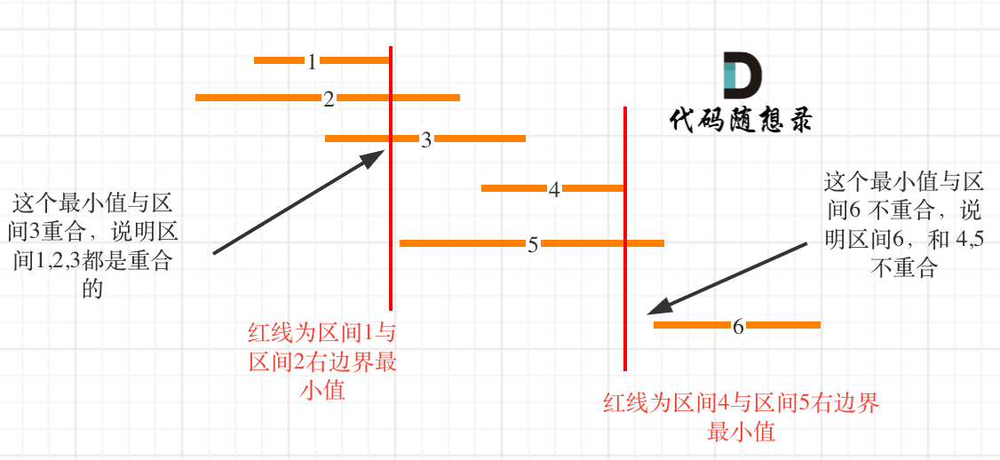

* [做專案（多個 C++、Java、Go、測開、前端專案）](https://www.programmercarl.com/other/kstar.html)
* [刷演算法（兩個月高強度學演算法）](https://www.programmercarl.com/xunlian/xunlianying.html)
* [背八股（40 天挑戰高頻面試題）](https://www.programmercarl.com/xunlian/bagu.html)


# 435. 無重疊區間

[LeetCode 題目連結](https://leetcode.cn/problems/non-overlapping-intervals/)

給定一個區間（interval）的集合（set），找到需要移除區間的最小數量，使剩餘區間互不重疊。

注意:
可以認為區間的終點總是大於它的起點。
區間 [1,2] 和 [2,3] 的邊界（boundary）相互「接觸」，但沒有相互重疊。

範例 1:
* 輸入: [ [1,2], [2,3], [3,4], [1,3] ]
* 輸出: 1
* 解釋: 移除 [1,3] 後，剩下的區間沒有重疊。

範例 2:
* 輸入: [ [1,2], [1,2], [1,2] ]
* 輸出: 2
* 解釋: 你需要移除兩個 [1,2] 來使剩下的區間沒有重疊。

範例 3:
* 輸入: [ [1,2], [2,3] ]
* 輸出: 0
* 解釋: 你不需要移除任何區間，因為它們已經是無重疊的了。

## 演算法公開課

**[《程式碼隨想錄》演算法影片公開課](https://programmercarl.com/other/gongkaike.html)：[貪心演算法（greedy algorithm），依然是判斷重疊區間 | LeetCode：435.無重疊區間](https://www.bilibili.com/video/BV1A14y1c7E1)，相信結合影片再看本篇題解，更有助於大家對本題的理解**。

## 解題思路

**相信很多同學看到這道題目都冥冥之中感覺要排序（sorting），但是究竟是按照右邊界排序，還是按照左邊界排序呢？**

其實都可以。主要就是為了讓區間盡可能地重疊。 

**我來按照右邊界排序，從左向右記錄非交叉區間的個數。最後用區間總數減去非交叉區間的個數就是需要移除的區間個數了**。

此時問題就是要求非交叉區間的最大個數。

這裡記錄非交叉區間的個數還是有技巧的，如圖：



區間，1，2，3，4，5，6 都按照右邊界排好序。

當確定區間 1 和 區間 2 重疊後，如何確定是否與 區間 3 也重疊呢？ 

就是取 區間 1 和 區間 2 右邊界的最小值，因為這個最小值之前的部分一定是 區間 1 和區間 2 的重合部分，如果這個最小值也觸達到區間 3，那麼說明 區間 1，2，3 都是重合的。 

接下來就是找大於區間 1 結束位置的區間，是從區間 4 開始。**那有同學問了為什麼不從區間 5 開始？別忘了已經是按照右邊界排序的了**。

區間 4 結束之後，再找到區間 6，所以一共記錄非交叉區間的個數是三個。

總共區間個數為 6，減去非交叉區間的個數 3。移除區間的最小數量就是 3。

C++ 程式碼如下：

```CPP
class Solution {
public:
    // 按照區間右邊界排序
    static bool cmp (const vector<int>& a, const vector<int>& b) {
        return a[1] < b[1];
    }
    int eraseOverlapIntervals(vector<vector<int>>& intervals) {
        if (intervals.size() == 0) return 0;
        sort(intervals.begin(), intervals.end(), cmp);
        int count = 1; // 記錄非交叉區間的個數
        int end = intervals[0][1]; // 記錄區間分割點
        for (int i = 1; i < intervals.size(); i++) {
            if (end <= intervals[i][0]) {
                end = intervals[i][1];
                count++;
            }
        }
        return intervals.size() - count;
    }
};
```
* 時間複雜度（time complexity）：O(nlog n) ，有一個快速排序（quick sort）
* 空間複雜度（space complexity）：O(n)，有一個快速排序，最差情況（倒序）時，需要 n 次遞迴呼叫（recursive call）。因此確實需要 O(n) 的堆疊空間（stack space）

大家此時會發現如此複雜的一個問題，程式碼實作卻這麼簡單！

## 補充

### 補充（1）

左邊界排序可不可以呢？ 

也是可以的，只不過 左邊界排序我們就是直接求 重疊的區間，count 為記錄重疊區間數。

```CPP 
class Solution {
public:
    static bool cmp (const vector<int>& a, const vector<int>& b) {
        return a[0] < b[0]; // 改為左邊界排序
    }
    int eraseOverlapIntervals(vector<vector<int>>& intervals) {
        if (intervals.size() == 0) return 0;
        sort(intervals.begin(), intervals.end(), cmp);
        int count = 0; // 注意這裡從 0 開始，因為是記錄重疊區間
        int end = intervals[0][1]; // 記錄區間分割點
        for (int i = 1; i < intervals.size(); i++) {   
            if (intervals[i][0] >= end)  end = intervals[i][1]; // 無重疊的情況
            else { // 重疊情況 
                end = min(end, intervals[i][1]);
                count++;
            }
        }
        return count;
    }
};
```

其實程式碼還可以精簡一下， 用 intervals[i][1] 替代 end 變數（variable），只判斷 重疊情況就好

```CPP 
class Solution {
public:
    static bool cmp (const vector<int>& a, const vector<int>& b) {
        return a[0] < b[0]; // 改為左邊界排序
    }
    int eraseOverlapIntervals(vector<vector<int>>& intervals) {
        if (intervals.size() == 0) return 0;
        sort(intervals.begin(), intervals.end(), cmp);
        int count = 0; // 注意這裡從 0 開始，因為是記錄重疊區間
        for (int i = 1; i < intervals.size(); i++) {
            if (intervals[i][0] < intervals[i - 1][1]) { // 重疊情況
                intervals[i][1] = min(intervals[i - 1][1], intervals[i][1]);
                count++;
            }
        }
        return count;
    }
};

```

### 補充（2）

本題其實和[452.用最少數量的箭引爆氣球](https://programmercarl.com/0452.用最少数量的箭引爆气球.html)非常像，弓箭的數量就相當於是非交叉區間的數量，只要把弓箭那道題目程式碼裡射爆氣球的判斷條件加個等號（認為 [0，1][1，2] 不是相鄰區間），然後用總區間數減去弓箭數量 就是要移除的區間數量了。

把[452.用最少數量的箭引爆氣球](https://programmercarl.com/0452.用最少数量的箭引爆气球.html)程式碼稍做修改，就可以 AC 本題。

```CPP
class Solution {
public:
    // 按照區間右邊界排序
    static bool cmp (const vector<int>& a, const vector<int>& b) {
        return a[1] < b[1]; // 右邊界排序 
    }
    int eraseOverlapIntervals(vector<vector<int>>& intervals) {
        if (intervals.size() == 0) return 0;
        sort(intervals.begin(), intervals.end(), cmp);

        int result = 1; // points 不為空至少需要一支箭
        for (int i = 1; i < intervals.size(); i++) {
            if (intervals[i][0] >= intervals[i - 1][1]) {
                result++; // 需要一支箭
            }
            else {  // 氣球 i 和氣球 i-1 挨著
                intervals[i][1] = min(intervals[i - 1][1], intervals[i][1]); // 更新重疊氣球最小右邊界
            }
        }
        return intervals.size() - result;
    }
};
```

這裡按照 左邊界排序，或者按照右邊界排序，都可以 AC，原理是一樣的。
```CPP
class Solution {
public:
    // 按照區間左邊界排序
    static bool cmp (const vector<int>& a, const vector<int>& b) {
        return a[0] < b[0]; // 左邊界排序
    }
    int eraseOverlapIntervals(vector<vector<int>>& intervals) {
        if (intervals.size() == 0) return 0;
        sort(intervals.begin(), intervals.end(), cmp);

        int result = 1; // points 不為空至少需要一支箭
        for (int i = 1; i < intervals.size(); i++) {
            if (intervals[i][0] >= intervals[i - 1][1]) {
                result++; // 需要一支箭
            }
            else {  // 氣球 i 和氣球 i-1 挨著
                intervals[i][1] = min(intervals[i - 1][1], intervals[i][1]); // 更新重疊氣球最小右邊界
            }
        }
        return intervals.size() - result;
    }
};

```

## 其他語言版本


### Java 
```java
class Solution {
    public int eraseOverlapIntervals(int[][] intervals) {
        Arrays.sort(intervals, (a,b)-> {
            return Integer.compare(a[0],b[0]);
        });
        int count = 1;
        for(int i = 1;i < intervals.length;i++){
            if(intervals[i][0] < intervals[i-1][1]){
                intervals[i][1] = Math.min(intervals[i - 1][1], intervals[i][1]);
                continue;
            }else{
                count++;
            }    
        }
        return intervals.length - count;
    }
}
```

按左邊排序，不管右邊順序。相交的時候取最小的右邊。
```java
class Solution {
    public int eraseOverlapIntervals(int[][] intervals) {
        Arrays.sort(intervals, (a,b)-> {
            return Integer.compare(a[0],b[0]);
        });
        int remove = 0;
        int pre = intervals[0][1];
        for(int i = 1; i < intervals.length; i++) {
            if(pre > intervals[i][0]) {
                remove++;
                pre = Math.min(pre, intervals[i][1]);
            }
            else pre = intervals[i][1];
        }
        return remove;
    }
}
```

### Python 
貪心法（greedy） 基於左邊界
```python
class Solution:
    def eraseOverlapIntervals(self, intervals: List[List[int]]) -> int:
        if not intervals:
            return 0
        
        intervals.sort(key=lambda x: x[0])  # 按照左邊界升序排序
        count = 0  # 記錄重疊區間數量
        
        for i in range(1, len(intervals)):
            if intervals[i][0] < intervals[i - 1][1]:  # 存在重疊區間
                intervals[i][1] = min(intervals[i - 1][1], intervals[i][1])  # 更新重疊區間的右邊界
                count += 1
        
        return count

```
貪心法 基於左邊界 把 452.用最少數量的箭引爆氣球程式碼稍做修改
```python
class Solution:
    def eraseOverlapIntervals(self, intervals: List[List[int]]) -> int:
        if not intervals:
            return 0
        
        intervals.sort(key=lambda x: x[0])  # 按照左邊界升序排序
        
        result = 1  # 不重疊區間數量，初始化為 1，因為至少有一個不重疊的區間
        
        for i in range(1, len(intervals)):
            if intervals[i][0] >= intervals[i - 1][1]:  # 沒有重疊
                result += 1
            else:  # 重疊情況
                intervals[i][1] = min(intervals[i - 1][1], intervals[i][1])  # 更新重疊區間的右邊界
        
        return len(intervals) - result


```
### Go 
```go
func eraseOverlapIntervals(intervals [][]int) int {
    sort.Slice(intervals, func(i, j int) bool {
        return intervals[i][1] < intervals[j][1]
    })
    res := 1
    for i := 1; i < len(intervals); i++ {
        if intervals[i][0] >= intervals[i-1][1] {
            res++
        } else {
            intervals[i][1] = min(intervals[i - 1][1], intervals[i][1])
        }
    }
    return len(intervals) - res
}
func min(a, b int) int {
    if a < b {
        return a
    }
    return b
}
```

### JavaScript
- 按右邊界排序
```Javascript
var eraseOverlapIntervals = function(intervals) {
    intervals.sort((a, b) => {
        return a[1] - b[1]
    })

    let count = 1
    let end = intervals[0][1]

    for(let i = 1; i < intervals.length; i++) {
        let interval = intervals[i]
        if(interval[0] >= end) {
            end = interval[1]
            count += 1
        }
    }
    
    return intervals.length - count
};
```
- 按左邊界排序
```js
var eraseOverlapIntervals = function(intervals) {
    // 按照左邊界升序排列
    intervals.sort((a, b) => a[0] - b[0])
    let count = 1
    let end = intervals[intervals.length - 1][0]
    // 倒序遍歷，對單個區間來說，左邊界越大越好，因為給前面區間的空間越大
    for(let i = intervals.length - 2; i >= 0; i--) {
        if(intervals[i][1] <= end) {
            count++
            end = intervals[i][0]
        }
    }
    // count 記錄的是最大非重複區間的個數
    return intervals.length - count
}
```

### TypeScript

> 按右邊界排序，從左往右遍歷（traversal）

```typescript
function eraseOverlapIntervals(intervals: number[][]): number {
    const length = intervals.length;
    if (length === 0) return 0;
    intervals.sort((a, b) => a[1] - b[1]);
    let right: number = intervals[0][1];
    let count: number = 1;
    for (let i = 1; i < length; i++) {
        if (intervals[i][0] >= right) {
            count++;
            right = intervals[i][1];
        }
    }
    return length - count;
};
```

> 按左邊界排序，從左往右遍歷

```typescript
function eraseOverlapIntervals(intervals: number[][]): number {
    if (intervals.length === 0) return 0;
    intervals.sort((a, b) => a[0] - b[0]);
    let right: number = intervals[0][1];
    let tempInterval: number[];
    let resCount: number = 0;
    for (let i = 1, length = intervals.length; i < length; i++) {
        tempInterval = intervals[i];
        if (tempInterval[0] >= right) {
            // 未重疊
            right = tempInterval[1];
        } else {
            // 有重疊，移除目前 interval 和前一個 interval 中右邊界更大的那個
            right = Math.min(right, tempInterval[1]);
            resCount++;
        }
    }
    return resCount;
};
```

### Scala

```scala
object Solution {
  def eraseOverlapIntervals(intervals: Array[Array[Int]]): Int = {
    var result = 0
    var interval = intervals.sortWith((a, b) => {
      a(1) < b(1)
    })
    var edge = Int.MinValue
    for (i <- 0 until interval.length) {
      if (edge <= interval(i)(0)) {
        edge = interval(i)(1)
      } else {
        result += 1
      }
    }
    result
  }
}
```

### Rust

```Rust
impl Solution {
    pub fn erase_overlap_intervals(mut intervals: Vec<Vec<i32>>) -> i32 {
        if intervals.is_empty() {
            return 0;
        }
        intervals.sort_by_key(|interval| interval[1]);
        let mut count = 1;
        let mut end = intervals[0][1];
        for v in intervals.iter().skip(1) {
            if end <= v[0] {
                end = v[1];
                count += 1;
            }
        }

        (intervals.len() - count) as i32
    }
}
```
### C

```c
// 按照區間右邊界排序
int cmp(const void * var1, const void * var2){
    return (*(int **) var1)[1] - (*(int **) var2)[1];
}

int eraseOverlapIntervals(int** intervals, int intervalsSize, int* intervalsColSize) {
    if(intervalsSize == 0){
        return 0;
    }
    qsort(intervals, intervalsSize, sizeof (int *), cmp);
    // 記錄非重疊的區間數量
    int count = 1;
    // 記錄區間分割點
    int end = intervals[0][1];
    for(int i = 1; i < intervalsSize; i++){
        if(end <= intervals[i][0]){
            end = intervals[i][1];
            count++;
        }
    }
    return intervalsSize - count;
}
```


### C#

```csharp
public class Solution
{
    public int EraseOverlapIntervals(int[][] intervals)
    {
        if (intervals.Length == 0) return 0;
        Array.Sort(intervals, (a, b) => a[1].CompareTo(b[1]));
        int res = 1, end = intervals[0][1];
        for (int i = 1; i < intervals.Length; i++)
        {
            if (end <= intervals[i][0])
            {
                end = intervals[i][1];
                res++;
            }
        }
        return intervals.Length - res;
    }
}
```


