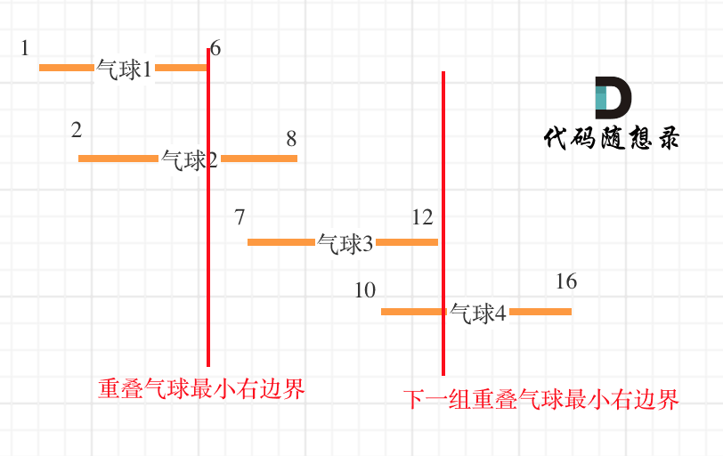

* [做專案（多個 C++、Java、Go、測開、前端專案）](https://www.programmercarl.com/other/kstar.html)
* [刷演算法（兩個月高強度學演算法）](https://www.programmercarl.com/xunlian/xunlianying.html)
* [背八股（40 天挑戰高頻面試題）](https://www.programmercarl.com/xunlian/bagu.html)


# 452. 用最少數量的箭引爆氣球

[LeetCode 題目連結](https://leetcode.cn/problems/minimum-number-of-arrows-to-burst-balloons/)

在二維（two-dimensional）空間中有許多球形的氣球。對於每個氣球，提供的輸入是水平方向上，氣球直徑的開始和結束坐標（coordinate）。由於它是水平的，所以縱坐標並不重要，因此只要知道開始和結束的橫坐標就足夠了。開始坐標總是小於結束坐標。

一支弓箭可以沿著 x 軸從不同點完全垂直地射出。在坐標 x 處射出一支箭，若有一個氣球的直徑的開始和結束坐標為 xstart，xend， 且滿足  xstart ≤ x ≤ xend，則該氣球會被引爆。可以射出的弓箭的數量沒有限制。 弓箭一旦被射出之後，可以無限地前進。我們想找到使得所有氣球全部被引爆，所需的弓箭的最小數量。

給你一個陣列（array） points ，其中 points [i] = [xstart,xend] ，回傳引爆所有氣球所必須射出的最小弓箭數。


範例 1：
* 輸入：points = [[10,16],[2,8],[1,6],[7,12]]
* 輸出：2
* 解釋：對於該範例，x = 6 可以射爆 [2,8],[1,6] 兩個氣球，以及 x = 11 射爆另外兩個氣球

範例 2：
* 輸入：points = [[1,2],[3,4],[5,6],[7,8]]
* 輸出：4

範例 3：
* 輸入：points = [[1,2],[2,3],[3,4],[4,5]]
* 輸出：2

範例 4：
* 輸入：points = [[1,2]]
* 輸出：1

範例 5：
* 輸入：points = [[2,3],[2,3]]
* 輸出：1

提示：
* 0 <= points.length <= 10^4
* points[i].length == 2
* -2^31 <= xstart < xend <= 2^31 - 1

## 演算法公開課

**[《程式碼隨想錄》演算法影片公開課](https://programmercarl.com/other/gongkaike.html)：[貪心演算法（greedy algorithm），判斷重疊區間（interval）問題 | LeetCode：452.用最少數量的箭引爆氣球](https://www.bilibili.com/video/BV1SA41167xe)，相信結合影片再看本篇題解，更有助於大家對本題的理解**。

## 解題思路

如何使用最少的弓箭呢？

直覺上來看，貌似只射重疊最多的氣球，用的弓箭一定最少，那麼有沒有目前重疊了三個氣球，我射兩個，留下一個和後面的一起射這樣弓箭用得更少的情況呢？

嘗試一下舉反例，發現沒有這種情況。

那麼就試一試貪心法（greedy）吧！區域最佳（local optimum）：當氣球出現重疊，一起射，所用弓箭最少。總體最佳（global optimum）：把所有氣球射爆所用弓箭最少。

**演算法確定下來了，那麼如何模擬（simulation）氣球射爆的過程呢？是在陣列中移除元素（element）還是做標記呢？**

如果真實地模擬射氣球的過程，應該射一個，氣球陣列就 remove 一個元素，這樣最直觀，畢竟氣球被射了。

但仔細思考一下就發現：如果把氣球排序（sorting）之後，從前到後遍歷（traversal）氣球，被射過的氣球僅僅跳過就行了，沒有必要讓氣球陣列 remove 氣球，只要記錄一下箭的數量就可以了。

以上為思考過程，已經確定下來使用貪心法了，那麼開始解題。

**為了讓氣球盡可能地重疊，需要對陣列進行排序**。

那麼按照氣球起始位置排序，還是按照氣球終止位置排序呢？

其實都可以！只不過對應的遍歷順序不同，我就按照氣球的起始位置排序了。

既然按照起始位置排序，那麼就從前向後遍歷氣球陣列，靠左盡可能讓氣球重複。

從前向後遍歷遇到重疊的氣球了怎麼辦？

**如果氣球重疊了，重疊氣球中右邊邊界（boundary）的最小值 之前的區間一定需要一個弓箭**。

以題目範例： [[10,16],[2,8],[1,6],[7,12]] 為例，如圖：（方便起見，已經排序）



可以看出首先第一組重疊氣球，一定是需要一個箭，氣球 3 的左邊界大於了 第一組重疊氣球的最小右邊界，所以再需要一支箭來射氣球 3 了。

C++ 程式碼如下：

```CPP
class Solution {
private:
    static bool cmp(const vector<int>& a, const vector<int>& b) {
        return a[0] < b[0];
    }
public:
    int findMinArrowShots(vector<vector<int>>& points) {
        if (points.size() == 0) return 0;
        sort(points.begin(), points.end(), cmp);

        int result = 1; // points 不為空至少需要一支箭
        for (int i = 1; i < points.size(); i++) {
            if (points[i][0] > points[i - 1][1]) {  // 氣球 i 和氣球 i-1 不挨著，注意這裡不是 >=
                result++; // 需要一支箭
            }
            else {  // 氣球 i 和氣球 i-1 挨著
                points[i][1] = min(points[i - 1][1], points[i][1]); // 更新重疊氣球最小右邊界
            }
        }
        return result;
    }
};
```

* 時間複雜性（time complexity）：O(nlog n)，因為有一個快速排序（quick sort）
* 空間複雜度（space complexity）：O(n)，有一個快速排序，最差情況（倒序）時，需要 n 次遞迴呼叫（recursive call）。因此確實需要 O(n) 的堆疊空間（stack space）

可以看出程式碼並不複雜。

## 注意事項

注意題目中說的是：滿足 xstart ≤ x ≤ xend，則該氣球會被引爆。那麼說明兩個氣球挨在一起不重疊也可以一起射爆，

所以程式碼中 `if (points[i][0] > points[i - 1][1])`  不能是 >=

## 總結

這道題目貪心法的想法很簡單也很直接，就是重複的一起射了，但本題我認為是有難度的。

就算想法都想好了，模擬射氣球的過程，很多同學真的要去模擬了，即時把氣球從陣列中移走，這麼寫的話就複雜了。

而且尋找重複的氣球，尋找重疊氣球最小右邊界，其實都有寫程式碼的技巧。

貪心題目有時候就是這樣，看起來很簡單，想法很直接，但是一寫程式碼就感覺很複雜無從下手。

這裡其實是需要寫程式碼的功底，那寫程式碼的功底怎麼練？

**多看多寫多總結！**


## 其他語言版本


### Java 
```java
/**
 * 時間複雜性 : O(NlogN)  排序需要 O(NlogN) 的複雜度
 * 空間複雜度 : O(logN) Java 所使用的內建函式是快速排序，需要 logN 的空間
 */
class Solution {
    public int findMinArrowShots(int[][] points) {
        // 根據氣球直徑的開始坐標從小到大排序
        // 使用 Integer 內建比較方法，不會溢位
        Arrays.sort(points, (a, b) -> Integer.compare(a[0], b[0]));

        int count = 1;  // points 不為空至少需要一支箭
        for (int i = 1; i < points.length; i++) {
            if (points[i][0] > points[i - 1][1]) {  // 氣球 i 和氣球 i-1 不挨著，注意這裡不是 >=
                count++; // 需要一支箭
            } else {  // 氣球 i 和氣球 i-1 挨著
                points[i][1] = Math.min(points[i][1], points[i - 1][1]); // 更新重疊氣球最小右邊界
            }
        }
        return count;
    }
}
```

### Python
```python
class Solution:
    def findMinArrowShots(self, points: List[List[int]]) -> int:
        if len(points) == 0: return 0
        points.sort(key=lambda x: x[0])
        result = 1
        for i in range(1, len(points)):
            if points[i][0] > points[i - 1][1]: # 氣球 i 和氣球 i-1 不挨著，注意這裡不是 >=
                result += 1     
            else:
                points[i][1] = min(points[i - 1][1], points[i][1]) # 更新重疊氣球最小右邊界
        return result
```
```python
class Solution: # 不改變原陣列
    def findMinArrowShots(self, points: List[List[int]]) -> int:
        if len(points) == 0:
            return 0
            
        points.sort(key = lambda x: x[0])

        # points 已經按照第一個坐標升序排列，因此只需要設定一個變數，記錄右側坐標（閾值）
        # 考慮一個氣球範圍包含兩個不相交氣球的情況：氣球 1: [1, 10], 氣球 2: [2, 5], 氣球 3: [6, 10]
        curr_min_right = points[0][1]
        count = 1
        
        for i in points:
            if i[0] > curr_min_right:
                # 當氣球左側大於這個閾值，那麼一定就需要再發射一支箭，並且將閾值更新為目前氣球的右側
                count += 1
                curr_min_right = i[1]
            else:
                # 否則的話，我們只需要求閾值和目前氣球的右側的較小值來更新閾值
                curr_min_right = min(curr_min_right, i[1])
        return count
```
### Go
```go
func findMinArrowShots(points [][]int) int {
    var res int = 1  // 弓箭數
    // 先按照第一位排序
    sort.Slice(points, func (i,j int) bool {
        return points[i][0] < points[j][0]
    })

    for i := 1; i < len(points); i++ {
        if points[i-1][1] < points[i][0] {  // 如果前一位的右邊界小於後一位的左邊界，則一定不重合
            res++
        } else {
            points[i][1] = min(points[i - 1][1], points[i][1]); // 更新重疊氣球最小右邊界，覆蓋該位置的值，留到下一步使用
        }
    }
    return res
}
func min(a, b int) int {
    if a > b {
        return b
    }
    return a
}
```

### JavaScript 
```Javascript
var findMinArrowShots = function(points) {
    points.sort((a, b) => {
        return a[0] - b[0]
    })
    let result = 1
    for(let i = 1; i < points.length; i++) {
        if(points[i][0] > points[i - 1][1]) {
            result++
        } else {
            points[i][1] = Math.min(points[i - 1][1], points[i][1])
        }
    }

    return result
};
```

### TypeScript

```typescript
function findMinArrowShots(points: number[][]): number {
    const length: number = points.length;
    if (length === 0) return 0;
    points.sort((a, b) => a[0] - b[0]);
    let resCount: number = 1;
    let right: number = points[0][1];   // 右邊界
    let tempPoint: number[];
    for (let i = 1; i < length; i++) {
        tempPoint = points[i];
        if (tempPoint[0] > right) {
            resCount++;
            right = tempPoint[1];
        } else {
            right = Math.min(right, tempPoint[1]);
        }
    }
    return resCount;
};
```

### C 

```c
int cmp(const void *a,const void *b)
{
    return ((*((int**)a))[0] > (*((int**)b))[0]);
} 

int findMinArrowShots(int** points, int pointsSize, int* pointsColSize){
    // 將 points 陣列作升序排序
    qsort(points, pointsSize, sizeof(points[0]),cmp);
    
    int arrowNum = 1;
    int i = 1;
    for(i = 1; i < pointsSize; i++) {
        // 若前一個氣球與目前氣球不重疊，證明需要增加箭的數量
        if(points[i][0] > points[i-1][1])
            arrowNum++;
        else
            // 若前一個氣球與目前氣球重疊，判斷並更新最小的 x_end
            points[i][1] = points[i][1] > points[i-1][1] ? points[i-1][1] : points[i][1];
    }
    return arrowNum;
}
```

### Rust
```Rust
impl Solution {
    pub fn find_min_arrow_shots(mut points: Vec<Vec<i32>>) -> i32 {
        if points.is_empty() {
            return 0;
        }
        points.sort_by_key(|point| point[0]);
        let mut result = 1;
        for i in 1..points.len() {
            if points[i][0] > points[i - 1][1] {
                result += 1;
            } else {
                points[i][1] = points[i][1].min(points[i - 1][1])
            }
        }
        result
    }
}
```

### Scala

```scala
object Solution {
  def findMinArrowShots(points: Array[Array[Int]]): Int = {
    if (points.length == 0) return 0
    // 排序
    var point = points.sortWith((a, b) => {
      a(0) < b(0)
    })

    var result = 1 // points 不為空就至少需要一支箭
    for (i <- 1 until point.length) {
      if (point(i)(0) > point(i - 1)(1)) {
        result += 1
      } else {
        point(i)(1) = math.min(point(i - 1)(1), point(i)(1))
      }
    }
    result // 回傳結果
  }
}
```
### C#
```csharp
public class Solution
{
    public int FindMinArrowShots(int[][] points)
    {
        if (points.Length == 0) return 0;
        Array.Sort(points, (a, b) => a[0].CompareTo(b[0]));
        int count = 1;
        for (int i = 1; i < points.Length; i++)
        {
            if (points[i][0] > points[i - 1][1]) count++;
            else points[i][1] = Math.Min(points[i][1], points[i - 1][1]);
        }
        return count;
    }
}
```

