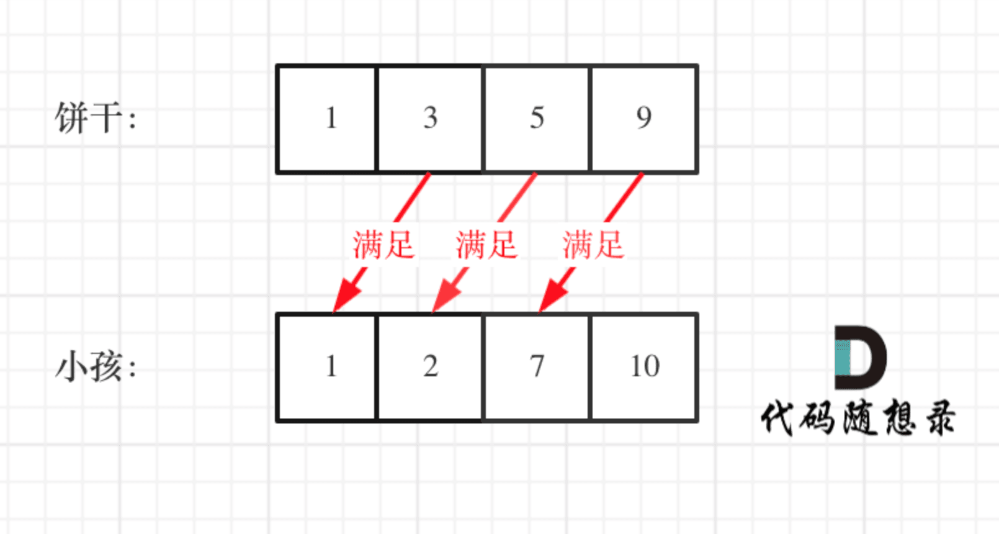
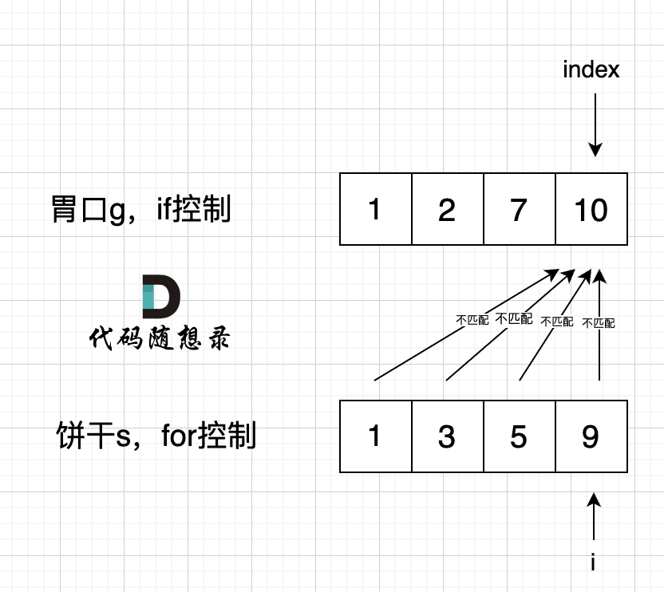

* [做專案（多個 C++、Java、Go、測開、前端專案）](https://www.programmercarl.com/other/kstar.html)
* [刷演算法（兩個月高強度學演算法）](https://www.programmercarl.com/xunlian/xunlianying.html)
* [背八股（40 天挑戰高頻面試題）](https://www.programmercarl.com/xunlian/bagu.html)

# 455. 分發餅乾

[LeetCode 題目連結](https://leetcode.cn/problems/assign-cookies/)

假設你是一位很棒的家長，想要給你的孩子們一些小餅乾。但是，每個孩子最多只能給一塊餅乾。

對每個孩子 i，都有一個胃口值  g[i]，這是能讓孩子們滿足胃口的餅乾的最小尺寸；並且每塊餅乾 j，都有一個尺寸 s[j] 。如果 s[j] >= g[i]，我們可以將這個餅乾 j 分配給孩子 i ，這個孩子會得到滿足。你的目標是盡可能滿足越多數量的孩子，並輸出這個最大數值。

範例  1:

- 輸入: g = [1,2,3], s = [1,1]
- 輸出: 1
  解釋:你有三個孩子和兩塊小餅乾，3 個孩子的胃口值分別是：1,2,3。雖然你有兩塊小餅乾，由於他們的尺寸都是 1，你只能讓胃口值是 1 的孩子滿足。所以你應該輸出 1。

範例  2:

- 輸入: g = [1,2], s = [1,2,3]
- 輸出: 2
- 解釋:你有兩個孩子和三塊小餅乾，2 個孩子的胃口值分別是 1,2。你擁有的餅乾數量和尺寸都足以讓所有孩子滿足。所以你應該輸出 2.

提示：

- 1 <= g.length <= 3 \* 10^4
- 0 <= s.length <= 3 \* 10^4
- 1 <= g[i], s[j] <= 2^31 - 1

## 演算法公開課

**[《程式碼隨想錄》演算法影片公開課](https://programmercarl.com/other/gongkaike.html)：[貪心演算法（greedy algorithm），你想先餵哪個小孩？| LeetCode：455.分發餅乾](https://www.bilibili.com/video/BV1MM411b7cq)，相信結合影片再看本篇題解，更有助於大家對本題的理解**。

## 解題思路

為了滿足更多的小孩，就不要造成餅乾尺寸的浪費。

大尺寸的餅乾既可以滿足胃口大的孩子也可以滿足胃口小的孩子，那麼就應該優先滿足胃口大的。

**這裡的區域最佳（local optimum）就是大餅乾餵給胃口大的，充分利用餅乾尺寸餵飽一個，總體最佳（global optimum）就是餵飽盡可能多的小孩**。

可以嘗試使用貪心策略（greedy strategy），先將餅乾陣列（array）和小孩陣列排序（sorting）。

然後從後向前遍歷（traversal）小孩陣列，用大餅乾優先滿足胃口大的，並統計滿足小孩數量。

如圖：



這個例子可以看出餅乾 9 只有餵給胃口為 7 的小孩，這樣才是整體最佳解，並想不出反例，那麼就可以開始寫程式碼了。

C++ 程式碼整體如下：

```CPP
// 版本一
class Solution {
public:
    int findContentChildren(vector<int>& g, vector<int>& s) {
        sort(g.begin(), g.end());
        sort(s.begin(), s.end());
        int index = s.size() - 1; // 餅乾陣列的下標
        int result = 0;
        for (int i = g.size() - 1; i >= 0; i--) { // 遍歷胃口
            if (index >= 0 && s[index] >= g[i]) { // 遍歷餅乾
                result++;
                index--;
            }
        }
        return result;
    }
};
```
* 時間複雜度（time complexity）：O(nlogn)
* 空間複雜度（space complexity）：O(1)


從程式碼中可以看出我用了一個 index 來控制餅乾陣列的遍歷，遍歷餅乾並沒有再起一個 for 迴圈（for-loop），而是採用自減的方式，這也是常用的技巧。

有的同學看到要遍歷兩個陣列，就想到用兩個 for 迴圈，那樣邏輯其實就複雜了。

### 注意事項

注意版本一的程式碼中，可以看出來，是先遍歷的胃口，再遍歷的餅乾，那麼可不可以 先遍歷 餅乾，再遍歷胃口呢？

其實是不可以的。

外面的 for 裡的下標（subscript） i 是固定移動的，而 if 裡面的下標 index 是符合條件（condition）才移動的。

如果 for 控制的是餅乾， if 控制胃口，就會出現如下情況 ：



if 裡的 index 指向 胃口 10， for 裡的 i 指向餅乾 9，因為 餅乾 9 滿足不了 胃口 10，所以 i 持續向前移動，而 index 走不到` s[index] >= g[i]` 的邏輯，所以 index 不會移動，那麼當 i 持續向前移動，最後所有的餅乾都匹配不上。

所以 一定要 for 控制 胃口，裡面的 if 控制餅乾。

### 其他思路

**也可以換一個想法，小餅乾先餵飽小胃口**

程式碼如下：

```CPP
class Solution {
public:
    int findContentChildren(vector<int>& g, vector<int>& s) {
        sort(g.begin(),g.end());
        sort(s.begin(),s.end());
        int index = 0;
        for(int i = 0; i < s.size(); i++) { // 餅乾
            if(index < g.size() && g[index] <= s[i]){ // 胃口
                index++;
            }
        }
        return index;
    }
};
```
* 時間複雜度：O(nlogn)
* 空間複雜度：O(1)


細心的錄友可以發現，這種寫法，兩個迴圈的順序改變了，先遍歷的餅乾，再遍歷的胃口，這是因為遍歷順序變了，我們是從小到大遍歷。

理由在上面「注意事項」中 已經講過。

## 總結

這道題是貪心法（greedy）很好的一道入門題目，想法還是比較容易想到的。

文中詳細介紹了思考的過程，**想清楚區域最佳，想清楚總體最佳，感覺區域最佳是可以推出總體最佳，並想不出反例，那麼就試一試貪心法**。

## 其他語言版本

### Java

```java
class Solution {
    // 思路 1：優先考慮餅乾，小餅乾先餵飽小胃口
    public int findContentChildren(int[] g, int[] s) {
        Arrays.sort(g);
        Arrays.sort(s);
        int start = 0;
        int count = 0;
        for (int i = 0; i < s.length && start < g.length; i++) {
            if (s[i] >= g[start]) {
                start++;
                count++;
            }
        }
        return count;
    }
}
```

```java
class Solution {
    // 思路 2：優先考慮胃口，先餵飽大胃口
    public int findContentChildren(int[] g, int[] s) {
        Arrays.sort(g);
        Arrays.sort(s);
        int count = 0;
        int start = s.length - 1;
        // 遍歷胃口
        for (int index = g.length - 1; index >= 0; index--) {
            if(start >= 0 && g[index] <= s[start]) {
                start--;
                count++;
            }
        }
        return count;
    }
}
```

### Python
貪心法 大餅乾優先
```python
class Solution:
    def findContentChildren(self, g, s):
        g.sort()  # 將孩子的貪心因子排序
        s.sort()  # 將餅乾的尺寸排序
        index = len(s) - 1  # 餅乾陣列的下標，從最後一個餅乾開始
        result = 0  # 滿足孩子的數量
        for i in range(len(g)-1, -1, -1):  # 遍歷胃口，從最後一個孩子開始
            if index >= 0 and s[index] >= g[i]:  # 遍歷餅乾
                result += 1
                index -= 1
        return result

```
貪心法 小餅乾優先
```python
class Solution:
    def findContentChildren(self, g, s):
        g.sort()  # 將孩子的貪心因子排序
        s.sort()  # 將餅乾的尺寸排序
        index = 0
        for i in range(len(s)):  # 遍歷餅乾
            if index < len(g) and g[index] <= s[i]:  # 如果目前孩子的貪心因子小於等於目前餅乾尺寸
                index += 1  # 滿足一個孩子，指向下一個孩子
        return index  # 回傳滿足的孩子數目

```

堆疊（stack）大餅乾優先
```python
from collecion import deque
class Solution:
    def findContentChildren(self, g: List[int], s: List[int]) -> int:
      # 想法：餅乾和孩子按從大到小排序，依序從堆疊中取出，若滿足條件 result += 1 否則將餅乾堆疊頂端元素重新放回 
        result = 0
        queue_g = deque(sorted(g, reverse = True))
        queue_s = deque(sorted(s, reverse = True))
        while queue_g and queue_s:
            child = queue_g.popleft()
            cookies = queue_s.popleft()
            if child <= cookies:
                result += 1
            else:
                queue_s.appendleft(cookies)
        return result
```

### Go

版本一 大餅乾優先
```Go
func findContentChildren(g []int, s []int) int {
    sort.Ints(g)
    sort.Ints(s)
    index := len(s) - 1
    result := 0
    for i := len(g) - 1; i >= 0; i-- {
        if index >= 0 && s[index] >= g[i] {
            result++
            index--
        }
    }
    return result
}
```

版本二 小餅乾優先
```Go
func findContentChildren(g []int, s []int) int {
    sort.Ints(g)
    sort.Ints(s)
    index := 0
    for i := 0; i < len(s); i++ {
        if index < len(g) && g[index] <= s[i] {
            index++
        }
    }
    return index
}
```

### Rust

```rust
pub fn find_content_children(mut children: Vec<i32>, mut cookies: Vec<i32>) -> i32 {
    children.sort();
    cookies.sort();

    let (mut child, mut cookie) = (0, 0);
    while child < children.len() && cookie < cookies.len() {
        // 優先選擇最小餅乾餵飽孩子
        if children[child] <= cookies[cookie] {
            child += 1;
        }
        cookie += 1;
    }
    child as i32
}
```

### JavaScript

```js
var findContentChildren = function (g, s) {
  g = g.sort((a, b) => a - b);
  s = s.sort((a, b) => a - b);
  let result = 0;
  let index = s.length - 1;
  for (let i = g.length - 1; i >= 0; i--) {
    if (index >= 0 && s[index] >= g[i]) {
      result++;
      index--;
    }
  }
  return result;
};
```

### TypeScript

```typescript
// 大餅乾盡量餵胃口大的
function findContentChildren(g: number[], s: number[]): number {
  g.sort((a, b) => a - b);
  s.sort((a, b) => a - b);
  const childLength: number = g.length,
    cookieLength: number = s.length;
  let curChild: number = childLength - 1,
    curCookie: number = cookieLength - 1;
  let resCount: number = 0;
  while (curChild >= 0 && curCookie >= 0) {
    if (g[curChild] <= s[curCookie]) {
      curCookie--;
      resCount++;
    }
    curChild--;
  }
  return resCount;
}
```

```typescript
// 小餅乾先餵飽小胃口的
function findContentChildren(g: number[], s: number[]): number {
  g.sort((a, b) => a - b);
  s.sort((a, b) => a - b);
  const childLength: number = g.length,
    cookieLength: number = s.length;
  let curChild: number = 0,
    curCookie: number = 0;
  while (curChild < childLength && curCookie < cookieLength) {
    if (g[curChild] <= s[curCookie]) {
      curChild++;
    }
    curCookie++;
  }
  return curChild;
}
```

### C

```c
///小餅乾先餵飽小胃口的
int cmp(int* a, int* b) {
    return *a - *b;
}

int findContentChildren(int* g, int gSize, int* s, int sSize){
    if(sSize == 0)
        return 0;

    // 將兩個陣列排序為升序
    qsort(g, gSize, sizeof(int), cmp);
    qsort(s, sSize, sizeof(int), cmp);

    int numFedChildren = 0;
    int i = 0;
    for(i = 0; i < sSize; ++i) {
        if(numFedChildren < gSize && g[numFedChildren] <= s[i])
            numFedChildren++;
    }
    return numFedChildren;
}
```

```c
///大餅乾先餵飽大胃口的
int cmp(int* a, int* b) {
    return *a - *b;
}

int findContentChildren(int* g, int gSize, int* s, int sSize){
    if(sSize == 0)
        return 0;

    // 將兩個陣列排序為升序
    qsort(g, gSize, sizeof(int), cmp);
    qsort(s, sSize, sizeof(int), cmp);

    int count = 0;
    int start = sSize - 1;

    for(int i = gSize - 1; i >= 0; i--) {
        if(start >= 0 && s[start] >= g[i] ) {
            start--;
            count++;
        }
    }
    return count;
}
```

### Scala

```scala
object Solution {
  def findContentChildren(g: Array[Int], s: Array[Int]): Int = {
    var result = 0
    var children = g.sorted
    var cookie = s.sorted
    // 遍歷餅乾
    var j = 0
    for (i <- cookie.indices) {
      if (j < children.size && cookie(i) >= children(j)) {
        j += 1
        result += 1
      }
    }
    result
  }
}
```
### C#
```csharp
public class Solution
{
    public int FindContentChildren(int[] g, int[] s)
    {
        Array.Sort(g);
        Array.Sort(s);
        int index = s.Length - 1;
        int res = 0;
        for (int i = g.Length - 1; i >=0; i--)
        {
            if(index >=0 && s[index]>=g[i])
            {
                res++;
                index--;
            }
        }
        return res;
    }
}
```

