* [做專案（多個 C++、Java、Go、測試開發、前端專案）](https://www.programmercarl.com/other/kstar.html)
* [刷演算法（兩個月高強度學演算法）](https://www.programmercarl.com/xunlian/xunlianying.html)
* [背面試必考題（八股文）（40 天挑戰高頻面試題）](https://www.programmercarl.com/xunlian/bagu.html)


> KMP 演算法（KMP algorithm）還能做這個

# 459.重複的子字串

[LeetCode 題目連結](https://leetcode.cn/problems/repeated-substring-pattern/)

給定一個非空的字串（string），判斷它是否可以由它的一個子字串（substring）重複多次構成。給定的字串只含有小寫英文字母，並且長度不超過 10000。

範例 1:    
* 輸入: "abab"    
* 輸出: True      
* 解釋: 可由子字串 "ab" 重複兩次構成。   

範例 2:     
* 輸入: "aba"  
* 輸出: False       

範例 3:      
* 輸入: "abcabcabcabc"   
* 輸出: True      
* 解釋: 可由子字串 "abc" 重複四次構成。 (或者子字串 "abcabc" 重複兩次構成。)

## 演算法影片公開課

**[《程式碼隨想錄》演算法影片公開課](https://programmercarl.com/other/gongkaike.html)：[字串這麼玩，可有點難度！ | LeetCode：459.重複的子字串](https://www.bilibili.com/video/BV1cg41127fw)，相信結合影片再看本篇題解，更有助於大家對本題的理解**。

## 解題思路


蠻力法（brute force）的解法，就是一個 for 迴圈（for-loop）取得子字串的終止位置，然後判斷子字串是否能重複構成字串，又巢狀一個 for 迴圈，所以是 O(n^2) 的時間複雜性（time complexity）。

有的同學可能會想，怎麼一個 for 迴圈就可以取得子字串嗎？至少得一個 for 取得子字串起始位置，一個 for 取得子字串結束位置吧。 

其實我們只需要判斷，以第一個字母為開始的子字串就可以，所以一個 for 迴圈取得子字串的終止位置就行了。而且遍歷（traversal）的時候都不用遍歷結束，只需要遍歷到中間位置，因為子字串結束位置大於中間位置的話，一定不能重複組成字串。 

蠻力法的解法，這裡就不詳細講解了。

主要講一講移動匹配和 KMP 兩種方法。 

### 移動匹配 

當一個字串 s：abcabc，內部由重複的子字串組成，那麼這個字串的結構一定是這樣的： 

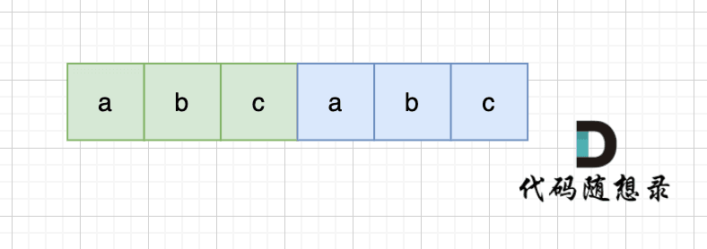 

也就是由前後相同的子字串組成。 

那麼既然前面有相同的子字串，後面有相同的子字串，用 s + s，這樣組成的字串中，後面的子字串做前串，前面的子字串做後串，就一定還能組成一個 s，如圖： 

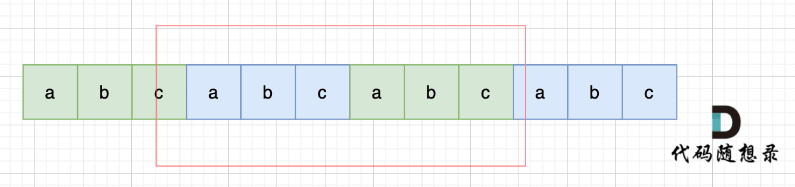


當然，我們在判斷 s + s 拼接的字串裡是否出現一個 s 的時候，**要刨除 s + s 的首字元（character）和尾字元**，這樣避免在 s+s 中搜尋出原來的 s，我們要搜尋的是中間拼接出來的 s。 


以上證明的充分性，接下來證明必要性： 

如果有一個字串 s，在 s + s 拼接後，不算首尾字元，如果能湊成 s 字串，說明 s 一定是重複子字串組成。  

如圖，字串 s，圖中數字為陣列（array）下標（subscript），在 s + s 拼接後，不算首尾字元，中間湊成 s 字串。（圖中數字為陣列下標）

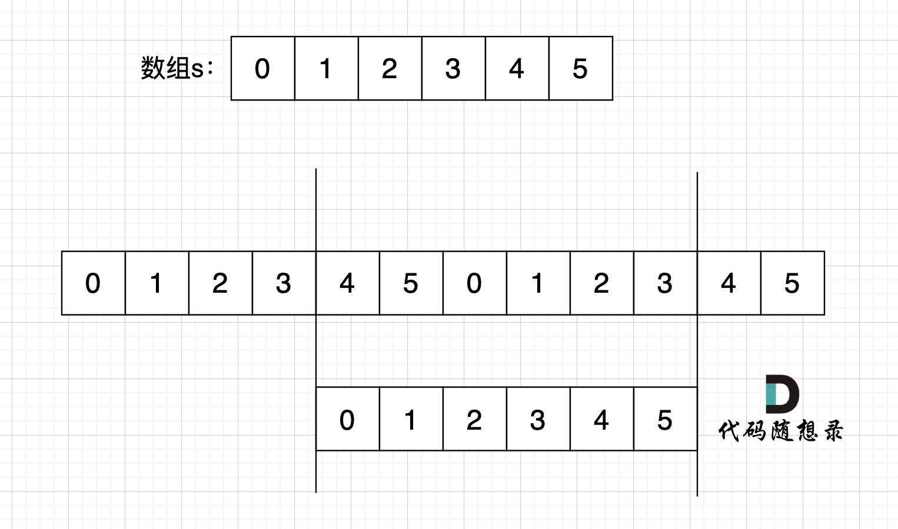 

圖中，因為中間拼接成了 s，根據紅色框可以知道 s[4] = s[0]，s[5] = s[1]，s[0] = s[2], s[1] = s[3], s[2] = s[4], s[3] = s[5] 

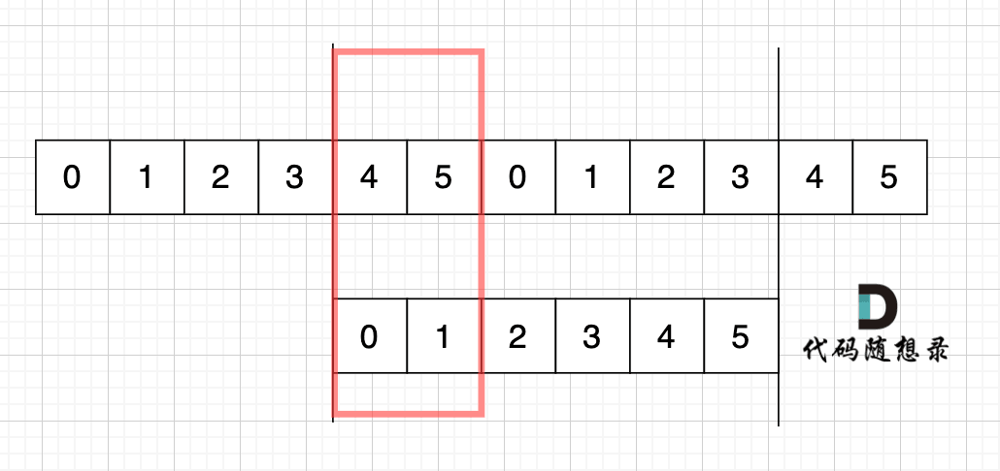  

以上相等關係我們串聯一下： 

s[4] = s[0] = s[2] 

s[5] = s[1] = s[3] 


即：s[4],s[5] = s[0],s[1] = s[2],s[3] 

**說明這個字串，是由兩個字元 s[0] 和 s[1] 重複組成的**！  

這裡可能有錄友會想，憑什麼就是這樣組成的 s 呢，我換一個方式組成 s 行不行，如圖： 

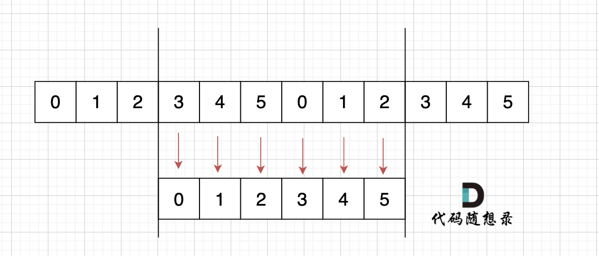  

s[3] = s[0]，s[4] = s[1]，s[5] = s[2]，s[0] = s[3]，s[1] = s[4]，s[2] = s[5]  

以上相等關係串聯： 

s[3] = s[0]  

s[1] = s[4] 

s[2] = s[5] 

s[0] s[1] s[2] = s[3] s[4] s[5]

和以上推導過程一樣，最後可以推導出，這個字串是由 s[0]，s[1]，s[2] 重複組成。 

如果是這樣的呢，如圖： 

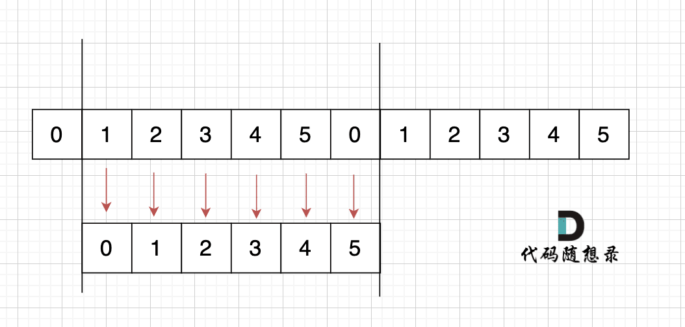 

s[1] = s[0]，s[2] = s[1]，s[3] = s[2]，s[4] = s[3]，s[5] = s[4]，s[0] = s[5] 

以上相等關係串聯 

s[0] = s[1] = s[2] = s[3] = s[4] = s[5] 

最後可以推導出，這個字串是由 s[0] 重複組成。 

以上充分和必要性都證明了，所以判斷字串 s 是否由重複子字串組成，只要兩個 s 拼接在一起，裡面還出現一個 s 的話，就說明是由重複子字串組成。


程式碼如下：

```CPP
class Solution {
public:
    bool repeatedSubstringPattern(string s) {
        string t = s + s;
        t.erase(t.begin()); t.erase(t.end() - 1); // 掐頭去尾
        if (t.find(s) != std::string::npos) return true; // r
        return false;
    }
};
```
* 時間複雜性: O(n)
* 空間複雜度（space complexity）: O(1)

不過這種解法還有一個問題，就是我們最終還是要判斷一個字串（s + s）是否出現過 s 的過程，大家可能直接用 contains、find 之類的程式館函數（library function），卻忽略了實作這些函數的時間複雜性（蠻力解法是 m * n，一般程式館函數實作為 O(m + n)）。

如果我們做過 [28.實作 strStr](https://programmercarl.com/0028.实现strStr.html) 題目的話，其實就知道，**實作一個高效的演算法來判斷一個字串中是否出現另一個字串是很複雜的**，這裡就涉及到了 KMP 演算法。 

### KMP 

#### 為什麼會使用 KMP 

以下使用 KMP 方式講解，強烈建議大家先把以下兩個影片看了，理解 KMP 演算法，再來看下面講解，否則會很懵。 

* [影片講解版：幫你把 KMP 演算法學個通透！（理論篇）](https://www.bilibili.com/video/BV1PD4y1o7nd/)
* [影片講解版：幫你把 KMP 演算法學個通透！（求 next 陣列程式碼篇）](https://www.bilibili.com/video/BV1M5411j7Xx)
* [文字講解版：KMP 演算法](https://programmercarl.com/0028.实现strStr.html)

在一個串中查找是否出現過另一個串，這是 KMP 的看家本領。那麼尋找重複子字串怎麼也涉及到 KMP 演算法了呢？

KMP 演算法中 next 陣列為什麼遇到字元不匹配的時候可以找到上一個匹配過的位置繼續匹配，靠的是有計算好的前綴（prefix）表。 

前綴表裡，統計了各個位置為終點字串的最長相同前綴與尾綴（suffix）的長度。

那麼最長相同前後綴和重複子字串的關係又有什麼關係呢。 

可能很多錄友又忘了前綴和尾綴的定義，再回顧一下： 

* 前綴是指不包含最後一個字元的所有以第一個字元開頭的連續子字串；
* 尾綴是指不包含第一個字元的所有以最後一個字元結尾的連續子字串

#### 充分性證明

如果一個字串 s 是由重複子字串組成，那麼最長相等前後綴不包含的子字串一定是字串 s 的最小重複子字串。  

如果 s 是由最小重複子字串 p 組成，即 s = n * p 

那麼相同前後綴可以是這樣： 

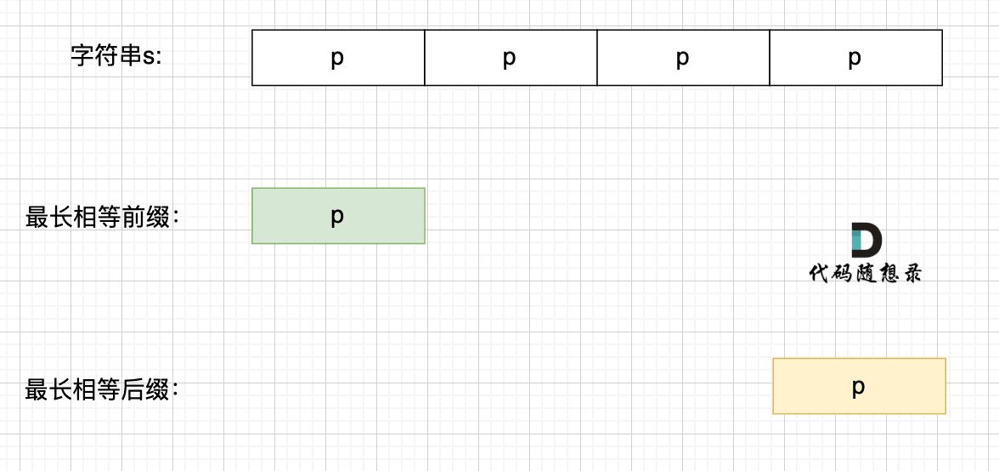 

也可以是這樣： 

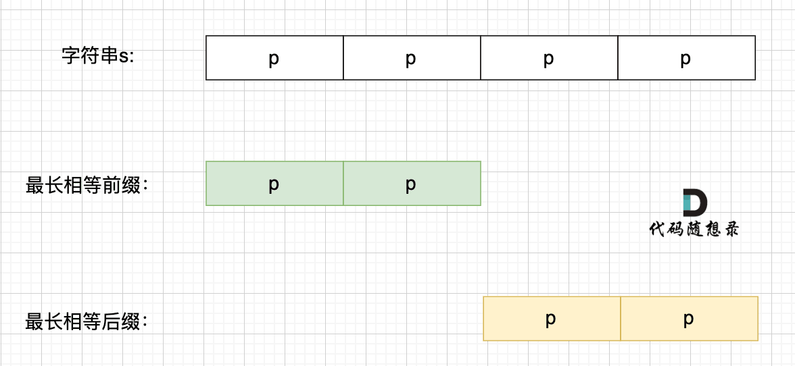 

最長的相等前後綴，也就是這樣： 

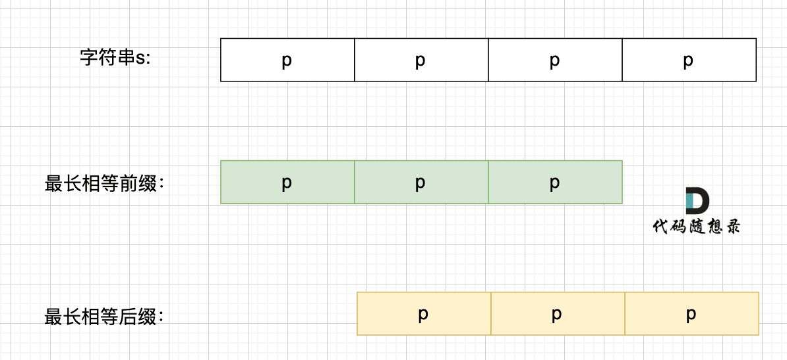

這裡有錄友就想：如果字串 s 是由最小重複子字串 p 組成，最長相等前後綴就不能更長一些？例如這樣： 

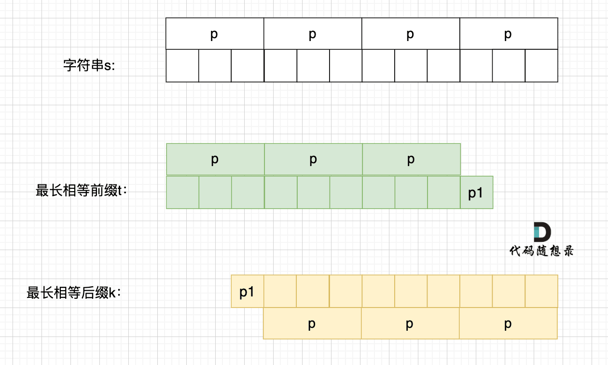 

如果這樣的話，因為前後綴要相同，所以 p2 = p1，p3 = p2，如圖： 

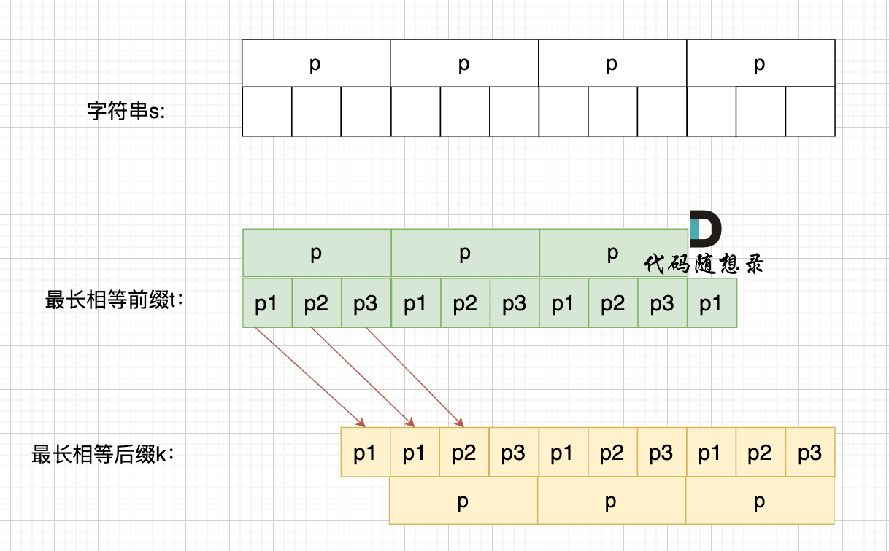 

p2 = p1，p3 = p2 即：p1 = p2 = p3 

說明 p = p1 * 3。 

這樣 p 就不是最小重複子字串了，不符合我們定義的條件。

所以，**如果這個字串 s 是由重複子字串組成，那麼最長相等前後綴不包含的子字串是字串 s 的最小重複子字串**。 

#### 必要性證明

以上是充分性證明，以下是必要性證明： 

**如果最長相等前後綴不包含的子字串是字串 s 的最小重複子字串，那麼字串 s 一定由重複子字串組成嗎**？ 

最長相等前後綴不包含的子字串已經是字串 s 的最小重複子字串，那麼字串 s 一定由重複子字串組成，這個不需要證明了。 

關鍵是要證明：最長相等前後綴不包含的子字串什麼時候才是字串 s 的最小重複子字串呢。 

情況一，最長相等前後綴不包含的子字串的長度比字串 s 的一半的長度還大，那一定不是字串 s 的重複子字串，如圖：

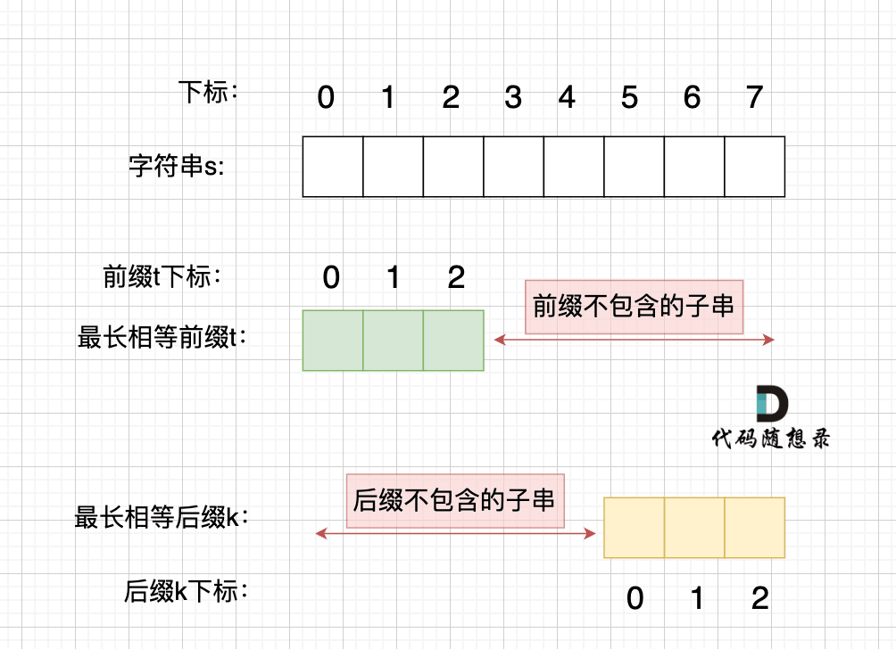

圖中：前後綴不包含的子字串的長度大於字串 s 的長度的二分之一

--------------

情況二，最長相等前後綴不包含的子字串的長度可以被字串 s 的長度整除，如圖：

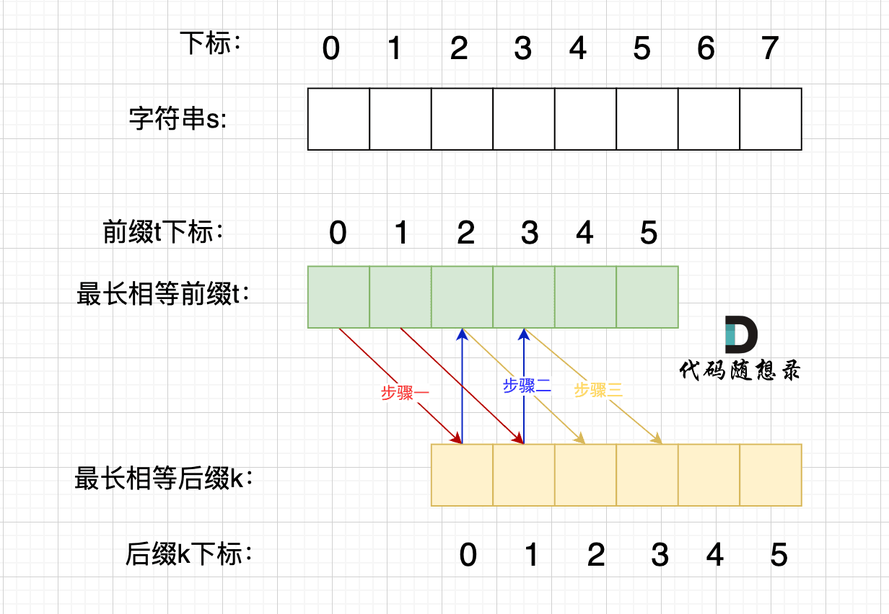 

步驟一：因為這是相等的前綴和尾綴，t[0] 與 k[0] 相同，t[1] 與 k[1] 相同，所以 s[0] 一定和 s[2] 相同，s[1] 一定和 s[3] 相同，即：s[0]s[1] 與 s[2]s[3] 相同。 

步驟二：因為在同一個字串位置，所以 t[2] 與 k[0] 相同，t[3] 與 k[1] 相同。 

步驟三：因為這是相等的前綴和尾綴，t[2] 與 k[2] 相同，t[3] 與 k[3] 相同，所以，s[2] 一定和 s[4] 相同，s[3] 一定和 s[5] 相同，即：s[2]s[3] 與 s[4]s[5] 相同。

步驟四：循環往復。 

所以字串 s，s[0]s[1] 與 s[2]s[3] 相同，s[2]s[3] 與 s[4]s[5] 相同，s[4]s[5] 與 s[6]s[7] 相同。 

可以推出，在由重複子字串組成的字串中，最長相等前後綴不包含的子字串就是最小重複子字串。  

即 s[0]s[1] 是最小重複子字串


以上推導中，錄友可能想，你怎麼知道 s[0] 和 s[1] 就不相同呢？s[0] 為什麼就不能是最小重複子字串。

如果 s[0] 和 s[1] 也相同，同時 s[0]s[1] 與 s[2]s[3] 相同，s[2]s[3] 與 s[4]s[5] 相同，s[4]s[5] 與 s[6]s[7] 相同，那麼這個字串就是由一個字元構成的字串。

那麼它的最長相同前後綴，就不是上圖中的前後綴，而是這樣的前後綴： 

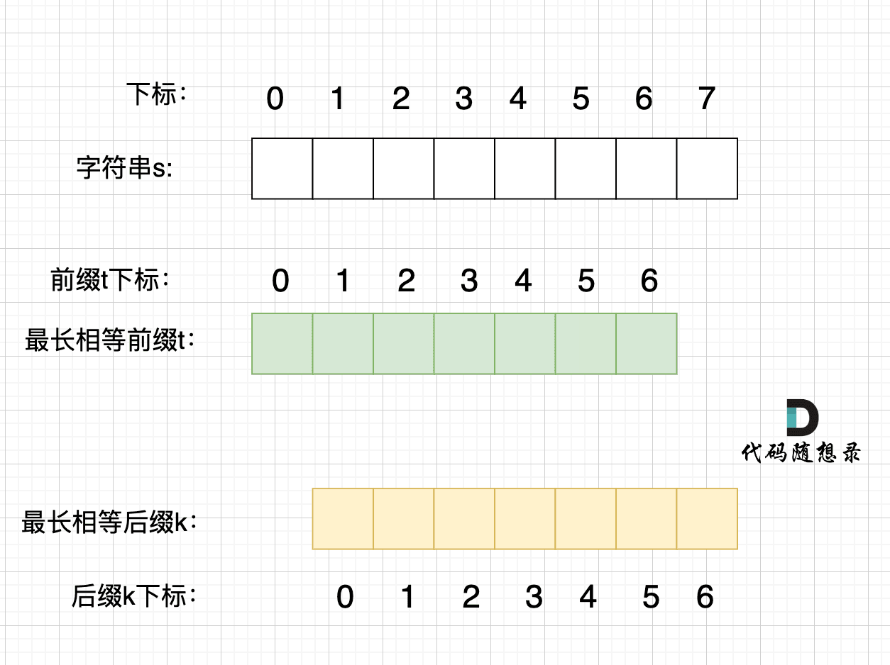

錄友可能再問，由一個字元組成的字串，最長相等前後綴憑什麼就是這樣的。 

有這種疑惑的錄友，就是還不知道最長相等前後綴是怎麼算的。 

可以看這裡：[KMP 講解](https://programmercarl.com/0028.%E5%AE%9E%E7%8E%B0strStr.html)，再去回顧一下。

或者說，自己舉個例子，`aaaaaa`，這個字串，它的最長相等前後綴是什麼？ 

同以上推導，最長相等前後綴不包含的子字串的長度只要被字串 s 的長度整除，最長相等前後綴不包含的子字串一定是最小重複子字串。

----------------

**情況三，最長相等前後綴不包含的子字串的長度不被字串 s 的長度整除的情況**，如圖： 

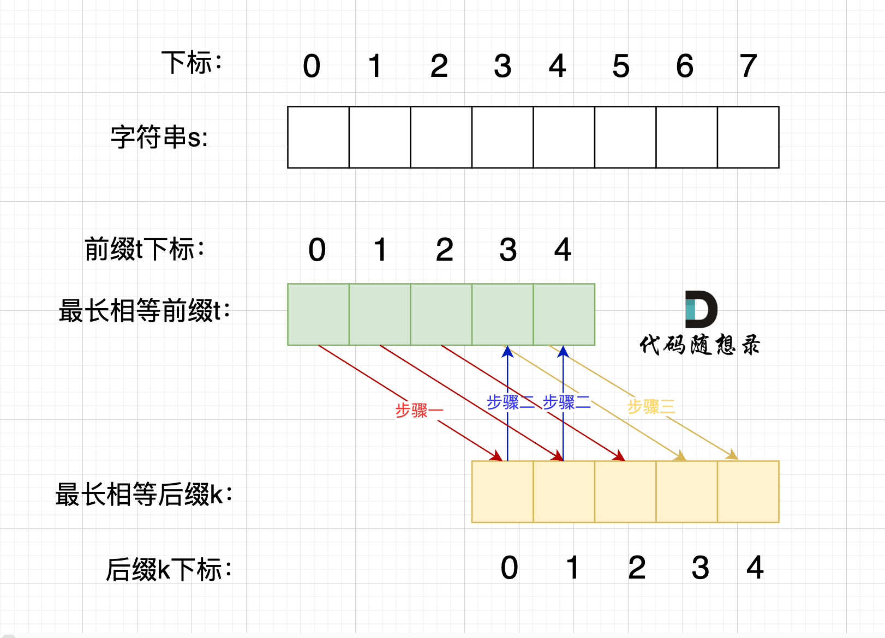 


步驟一：因為這是相等的前綴和尾綴，t[0] 與 k[0] 相同，t[1] 與 k[1] 相同，t[2] 與 k[2] 相同。

所以 s[0] 與 s[3] 相同，s[1] 與 s[4] 相同，s[2] 與 s[5] 相同，即：s[0]s[1]s[2] 與 s[3]s[4]s[5] 相同。 

步驟二：因為在同一個字串位置，所以 t[3] 與 k[0] 相同，t[4] 與 k[1] 相同。   


步驟三：因為這是相等的前綴和尾綴，t[3] 與 k[3] 相同，t[4] 與 k[5] 相同，所以，s[3] 一定和 s[6] 相同，s[4] 一定和 s[7] 相同，即：s[3]s[4] 與 s[6]s[7] 相同。 


以上推導，可以得出 s[0],s[1],s[2] 與 s[3],s[4],s[5] 相同，s[3]s[4] 與 s[6]s[7] 相同。

那麼最長相等前後綴不包含的子字串的長度不被字串 s 的長度整除，最長相等前後綴不包含的子字串就不是 s 的重複子字串

-----------

充分條件：如果字串 s 是由重複子字串組成，那麼最長相等前後綴不包含的子字串一定是 s 的最小重複子字串。 

必要條件：如果字串 s 的最長相等前後綴不包含的子字串是 s 最小重複子字串，那麼 s 是由重複子字串組成。 

在必要條件，這是顯而易見的，都已經假設最長相等前後綴不包含的子字串是 s 的最小重複子字串了，那 s 必然是重複子字串。 

**關鍵是需要證明，字串 s 的最長相等前後綴不包含的子字串什麼時候才是 s 最小重複子字串**。 

同上我們證明了，當最長相等前後綴不包含的子字串的長度可以被字串 s 的長度整除，那麼不包含的子字串就是 s 的最小重複子字串。 


-------------


### 程式碼分析

next 陣列記錄的就是最長相同前後綴（[字串：KMP 演算法精講](https://programmercarl.com/0028.实现strStr.html)），如果 `next[len - 1] != -1`，則說明字串有最長相同的前後綴（就是字串裡的前綴子字串和尾綴子字串相同的最長長度）。

最長相等前後綴的長度為：`next[len - 1] + 1`。(這裡的 next 陣列是以統一減一的方式計算的，因此需要 +1，兩種計算 next 陣列的具體區別看這裡：[字串：KMP 演算法精講](https://programmercarl.com/0028.实现strStr.html))

陣列長度為：len。

`len - (next[len - 1] + 1)` 是最長相等前後綴不包含的子字串的長度。 

如果 `len % (len - (next[len - 1] + 1)) == 0`，則說明陣列的長度正好可以被最長相等前後綴不包含的子字串的長度整除，說明該字串有重複的子字串。

### 印出陣列

**強烈建議大家把 next 陣列印出來，看看 next 陣列裡的規律，有助於理解 KMP 演算法**

如圖：

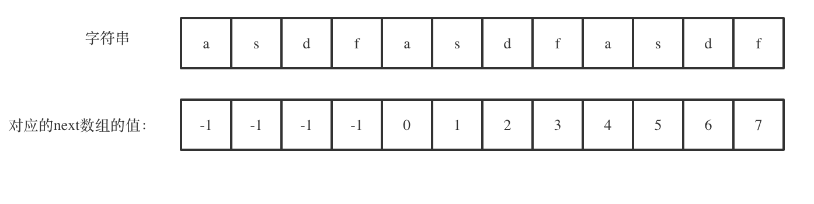

`next[len - 1] = 7`，`next[len - 1] + 1 = 8`，8 就是此時字串 asdfasdfasdf 的最長相同前後綴的長度。

`(len - (next[len - 1] + 1))` 也就是：12（字串的長度）- 8（最長公用前後綴的長度）= 4，為最長相同前後綴不包含的子字串長度


4 可以被 12（字串的長度）整除，所以說明有重複的子字串（asdf）。

### 程式碼實作

C++ 程式碼如下：（這裡使用了前綴表統一減一的實作方式）

```CPP
class Solution {
public:
    void getNext (int* next, const string& s){
        next[0] = -1;
        int j = -1;
        for(int i = 1;i < s.size(); i++){
            while(j >= 0 && s[i] != s[j + 1]) {
                j = next[j];
            }
            if(s[i] == s[j + 1]) {
                j++;
            }
            next[i] = j;
        }
    }
    bool repeatedSubstringPattern (string s) {
        if (s.size() == 0) {
            return false;
        }
        int next[s.size()];
        getNext(next, s);
        int len = s.size();
        if (next[len - 1] != -1 && len % (len - (next[len - 1] + 1)) == 0) {
            return true;
        }
        return false;
    }
};
```
* 時間複雜性: O(n)
* 空間複雜度: O(n)


前綴表（不減一）的 C++ 程式碼實作：

```CPP
class Solution {
public:
    void getNext (int* next, const string& s){
        next[0] = 0;
        int j = 0;
        for(int i = 1;i < s.size(); i++){
            while(j > 0 && s[i] != s[j]) {
                j = next[j - 1];
            }
            if(s[i] == s[j]) {
                j++;
            }
            next[i] = j;
        }
    }
    bool repeatedSubstringPattern (string s) {
        if (s.size() == 0) {
            return false;
        }
        int next[s.size()];
        getNext(next, s);
        int len = s.size();
        if (next[len - 1] != 0 && len % (len - (next[len - 1] )) == 0) {
            return true;
        }
        return false;
    }
};
```
* 時間複雜性: O(n)
* 空間複雜度: O(n)


## 其他語言版本

### Java：

（版本一）前綴表 減一

```java
class Solution {
    public boolean repeatedSubstringPattern(String s) {
        if (s.equals("")) return false;

        int len = s.length();
        // 原串加個空白(哨符)，使下標從1開始，這樣j從0開始，也不用初始化了
        s = " " + s;
        char[] chars = s.toCharArray();
        int[] next = new int[len + 1];

        // 建構 next 陣列過程，j從0開始(空白)，i從2開始
        for (int i = 2, j = 0; i <= len; i++) {
            // 匹配不成功，j回到前一位置 next 陣列所對應的值
            while (j > 0 && chars[i] != chars[j + 1]) j = next[j];
            // 匹配成功，j往後移
            if (chars[i] == chars[j + 1]) j++;
            // 更新 next 陣列的值
            next[i] = j;
        }

        // 最後判斷是否是重複的子字串，這裡 next[len] 即代表 next 陣列末尾的值
        if (next[len] > 0 && len % (len - next[len]) == 0) {
            return true;
        }
        return false;
    }
}
```

（版本二）前綴表 不減一

```java
/*
 * 充分條件：如果字串s是由重複子字串組成的，那麼它的最長相等前後綴不包含的子字串一定是s的最小重複子字串。
 * 必要條件：如果字串s的最長相等前後綴不包含的子字串是s的最小重複子字串，那麼s必然是由重複子字串組成的。
 * 推得：當字串s的長度可以被其最長相等前後綴不包含的子字串的長度整除時，不包含的子字串就是s的最小重複子字串。
 *
 * 時間複雜性：O(n)
 * 空間複雜度：O(n)
 */
class Solution {
    public boolean repeatedSubstringPattern(String s) {
        // if (s.equals("")) return false; 
        // 邊界判斷（可以去掉，因為題目給定範圍是1 <= s.length <= 10^4）
        int n = s.length();

        // Step 1.建構KMP演算法的前綴表
        int[] next = new int[n]; // 前綴表的值表示 以該位置結尾的字串的最長相等前後綴的長度
        int j = 0;
        next[0] = 0;
        for (int i = 1; i < n; i++) {
            while (j > 0 && s.charAt(i) != s.charAt(j)) // 只要前綴尾綴還不一致，就根據前綴表回退j直到起點為止
                j = next[j - 1];
            if (s.charAt(i) == s.charAt(j))
                j++;
            next[i] = j;
        }

        // Step 2.判斷重複子字串
        if (next[n - 1] > 0 && n % (n - next[n - 1]) == 0) { // 當字串s的長度可以被其最長相等前後綴不包含的子字串的長度整除時
            return true; // 不包含的子字串就是s的最小重複子字串
        } else {
            return false;
        }
    }
}
```

### Python：

（版本一）前綴表 減一
```python
class Solution:
    def repeatedSubstringPattern(self, s: str) -> bool:  
        if len(s) == 0:
            return False
        nxt = [0] * len(s)
        self.getNext(nxt, s)
        if nxt[-1] != -1 and len(s) % (len(s) - (nxt[-1] + 1)) == 0:
            return True
        return False
    
    def getNext(self, nxt, s):
        nxt[0] = -1
        j = -1
        for i in range(1, len(s)):
            while j >= 0 and s[i] != s[j+1]:
                j = nxt[j]
            if s[i] == s[j+1]:
                j += 1
            nxt[i] = j
        return nxt
```

（版本二）前綴表 不減一

```python
class Solution:
    def repeatedSubstringPattern(self, s: str) -> bool:  
        if len(s) == 0:
            return False
        nxt = [0] * len(s)
        self.getNext(nxt, s)
        if nxt[-1] != 0 and len(s) % (len(s) - nxt[-1]) == 0:
            return True
        return False
    
    def getNext(self, nxt, s):
        nxt[0] = 0
        j = 0
        for i in range(1, len(s)):
            while j > 0 and s[i] != s[j]:
                j = nxt[j - 1]
            if s[i] == s[j]:
                j += 1
            nxt[i] = j
        return nxt
```


（版本三）使用 find

```python
class Solution:
    def repeatedSubstringPattern(self, s: str) -> bool:
        n = len(s)
        if n <= 1:
            return False
        ss = s[1:] + s[:-1] 
        print(ss.find(s))              
        return ss.find(s) != -1
```

（版本四）蠻力法

```python
class Solution:
    def repeatedSubstringPattern(self, s: str) -> bool:
        n = len(s)
        if n <= 1:
            return False
        
        substr = ""
        for i in range(1, n//2 + 1):
            if n % i == 0:
                substr = s[:i]
                if substr * (n//i) == s:
                    return True
                
        return False
```

### Go：

這裡使用了前綴表統一減一的實作方式

```go
func repeatedSubstringPattern(s string) bool {
	n := len(s)
	if n == 0 {
		return false
	}
	next := make([]int, n)
	j := -1
	next[0] = j
	for i := 1; i < n; i++ {
		for j >= 0 && s[i] != s[j+1] {
			j = next[j]
		}
		if s[i] == s[j+1] {
			j++
		}
		next[i] = j
	}
	// next[n-1]+1 最長相同前後綴的長度
	if next[n-1] != -1 && n%(n-(next[n-1]+1)) == 0 {
		return true
	}
	return false
}
```

前綴表（不減一）的程式碼實作

```go
func repeatedSubstringPattern(s string) bool {
	n := len(s)
	if n == 0 {
		return false
	}
	j := 0
	next := make([]int, n)
	next[0] = j
	for i := 1; i < n; i++ {
		for j > 0 && s[i] != s[j] {
			j = next[j-1]
		}
		if s[i] == s[j] {
			j++
		}
		next[i] = j
	}
	// next[n-1]  最長相同前後綴的長度
	if next[n-1] != 0 && n%(n-next[n-1]) == 0 {
		return true
	}
	return false
}
```

移動匹配

```go
func repeatedSubstringPattern(s string) bool {
    if len(s) == 0 {
        return false
    }
    t := s + s
    return strings.Contains(t[1:len(t)-1], s)
}
```

### JavaScript:

> 前綴表統一減一

```javascript
/**
 * @param {string} s
 * @return {boolean}
 */
var repeatedSubstringPattern = function (s) {
    if (s.length === 0)
        return false;

    const getNext = (s) => {
        let next = [];
        let j = -1;

        next.push(j);

        for (let i = 1; i < s.length; ++i) {
            while (j >= 0 && s[i] !== s[j + 1])
                j = next[j];
            if (s[i] === s[j + 1])
                j++;
            next.push(j);
        }

        return next;
    }

    let next = getNext(s);

    if (next[next.length - 1] !== -1 && s.length % (s.length - (next[next.length - 1] + 1)) === 0)
        return true;
    return false;
};
```

> 前綴表統一不減一

```javascript
/**
 * @param {string} s
 * @return {boolean}
 */
var repeatedSubstringPattern = function (s) {
    if (s.length === 0)
        return false;

    const getNext = (s) => {
        let next = [];
        let j = 0;

        next.push(j);

        for (let i = 1; i < s.length; ++i) {
            while (j > 0 && s[i] !== s[j])
                j = next[j - 1];
            if (s[i] === s[j])
                j++;
            next.push(j);
        }

        return next;
    }

    let next = getNext(s);

    if (next[next.length - 1] !== 0 && s.length % (s.length - next[next.length - 1]) === 0)
        return true;
    return false;
};
```

> 正規表達式（regular expression）匹配
```javascript
/**
 * @param {string} s
 * @return {boolean}
 */
var repeatedSubstringPattern = function(s) {
  let reg = /^(\w+)\1+$/
  return reg.test(s)
};
```
> 移動匹配
```javascript
/**
 * @param {string} s
 * @return {boolean}
 */
var repeatedSubstringPattern = function (s) {
    let ss = s + s;
    return ss.substring(1, ss.length - 1).includes(s);
};
```

### TypeScript:

> 前綴表統一減一

```typescript
function repeatedSubstringPattern(s: string): boolean {
    function getNext(str: string): number[] {
        let next: number[] = [];
        let j: number = -1;
        next[0] = j;
        for (let i = 1, length = str.length; i < length; i++) {
            while (j >= 0 && str[i] !== str[j + 1]) {
                j = next[j];
            }
            if (str[i] === str[j + 1]) {
                j++;
            }
            next[i] = j;
        }
        return next;
    }

    let next: number[] = getNext(s);
    let sLength: number = s.length;
    let nextLength: number = next.length;
    let suffixLength: number = next[nextLength - 1] + 1;
    if (suffixLength > 0 && sLength % (sLength - suffixLength) === 0) return true;
    return false;
};
```

> 前綴表不減一

```typescript
function repeatedSubstringPattern(s: string): boolean {
    function getNext(str: string): number[] {
        let next: number[] = [];
        let j: number = 0;
        next[0] = j;
        for (let i = 1, length = str.length; i < length; i++) {
            while (j > 0 && str[i] !== str[j]) {
                j = next[j - 1];
            }
            if (str[i] === str[j]) {
                j++;
            }
            next[i] = j;
        }
        return next;
    }

    let next: number[] = getNext(s);
    let sLength: number = s.length;
    let nextLength: number = next.length;
    let suffixLength: number = next[nextLength - 1];
    if (suffixLength > 0 && sLength % (sLength - suffixLength) === 0) return true;
    return false;
};
```

### Swift:

> 前綴表統一減一
```swift
	func repeatedSubstringPattern(_ s: String) -> Bool {
        
        let sArr = Array(s)
        let len = s.count
        if len == 0 {
            return false
        }
        var next = Array.init(repeating: -1, count: len)
        
        getNext(&next,sArr)
        
        if next.last != -1 && len % (len - (next[len-1] + 1)) == 0{
            return true
        }

        return false
    }
    
    func getNext(_ next: inout [Int], _ str:[Character]) {
        
        var j = -1
        next[0] = j
        
        for i in 1 ..< str.count {
            
            while j >= 0 && str[j+1] != str[i] {
                j = next[j]
            }
            
            if str[i] == str[j+1] {
                j += 1
            }
            
            next[i] = j
        }
    }
```

> 前綴表統一不減一
```swift
	func repeatedSubstringPattern(_ s: String) -> Bool {
        
        let sArr = Array(s)
        let len = sArr.count
        if len == 0 {
            return false
        }
        
        var next = Array.init(repeating: 0, count: len)
        getNext(&next, sArr)
        
        if next[len-1] != 0 && len % (len - next[len-1]) == 0 {
            return true
        }
        
        return false
    }
    
    // 前綴表不減一
    func getNext(_ next: inout [Int], _ sArr:[Character]) {
        
        var j = 0
        next[0] = 0
        
        for  i  in 1 ..< sArr.count {
            
            while j > 0 && sArr[i] != sArr[j] {
                j = next[j-1]
            }
            
            if sArr[i] == sArr[j] {
                j += 1
            }
            
            next[i] = j
        }
    }
```

### Rust:

> 前綴表統一不減一
```Rust
impl Solution {
    pub fn get_next(next: &mut Vec<usize>, s: &Vec<char>) {
        let len = s.len();
        let mut j = 0;
        for i in 1..len {
            while j > 0 && s[i] != s[j] {
                j = next[j - 1];
            }
            if s[i] == s[j] {
                j += 1;
            }
            next[i] = j;
        }
    }

    pub fn repeated_substring_pattern(s: String) -> bool {
        let s = s.chars().collect::<Vec<char>>();
        let len = s.len();
        if len == 0 { return false; };
        let mut next = vec![0; len];
        Self::get_next(&mut next, &s);
        if next[len - 1] != 0 && len % (len - (next[len - 1] )) == 0 { return true; }
        return false;
    }
}
```

> 前綴表統一減一

```rust
impl Solution {
    pub fn get_next(next_len: usize, s: &Vec<char>) -> Vec<i32> {
        let mut next = vec![-1; next_len];
        let mut j = -1;
        for i in 1..s.len() {
            while j >= 0 && s[i] != s[(j + 1) as usize] {
                j = next[j as usize];
            }
            if s[i] == s[(j + 1) as usize] {
                j += 1;
            }
            next[i] = j;
        }
        next
    }
    pub fn repeated_substring_pattern(s: String) -> bool {
        let s_chars = s.chars().collect::<Vec<char>>();
        let next = Self::get_next(s_chars.len(), &s_chars);
        if next[s_chars.len() - 1] >= 0
            && s_chars.len() % (s_chars.len() - (next[s_chars.len() - 1] + 1) as usize) == 0
        {
            return true;
        }
        false
    }
}
```
### C#

> 前綴表不減一

```csharp
public bool RepeatedSubstringPattern(string s)
{
    if (s.Length == 0)
        return false;
    int[] next = GetNext(s);
    int len = s.Length;
    if (next[len - 1] != 0 && len % (len - next[len - 1]) == 0) return true;
    return false;
}
public int[] GetNext(string s)
{
    int[] next = Enumerable.Repeat(0, s.Length).ToArray();
    for (int i = 1, j = 0; i < s.Length; i++)
    {
        while (j > 0 && s[i] != s[j])
            j = next[j - 1];
        if (s[i] == s[j])
            j++;
        next[i] = j;
    }
    return next;
}
```

> 移動匹配
```csharp
public bool RepeatedSubstringPattern(string s) {
    string  ss = (s + s).Substring(1, (s + s).Length - 2);
    return ss.Contains(s);
}
```
### C

```c
// 前綴表不減一
int *build_next(char* s, int len) {

    int *next = (int *)malloc(len * sizeof(int));
    assert(next);

    // 初始化前綴表
    next[0] = 0;

    // 建構前綴表
    int i = 1, j = 0;
    while (i < len) {
        if (s[i] == s[j]) {
            j++;
            next[i] = j;
            i++;
        } else if (j > 0) {
            j = next[j - 1];
        } else {
            next[i] = 0;
            i++;
        }
    }
    return next;
}

bool repeatedSubstringPattern(char* s) {

    int len = strlen(s);
    int *next = build_next(s, len);
    bool result = false;

    // 檢查最小重複片段能否被長度整除
    if (next[len - 1]) {
        result = len % (len - next[len - 1]) == 0;
    }

    free(next);
    return result;
}

```


