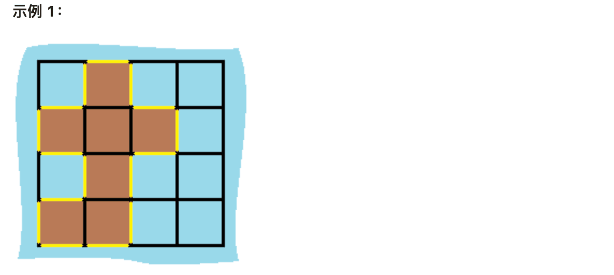
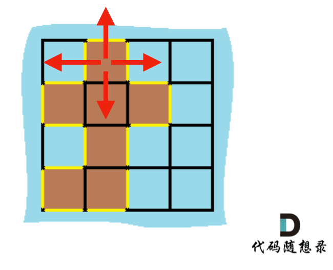
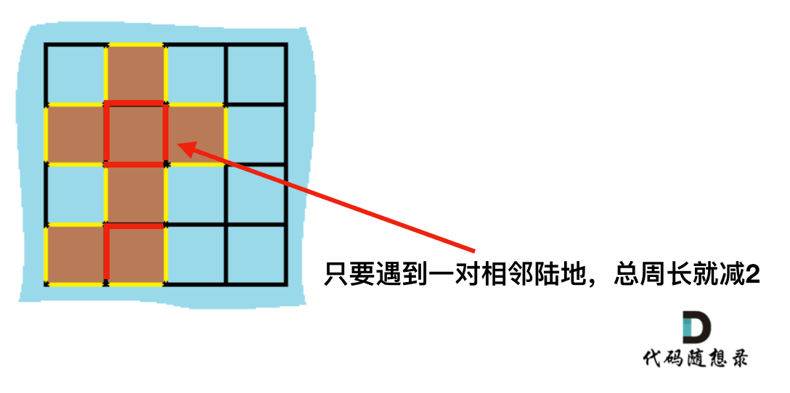

* [做專案（多個 C++、Java、Go、測試開發、前端專案）](https://www.programmercarl.com/other/kstar.html)
* [刷演算法（兩個月高強度學演算法）](https://www.programmercarl.com/xunlian/xunlianying.html)
* [背面試必考題（八股文）（40 天挑戰高頻面試題）](https://www.programmercarl.com/xunlian/bagu.html)


# 463. 島嶼的周長

[LeetCode 題目連結](https://leetcode.cn/problems/island-perimeter/)

給定一個 row x col 的二維（two-dimensional）網格地圖 grid，其中：grid[i][j] = 1 表示陸地，grid[i][j] = 0 表示水域。

網格中的格子（grid）水平和垂直方向相連（對角線方向不相連）。整個網格被水完全包圍，但其中恰好有一個島嶼（或者說，一個或多個表示陸地的格子相連組成的島嶼）。

島嶼中沒有「湖」（「湖」指水域在島嶼內部且不和島嶼周圍的水相連）。格子是邊長為 1 的正方形。網格為長方形，且寬度和高度均不超過 100。計算這個島嶼的周長。


 

* 輸入：grid = [[0,1,0,0],[1,1,1,0],[0,1,0,0],[1,1,0,0]]
* 輸出：16
* 解釋：它的周長是上面圖片中的 16 個黃色的邊


範例 2：

* 輸入：grid = [[1]]
* 輸出：4

範例 3：

* 輸入：grid = [[1,0]]
* 輸出：4

提示：

* row == grid.length
* col == grid[i].length
* 1 <= row, col <= 100
* grid[i][j] 為 0 或 1

## 解題思路

島嶼問題最容易讓人想到 BFS 或者 DFS，但是這道題還真的沒有必要，別把簡單問題搞複雜了。

### 解法一：

遍歷（traversal）每一個格子，遇到島嶼，計算其上下左右的情況，遇到水域或者出界的情況，就可以計算邊了。

如圖：

 </img></div>

C++ 程式碼如下：（詳細註解）

```CPP
class Solution {
public:
    int direction[4][2] = {0, 1, 1, 0, -1, 0, 0, -1};
    int islandPerimeter(vector<vector<int>>& grid) {
        int result = 0;
        for (int i = 0; i < grid.size(); i++) {
            for (int j = 0; j < grid[0].size(); j++) {
                if (grid[i][j] == 1) {
                    for (int k = 0; k < 4; k++) {       // 上下左右四個方向
                        int x = i + direction[k][0];
                        int y = j + direction[k][1];    // 計算周邊坐標x,y
                        if (x < 0                       // i在邊界上
                                || x >= grid.size()     // i在邊界上
                                || y < 0                // j在邊界上
                                || y >= grid[0].size()  // j在邊界上
                                || grid[x][y] == 0) {   // x,y位置是水域
                            result++;
                        }
                    }
                }
            }
        }
        return result;
    }
};
```

### 解法二：

計算出總的島嶼數量，因為有一對相鄰兩個陸地，邊的總數就減 2，那麼再計算出相鄰島嶼的數量就可以了。

result = 島嶼數量 * 4 - cover * 2;

如圖：

 </img></div>

C++ 程式碼如下：（詳細註解）

```CPP
class Solution {
public:
    int islandPerimeter(vector<vector<int>>& grid) {
        int sum = 0;    // 陸地數量
        int cover = 0;  // 相鄰數量
        for (int i = 0; i < grid.size(); i++) {
            for (int j = 0; j < grid[0].size(); j++) {
                if (grid[i][j] == 1) {
                    sum++;
                    // 統計上邊相鄰陸地
                    if(i - 1 >= 0 && grid[i - 1][j] == 1) cover++;
                    // 統計左邊相鄰陸地
                    if(j - 1 >= 0 && grid[i][j - 1] == 1) cover++;
                    // 為什麼沒統計下邊和右邊？ 因為避免重複計算
                }
            }
        }
        return sum * 4 - cover * 2;
    }
};
```


## 其他語言版本

### Java： 

```java
// 解法一
class Solution {
    // 上下左右 4 個方向
    int[] dirx = {-1, 1, 0, 0};
    int[] diry = {0, 0, -1, 1};

    public int islandPerimeter(int[][] grid) {
        int m = grid.length;
        int n = grid[0].length;
        int res = 0; // 島嶼周長
        for (int i = 0; i < m; i++) {
            for (int j = 0; j < n; j++) {
                if (grid[i][j] == 1) {
                    for (int k = 0; k < 4; k++) {
                        int x = i + dirx[k];
                        int y = j + diry[k];
                        // 當前位置是陸地，並且從當前位置4個方向擴展的「新位置」是「水域」或「新位置」越界，則會為周長貢獻一條邊
                        if (x < 0 || x >= m || y < 0 || y >= n || grid[x][y] == 0) {
                            res++;
                            continue;
                        }
                    }
                }
            }
        }
        return res;
    }
}

// 解法二
class Solution {
    public int islandPerimeter(int[][] grid) {
        // 計算島嶼的周長 
        // 方法二 : 遇到相鄰的陸地總周長就-2
        int landSum = 0; // 陸地數量 
        int cover = 0; // 相鄰陸地數量
        for (int i = 0; i < grid.length; i++) {
            for (int j = 0; j < grid[0].length; j++) {
                if (grid[i][j] == 1) {
                    landSum++;
                    // 統計上面和左邊的相鄰陸地
                    if(i - 1 >= 0 && grid[i-1][j] == 1) cover++;
                    if(j - 1 >= 0 && grid[i][j-1] == 1) cover++;
                }
            }
        }
        return landSum * 4 - cover * 2;
    }
}
// 延伸 - 傳統DFS解法(使用visited陣列)（遇到邊界 或是 海水 就edge ++）
class Solution {
    int dir[][] ={
        {0, 1},
        {0, -1},
        {1, 0},
        {-1, 0}
    };

    boolean visited[][];
    int res = 0;

    public int islandPerimeter(int[][] grid) {
        int row = grid.length;
        int col = grid[0].length;
        visited = new boolean[row][col];

        int result = 0;
        
        for(int i = 0; i < row; i++){
            for(int j = 0; j < col; j++){
                if(visited[i][j] == false && grid[i][j] == 1)
                    result += dfs(grid, i, j);
            }
        }
        return result;
    }

    private int dfs(int[][] grid, int x, int y){
        //如果遇到 邊界（x < 0 || y < 0 || x >= grid.length || y >= grid[0].length）或是 遇到海水(grid[x][y] == 0)就return 1（edge + 1）
        if(x < 0 || y < 0 || x >= grid.length || y >= grid[0].length || grid[x][y] == 0)
            return 1;
        //如果該地已經拜訪過，就return 0 避免重複計算
        if(visited[x][y])
            return 0;
        int temp = 0;
        visited[x][y] = true;
        for(int i = 0; i < 4; i++){
            int nextX = x + dir[i][0];
            int nextY = y + dir[i][1];
            //用temp 把edge存起來
            temp +=dfs(grid, nextX, nextY);
        }
        return temp;
    }
}

```

### Python：

掃描每個 cell，如果當前位置為島嶼 grid[i][j] == 1，從當前位置判斷四邊方向，如果邊界（boundary）或者是水域，證明有邊界存在，res 矩陣（matrix）的對應 cell 加一。

```python
class Solution:
    def islandPerimeter(self, grid: List[List[int]]) -> int:

        m = len(grid)
        n = len(grid[0])

        # 建立res二維陣列記錄答案
        res = [[0] * n for j in range(m)]

        for i in range(m):
            for j in range(len(grid[i])):
                # 如果當前位置為水域，不做修改或reset res[i][j] = 0
                if grid[i][j] == 0:
                    res[i][j] = 0
                # 如果當前位置為陸地，往四個方向判斷，update res[i][j]
                elif grid[i][j] == 1:
                    if i == 0 or (i > 0 and grid[i-1][j] == 0):
                        res[i][j] += 1
                    if j == 0 or (j >0 and grid[i][j-1] == 0):
                        res[i][j] += 1
                    if i == m-1 or (i < m-1 and grid[i+1][j] == 0):
                        res[i][j] += 1
                    if j == n-1 or (j < n-1 and grid[i][j+1] == 0):
                        res[i][j] += 1

        # 最後求和res矩陣，這裡其實不一定需要矩陣記錄，可以設定一個variable res 記錄邊長，用矩陣無非是更加形象而已
        ans = sum([sum(row) for row in res])

        return ans

```

### Go：

```go
func islandPerimeter(grid [][]int) int {
    m, n := len(grid), len(grid[0])
    res := 0
    for i := 0; i < m; i++ {
        for j := 0; j < n; j++ {
            if grid[i][j] == 1 {
                res += 4
                // 上下左右四個方向
                if i > 0 && grid[i-1][j] == 1 {res--} // 上邊有島嶼
                if i < m-1 && grid[i+1][j] == 1 {res--} // 下邊有島嶼
                if j > 0 && grid[i][j-1] == 1 {res--} // 左邊有島嶼
                if j < n-1 && grid[i][j+1] == 1 {res--} // 右邊有島嶼
            }
        }
    }
    return res
}
```

### JavaScript：

```javascript
//解法一
var islandPerimeter = function(grid) {
    // 上下左右 4 個方向
    const dirx = [-1, 1, 0, 0], diry = [0, 0, -1, 1];
    const m = grid.length, n = grid[0].length;
    let res = 0; //島嶼周長
    for(let i = 0; i < m; i++){
        for(let j = 0; j < n; j++){
            if(grid[i][j] === 1){
                for(let k = 0; k < 4; k++){ //上下左右四個方向
                    // 計算周邊坐標的x,y
                    let x = i + dirx[k];
                    let y = j + diry[k];
                    // 四個方向擴展的新位置是水域或者越界就會為周長貢獻1
                    if(x < 0  // i在邊界上
                    || x >= m // i在邊界上
                    || y < 0  // j在邊界上
                    || y >= n // j在邊界上
                    || grid[x][y] === 0){ // (x,y)位置是水域
                        res++;
                        continue;
                    }
                }
            }
        }
    }
    return res;
};

//解法二
var islandPerimeter = function(grid) {
    let sum = 0; // 陸地數量
    let cover = 0; // 相鄰數量
    for(let i = 0; i < grid.length; i++){
        for(let j = 0; j <grid[0].length; j++){
            if(grid[i][j] === 1){
                sum++;
                // 統計上邊相鄰陸地
                if(i - 1 >= 0 && grid[i-1][j] === 1) cover++;
                // 統計左邊相鄰陸地
                if(j - 1 >= 0 && grid[i][j-1] === 1) cover++;
                // 為什麼沒統計下邊和右邊？ 因為避免重複計算
            }
        }
    }
    return sum * 4 - cover * 2;
};
```

TypeScript:

```typescript
/**
 * 方法一：深度優先搜尋（DFS）
 * @param grid 二維網格地圖，其中 grid[i][j] = 1 表示陸地， grid[i][j] = 0 表示水域
 * @returns 島嶼的周長
 */
function islandPerimeter(grid: number[][]): number {
  // 處理特殊情況：網格為空或列數與行數為 0，直接回傳 0
  if (!grid || grid.length === 0 || grid[0].length === 0) {
    return 0;
  }

  // 取得網格的列數和行數
  const rows = grid.length;
  const cols = grid[0].length;
  let perimeter = 0; // 島嶼的周長

  /**
   * 深度優先搜尋函數
   * @param i 當前格子的列索引
   * @param j 當前格子的行索引
   */
  const dfs = (i: number, j: number) => {
    // 如果當前位置超出網格範圍，或者當前位置是水域（grid[i][j] === 0），則周長增加1
    if (i < 0 || i >= rows || j < 0 || j >= cols || grid[i][j] === 0) {
      perimeter++;
      return;
    }

    // 如果當前位置已經造訪過（grid[i][j] === -1），則直接回傳
    if (grid[i][j] === -1) {
      return;
    }

    // 標記當前位置為已造訪（-1），避免重複計算
    grid[i][j] = -1;

    // 繼續搜尋上、下、左、右四個方向
    dfs(i + 1, j);
    dfs(i - 1, j);
    dfs(i, j + 1);
    dfs(i, j - 1);
  };

  // 遍歷整個網格，找到第一個陸地格子（grid[i][j] === 1），並以此為起點進行深度優先搜尋
  for (let i = 0; i < rows; i++) {
    for (let j = 0; j < cols; j++) {
      if (grid[i][j] === 1) {
        dfs(i, j);
        break;
      }
    }
  }

  return perimeter;
}

/**
 * 方法二：遍歷每個陸地格子，統計周長
 * @param grid 二維網格地圖，其中 grid[i][j] = 1 表示陸地， grid[i][j] = 0 表示水域
 * @returns 島嶼的周長
 */
function islandPerimeter(grid: number[][]): number {
  // 處理特殊情況：網格為空或列數與行數為 0，直接回傳 0
  if (!grid || grid.length === 0 || grid[0].length === 0) {
    return 0;
  }

  // 取得網格的列數和行數
  const rows = grid.length;
  const cols = grid[0].length;
  let perimeter = 0; // 島嶼的周長

  // 遍歷整個網格
  for (let i = 0; i < rows; i++) {
    for (let j = 0; j < cols; j++) {
      // 如果當前格子是陸地（grid[i][j] === 1）
      if (grid[i][j] === 1) {
        perimeter += 4; // 周長先加上4個邊

        // 判斷當前格子的上方是否也是陸地，如果是，則周長減去2個邊
        if (i > 0 && grid[i - 1][j] === 1) {
          perimeter -= 2;
        }

        // 判斷當前格子的左方是否也是陸地，如果是，則周長減去2個邊
        if (j > 0 && grid[i][j - 1] === 1) {
          perimeter -= 2;
        }
      }
    }
  }

  return perimeter;
}
```


