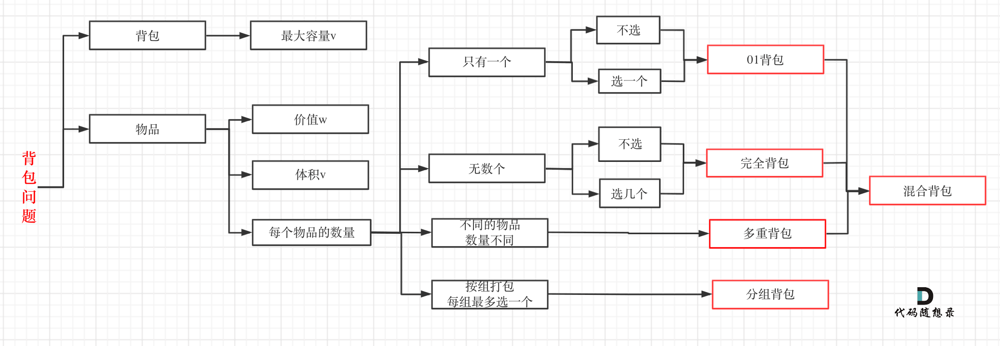
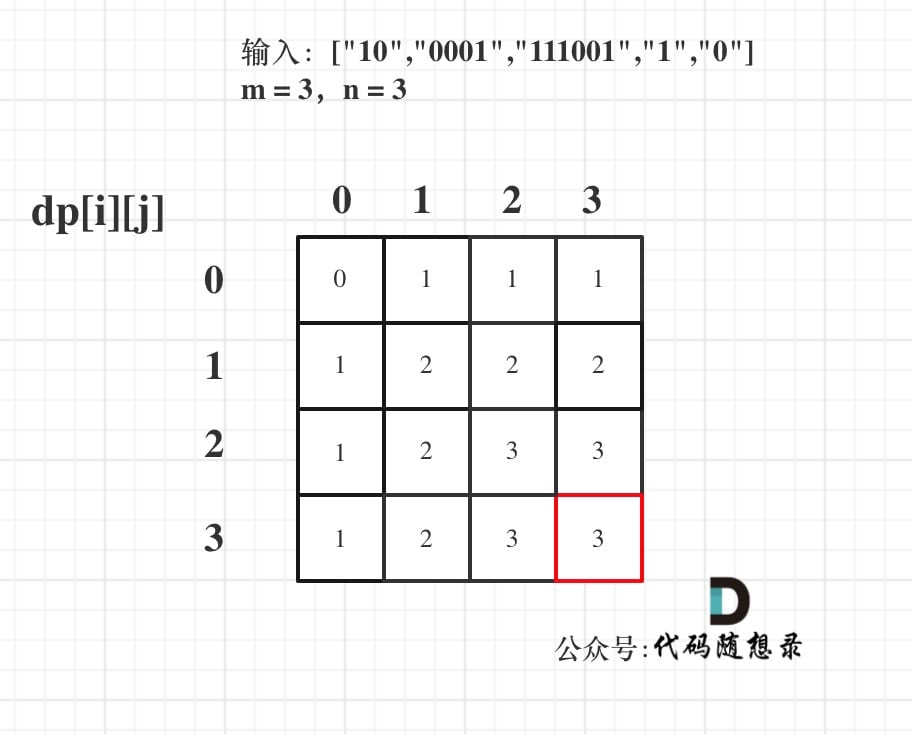

* [做專案（多個 C++、Java、Go、測試開發、前端專案）](https://www.programmercarl.com/other/kstar.html)
* [刷演算法（algorithm）（兩個月高強度學演算法）](https://www.programmercarl.com/xunlian/xunlianying.html)
* [背面試必考題（八股文）（40 天挑戰高頻面試題）](https://www.programmercarl.com/xunlian/bagu.html)

# 474.一和零

[LeetCode 題目連結](https://leetcode.cn/problems/ones-and-zeroes/)

給你一個二進制（binary）字串（string）陣列（array）strs 和兩個整數（integer）m 和 n 。

請你找出並回傳 strs 的最大子集（subset）的大小，該子集中 最多 有 m 個 0 和 n 個 1 。

如果 x 的所有元素（element）也是 y 的元素，集合（set）x 是集合 y 的 子集 。

範例 1：

* 輸入：strs = ["10", "0001", "111001", "1", "0"], m = 5, n = 3
* 輸出：4

* 解釋：最多有 5 個 0 和 3 個 1 的最大子集是 {"10","0001","1","0"} ，因此答案是 4 。
其他滿足題意但較小的子集包括 {"0001","1"} 和 {"10","1","0"} 。{"111001"} 不滿足題意，因為它含 4 個 1 ，大於 n 的值 3 。

範例 2：
* 輸入：strs = ["10", "0", "1"], m = 1, n = 1
* 輸出：2
* 解釋：最大的子集是 {"0", "1"} ，所以答案是 2 。

提示：

* 1 <= strs.length <= 600
* 1 <= strs[i].length <= 100
* strs[i] 僅由 '0' 和 '1' 組成
* 1 <= m, n <= 100

## 演算法影片公開課

**[《程式碼隨想錄》演算法影片公開課](https://programmercarl.com/other/gongkaike.html)：[裝滿這個背包最多用多少個物品？| LeetCode：474.一和零](https://www.bilibili.com/video/BV1rW4y1x7ZQ/)，相信結合影片再看本篇題解，更有助於大家對本題的理解**。


## 解題思路

如果對背包問題（knapsack problem）都不熟悉先看這兩篇：

* [動態規劃（dynamic programming, DP）：關於 0/1 背包問題（0/1 knapsack problem），你該了解這些！](https://programmercarl.com/背包理论基础01背包-1.html)
* [動態規劃：關於 0/1 背包問題，你該了解這些！（rolling array）](https://programmercarl.com/背包理论基础01背包-2.html)

這道題目，還是比較難的，也有點像工程師自己給自己出個腦筋急轉彎，工程師何苦為難工程師呢。

來說題，本題不少同學會認為是 bounded knapsack，一些題解也是這麼寫的。

其實本題並不是 bounded knapsack，再來看一下這個圖，釐清幾種背包的關係




bounded knapsack 是每個物品，數量不同的情況。

**本題中 strs 陣列裡的元素就是物品，每個物品都是一個！**

**而 m 和 n 相當於是一個背包，兩個維度的背包**。

理解成 bounded knapsack 的同學主要是把 m 和 n 混淆為物品了，感覺這是不同數量的物品，所以以為是 bounded knapsack。

但本題其實是 0/1 背包問題！

只不過這個背包有兩個維度，一個是 m 一個是 n，而不同長度的字串就是不同大小的待裝物品。

開始動態規劃五部曲：

1. 確定 dp 陣列（dp table）以及下標（subscript）的含義

**dp[i][j]：最多有 i 個 0 和 j 個 1 的 strs 的最大子集的大小為 dp[i][j]**。

2. 確定遞迴公式（recurrence formula）

dp[i][j] 可以由前一個 strs 裡的字串推導出來，strs 裡的字串有 zeroNum 個 0，oneNum 個 1。

dp[i][j] 就可以是 dp[i - zeroNum][j - oneNum] + 1。

然後我們在遍歷（traversal）的過程中，取 dp[i][j] 的最大值。

所以遞迴公式：dp[i][j] = max(dp[i][j], dp[i - zeroNum][j - oneNum] + 1);

此時大家可以回想一下 0/1 背包的遞迴公式：dp[j] = max(dp[j], dp[j - weight[i]] + value[i]);

對比一下就會發現，字串的 zeroNum 和 oneNum 相當於物品的重量（weight[i]），字串本身的個數相當於物品的價值（value[i]）。

**這就是一個典型的 0/1 背包！** 只不過物品的重量有了兩個維度而已。 


3. dp 陣列如何初始化（initialization）

在[動態規劃：關於 0/1 背包問題，你該了解這些！（rolling array）](https://programmercarl.com/背包理论基础01背包-2.html)中已經講解了，0/1 背包的 dp 陣列初始化為 0 就可以。

因為物品價值不會是負數，初始為 0，保證遞推的時候 dp[i][j] 不會被初始值覆蓋。

4. 確定遍歷順序

在[動態規劃：關於 0/1 背包問題，你該了解這些！（rolling array）](https://programmercarl.com/背包理论基础01背包-2.html)中，我們講到了 0/1 背包為什麼一定是外層 for 迴圈（for-loop）遍歷物品，內層 for 迴圈遍歷背包容量且從後向前遍歷！

那麼本題也是，物品就是 strs 裡的字串，背包容量就是題目描述中的 m 和 n。

程式碼如下：
```CPP
for (string str : strs) { // 遍歷物品
    int oneNum = 0, zeroNum = 0;
    for (char c : str) {
        if (c == '0') zeroNum++;
        else oneNum++;
    }
    for (int i = m; i >= zeroNum; i--) { // 遍歷背包容量且從後向前遍歷！
        for (int j = n; j >= oneNum; j--) {
            dp[i][j] = max(dp[i][j], dp[i - zeroNum][j - oneNum] + 1);
        }
    }
}
```

有同學可能想，那個遍歷背包容量的兩層 for 迴圈先後順序有沒有什麼講究？

沒講究，都是物品重量的一個維度，先遍歷哪個都行！

5. 舉例推導 dp 陣列

以輸入：["10","0001","111001","1","0"]，m = 3，n = 3 為例

最後 dp 陣列的狀態如下所示：





以上動態規劃五部曲分析完畢，C++ 程式碼如下：

```CPP
class Solution {
public:
    int findMaxForm(vector<string>& strs, int m, int n) {
        vector<vector<int>> dp(m + 1, vector<int> (n + 1, 0)); // 預設初始化0
        for (string str : strs) { // 遍歷物品
            int oneNum = 0, zeroNum = 0;
            for (char c : str) {
                if (c == '0') zeroNum++;
                else oneNum++;
            }
            for (int i = m; i >= zeroNum; i--) { // 遍歷背包容量且從後向前遍歷！
                for (int j = n; j >= oneNum; j--) {
                    dp[i][j] = max(dp[i][j], dp[i - zeroNum][j - oneNum] + 1);
                }
            }
        }
        return dp[m][n];
    }
};
```

* 時間複雜性（time complexity）: O(kmn)，k 為 strs 的長度
* 空間複雜度（space complexity）: O(mn)

C++: 
使用三維陣列的版本

```CPP
class Solution {
public:
    int findMaxForm(vector<string>& strs, int m, int n) {
        int num_of_str = strs.size();

		vector<vector<vector<int>>> dp(num_of_str, vector<vector<int>>(m + 1,vector<int>(n + 1, 0)));

		/* 	dp[i][j][k] represents, if choosing items among strs[0] to strs[i] to form a subset, 
			what is the maximum size of this subset such that there are no more than m 0's and n 1's in this subset. 
			Each entry of dp[i][j][k] is initialized with 0
			
			transition formula:
			using x[i] to indicates the number of 0's in strs[i]
			using y[i] to indicates the number of 1's in strs[i]
			
			dp[i][j][k] = max(dp[i-1][j][k], dp[i-1][j - x[i]][k - y[i]] + 1)

		*/


		// num_of_zeros records the number of 0's for each str
		// num_of_ones records the number of 1's for each str
		// find the number of 0's and the number of 1's for each str in strs
		vector<int> num_of_zeros;
		vector<int> num_of_ones;
		for (auto& str : strs){
			int count_of_zero = 0;
			int count_of_one = 0;
			for (char &c : str){
				if(c == '0') count_of_zero ++;
				else count_of_one ++;
			}
			num_of_zeros.push_back(count_of_zero);
			num_of_ones.push_back(count_of_one);
			
		}

		
		// num_of_zeros[0] indicates the number of 0's for str[0]
		// num_of_ones[0] indiates the number of 1's for str[1]

		// initialize the 1st plane of dp[i][j][k], i.e., dp[0][j][k]
		// if num_of_zeros[0] > m or num_of_ones[0] > n, no need to further initialize dp[0][j][k], 
		// because they have been intialized to 0 previously
		if(num_of_zeros[0] <= m && num_of_ones[0] <= n){
			// for j < num_of_zeros[0] or k < num_of_ones[0], dp[0][j][k] = 0
			for(int j = num_of_zeros[0]; j <= m; j++){
				for(int k = num_of_ones[0]; k <= n; k++){
					dp[0][j][k] = 1;
				}
			}
		}

		/*	if j - num_of_zeros[i] >= 0 and k - num_of_ones[i] >= 0:
				dp[i][j][k] = max(dp[i-1][j][k], dp[i-1][j - num_of_zeros[i]][k - num_of_ones[i]] + 1)  
			else:
				dp[i][j][k] = dp[i-1][j][k]
		*/

		for (int i = 1; i < num_of_str; i++){
			int count_of_zeros = num_of_zeros[i];
			int count_of_ones = num_of_ones[i]; 
			for (int j = 0; j <= m; j++){
				for (int k = 0; k <= n; k++){
					if( j < count_of_zeros || k < count_of_ones){
						dp[i][j][k] = dp[i-1][j][k];
					}else{
						dp[i][j][k] = max(dp[i-1][j][k], dp[i-1][j - count_of_zeros][k - count_of_ones] + 1);
					}
				}
			}
			
		}

		return dp[num_of_str-1][m][n];

    }
};
```

## 總結

不少同學刷過這道題，可能沒有總結這究竟是什麼背包。

此時我們講解了 0/1 背包的多種應用，

* [純 0 - 1 背包](https://programmercarl.com/%E8%83%8C%E5%8C%85%E7%90%86%E8%AE%BA%E5%9F%BA%E7%A1%8001%E8%83%8C%E5%8C%85-2.html) 是求 給定背包容量 裝滿背包 的最大價值是多少。 
* [416. 分割等和子集](https://programmercarl.com/0416.%E5%88%86%E5%89%B2%E7%AD%89%E5%92%8C%E5%AD%90%E9%9B%86.html) 是求 給定背包容量，能不能裝滿這個背包。 
* [1049. 最後一塊石頭的重量 II](https://programmercarl.com/1049.%E6%9C%80%E5%90%8E%E4%B8%80%E5%9D%97%E7%9F%B3%E5%A4%B4%E7%9A%84%E9%87%8D%E9%87%8FII.html) 是求 給定背包容量，盡可能裝，最多能裝多少 
* [494. 目標和](https://programmercarl.com/0494.%E7%9B%AE%E6%A0%87%E5%92%8C.html) 是求 給定背包容量，裝滿背包有多少種方法。 
* 本題是求 給定背包容量，裝滿背包最多有多少個物品。

所以在《程式碼隨想錄》中所列舉的題目，都是 0/1 背包不同維度上的應用，大家可以細心體會！


## 其他語言版本

### Java

三維 DP 陣列實作

```java
class Solution {
    public int findMaxForm(String[] strs, int m, int n) {
        /// 陣列有三個維度
        // 第一個維度：取前面的幾個字串
        // 第二個維度：0的數量限制（背包維度 1 容量）
        // 第三個維度：1的數量限制（背包維度 2 容量）
        int[][][] dpArr = new int[strs.length][m + 1][n + 1];

        /// 初始化dpArr陣列
        // 計算第一個字串的零數量和1數量
        int zeroNum = 0;
        int oneNum = 0;
        for (char c : strs[0].toCharArray()) {
            if (c == '0') {
                zeroNum++;
            } else {
                oneNum++;
            }
        }
        // 當0數量、1數量都容得下第一個字串時，將DP陣列的相應位置初始化為1，因為當前的子集數量為1
        for (int j = zeroNum; j <= m; j++) {
            for (int k = oneNum; k <= n; k++) {
                dpArr[0][j][k] = 1;
            }
        }
        /// 依序填充加入第i個字串之後的DP陣列
        for (int i = 1; i < strs.length; i++) {
            zeroNum = 0;
            oneNum = 0;
            for (char c : strs[i].toCharArray()) {
                if (c == '0') {
                    zeroNum++;
                } else {
                    oneNum++;
                }
            }
            for (int j = 0; j <= m; j++) {
                for (int k = 0; k <= n; k++) {
                    if (j >= zeroNum && k >= oneNum) {
                        // --if-- 當0數量維度和1數量維度的容量都大於等於當前字串的0數量和1數量時，才考慮是否將當前字串放入背包
                        // 不放入第i個字串，子集數量仍為 dpArr[i - 1][j][k]
                        // 放入第i個字串，需要在0維度騰出 zeroNum 個容量，1維度騰出 oneNum 個容量，然後放入當前字串，即 dpArr[i - 1][j - zeroNum][k - oneNum] + 1)
                        dpArr[i][j][k] = Math.max(dpArr[i - 1][j][k], dpArr[i - 1][j - zeroNum][k - oneNum] + 1);
                    } else {
                        // --if--  無法放入第i個字串，子集數量仍為 dpArr[i - 1][j][k]
                        dpArr[i][j][k] = dpArr[i - 1][j][k];
                    }
                }
            }
        }
        return dpArr[dpArr.length - 1][m][n];
    }
}
```


二維 DP 陣列實作

```Java
class Solution {
    public int findMaxForm(String[] strs, int m, int n) {
        //dp[i][j]表示i個0和j個1時的最大子集
        int[][] dp = new int[m + 1][n + 1];
        int oneNum, zeroNum;
        for (String str : strs) {
            oneNum = 0;
            zeroNum = 0;
            for (char ch : str.toCharArray()) {
                if (ch == '0') {
                    zeroNum++;
                } else {
                    oneNum++;
                }
            }
            //倒序遍歷
            for (int i = m; i >= zeroNum; i--) {
                for (int j = n; j >= oneNum; j--) {
                    dp[i][j] = Math.max(dp[i][j], dp[i - zeroNum][j - oneNum] + 1);
                }
            }
        }
        return dp[m][n];
    }
}
```

### Python
DP（版本一）
```python
class Solution:
    def findMaxForm(self, strs: List[str], m: int, n: int) -> int:
        dp = [[0] * (n + 1) for _ in range(m + 1)]  # 建立二維動態規劃陣列，初始化為0
        for s in strs:  # 遍歷物品
            zeroNum = s.count('0')  # 統計0的個數
            oneNum = len(s) - zeroNum  # 統計1的個數
            for i in range(m, zeroNum - 1, -1):  # 遍歷背包容量且從後向前遍歷
                for j in range(n, oneNum - 1, -1):
                    dp[i][j] = max(dp[i][j], dp[i - zeroNum][j - oneNum] + 1)  # 狀態變遷方程式
        return dp[m][n]

```
DP（版本二）
```python
class Solution:
    def findMaxForm(self, strs: List[str], m: int, n: int) -> int:
        dp = [[0] * (n + 1) for _ in range(m + 1)]  # 建立二維動態規劃陣列，初始化為0
        # 遍歷物品
        for s in strs:
            ones = s.count('1')  # 統計字串中1的個數
            zeros = s.count('0')  # 統計字串中0的個數
            # 遍歷背包容量且從後向前遍歷
            for i in range(m, zeros - 1, -1):
                for j in range(n, ones - 1, -1):
                    dp[i][j] = max(dp[i][j], dp[i - zeros][j - ones] + 1)  # 狀態變遷方程式
        return dp[m][n]

```

### Go
```go
func findMaxForm(strs []string, m int, n int) int {
	// 定義陣列
	dp := make([][]int, m+1)
	for i,_ := range dp {
		dp[i] = make([]int, n+1 )
	}
	// 遍歷
	for i:=0;i<len(strs);i++ {
		zeroNum,oneNum := 0 , 0
		//計算0,1 個數
		//或者直接strings.Count(strs[i],"0")
		for _,v := range strs[i] {
			if v == '0' {
				zeroNum++
			}
		}
		oneNum = len(strs[i])-zeroNum
		// 從後往前 遍歷背包容量
		for j:= m ; j >= zeroNum;j-- {
			for k:=n ; k >= oneNum;k-- {
				// 推導公式
				dp[j][k] = max(dp[j][k],dp[j-zeroNum][k-oneNum]+1)
			}
		}
		//fmt.Println(dp)
	}
	return dp[m][n]
}

func max(a,b int) int {
	if a > b {
		return a
	}
	return b
}
```

### JavaScript
```javascript
const findMaxForm = (strs, m, n) => {
    const dp = Array.from(Array(m+1), () => Array(n+1).fill(0));
    let numOfZeros, numOfOnes;

    for(let str of strs) {
        numOfZeros = 0;
        numOfOnes = 0;
    
        for(let c of str) {
            if (c === '0') {
                numOfZeros++;
            } else {
                numOfOnes++;
            }
        }

        for(let i = m; i >= numOfZeros; i--) {
            for(let j = n; j >= numOfOnes; j--) {
                dp[i][j] = Math.max(dp[i][j], dp[i - numOfZeros][j - numOfOnes] + 1);
            }
        }
    }

    return dp[m][n];
};
```

### TypeScript

> rolling array，二維（two-dimensional）陣列法

```typescript
type BinaryInfo = { numOfZero: number, numOfOne: number };
function findMaxForm(strs: string[], m: number, n: number): number {
    const goodsNum: number = strs.length;
    const dp: number[][] = new Array(m + 1).fill(0)
        .map(_ => new Array(n + 1).fill(0));
    for (let i = 0; i < goodsNum; i++) {
        const { numOfZero, numOfOne } = countBinary(strs[i]);
        for (let j = m; j >= numOfZero; j--) {
            for (let k = n; k >= numOfOne; k--) {
                dp[j][k] = Math.max(dp[j][k], dp[j - numOfZero][k - numOfOne] + 1);
            }
        }
    }
    return dp[m][n];
};
function countBinary(str: string): BinaryInfo {
    let numOfZero: number = 0,
        numOfOne: number = 0;
    for (let s of str) {
        if (s === '0') {
            numOfZero++;
        } else {
            numOfOne++;
        }
    }
    return { numOfZero, numOfOne };
}
```

> 傳統背包，三維陣列法

```typescript
type BinaryInfo = { numOfZero: number, numOfOne: number };
function findMaxForm(strs: string[], m: number, n: number): number {
    /**
        dp[i][j][k]: 前i個物品中, 背包的0容量為j, 1容量為k, 最多能放的物品數量
     */
    const goodsNum: number = strs.length;
    const dp: number[][][] = new Array(goodsNum).fill(0)
        .map(_ => new Array(m + 1)
            .fill(0)
            .map(_ => new Array(n + 1).fill(0))
        );
    const { numOfZero, numOfOne } = countBinary(strs[0]);
    for (let i = numOfZero; i <= m; i++) {
        for (let j = numOfOne; j <= n; j++) {
            dp[0][i][j] = 1;
        }
    }
    for (let i = 1; i < goodsNum; i++) {
        const { numOfZero, numOfOne } = countBinary(strs[i]);
        for (let j = 0; j <= m; j++) {
            for (let k = 0; k <= n; k++) {
                if (j < numOfZero || k < numOfOne) {
                    dp[i][j][k] = dp[i - 1][j][k];
                } else {
                    dp[i][j][k] = Math.max(dp[i - 1][j][k], dp[i - 1][j - numOfZero][k - numOfOne] + 1);
                }
            }
        }
    }
    return dp[dp.length - 1][m][n];
};
function countBinary(str: string): BinaryInfo {
    let numOfZero: number = 0,
        numOfOne: number = 0;
    for (let s of str) {
        if (s === '0') {
            numOfZero++;
        } else {
            numOfOne++;
        }
    }
    return { numOfZero, numOfOne };
}
```

> 回溯法（backtracking）（會逾時）

```typescript
function findMaxForm(strs: string[], m: number, n: number): number {
    /**
        解題思路：蠻力列舉strs的所有子集，記錄符合條件子集的最大長度
     */
    let resMax: number = 0;
    backTrack(strs, m, n, 0, []);
    return resMax;
    function backTrack(
        strs: string[], m: number, n: number,
        startIndex: number, route: string[]
    ): void {
        if (startIndex === strs.length) return;
        for (let i = startIndex, length = strs.length; i < length; i++) {
            route.push(strs[i]);
            if (isValidSubSet(route, m, n)) {
                resMax = Math.max(resMax, route.length);
                backTrack(strs, m, n, i + 1, route);
            }
            route.pop();
        }
    }
};
function isValidSubSet(strs: string[], m: number, n: number): boolean {
    let zeroNum: number = 0,
        oneNum: number = 0;
    strs.forEach(str => {
        for (let s of str) {
            if (s === '0') {
                zeroNum++;
            } else {
                oneNum++;
            }
        }
    });
    return zeroNum <= m && oneNum <= n;
}
```

### Scala

背包：
```scala
object Solution {
  def findMaxForm(strs: Array[String], m: Int, n: Int): Int = {
    var dp = Array.ofDim[Int](m + 1, n + 1)

    var (oneNum, zeroNum) = (0, 0)

    for (str <- strs) {
      oneNum = 0
      zeroNum = 0
      for (i <- str.indices) {
        if (str(i) == '0') zeroNum += 1
        else oneNum += 1
      }

      for (i <- m to zeroNum by -1) {
        for (j <- n to oneNum by -1) {
          dp(i)(j) = math.max(dp(i)(j), dp(i - zeroNum)(j - oneNum) + 1)
        }
      }
    }

    dp(m)(n)
  }
}
```

回溯法（逾時）：
```scala
object Solution {
  import scala.collection.mutable

  var res = Int.MinValue

  def test(str: String): (Int, Int) = {
    var (zero, one) = (0, 0)
    for (i <- str.indices) {
      if (str(i) == '1') one += 1
      else zero += 1
    }
    (zero, one)
  }

  def travsel(strs: Array[String], path: mutable.ArrayBuffer[String], m: Int, n: Int, startIndex: Int): Unit = {
    if (startIndex > strs.length) {
      return
    }

    res = math.max(res, path.length)

    for (i <- startIndex until strs.length) {

      var (zero, one) = test(strs(i))

      // 如果0的個數小於m，1的個數小於n，則可以回溯
      if (zero <= m && one <= n) {
        path.append(strs(i))
        travsel(strs, path, m - zero, n - one, i + 1)
        path.remove(path.length - 1)
      }
    }
  }

  def findMaxForm(strs: Array[String], m: Int, n: Int): Int = {
    res = Int.MinValue
    var path = mutable.ArrayBuffer[String]()
    travsel(strs, path, m, n, 0)
    res
  }
}
```

### Rust

```rust
impl Solution {
    pub fn find_max_form(strs: Vec<String>, m: i32, n: i32) -> i32 {
        let (m, n) = (m as usize, n as usize);
        let mut dp = vec![vec![0; n + 1]; m + 1];
        for s in strs {
            let (mut one_num, mut zero_num) = (0, 0);
            for c in s.chars() {
                match c {
                    '0' => zero_num += 1,
                    '1' => one_num += 1,
                    _ => (),
                }
            }
            for i in (zero_num..=m).rev() {
                for j in (one_num..=n).rev() {
                    dp[i][j] = dp[i][j].max(dp[i - zero_num][j - one_num] + 1);
                }
            }
        }
        dp[m][n]
    }
}
```
### C

```c
#define max(a, b) ((a) > (b) ? (a) : (b))

int findMaxForm(char** strs, int strsSize, int m, int n) {
    int dp[m + 1][n + 1];
    memset(dp, 0, sizeof (int ) * (m + 1) * (n + 1));
    for(int i = 0; i < strsSize; i++){
        // 統計0和1的數量
        int count0 = 0;
        int count1 = 0;
        char *str = strs[i];
        while (*str != '\0'){
            if(*str == '0'){
                count0++;
            } else{
                count1++;
            }
            str++;
        }
        for(int j = m; j >= count0; j--){
            for(int k = n; k >= count1; k--){
                dp[j][k] = max(dp[j][k], dp[j - count0][k - count1] + 1);
            }
        }
    }
    return dp[m][n];
}
```


### C#

```csharp
public class Solution
{
    public int FindMaxForm(string[] strs, int m, int n)
    {
        int[,] dp = new int[m + 1, n + 1];
        foreach (string str in strs)
        {
            int zero = 0, one = 0;
            foreach (char c in str)
            {
                if (c == '0') zero++;
                else one++;
            }
            for (int i = m; i >= zero; i--)
            {
                for (int j = n; j >= one; j--)
                {
                    dp[i, j] = Math.Max(dp[i, j], dp[i - zero, j - one] + 1);
                }
            }
        }
        return dp[m, n];
    }
}
```


