* [做專案（多個 C++、Java、Go、測試開發、前端專案）](https://www.programmercarl.com/other/kstar.html)
* [刷演算法（兩個月高強度學演算法）](https://www.programmercarl.com/xunlian/xunlianying.html)
* [背面試必考題（八股文）（40 天挑戰高頻面試題）](https://www.programmercarl.com/xunlian/bagu.html)


# 494. 目標和

[LeetCode 題目連結](https://leetcode.cn/problems/target-sum/)

難度：中等

給定一個非負整數（nonnegative integer）陣列（array），a1, a2, ..., an，和一個目標數 S。現在你有兩個符號 + 和 -。對於陣列中的任意一個整數（integer），你都可以從 + 或 - 中選擇一個符號添加在前面。

回傳可以使最終陣列和為目標數 S 的所有添加符號的方法數。

範例：

* 輸入：nums: [1, 1, 1, 1, 1], S: 3     
* 輸出：5       

解釋：     
* -1+1+1+1+1 = 3      
* +1-1+1+1+1 = 3     
* +1+1-1+1+1 = 3    
* +1+1+1-1+1 = 3    
* +1+1+1+1-1 = 3     

一共有 5 種方法讓最終目標和為 3。

提示：

* 陣列非空，且長度不會超過 20。
* 初始的陣列的和不會超過 1000。
* 保證回傳的最終結果能被 32 位元（bit）整數存下。

## 演算法公開課

**[《程式碼隨想錄》演算法影片公開課](https://programmercarl.com/other/gongkaike.html)：[裝滿背包有多少種方法？| LeetCode：494. 目標和](https://www.bilibili.com/video/BV1o8411j73x/)，相信結合影片再看本篇題解，更有助於大家對本題的理解**。


## 解題思路

如果對背包問題（knapsack problem）都不熟悉先看這兩篇：

* [動態規劃（dynamic programming, DP）：關於 0/1 背包問題（0/1 knapsack problem），你該了解這些！](https://programmercarl.com/背包理论基础01背包-1.html)
* [動態規劃：關於 0/1 背包問題，你該了解這些！（rolling array）](https://programmercarl.com/背包理论基础01背包-2.html)

如果跟著「程式碼隨想錄」一起學過[回溯演算法（backtracking algorithm）系列](https://programmercarl.com/回溯总结.html)的錄友，看到這道題，應該有一種直覺，就是感覺好像回溯（backtracking）法可以蠻力（brute force）搜尋出來。

事實確實如此，下面我也會給出相應的程式碼，只不過會逾時。

這道題目乍看之下和動態規劃（dynamic programming, DP）背包問題也沒啥關係。

本題要如何使表達式結果為 target，

既然為 target，那麼就一定有 left 組合（combination） - right 組合 = target。

left + right = sum，而 sum 是固定的。right = sum - left  

left - (sum - left) = target 推導出 left = (target + sum)/2。

target 是固定的，sum 是固定的，left 就可以求出來。

此時問題就是在集合（set） nums 中找出和為 left 的組合。

### 回溯演算法

在回溯演算法系列中，一起學過這道題目[回溯演算法：39. 組合總和](https://programmercarl.com/0039.组合总和.html)的錄友應該感覺很熟悉，這不就是組合總和問題嗎？

此時可以套用組合總和的回溯法程式碼，幾乎不用改動。

當然，也可以轉變成序列（sequence）區間（interval）選 + 或者 -，使用回溯法，那就是另一個解法（solution）。

我也把程式碼給出來吧，大家可以了解一下回溯的解法，以下是本題轉變為組合總和問題的回溯法程式碼：

```CPP
class Solution {
private:
    vector<vector<int>> result;
    vector<int> path;
    void backtracking(vector<int>& candidates, int target, int sum, int startIndex) {
        if (sum == target) {
            result.push_back(path);
        }
        // 如果 sum + candidates[i] > target 就終止遍歷
        for (int i = startIndex; i < candidates.size() && sum + candidates[i] <= target; i++) {
            sum += candidates[i];
            path.push_back(candidates[i]);
            backtracking(candidates, target, sum, i + 1);
            sum -= candidates[i];
            path.pop_back();

        }
    }
public:
    int findTargetSumWays(vector<int>& nums, int S) {
        int sum = 0;
        for (int i = 0; i < nums.size(); i++) sum += nums[i];
        if (S > sum) return 0; // 此時沒有方案
        if ((S + sum) % 2) return 0; // 此時沒有方案，兩個 int 相加的時候要格外小心數值溢位的問題
        int bagSize = (S + sum) / 2; // 轉變為組合總和問題，bagsize 就是要求的和

        // 以下為回溯法程式碼
        result.clear();
        path.clear();
        sort(nums.begin(), nums.end()); // 需要排序
        backtracking(nums, bagSize, 0, 0);
        return result.size();
    }
};
```

當然以上程式碼逾時了。

也可以使用備忘（memoization）回溯，但這裡我就不在回溯上下功夫了，直接看DP吧

### 動態規劃（二維（2D） DP 陣列）

假設加法的總和為 x，那麼減法對應的總和就是 sum - x。

所以我們要求的是 x - (sum - x) = target

x = (target + sum) / 2

**此時問題就轉化為，用 nums 裝滿容量為 x 的背包，有幾種方法**。

這裡的 x，就是 bagSize，也就是我們後面要求的背包容量。

大家看到`(target + sum) / 2` 應該擔心計算的過程中向下取整有沒有影響。

這麼擔心就對了，例如 sum 是 5，target 是 2 的話其實就是無解的，所以：

```CPP 
（C++ 程式碼中，輸入的 S 就是題目描述的 target）
if ((target + sum) % 2 == 1) return 0; // 此時沒有方案
```

同時如果 target 的絕對值（absolute value）已經大於 sum，那麼也是沒有方案的。

```CPP
if (abs(target) > sum) return 0; // 此時沒有方案
```

因為每個物品（題目中的 1）只用一次！

這次和之前遇到的背包問題不一樣了，之前都是求容量為 j 的背包，最多能裝多少。

本題則是裝滿有幾種方法。其實這就是一個組合問題了。

#### 1. 確定 dp 陣列以及下標（subscript）的含義

先用二維 DP 陣列求解本題，dp[i][j]：使用下標為 [0, i] 的 nums[i] 能夠湊滿 j（包括 j）這麼大容量的包，有 dp[i][j] 種方法。

0/1 背包為什麼這麼定義 dp 陣列，我在[0-1背包理論基礎](https://www.programmercarl.com/%E8%83%8C%E5%8C%85%E7%90%86%E8%AE%BA%E5%9F%BA%E7%A1%8001%E8%83%8C%E5%8C%85-1.html)中確定 dp 陣列的含義裡講解過。 

#### 2. 確定遞迴公式（recurrence formula）

我們先手動推導一下，這個二維陣列裡面的數值。 

------------ 

先只考慮物品 0，如圖：

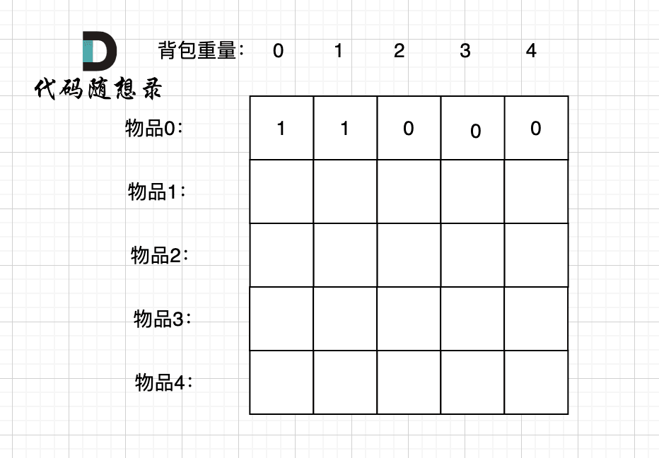

（這裡的所有物品，都是題目中的數字 1）。

裝滿背包容量為 0 的方法個數是 1，即放 0 件物品。  

裝滿背包容量為 1 的方法個數是 1，即放物品 0。 

裝滿背包容量為 2 的方法個數是 0，目前沒有辦法能裝滿容量為 2 的背包。

--------------

接下來考慮物品 0 和物品 1，如圖：  

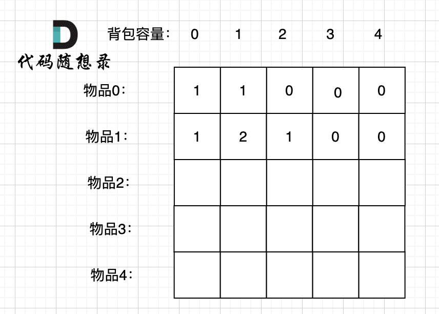 

裝滿背包容量為 0 的方法個數是 1，即放 0 件物品。  

裝滿背包容量為 1 的方法個數是 2，即放物品 0 或者放物品 1。  

裝滿背包容量為 2 的方法個數是 1，即放物品 0 和物品 1。  

其他容量都不能裝滿，所以方法是 0。 

-----------------

接下來考慮物品 0、物品 1 和物品 2，如圖：  

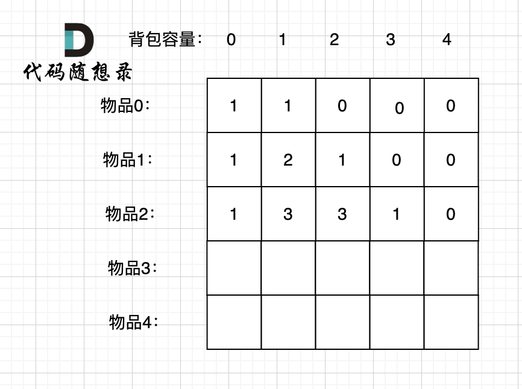

裝滿背包容量為 0 的方法個數是 1，即放 0 件物品。  

裝滿背包容量為 1 的方法個數是 3，即放物品 0 或者放物品 1 或者放物品 2。  

裝滿背包容量為 2 的方法個數是 3，即放物品 0 和物品 1、放物品 0 和物品 2、放物品 1 和物品 2。 

裝滿背包容量為 3 的方法個數是 1，即放物品 0 和物品 1 和物品 2。  

---------------

透過以上舉例，我們來看 dp[2][2] 可以有哪些方向推出來。  

如圖紅色部分： 

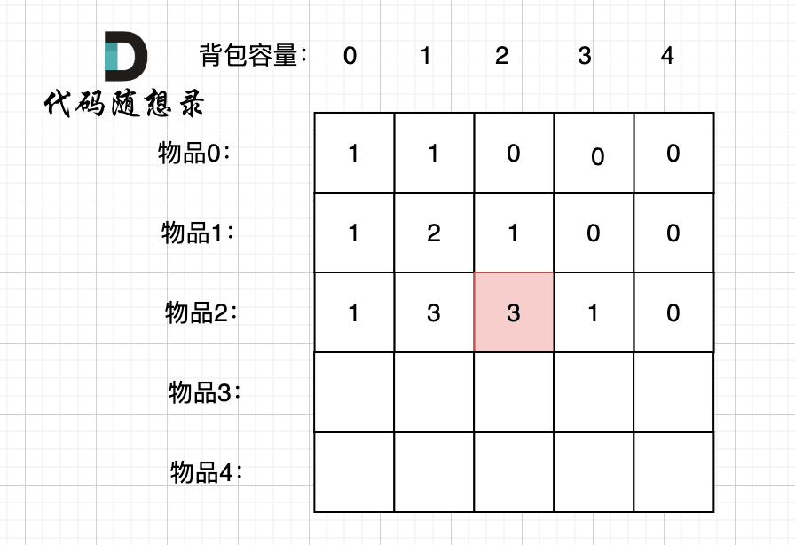

dp[2][2] = 3，即放物品 0 和物品 1、放物品 0 和物品 2、放物品 1 和物品 2，如圖所示，三種方法： 

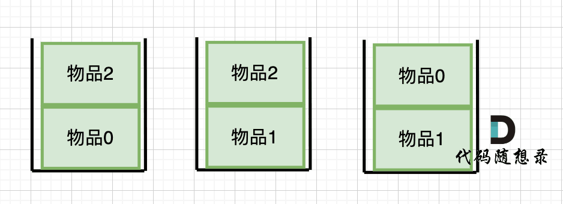

**容量為 2 的背包，如果不放物品 2 有幾種方法呢**？ 

有 dp[1][2] 種方法，即背包容量為 2，只考慮物品 0 和物品 1，有 dp[1][2] 種方法，如圖： 

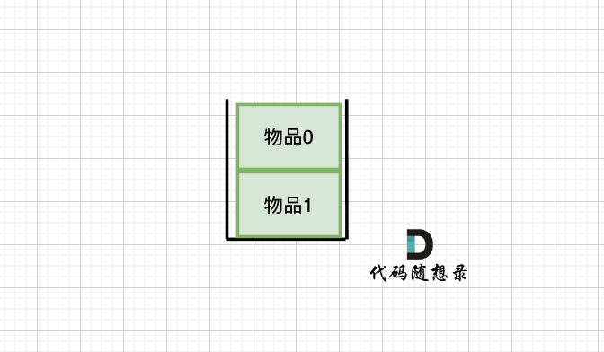

**容量為 2 的背包，如果放物品 2 有幾種方法呢**？ 

首先要在背包裡先把物品 2 的容量空出來，裝滿扣除物品 2 容量後的背包有幾種方法呢？  

扣除物品 2 容量後的背包容量為 1。

此時裝滿背包容量為 1 有 dp[1][1] 種方法，即：不放物品 2，背包容量為 1，只考慮物品 0 和物品 1，有 dp[1][1] 種方法。 

如圖： 

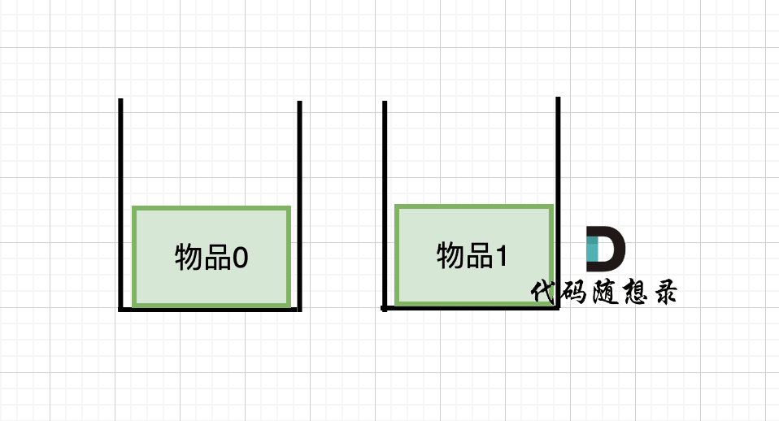 

有錄友可能疑惑，這裡計算的是放滿容量為 2 的背包有幾種方法，那物品 2 去哪了？  

在上面圖中，你把物品 2 補上就好，同樣是兩種方法。

dp[2][2] = 容量為 2 的背包不放物品 2 有幾種方法 + 容量為 2 的背包放物品 2 有幾種方法 

所以 dp[2][2] = dp[1][2] + dp[1][1]，如圖： 

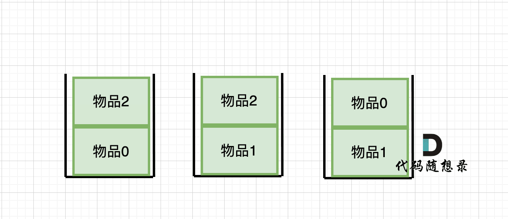

以上過程，抽象化如下：

* **不放物品 i**：即背包容量為 j，裡面不放物品 i，裝滿有 dp[i - 1][j] 種方法。

* **放物品 i**：即：先空出物品 i 的容量，背包容量為（j - 物品 i 容量），放滿背包有 dp[i - 1][j - 物品 i 容量] 種方法。 

本題中，物品 i 的容量是 nums[i]，價值也是 nums[i]。

遞迴公式：dp[i][j] = dp[i - 1][j] + dp[i - 1][j - nums[i]]; 

看到這個遞迴公式，我們應該注意到，`j - nums[i]` 作為陣列下標，如果 `j - nums[i]` 小於零呢？ 

說明背包容量裝不下物品 i，所以此時裝滿背包的方法數等於不放物品 i 的裝滿背包的方法，即：dp[i][j] = dp[i - 1][j];

所以遞迴公式： 

```CPP 
if (nums[i] > j) dp[i][j] = dp[i - 1][j]; 
else dp[i][j] = dp[i - 1][j] + dp[i - 1][j - nums[i]];
```

#### 3. dp 陣列如何初始化

先明確遞推的方向，如圖，求解 dp[2][2] 是由上方和左上方推出。

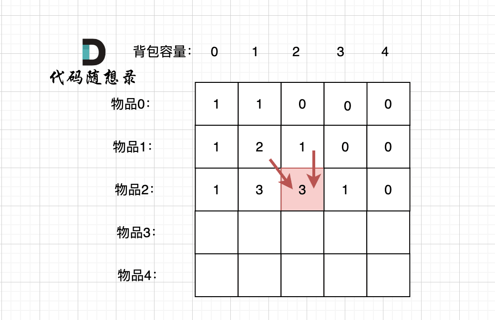

那麼二維陣列的最上列（row）和最左行（column）一定要初始化（initialization），這是遞迴公式推導的基礎，如圖紅色部分：

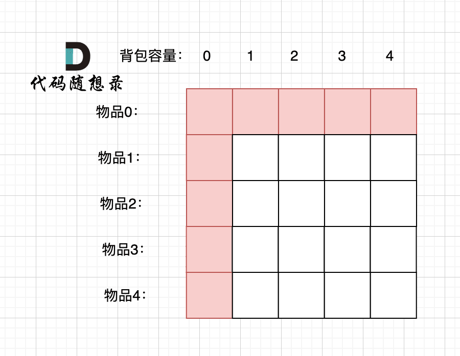  

關於 dp[0][0] 的值，在上面的遞迴公式講解中已經講過，裝滿背包容量為 0 的方法數量是 1，即放 0 件物品。  

那麼最上列 dp[0][j] 如何初始化呢？ 

dp[0][j]：只放物品 0，把容量為 j 的背包填滿有幾種方法。 

只有背包容量為物品 0 的容量的時候，方法為 1，正好裝滿。

其他情況下，要不是裝不滿，要不是裝不下。

所以初始化：dp[0][nums[0]] = 1，其他均為 0。 

表格最左行也要初始化，dp[i][0]：背包容量為 0，放物品 0 到物品 i，裝滿有幾種方法。 

都是有一種方法，就是放 0 件物品。 

即 dp[i][0] = 1 

但這裡有例外，就是如果物品數值就是 0 呢？ 

如果有兩個物品，物品 0 為 0，物品 1 為 0，裝滿背包容量為 0 的方法有幾種。 

* 放 0 件物品 
* 放物品 0  
* 放物品 1 
* 放物品 0 和物品 1 

此時是有 4 種方法。  

其實就是算陣列裡有 t 個 0，然後按照組合數量求，即 2^t。 

初始化如下： 

```CPP
int numZero = 0;
for (int i = 0; i < nums.size(); i++) {
    if (nums[i] == 0) numZero++;
    dp[i][0] = (int) pow(2.0, numZero);
}
```

#### 4. 確定遍歷（traversal）順序

在明確遞推方向時，我們知道當前值是由上方和左上方推出。 

那麼我們的遍歷順序一定是從上到下，從左到右。 

因為只有這樣，我們才能基於之前的數值做推導。 

例如下圖，如果上方沒數值，左上方沒數值，就無法推出 dp[2][2]。

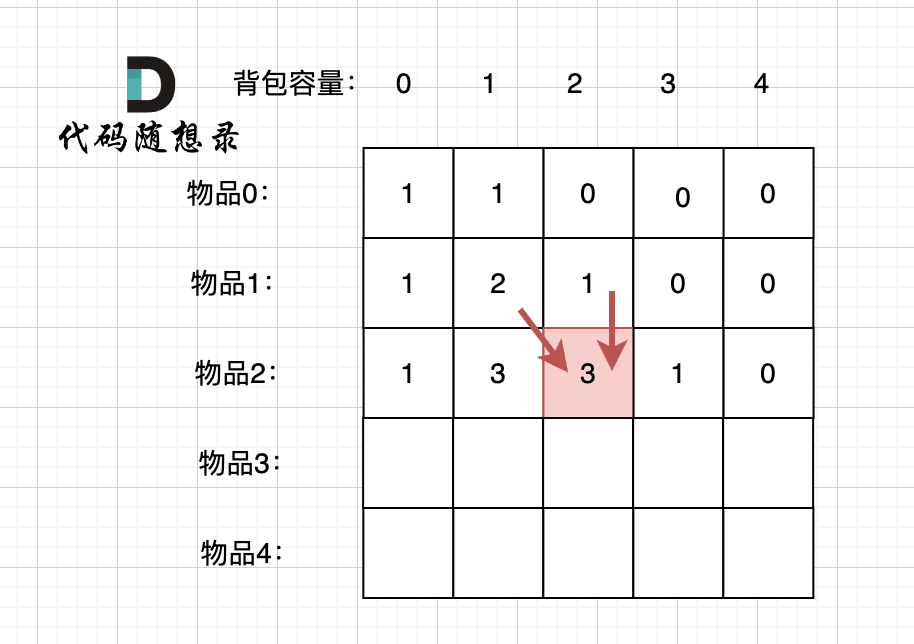  

那麼是先從上到下，再從左到右遍歷，例如這樣： 

```CPP 
for (int i = 1; i < nums.size(); i++) { // 列，遍歷物品
    for (int j = 0; j <= bagSize; j++) { // 行，遍歷背包
    }
}
``` 

還是先從左到右，再從上到下呢，例如這樣： 

```CPP 
for (int j = 0; j <= bagSize; j++) { // 行，遍歷背包
    for (int i = 1; i < nums.size(); i++) { // 列，遍歷物品
    }
}
``` 

**其實以上兩種遍歷都可以**！（但僅針對二維 DP 陣列是這樣的）

這一點我在 [01背包理論基礎](https://www.programmercarl.com/%E8%83%8C%E5%8C%85%E7%90%86%E8%AE%BA%E5%9F%BA%E7%A1%8001%E8%83%8C%E5%8C%85-1.html)中的遍歷順序部分講過。 

這裡我再畫圖講一下，以求 dp[2][2] 為例，當先從上到下，再從左到右遍歷，矩陣（matrix）是這樣： 

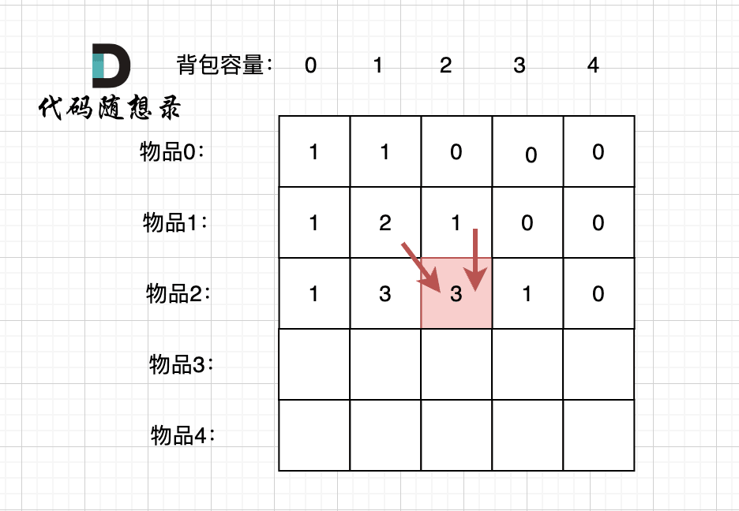 

當先從左到右，再從上到下遍歷，矩陣是這樣： 

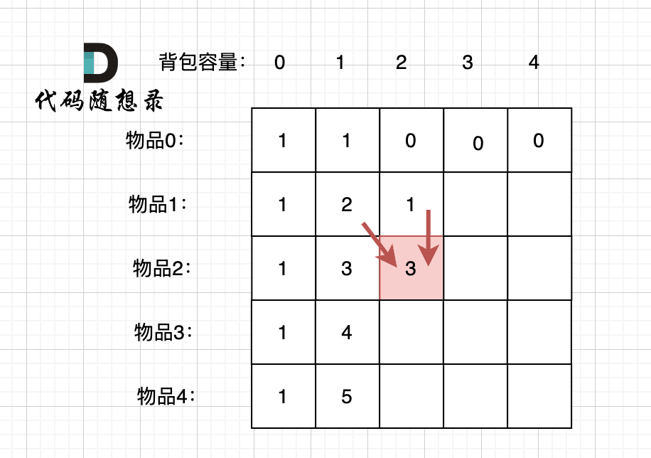 

這裡大家可以看出，無論是以上哪種遍歷，都不影響 dp[2][2] 的求值，用來推導 dp[2][2] 的數值都在。 


#### 5. 舉例推導 dp 陣列

輸入：nums: [1, 1, 1, 1, 1], target: 3

bagSize = (target + sum) / 2 = (3 + 5) / 2 = 4

dp 陣列狀態（state）變化如下：

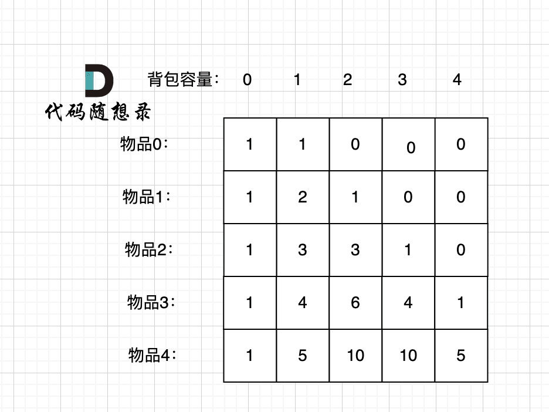

這麼大的矩陣，我們是可以自己手動模擬（simulation）出來的。

在模擬的過程中，既可以幫我們尋找規律，也可以幫我們驗證遞迴公式加遍歷順序是不是按照我們想像的結果推進的。 


最後二維 dp 陣列的 C++ 程式碼如下：

```CPP 
class Solution {
public:
    int findTargetSumWays(vector<int>& nums, int target) {
        int sum = 0;
        for (int i = 0; i < nums.size(); i++) sum += nums[i];
        if (abs(target) > sum) return 0; // 此時沒有方案
        if ((target + sum) % 2 == 1) return 0; // 此時沒有方案
        int bagSize = (target + sum) / 2;
        
        vector<vector<int>> dp(nums.size(), vector<int>(bagSize + 1, 0));
        
        // 初始化最上列
        if (nums[0] <= bagSize) dp[0][nums[0]] = 1; 

        // 初始化最左行，最左行其他數值在遞迴公式中就完成了賦值
        dp[0][0] = 1; 

        int numZero = 0;
        for (int i = 0; i < nums.size(); i++) {
            if (nums[i] == 0) numZero++;
            dp[i][0] = (int) pow(2.0, numZero);
        }

        // 以下遍歷順序行、列可以顛倒
        for (int i = 1; i < nums.size(); i++) { // 列，遍歷物品
            for (int j = 0; j <= bagSize; j++) { // 行，遍歷背包
                if (nums[i] > j) dp[i][j] = dp[i - 1][j]; 
                else dp[i][j] = dp[i - 1][j] + dp[i - 1][j - nums[i]];
            }
        }
        return dp[nums.size() - 1][bagSize];
    }
};
```

### 動態規劃（一維陣列（one dimensional array） dp 陣列）

將二維 dp 陣列壓縮成一維 dp 陣列，我們在 [01背包理論基礎（rolling array）](https://programmercarl.com/背包理论基础01背包-2.html) 講過滾動陣列，原理是一樣的，即重複利用每一列的數值。 

既然是重複利用每一列，就是將二維陣列壓縮成一列。 

dp[i][j] 去掉列的維度，即 dp[j]，表示：填滿 j（包括 j）這麼大容積的包，有 dp[j] 種方法。 

#### 2. 確定遞迴公式

二維 DP 陣列遞迴公式：`dp[i][j] = dp[i - 1][j] + dp[i - 1][j - nums[i]];` 

去掉維度 i 之後，遞迴公式：`dp[j] = dp[j] + dp[j - nums[i]]`，即：`dp[j] += dp[j - nums[i]]`  

**這個公式在後面在講解背包解決排列（permutation）組合問題的時候還會用到！**

#### 3. dp 陣列如何初始化

在上面二維 dp 陣列中，我們講解過 dp[0][0] 初始為 1，這裡 dp[0] 同樣初始為 1，即裝滿背包為 0 的方法有一種，放 0 件物品。 

#### 4. 確定遍歷順序

在[動態規劃：關於 0/1 背包問題，你該了解這些！（rolling array）](https://programmercarl.com/背包理论基础01背包-2.html)中，我們系統講過對於 0/1 背包問題一維 dp 的遍歷。

遍歷物品放在外迴圈（loop），遍歷背包在內迴圈，且內迴圈倒序（為了保證物品只使用一次）。

#### 5. 舉例推導 dp 陣列

輸入：nums: [1, 1, 1, 1, 1], target: 3

bagSize = (target + sum) / 2 = (3 + 5) / 2 = 4

dp 陣列狀態變化如下：

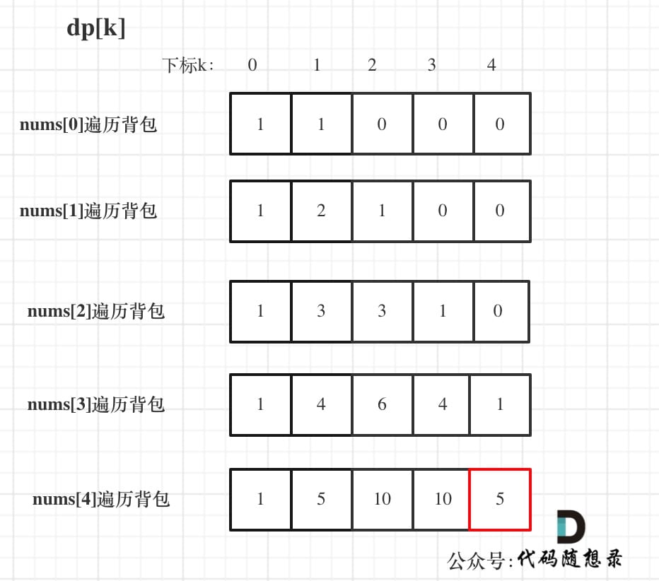

大家可以和二維 dp 陣列的輸出結果做一下對比。

一維 DP 的 C++ 程式碼如下：

```CPP
class Solution {
public:
    int findTargetSumWays(vector<int>& nums, int target) {
        int sum = 0;
        for (int i = 0; i < nums.size(); i++) sum += nums[i];
        if (abs(target) > sum) return 0; // 此時沒有方案
        if ((target + sum) % 2 == 1) return 0; // 此時沒有方案
        int bagSize = (target + sum) / 2;
        vector<int> dp(bagSize + 1, 0);
        dp[0] = 1;
        for (int i = 0; i < nums.size(); i++) {
            for (int j = bagSize; j >= nums[i]; j--) {
                dp[j] += dp[j - nums[i]];
            }
        }
        return dp[bagSize];
    }
};

```
* 時間複雜度（time complexity）：O(n × m)，n 為正數個數，m 為背包容量
* 空間複雜度（space complexity）：O(m)，m 為背包容量


### 拓展

關於一維 dp 陣列的遞迴公式解釋，也可以從以下維度來理解。（**但還是從二維 DP 陣列到一維 DP 陣列這樣更容易理解一些**）

2. 確定遞迴公式

有哪些來源可以推出 dp[j] 呢？

只要搞到 nums[i]，湊成 dp[j] 就有 dp[j - nums[i]] 種方法。

例如：dp[j]，j 為 5， 

* 已經有一個 1（nums[i]）的話，有 dp[4] 種方法湊成容量為 5 的背包。
* 已經有一個 2（nums[i]）的話，有 dp[3] 種方法湊成容量為 5 的背包。
* 已經有一個 3（nums[i]）的話，有 dp[2] 種方法湊成容量為 5 的背包
* 已經有一個 4（nums[i]）的話，有 dp[1] 種方法湊成容量為 5 的背包
* 已經有一個 5（nums[i]）的話，有 dp[0] 種方法湊成容量為 5 的背包

那麼湊整 dp[5] 有多少方法呢，也就是把所有的 dp[j - nums[i]] 累加起來。

所以求組合類問題的公式，都是類似這種：

```
dp[j] += dp[j - nums[i]]
```


## 總結

此時大家應該不禁想起，我們之前講過的[回溯演算法：39. 組合總和](https://programmercarl.com/0039.组合总和.html)是不是應該也可以用 dp 來做啊？

是可以求的，如果僅僅是求個數的話，就可以用 dp，但[回溯演算法：39. 組合總和](https://programmercarl.com/0039.组合总和.html)要求的是把所有組合列出來，還是要使用回溯法蠻力搜尋的。

本題還是有點難度，理解上從二維 DP 陣列更容易理解，做題上直接用一維 DP 更簡潔一些。 

大家可以選擇哪種方式自己更容易理解。 

在後面的題目中，在求裝滿背包有幾種方法的情況下，遞迴公式一般為：

```CPP
dp[j] += dp[j - nums[i]];
```

我們在講解無界背包問題（unbounded knapsack problem）的時候，還會用到這個遞迴公式！

## 其他語言版本

### Java
```java
class Solution {
    public int findTargetSumWays(int[] nums, int target) {
        int sum = 0;
        for (int i = 0; i < nums.length; i++) sum += nums[i];

        //如果 target 的絕對值大於 sum，那麼是沒有方案的
        if (Math.abs(target) > sum) return 0;
        //如果 (target+sum) 除以 2 的餘數不為 0，也是沒有方案的
        if ((target + sum) % 2 == 1) return 0;

        int bagSize = (target + sum) / 2;
        int[] dp = new int[bagSize + 1];
        dp[0] = 1;

        for (int i = 0; i < nums.length; i++) {
            for (int j = bagSize; j >= nums[i]; j--) {
                dp[j] += dp[j - nums[i]];
            }
        }

        return dp[bagSize];
    }
}
```

易於理解的二維陣列版本：
```java
class Solution {
    public int findTargetSumWays(int[] nums, int target) {

        // 0/1 背包應用之「有多少種不同的填滿背包最大容量的方法」
        // 易於理解的二維陣列解法及詳細註解

        int sum = 0;
        for(int i = 0; i < nums.length; i++) {
            sum += nums[i];
        }

        // 注意 nums[i] >= 0 的題目條件，意味著 sum 也是所有 nums[i] 的絕對值之和
        // 這裡保證了 sum + target 一定是大於等於零的，也就是 left 大於等於零（畢竟我們定義 left 大於 right）
        if(sum < Math.abs(target)){
            return 0;
        }

        // 利用二元一次聯立方程式將 left 用 target 和 sum 表示出來（替換掉 right 組合），詳見程式碼隨想錄對此題的分析
        // 如果所求的 left 陣列和為小數，則作為整數陣列的 nums 裡的任何元素自然是沒有辦法湊出這個小數的
        if((sum + target) % 2 != 0) {
            return 0;
        }

        int left = (sum + target) / 2;
        
        // dp[i][j]：遍歷到陣列第 i 個數時，left 為 j 時的能裝滿背包的方法總數
        int[][] dp = new int[nums.length][left + 1];

        // 初始化最上列（dp[0][j])，當 nums[0] == j 時（注意 nums[0] 和 j 都一定是大於等於零的，因此不需要判斷等於 -j 時的情況），有唯一一種取法可取到 j，dp[0][j] 此時等於 1
        // 其他情況 dp[0][j] = 0
        // java 整數陣列預設初始值為 0
        if (nums[0] <= left) {
            dp[0][nums[0]] = 1;
        }

        // 初始化最左行（dp[i][0])
        // 當從 nums 陣列的索引 0 到 i 的部分有 n 個 0 時（n > 0)，每個 0 可以取 +/-，因此有 2 的 n 次方種可以取到 j = 0 的方案
        // n = 0 說明當前遍歷到的陣列部分沒有 0 全為正數，因此只有一種方案可以取到 j = 0（就是所有數都不取）
        int numZeros = 0;
        for(int i = 0; i < nums.length; i++) {
            if(nums[i] == 0) {
                numZeros++;
            }
            dp[i][0] = (int) Math.pow(2, numZeros);

        }

        // 遞迴公式分析：
        // 當 nums[i] > j 時，這時候 nums[i] 一定不能取，所以是 dp[i - 1][j] 種方案數
        // nums[i] <= j 時，num[i] 可取可不取，因此方案數是 dp[i - 1][j] + dp[i - 1][j - nums[i]]
        // 由遞迴公式可知，先遍歷 i 或 j 都可
        for(int i = 1; i < nums.length; i++) {
            for(int j = 1; j <= left; j++) {
                if(nums[i] > j) {
                    dp[i][j] = dp[i - 1][j];
                } else {
                    dp[i][j] = dp[i - 1][j] + dp[i - 1][j - nums[i]];
                }
            }
        }


        return dp[nums.length - 1][left];
        
    }
}
```

### Python
回溯版
```python
class Solution:


    def backtracking(self, candidates, target, total, startIndex, path, result):
        if total == target:
            result.append(path[:])  # 將當前路徑的複本添加到結果中
        # 如果 sum + candidates[i] > target，則停止遍歷
        for i in range(startIndex, len(candidates)):
            if total + candidates[i] > target:
                break
            total += candidates[i]
            path.append(candidates[i])
            self.backtracking(candidates, target, total, i + 1, path, result)
            total -= candidates[i]
            path.pop()

    def findTargetSumWays(self, nums: List[int], target: int) -> int:
        total = sum(nums)
        if target > total:
            return 0  # 此時沒有方案
        if (target + total) % 2 != 0:
            return 0  # 此時沒有方案，兩個整數相加時要注意數值溢位的問題
        bagSize = (target + total) // 2  # 轉化為組合總和問題，bagSize 就是目標和

        # 以下是回溯法程式碼
        result = []
        nums.sort()  # 需要對 nums 進行排序
        self.backtracking(nums, bagSize, 0, 0, [], result)
        return len(result)

```
二維 DP
```python
class Solution:
    def findTargetSumWays(self, nums: List[int], target: int) -> int:
        total_sum = sum(nums)  # 計算 nums 的總和
        if abs(target) > total_sum:
            return 0  # 此時沒有方案
        if (target + total_sum) % 2 == 1:
            return 0  # 此時沒有方案
        target_sum = (target + total_sum) // 2  # 目標和

        # 建立二維動態規劃陣列，列表示選取的元素數量，行表示累加和
        dp = [[0] * (target_sum + 1) for _ in range(len(nums))]

        # 初始化狀態
        dp[0][0] = 1
        if nums[0] <= target_sum:
            dp[0][nums[0]] = 1
        numZero = 0
        for i in range(len(nums)):
            if nums[i] == 0:
                numZero += 1
            dp[i][0] = int(math.pow(2, numZero))

        # 動態規劃過程
        for i in range(1, len(nums)):
            for j in range(target_sum + 1):
                dp[i][j] = dp[i - 1][j]  # 不選取當前元素
                if j >= nums[i]: #只有 j >= 本次遍歷元素才可以選取當前元素
                    dp[i][j] += dp[i - 1][j - nums[i]]  # 選取當前元素

        return dp[len(nums)-1][target_sum]  # 回傳達到目標和的方案數


```
一維 DP
```python
class Solution:
    def findTargetSumWays(self, nums: List[int], target: int) -> int:
        total_sum = sum(nums)  # 計算 nums 的總和
        if abs(target) > total_sum:
            return 0  # 此時沒有方案
        if (target + total_sum) % 2 == 1:
            return 0  # 此時沒有方案
        target_sum = (target + total_sum) // 2  # 目標和
        dp = [0] * (target_sum + 1)  # 建立動態規劃陣列，初始化為 0
        dp[0] = 1  # 當目標和為 0 時，只有一種方案，即什麼都不選
        for num in nums:
            for j in range(target_sum, num - 1, -1):
                dp[j] += dp[j - num]  # 狀態變遷方程式，累加不同選擇方式的數量
        return dp[target_sum]  # 回傳達到目標和的方案數

```

### Go
回溯法思路
```go
func findTargetSumWays(nums []int, target int) int {
    var result int
    var backtracking func(nums []int, target int, index int, currentSum int)

    backtracking = func(nums []int, target int, index int, currentSum int) {
        if index == len(nums) {
            if currentSum == target {
                result++
            }
            return
        }
        
        // 選擇加上當前數字
        backtracking(nums, target, index+1, currentSum+nums[index])
        
        // 選擇減去當前數字
        backtracking(nums, target, index+1, currentSum-nums[index])
    }

    backtracking(nums, target, 0, 0)
    return result
}
```
二維 dp
```go
func findTargetSumWays(nums []int, target int) int {
    sum := 0
    for _, v := range nums {
        sum += v
    }
    if math.Abs(float64(target)) > float64(sum) {
        return 0 // 此時沒有方案
    }
    if (target + sum) % 2 == 1 {
        return 0 // 此時沒有方案
    }
    bagSize := (target + sum) / 2
    
    dp := make([][]int, len(nums))
    for i := range dp {
        dp[i] = make([]int, bagSize + 1)
    }
    
    // 初始化最上列
    if nums[0] <= bagSize {
        dp[0][nums[0]] = 1
    }
    
    // 初始化最左行，最左行其他數值在遞迴公式中就完成了賦值
    dp[0][0] = 1
    
    var numZero float64
    for i := range nums {
        if nums[i] == 0 {
            numZero++
        }
        dp[i][0] = int(math.Pow(2, numZero))
    }
    
    // 以下遍歷順序行、列可以顛倒
    for i := 1; i < len(nums); i++ { // 列，遍歷物品
        for j := 0; j <= bagSize; j++ { // 行，遍歷背包
            if nums[i] > j {
                dp[i][j] = dp[i-1][j]
            } else {
                dp[i][j] = dp[i-1][j] + dp[i-1][j-nums[i]]
            }
        }
    }
    return dp[len(nums)-1][bagSize]
}
```

一維 dp
```go
func findTargetSumWays(nums []int, target int) int {
	sum := 0
	for _, v := range nums {
		sum += v
	}
	if abs(target) > sum {
		return 0
	}
	if (sum+target)%2 == 1 {
		return 0
	}
	// 計算背包大小
	bag := (sum + target) / 2
	// 定義 dp 陣列
	dp := make([]int, bag+1)
	// 初始化
	dp[0] = 1
	// 遍歷順序
	for i := 0; i < len(nums); i++ {
		for j := bag; j >= nums[i]; j-- {
			//推導公式
			dp[j] += dp[j-nums[i]]
			//fmt.Println(dp)
		}
	}
	return dp[bag]
}

func abs(x int) int {
	return int(math.Abs(float64(x)))
}
```

### JavaScript
```javascript
/**
 * 題目來源: {@link https://leetcode.cn/problems/target-sum/}
 *
 * 題解來源: {@link https://programmercarl.com/0494.%E7%9B%AE%E6%A0%87%E5%92%8C.html#%E7%AE%97%E6%B3%95%E5%85%AC%E5%BC%80%E8%AF%BE}
 *
 * 時間複雜度: O(n * C), C 為陣列元素總和與目標值之和的一半
 *
 * 空間複雜度: O(C)
 *
 * @param { number[] } nums
 * @param { number } target
 * @return { number }
 */
const findTargetSumWays = (nums, target) => {
    // 原題目可轉化為:
    //
    // 將所有元素劃分為 2 個集合,
    // 一個集合中包含所有要添加 "+" 號的元素, 一個集合中包含所有要添加 "-" 號的元素
    //
    // 設兩個集合的元素和分別為 positive 和 negative, 所有元素總和為 sum, 那麼有如下等式:
    // positive + negative = sum (1)
    // positive - negative = target (2)
    // (1) 與 (2) 聯立可得: positive = (sum + target) / 2,
    // 所以如果能從原陣列中取出若干個元素形成 1 個元素總和為 (sum + target) / 2 的集合, 
    // 就算得到了 1 種滿足題意的組合方法
    //
    // 因此, 所求變為: 有多少種取法, 可使得容量為 (sum + target) / 2 的背包被裝滿?

    const sum = nums.reduce((a, b) => a + b);
    
    if (Math.abs(target) > sum) {
        return 0;
    }

    if ((target + sum) % 2) {
        return 0;
    }

    const bagWeight = (target + sum) / 2;
    
    // 1. dp 陣列的含義
    // dp[j]: 裝滿容量為 j 的背包, 有 dp[j] 種方法
    let dp = new Array(bagWeight + 1).fill(0);
    
    // 2. 遞迴公式
    // dp[j] = Σ(dp[j - nums[j]]), (j ∈ [0, j] 且 j >= nums[j])
    // 因爲 dp[j - nums[j]] 表示: 裝滿容量為 j - nums[j] 背包有 dp[j - nums[j]] 種方法
    // 而容量為 j - nums[j] 的背包只需要再將 nums[j] 放入背包就能使得背包容量達到 j
    // 因此, 讓背包容量達到 j 有 Σ(dp[j - nums[j]]) 種方法
    
    // 3. dp 陣列如何初始化
    // dp[0] = 1, dp[1 ~ bagWeight] = 0
    dp[0] = 1;
    
    // 4. 遍歷順序
    // 先物品後背包, 物品從前往後遍歷, 背包容量從後往前遍歷
    for (let i = 0; i < nums.length; i++) {
        for (let j = bagWeight; j >= nums[i]; j--) {
            dp[j] += dp[j - nums[i]];
        }
    }

    return dp[bagWeight];
};
```


### TypeScript

```ts
function findTargetSumWays(nums: number[], target: number): number {
    // 把陣列分成兩個組合 left, right. left + right = sum, left - right = target.
    const sum: number = nums.reduce((a: number, b: number): number => a + b);
    if ((sum + target) % 2 || Math.abs(target) > sum)  return 0;
    const left: number = (sum + target) / 2;
    
    // 將問題轉化為裝滿容量為 left 的背包有多少種方法
    // dp[i] 表示裝滿容量為 i 的背包有多少種方法
    const dp: number[] = new Array(left + 1).fill(0);
    dp[0] = 1;  // 裝滿容量為 0 的背包有 1 種方法（什麼也不裝）
    for (let i: number = 0; i < nums.length; i++) {
        for (let j: number = left; j >= nums[i]; j--) {
            dp[j] += dp[j - nums[i]];
        }
    }
    return dp[left];
};
```

### Scala

```scala
object Solution {
  def findTargetSumWays(nums: Array[Int], target: Int): Int = {
    var sum = nums.sum
    if (math.abs(target) > sum) return 0 // 此時沒有方案
    if ((sum + target) % 2 == 1) return 0 // 此時沒有方案
    var bagSize = (sum + target) / 2
    var dp = new Array[Int](bagSize + 1)
    dp(0) = 1
    for (i <- 0 until nums.length; j <- bagSize to nums(i) by -1) {
      dp(j) += dp(j - nums(i))
    }

    dp(bagSize)
  }
}
```

### Rust

```rust
impl Solution {
    pub fn find_target_sum_ways(nums: Vec<i32>, target: i32) -> i32 {
        let sum = nums.iter().sum::<i32>();
        if target.abs() > sum {
            return 0;
        }
        if (target + sum) % 2 == 1 {
            return 0;
        }
        let size = (sum + target) as usize / 2;
        let mut dp = vec![0; size + 1];
        dp[0] = 1;
        for n in nums {
            for s in (n as usize..=size).rev() {
                dp[s] += dp[s - n as usize];
            }
        }
        dp[size]
    }
}
```
### C

```c
int getSum(int * nums, int numsSize){
    int sum = 0;
    for(int i = 0; i < numsSize; i++){
        sum += nums[i];
    }
    return sum;
}

int findTargetSumWays(int* nums, int numsSize, int target) {
    int sum = getSum(nums, numsSize);
    int diff = sum - target;
    // 兩種情況不滿足
    if(diff < 0 || diff % 2 != 0){
        return 0;
    }
    int bagSize = diff / 2;
    int dp[numsSize + 1][bagSize + 1];
    dp[0][0] = 1;
    for(int i = 1; i <= numsSize; i++){
        int num = nums[i - 1];
        for(int j = 0; j <= bagSize; j++){
            dp[i][j] = dp[i - 1][j];
            if(j >= num){
                dp[i][j] += dp[i - 1][j - num];
            }
        }
    }
    return dp[numsSize][bagSize];
}
```


### C#

```csharp
public class Solution
{
    public int FindTargetSumWays(int[] nums, int target)
    {
        int sum = 0;
        foreach (int num in nums)
        {
            sum += num;
        }
        if (Math.Abs(target) > sum) return 0;
        if ((sum + target) % 2 == 1) return 0;
        int bagSize = (sum + target) / 2;
        int[] dp = new int[bagSize + 1];
        dp[0] = 1;
        for (int i = 0; i < nums.Length; i++)
        {
            for (int j = bagSize; j >= nums[i]; j--)
            {
                dp[j] += dp[j - nums[i]];
            }
        }
        return dp[bagSize];
    }
}
```


