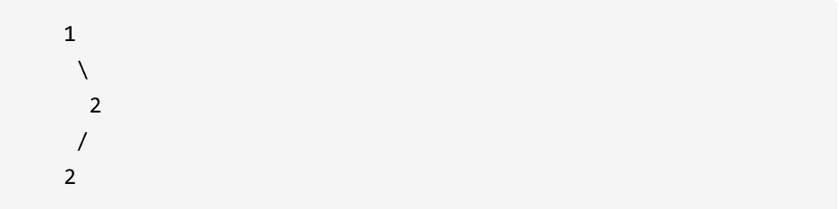
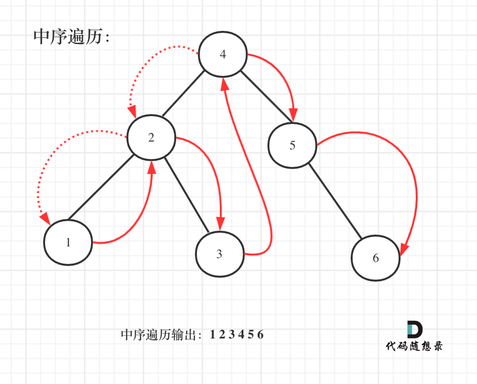

* [做專案（多個 C++、Java、Go、測試開發、前端專案）](https://www.programmercarl.com/other/kstar.html)
* [刷演算法（algorithm）（兩個月高強度學演算法）](https://www.programmercarl.com/xunlian/xunlianying.html)
* [背面試必考題（八股文）（40 天挑戰高頻面試題）](https://www.programmercarl.com/xunlian/bagu.html)


> 二元樹（binary tree）上應該怎麼求，二元搜尋樹（binary search tree, BST）上又應該怎麼求？

# 501. 二元搜尋樹中的 mode


[LeetCode 題目連結](https://leetcode.cn/problems/find-mode-in-binary-search-tree/)


給定一個有相同值的二元搜尋樹（BST），找出 BST 中的所有 mode（出現頻率最高的元素（element））。

假定 BST 有如下定義：

* 節點（node）左子樹（left subtree）中所含節點的值小於等於當前節點的值
* 節點右子樹（right subtree）中所含節點的值大於等於當前節點的值
* 左子樹和右子樹都是二元搜尋樹

例如：

給定 BST [1,null,2,2],



回傳 [2].

提示：如果 mode 超過 1 個，不需考慮輸出順序

進階：你可以不使用額外的空間嗎？（假設由遞迴（recursion）產生的隱式呼叫堆疊（call stack）的開銷不被計算在內）

## 演算法公開課 

**[《程式碼隨想錄》演算法影片公開課](https://programmercarl.com/other/gongkaike.html)：[不僅 two pointers，還有程式碼技巧可以驚豔到你！ | LeetCode：501. 二元搜尋樹中的 mode](https://www.bilibili.com/video/BV1fD4y117gp)，相信結合影片再看本篇題解，更有助於大家對本題的理解**。


## 解題思路

這道題目呢，遞迴法我從兩個維度來講。

首先如果不是二元搜尋樹的話，應該怎麼解題，是二元搜尋樹，又應該如何解題，兩種方式做一個比較（comparison），可以加深大家對二元樹的理解。

### 遞迴法

#### 如果不是二元搜尋樹

如果不是二元搜尋樹，最直觀的方法一定是把這個樹（tree）都遍歷（traversal）了，用 map 統計頻率，把頻率排個序，最後取前面高頻的元素的集合（set）。

具體步驟如下：

1. 這個樹都遍歷了，用 map 統計頻率

至於用前中後序哪種遍歷也不重要，因為就是要全遍歷一遍，怎麼個遍歷法都行，層次序走訪（level order traversal）都沒毛病！

這裡採用前序遍歷（preorder traversal），程式碼如下：

```CPP
// map<int, int> key: 元素，value: 出現頻率
void searchBST(TreeNode* cur, unordered_map<int, int>& map) { // 前序遍歷
    if (cur == NULL) return ;
    map[cur->val]++; // 統計元素頻率
    searchBST(cur->left, map);
    searchBST(cur->right, map);
    return ;
}
```

2. 把統計出來的出現頻率（即 map 中的 value）排個序

有的同學可能想直接對 map 中的 value 排序（sorting），還真做不到，C++ 中如果使用 std::map 或者 std::multimap 可以對 key 排序，但不能對 value 排序。

所以要把 map 轉化為陣列（array）即 vector，再進行排序，當然 vector 裡面放的也是 `pair<int, int>` 類型的資料，第一個 int 為元素，第二個 int 為出現頻率。

程式碼如下：

```CPP
bool static cmp (const pair<int, int>& a, const pair<int, int>& b) {
    return a.second > b.second; // 按照頻率從大到小排序
}

vector<pair<int, int>> vec(map.begin(), map.end());
sort(vec.begin(), vec.end(), cmp); // 給頻率排個序
```

3. 取前面高頻的元素

此時陣列 vector 中已經是存放著按照頻率排好序的 pair，那麼把前面高頻的元素取出來就可以了。

程式碼如下：

```CPP
result.push_back(vec[0].first);
for (int i = 1; i < vec.size(); i++) {
    // 取最高的放到 result 陣列中
    if (vec[i].second == vec[0].second) result.push_back(vec[i].first);
    else break;
}
return result;
```


整體 C++ 程式碼如下：

```CPP
class Solution {
private:

void searchBST(TreeNode* cur, unordered_map<int, int>& map) { // 前序遍歷
    if (cur == NULL) return ;
    map[cur->val]++; // 統計元素頻率
    searchBST(cur->left, map);
    searchBST(cur->right, map);
    return ;
}
bool static cmp (const pair<int, int>& a, const pair<int, int>& b) {
    return a.second > b.second;
}
public:
    vector<int> findMode(TreeNode* root) {
        unordered_map<int, int> map; // key: 元素，value: 出現頻率
        vector<int> result;
        if (root == NULL) return result;
        searchBST(root, map);
        vector<pair<int, int>> vec(map.begin(), map.end());
        sort(vec.begin(), vec.end(), cmp); // 給頻率排個序
        result.push_back(vec[0].first);
        for (int i = 1; i < vec.size(); i++) {
            // 取最高的放到 result 陣列中
            if (vec[i].second == vec[0].second) result.push_back(vec[i].first);
            else break;
        }
        return result;
    }
};
```

**所以如果本題沒有說是二元搜尋樹的話，那麼就按照上面的解題思路寫！**

#### 是二元搜尋樹

**既然是搜尋樹，它中序橫過（inorder traversal）就是有序（ordered）的**。

如圖：



中序橫過程式碼如下：

```CPP
void searchBST(TreeNode* cur) {
    if (cur == NULL) return ;
    searchBST(cur->left);       // 左
    （處理節點）                // 中
    searchBST(cur->right);      // 右
    return ;
}
```

遍歷有序陣列的元素出現頻率，從頭遍歷，那麼一定是相鄰兩個元素作比較，然後就把出現頻率最高的元素輸出就可以了。

關鍵是在有序陣列上的話，很好處理，在樹上怎麼處理呢？

這就考驗對樹的操作了。

在[二元樹：搜尋樹的最小絕對差](https://programmercarl.com/0530.二叉搜索树的最小绝对差.html)中我們就使用了 pre 指標（pointer）和 cur 指標的技巧，這次又用上了。

弄一個指標指向前一個節點，這樣每次 cur（當前節點）才能和 pre（前一個節點）作比較。

而且初始化（initialization）的時候 pre = NULL，這樣當 pre 為 NULL 時候，我們就知道這是比較的第一個元素。

程式碼如下：

```CPP
if (pre == NULL) { // 第一個節點
    count = 1; // 頻率為 1
} else if (pre->val == cur->val) { // 與前一個節點數值相同
    count++;
} else { // 與前一個節點數值不同
    count = 1;
}
pre = cur; // 更新上一個節點
```

此時又有問題了，因為要求最大頻率的元素集合（注意是集合，不是一個元素，可以有多個 mode），如果是陣列上大家一般怎麼辦？

應該是先遍歷一遍陣列，找出最大頻率（maxCount），然後再重新遍歷一遍陣列把出現頻率為 maxCount 的元素放進集合。（因為 mode 有多個）

這種方式遍歷了兩遍陣列。

那麼我們遍歷兩遍二元搜尋樹，把 mode 集合算出來也是可以的。

但這裡其實只需要遍歷一次就可以找到所有的 mode。

那麼如何只遍歷一遍呢？

如果頻率 count 等於 maxCount（最大頻率），當然要把這個元素加入到結果集（result set）中（以下程式碼為 result 陣列），程式碼如下：

```CPP
if (count == maxCount) { // 如果和最大值相同，放進 result 中
    result.push_back(cur->val);
}
```

是不是感覺這裡有問題，result 怎麼能輕易就把元素放進去了呢，萬一，這個 maxCount 此時還不是真正最大頻率呢。

所以下面要做如下操作：

頻率 count 大於 maxCount 的時候，不僅要更新 maxCount，而且要清空結果集（以下程式碼為 result 陣列），因為結果集之前的元素都失效了。

```CPP
if (count > maxCount) { // 如果計數大於最大值
    maxCount = count;   // 更新最大頻率
    result.clear();     // 很關鍵的一步，不要忘記清空 result，之前 result 裡的元素都失效了
    result.push_back(cur->val);
}
```

關鍵程式碼都講完了，完整程式碼如下：（**只需要遍歷一遍二元搜尋樹，就求出了 mode 的集合**）


```CPP
class Solution {
private:
    int maxCount = 0; // 最大頻率
    int count = 0; // 統計頻率
    TreeNode* pre = NULL;
    vector<int> result;
    void searchBST(TreeNode* cur) {
        if (cur == NULL) return ;

        searchBST(cur->left);       // 左
                                    // 中
        if (pre == NULL) { // 第一個節點
            count = 1;
        } else if (pre->val == cur->val) { // 與前一個節點數值相同
            count++;
        } else { // 與前一個節點數值不同
            count = 1;
        }
        pre = cur; // 更新上一個節點

        if (count == maxCount) { // 如果和最大值相同，放進 result 中
            result.push_back(cur->val);
        }

        if (count > maxCount) { // 如果計數大於最大值頻率
            maxCount = count;   // 更新最大頻率
            result.clear();     // 很關鍵的一步，不要忘記清空 result，之前 result 裡的元素都失效了
            result.push_back(cur->val);
        }

        searchBST(cur->right);      // 右
        return ;
    }

public:
    vector<int> findMode(TreeNode* root) {
        count = 0;
        maxCount = 0;
        pre = NULL; // 記錄前一個節點
        result.clear();

        searchBST(root);
        return result;
    }
};
```


### 疊代（iteration）法

只要把中序橫過轉成疊代，中間節點的處理邏輯完全一樣。

二元樹前中後序轉疊代，傳送門：

* [二元樹：前中後序疊代法](https://programmercarl.com/二叉树的迭代遍历.html)
* [二元樹：前中後序統一風格的疊代方式](https://programmercarl.com/二叉树的统一迭代法.html)

下面我給出其中的一種中序橫過的疊代法，其中間處理邏輯一點都沒有變（我從遞迴法直接複製過來的程式碼，連註解都沒改）

程式碼如下：

```CPP
class Solution {
public:
    vector<int> findMode(TreeNode* root) {
        stack<TreeNode*> st;
        TreeNode* cur = root;
        TreeNode* pre = NULL;
        int maxCount = 0; // 最大頻率
        int count = 0; // 統計頻率
        vector<int> result;
        while (cur != NULL || !st.empty()) {
            if (cur != NULL) { // 指標來訪問節點，訪問到最底層
                st.push(cur); // 將訪問的節點放進堆疊
                cur = cur->left;                // 左
            } else {
                cur = st.top();
                st.pop();                       // 中
                if (pre == NULL) { // 第一個節點
                    count = 1;
                } else if (pre->val == cur->val) { // 與前一個節點數值相同
                    count++;
                } else { // 與前一個節點數值不同
                    count = 1;
                }
                if (count == maxCount) { // 如果和最大值相同，放進 result 中
                    result.push_back(cur->val);
                }

                if (count > maxCount) { // 如果計數大於最大值頻率
                    maxCount = count;   // 更新最大頻率
                    result.clear();     // 很關鍵的一步，不要忘記清空 result，之前 result 裡的元素都失效了
                    result.push_back(cur->val);
                }
                pre = cur;
                cur = cur->right;               // 右
            }
        }
        return result;
    }
};
```

## 總結

本題在遞迴法中，我給出了如果是普通二元樹，應該怎麼求 mode。

知道了普通二元樹的做法後，我再進一步給出二元搜尋樹又應該怎麼求 mode，這樣鮮明的對比，相信會對二元樹又有更深層次的理解了。

在遞迴遍歷二元搜尋樹的過程中，我還介紹了一個統計最高出現頻率元素集合的技巧，要不然就要遍歷兩次二元搜尋樹才能把這個最高出現頻率元素的集合求出來。


**為什麼沒有這個技巧一定要遍歷兩次呢？因為要求的是集合，會有多個 mode，如果規定只有一個 mode，那麼就遍歷一次穩穩的了。**

最後我依然給出對應的疊代法，其實就是疊代法中序橫過的模板（template）加上遞迴法中中間節點的處理邏輯，分分鐘就可以寫出來，中間邏輯的程式碼我都是從遞迴法中直接複製過來的。

**求二元搜尋樹中的 mode 其實是一道簡單題，但大家可以發現我寫了這麼一大篇幅的文章來講解，主要是為了儘量從各個角度對本題進行剖析，幫助大家更快更深入理解二元樹**。


> **需要強調的是 leetcode 上的耗時統計是非常不準確的，看個大概就行，一樣的程式碼耗時可以差百分之 50 以上**，所以 leetcode 的耗時統計別太當回事，知道理論上的效率優劣就行了。


## 其他語言版本


### Java

蠻力法（brute force method）

```java
class Solution {
	public int[] findMode(TreeNode root) {
		Map<Integer, Integer> map = new HashMap<>();
		List<Integer> list = new ArrayList<>();
		if (root == null) return list.stream().mapToInt(Integer::intValue).toArray();
		// 獲得頻率 Map
		searchBST(root, map);
		List<Map.Entry<Integer, Integer>> mapList = map.entrySet().stream()
				.sorted((c1, c2) -> c2.getValue().compareTo(c1.getValue()))
				.collect(Collectors.toList());
		list.add(mapList.get(0).getKey());
		// 把頻率最高的加入 list
		for (int i = 1; i < mapList.size(); i++) {
			if (mapList.get(i).getValue() == mapList.get(i - 1).getValue()) {
				list.add(mapList.get(i).getKey());
			} else {
				break;
			}
		}
		return list.stream().mapToInt(Integer::intValue).toArray();
	}

	void searchBST(TreeNode curr, Map<Integer, Integer> map) {
		if (curr == null) return;
		map.put(curr.val, map.getOrDefault(curr.val, 0) + 1);
		searchBST(curr.left, map);
		searchBST(curr.right, map);
	}

}
```

中序橫過 - 不使用額外空間，利用二元搜尋樹特性 

```Java
class Solution {
    ArrayList<Integer> resList;
    int maxCount;
    int count;
    TreeNode pre;

    public int[] findMode(TreeNode root) {
        resList = new ArrayList<>();
        maxCount = 0;
        count = 0;
        pre = null;
        findMode1(root);
        int[] res = new int[resList.size()];
        for (int i = 0; i < resList.size(); i++) {
            res[i] = resList.get(i);
        }
        return res;
    }

    public void findMode1(TreeNode root) {
        if (root == null) {
            return;
        }
        findMode1(root.left);

        int rootValue = root.val;
        // 計數
        if (pre == null || rootValue != pre.val) {
            count = 1;
        } else {
            count++;
        }
        // 更新結果以及 maxCount
        if (count > maxCount) {
            resList.clear();
            resList.add(rootValue);
            maxCount = count;
        } else if (count == maxCount) {
            resList.add(rootValue);
        }
        pre = root;

        findMode1(root.right);
    }
}
```
疊代法
```java
class Solution {
    public int[] findMode(TreeNode root) {
        TreeNode pre = null;
        Stack<TreeNode> stack = new Stack<>();
        List<Integer> result = new ArrayList<>();
        int maxCount = 0;
        int count = 0;
        TreeNode cur = root;
        while (cur != null || !stack.isEmpty()) {
            if (cur != null) {
                stack.push(cur);
                cur =cur.left;
            }else {
                cur = stack.pop();
                // 計數
                if (pre == null || cur.val != pre.val) {
                    count = 1;
                }else {
                    count++;
                }
                // 更新結果
                if (count > maxCount) {
                    maxCount = count;
                    result.clear();
                    result.add(cur.val);
                }else if (count == maxCount) {
                    result.add(cur.val);
                }
                pre = cur;
                cur = cur.right;
            }
        }
        return result.stream().mapToInt(Integer::intValue).toArray();
    }
}
```
統一疊代法
```Java
class Solution {
    public int[] findMode(TreeNode root) {
        int count = 0;
        int maxCount = 0;
        TreeNode pre = null;
        LinkedList<Integer> res = new LinkedList<>();
        Stack<TreeNode> stack = new Stack<>();

        if(root != null)
            stack.add(root);
        
        while(!stack.isEmpty()){
            TreeNode curr = stack.peek();
            if(curr != null){
                stack.pop();
                if(curr.right != null)
                    stack.add(curr.right);
                stack.add(curr);
                stack.add(null);
                if(curr.left != null)
                    stack.add(curr.left);
            }else{
                stack.pop();
                TreeNode temp = stack.pop();
                if(pre == null)
                    count = 1;
                else if(pre != null && pre.val == temp.val)
                    count++;
                else
                    count = 1;
                pre = temp;
                if(count == maxCount)
                    res.add(temp.val);
                if(count > maxCount){
                    maxCount = count;
                    res.clear();
                    res.add(temp.val);
                }
            }
        }
        int[] result = new int[res.size()];
        int i = 0;
        for (int x : res){
            result[i] = x;
            i++;
        }
        return result;    
    }
}
```


### Python 

遞迴法（版本一）利用字典（dictionary）

```python
# Definition for a binary tree node.
# class TreeNode:
#     def __init__(self, val=0, left=None, right=None):
#         self.val = val
#         self.left = left
#         self.right = right
from collections import defaultdict

class Solution:
    def searchBST(self, cur, freq_map):
        if cur is None:
            return
        freq_map[cur.val] += 1  # 統計元素頻率
        self.searchBST(cur.left, freq_map)
        self.searchBST(cur.right, freq_map)

    def findMode(self, root):
        freq_map = defaultdict(int)  # key: 元素，value: 出現頻率
        result = []
        if root is None:
            return result
        self.searchBST(root, freq_map)
        max_freq = max(freq_map.values())
        for key, freq in freq_map.items():
            if freq == max_freq:
                result.append(key)
        return result

```

遞迴法（版本二）利用二元搜尋樹性質

```python
class Solution:
    def __init__(self):
        self.maxCount = 0  # 最大頻率
        self.count = 0  # 統計頻率
        self.pre = None
        self.result = []

    def searchBST(self, cur):
        if cur is None:
            return

        self.searchBST(cur.left)  # 左
        # 中
        if self.pre is None:  # 第一個節點
            self.count = 1
        elif self.pre.val == cur.val:  # 與前一個節點數值相同
            self.count += 1
        else:  # 與前一個節點數值不同
            self.count = 1
        self.pre = cur  # 更新上一個節點

        if self.count == self.maxCount:  # 如果與最大值頻率相同，放進 result 中
            self.result.append(cur.val)

        if self.count > self.maxCount:  # 如果計數大於最大值頻率
            self.maxCount = self.count  # 更新最大頻率
            self.result = [cur.val]  # 很關鍵的一步，不要忘記清空 result，之前 result 裡的元素都失效了

        self.searchBST(cur.right)  # 右
        return

    def findMode(self, root):
        self.count = 0
        self.maxCount = 0
        self.pre = None  # 記錄前一個節點
        self.result = []

        self.searchBST(root)
        return self.result
```
疊代法
```python
class Solution:
    def findMode(self, root):
        st = []
        cur = root
        pre = None
        maxCount = 0  # 最大頻率
        count = 0  # 統計頻率
        result = []

        while cur is not None or st:
            if cur is not None:  # 指標來訪問節點，訪問到最底層
                st.append(cur)  # 將訪問的節點放進堆疊
                cur = cur.left  # 左
            else:
                cur = st.pop()
                if pre is None:  # 第一個節點
                    count = 1
                elif pre.val == cur.val:  # 與前一個節點數值相同
                    count += 1
                else:  # 與前一個節點數值不同
                    count = 1

                if count == maxCount:  # 如果和最大值相同，放進 result 中
                    result.append(cur.val)

                if count > maxCount:  # 如果計數大於最大值頻率
                    maxCount = count  # 更新最大頻率
                    result = [cur.val]  # 很關鍵的一步，不要忘記清空 result，之前 result 裡的元素都失效了

                pre = cur
                cur = cur.right  # 右

        return result
```
### Go 

計數法，不使用額外空間，利用二元樹性質，中序橫過
```go
func findMode(root *TreeNode) []int {
    res := make([]int, 0)
    count := 1
    max := 1
    var prev *TreeNode
    var travel func(node *TreeNode) 
    travel = func(node *TreeNode) {
        if node == nil {
            return
        }
        travel(node.Left)
        if prev != nil && prev.Val == node.Val {
            count++
        } else {
            count = 1
        }
        if count >= max {
            if count > max && len(res) > 0 {
                res = []int{node.Val}
            } else {
                res = append(res, node.Val)
            }
            max = count
        }
        prev = node
        travel(node.Right)
    }
    travel(root)
    return res
}
```

### JavaScript 

使用額外空間 map 的方法 
```javascript
var findMode = function(root) {
    // 使用遞迴中序橫過
    let map = new Map();
    // 1. 確定遞迴函式以及函式參數
    const traverTree = function(root) {
        // 2. 確定遞迴終止條件
        if(root === null) {
            return ;
        }
        traverTree(root.left);
         // 3. 單層遞迴邏輯
        map.set(root.val,map.has(root.val)?map.get(root.val)+1:1);
        traverTree(root.right);
    }
    traverTree(root);
    // 上面把資料都儲存到 map
    // 下面開始尋找 map 裡面的
    // 定義一個最大出現次數的初始值為 root.val 的出現次數
    let maxCount = map.get(root.val);
    // 定義一個存放結果的陣列 res
    let res = [];
    for(let [key,value] of map) {
        // 如果當前值等於最大出現次數就直接在 res 增加該值
        if(value === maxCount) {
            res.push(key);
        }
        // 如果 value 的值大於原本的 maxCount 就清空 res 的所有值，因為找到了更大的
        if(value>maxCount) {
            res = [];
            maxCount = value;
            res.push(key);
        }
    }
    return res;
};
```

不使用額外空間，利用二元樹性質，中序橫過(有序)：

```javascript
var findMode = function(root) {
    // 不使用額外空間，使用中序橫過, 設定出現最大次數初始值為 1
    let count = 0,maxCount = 1;
    let pre = root,res = [];
    // 1. 確定遞迴函式及函式參數
    const travelTree = function(cur) {
        // 2. 確定遞迴終止條件
        if(cur === null) {
            return ;
        }
        travelTree(cur.left);
        // 3. 單層遞迴邏輯
        if(pre.val === cur.val) {
            count++;
        }else {
            count = 1;
        }
        pre = cur;
        if(count === maxCount) {
            res.push(cur.val);
        }
        if(count > maxCount) {
            res = [];
            maxCount = count;
            res.push(cur.val);
        }
        travelTree(cur.right);
    }
    travelTree(root);
    return res;
};
```

### TypeScript

> 輔助 Map 法

```typescript
function findMode(root: TreeNode | null): number[] {
    if (root === null) return [];
    const countMap: Map<number, number> = new Map();
    function traverse(root: TreeNode | null): void {
        if (root === null) return;
        countMap.set(root.val, (countMap.get(root.val) || 0) + 1);
        traverse(root.left);
        traverse(root.right);
    }
    traverse(root);
    const countArr: number[][] = Array.from(countMap);
    countArr.sort((a, b) => {
        return b[1] - a[1];
    })
    const resArr: number[] = [];
    const maxCount: number = countArr[0][1];
    for (let i of countArr) {
        if (i[1] === maxCount) resArr.push(i[0]);
    }
    return resArr;
};
```

> 遞迴中直接解決

```typescript
function findMode(root: TreeNode | null): number[] {
    let preNode: TreeNode | null = null;
    let maxCount: number = 0;
    let count: number = 0;
    let resArr: number[] = [];
    function traverse(root: TreeNode | null): void {
        if (root === null) return;
        traverse(root.left);
        if (preNode === null) { // 第一個節點
            count = 1;
        } else if (preNode.val === root.val) {
            count++;
        } else {
            count = 1;
        }
        if (count === maxCount) {
            resArr.push(root.val);
        } else if (count > maxCount) {
            maxCount = count;
            resArr.length = 0;
            resArr.push(root.val);
        }
        preNode = root;
        traverse(root.right);
    }
    traverse(root);
    return resArr;
};
```

> 疊代法

```typescript
function findMode(root: TreeNode | null): number[] {
    const helperStack: TreeNode[] = [];
    const resArr: number[] = [];
    let maxCount: number = 0;
    let count: number = 0;
    let preNode: TreeNode | null = null;
    let curNode: TreeNode | null = root;
    while (curNode !== null || helperStack.length > 0) {
        if (curNode !== null) {
            helperStack.push(curNode);
            curNode = curNode.left;
        } else {
            curNode = helperStack.pop()!;
            if (preNode === null) { // 第一個節點
                count = 1;
            } else if (preNode.val === curNode.val) {
                count++;
            } else {
                count = 1;
            }
            if (count === maxCount) {
                resArr.push(curNode.val);
            } else if (count > maxCount) {
                maxCount = count;
                resArr.length = 0;
                resArr.push(curNode.val);
            }
            preNode = curNode;
            curNode = curNode.right;
        }
    }
    return resArr;
};
```

### Scala

蠻力（brute force）:
```scala
object Solution {
  // 匯入套件
  import scala.collection.mutable // 集合套件
  import scala.util.control.Breaks.{break, breakable} // 流程控制套件
  def findMode(root: TreeNode): Array[Int] = {
    var map = mutable.HashMap[Int, Int]() // 儲存節點的值，和該值出現的次數
    def searchBST(curNode: TreeNode): Unit = {
      if (curNode == null) return
      var value = map.getOrElse(curNode.value, 0)
      map.put(curNode.value, value + 1) 
      searchBST(curNode.left)
      searchBST(curNode.right)
    }
    searchBST(root) // 前序遍歷把每個節點的值加入到裡面
    // 將 map 轉換為 list，隨後根據元組的第二個值進行排序
    val list = map.toList.sortWith((map1, map2) => {
      if (map1._2 > map2._2) true else false
    })
    var res = mutable.ArrayBuffer[Int]()
    res.append(list(0)._1) // 將第一個加入結果集
    breakable {
      for (i <- 1 until list.size) {
        // 如果值相同就加入結果集合，反之 break
        if (list(i)._2 == list(0)._2) res.append(list(i)._1)
        else break
      }
    }
    res.toArray // 最終回傳 res 的 Array 格式，return 關鍵字可以省略
  }
}
```

遞迴(利用二元搜尋樹的性質):
```scala
object Solution {
  import scala.collection.mutable
  def findMode(root: TreeNode): Array[Int] = {
    var maxCount = 0 // 最大頻率
    var count = 0 // 統計頻率
    var pre: TreeNode = null
    var result = mutable.ArrayBuffer[Int]()

    def searchBST(cur: TreeNode): Unit = {
      if (cur == null) return
      searchBST(cur.left)
      if (pre == null) count = 1 // 等於空置為 1
      else if (pre.value == cur.value) count += 1 // 與上一個節點的值相同加 1
      else count = 1 // 與上一個節點的值不同
      pre = cur

      // 如果和最大值相同，則放入結果集
      if (count == maxCount) result.append(cur.value)

      // 如果當前計數大於最大值頻率，更新最大值，清空結果集
      if (count > maxCount) {
        maxCount = count
        result.clear()
        result.append(cur.value)
      }
      searchBST(cur.right)
    }
    searchBST(root)
    result.toArray  // return 關鍵字可以省略
  }
}
```

### Rust

遞迴：

```rust
impl Solution {
    pub fn find_mode(root: Option<Rc<RefCell<TreeNode>>>) -> Vec<i32> {
        let mut count = 0;
        let mut max_count = 0;
        let mut res = vec![];
        let mut pre = i32::MIN;
        Self::search_bst(&root, &mut pre, &mut res, &mut count, &mut max_count);
        res
    }
    pub fn search_bst(
        cur: &Option<Rc<RefCell<TreeNode>>>,
        mut pre: &mut i32,
        res: &mut Vec<i32>,
        count: &mut i32,
        max_count: &mut i32,
    ) {
        if cur.is_none() {
            return;
        }

        let cur_node = cur.as_ref().unwrap().borrow();
        Self::search_bst(&cur_node.left, pre, res, count, max_count);
        if *pre == i32::MIN {
            *count = 1;
        } else if *pre == cur_node.val {
            *count += 1;
        } else {
            *count = 1;
        };
        match count.cmp(&max_count) {
            std::cmp::Ordering::Equal => res.push(cur_node.val),
            std::cmp::Ordering::Greater => {
                *max_count = *count;
                res.clear();
                res.push(cur_node.val);
            }
            _ => {}
        };
        *pre = cur_node.val;
        Self::search_bst(&cur_node.right, pre, res, count, max_count);
    }
}
```

疊代：

```rust
pub fn find_mode(root: Option<Rc<RefCell<TreeNode>>>) -> Vec<i32> {
        let (mut cur, mut pre) = (root, i32::MIN);
        let mut res = vec![];
        let mut stack = vec![];
        let (mut count, mut max_count) = (0, 0);
        while !stack.is_empty() || cur.is_some() {
            while let Some(node) = cur {
                cur = node.borrow().left.clone();
                stack.push(node);
            }
            if let Some(node) = stack.pop() {
                if pre == i32::MIN {
                    count = 1;
                } else if pre == node.borrow().val {
                    count += 1;
                } else {
                    count = 1;
                }
                match count.cmp(&max_count) {
                    std::cmp::Ordering::Equal => res.push(node.borrow().val),
                    std::cmp::Ordering::Greater => {
                        max_count = count;
                        res.clear();
                        res.push(node.borrow().val);
                    }
                    _ => {}
                }
                pre = node.borrow().val;
                cur = node.borrow().right.clone();
            }
        }
        res
    }
```
### C#
```csharp
// 遞迴
public class Solution
{
    public List<int> res = new List<int>();
    public int count = 0;
    public int maxCount = 0;
    public TreeNode pre = null;
    public int[] FindMode(TreeNode root)
    {
        SearchBST(root);
        return res.ToArray();
    }
    public void SearchBST(TreeNode root)
    {
        if (root == null) return;
        SearchBST(root.left);
        if (pre == null)
            count = 1;
        else if (pre.val == root.val)
            count++;
        else
            count = 1;

        pre = root;
        if (count == maxCount)
        {
            res.Add(root.val);
        }
        else if (count > maxCount)
        {
            res.Clear();
            res.Add(root.val);
            maxCount = count;
        }
        SearchBST(root.right);
    }
}
```


