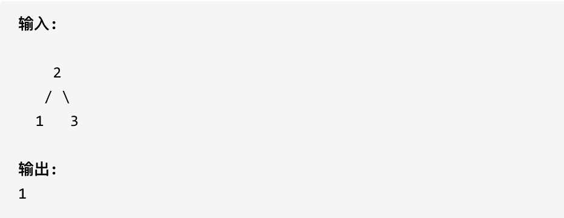
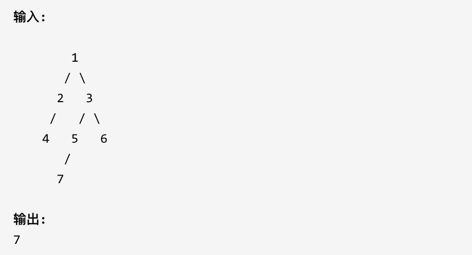

* [做專案（多個 C++、Java、Go、測試開發、前端專案）](https://www.programmercarl.com/other/kstar.html)
* [刷演算法（兩個月高強度學演算法）](https://www.programmercarl.com/xunlian/xunlianying.html)
* [背八股（40天挑戰高頻面試題）](https://www.programmercarl.com/xunlian/bagu.html)


# 513.找樹（tree）左下角的值

[LeetCode 題目連結](https://leetcode.com/problems/find-bottom-left-tree-value/)

給定一個二元樹（binary tree），在樹的最後一行找到最左邊的值。


範例 1:



範例 2:



## 演算法公開課

**[《程式碼隨想錄》演算法影片公開課](https://programmercarl.com/other/gongkaike.html)：[怎麼找二元樹的左下角？ 遞迴（recursion）中又帶回溯（backtracking）了，怎麼辦？| LeetCode：513.找二元樹左下角的值](https://www.bilibili.com/video/BV1424y1Z7pn)，相信結合影片再看本篇題解，更有助於大家對本題的理解**。


## 想法

本題要找出樹的最後一行的最左邊的值。此時大家應該想起用層次序走訪（level order traversal）是非常簡單的了，反而用遞迴的話會比較難一點。

我們依然還是先介紹遞迴法。

### 遞迴

乍眼一看，這道題目用遞迴的話就一直向左遍歷（traversal），最後一個就是答案唄？

沒有這麼簡單，一直向左遍歷到最後一個，它未必是最後一行啊。

我們來分析一下題目：在樹的**最後一行**找到**最左邊的值**。

首先要是最後一行，然後是最左邊的值。

如果使用遞迴法，如何判斷是最後一行呢，其實就是深度（depth）最大的葉節點（leaf node）一定是最後一行。

如果對二元樹深度和高度（height）還有點疑惑的話，請看：[110.平衡二元樹（balanced binary tree）](./0110.平衡二叉樹.md)。

所以要找深度最大的葉節點。

那麼如何找最左邊的呢？可以使用前序遍歷（preorder traversal）（當然中序，後序都可以，因為本題沒有中間節點（node）的處理邏輯，只要左優先就行），保證優先左邊搜尋，然後記錄深度最大的葉節點，此時就是樹的最後一行最左邊的值。

遞迴三部曲：

1. 確定遞迴函數（recursive function）的參數（parameter）和轉回值（return value）

參數必須有要遍歷的樹的根節點（root node），還有就是一個 int 型的變數（variable）用來記錄最長深度。這裡就不需要轉回值了，所以遞迴函數的傳回類型（return type）為 void。

本題還需要類別（class）裡的兩個全域變數（global variable），maxDepth 用來記錄最大深度，result 記錄最大深度最左節點的數值。

程式碼如下：

```CPP
int maxDepth = INT_MIN;   // 全域變數 記錄最大深度
int result;       // 全域變數 最大深度最左節點的數值
void traversal(TreeNode* root, int depth)
```


2. 確定終止條件（termination condition）

當遇到葉節點的時候，就需要統計一下最大的深度了，所以需要遇到葉節點來更新最大深度。

程式碼如下：

```CPP
if (root->left == NULL && root->right == NULL) {
    if (depth > maxDepth) {
        maxDepth = depth;           // 更新最大深度
        result = root->val;   // 最大深度最左面的數值
    }
    return;
}
```

3. 確定單層遞迴的邏輯

在找最大深度的時候，遞迴的過程中依然要使用回溯，程式碼如下：

```CPP
                    // 中
if (root->left) {   // 左
    depth++; // 深度加一
    traversal(root->left, depth);
    depth--; // 回溯，深度減一
}
if (root->right) { // 右
    depth++; // 深度加一
    traversal(root->right, depth);
    depth--; // 回溯，深度減一
}
return;
```

完整程式碼如下：

```CPP
class Solution {
public:
    int maxDepth = INT_MIN;
    int result;
    void traversal(TreeNode* root, int depth) {
        if (root->left == NULL && root->right == NULL) {
            if (depth > maxDepth) {
                maxDepth = depth;
                result = root->val;
            }
            return;
        }
        if (root->left) {
            depth++;
            traversal(root->left, depth);
            depth--; // 回溯
        }
        if (root->right) {
            depth++;
            traversal(root->right, depth);
            depth--; // 回溯
        }
        return;
    }
    int findBottomLeftValue(TreeNode* root) {
        traversal(root, 0);
        return result;
    }
};
```

當然回溯的地方可以精簡，精簡程式碼如下：

```CPP
class Solution {
public:
    int maxDepth = INT_MIN;
    int result;
    void traversal(TreeNode* root, int depth) {
        if (root->left == NULL && root->right == NULL) {
            if (depth > maxDepth) {
                maxDepth = depth;
                result = root->val;
            }
            return;
        }
        if (root->left) {
            traversal(root->left, depth + 1); // 隱藏著回溯
        }
        if (root->right) {
            traversal(root->right, depth + 1); // 隱藏著回溯
        }
        return;
    }
    int findBottomLeftValue(TreeNode* root) {
        traversal(root, 0);
        return result;
    }
};
```

如果對回溯部分精簡的程式碼不理解的話，可以看這篇[257. 二元樹的所有路徑（path）](./0257.二叉樹的所有路徑.md) 


### 疊代（iteration）法

本題使用層次序走訪再合適不過了，比遞迴要好理解得多！

只需要記錄最後一行第一個節點的數值就可以了。

如果對層次序走訪不了解，看這篇[二元樹：層次序走訪登場！](./0102.二元樹的層次序走訪.md)，這篇裡也給出了層次序走訪的模板（template），稍作修改就一次刷過這道題了。

程式碼如下：

```CPP
class Solution {
public:
    int findBottomLeftValue(TreeNode* root) {
        queue<TreeNode*> que;
        if (root != NULL) que.push(root);
        int result = 0;
        while (!que.empty()) {
            int size = que.size();
            for (int i = 0; i < size; i++) {
                TreeNode* node = que.front();
                que.pop();
                if (i == 0) result = node->val; // 記錄最後一行第一個元素
                if (node->left) que.push(node->left);
                if (node->right) que.push(node->right);
            }
        }
        return result;
    }
};
```

## 總結

本題涉及如下幾點：

* 遞迴求深度的寫法，我們在[110.平衡二元樹](./0110.平衡二叉樹.md)中詳細分析了深度應該怎麼求，高度應該怎麼求。
* 遞迴中其實隱藏了回溯，在[257. 二元樹的所有路徑](./0257.二叉樹的所有路徑.md)中講解了究竟哪裡使用了回溯，哪裡隱藏了回溯。
* 層次遍歷，在[二元樹：層次序走訪登場！](./0102.二元樹的層次序走訪.md)深度講解了二元樹層次遍歷。
所以本題涉及到的點，我們之前都講解過，這些知識點需要同學們靈活運用，這樣就舉一反三了。


## 其他語言版本


### Java 

```java
// 遞迴法
class Solution {
    private int Deep = -1;
    private int value = 0;
    public int findBottomLeftValue(TreeNode root) {
        value = root.val;
        findLeftValue(root,0);
        return value;
    }

    private void findLeftValue (TreeNode root,int deep) {
        if (root == null) return;
        if (root.left == null && root.right == null) {
            if (deep > Deep) {
                value = root.val;
                Deep = deep;
            }
        }
        if (root.left != null) findLeftValue(root.left,deep + 1);
        if (root.right != null) findLeftValue(root.right,deep + 1);
    }
}
```

```java
//疊代法
class Solution {

    public int findBottomLeftValue(TreeNode root) {
        Queue<TreeNode> queue = new LinkedList<>();
        queue.offer(root);
        int res = 0;
        while (!queue.isEmpty()) {
            int size = queue.size();
            for (int i = 0; i < size; i++) {
                TreeNode poll = queue.poll();
                if (i == 0) {
                    res = poll.val;
                }
                if (poll.left != null) {
                    queue.offer(poll.left);
                }
                if (poll.right != null) {
                    queue.offer(poll.right);
                }
            }
        }
        return res;
    }
}
```


### Python 
（版本一）遞迴法 + 回溯
```python
class Solution:
    def findBottomLeftValue(self, root: TreeNode) -> int:
        self.max_depth = float('-inf')
        self.result = None
        self.traversal(root, 0)
        return self.result
    
    def traversal(self, node, depth):
        if not node.left and not node.right:
            if depth > self.max_depth:
                self.max_depth = depth
                self.result = node.val
            return
        
        if node.left:
            depth += 1
            self.traversal(node.left, depth)
            depth -= 1
        if node.right:
            depth += 1
            self.traversal(node.right, depth)
            depth -= 1

```

（版本二）遞迴法 + 精簡
```python
class Solution:
    def findBottomLeftValue(self, root: TreeNode) -> int:
        self.max_depth = float('-inf')
        self.result = None
        self.traversal(root, 0)
        return self.result
    
    def traversal(self, node, depth):
        if not node.left and not node.right:
            if depth > self.max_depth:
                self.max_depth = depth
                self.result = node.val
            return
        
        if node.left:
            self.traversal(node.left, depth+1)
        if node.right:
            self.traversal(node.right, depth+1)
```

（版本三）疊代法
```python
# Definition for a binary tree node.
# class TreeNode:
#     def __init__(self, val=0, left=None, right=None):
#         self.val = val
#         self.left = left
#         self.right = right
from collections import deque
class Solution:
    def findBottomLeftValue(self, root):
        if root is None:
            return 0
        queue = deque()
        queue.append(root)
        result = 0
        while queue:
            size = len(queue)
            for i in range(size):
                node = queue.popleft()
                if i == 0:
                    result = node.val
                if node.left:
                    queue.append(node.left)
                if node.right:
                    queue.append(node.right)
        return result


```

### Go

遞迴法：

```go
var depth int   // 全域變數 最大深度
var res int     // 記錄最終結果
func findBottomLeftValue(root *TreeNode) int {
    depth, res = 0, 0   // 初始化
    dfs(root, 1)
    return res
}

func dfs(root *TreeNode, d int) {
    if root == nil {
        return
    }
    // 因為先遍歷左邊，所以左邊如果有值，右邊的同層不會更新結果
    if root.Left == nil && root.Right == nil && depth < d { 
        depth = d
        res = root.Val
    }
    dfs(root.Left, d+1)   // 隱藏回溯
    dfs(root.Right, d+1)
}
```

疊代法：

```go
func findBottomLeftValue(root *TreeNode) int {
    var gradation int
    queue := list.New()
    
    queue.PushBack(root)
    for queue.Len() > 0 {
        length := queue.Len()
        for i := 0; i < length; i++ {
            node := queue.Remove(queue.Front()).(*TreeNode)
            if i == 0 {
                gradation = node.Val
            }
            if node.Left != nil {
                queue.PushBack(node.Left)
            }
            if node.Right != nil {
                queue.PushBack(node.Right)
            }
        }
    }
    return gradation
}
```

### JavaScript 

遞迴版本：

```javascript
var findBottomLeftValue = function(root) {
    //首先考慮遞迴遍歷 前序遍歷 找到最大深度的葉節點即可
    let maxPath = 0, resNode = null;
    // 1. 確定遞迴函數的函數參數
    const dfsTree = function(node, curPath) {
    // 2. 確定遞迴函數終止條件
        if(node.left === null && node.right === null) {
            if(curPath > maxPath) {
            maxPath = curPath;
            resNode = node.val;
            }
        }
        node.left && dfsTree(node.left, curPath+1);
        node.right && dfsTree(node.right, curPath+1);
    }
    dfsTree(root,1);
    return resNode;
};
```
層次序走訪：

```javascript
var findBottomLeftValue = function(root) {
    //考慮層次序走訪 記錄最後一行的第一個節點
    let queue = [];
    if(root === null) { 
        return null;
    }
    queue.push(root);
    let resNode;
    while(queue.length) {
        let length = queue.length;
        for(let i = 0; i < length; i++) {
            let node = queue.shift();
            if(i === 0) {
                resNode = node.val;
            }
            node.left && queue.push(node.left);
            node.right && queue.push(node.right);
        }
    }
    return resNode;
};
```

### TypeScript

> 遞迴法：

```typescript
function findBottomLeftValue(root: TreeNode | null): number {
    function recur(root: TreeNode, depth: number): void {
        if (root.left === null && root.right === null) {
            if (depth > maxDepth) {
                maxDepth = depth;
                resVal = root.val;
            }
            return;
        }
        if (root.left !== null) recur(root.left, depth + 1);
        if (root.right !== null) recur(root.right, depth + 1);
    }
    let maxDepth: number = 0;
    let resVal: number = 0;
    if (root === null) return resVal;
    recur(root, 1);
    return resVal;
};
```

> 疊代法：

```typescript
function findBottomLeftValue(root: TreeNode | null): number {
    let helperQueue: TreeNode[] = [];
    if (root !== null) helperQueue.push(root);
    let resVal: number = 0;
    let tempNode: TreeNode;
    while (helperQueue.length > 0) {
        resVal = helperQueue[0].val;
        for (let i = 0, length = helperQueue.length; i < length; i++) {
            tempNode = helperQueue.shift()!;
            if (tempNode.left !== null) helperQueue.push(tempNode.left);
            if (tempNode.right !== null) helperQueue.push(tempNode.right);
        }
    }
    return resVal;
};
```

### Swift 

遞迴版本：

```swift
var maxLen = -1
var maxLeftValue = 0
func findBottomLeftValue_2(_ root: TreeNode?) -> Int {
    traversal(root, 0)
    return maxLeftValue
}

func traversal(_ root: TreeNode?, _ deep: Int) {
    guard let root = root else {
        return
    }

    if root.left == nil && root.right == nil {
        if deep > maxLen {
            maxLen = deep
            maxLeftValue = root.val
        }
        return
    }
    
    if root.left != nil {
        traversal(root.left, deep + 1)
    }
    
    if root.right != nil {
        traversal(root.right, deep + 1)
    }
    return
}
```
層次序走訪：

```swift
func findBottomLeftValue(_ root: TreeNode?) -> Int {
    guard let root = root else {
        return 0
    }
    
    var queue = [root]
    var result = 0
    
    while !queue.isEmpty {
        let size = queue.count
        for i in 0..<size {
            let firstNode = queue.removeFirst()
          
            if i == 0 {
                result = firstNode.val
            }
            
            if let leftNode = firstNode.left {
                queue.append(leftNode)
            }
            
            if let rightNode = firstNode.right {
                queue.append(rightNode)
            }
        }
    }
    return result
}
```

### Scala

遞迴版本:
```scala
object Solution {
  def findBottomLeftValue(root: TreeNode): Int = {
    var maxLeftValue = 0
    var maxLen = Int.MinValue
    // 遞迴方法
    def traversal(node: TreeNode, depth: Int): Unit = {
      // 如果左右都為空並且目前深度大於最大深度，記錄最左節點的值
      if (node.left == null && node.right == null && depth > maxLen) {
        maxLen = depth
        maxLeftValue = node.value
      }
      if (node.left != null) traversal(node.left, depth + 1)
      if (node.right != null) traversal(node.right, depth + 1)
    }
    traversal(root, 0)  // 呼叫方法
    maxLeftValue    // return關鍵字可以省略
  }
}
```

層次序走訪:
```scala
  import scala.collection.mutable

  def findBottomLeftValue(root: TreeNode): Int = {
    val queue = mutable.Queue[TreeNode]()
    queue.enqueue(root)
    var res = 0   // 記錄每層最左側結果
    while (!queue.isEmpty) {
      val len = queue.size
      for (i <- 0 until len) {
        val curNode = queue.dequeue()
        if (i == 0) res = curNode.value // 記錄最左側的節點
        if (curNode.left != null) queue.enqueue(curNode.left)
        if (curNode.right != null) queue.enqueue(curNode.right)
      }
    }
    res // 最終回傳結果，return關鍵字可以省略
  }
```

### Rust

**層次序走訪**

```rust
use std::cell::RefCell;
use std::collections::VecDeque;
use std::rc::Rc;
impl Solution {
    pub fn find_bottom_left_value(root: Option<Rc<RefCell<TreeNode>>>) -> i32 {
        let mut queue = VecDeque::new();
        let mut res = 0;
        if root.is_some() {
            queue.push_back(root);
        }
        while !queue.is_empty() {
            for i in 0..queue.len() {
                let node = queue.pop_front().unwrap().unwrap();
                if i == 0 {
                    res = node.borrow().val;
                }
                if node.borrow().left.is_some() {
                    queue.push_back(node.borrow().left.clone());
                }
                if node.borrow().right.is_some() {
                    queue.push_back(node.borrow().right.clone());
                }
            }
        }
        res
    }
}
```

**遞迴**

```rust
use std::cell::RefCell;
use std::rc::Rc;
impl Solution {
    //*遞迴*/
    pub fn find_bottom_left_value(root: Option<Rc<RefCell<TreeNode>>>) -> i32 {
        let mut res = 0;
        let mut max_depth = i32::MIN;
        Self::traversal(root, 0, &mut max_depth, &mut res);
        res
    }
    fn traversal(
        root: Option<Rc<RefCell<TreeNode>>>,
        depth: i32,
        max_depth: &mut i32,
        res: &mut i32,
    ) {
        let node = root.unwrap();
        if node.borrow().left.is_none() && node.borrow().right.is_none() {
            if depth > *max_depth {
                *max_depth = depth;
                *res = node.borrow().val;
            }
            return;
        }
        if node.borrow().left.is_some() {
            Self::traversal(node.borrow().left.clone(), depth + 1, max_depth, res);
        }
        if node.borrow().right.is_some() {
            Self::traversal(node.borrow().right.clone(), depth + 1, max_depth, res);
        }
    }
}
```
### C#
```csharp
//遞迴
int maxDepth = -1;
int res = 0;
public int FindBottomLeftValue(TreeNode root)
{
    Traversal(root, 0);
    return res;
}
public void Traversal(TreeNode root, int depth)
{
    if (root.left == null && root.right == null)
    {
        if (depth > maxDepth)
        {
            maxDepth = depth;
            res = root.val;
        }
        return;
    }
    if (root.left != null)
    {
        Traversal(root.left, depth + 1);
    }
    if (root.right != null)
    {
        Traversal(root.right, depth + 1);
    }
    return;
}
```
```csharp
/*
 * @lc app=leetcode id=513 lang=csharp
 * 疊代法
 * [513] Find Bottom Left Tree Value
 */

// @lc code=start
public class Solution
{
    public int FindBottomLeftValue(TreeNode root)
    {
        Queue<TreeNode> que = new Queue<TreeNode>();

        if (root != null)
        {
            que.Enqueue(root);
        }
        
        int ans = 0;
        while (que.Count != 0)
        {
           
            int size = que.Count;
            for (var i = 0; i < size; i++)
            {
                var curNode = que.Peek();
                que.Dequeue();
                if(i == 0){
                    ans = curNode.val;
                }
                if (curNode.left != null)
                {
                    que.Enqueue(curNode.left);
                }
                if (curNode.right != null)
                {
                    que.Enqueue(curNode.right);
                }
            }

        }
        return ans;
    }
}
// @lc code=end
```

