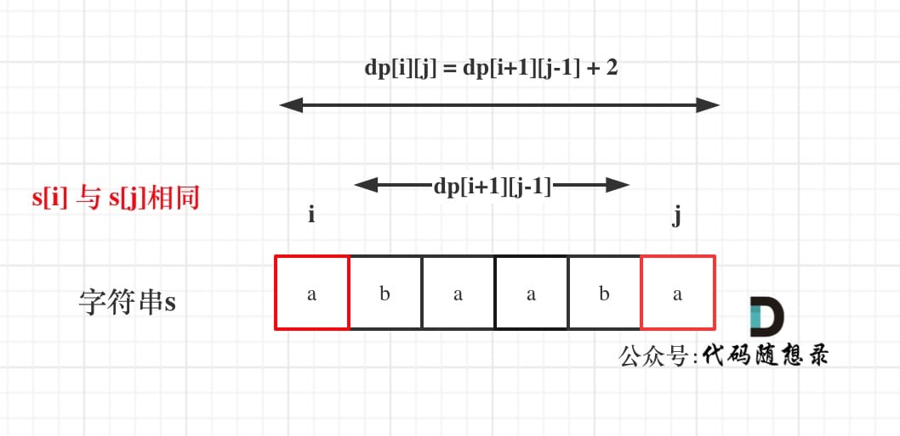
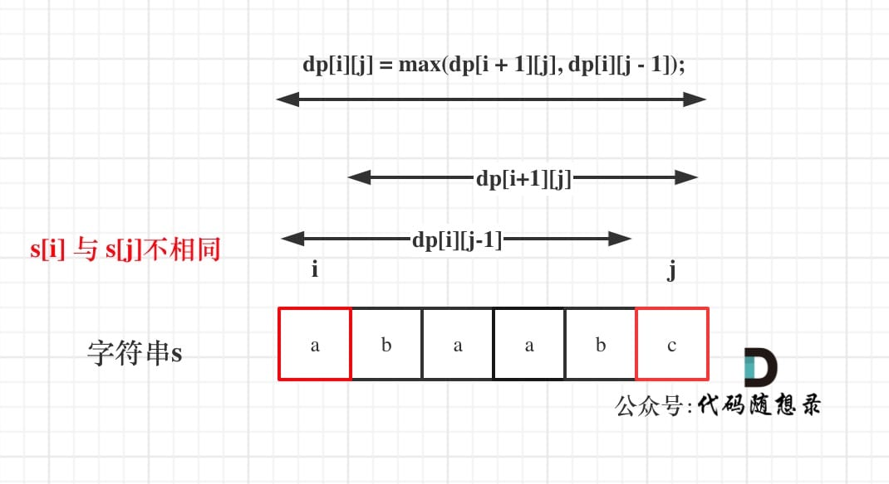
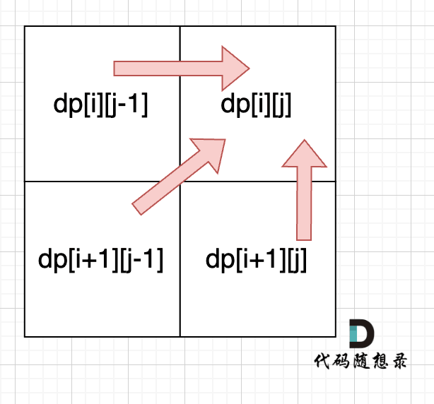
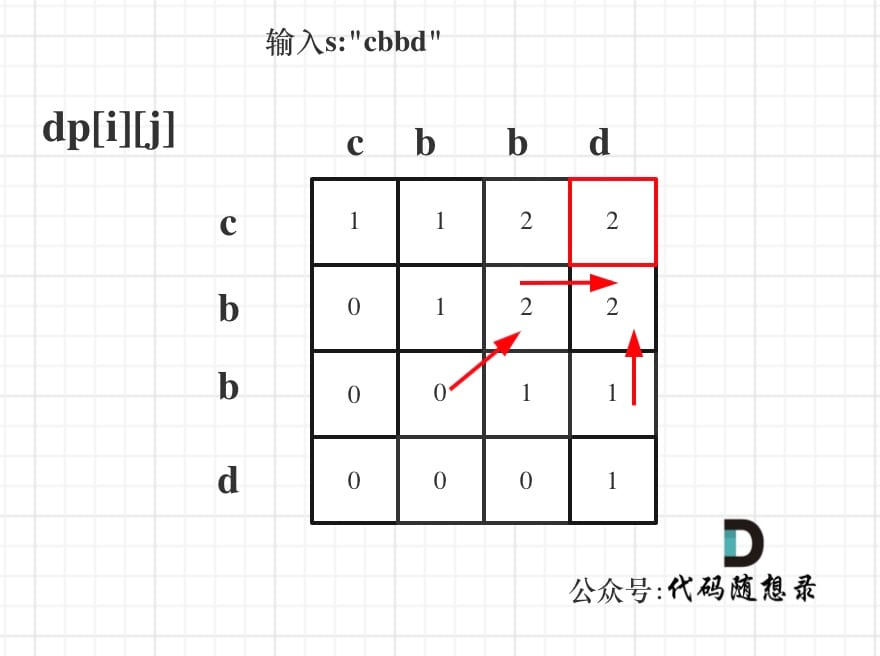

* [做專案（多個 C++、Java、Go、測試開發、前端專案）](https://www.programmercarl.com/other/kstar.html)
* [刷演算法（兩個月高強度學演算法）](https://www.programmercarl.com/xunlian/xunlianying.html)
* [背八股（40天挑戰高頻面試題）](https://www.programmercarl.com/xunlian/bagu.html)


# 516.最長回文（palindrome）次序列（subsequence）

[LeetCode 題目連結](https://leetcode.com/problems/longest-palindromic-subsequence/)

給定一個字串（string）s，找到其中最長的回文次序列，並回傳該序列（sequence）的長度。可以假設 s 的最大長度為 1000。

範例 1:
輸入: "bbbab"
輸出: 4
一個可能的最長回文次序列為 "bbbb"。

範例 2:
輸入:"cbbd"
輸出: 2
一個可能的最長回文次序列為 "bb"。

提示：

* 1 <= s.length <= 1000
* s 只包含小寫英文字母

## 演算法公開課

**[《程式碼隨想錄》演算法影片公開課](https://programmercarl.com/other/gongkaike.html)：[動態規劃（dynamic programming, DP）再顯神通，LeetCode：516.最長回文次序列](https://www.bilibili.com/video/BV1d8411K7W6/)，相信結合影片再看本篇題解，更有助於大家對本題的理解**。


## 想法

我們剛剛做過了 [動態規劃：回文子字串（substring）](./0647.回文子字串.md)，求的是回文子字串，而本題要求的是回文次序列，要搞清楚這兩者之間的區別。

**回文子字串是要連續的，回文次序列可不是連續的！** 回文子字串，回文次序列都是動態規劃（dynamic programming, DP）經典題目。

回文子字串，可以做這兩題：

* 647.回文子字串
* 5.最長回文子字串

想法其實是差不多的，但本題要比求回文子字串簡單一點，因為情況少了一點。

DP五部曲分析如下：

1. 確定 dp 陣列（array）（dp table）以及下標（subscript）的含義

**dp[i][j]：字串 s 在 [i, j] 範圍內最長的回文次序列的長度為 dp[i][j]**。

2. 確定遞迴公式（recurrence formula）

在判斷回文子字串的題目中，關鍵邏輯就是看 s[i] 與 s[j] 是否相同。

如果 s[i] 與 s[j] 相同，那麼 dp[i][j] = dp[i + 1][j - 1] + 2;

如圖：


（如果這裡看不懂，回憶一下 dp[i][j] 的定義）

如果 s[i] 與 s[j] 不相同，說明 s[i] 和 s[j] 的同時加入並不能增加 [i,j] 區間（interval）回文次序列的長度，那麼分別加入 s[i]、s[j] 看看哪一個可以組成最長的回文次序列。

加入 s[j] 的回文次序列長度為 dp[i + 1][j]。

加入 s[i] 的回文次序列長度為 dp[i][j - 1]。

那麼 dp[i][j] 一定是取最大的，即：dp[i][j] = max(dp[i + 1][j], dp[i][j - 1]);



程式碼如下：

```CPP
if (s[i] == s[j]) {
    dp[i][j] = dp[i + 1][j - 1] + 2;
} else {
    dp[i][j] = max(dp[i + 1][j], dp[i][j - 1]);
}
```

3. dp 陣列如何初始化（initialization）

首先要考慮當 i 和 j 相同的情況，從遞迴公式：dp[i][j] = dp[i + 1][j - 1] + 2; 可以看出遞迴公式是計算不到 i 和 j 相同時候的情況。

所以需要手動初始化一下，當 i 與 j 相同，那麼 dp[i][j] 一定是等於 1 的，即：一個字元（character）的回文次序列長度就是 1。

其他情況 dp[i][j] 初始為 0 就行，這樣遞迴公式：dp[i][j] = max(dp[i + 1][j], dp[i][j - 1]); 中 dp[i][j] 才不會被初始值覆蓋。

```CPP
vector<vector<int>> dp(s.size(), vector<int>(s.size(), 0));
for (int i = 0; i < s.size(); i++) dp[i][i] = 1;
```

4. 確定遍歷（traversal）順序

從遞迴公式中，可以看出，dp[i][j] 依賴於 dp[i + 1][j - 1] ，dp[i + 1][j] 和 dp[i][j - 1]，如圖：



**所以遍歷 i 的時候一定要從下到上遍歷，這樣才能保證下一列的資料是經過計算的**。

j 的話，可以正常從左向右遍歷。

程式碼如下：

```CPP
for (int i = s.size() - 1; i >= 0; i--) {
    for (int j = i + 1; j < s.size(); j++) {
        if (s[i] == s[j]) {
            dp[i][j] = dp[i + 1][j - 1] + 2;
        } else {
            dp[i][j] = max(dp[i + 1][j], dp[i][j - 1]);
        }
    }
}
```

5. 舉例推導 dp 陣列

輸入 s:"cbbd" 為例，dp 陣列狀態（state）如圖：



紅色框即：dp[0][s.size() - 1]; 為最終結果。

以上分析完畢，C++ 程式碼如下：

```CPP
class Solution {
public:
    int longestPalindromeSubseq(string s) {
        vector<vector<int>> dp(s.size(), vector<int>(s.size(), 0));
        for (int i = 0; i < s.size(); i++) dp[i][i] = 1;
        for (int i = s.size() - 1; i >= 0; i--) {
            for (int j = i + 1; j < s.size(); j++) {
                if (s[i] == s[j]) {
                    dp[i][j] = dp[i + 1][j - 1] + 2;
                } else {
                    dp[i][j] = max(dp[i + 1][j], dp[i][j - 1]);
                }
            }
        }
        return dp[0][s.size() - 1];
    }
};
```
* 時間複雜度（time complexity）: O(n^2)
* 空間複雜度（space complexity）: O(n^2)


## 其他語言版本

### Java：

```java
public class Solution {
    public int longestPalindromeSubseq(String s) {
        int len = s.length();
        int[][] dp = new int[len + 1][len + 1];
        for (int i = len - 1; i >= 0; i--) { // 從後往前遍歷 保證情況不漏
            dp[i][i] = 1; // 初始化
            for (int j = i + 1; j < len; j++) {
                if (s.charAt(i) == s.charAt(j)) {
                    dp[i][j] = dp[i + 1][j - 1] + 2;
                } else {
                    dp[i][j] = Math.max(dp[i + 1][j], Math.max(dp[i][j], dp[i][j - 1]));
                }
            }
        }
        return dp[0][len - 1];
    }
}
```

### Python：

```python
class Solution:
    def longestPalindromeSubseq(self, s: str) -> int:
        dp = [[0] * len(s) for _ in range(len(s))]
        for i in range(len(s)):
            dp[i][i] = 1
        for i in range(len(s)-1, -1, -1):
            for j in range(i+1, len(s)):
                if s[i] == s[j]:
                    dp[i][j] = dp[i+1][j-1] + 2
                else:
                    dp[i][j] = max(dp[i+1][j], dp[i][j-1])
        return dp[0][-1]
```

### Go：

```Go
func longestPalindromeSubseq(s string) int {
	size := len(s)
	max := func(a, b int) int {
		if a > b {
			return a
		}
		return b
	}
	dp := make([][]int, size)
	for i := 0; i < size; i++ {
		dp[i] = make([]int, size)
		dp[i][i] = 1
	}
	for i := size - 1; i >= 0; i-- {
		for j := i + 1; j < size; j++ {
			if s[i] == s[j] {
				dp[i][j] = dp[i+1][j-1] + 2
			} else {
				dp[i][j] = max(dp[i][j-1], dp[i+1][j])
			}
		}
	}
	return dp[0][size-1]
}
```

### JavaScript：

```javascript
const longestPalindromeSubseq = (s) => {
    const strLen = s.length;
    let dp = Array.from(Array(strLen), () => Array(strLen).fill(0));

    for(let i = 0; i < strLen; i++) {
        dp[i][i] = 1;
    }

    for(let i = strLen - 1; i >= 0; i--) {
        for(let j = i + 1; j < strLen; j++) {
            if(s[i] === s[j]) {
                dp[i][j] = dp[i+1][j-1] + 2;
            } else {
                dp[i][j] = Math.max(dp[i+1][j], dp[i][j-1]);
            }
        }
    }

    return dp[0][strLen - 1];
};
```

### TypeScript：

```typescript
function longestPalindromeSubseq(s: string): number {
    /**
        dp[i][j]：[i,j]區間內，最長回文次序列的長度
     */
    const length: number = s.length;
    const dp: number[][] = new Array(length).fill(0)
        .map(_ => new Array(length).fill(0));
    for (let i = 0; i < length; i++) {
        dp[i][i] = 1;
    }
    // 由下而上，由左往右遍歷
    for (let i = length - 1; i >= 0; i--) {
        for (let j = i + 1; j < length; j++) {
            if (s[i] === s[j]) {
                dp[i][j] = dp[i + 1][j - 1] + 2;
            } else {
                dp[i][j] = Math.max(dp[i][j - 1], dp[i + 1][j]);
            }
        }
    }
    return dp[0][length - 1];
};
```

Rust:

```rust
impl Solution {
    pub fn longest_palindrome_subseq(s: String) -> i32 {
        let mut dp = vec![vec![0; s.len()]; s.len()];
        for i in (0..s.len()).rev() {
            dp[i][i] = 1;
            for j in i + 1..s.len() {
                if s[i..=i] == s[j..=j] {
                    dp[i][j] = dp[i + 1][j - 1] + 2;
                    continue;
                }
                dp[i][j] = dp[i + 1][j].max(dp[i][j - 1]);
            }
        }
        dp[0][s.len() - 1]
    }
}
```


