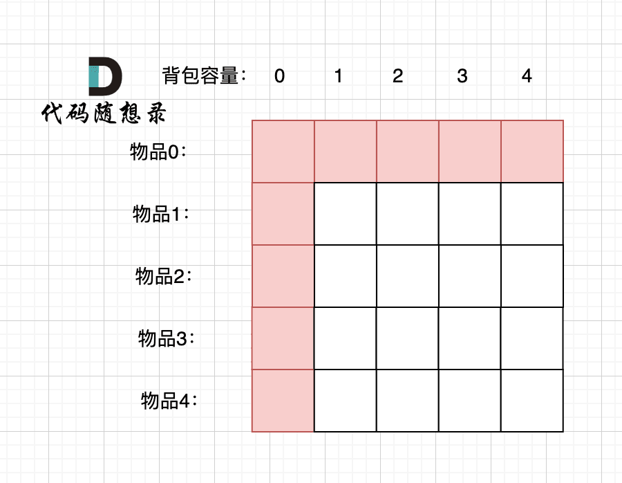
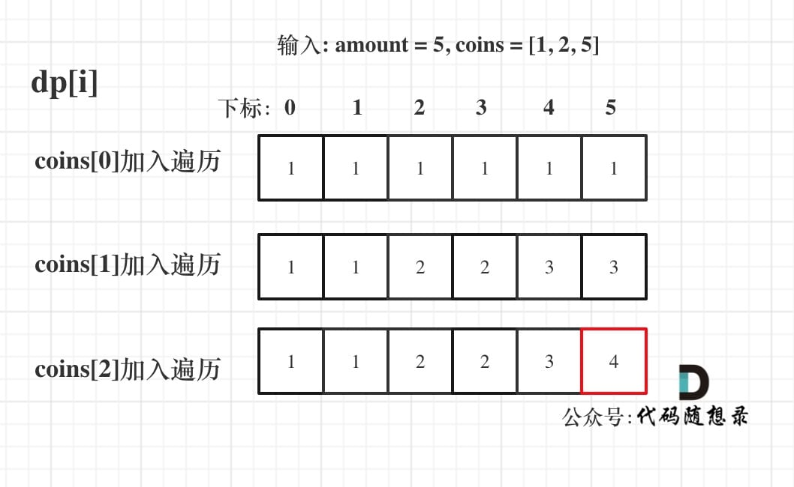

* [做專案（多個 C++、Java、Go、測試開發、前端專案）](https://www.programmercarl.com/other/kstar.html)
* [刷演算法（algorithm）（兩個月高強度學演算法）](https://www.programmercarl.com/xunlian/xunlianying.html)
* [背八股（40天挑戰高頻面試題）](https://www.programmercarl.com/xunlian/bagu.html)

# 518.零錢兌換 II

[LeetCode 題目連結](https://leetcode.cn/problems/coin-change-ii/)

給定不同面額的硬幣和一個總金額。寫出函式（function）來計算可以湊成總金額的硬幣組合（combination）數。假設每一種面額的硬幣有無限個。

範例 1:

* 輸入: amount = 5, coins = [1, 2, 5]
* 輸出: 4

解釋: 有四種方式可以湊成總金額:

* 5=5
* 5=2+2+1
* 5=2+1+1+1
* 5=1+1+1+1+1

範例 2:

* 輸入: amount = 3, coins = [2]
* 輸出: 0
* 解釋: 只用面額 2 的硬幣不能湊成總金額 3。

範例 3:

* 輸入: amount = 10, coins = [10]
* 輸出: 1

注意，你可以假設：

* 0 <= amount (總金額) <= 5000
* 1 <= coin (硬幣面額) <= 5000
* 硬幣種類不超過 500 種
* 結果符合 32 位元（bit）帶正負號整數（signed integer）

## 演算法公開課

**[《程式碼隨想錄》演算法影片公開課](https://programmercarl.com/other/gongkaike.html)：[裝滿背包有多少種方法？組合與排列（permutation）有講究！| LeetCode：518.零錢兌換 II](https://www.bilibili.com/video/BV1KM411k75j/)，相信結合影片再看本篇題解，更有助於大家對本題的理解**。

## 二維（two-dimensional）dp 講解

如果大家認真做完：[分割等和子集（subset）](https://www.programmercarl.com/0416.%E5%88%86%E5%89%B2%E7%AD%89%E5%92%8C%E5%AD%90%E9%9B%86.html) ， [最後一塊石頭的重量 II](https://www.programmercarl.com/1049.%E6%9C%80%E5%90%8E%E4%B8%80%E5%9D%97%E7%9F%B3%E5%A4%B4%E7%9A%84%E9%87%8D%E9%87%8FII.html) 和 [目標和](https://www.programmercarl.com/0494.%E7%9B%AE%E6%A0%87%E5%92%8C.html)

應該會知道類似這種題目：給出一個總數，一些物品，問能否湊成這個總數。

這是典型的背包問題（knapsack problem）！

本題求的是裝滿這個背包的物品組合數是多少。

因為每一種面額的硬幣有無限個，所以這是無界背包問題（unbounded knapsack problem）。

對無界背包問題還不了解的同學，可以看這篇：[無界背包問題理論基礎](https://programmercarl.com/背包问题理论基础完全背包.html)

但本題和純無界背包問題不一樣，**純無界背包問題是湊成背包最大價值是多少，而本題是要求湊成總金額的物品組合個數！**

注意題目描述中是湊成總金額的硬幣組合數，為什麼強調是組合數呢？

例如範例一：

5 = 2 + 2 + 1

5 = 2 + 1 + 2

這是一種組合，都是 2 2 1。

如果問的是排列數，那麼上面就是兩種排列了。

**組合不強調元素（element）之間的順序，排列強調元素之間的順序**。其實這一點我們在講解回溯（backtracking）演算法專題的時候就講過。

那我為什麼要介紹這些呢，因為這和下文講解遍歷（traversal）順序息息相關！

本題其實與我們講過 [494. 目標和](https://programmercarl.com/0494.目标和.html) 十分類似。

[494. 目標和](https://programmercarl.com/0494.目标和.html) 求的是裝滿背包有多少種方法，而本題是求裝滿背包有多少種組合。

這有啥區別？

**求裝滿背包有幾種方法其實就是求組合數**。不過 [494. 目標和](https://programmercarl.com/0494.目标和.html) 是 0/1 背包問題（0/1 knapsack problem），即每一類物品只有一個。

以下動態規劃（dynamic programming, DP）五部曲：

### 1、確定 dp 陣列（array）以及下標（subscript）的含義 

定義二維 dp 陣列 dp[i][j]：使用下標為 [0, i] 的 coins[i] 能夠湊滿 j（包括 j）這麼大容量的包，有 dp[i][j] 種組合方法。

很多讀者也會疑惑，憑什麼上來就定義 dp 陣列，思考過程是什麼樣的，這個思考過程我在 [0/1 背包問題理論基礎（二維（2D）陣列）](https://programmercarl.com/背包理论基础01背包-1.html) 中的「確定 dp 陣列以及下標的含義」有詳細講解。

（**強烈建議按照程式碼隨想錄的順序學習，否則可能看不懂我的講解**）


### 2、確定遞迴公式（recurrence formula）

> **注意**：這裡的公式推導，與之前講解過的 [494. 目標和](https://programmercarl.com/0494.目标和.html) 、[無界背包問題理論基礎](https://programmercarl.com/背包问题理论基础完全背包.html) 有極大重複，所以我不再重複講解原理，而是只講解區別。

我們再回顧一下，[0/1 背包問題理論基礎](https://programmercarl.com/背包理论基础01背包-1.html)中二維 DP 陣列的遞迴公式為：

`dp[i][j] = max(dp[i - 1][j], dp[i - 1][j - weight[i]] + value[i])` 

在 [無界背包問題理論基礎](https://programmercarl.com/背包问题理论基础完全背包.html) 詳細講解了無界背包問題二維 DP 陣列的遞迴公式為：

`dp[i][j] = max(dp[i - 1][j], dp[i][j - weight[i]] + value[i])`


看出無界背包問題和 0/1 背包問題的差別在哪裡？

在於 0/1 背包問題是 `dp[i - 1][j - weight[i]] + value[i]` ，無界背包問題是 `dp[i][j - weight[i]] + value[i])` 

主要原因就是無界背包問題單類物品有無限個。

具體原因我在 [無界背包問題理論基礎（二維）](https://programmercarl.com/背包问题理论基础完全背包.html) 的「確定遞迴公式」有詳細講解，如果大家忘了，再回顧一下。

我上面有說過，本題和 [494. 目標和](https://programmercarl.com/0494.目标和.html) 是一樣的，唯一區別就是 [494. 目標和](https://programmercarl.com/0494.目标和.html) 是 0/1 背包問題，本題是無界背包問題。


在[494. 目標和](https://programmercarl.com/0494.目标和.html)中詳細講解了裝滿背包有幾種方法，二維 DP 陣列的遞迴公式：
`dp[i][j] = dp[i - 1][j] + dp[i - 1][j - nums[i]]`

所以本題遞迴公式：`dp[i][j] = dp[i - 1][j] + dp[i][j - nums[i]]` ，區別依然是 `dp[i - 1][j - nums[i]]` 和 `dp[i][j - nums[i]]` 

這個「所以」我省略了很多推導的內容，因為這些內容在 [494. 目標和](https://programmercarl.com/0494.目标和.html) 和 [無界背包問題理論基礎](https://programmercarl.com/背包问题理论基础完全背包.html) 都詳細講過。

這裡不再重複講解。

大家主要疑惑點

1、 `dp[i][j] = dp[i - 1][j] + dp[i][j - nums[i]]` 這個遞迴公式框架（framework）怎麼來的，在 [494. 目標和](https://programmercarl.com/0494.目标和.html) 有詳細講解。

2、為什麼是 `dp[i][j - nums[i]]` 而不是 `dp[i - 1][j - nums[i]]` ，在[無界背包問題理論基礎（二維）](https://programmercarl.com/背包问题理论基础完全背包.html) 有詳細講解 


### 3. dp 陣列如何初始化（initialization） 

那麼二維陣列的最上列（row）和最左行（column）一定要初始化，這是遞迴公式推導的基礎，如圖紅色部分：

  


這裡首先要關注的就是 dp[0][0] 應該是多少？

背包空間為 0，裝滿「物品 0」的組合數有多少呢？

應該是 1 個（空集合，裝 0 個物品 0），但如果「物品 0」的數值就是 0 呢？豈不是可以有無限個 0 組合和為 0！

題目描述中說了 `1 <= coins[i] <= 5000` ，所以不用考慮物品數值為 0 的情況。

那麼最上列 dp[0][j] 如何初始化呢？

dp[0][j] 的含義：用「物品 0」（即 coins[0]）裝滿背包容量為 j 的背包，有幾種組合方法。（如果看不懂 dp 陣列的含義，建議先學習[494. 目標和](https://programmercarl.com/0494.目标和.html)）

如果 j 可以整除物品 0，那麼裝滿背包就有 1 種組合方法。

初始化程式碼：

```CPP 
for (int j = 0; j <= bagSize; j++) {
    if (j % coins[0] == 0) dp[0][j] = 1;
}
```

最左行如何初始化呢？

dp[i][0] 的含義：用物品 i（即 coins[i]）裝滿容量為 0 的背包有幾種組合方法。

都有一種方法，即不裝。

所以 dp[i][0] 都初始化為 1

### 4. 確定遍歷順序 

二維 DP 陣列的無界背包問題的兩個 for 迴圈（for-loop）先後順序是無所謂的。

先遍歷背包，還是先遍歷物品都是可以的。

原理和 [0/1 背包問題理論基礎（二維陣列）](https://programmercarl.com/背包理论基础01背包-1.html) 中的「遍歷順序」是一樣的，都是因為兩個 for 迴圈的先後順序不影響遞迴公式所需要的數值。

具體分析過程看 [0/1 背包問題理論基礎（二維陣列）](https://programmercarl.com/背包理论基础01背包-1.html) 中的「遍歷順序」

### 5. 印出 DP 陣列

以 amount 為 5，coins 為：[2,3,5] 為例：

dp 陣列應該是這樣的：

```
1 0 1 0 1 0
1 0 1 1 1 1
1 0 1 1 1 2
```

### 程式碼實作： 

```CPP 
class Solution {
public:
    int change(int amount, vector<int>& coins) {
        int bagSize = amount;

        vector<vector<uint64_t>> dp(coins.size(), vector<uint64_t>(bagSize + 1, 0));

        // 初始化最上列
        for (int j = 0; j <= bagSize; j++) {
            if (j % coins[0] == 0) dp[0][j] = 1;
        }
        // 初始化最左行
        for (int i = 0; i < coins.size(); i++) {
            dp[i][0] = 1;
        }
        // 以下遍歷順序行列可以顛倒
        for (int i = 1; i < coins.size(); i++) { // 列，遍歷物品
            for (int j = 0; j <= bagSize; j++) { // 行，遍歷背包
                if (coins[i] > j) dp[i][j] = dp[i - 1][j]; 
                else dp[i][j] = dp[i - 1][j] +  dp[i][j - coins[i]];
            }
        }
        return dp[coins.size() - 1][bagSize];
    }
};
```

## 一維（one dimensional）dp 講解 

### 1、確定 dp 陣列以及下標的含義 

dp[j]：湊成總金額 j 的貨幣組合數為 dp[j]

### 2、確定遞迴公式

本題二維 dp 遞迴公式：`dp[i][j] = dp[i - 1][j] + dp[i][j - coins[i]]` 

壓縮成一維：`dp[j] += dp[j - coins[i]]` 

這個遞迴公式大家應該不陌生了，我在講解 0/1 背包問題題目的時候在這篇[494. 目標和](https://programmercarl.com/0494.目标和.html)中就講解了，求裝滿背包有幾種方法，公式都是：`dp[j] += dp[j - nums[i]]`

### 3. dp 陣列如何初始化 

裝滿背包容量為 0 的方法是 1，即不放任何物品，`dp[0] = 1`

### 4. 確定遍歷順序 


本題中我們是外層 for 迴圈遍歷物品（錢幣），內層 for 遍歷背包（金錢總額），還是外層 for 遍歷背包（金錢總額），內層 for 迴圈遍歷物品（錢幣）呢？

我在[無界背包問題（一維 DP）](./背包問題完全背包一維.md)中講解了無界背包問題的兩個 for 迴圈的先後順序都是可以的。

**但本題就不行了！**

因為純無界背包問題求得裝滿背包的最大價值是多少，和湊成總和的元素有沒有順序沒關係，即：有順序也行，沒有順序也行！

而本題要求湊成總和的組合數，元素之間明確要求沒有順序。

所以純無界背包問題是能湊成總和就行，不用管怎麼湊的。

本題是求湊出來的方案個數，且每個方案個數是組合數。

那麼本題，兩個 for 迴圈的先後順序可就有講究了。

我們先來看外層 for 迴圈遍歷物品（錢幣），內層 for 遍歷背包（金錢總額）的情況。

程式碼如下：

```CPP
for (int i = 0; i < coins.size(); i++) { // 遍歷物品
    for (int j = coins[i]; j <= amount; j++) { // 遍歷背包容量
        dp[j] += dp[j - coins[i]];
    }
}
```

假設：coins[0] = 1，coins[1] = 5。

那麼就是先把 1 加入計算，然後再把 5 加入計算，得到的方法數量只有 {1, 5} 這種情況。而不會出現 {5, 1} 的情況。

**所以這種遍歷順序中 dp[j] 裡計算的是組合數！**

如果把兩個 for 交換順序，程式碼如下：

```CPP
for (int j = 0; j <= amount; j++) { // 遍歷背包容量
    for (int i = 0; i < coins.size(); i++) { // 遍歷物品
        if (j - coins[i] >= 0) dp[j] += dp[j - coins[i]];
    }
}
```

背包容量的每一個值，都是經過 1 和 5 的計算，包含了 {1, 5} 和 {5, 1} 兩種情況。

**此時 dp[j] 裡算出來的就是排列數！**

可能這裡很多同學還不是很理解，**建議動手把這兩種方案的 dp 陣列數值變化印出來，對比看一看！（實踐出真知）**

### 5. 舉例推導 dp 陣列

輸入: amount = 5, coins = [1, 2, 5] ，dp 狀態（state）圖如圖：



最後紅色框 dp[amount] 為最終結果。

以上分析完畢，C++ 程式碼如下：

```CPP
class Solution {
public:
    int change(int amount, vector<int>& coins) {
        vector<uint64_t> dp(amount + 1, 0); // 防止相加資料超 int
        dp[0] = 1; // 只有一種方式達到 0
        for (int i = 0; i < coins.size(); i++) { // 遍歷物品
            for (int j = coins[i]; j <= amount; j++) { // 遍歷背包
                dp[j] += dp[j - coins[i]];
            }
        }
        return dp[amount]; // 回傳組合數
    }
};
```

C++ 測試案例（test case）有兩個數相加超過 int 的資料，所以需要在 if 裡加上 dp[i] < INT_MAX - dp[i - num]。

* 時間複雜性（time complexity）: O(mn)，其中 m 是 amount，n 是 coins 的長度
* 空間複雜度（space complexity）: O(m)

為了防止相加的資料超過 int 也可以這麼寫：

```CPP
class Solution {
public:
    int change(int amount, vector<int>& coins) {
        vector<int> dp(amount + 1, 0);
        dp[0] = 1; // 只有一種方式達到 0
        for (int i = 0; i < coins.size(); i++) { // 遍歷物品
            for (int j = coins[i]; j <= amount; j++) { // 遍歷背包
                if (dp[j] < INT_MAX - dp[j - coins[i]]) { //防止相加資料超 int
                    dp[j] += dp[j - coins[i]];
                }
            }
        }
        return dp[amount]; // 回傳組合數
    }
};
```


## 總結

本題我們從二維分析到一維。

大家在剛開始學習的時候，從二維開始學習容易理解。

之後，推薦大家直接掌握一維的寫法，熟練後更容易寫出來。

本題中，二維 dp 主要是就要想清楚和我們之前講解的 [0/1 背包問題理論基礎](https://programmercarl.com/背包理论基础01背包-1.html)、[494. 目標和](https://programmercarl.com/0494.目标和.html)、 [無界背包問題理論基礎](https://programmercarl.com/背包问题理论基础完全背包.html) 聯繫與區別。

這也是程式碼隨想錄安排刷題順序的精髓所在。

本題的一維 dp 中，難點在於理解遍歷順序。

在求裝滿背包有幾種方案的時候，認清遍歷順序是非常關鍵的。

**如果求組合數就是外層 for 迴圈遍歷物品，內層 for 遍歷背包**。

**如果求排列數就是外層 for 遍歷背包，內層 for 迴圈遍歷物品**。

可能說到排列數讀者們已經有點懵了，後面我還會安排求排列數的題目，到時候再對比一下，大家就會發現神奇所在！


## 其他語言版本

### Java：

```Java
class Solution {
    public int change(int amount, int[] coins) {
        //遞迴表達式
        int[] dp = new int[amount + 1];
        //初始化 dp 陣列，表示金額為 0 時只有一種情況，也就是什麼都不裝
        dp[0] = 1;
        for (int i = 0; i < coins.length; i++) {
            for (int j = coins[i]; j <= amount; j++) {
                dp[j] += dp[j - coins[i]];
            }
        }
        return dp[amount];
    }
}
```
```Java
// 二維 dp 陣列版本，方便理解
class Solution {
    public int change(int amount, int[] coins) {
        int[][] dp = new int[coins.length][amount+1];

        // 初始化邊界值
        for(int i = 0; i < coins.length; i++){
            // 第一行的初始值為 1
            dp[i][0] = 1;
        }
        for(int j = coins[0]; j <= amount; j++){
            // 初始化第一列
            dp[0][j] += dp[0][j-coins[0]];
        }
        
        for(int i = 1; i < coins.length; i++){
            for(int j = 1; j <= amount; j++){
                if(j < coins[i]) dp[i][j] = dp[i-1][j];
                else dp[i][j] = dp[i][j-coins[i]] + dp[i-1][j];
            }
        }

        return dp[coins.length-1][amount];
    }
}
```

### Python：


```python
class Solution:
    def change(self, amount: int, coins: List[int]) -> int:
        dp = [0]*(amount + 1)
        dp[0] = 1
        # 遍歷物品
        for i in range(len(coins)):
            # 遍歷背包
            for j in range(coins[i], amount + 1):
                dp[j] += dp[j - coins[i]]
        return dp[amount]
```


### Go：

一維 dp
```go
func change(amount int, coins []int) int {
	// 定義 dp 陣列
	dp := make([]int, amount+1)
	// 初始化, 0 大小的背包, 當然是不裝任何東西了, 就是 1 種方法
	dp[0]  = 1
	// 遍歷順序
	// 遍歷物品
	for i := 0 ;i < len(coins);i++ {
		// 遍歷背包
		for j:= coins[i] ; j <= amount ;j++ {
			// 推導公式
			dp[j] += dp[j-coins[i]]
		}
	}
	return dp[amount]
}
```
二維 dp
```go
func change(amount int, coins []int) int {
    dp := make([][]int, len(coins))
    for i := range dp {
        dp[i] = make([]int, amount + 1)
        dp[i][0] = 1
    }
    for j := coins[0]; j <= amount; j++ {
        dp[0][j] += dp[0][j-coins[0]]
    }
    for i := 1; i < len(coins); i++ {
        for j := 1; j <= amount; j++ {
            if j < coins[i] {
                dp[i][j] = dp[i-1][j]
            } else {
                dp[i][j] = dp[i][j-coins[i]] + dp[i-1][j]
            }
        }
    }
    return dp[len(coins)-1][amount]
}
```

### Rust:

```rust
impl Solution {
    pub fn change(amount: i32, coins: Vec<i32>) -> i32 {
        let amount = amount as usize;
        let mut dp = vec![0; amount + 1];
        dp[0] = 1;
        for coin in coins {
            for j in coin as usize..=amount {
                dp[j] += dp[j - coin as usize];
            }
        }
        dp[amount]
    }
}
```

### JavaScript：

```javascript
const change = (amount, coins) => {
    let dp = Array(amount + 1).fill(0);
    dp[0] = 1;

    for(let i =0; i < coins.length; i++) {
        for(let j = coins[i]; j <= amount; j++) {
            dp[j] += dp[j - coins[i]];
        }
    }

    return dp[amount];
}
```

### TypeScript：

```typescript
function change(amount: number, coins: number[]): number {
    const dp: number[] = new Array(amount + 1).fill(0);
    dp[0] = 1;
    for (let i = 0, length = coins.length; i < length; i++) {
        for (let j = coins[i]; j <= amount; j++) {
            dp[j] += dp[j - coins[i]];
        }
    }
    return dp[amount];
};
```

### Scala:

```scala
object Solution {
  def change(amount: Int, coins: Array[Int]): Int = {
    var dp = new Array[Int](amount + 1)
    dp(0) = 1
    for (i <- 0 until coins.length) {
      for (j <- coins(i) to amount) {
        dp(j) += dp(j - coins(i))
      }
    }
    dp(amount)
  }
}
```
### C

```c
int change(int amount, int* coins, int coinsSize) {
    int dp[amount + 1];
    memset(dp, 0, sizeof (dp));
    dp[0] = 1;
    // 遍歷物品
    for(int i = 0; i < coinsSize; i++){
        // 遍歷背包
        for(int j = coins[i]; j <= amount; j++){
            dp[j] += dp[j - coins[i]];
        }
    }
    return dp[amount];
}
```


### C#

```csharp
public class Solution
{
    public int Change(int amount, int[] coins)
    {
        int[] dp = new int[amount + 1];
        dp[0] = 1;
        for (int i = 0; i < coins.Length; i++)
        {
            for (int j = coins[i]; j <= amount; j++)
            {
                if (j >= coins[i])
                    dp[j] += dp[j - coins[i]];
            }
        }
        return dp[amount];
    }
}
```


