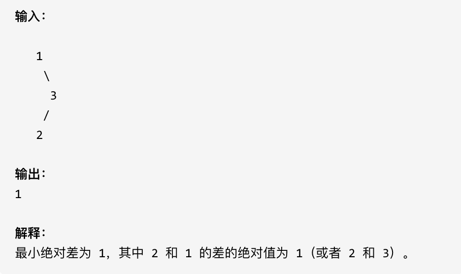
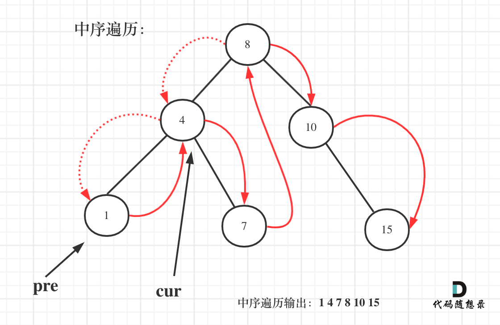

* [做專案（多個 C++、Java、Go、測試開發、前端專案）](https://www.programmercarl.com/other/kstar.html)
* [刷演算法（algorithm）（兩個月高強度學演算法）](https://www.programmercarl.com/xunlian/xunlianying.html)
* [背八股（40天挑戰高頻面試題）](https://www.programmercarl.com/xunlian/bagu.html)


> 利用二元搜尋樹（binary search tree, BST）的特性搞起！

# 530.二元搜尋樹的最小絕對差

[LeetCode 題目連結](https://leetcode.cn/problems/minimum-absolute-difference-in-bst/)

給你一棵所有節點（node）為非負值的二元搜尋樹，請你計算樹（tree）中任意兩節點的差的絕對值（absolute value）的最小值。

範例：



提示：樹中至少有 2 個節點。

## 演算法公開課

**[《程式碼隨想錄》演算法影片公開課](https://programmercarl.com/other/gongkaike.html)：[二元搜尋樹中，需要掌握如何 two pointers 遍歷（traversal）！| LeetCode：530.二元搜尋樹的最小絕對差](https://www.bilibili.com/video/BV1DD4y11779)，相信結合影片再看本篇題解，更有助於大家對本題的理解**。


## 想法

題目中要求在二元搜尋樹上任意兩節點的差的絕對值的最小值。

**注意是二元搜尋樹**，二元搜尋樹可是有序（ordered）的。

遇到在二元搜尋樹上求什麼最值啊，差值之類的，就把它想成在一個有序陣列（ordered array）上求最值，求差值，這樣就簡單多了。

### 遞迴（recursion）

那麼二元搜尋樹採用中序橫過（inorder traversal），其實就是一個有序陣列。

**在一個有序陣列上求兩個數最小差值，這是不是就是一道送分題了。**

最直觀的想法，就是把二元搜尋樹轉換成有序陣列，然後遍歷一遍陣列（array），就統計出來最小差值了。

程式碼如下：

```CPP
class Solution {
private:
vector<int> vec;
void traversal(TreeNode* root) {
    if (root == NULL) return;
    traversal(root->left);
    vec.push_back(root->val); // 將二元搜尋樹轉換為有序陣列
    traversal(root->right);
}
public:
    int getMinimumDifference(TreeNode* root) {
        vec.clear();
        traversal(root);
        if (vec.size() < 2) return 0;
        int result = INT_MAX;
        for (int i = 1; i < vec.size(); i++) { // 統計有序陣列的最小差值
            result = min(result, vec[i] - vec[i-1]);
        }
        return result;
    }
};
```

以上程式碼是把二元搜尋樹轉化為有序陣列了，其實在二元搜尋樹中序橫過的過程中，我們就可以直接計算了。

需要用一個 pre 節點記錄一下 cur 節點的前一個節點。

如圖：



一些同學不知道在遞迴中如何記錄前一個節點的指標（pointer），其實實作起來是很簡單的，大家只要看過一次，寫過一次，就掌握了。

程式碼如下：

```CPP
class Solution {
private:
int result = INT_MAX;
TreeNode* pre = NULL;
void traversal(TreeNode* cur) {
    if (cur == NULL) return;
    traversal(cur->left);   // 左
    if (pre != NULL){       // 中
        result = min(result, cur->val - pre->val);
    }
    pre = cur; // 記錄前一個
    traversal(cur->right);  // 右
}
public:
    int getMinimumDifference(TreeNode* root) {
        traversal(root);
        return result;
    }
};
```

是不是看上去也並不複雜！

### 疊代（iteration）

看過這兩篇[二元樹（binary tree）：聽說遞迴能做的，堆疊（stack）也能做！](https://programmercarl.com/二叉树的迭代遍历.html)，[二元樹：前中後序疊代方式的寫法就不能統一一下麼？](https://programmercarl.com/二叉树的统一迭代法.html)文章之後，不難寫出兩種中序橫過的疊代法。

下面我給出其中的一種中序橫過的疊代法，程式碼如下：

```CPP
class Solution {
public:
    int getMinimumDifference(TreeNode* root) {
        stack<TreeNode*> st;
        TreeNode* cur = root;
        TreeNode* pre = NULL;
        int result = INT_MAX;
        while (cur != NULL || !st.empty()) {
            if (cur != NULL) { // 指標來存取節點，存取到最底層
                st.push(cur); // 將存取的節點放進堆疊
                cur = cur->left;                // 左
            } else {
                cur = st.top();
                st.pop();
                if (pre != NULL) {              // 中
                    result = min(result, cur->val - pre->val);
                }
                pre = cur;
                cur = cur->right;               // 右
            }
        }
        return result;
    }
};
```

## 總結

**遇到在二元搜尋樹上求什麼最值，求差值之類的，都要思考一下二元搜尋樹可是有序的，要利用好這一特點。**

同時要學會在遞迴遍歷的過程中如何記錄前後兩個指標，這也是一個小技巧，學會了還是很受用的。

後面我將繼續介紹一系列利用二元搜尋樹特性的題目。


## 其他語言版本


### Java 

遞迴
```java
class Solution {
    TreeNode pre; // 記錄上一個遍歷的節點
    int result = Integer.MAX_VALUE;

    public int getMinimumDifference(TreeNode root) {
        if (root == null)
            return 0;
        traversal(root);
        return result;
    }

    public void traversal(TreeNode root) {
        if (root == null)
            return;
        // 左
        traversal(root.left);
        // 中
        if (pre != null) {
            result = Math.min(result, root.val - pre.val);
        }
        pre = root;
        // 右
        traversal(root.right);
    }
}
```
統一疊代法-中序橫過
```Java
class Solution {
    public int getMinimumDifference(TreeNode root) {
        Stack<TreeNode> stack = new Stack<>();
        TreeNode pre = null;
        int result = Integer.MAX_VALUE;

        if (root != null)
            stack.add(root);

        // 中序橫過（左中右），由於堆疊先進後出，反序（右中左）
        while (!stack.isEmpty()) {
            TreeNode curr = stack.peek();
            if (curr != null) {
                stack.pop();
                // 右
                if (curr.right != null)
                    stack.add(curr.right);
                // 中（先用 null 標記）
                stack.add(curr);
                stack.add(null);
                // 左
                if (curr.left != null)
                    stack.add(curr.left);
            } else { // 中（遇到 null 再處理）
                stack.pop();
                TreeNode temp = stack.pop();
                if (pre != null)
                    result = Math.min(result, temp.val - pre.val);
                pre = temp;
            }
        }
        return result;
    }
}
```

疊代法-中序橫過

```java
class Solution {
    TreeNode pre;
    Stack<TreeNode> stack;
    public int getMinimumDifference(TreeNode root) {
        if (root == null) return 0;
        stack = new Stack<>();
        TreeNode cur = root;
        int result = Integer.MAX_VALUE;
        while (cur != null || !stack.isEmpty()) {
            if (cur != null) {
                stack.push(cur); // 將存取的節點放進堆疊
                cur = cur.left; // 左
            }else {
                cur = stack.pop(); 
                if (pre != null) { // 中
                    result = Math.min(result, cur.val - pre.val);
                }
                pre = cur;
                cur = cur.right; // 右
            }
        }
        return result;
    }
}
```
### Python 

遞迴法（版本一）利用中序遞增，結合陣列
```python
class Solution:
    def __init__(self):
        self.vec = []

    def traversal(self, root):
        if root is None:
            return
        self.traversal(root.left)
        self.vec.append(root.val)  # 將二元搜尋樹轉換為有序陣列
        self.traversal(root.right)

    def getMinimumDifference(self, root):
        self.vec = []
        self.traversal(root)
        if len(self.vec) < 2:
            return 0
        result = float('inf')
        for i in range(1, len(self.vec)):
            # 統計有序陣列的最小差值
            result = min(result, self.vec[i] - self.vec[i - 1])
        return result

```


遞迴法（版本二）利用中序遞增，找到該樹最小值
```python 
class Solution:
    def __init__(self):
        self.result = float('inf')
        self.pre = None

    def traversal(self, cur):
        if cur is None:
            return
        self.traversal(cur.left)  # 左
        if self.pre is not None:  # 中
            self.result = min(self.result, cur.val - self.pre.val)
        self.pre = cur  # 記錄前一個
        self.traversal(cur.right)  # 右

    def getMinimumDifference(self, root):
        self.traversal(root)
        return self.result

        
```

疊代法
```python 
class Solution:
    def getMinimumDifference(self, root):
        stack = []
        cur = root
        pre = None
        result = float('inf')

        while cur is not None or len(stack) > 0:
            if cur is not None:
                stack.append(cur)  # 將存取的節點放進堆疊
                cur = cur.left  # 左
            else:
                cur = stack.pop()
                if pre is not None:  # 中
                    result = min(result, cur.val - pre.val)
                pre = cur
                cur = cur.right  # 右

        return result


        
```
### Go

中序橫過，然後計算最小差值
```go
// 中序橫過的同時計算最小值
func getMinimumDifference(root *TreeNode) int {
    // 保留前一個節點的指標
    var prev *TreeNode
    // 定義一個比較大的值
    min := math.MaxInt64
    var travel func(node *TreeNode)
    travel = func(node *TreeNode) {
        if node == nil {
            return 
        }
        travel(node.Left)
        if prev != nil && node.Val - prev.Val < min {
            min = node.Val - prev.Val
        }
        prev = node
        travel(node.Right)
    }
    travel(root)
    return min
}
```

### JavaScript 
遞迴 先轉換為有序陣列
```javascript
/**
 * Definition for a binary tree node.
 * function TreeNode(val, left, right) {
 *     this.val = (val===undefined ? 0 : val)
 *     this.left = (left===undefined ? null : left)
 *     this.right = (right===undefined ? null : right)
 * }
 */
/**
 * @param {TreeNode} root
 * @return {number}
 */
var getMinimumDifference = function (root) {
    let arr = [];
    const buildArr = (root) => {
        if (root) {
            buildArr(root.left);
            arr.push(root.val);
            buildArr(root.right);
        }
    }
    buildArr(root);
    let diff = arr[arr.length - 1];
    for (let i = 1; i < arr.length; ++i) {
        if (diff > arr[i] - arr[i - 1])
            diff = arr[i] - arr[i - 1];
    }
    return diff;
};
```
遞迴 在遞迴的過程中更新最小值
```js
var getMinimumDifference = function(root) {
    let res = Infinity
    let preNode = null
    // 中序橫過
    const inorder = (node) => {
        if(!node) return
        inorder(node.left)
        // 更新 res
        if(preNode) res = Math.min(res, node.val - preNode.val)
        // 記錄前一個節點         
        preNode = node
        inorder(node.right)
    }
    inorder(root)
    return res
}
```

疊代  中序橫過
```js
var getMinimumDifference = function(root) {
    let stack = []
    let cur = root
    let res = Infinity
    let pre = null
    while(cur || stack.length) {
        if(cur) {
            stack.push(cur)
            cur = cur.left
        } else {
            cur = stack.pop()
            if(pre) res = Math.min(res, cur.val - pre.val)
            pre = cur
            cur = cur.right
        }
    }
    return res
}
```

### TypeScript

> 輔助陣列解決

```typescript
function getMinimumDifference(root: TreeNode | null): number {
    let helperArr: number[] = [];
    function recur(root: TreeNode | null): void {
        if (root === null) return;
        recur(root.left);
        helperArr.push(root.val);
        recur(root.right);
    }
    recur(root);
    let resMin: number = Infinity;
    for (let i = 0, length = helperArr.length; i < length - 1; i++) {
        resMin = Math.min(resMin, helperArr[i + 1] - helperArr[i]);
    }
    return resMin;
};
```

> 遞迴中解決

```typescript
function getMinimumDifference(root: TreeNode | null): number {
    let preNode: TreeNode | null= null;
    let resMin: number = Infinity;
    function recur(root: TreeNode | null): void {
        if (root === null) return;
        recur(root.left);
        if (preNode !== null) {
            resMin = Math.min(resMin, root.val - preNode.val);
        }
        preNode = root;
        recur(root.right);
    }
    recur(root);
    return resMin;
};
```

> 疊代法-中序橫過

```typescript
function getMinimumDifference(root: TreeNode | null): number {
    const helperStack: TreeNode[] = [];
    let curNode: TreeNode | null = root;
    let resMin: number = Infinity;
    let preNode: TreeNode | null = null;
    while (curNode !== null || helperStack.length > 0) {
        if (curNode !== null) {
            helperStack.push(curNode);
            curNode = curNode.left;
        } else {
            curNode = helperStack.pop()!;
            if (preNode !== null) {
                resMin = Math.min(resMin, curNode.val - preNode.val);
            }
            preNode = curNode;
            curNode = curNode.right;
        }
    }
    return resMin;
};
```

### Scala

建構二元樹的有序陣列:

```scala
object Solution {
  import scala.collection.mutable
  def getMinimumDifference(root: TreeNode): Int = {
    val arr = mutable.ArrayBuffer[Int]()
    def traversal(node: TreeNode): Unit = {
      if (node == null) return
      traversal(node.left)
      arr.append(node.value)
      traversal(node.right)
    }
    traversal(root)
    // 在有序陣列上求最小差值
    var result = Int.MaxValue
    for (i <- 1 until arr.size) {
      result = math.min(result, arr(i) - arr(i - 1))
    }
    result // 回傳最小差值
  }
}
```

遞迴記錄前一個節點:

```scala
object Solution {
  def getMinimumDifference(root: TreeNode): Int = {
    var result = Int.MaxValue // 初始化為最大值
    var pre: TreeNode = null // 記錄前一個節點

    def traversal(cur: TreeNode): Unit = {
      if (cur == null) return
      traversal(cur.left)
      if (pre != null) {
        // 對比 result 與節點之間的差值
        result = math.min(result, cur.value - pre.value)
      }
      pre = cur
      traversal(cur.right)
    }

    traversal(root)
    result // return 關鍵字可以省略
  }
}
```

疊代解決:

```scala
object Solution {
  import scala.collection.mutable
  def getMinimumDifference(root: TreeNode): Int = {
    var result = Int.MaxValue // 初始化為最大值
    var pre: TreeNode = null // 記錄前一個節點
    var cur = root
    var stack = mutable.Stack[TreeNode]()
    while (cur != null || !stack.isEmpty) {
      if (cur != null) {
        stack.push(cur)
        cur = cur.left
      } else {
        cur = stack.pop()
        if (pre != null) {
          result = math.min(result, cur.value - pre.value)
        }
        pre = cur
        cur = cur.right
      }
    }
    result // return 關鍵字可以省略
  }
}
```

### Rust

建構二元樹的有序陣列:

```rust
use std::cell::RefCell;
use std::rc::Rc;
impl Solution {
    pub fn get_minimum_difference(root: Option<Rc<RefCell<TreeNode>>>) -> i32 {
        let mut vec = vec![];
        Self::traversal(root, &mut vec);
        let mut min = i32::MAX;
        for i in 1..vec.len() {
            min = min.min(vec[i] - vec[i - 1])
        }
        min
    }
    pub fn traversal(root: Option<Rc<RefCell<TreeNode>>>, v: &mut Vec<i32>) {
        if root.is_none() {
            return;
        }
        let node = root.as_ref().unwrap().borrow();
        Self::traversal(node.left.clone(), v);
        v.push(node.val);
        Self::traversal(node.right.clone(), v);
    }
}
```

遞迴中解決

```rust
impl Solution {
    pub fn get_minimum_difference(root: Option<Rc<RefCell<TreeNode>>>) -> i32 {
        let mut pre = None;
        let mut min = i32::MAX;
        Self::inorder(root, &mut pre, &mut min);
        min
    }
    pub fn inorder(root: Option<Rc<RefCell<TreeNode>>>, pre: &mut Option<i32>, min: &mut i32) {
        if root.is_none() {
            return;
        }
        let node = root.as_ref().unwrap().borrow();
        Self::inorder(node.left.clone(), pre, min);
        if let Some(pre) = pre {
            *min = (node.val - *pre).min(*min);
        }
        *pre = Some(node.val);

        Self::inorder(node.right.clone(), pre, min);
    }
}
```

疊代

```rust
impl Solution {
    pub fn get_minimum_difference(mut root: Option<Rc<RefCell<TreeNode>>>) -> i32 {
        if root.is_none() {
            return 0;
        }
        let mut stack = vec![];
        let mut pre = -1;
        let mut res = i32::MAX;
        while root.is_some() || !stack.is_empty() {
            while let Some(node) = root {
                root = node.borrow().left.clone();
                stack.push(node);
            }

            let node = stack.pop().unwrap();

            if pre >= 0 {
                res = res.min(node.borrow().val - pre);
            }

            pre = node.borrow().val;

            root = node.borrow().right.clone();
        }
        res
    }
}
```
### C#
```csharp
// 遞迴
public class Solution
{
    public List<int> res = new List<int>();
    public int GetMinimumDifference(TreeNode root)
    {
        Traversal(root);
        return res.SelectMany((x, i) => res.Skip(i + 1).Select(y => Math.Abs(x - y))).Min();

    }
    public void Traversal(TreeNode root)
    {
        if (root == null) return;
        Traversal(root.left);
        res.Add(root.val);
        Traversal(root.right);
    }
}
```


