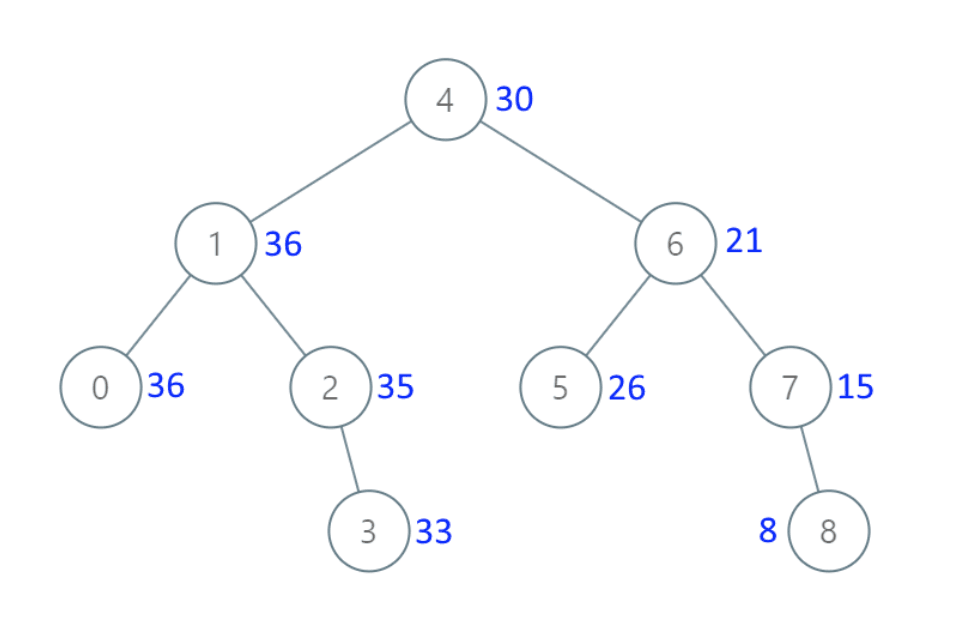
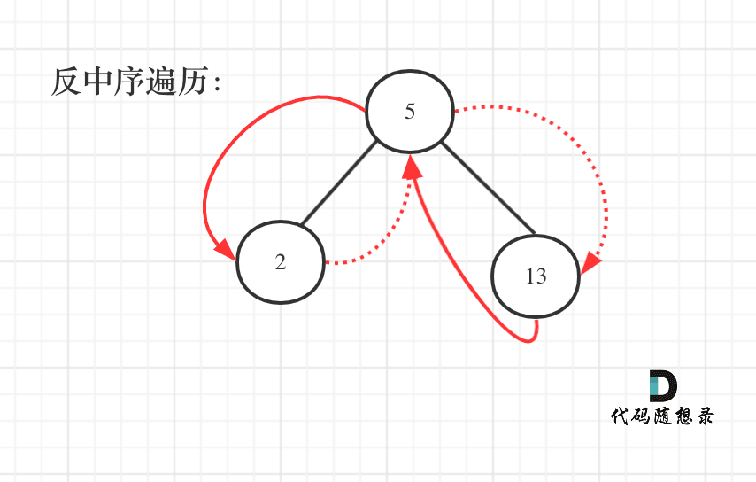

* [做專案（多個 C++、Java、Go、測試開發、前端專案）](https://www.programmercarl.com/other/kstar.html)
* [刷演算法（兩個月高強度學演算法）](https://www.programmercarl.com/xunlian/xunlianying.html)
* [背八股（40天挑戰高頻面試題）](https://www.programmercarl.com/xunlian/bagu.html)


# 538.把二元搜尋樹（binary search tree, BST）轉換為累加樹

[LeetCode 題目連結](https://leetcode.com/problems/convert-bst-to-greater-tree/)

給出二元搜尋樹（binary search tree, BST）的根節點（root node），該樹（tree）的節點（node）值各不相同，請你將其轉換為累加樹（Greater Sum Tree），使每個節點 node 的新值等於原樹中大於或等於 node.val 的值之和。

提醒一下，BST滿足下列約束條件：

節點的左子樹（left subtree）僅包含鍵（key）小於節點鍵的節點。
節點的右子樹（right subtree）僅包含鍵大於節點鍵的節點。
左右子樹也必須是BST。

範例 1：




* 輸入：[4,1,6,0,2,5,7,null,null,null,3,null,null,null,8]
* 輸出：[30,36,21,36,35,26,15,null,null,null,33,null,null,null,8]

範例 2：
* 輸入：root = [0,null,1]
* 輸出：[1,null,1]

範例 3：
* 輸入：root = [1,0,2]
* 輸出：[3,3,2]

範例 4：
* 輸入：root = [3,2,4,1]
* 輸出：[7,9,4,10]

提示：

* 樹中的節點數介於 0 和 104 之間。
* 每個節點的值介於 -104 和 104 之間。
* 樹中的所有值互不相同。
* 給定的樹為BST。

## 演算法公開課 

**[《程式碼隨想錄》演算法影片公開課](https://programmercarl.com/other/gongkaike.html)：[普天同慶！二元樹（binary tree）章節已全部更完啦！| LeetCode：538.把二元搜尋樹轉換為累加樹](https://www.bilibili.com/video/BV1d44y1f7wP?share_source=copy_web)，相信結合影片再看本篇題解，更有助於大家對本題的理解**。

## 想法

一看到累加樹，相信很多夥伴都會疑惑：如何累加？遇到一個節點，然後再遍歷（traversal）其他節點累加？怎麼一想這麼麻煩呢。

然後再發現這是一棵BST，BST啊，這是有序（ordered）的啊。

那麼有序的元素（element）如何求累加呢？

**其實這就是一棵樹，大家可能看起來有點別扭，換一個角度來看，這就是一個有序陣列（ordered array）[2, 5, 13]，求從後到前的累加陣列（array），也就是 [20, 18, 13]，是不是感覺這就簡單了。**

為什麼變成陣列就是感覺簡單了呢？

因為陣列大家都知道怎麼遍歷啊，從後向前，挨個累加就完事了，這換成了BST，看起來就別扭了一些是不是。

那麼知道如何遍歷這個二元樹，也就迎刃而解了，**從樹中可以看出累加的順序是右中左，所以我們需要反中序橫過（inorder traversal）這個二元樹，然後順序累加就可以了**。

### 遞迴（recursion）

遍歷順序如圖所示：




本題依然需要一個 pre 指標（pointer）記錄目前遍歷節點 cur 的前一個節點，這樣才方便做累加。

pre 指標的使用技巧，我們在[二元樹：搜尋樹的最小絕對差](./0530.二叉搜索樹的最小絕對差.md)和[二元樹：我的 mode 是多少？](./0501.二叉搜索樹中的眾數.md)都提到了，這是常用的操作手段。

* 遞迴函數（recursive function）參數（parameter）以及轉回值（return value）

這裡很明確了，不需要遞迴函數的轉回值做什麼操作了，要遍歷整棵樹。

同時需要定義一個全域變數（global variable）pre，用來儲存 cur 節點的前一個節點的數值，定義為 int 型就可以了。

程式碼如下：

```
int pre = 0; // 記錄前一個節點的數值
void traversal(TreeNode* cur)
```

* 確定終止條件（termination condition）

遇空就終止。

```
if (cur == NULL) return;
```

* 確定單層遞迴的邏輯

注意**要右中左來遍歷二元樹**，中節點的處理邏輯就是讓 cur 的數值加上前一個節點的數值。

程式碼如下：

```
traversal(cur->right);  // 右
cur->val += pre;        // 中
pre = cur->val;
traversal(cur->left);   // 左
```

遞迴法整體程式碼如下：

```CPP
class Solution {
private:
    int pre = 0; // 記錄前一個節點的數值
    void traversal(TreeNode* cur) { // 右中左遍歷
        if (cur == NULL) return;
        traversal(cur->right);
        cur->val += pre;
        pre = cur->val;
        traversal(cur->left);
    }
public:
    TreeNode* convertBST(TreeNode* root) {
        pre = 0;
        traversal(root);
        return root;
    }
};
```

### 疊代（iteration）法

疊代法其實就是中序模板（template）題了，在[二元樹：前中後序疊代法](./二叉樹的疊代遍歷.md)和[二元樹：前中後序統一方式疊代法](./二叉樹的統一疊代法.md)可以選一種自己習慣的寫法。

這裡我給出其中的一種，程式碼如下：

```CPP
class Solution {
private:
    int pre; // 記錄前一個節點的數值
    void traversal(TreeNode* root) {
        stack<TreeNode*> st;
        TreeNode* cur = root;
        while (cur != NULL || !st.empty()) {
            if (cur != NULL) {
                st.push(cur);
                cur = cur->right;   // 右
            } else {
                cur = st.top();     // 中
                st.pop();
                cur->val += pre;
                pre = cur->val;
                cur = cur->left;    // 左
            }
        }
    }
public:
    TreeNode* convertBST(TreeNode* root) {
        pre = 0;
        traversal(root);
        return root;
    }
};
```

## 總結

經歷了前面各種二元樹增刪改查的洗禮之後，這道題目應該比較簡單了。

**好了，二元樹已經接近尾聲了，接下來就是要對二元樹來一個大總結了**。


## 其他語言版本


### Java 
**遞迴**

```Java
class Solution {
    int sum;
    public TreeNode convertBST(TreeNode root) {
        sum = 0;
        convertBST1(root);
        return root;
    }

    // 按右中左順序遍歷，累加即可
    public void convertBST1(TreeNode root) {
        if (root == null) {
            return;
        }
        convertBST1(root.right);
        sum += root.val;
        root.val = sum;
        convertBST1(root.left);
    }
}
```
**疊代**

```Java
class Solution {
    //DFS iteraion統一疊代法
    public TreeNode convertBST(TreeNode root) {
        int pre = 0;
        Stack<TreeNode> stack = new Stack<>();
        if(root == null) //edge case check
            return null;

        stack.add(root);

        while(!stack.isEmpty()){
            TreeNode curr = stack.peek();
            //curr != null的狀況，只負責存node到stack中
            if(curr != null){ 
                stack.pop();
                if(curr.left != null)       //左
                    stack.add(curr.left);
                stack.add(curr);            //中
                stack.add(null);
                if(curr.right != null)      //右
                    stack.add(curr.right);
            }else{
            //curr == null的狀況，只負責做單層邏輯
                stack.pop();
                TreeNode temp = stack.pop();
                temp.val += pre;
                pre = temp.val;
            }
        }
        return root;
    }
}
```

### Python 
遞迴法(版本一)
```python
# Definition for a binary tree node.
# class TreeNode:
#     def __init__(self, val=0, left=None, right=None):
#         self.val = val
#         self.left = left
#         self.right = right
class Solution:
    def convertBST(self, root: TreeNode) -> TreeNode:
        self.pre = 0  # 記錄前一個節點的數值
        self.traversal(root)
        return root
    def traversal(self, cur):
        if cur is None:
            return        
        self.traversal(cur.right)
        cur.val += self.pre
        self.pre = cur.val
        self.traversal(cur.left)
    
        
```
遞迴法（版本二）
```python
# Definition for a binary tree node.
# class TreeNode:
#     def __init__(self, val=0, left=None, right=None):
#         self.val = val
#         self.left = left
#         self.right = right
class Solution:
    def __init__(self):
        self.count = 0

    def convertBST(self, root: Optional[TreeNode]) -> Optional[TreeNode]:
        if root == None:
            return 
        '''
        倒序累加替換：  
        '''
        # 右
        self.convertBST(root.right)

        # 中
        # 中節點：用目前 root 的值加上 pre 的值
        self.count += root.val

        root.val = self.count 

        # 左
        self.convertBST(root.left)

        return root 
        
```
疊代法（版本一）
```python
class Solution:
    def __init__(self):
        self.pre = 0  # 記錄前一個節點的數值
    
    def traversal(self, root):
        stack = []
        cur = root
        while cur or stack:
            if cur:
                stack.append(cur)
                cur = cur.right  # 右
            else:
                cur = stack.pop()  # 中
                cur.val += self.pre
                self.pre = cur.val
                cur = cur.left  # 左
    
    def convertBST(self, root):
        self.pre = 0
        self.traversal(root)
        return root

```
疊代法（版本二）
```python
class Solution:
    def convertBST(self, root: Optional[TreeNode]) -> Optional[TreeNode]:
        if not root: return root
        stack = []
        result = []
        cur = root
        pre = 0
        while cur or stack:
            if cur:
                stack.append(cur)
                cur = cur.right
            else: 
                cur = stack.pop()
                cur.val+= pre
                pre = cur.val
                cur =cur.left
        return root
```

### Go

弄一個 sum 暫存其和值
```go
var pre int
func convertBST(root *TreeNode) *TreeNode {
    pre = 0
    traversal(root)
    return root
}

func traversal(cur *TreeNode) {
    if cur == nil {
        return
    }
    traversal(cur.Right)
    cur.Val += pre
    pre = cur.Val
    traversal(cur.Left)
}
```

### JavaScript

遞迴
```javascript
var convertBST = function(root) {
    let pre = 0;
    const ReverseInOrder = (cur) => {
        if(cur) {
            ReverseInOrder(cur.right);
            cur.val += pre;
            pre = cur.val;
            ReverseInOrder(cur.left);
        }
    }
    ReverseInOrder(root);
    return root;
};
```

疊代
```javascript
var convertBST = function (root) {
    let pre = 0;
    let cur = root;
    let stack = [];
    while (cur !== null || stack.length !== 0) {
        while (cur !== null) {
            stack.push(cur);
            cur = cur.right;
        }
        cur = stack.pop();
        cur.val += pre;
        pre = cur.val;
        cur = cur.left;
    }
    return root;
};
```

### C

遞迴
```c
int pre;
void traversal(struct TreeNode* node) {
    if(!node)
        return ;
    traversal(node->right);
    node->val = node->val + pre;
    pre = node->val;
    traversal(node->left);
}

struct TreeNode* convertBST(struct TreeNode* root){
    pre = 0;
    traversal(root);
    return root;
}
```

### TypeScript

> 遞迴法

```typescript
function convertBST(root: TreeNode | null): TreeNode | null {
    let pre: number = 0;
    function recur(root: TreeNode | null): void {
        if (root === null) return;
        recur(root.right);
        root.val += pre;
        pre = root.val;
        recur(root.left);
    }
    recur(root);
    return root;
};
```

> 疊代法

```typescript
function convertBST(root: TreeNode | null): TreeNode | null {
    const helperStack: TreeNode[] = [];
    let curNode: TreeNode | null = root;
    let pre: number = 0;
    while (curNode !== null || helperStack.length > 0) {
        while (curNode !== null) {
            helperStack.push(curNode);
            curNode = curNode.right;
        }
        curNode = helperStack.pop()!;
        curNode.val += pre;
        pre = curNode.val;
        curNode = curNode.left;
    }
    return root;
};
```

### Scala

```scala
object Solution {
  def convertBST(root: TreeNode): TreeNode = {
    var sum = 0
    def convert(node: TreeNode): Unit = {
      if (node == null) return
      convert(node.right)
      sum += node.value
      node.value = sum
      convert(node.left)
    }
    convert(root)
    root
  }
}
```

### Rust

遞迴：

```rust
impl Solution {
    pub fn convert_bst(root: Option<Rc<RefCell<TreeNode>>>) -> Option<Rc<RefCell<TreeNode>>> {
        let mut pre = 0;
        Self::traversal(&root, &mut pre);
        root
    }

    pub fn traversal(cur: &Option<Rc<RefCell<TreeNode>>>, pre: &mut i32) {
        if cur.is_none() {
            return;
        }
        let mut node = cur.as_ref().unwrap().borrow_mut();
        Self::traversal(&node.right, pre);
        *pre += node.val;
        node.val = *pre;
        Self::traversal(&node.left, pre);
    }
}
```

疊代：

```rust
impl Solution {
    pub fn convert_bst(root: Option<Rc<RefCell<TreeNode>>>) -> Option<Rc<RefCell<TreeNode>>> {
        let mut cur = root.clone();
        let mut stack = vec![];
        let mut pre = 0;
        while !stack.is_empty() || cur.is_some() {
            while let Some(node) = cur {
                cur = node.borrow().right.clone();
                stack.push(node);
            }
            if let Some(node) = stack.pop() {
                pre += node.borrow().val;
                node.borrow_mut().val = pre;
                cur = node.borrow().left.clone();
            }
        }
        root
    }
}
```
### C#
```csharp
// 遞迴
public class Solution
{
    int pre = 0;
    public TreeNode ConvertBST(TreeNode root)
    {
        if (root == null) return null;
        ConvertBST(root.right);
        root.val += pre;
        pre = root.val;
        ConvertBST(root.left);
        return root;
    }
}
```


