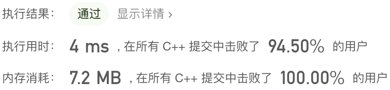

* [做專案（多個 C++、Java、Go、測試開發、前端專案）](https://www.programmercarl.com/other/kstar.html)
* [刷演算法（兩個月高強度學演算法）](https://www.programmercarl.com/xunlian/xunlianying.html)
* [背八股（40天挑戰高頻面試題）](https://www.programmercarl.com/xunlian/bagu.html)


> 簡單的反轉（reverse）還不夠，我要花式反轉

# 541. 反轉字串（string）II

[LeetCode 題目連結](https://leetcode.cn/problems/reverse-string-ii/)

給定一個字串 s 和一個整數（integer）k，從字串開頭算起，每計數至 2k 個字元（character），就反轉這 2k 個字元中的前 k 個字元。

如果剩餘字元少於 k 個，則將剩餘字元全部反轉。

如果剩餘字元小於 2k 但大於或等於 k 個，則反轉前 k 個字元，其餘字元保持原樣。

範例:

輸入: s = "abcdefg", k = 2    
輸出: "bacdfeg"    

## 演算法公開課

**[《程式碼隨想錄》演算法影片公開課](https://programmercarl.com/other/gongkaike.html)：[字串操作進階！| LeetCode：541. 反轉字串 II](https://www.bilibili.com/video/BV1dT411j7NN)，相信結合影片再看本篇題解，更有助於大家對本題的理解**。

## 想法

這道題目其實也是模擬（simulation），實作題目中規定的反轉規則就可以了。

一些同學可能為了處理邏輯：每隔 2k 個字元的前 k 個字元，寫了一堆邏輯程式碼或者再搞一個計數器（counter），來統計 2k，再統計前 k 個字元。

其實在遍歷（traversal）字串的過程中，只要讓 i += (2 * k)，i 每次移動 2 * k 就可以了，然後判斷是否需要有反轉的區間（interval）。

因為要找的也就是每 2 * k 區間的起點，這樣寫，程式會高效很多。

**所以當需要固定規律一段一段去處理字串的時候，要想想在 for 迴圈（for-loop）的運算式上做做文章。**

效能如下：
 </img></div>

那麼這裡具體反轉的邏輯我們要不要使用程式館函數（library function）呢，其實用不用都可以，使用 reverse 來實作反轉也沒問題，畢竟不是解題關鍵部分。

使用 C++ 程式館函數 reverse 的版本如下：

```CPP
class Solution {
public:
    string reverseStr(string s, int k) {
        for (int i = 0; i < s.size(); i += (2 * k)) {
            // 1. 每隔 2k 個字元的前 k 個字元進行反轉
            // 2. 剩餘字元小於 2k 但大於或等於 k 個，則反轉前 k 個字元
            if (i + k <= s.size()) {
                reverse(s.begin() + i, s.begin() + i + k );
            } else {
                // 3. 剩餘字元少於 k 個，則將剩餘字元全部反轉。
                reverse(s.begin() + i, s.end());
            }
        }
        return s;
    }
};
```

* 時間複雜性（time complexity）: O(n)
* 空間複雜度（space complexity）: O(1)


那麼我們也可以實作自己的 reverse 函式（function），其實和題目[344. 反轉字串](https://programmercarl.com/0344.反转字符串.html)道理是一樣的。

下面我實作的 reverse 函式區間是左閉右閉區間，程式碼如下：

```CPP
class Solution {
public:
    void reverse(string& s, int start, int end) {
        for (int i = start, j = end; i < j; i++, j--) {
            swap(s[i], s[j]);
        }
    }
    string reverseStr(string s, int k) {
        for (int i = 0; i < s.size(); i += (2 * k)) {
            // 1. 每隔 2k 個字元的前 k 個字元進行反轉
            // 2. 剩餘字元小於 2k 但大於或等於 k 個，則反轉前 k 個字元
            if (i + k <= s.size()) {
                reverse(s, i, i + k - 1);
                continue;
            }
            // 3. 剩餘字元少於 k 個，則將剩餘字元全部反轉。
            reverse(s, i, s.size() - 1);
        }
        return s;
    }
};
```

* 時間複雜性: O(n)
* 空間複雜度: O(1)或 O(n), 取決於使用的語言中字串是否可以修改.


另一種想法的解法

```CPP
class Solution {
public:
    string reverseStr(string s, int k) {
        int n = s.size(),pos = 0;
        while(pos < n){
            //剩餘字串大於等於 k 的情況
            if(pos + k < n) reverse(s.begin() + pos, s.begin() + pos + k);
            //剩餘字串不足 k 的情況 
            else reverse(s.begin() + pos,s.end());
            pos += 2 * k;
        }
        return s;
    }
};
```

* 時間複雜性: O(n)
* 空間複雜度: O(1)


## 其他語言版本

### C：

```c
char * reverseStr(char * s, int k){
    int len = strlen(s);

    for (int i = 0; i < len; i += (2 * k)) {
        //判斷剩餘字元是否少於 k
        k = i + k > len ? len - i : k;

        int left = i;
        int right = i + k - 1;
        while (left < right) {
            char temp = s[left];
            s[left++] = s[right];
            s[right--] = temp;
        }
    }

    return s;
}
```

### Java：

```Java
//解法一
class Solution {
    public String reverseStr(String s, int k) {
        StringBuffer res = new StringBuffer();
        int length = s.length();
        int start = 0;
        while (start < length) {
            // 找到 k 處和 2k 處
            StringBuffer temp = new StringBuffer();
            // 與 length 進行判斷，如果大於 length 了，那就將其設為 length
            int firstK = (start + k > length) ? length : start + k;
            int secondK = (start + (2 * k) > length) ? length : start + (2 * k);

            //無論 start 所處位置，至少會反轉一次
            temp.append(s.substring(start, firstK));
            res.append(temp.reverse());

            // 如果 firstK 到 secondK 之間有元素，這些元素直接放入 res 裡即可。
            if (firstK < secondK) { //此時剩餘長度一定大於 k。
                res.append(s.substring(firstK, secondK));
            }
            start += (2 * k);
        }
        return res.toString();
    }
}

//解法二（似乎更容易理解點）
//題目的意思其實概括為 每隔 2k 個反轉前 k 個，尾數不夠 k 個時候全部反轉
class Solution {
    public String reverseStr(String s, int k) {
        char[] ch = s.toCharArray();
        for(int i = 0; i < ch.length; i += 2 * k){
            int start = i;
            //這裡是判斷尾數夠不夠 k 個來決定 end 指標的位置
            int end = Math.min(ch.length - 1, start + k - 1);
            //用互斥或運算反轉 
            while(start < end){
                ch[start] ^= ch[end];
                ch[end] ^= ch[start];
                ch[start] ^= ch[end];
                start++;
                end--;
            }
        }
        return new String(ch);
    }
}


// 解法二還可以用 temp 來交換數值，會的人更多些
class Solution {
    public String reverseStr(String s, int k) {
        char[] ch = s.toCharArray();
        for(int i = 0;i < ch.length;i += 2 * k){
            int start = i;
            // 判斷尾數夠不夠 k 個來決定 end 指標的位置
            int end = Math.min(ch.length - 1,start + k - 1);
            while(start < end){
                
                char temp = ch[start];
                ch[start] = ch[end];
                ch[end] = temp;

                start++;
                end--;
            }
        }
        return new String(ch);
    }
}
```
```java
// 解法3
class Solution {
    public String reverseStr(String s, int k) {
        char[] ch = s.toCharArray();
        // 1. 每隔 2k 個字元的前 k 個字元進行反轉
        for (int i = 0; i< ch.length; i += 2 * k) {
            // 2. 剩餘字元小於 2k 但大於或等於 k 個，則反轉前 k 個字元
            if (i + k <= ch.length) {
                reverse(ch, i, i + k -1);
                continue;
            }
            // 3. 剩餘字元少於 k 個，則將剩餘字元全部反轉
            reverse(ch, i, ch.length - 1);
        }
        return  new String(ch);

    }
    // 定義翻轉函式
    public void reverse(char[] ch, int i, int j) {
    for (; i < j; i++, j--) {
        char temp  = ch[i];
        ch[i] = ch[j];
        ch[j] = temp;
    }

    }
}
```
### Python：

```python
class Solution:
    def reverseStr(self, s: str, k: int) -> str:
        """
        1. 使用 range(start, end, step) 來確定需要調換的初始位置
        2. 對於字串 s = 'abc'，如果使用 s[0:999] ===> 'abc'。字串末尾如果超過最大長度，則會回傳至字串最後一個值，這個特性可以避免一些邊界條件的處理。
        3. 用切片整體替換，而不是一個個替換.
        """
        def reverse_substring(text):
            left, right = 0, len(text) - 1
            while left < right:
                text[left], text[right] = text[right], text[left]
                left += 1
                right -= 1
            return text
        
        res = list(s)

        for cur in range(0, len(s), 2 * k):
            res[cur: cur + k] = reverse_substring(res[cur: cur + k])
        
        return ''.join(res)
```

#### Python3 (v2):

```python
class Solution:
    def reverseStr(self, s: str, k: int) -> str:
        # Two pointers. Another is inside the loop.
        p = 0
        while p < len(s):
            p2 = p + k
            # Written in this could be more pythonic.
            s = s[:p] + s[p: p2][::-1] + s[p2:]
            p = p + 2 * k
        return s
```

#### Python3 (v3):

```python
class Solution:
    def reverseStr(self, s: str, k: int) -> str:
        i = 0
        chars = list(s)
        
        while i < len(chars):
            chars[i:i + k] = chars[i:i + k][::-1] # 反轉後，更改原值為反轉後值
            i += k * 2

        return ''.join(chars)
```

### Go：

```go
func reverseStr(s string, k int) string {
    ss := []byte(s)
    length := len(s)
    for i := 0; i < length; i += 2 * k {
     // 1. 每隔 2k 個字元的前 k 個字元進行反轉
     // 2. 剩餘字元小於 2k 但大於或等於 k 個，則反轉前 k 個字元
        if i + k <= length {
            reverse(ss[i:i+k])
        } else {
            reverse(ss[i:length])
        }
    }
    return string(ss)
}

func reverse(b []byte) {
    left := 0
    right := len(b) - 1
    for left < right {
        b[left], b[right] = b[right], b[left]
        left++
        right--
    }
}
```

### JavaScript: 

```js

/**
 * @param {string} s
 * @param {number} k
 * @return {string}
 */
var reverseStr = function(s, k) {
    const len = s.length;
    let resArr = s.split(""); 
    for(let i = 0; i < len; i += 2 * k) {  // 每隔 2k 個字元的前 k 個字元進行反轉
        let l = i - 1, r = i + k > len ? len : i + k;
        while(++l < --r) [resArr[l], resArr[r]] = [resArr[r], resArr[l]];
    }
    return resArr.join("");
};

```

### TypeScript：

```typescript
function reverseStr(s: string, k: number): string {
    let left: number, right: number;
    let arr: string[] = s.split('');
    let temp: string;
    for (let i = 0, length = arr.length; i < length; i += 2 * k) {
        left = i;
        right = (i + k - 1) >= length ? length - 1 : i + k - 1;
        while (left < right) {
            temp = arr[left];
            arr[left] = arr[right];
            arr[right] = temp;
            left++;
            right--;
        }
    }
    return arr.join('');
};
```

### Swift:

```swift
func reverseStr(_ s: String, _ k: Int) -> String {
    var ch = Array(s)

    for i in stride(from: 0, to: ch.count, by: 2 * k) {
        var left = i
        var right = min(s.count - 1, left + k - 1)
      
        while left < right {
            (ch[left], ch[right]) = (ch[right], ch[left])
            left += 1
            right -= 1
        }
    }
    return String(ch)
}
```

### C#：

```csharp
public class Solution
{
    public string ReverseStr(string s, int k)
    {
        Span<char> span = s.ToCharArray().AsSpan();
        for (int i = 0; i < span.Length; i += 2 * k)
        {
            span[i + k < span.Length ? i..(i + k) : i..].Reverse();
        }
        return span.ToString();
    }
}
```
### Scala:

版本一: (正常解法)
```scala
object Solution {
  def reverseStr(s: String, k: Int): String = {
    val res = s.toCharArray // 轉換為 Array 好處理
    for (i <- s.indices by 2 * k) {
      // 如果 i+k 大於了 res 的長度，則需要全部翻轉
      if (i + k > res.length) {
        reverse(res, i, s.length - 1)
      } else {
        reverse(res, i, i + k - 1)
      }
    }
    new String(res)
  }
  // 翻轉字串，從 start 到 end
  def reverse(s: Array[Char], start: Int, end: Int): Unit = {
    var (left, right) = (start, end)
    while (left < right) {
      var tmp = s(left)
      s(left) = s(right)
      s(right) = tmp
      left += 1
      right -= 1
    }
  }
}
```
版本二: 首先利用 grouped 每隔 k 個進行分割，再使用 zipWithIndex 新增每個陣列（array）的索引（index），緊接著利用 map 做變換，如果索引 %2==0 則說明需要翻轉，否則原封不動，最後再轉換為 String
```scala
object Solution {
  def reverseStr(s: String, k: Int): String = {
    // s = "abcdefg", k = 2
    s.grouped(k) // Iterator ["ab", "cd", "ef", "g"]
      .zipWithIndex // Iterator [("ab", 0), ("cd", 1), ("ef", 2), ("g", 3)]
      .map {
        case (subStr, index) => 
          if (index % 2 == 0) subStr.reverse else subStr
      }
      .mkString
  }
}
```

版本三: (遞迴（recursion）)
```scala
import scala.annotation.tailrec

object Solution {
  def reverseStr(s: String, k: Int): String = {
    @tailrec // 這個函式已經最佳化成了尾遞迴
    def reverse(s: String, needToReverse: Boolean, history: String): String = {
      // 截取前 k 個字元（判斷是否翻轉）
      val subStr = if (needToReverse) s.take(k).reverse else s.take(k)
      // 如果字串長度小於 k，回傳結果
      // 否則，對於剩餘字串進行同樣的操作
      if (s.length < k) history + subStr
      else reverse(s.drop(k), !needToReverse, history + subStr)
    }
    reverse(s, true, "")
  }
}
```

### Rust:

```Rust
impl Solution {
    pub fn reverse(s: &mut Vec<char>, mut begin: usize, mut end: usize){
        while begin < end {
            let temp = s[begin];
            s[begin] = s[end];
            s[end] = temp;
            begin += 1;
            end -= 1;
        }
    }
    pub fn reverse_str(s: String, k: i32) -> String {
        let len = s.len();
        let k = k as usize;
        let mut s = s.chars().collect::<Vec<_>>();
        for i in (0..len).step_by(2 * k) {
            if i + k < len {
                Self::reverse(&mut s, i, i + k - 1);
            }
            else {
                Self::reverse(&mut s, i, len - 1);
            }
        }
        s.iter().collect::<String>()
    }
}
```


