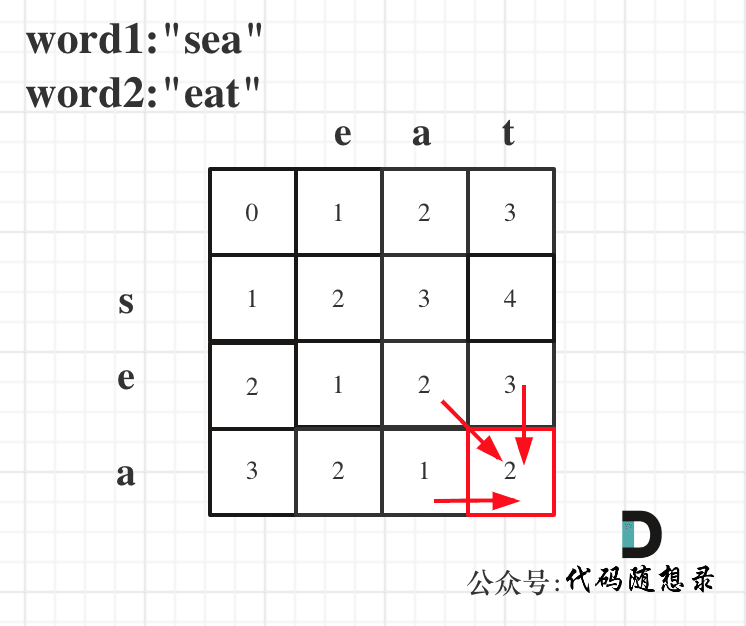

* [做專案（多個 C++、Java、Go、測試開發、前端（front end）專案）](https://www.programmercarl.com/other/kstar.html)
* [刷演算法（兩個月高強度學演算法）](https://www.programmercarl.com/xunlian/xunlianying.html)
* [背八股（40 天挑戰高頻面試題）](https://www.programmercarl.com/xunlian/bagu.html)

# 583. 兩個字串的刪除操作 

[LeetCode 題目連結](https://leetcode.com/problems/delete-operation-for-two-strings/)

給定兩個單字 word1 和 word2，找到使得 word1 和 word2 相同所需的最小步數，每步可以刪除任意一個字串（string）中的一個字元（character）。   

範例：    

* 輸入: "sea", "eat"     
* 輸出: 2
* 解釋: 第一步將 "sea" 變為 "ea"，第二步將 "eat" 變為 "ea"


## 演算法公開課

**[《程式碼隨想錄》演算法影片公開課](https://programmercarl.com/other/gongkaike.html)：[LeetCode：583.兩個字串的刪除操作](https://www.bilibili.com/video/BV1we4y157wB/)，相信結合影片再看本篇題解，更有助於大家對本題的理解**。


## 解題思路 
### 動態規劃（dynamic programming, DP）一

本題和[動態規劃：115.不同的次序列（subsequence）](./0115.不同的次序列.md)相比，其實就是兩個字串都可以刪除了，情況雖說複雜一些，但整體想法是不變的。

這次是兩個字串可以相互刪除了，這種題目也知道用動態規劃（dynamic programming, DP）的思路來解，DP五部曲，分析如下：

1. 確定 dp 陣列（array）（dp table）以及下標（subscript）的含義

dp[i][j]：以 i-1 為結尾的字串 word1，和以 j-1 為結尾的字串 word2，想要達到相等，所需要刪除元素（element）的最少次數。 

這裡 dp 陣列的定義有點繞，大家要理清思路。

2. 確定遞迴公式（recurrence formula）

* 當 word1[i - 1] 與 word2[j - 1] 相同的時候 
* 當 word1[i - 1] 與 word2[j - 1] 不相同的時候 

當 word1[i - 1] 與 word2[j - 1] 相同的時候，dp[i][j] = dp[i - 1][j - 1]; 

當 word1[i - 1] 與 word2[j - 1] 不相同的時候，有三種情況：

情況一：刪 word1[i - 1]，最少操作次數為 dp[i - 1][j] + 1 

情況二：刪 word2[j - 1]，最少操作次數為 dp[i][j - 1] + 1 

情況三：同時刪 word1[i - 1] 和 word2[j - 1]，操作的最少次數為 dp[i - 1][j - 1] + 2 

那最後當然是取最小值，所以當 word1[i - 1] 與 word2[j - 1] 不相同的時候，遞迴公式：dp[i][j] = min({dp[i - 1][j - 1] + 2, dp[i - 1][j] + 1, dp[i][j - 1] + 1});


因為 dp[i][j - 1] + 1 = dp[i - 1][j - 1] + 2，所以遞迴公式可簡化為：dp[i][j] = min(dp[i - 1][j] + 1, dp[i][j - 1] + 1);

這裡可能不少錄友有點迷糊，從字面上理解就是當同時刪 word1[i - 1] 和 word2[j - 1]，dp[i][j-1] 本來就不考慮 word2[j - 1] 了，那麼我再刪 word1[i - 1]，是不是就達到兩個元素都刪除的效果，即 dp[i][j-1] + 1。


3. dp 陣列如何初始化（initialization）

從遞迴公式中，可以看出來，dp[i][0] 和 dp[0][j] 是一定要初始化的。

dp[i][0]：word2 為空字串（empty string），以 i-1 為結尾的字串 word1 要刪除多少個元素，才能和 word2 相同呢，很明顯 dp[i][0] = i。

dp[0][j] 的話同理，所以程式碼如下：

```CPP
vector<vector<int>> dp(word1.size() + 1, vector<int>(word2.size() + 1));
for (int i = 0; i <= word1.size(); i++) dp[i][0] = i;
for (int j = 0; j <= word2.size(); j++) dp[0][j] = j;
```

4. 確定遍歷（traversal）順序

從遞迴公式 dp[i][j] = min(dp[i - 1][j - 1] + 2, min(dp[i - 1][j], dp[i][j - 1]) + 1); 和 dp[i][j] = dp[i - 1][j - 1] 可以看出 dp[i][j] 都是根據左上方、正上方、正左方推出來的。

所以遍歷的時候一定是從上到下，從左到右，這樣保證 dp[i][j] 可以根據之前計算出來的數值進行計算。


5. 舉例推導 dp 陣列

以 word1:"sea"，word2:"eat" 為例，推導 dp 陣列狀態（state）圖如下：




以上分析完畢，程式碼如下：

```CPP
class Solution {
public:
    int minDistance(string word1, string word2) {
        vector<vector<int>> dp(word1.size() + 1, vector<int>(word2.size() + 1));
        for (int i = 0; i <= word1.size(); i++) dp[i][0] = i;
        for (int j = 0; j <= word2.size(); j++) dp[0][j] = j;
        for (int i = 1; i <= word1.size(); i++) {
            for (int j = 1; j <= word2.size(); j++) {
                if (word1[i - 1] == word2[j - 1]) {
                    dp[i][j] = dp[i - 1][j - 1];
                } else {
                    dp[i][j] = min(dp[i - 1][j] + 1, dp[i][j - 1] + 1);
                }
            }
        }
        return dp[word1.size()][word2.size()];
    }
};

```
* 時間複雜度（time complexity）: O(n * m)
* 空間複雜度（space complexity）: O(n * m)


### 動態規劃二

本題和[動態規劃：1143.最長公用次序列](./1143.最長公共次序列.md)基本相同，只要求出兩個字串的最長公用次序列（longest common subsequence）長度即可，那麼除了最長公用次序列之外的字元都是必須刪除的，最後用兩個字串的總長度減去兩個最長公用次序列的長度就是刪除的最少步數。

程式碼如下：

```CPP
class Solution {
public:
    int minDistance(string word1, string word2) {
        vector<vector<int>> dp(word1.size()+1, vector<int>(word2.size()+1, 0));
        for (int i=1; i<=word1.size(); i++){
            for (int j=1; j<=word2.size(); j++){
                if (word1[i-1] == word2[j-1]) dp[i][j] = dp[i-1][j-1] + 1;
                else dp[i][j] = max(dp[i-1][j], dp[i][j-1]);
            }
        }
        return word1.size()+word2.size()-dp[word1.size()][word2.size()]*2;
    }
};

```
* 時間複雜度: O(n * m)
* 空間複雜度: O(n * m)


## 其他語言版本

### Java：

```java
// dp陣列中儲存word1和word2最長相同次序列的長度
class Solution {
    public int minDistance(String word1, String word2) {
        int len1 = word1.length();
        int len2 = word2.length();
        int[][] dp = new int[len1 + 1][len2 + 1];

        for (int i = 1; i <= len1; i++) {
            for (int j = 1; j <= len2; j++) {
                if (word1.charAt(i - 1) == word2.charAt(j - 1)) {
                    dp[i][j] = dp[i - 1][j - 1] + 1;
                } else {
                    dp[i][j] = Math.max(dp[i - 1][j], dp[i][j - 1]);
                }
            }
        }

        return len1 + len2 - dp[len1][len2] * 2;
    }
}

// dp陣列中儲存需要刪除的字元個數
class Solution {
    public int minDistance(String word1, String word2) {
        int[][] dp = new int[word1.length() + 1][word2.length() + 1];
        for (int i = 0; i < word1.length() + 1; i++) dp[i][0] = i;
        for (int j = 0; j < word2.length() + 1; j++) dp[0][j] = j;
        
        for (int i = 1; i < word1.length() + 1; i++) {
            for (int j = 1; j < word2.length() + 1; j++) {
                if (word1.charAt(i - 1) == word2.charAt(j - 1)) {
                    dp[i][j] = dp[i - 1][j - 1];
                }else{
                    dp[i][j] = Math.min(dp[i - 1][j - 1] + 2,
                                        Math.min(dp[i - 1][j] + 1, dp[i][j - 1] + 1));
                }
            }
        }
        
        return dp[word1.length()][word2.length()];
    }
}
```
```java
//DP - longest common subsequence (用最長公用次序列反推)
class Solution {
    public int minDistance(String word1, String word2) {
        char[] char1 = word1.toCharArray();
        char[] char2 = word2.toCharArray();

        int len1 = char1.length;
        int len2 = char2.length;

        int dp[][] = new int [len1 + 1][len2 + 1];

        for(int i = 1; i <= len1; i++){
            for(int j = 1; j <= len2; j++){
                if(char1[i - 1] == char2[j - 1])
                    dp[i][j] = dp[i - 1][j - 1] + 1;
                else
                    dp[i][j] = Math.max(dp[i - 1][j], dp[i][j - 1]);
            }
        }

        return len1 + len2 - (2 * dp[len1][len2]);//和 LeetCode 1143 只差在這一行。
    }
}
```

### Python：

```python
class Solution:
    def minDistance(self, word1: str, word2: str) -> int:
        dp = [[0] * (len(word2)+1) for _ in range(len(word1)+1)]
        for i in range(len(word1)+1):
            dp[i][0] = i
        for j in range(len(word2)+1):
            dp[0][j] = j
        for i in range(1, len(word1)+1):
            for j in range(1, len(word2)+1):
                if word1[i-1] == word2[j-1]:
                    dp[i][j] = dp[i-1][j-1]
                else:
                    dp[i][j] = min(dp[i-1][j-1] + 2, dp[i-1][j] + 1, dp[i][j-1] + 1)
        return dp[-1][-1]
```

> 版本 2

```python
class Solution(object):
    def minDistance(self, word1, word2):
        m, n = len(word1), len(word2)
        
        # dp 求解兩字串最長公用次序列
        dp = [[0] * (n+1) for _ in range(m+1)]
        for i in range(1, m+1):
            for j in range(1, n+1):
                if word1[i-1] == word2[j-1]:
                    dp[i][j] = dp[i-1][j-1] + 1
                else:
                    dp[i][j] = max(dp[i-1][j], dp[i][j-1])
                    
        # 刪去最長公用次序列以外元素
        return m + n - 2 * dp[-1][-1]
```
### Go：

DP一

```go
func minDistance(word1 string, word2 string) int {
	dp := make([][]int, len(word1)+1)
	for i := 0; i < len(dp); i++ {
		dp[i] = make([]int, len(word2)+1)
	}
	//初始化
	for i := 0; i < len(dp); i++ {
		dp[i][0] = i
	}
	for j := 0; j < len(dp[0]); j++ {
		dp[0][j] = j
	}
	for i := 1; i < len(dp); i++ {
		for j := 1; j < len(dp[i]); j++ {
			if word1[i-1] == word2[j-1] {
				dp[i][j] = dp[i-1][j-1]
			} else {
				dp[i][j] = min(min(dp[i-1][j]+1, dp[i][j-1]+1), dp[i-1][j-1]+2)
			}
		}
	}
	return dp[len(dp)-1][len(dp[0])-1]
}

func min(a, b int) int {
	if a < b {
		return a
	}
	return b
}
```


DP二

```go
func minDistance(word1 string, word2 string) int {
    dp := make([][]int, len(word1) + 1)
    for i := range dp {
        dp[i] = make([]int, len(word2) + 1)
    }
    for i := 1; i <= len(word1); i++ {
        for j := 1; j <= len(word2); j++ {
            if word1[i-1] == word2[j-1] {
                dp[i][j] = dp[i-1][j-1] + 1
            } else {
                dp[i][j] = max(dp[i-1][j], dp[i][j-1])
            }
        }
    }
    return len(word1) + len(word2) - dp[len(word1)][len(word2)] * 2
}

func max(x, y int) int {
    if x > y {
        return x
    }
    return y
}
```


### JavaScript：


```javascript
// 方法一
var minDistance = (word1, word2) => {
  let dp = Array.from(new Array(word1.length + 1), () =>
    Array(word2.length + 1).fill(0)
  );
  for (let i = 1; i <= word1.length; i++) {
    dp[i][0] = i;
  }
  for (let j = 1; j <= word2.length; j++) {
    dp[0][j] = j;
  }
  for (let i = 1; i <= word1.length; i++) {
    for (let j = 1; j <= word2.length; j++) {
      if (word1[i - 1] === word2[j - 1]) {
        dp[i][j] = dp[i - 1][j - 1];
      } else {
        dp[i][j] = Math.min(
          dp[i - 1][j] + 1,
          dp[i][j - 1] + 1,
          dp[i - 1][j - 1] + 2
        );
      }
    }
  }
  return dp[word1.length][word2.length];
};

// 方法二
var minDistance = function (word1, word2) {
  let dp = new Array(word1.length + 1)
    .fill(0)
    .map((_) => new Array(word2.length + 1).fill(0));
  for (let i = 1; i <= word1.length; i++)
    for (let j = 1; j <= word2.length; j++)
      if (word1[i - 1] === word2[j - 1]) dp[i][j] = dp[i - 1][j - 1] + 1;
      else dp[i][j] = Math.max(dp[i - 1][j], dp[i][j - 1]);
  return word1.length + word2.length - dp[word1.length][word2.length] * 2;
};
```

### TypeScript：

> dp 版本一：

```typescript
function minDistance(word1: string, word2: string): number {
    /**
        dp[i][j]: word1 前 i 個字元，word2 前 j 個字元，所需最小步數
        dp[0][0]=0: word1 前 0 個字元為 '', word2 前 0 個字元為 ''
     */
    const length1: number = word1.length,
        length2: number = word2.length;
    const dp: number[][] = new Array(length1 + 1).fill(0)
        .map(_ => new Array(length2 + 1).fill(0));
    for (let i = 0; i <= length1; i++) {
        dp[i][0] = i;
    }
    for (let i = 0; i <= length2; i++) {
        dp[0][i] = i;
    }
    for (let i = 1; i <= length1; i++) {
        for (let j = 1; j <= length2; j++) {
            if (word1[i - 1] === word2[j - 1]) {
                dp[i][j] = dp[i - 1][j - 1];
            } else {
                dp[i][j] = Math.min(dp[i - 1][j], dp[i][j - 1]) + 1;
            }
        }
    }
    return dp[length1][length2];
};
```

> dp 版本二：

```typescript
function minDistance(word1: string, word2: string): number {
    /**
        dp[i][j]: word1 前 i 個字元，word2 前 j 個字元，最長公用次序列的長度
        dp[0][0]=0: word1 前 0 個字元為 '', word2 前 0 個字元為 ''
     */
    const length1: number = word1.length,
        length2: number = word2.length;
    const dp: number[][] = new Array(length1 + 1).fill(0)
        .map(_ => new Array(length2 + 1).fill(0));
    for (let i = 1; i <= length1; i++) {
        for (let j = 1; j <= length2; j++) {
            if (word1[i - 1] === word2[j - 1]) {
                dp[i][j] = dp[i - 1][j - 1] + 1;
            } else {
                dp[i][j] = Math.max(dp[i][j - 1], dp[i - 1][j]);
            }
        }
    }
    const maxLen: number = dp[length1][length2];
    return length1 + length2 - maxLen * 2;
};
```

Rust:

```rust
impl Solution {
    pub fn min_distance(word1: String, word2: String) -> i32 {
        let mut dp = vec![vec![0; word2.len() + 1]; word1.len() + 1];
        for i in 0..word1.len() {
            dp[i + 1][0] = i + 1;
        }
        for j in 0..word2.len() {
            dp[0][j + 1] = j + 1;
        }
        for (i, char1) in word1.chars().enumerate() {
            for (j, char2) in word2.chars().enumerate() {
                if char1 == char2 {
                    dp[i + 1][j + 1] = dp[i][j];
                    continue;
                }
                dp[i + 1][j + 1] = dp[i][j + 1].min(dp[i + 1][j]) + 1;
            }
        }
        dp[word1.len()][word2.len()] as i32
    }
}
```

> 版本 2

```rust
impl Solution {
    pub fn min_distance(word1: String, word2: String) -> i32 {
        let mut dp = vec![vec![0; word2.len() + 1]; word1.len() + 1];
        for (i, char1) in word1.chars().enumerate() {
            for (j, char2) in word2.chars().enumerate() {
                if char1 == char2 {
                    dp[i + 1][j + 1] = dp[i][j] + 1;
                    continue;
                }
                dp[i + 1][j + 1] = dp[i][j + 1].max(dp[i + 1][j]);
            }
        }
        (word1.len() + word2.len() - 2 * dp[word1.len()][word2.len()]) as i32
    }
}
```


